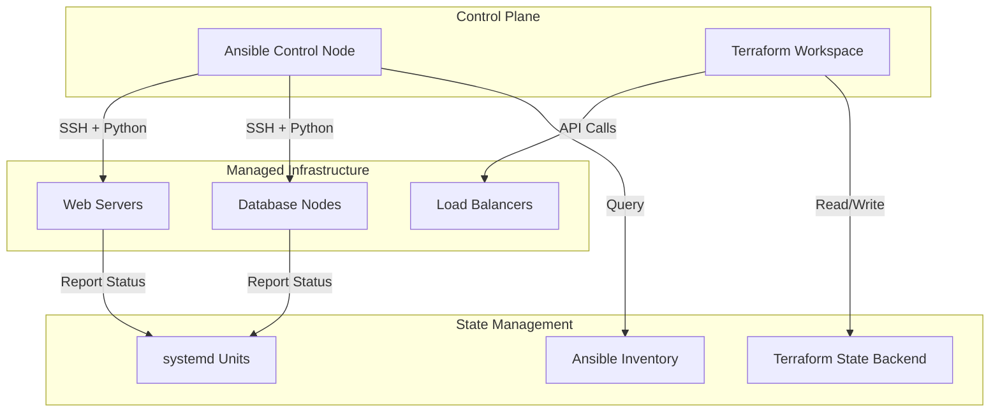
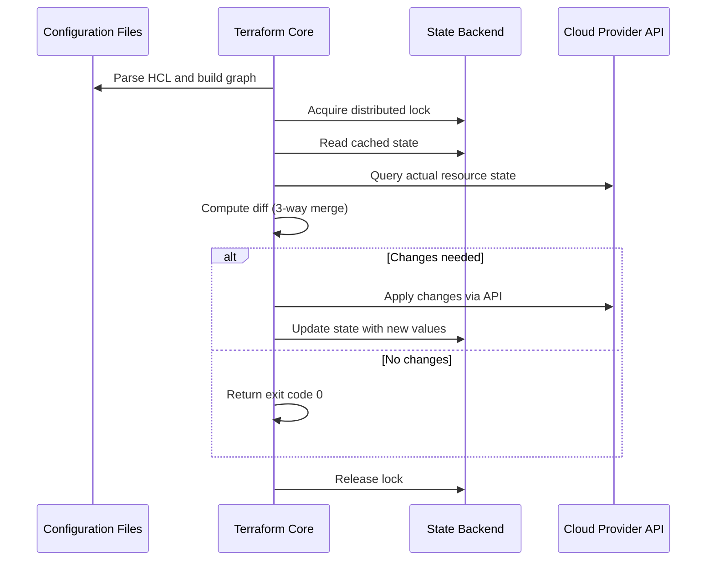
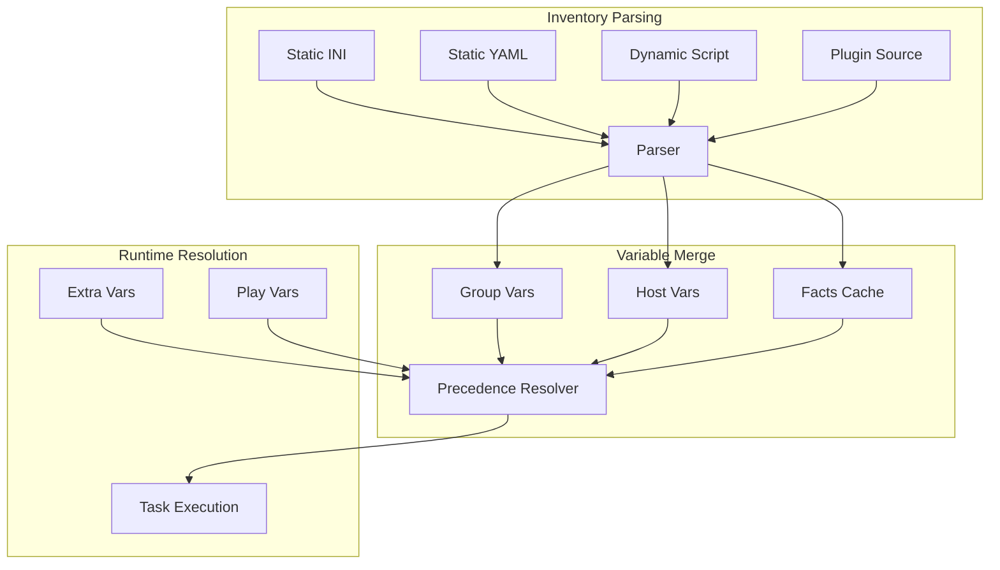
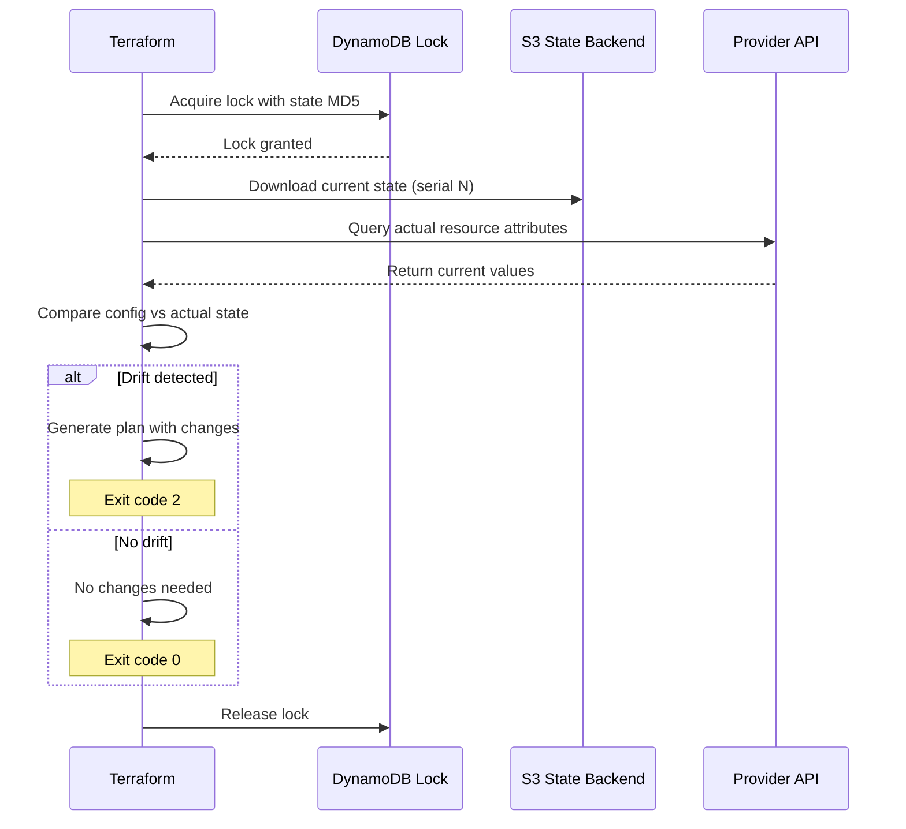
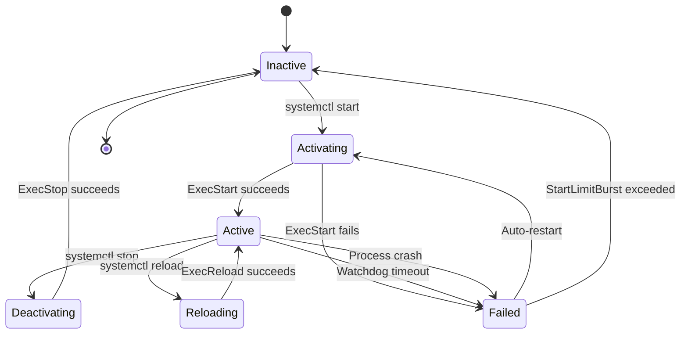

# Operational Verification Labs: Systems Automation & Configuration Management

## Lab Architecture Overview



## Lab 1: Idempotent Configuration Verification

**Objective**: Verify that configuration management operations produce identical results across multiple executions without side effects.

### 1.1 Ansible Idempotency Testing

Create an idempotent playbook that configures a web server baseline:

```yaml
# playbooks/webserver_baseline.yml
---
- name: Configure web server baseline with idempotent operations
  hosts: webservers
  become: true
  vars:
    nginx_version: "1.24.0"
    app_user: "webapp"
    app_home: "/opt/webapp"
    
  tasks:
    - name: Ensure nginx package is present at specific version
      ansible.builtin.package:
        name: "nginx={{ nginx_version }}"
        state: present
      register: nginx_install
      
    - name: Create application user with specific UID
      ansible.builtin.user:
        name: "{{ app_user }}"
        uid: 5000
        shell: /bin/bash
        home: "{{ app_home }}"
        create_home: true
        state: present
      register: user_creation
      
    - name: Deploy nginx configuration template
      ansible.builtin.template:
        src: templates/nginx.conf.j2
        dest: /etc/nginx/nginx.conf
        owner: root
        group: root
        mode: '0644'
        validate: 'nginx -t -c %s'
      notify: reload nginx
      register: nginx_config
      
    - name: Ensure nginx service is enabled and running
      ansible.builtin.systemd:
        name: nginx
        enabled: true
        state: started
      register: nginx_service
      
    - name: Create application directories with proper permissions
      ansible.builtin.file:
        path: "{{ item }}"
        state: directory
        owner: "{{ app_user }}"
        group: "{{ app_user }}"
        mode: '0755'
      loop:
        - "{{ app_home }}/logs"
        - "{{ app_home }}/config"
        - "{{ app_home }}/data"
      register: directory_creation
      
  handlers:
    - name: reload nginx
      ansible.builtin.systemd:
        name: nginx
        state: reloaded
```

Create the nginx configuration template:

```jinja2
# templates/nginx.conf.j2
user {{ app_user }};
worker_processes auto;
error_log /var/log/nginx/error.log warn;
pid /run/nginx.pid;

events {
    worker_connections 1024;
    use epoll;
}

http {
    include /etc/nginx/mime.types;
    default_type application/octet-stream;
    
    log_format main '$remote_addr - $remote_user [$time_local] "$request" '
                    '$status $body_bytes_sent "$http_referer" '
                    '"$http_user_agent" "$http_x_forwarded_for"';
                    
    access_log /var/log/nginx/access.log main;
    
    sendfile on;
    tcp_nopush on;
    keepalive_timeout 65;
    
    server {
        listen 80;
        server_name {{ ansible_hostname }};
        root {{ app_home }}/public;
        
        location / {
            try_files $uri $uri/ =404;
        }
    }
}
```

Create inventory file:

```ini
# inventory/production.ini
[webservers]
web01.example.com ansible_host=192.168.1.10
web02.example.com ansible_host=192.168.1.11
web03.example.com ansible_host=192.168.1.12

[webservers:vars]
ansible_user=ansible
ansible_python_interpreter=/usr/bin/python3
ansible_ssh_private_key_file=~/.ssh/ansible_key
```

**Verification Protocol**:

```bash
# First execution - baseline establishment
ansible-playbook -i inventory/production.ini playbooks/webserver_baseline.yml \
  --check --diff > run1_check.log

ansible-playbook -i inventory/production.ini playbooks/webserver_baseline.yml \
  -v > run1_apply.log

# Second execution - idempotency verification
ansible-playbook -i inventory/production.ini playbooks/webserver_baseline.yml \
  --check --diff > run2_check.log

ansible-playbook -i inventory/production.ini playbooks/webserver_baseline.yml \
  -v > run2_apply.log

# Compare change counts
grep "changed=" run1_apply.log | tail -1
grep "changed=" run2_apply.log | tail -1

# Verify no changes on second run
if grep -q "changed=0" run2_apply.log; then
    echo "✓ Idempotency verified: No changes on second execution"
else
    echo "✗ Idempotency failure: Changes detected on second execution"
    diff run1_apply.log run2_apply.log
fi
```

**First-Principles Analysis**:

Idempotency in configuration management is achieved through **declarative desired-state convergence**. The Ansible modules implement internal state detection logic:

1. **package module**: Queries RPM/APT database before attempting installation
2. **user module**: Reads `/etc/passwd` and `/etc/shadow` to compare UID, shell, and home directory
3. **template module**: Computes SHA256 hash of source and destination before copying
4. **systemd module**: Queries systemd D-Bus API for unit state before issuing commands

The `--check` flag performs a **dry-run simulation** by executing state detection logic without applying changes, while `--diff` displays the specific line-level differences that would be applied.

### 1.2 Terraform State Convergence Testing

Create infrastructure-as-code for load balancer configuration:

```hcl
# terraform/loadbalancer/main.tf
terraform {
  required_version = ">= 1.5.0"
  
  required_providers {
    aws = {
      source  = "hashicorp/aws"
      version = "~> 5.0"
    }
  }
  
  backend "s3" {
    bucket         = "terraform-state-prod"
    key            = "loadbalancer/terraform.tfstate"
    region         = "us-east-1"
    encrypt        = true
    dynamodb_table = "terraform-locks"
  }
}

provider "aws" {
  region = var.aws_region
  
  default_tags {
    tags = {
      Environment = var.environment
      ManagedBy   = "Terraform"
      Project     = "WebInfra"
    }
  }
}

variable "aws_region" {
  type    = string
  default = "us-east-1"
}

variable "environment" {
  type    = string
  default = "production"
}

variable "vpc_id" {
  type        = string
  description = "VPC ID for load balancer deployment"
}

variable "subnet_ids" {
  type        = list(string)
  description = "Subnet IDs for load balancer placement"
}

# Security group for ALB
resource "aws_security_group" "alb" {
  name_prefix = "alb-${var.environment}-"
  description = "Security group for application load balancer"
  vpc_id      = var.vpc_id
  
  ingress {
    from_port   = 80
    to_port     = 80
    protocol    = "tcp"
    cidr_blocks = ["0.0.0.0/0"]
    description = "Allow HTTP inbound"
  }
  
  ingress {
    from_port   = 443
    to_port     = 443
    protocol    = "tcp"
    cidr_blocks = ["0.0.0.0/0"]
    description = "Allow HTTPS inbound"
  }
  
  egress {
    from_port   = 0
    to_port     = 0
    protocol    = "-1"
    cidr_blocks = ["0.0.0.0/0"]
    description = "Allow all outbound"
  }
  
  lifecycle {
    create_before_destroy = true
  }
  
  tags = {
    Name = "alb-${var.environment}"
  }
}

# Application Load Balancer
resource "aws_lb" "main" {
  name               = "app-lb-${var.environment}"
  internal           = false
  load_balancer_type = "application"
  security_groups    = [aws_security_group.alb.id]
  subnets            = var.subnet_ids
  
  enable_deletion_protection = true
  enable_http2              = true
  enable_cross_zone_load_balancing = true
  
  access_logs {
    bucket  = aws_s3_bucket.lb_logs.id
    enabled = true
    prefix  = "alb"
  }
  
  tags = {
    Name = "app-lb-${var.environment}"
  }
}

# S3 bucket for ALB access logs
resource "aws_s3_bucket" "lb_logs" {
  bucket = "alb-logs-${var.environment}-${data.aws_caller_identity.current.account_id}"
  
  tags = {
    Name = "alb-logs-${var.environment}"
  }
}

resource "aws_s3_bucket_lifecycle_configuration" "lb_logs" {
  bucket = aws_s3_bucket.lb_logs.id
  
  rule {
    id     = "expire-old-logs"
    status = "Enabled"
    
    expiration {
      days = 90
    }
  }
}

# Target group for web servers
resource "aws_lb_target_group" "web" {
  name     = "web-tg-${var.environment}"
  port     = 80
  protocol = "HTTP"
  vpc_id   = var.vpc_id
  
  health_check {
    enabled             = true
    healthy_threshold   = 2
    unhealthy_threshold = 3
    timeout             = 5
    interval            = 30
    path                = "/health"
    matcher             = "200"
  }
  
  deregistration_delay = 30
  
  stickiness {
    type            = "lb_cookie"
    cookie_duration = 86400
    enabled         = true
  }
  
  tags = {
    Name = "web-tg-${var.environment}"
  }
}

# HTTP listener
resource "aws_lb_listener" "http" {
  load_balancer_arn = aws_lb.main.arn
  port              = 80
  protocol          = "HTTP"
  
  default_action {
    type = "redirect"
    
    redirect {
      port        = "443"
      protocol    = "HTTPS"
      status_code = "HTTP_301"
    }
  }
}

# HTTPS listener
resource "aws_lb_listener" "https" {
  load_balancer_arn = aws_lb.main.arn
  port              = 443
  protocol          = "HTTPS"
  ssl_policy        = "ELBSecurityPolicy-TLS-1-2-2017-01"
  certificate_arn   = var.certificate_arn
  
  default_action {
    type             = "forward"
    target_group_arn = aws_lb_target_group.web.arn
  }
}

data "aws_caller_identity" "current" {}

output "alb_dns_name" {
  value       = aws_lb.main.dns_name
  description = "DNS name of the load balancer"
}

output "target_group_arn" {
  value       = aws_lb_target_group.web.arn
  description = "ARN of the target group"
}
```

Create variable definitions:

```hcl
# terraform/loadbalancer/terraform.tfvars
aws_region  = "us-east-1"
environment = "production"
vpc_id      = "vpc-0123456789abcdef0"
subnet_ids  = [
  "subnet-0123456789abcdef0",
  "subnet-0123456789abcdef1",
  "subnet-0123456789abcdef2"
]
certificate_arn = "arn:aws:acm:us-east-1:123456789012:certificate/abcd1234-5678-90ab-cdef-1234567890ab"
```

**Verification Protocol**:

```bash
cd terraform/loadbalancer

# Initialize Terraform and download providers
terraform init

# Generate and review execution plan
terraform plan -out=tfplan.binary

# Convert binary plan to JSON for analysis
terraform show -json tfplan.binary > tfplan.json

# Extract planned changes
jq '.resource_changes[] | select(.change.actions != ["no-op"]) | {address: .address, actions: .change.actions}' tfplan.json

# Apply infrastructure changes
terraform apply tfplan.binary

# Wait for resources to stabilize (30 seconds)
sleep 30

# Re-run plan to verify convergence
terraform plan -detailed-exitcode

# Exit code meanings:
# 0 = No changes (converged state)
# 1 = Error occurred
# 2 = Changes detected (drift or incomplete convergence)

if [ $? -eq 0 ]; then
    echo "✓ Infrastructure converged: State matches configuration"
else
    echo "✗ Convergence failure: Drift detected"
    terraform plan
fi

# Inspect state file structure
terraform show -json | jq '.values.root_module.resources[] | {address: .address, type: .type, values: .values | keys}'

# Verify state locking mechanism
terraform state list
terraform state show aws_lb.main

# Check for resource drift
terraform refresh
terraform plan -refresh-only
```

**First-Principles Analysis**:

Terraform achieves idempotency through **dependency graph evaluation** and **desired-state reconciliation**:

1. **Graph Construction**: Terraform parses HCL configuration files and constructs a directed acyclic graph (DAG) representing resource dependencies based on implicit references (`aws_lb.main.arn`) and explicit `depends_on` declarations.

2. **State Synchronization**: The state file (`terraform.tfstate`) serves as a **source of truth cache** containing resource IDs, attribute values, and metadata. Terraform queries cloud provider APIs to detect drift between cached state and actual infrastructure.

3. **Change Planning**: The `terraform plan` command performs a three-way merge:
   - **Configuration**: Desired state from `.tf` files
   - **Cached State**: Last-known state from `terraform.tfstate`
   - **Actual State**: Current state from provider API queries

4. **Convergence Guarantee**: Resources are created/updated/destroyed based on the diff between configuration and actual state. The `-detailed-exitcode` flag provides programmatic verification of convergence (exit code 0 = no changes needed).

5. **Concurrency Safety**: The DynamoDB table provides distributed locking to prevent concurrent modifications. Each operation acquires a lock with the state file's MD5 digest as the lock ID.



## Lab 2: Ansible Inventory and Variable Precedence Verification

**Objective**: Validate dynamic inventory generation, variable precedence hierarchy, and fact gathering mechanisms.

### 2.1 Multi-Source Inventory Composition

Create a static inventory with groups:

```ini
# inventory/hosts.ini
[webservers]
web01.prod.example.com ansible_host=10.0.1.10
web02.prod.example.com ansible_host=10.0.1.11
web03.prod.example.com ansible_host=10.0.1.12

[databases]
db01.prod.example.com ansible_host=10.0.2.10 pg_role=primary
db02.prod.example.com ansible_host=10.0.2.11 pg_role=replica
db03.prod.example.com ansible_host=10.0.2.12 pg_role=replica

[loadbalancers]
lb01.prod.example.com ansible_host=10.0.3.10
lb02.prod.example.com ansible_host=10.0.3.11

[production:children]
webservers
databases
loadbalancers

[production:vars]
environment=production
monitoring_enabled=true
backup_retention_days=30
```

Create group variable files:

```yaml
# inventory/group_vars/all.yml
---
ansible_user: ansible
ansible_python_interpreter: /usr/bin/python3
ansible_ssh_private_key_file: ~/.ssh/ansible_prod_key

ntp_servers:
  - 0.pool.ntp.org
  - 1.pool.ntp.org
  - 2.pool.ntp.org

dns_servers:
  - 8.8.8.8
  - 8.8.4.4

common_packages:
  - vim
  - htop
  - curl
  - wget
  - net-tools
```

```yaml
# inventory/group_vars/webservers.yml
---
nginx_worker_processes: auto
nginx_worker_connections: 2048
nginx_keepalive_timeout: 65

app_port: 8080
app_threads: 4
app_max_memory: "2048M"

firewall_allowed_ports:
  - 80/tcp
  - 443/tcp
  - 22/tcp
```

```yaml
# inventory/group_vars/databases.yml
---
postgresql_version: 15
postgresql_port: 5432
postgresql_max_connections: 200
postgresql_shared_buffers: "4GB"
postgresql_effective_cache_size: "12GB"

backup_schedule: "0 2 * * *"
wal_level: replica
max_wal_senders: 5
```

Create host-specific variables:

```yaml
# inventory/host_vars/db01.prod.example.com.yml
---
postgresql_max_connections: 300
postgresql_shared_buffers: "8GB"
backup_enabled: true
replication_slots:
  - slot_name: replica_01
    slot_type: physical
  - slot_name: replica_02
    slot_type: physical
```

Create a dynamic inventory script:

```python
#!/usr/bin/env python3
# inventory/aws_dynamic_inventory.py

import json
import argparse
import boto3

def get_inventory():
    """Generate dynamic inventory from AWS EC2 instances"""
    
    ec2 = boto3.client('ec2', region_name='us-east-1')
    
    # Query all running instances
    response = ec2.describe_instances(
        Filters=[
            {'Name': 'instance-state-name', 'Values': ['running']},
            {'Name': 'tag:ManagedBy', 'Values': ['Ansible']}
        ]
    )
    
    inventory = {
        '_meta': {
            'hostvars': {}
        },
        'all': {
            'hosts': [],
            'vars': {
                'ansible_user': 'ec2-user',
                'ansible_ssh_private_key_file': '~/.ssh/aws_key.pem'
            }
        }
    }
    
    for reservation in response['Reservations']:
        for instance in reservation['Instances']:
            instance_id = instance['InstanceId']
            private_ip = instance.get('PrivateIpAddress', '')
            
            # Extract tags
            tags = {tag['Key']: tag['Value'] for tag in instance.get('Tags', [])}
            hostname = tags.get('Name', instance_id)
            role = tags.get('Role', 'undefined')
            environment = tags.get('Environment', 'production')
            
            # Add to all hosts
            inventory['all']['hosts'].append(hostname)
            
            # Create role-based groups
            if role not in inventory:
                inventory[role] = {'hosts': [], 'vars': {}}
            inventory[role]['hosts'].append(hostname)
            
            # Create environment-based groups
            env_group = f"{environment}_servers"
            if env_group not in inventory:
                inventory[env_group] = {'hosts': [], 'vars': {}}
            inventory[env_group]['hosts'].append(hostname)
            
            # Set host variables
            inventory['_meta']['hostvars'][hostname] = {
                'ansible_host': private_ip,
                'instance_id': instance_id,
                'instance_type': instance['InstanceType'],
                'availability_zone': instance['Placement']['AvailabilityZone'],
                'environment': environment,
                'role': role,
                'tags': tags
            }
    
    return inventory

def get_host(hostname):
    """Return variables for a specific host"""
    inventory = get_inventory()
    return inventory['_meta']['hostvars'].get(hostname, {})

if __name__ == '__main__':
    parser = argparse.ArgumentParser(description='AWS EC2 Dynamic Inventory')
    parser.add_argument('--list', action='store_true', help='List all groups and hosts')
    parser.add_argument('--host', help='Get variables for specific host')
    args = parser.parse_args()
    
    if args.list:
        print(json.dumps(get_inventory(), indent=2))
    elif args.host:
        print(json.dumps(get_host(args.host), indent=2))
    else:
        parser.print_help()
```

**Verification Protocol**:

```bash
# Test static inventory parsing
ansible-inventory -i inventory/hosts.ini --list --yaml

# Verify group membership
ansible-inventory -i inventory/hosts.ini --graph

# Expected output:
# @all:
#   |--@production:
#   |  |--@databases:
#   |  |  |--db01.prod.example.com
#   |  |  |--db02.prod.example.com
#   |  |  |--db03.prod.example.com
#   |  |--@loadbalancers:
#   |  |  |--lb01.prod.example.com
#   |  |  |--lb02.prod.example.com
#   |  |--@webservers:
#   |  |  |--web01.prod.example.com
#   |  |  |--web02.prod.example.com
#   |  |  |--web03.prod.example.com

# Display variables for specific host (shows precedence resolution)
ansible-inventory -i inventory/hosts.ini --host db01.prod.example.com

# Test dynamic inventory
chmod +x inventory/aws_dynamic_inventory.py
./inventory/aws_dynamic_inventory.py --list | jq '.'

# Combine static and dynamic inventories
ansible-inventory -i inventory/hosts.ini -i inventory/aws_dynamic_inventory.py --list

# Verify variable precedence with a test playbook
cat > test_precedence.yml <<'EOF'
---
- name: Test variable precedence
  hosts: db01.prod.example.com
  gather_facts: false
  
  tasks:
    - name: Display postgresql_max_connections from different sources
      ansible.builtin.debug:
        msg:
          - "postgresql_max_connections: {{ postgresql_max_connections }}"
          - "Source: host_vars (highest precedence)"
          
    - name: Display all variables for this host
      ansible.builtin.debug:
        var: hostvars[inventory_hostname]
EOF

ansible-playbook -i inventory/hosts.ini test_precedence.yml -v

# Test fact gathering and caching
ansible webservers -i inventory/hosts.ini -m ansible.builtin.setup \
  --tree /tmp/facts

# Inspect gathered facts
cat /tmp/facts/web01.prod.example.com | jq '.ansible_facts | {
  hostname: .ansible_hostname,
  os_family: .ansible_os_family,
  processor_cores: .ansible_processor_cores,
  memory_mb: .ansible_memtotal_mb,
  interfaces: .ansible_interfaces
}'

# Verify fact caching with JSON cache plugin
cat > ansible.cfg <<'EOF'
[defaults]
gathering = smart
fact_caching = jsonfile
fact_caching_connection = /tmp/ansible_facts
fact_caching_timeout = 3600

[inventory]
enable_plugins = host_list, script, yaml, ini, auto
EOF

# First run with fact gathering
time ansible webservers -i inventory/hosts.ini -m ansible.builtin.ping

# Second run using cached facts (should be faster)
time ansible webservers -i inventory/hosts.ini -m ansible.builtin.ping

# Examine cached facts
ls -lh /tmp/ansible_facts/
cat /tmp/ansible_facts/web01.prod.example.com | jq '.ansible_facts.ansible_distribution'
```

**First-Principles Analysis**:

Ansible's inventory system implements **hierarchical variable composition** with a strict precedence order:

**Variable Precedence (lowest to highest)**:
1. role defaults
2. inventory file or script group vars
3. inventory group_vars/all
4. inventory group_vars/*
5. inventory file or script host vars
6. inventory host_vars/*
7. host facts / cached facts
8. play vars
9. play vars_prompt
10. play vars_files
11. role vars
12. block vars
13. task vars
14. include_vars
15. set_facts / registered vars
16. role (and include_role) params
17. include params
18. extra vars (highest, always win: `-e "user=my_user"`)

The inventory parsing process:

1. **Parser Selection**: Ansible detects inventory type by file extension (`.ini`, `.yml`, `.py`) or tries each enabled plugin sequentially.

2. **Group Construction**: The `[groupname:children]` directive creates nested groups. Child group hosts inherit parent group variables but can override them.

3. **Dynamic Execution**: Python-based dynamic inventories must output JSON to stdout. The `--list` flag returns all groups and hosts; `--host <hostname>` returns variables for a single host.

4. **Fact Merging**: Gathered facts are merged into `ansible_facts` namespace. Cached facts are loaded from the configured backend (JSON files, Redis, etc.) if within the timeout window.

5. **Variable Resolution**: When a variable is referenced in a task, Ansible walks the precedence hierarchy from lowest to highest, with the last value winning.



### 2.2 Advanced Fact Gathering and Filtering

Create a playbook to gather and filter specific facts:

```yaml
# playbooks/fact_analysis.yml
---
- name: Advanced fact gathering and analysis
  hosts: all
  gather_facts: true
  
  tasks:
    - name: Display network interface configuration
      ansible.builtin.debug:
        msg: |
          Interface: {{ item }}
          IPv4: {{ hostvars[inventory_hostname]['ansible_' + item].ipv4.address | default('N/A') }}
          MAC: {{ hostvars[inventory_hostname]['ansible_' + item].macaddress | default('N/A') }}
      loop: "{{ ansible_interfaces }}"
      when: 
        - item != 'lo'
        - hostvars[inventory_hostname]['ansible_' + item].ipv4 is defined
    
    - name: Gather custom subset of facts only
      ansible.builtin.setup:
        gather_subset:
          - '!all'
          - '!min'
          - network
          - hardware
        filter:
          - ansible_memtotal_mb
          - ansible_processor_vcpus
          - ansible_default_ipv4
      register: filtered_facts
      
    - name: Create structured fact report
      ansible.builtin.set_fact:
        system_profile:
          hostname: "{{ ansible_hostname }}"
          fqdn: "{{ ansible_fqdn }}"
          os: "{{ ansible_distribution }} {{ ansible_distribution_version }}"
          kernel: "{{ ansible_kernel }}"
          cpu_cores: "{{ ansible_processor_vcpus }}"
          memory_mb: "{{ ansible_memtotal_mb }}"
          primary_ip: "{{ ansible_default_ipv4.address }}"
          gateway: "{{ ansible_default_ipv4.gateway }}"
          
    - name: Export system profile to file
      ansible.builtin.copy:
        content: "{{ system_profile | to_nice_json }}"
        dest: "/tmp/{{ inventory_hostname }}_profile.json"
      delegate_to: localhost
```

Execute and analyze:

```bash
ansible-playbook -i inventory/hosts.ini playbooks/fact_analysis.yml

# Review exported profiles
for file in /tmp/*_profile.json; do
    echo "=== $(basename $file) ==="
    jq '.' "$file"
done

# Query specific facts across all hosts
ansible all -i inventory/hosts.ini -m ansible.builtin.setup \
  -a 'filter=ansible_mem*' | grep -A 5 'ansible_memtotal_mb'

# Identify hosts by fact criteria (e.g., low memory)
ansible all -i inventory/hosts.ini -m ansible.builtin.setup \
  --tree /tmp/facts

for host in /tmp/facts/*; do
    memory=$(jq '.ansible_facts.ansible_memtotal_mb' "$host")
    hostname=$(jq -r '.ansible_facts.ansible_hostname' "$host")
    if [ "$memory" -lt 4096 ]; then
        echo "Low memory host: $hostname ($memory MB)"
    fi
done
```

## Lab 3: Terraform State Management and Drift Detection

**Objective**: Master Terraform state manipulation, remote backend configuration, and automated drift detection.

### 3.1 Remote State Backend with Locking

Create S3 backend configuration:

```hcl
# terraform/backend/main.tf
terraform {
  required_version = ">= 1.5.0"
  
  required_providers {
    aws = {
      source  = "hashicorp/aws"
      version = "~> 5.0"
    }
  }
}

provider "aws" {
  region = "us-east-1"
}

# S3 bucket for state storage
resource "aws_s3_bucket" "terraform_state" {
  bucket = "terraform-state-${data.aws_caller_identity.current.account_id}"
  
  lifecycle {
    prevent_destroy = true
  }
  
  tags = {
    Name        = "Terraform State Storage"
    Environment = "Global"
  }
}

# Enable versioning for state recovery
resource "aws_s3_bucket_versioning" "terraform_state" {
  bucket = aws_s3_bucket.terraform_state.id
  
  versioning_configuration {
    status = "Enabled"
  }
}

# Enable encryption at rest
resource "aws_s3_bucket_server_side_encryption_configuration" "terraform_state" {
  bucket = aws_s3_bucket.terraform_state.id
  
  rule {
    apply_server_side_encryption_by_default {
      sse_algorithm = "AES256"
    }
  }
}

# Block public access
resource "aws_s3_bucket_public_access_block" "terraform_state" {
  bucket = aws_s3_bucket.terraform_state.id
  
  block_public_acls       = true
  block_public_policy     = true
  ignore_public_acls      = true
  restrict_public_buckets = true
}

# DynamoDB table for state locking
resource "aws_dynamodb_table" "terraform_locks" {
  name         = "terraform-locks"
  billing_mode = "PAY_PER_REQUEST"
  hash_key     = "LockID"
  
  attribute {
    name = "LockID"
    type = "S"
  }
  
  point_in_time_recovery {
    enabled = true
  }
  
  tags = {
    Name        = "Terraform State Locks"
    Environment = "Global"
  }
}

data "aws_caller_identity" "current" {}

output "state_bucket_name" {
  value = aws_s3_bucket.terraform_state.id
}

output "lock_table_name" {
  value = aws_dynamodb_table.terraform_locks.id
}
```

Initialize and create backend infrastructure:

```bash
cd terraform/backend
terraform init
terraform apply

# Capture outputs
STATE_BUCKET=$(terraform output -raw state_bucket_name)
LOCK_TABLE=$(terraform output -raw lock_table_name)

echo "State bucket: $STATE_BUCKET"
echo "Lock table: $LOCK_TABLE"
```

Migrate existing project to remote backend:

```hcl
# terraform/webapp/backend.tf
terraform {
  backend "s3" {
    bucket         = "terraform-state-123456789012"  # Replace with actual bucket
    key            = "webapp/production/terraform.tfstate"
    region         = "us-east-1"
    encrypt        = true
    dynamodb_table = "terraform-locks"
    
    # Enable state locking
    skip_credentials_validation = false
    skip_metadata_api_check     = false
  }
}
```

Perform state migration:

```bash
cd terraform/webapp

# Backup existing local state
cp terraform.tfstate terraform.tfstate.backup.$(date +%Y%m%d%H%M%S)

# Initialize with new backend (triggers migration prompt)
terraform init -migrate-state

# Verify remote state
terraform state list

# Inspect state metadata
aws s3api head-object \
  --bucket "$STATE_BUCKET" \
  --key webapp/production/terraform.tfstate \
  | jq '{LastModified, ContentLength, ETag}'

# Check for active locks (should be empty)
aws dynamodb scan \
  --table-name "$LOCK_TABLE" \
  --projection-expression "LockID,Info" \
  | jq '.Items'
```

### 3.2 State Inspection and Resource Targeting

Create infrastructure with multiple resources:

```hcl
# terraform/webapp/main.tf
resource "aws_instance" "app_server" {
  count         = 3
  ami           = "ami-0c55b159cbfafe1f0"
  instance_type = "t3.medium"
  
  subnet_id              = var.subnet_ids[count.index % length(var.subnet_ids)]
  vpc_security_group_ids = [aws_security_group.app_server.id]
  
  user_data = templatefile("${path.module}/user_data.sh", {
    app_version = var.app_version
    environment = var.environment
  })
  
  tags = {
    Name        = "app-server-${count.index + 1}"
    Environment = var.environment
    Role        = "application"
  }
}

resource "aws_security_group" "app_server" {
  name_prefix = "app-server-"
  description = "Security group for application servers"
  vpc_id      = var.vpc_id
  
  ingress {
    from_port   = 8080
    to_port     = 8080
    protocol    = "tcp"
    cidr_blocks = [var.vpc_cidr]
  }
  
  egress {
    from_port   = 0
    to_port     = 0
    protocol    = "-1"
    cidr_blocks = ["0.0.0.0/0"]
  }
}

resource "aws_lb_target_group_attachment" "app_servers" {
  count            = length(aws_instance.app_server)
  target_group_arn = var.target_group_arn
  target_id        = aws_instance.app_server[count.index].id
  port             = 8080
}
```

**Verification Protocol**:

```bash
# List all resources in state
terraform state list

# Show detailed resource state
terraform state show 'aws_instance.app_server[0]'

# Extract specific attribute from state
terraform state show -json 'aws_instance.app_server[0]' \
  | jq '.values.private_ip'

# Pull remote state to local file for inspection
terraform state pull > state_snapshot.json

# Analyze state structure
jq '.version, .terraform_version, .serial, .lineage' state_snapshot.json

# Count resources by type
jq -r '.resources[].type' state_snapshot.json | sort | uniq -c

# Find resources with specific tags
jq -r '.resources[] | select(.instances[0].attributes.tags.Environment == "production") | .address' state_snapshot.json

# Target specific resource for update
terraform apply -target='aws_instance.app_server[1]'

# Refresh only specific resource
terraform refresh -target='aws_security_group.app_server'

# Remove resource from state without destroying
terraform state rm 'aws_instance.app_server[2]'

# Import existing infrastructure into state
terraform import 'aws_instance.app_server[2]' i-0123456789abcdef0

# Move resource to different address in state
terraform state mv 'aws_instance.app_server[0]' 'aws_instance.primary_app_server'

# Replace resource (force recreation)
terraform apply -replace='aws_instance.app_server[1]'
```

### 3.3 Automated Drift Detection Pipeline

Create drift detection script:

```bash
#!/bin/bash
# scripts/detect_terraform_drift.sh

set -euo pipefail

TERRAFORM_DIR="${1:-.}"
NOTIFICATION_EMAIL="${NOTIFICATION_EMAIL:-ops@example.com}"
REPORT_FILE="/tmp/terraform_drift_$(date +%Y%m%d_%H%M%S).txt"

echo "=== Terraform Drift Detection ===" | tee "$REPORT_FILE"
echo "Directory: $TERRAFORM_DIR" | tee -a "$REPORT_FILE"
echo "Timestamp: $(date -Iseconds)" | tee -a "$REPORT_FILE"
echo "" | tee -a "$REPORT_FILE"

cd "$TERRAFORM_DIR"

# Ensure we're using remote state
if ! grep -q 'backend "s3"' backend.tf 2>/dev/null; then
    echo "ERROR: Remote backend not configured" | tee -a "$REPORT_FILE"
    exit 1
fi

# Initialize Terraform
echo "Initializing Terraform..." | tee -a "$REPORT_FILE"
terraform init -input=false >> "$REPORT_FILE" 2>&1

# Refresh state from remote infrastructure
echo "Refreshing state..." | tee -a "$REPORT_FILE"
terraform refresh -input=false >> "$REPORT_FILE" 2>&1

# Generate plan and check for drift
echo "Detecting drift..." | tee -a "$REPORT_FILE"
if terraform plan -detailed-exitcode -out=drift.tfplan >> "$REPORT_FILE" 2>&1; then
    echo "✓ No drift detected - infrastructure matches configuration" | tee -a "$REPORT_FILE"
    DRIFT_STATUS="clean"
else
    EXIT_CODE=$?
    if [ $EXIT_CODE -eq 2 ]; then
        echo "✗ DRIFT DETECTED - infrastructure has diverged from configuration" | tee -a "$REPORT_FILE"
        echo "" | tee -a "$REPORT_FILE"
        
        # Show detailed drift
        terraform show drift.tfplan | tee -a "$REPORT_FILE"
        
        # Convert to JSON for programmatic analysis
        terraform show -json drift.tfplan > drift.json
        
        # Extract changed resources
        echo "" | tee -a "$REPORT_FILE"
        echo "=== Changed Resources ===" | tee -a "$REPORT_FILE"
        jq -r '.resource_changes[] | select(.change.actions != ["no-op"]) | 
          "\(.address): \(.change.actions | join(","))"' drift.json | tee -a "$REPORT_FILE"
        
        DRIFT_STATUS="drift_detected"
    else
        echo "ERROR: Terraform plan failed with exit code $EXIT_CODE" | tee -a "$REPORT_FILE"
        DRIFT_STATUS="error"
    fi
fi

# Record drift event
cat > /var/log/terraform_drift.log <<EOF
{
  "timestamp": "$(date -Iseconds)",
  "directory": "$TERRAFORM_DIR",
  "status": "$DRIFT_STATUS",
  "report_file": "$REPORT_FILE"
}
EOF

# Send notification if drift detected
if [ "$DRIFT_STATUS" = "drift_detected" ]; then
    echo "Sending notification..." | tee -a "$REPORT_FILE"
    
    # Using mail command (requires mailutils)
    if command -v mail &> /dev/null; then
        mail -s "Terraform Drift Detected in $TERRAFORM_DIR" "$NOTIFICATION_EMAIL" < "$REPORT_FILE"
    fi
    
    # Or using AWS SNS
    if command -v aws &> /dev/null; then
        aws sns publish \
            --topic-arn "${SNS_TOPIC_ARN:-}" \
            --subject "Terraform Drift Detected" \
            --message file://"$REPORT_FILE"
    fi
    
    exit 2
fi

exit 0
```

Create systemd timer for automated drift detection:

```ini
# /etc/systemd/system/terraform-drift-check.service
[Unit]
Description=Terraform Drift Detection
After=network-online.target
Wants=network-online.target

[Service]
Type=oneshot
User=terraform
Group=terraform
WorkingDirectory=/opt/terraform
Environment="PATH=/usr/local/bin:/usr/bin:/bin"
Environment="NOTIFICATION_EMAIL=ops@example.com"
Environment="SNS_TOPIC_ARN=arn:aws:sns:us-east-1:123456789012:terraform-alerts"
ExecStart=/opt/terraform/scripts/detect_terraform_drift.sh /opt/terraform/webapp
StandardOutput=journal
StandardError=journal
SyslogIdentifier=terraform-drift

[Install]
WantedBy=multi-user.target
```

```ini
# /etc/systemd/system/terraform-drift-check.timer
[Unit]
Description=Terraform Drift Detection Timer
Requires=terraform-drift-check.service

[Timer]
# Run every 6 hours
OnCalendar=*-*-* 00,06,12,18:00:00
Persistent=true
RandomizedDelaySec=300

[Install]
WantedBy=timers.target
```

Enable and test the timer:

```bash
# Install service and timer
sudo cp terraform-drift-check.service /etc/systemd/system/
sudo cp terraform-drift-check.timer /etc/systemd/system/

# Reload systemd
sudo systemctl daemon-reload

# Enable and start timer
sudo systemctl enable terraform-drift-check.timer
sudo systemctl start terraform-drift-check.timer

# Verify timer is active
systemctl list-timers terraform-drift-check.timer

# Manual test run
sudo systemctl start terraform-drift-check.service

# Check execution logs
journalctl -u terraform-drift-check.service -n 50 --no-pager

# View drift detection history
cat /var/log/terraform_drift.log | jq -s '.'

# Simulate drift by manually modifying a resource
INSTANCE_ID=$(terraform state show 'aws_instance.app_server[0]' | grep '^id ' | awk '{print $3}')
aws ec2 create-tags \
  --resources "$INSTANCE_ID" \
  --tags Key=DriftTest,Value=true

# Wait 1 minute then trigger drift check
sleep 60
sudo systemctl start terraform-drift-check.service
journalctl -u terraform-drift-check.service -n 20 --no-pager

# Correct the drift
terraform apply -auto-approve
```

**First-Principles Analysis**:

Terraform state drift occurs when infrastructure is modified outside of Terraform (manual changes via console, API, or other IaC tools). The drift detection workflow:

1. **State Refresh**: Terraform queries provider APIs to get current resource attributes and compares them against the cached state file. This updates the state file with actual values without modifying infrastructure.

2. **Plan Generation**: Terraform compares refreshed state against configuration files. The three-way diff identifies:
   - **Additions**: Resources in config but not in state
   - **Changes**: Resources with attribute mismatches
   - **Deletions**: Resources in state but not in config

3. **Exit Code Semantics**:
   - `0`: Configuration and state match (no drift)
   - `1`: Error occurred during planning
   - `2`: Plan succeeded but changes are required (drift detected)

4. **Concurrency Control**: The DynamoDB lock prevents concurrent operations. Each lock contains:
   ```json
   {
     "LockID": "terraform-state-prod/webapp/production/terraform.tfstate-md5",
     "Info": {
       "ID": "a1b2c3d4-5678-90ab-cdef-1234567890ab",
       "Operation": "OperationTypePlan",
       "Who": "user@hostname",
       "Version": "1.5.7",
       "Created": "2024-01-15T10:30:00Z",
       "Path": "webapp/production/terraform.tfstate"
     }
   }
   ```

5. **State Versioning**: S3 versioning provides rollback capability. Each `terraform apply` creates a new state version with a monotonically increasing serial number.



## Lab 4: systemd Service Automation and Dependency Management

**Objective**: Create, manage, and troubleshoot systemd units with proper dependency chains and automated recovery.

### 4.1 Multi-Service Application Stack

Create a web application systemd unit:

```ini
# /etc/systemd/system/webapp.service
[Unit]
Description=Web Application Service
Documentation=https://docs.example.com/webapp
After=network-online.target postgresql.service redis.service
Wants=network-online.target
Requires=postgresql.service

# Ensure service starts only after dependencies are fully ready
ConditionPathExists=/opt/webapp/app.jar
ConditionPathExists=/etc/webapp/config.yml

[Service]
Type=notify
User=webapp
Group=webapp
WorkingDirectory=/opt/webapp

# Environment configuration
Environment="JAVA_HOME=/usr/lib/jvm/java-17-openjdk"
Environment="JAVA_OPTS=-Xms512m -Xmx2048m -XX:+UseG1GC"
EnvironmentFile=/etc/webapp/environment

# Service execution
ExecStartPre=/opt/webapp/scripts/pre-start-checks.sh
ExecStart=/usr/bin/java ${JAVA_OPTS} -jar /opt/webapp/app.jar --config /etc/webapp/config.yml
ExecReload=/bin/kill -HUP $MAINPID
ExecStop=/opt/webapp/scripts/graceful-shutdown.sh
ExecStopPost=/opt/webapp/scripts/cleanup.sh

# Health monitoring
WatchdogSec=30s
Restart=on-failure
RestartSec=10s
StartLimitBurst=5
StartLimitIntervalSec=120s

# Resource limits
LimitNOFILE=65536
LimitNPROC=4096
MemoryLimit=3G
CPUQuota=200%

# Security hardening
NoNewPrivileges=true
PrivateTmp=true
ProtectSystem=strict
ProtectHome=true
ReadWritePaths=/opt/webapp/logs /opt/webapp/data
CapabilityBoundingSet=CAP_NET_BIND_SERVICE

# Logging
StandardOutput=journal
StandardError=journal
SyslogIdentifier=webapp

[Install]
WantedBy=multi-user.target
```

Create dependency service (PostgreSQL):

```ini
# /etc/systemd/system/postgresql.service
[Unit]
Description=PostgreSQL Database Server
Documentation=man:postgres(1)
After=network-online.target
Wants=network-online.target

[Service]
Type=notify
User=postgres
Group=postgres

Environment="PGDATA=/var/lib/postgresql/data"
Environment="PGLOG=/var/log/postgresql/postgresql.log"

ExecStartPre=/usr/bin/postgresql-check-db-dir ${PGDATA}
ExecStart=/usr/bin/postgres -D ${PGDATA}
ExecReload=/bin/kill -HUP $MAINPID

# Graceful shutdown with timeout
KillMode=mixed
KillSignal=SIGINT
TimeoutSec=300

Restart=on-failure
RestartSec=5s

# Resource limits
LimitNOFILE=65536
OOMScoreAdjust=-500

[Install]
WantedBy=multi-user.target
```

Create supporting scripts:

```bash
#!/bin/bash
# /opt/webapp/scripts/pre-start-checks.sh

set -e

echo "Running pre-start checks..."

# Check database connectivity
if ! pg_isready -h localhost -p 5432 -U webapp -t 5; then
    echo "ERROR: PostgreSQL is not ready"
    exit 1
fi

# Check Redis connectivity
if ! redis-cli -h localhost -p 6379 ping | grep -q PONG; then
    echo "ERROR: Redis is not ready"
    exit 1
fi

# Verify configuration file
if ! /usr/bin/java -jar /opt/webapp/app.jar --validate-config /etc/webapp/config.yml; then
    echo "ERROR: Invalid configuration"
    exit 1
fi

echo "Pre-start checks passed"
exit 0
```

```bash
#!/bin/bash
# /opt/webapp/scripts/graceful-shutdown.sh

set -e

PID_FILE="/var/run/webapp.pid"

if [ -f "$PID_FILE" ]; then
    PID=$(cat "$PID_FILE")
    echo "Initiating graceful shutdown of webapp (PID: $PID)"
    
    # Send TERM signal and wait
    kill -TERM "$PID"
    
    # Wait up to 30 seconds for graceful shutdown
    for i in {1..30}; do
        if ! kill -0 "$PID" 2>/dev/null; then
            echo "Webapp shutdown gracefully"
            rm -f "$PID_FILE"
            exit 0
        fi
        sleep 1
    done
    
    # Force kill if still running
    echo "Graceful shutdown timeout - forcing kill"
    kill -KILL "$PID"
    rm -f "$PID_FILE"
fi

exit 0
```

**Verification Protocol**:

```bash
# Install service units
sudo cp webapp.service /etc/systemd/system/
sudo cp postgresql.service /etc/systemd/system/

# Reload systemd to recognize new units
sudo systemctl daemon-reload

# View unit file and configuration
systemctl cat webapp.service

# Check syntax and dependencies
systemd-analyze verify webapp.service

# Display dependency tree
systemctl list-dependencies webapp.service
systemctl list-dependencies --reverse webapp.service

# Enable services for automatic startup
sudo systemctl enable postgresql.service
sudo systemctl enable webapp.service

# Start services in dependency order
sudo systemctl start postgresql.service
sudo systemctl start webapp.service

# Verify service status
systemctl status webapp.service --no-pager -l

# Check process tree
systemctl status webapp.service --no-pager | grep -A 10 "CGroup:"

# Monitor service logs in real-time
journalctl -u webapp.service -f

# View logs with priorities
journalctl -u webapp.service -p err -n 50 --no-pager

# Display logs with timestamps
journalctl -u webapp.service --since "2024-01-15 10:00:00" --until "2024-01-15 11:00:00"

# Show service properties
systemctl show webapp.service --property=ActiveState,SubState,LoadState,UnitFileState

# Test service restart behavior
sudo systemctl restart webapp.service

# Simulate failure to test auto-restart
sudo kill -KILL $(systemctl show webapp.service -p MainPID --value)

# Wait 15 seconds and verify auto-restart occurred
sleep 15
systemctl status webapp.service | grep "Active:"

# Check restart statistics
systemctl show webapp.service --property=NRestarts

# Test reload without downtime
sudo systemctl reload webapp.service

# Verify configuration reload in logs
journalctl -u webapp.service -n 20 --no-pager | grep -i reload

# Stop services in reverse dependency order
sudo systemctl stop webapp.service
sudo systemctl stop postgresql.service

# Verify clean shutdown
journalctl -u webapp.service -n 10 --no-pager
```

### 4.2 Service Dependency Failure Handling

Create a monitoring service that detects dependency failures:

```ini
# /etc/systemd/system/service-monitor.service
[Unit]
Description=Service Health Monitor
After=multi-user.target

[Service]
Type=simple
User=monitor
Group=monitor
ExecStart=/opt/monitor/check-services.sh
Restart=always
RestartSec=60s

StandardOutput=journal
StandardError=journal

[Install]
WantedBy=multi-user.target
```

Create monitoring script:

```bash
#!/bin/bash
# /opt/monitor/check-services.sh

set -euo pipefail

SERVICES=("postgresql.service" "redis.service" "webapp.service")
CHECK_INTERVAL=30
ALERT_THRESHOLD=3

declare -A failure_counts

while true; do
    for service in "${SERVICES[@]}"; do
        if systemctl is-active --quiet "$service"; then
            # Service is healthy - reset failure count
            failure_counts["$service"]=0
        else
            # Service is down - increment failure count
            failure_counts["$service"]=$((${failure_counts["$service"]:-0} + 1))
            
            echo "WARNING: $service is not active (failure count: ${failure_counts["$service"]})"
            
            # Alert if threshold exceeded
            if [ "${failure_counts["$service"]}" -ge "$ALERT_THRESHOLD" ]; then
                echo "CRITICAL: $service has failed $ALERT_THRESHOLD consecutive checks"
                
                # Attempt automatic recovery
                echo "Attempting to restart $service"
                systemctl restart "$service" || echo "ERROR: Failed to restart $service"
                
                # Send alert (example using logger)
                logger -t service-monitor -p user.crit \
                    "Service $service failed $ALERT_THRESHOLD times - restart attempted"
                
                # Reset counter after intervention
                failure_counts["$service"]=0
            fi
        fi
    done
    
    sleep "$CHECK_INTERVAL"
done
```

**Verification Protocol**:

```bash
# Start monitoring service
sudo systemctl start service-monitor.service
sudo systemctl enable service-monitor.service

# View monitoring logs
journalctl -u service-monitor.service -f

# Simulate service failure
sudo systemctl stop webapp.service

# Monitor detection and recovery
journalctl -u service-monitor.service -n 20 --no-pager

# Verify automatic restart occurred
systemctl status webapp.service

# Check system logs for alerts
grep "service-monitor" /var/log/syslog | tail -20

# Test cascading failure scenario
sudo systemctl stop postgresql.service

# Webapp should also fail due to Requires= dependency
sleep 5
systemctl status webapp.service

# Verify both services are stopped
systemctl is-active postgresql.service webapp.service

# Restart PostgreSQL - webapp should auto-start
sudo systemctl start postgresql.service
sleep 10
systemctl status webapp.service
```

**First-Principles Analysis**:

systemd implements a **directed acyclic graph (DAG)** of unit dependencies:

**Dependency Types**:
- `Requires=`: Hard dependency - if target fails, this unit fails
- `Wants=`: Soft dependency - target failure doesn't affect this unit
- `After=`: Ordering constraint - start after target (no dependency)
- `Before=`: Ordering constraint - start before target
- `BindsTo=`: Stronger than Requires - stops when target stops
- `PartOf=`: Stopped/restarted when target is stopped/restarted

**Service Types**:
- `simple`: Main process specified in ExecStart (default)
- `forking`: Service forks child and parent exits
- `oneshot`: Short-lived process, no main process remains
- `notify`: Service sends ready notification via sd_notify()
- `dbus`: Service acquires D-Bus name

**Restart Logic**:
```
Restart=on-failure
RestartSec=10s
StartLimitBurst=5
StartLimitIntervalSec=120s
```

This creates a rate-limited restart policy: maximum 5 restarts within 120 seconds, with 10-second delay between attempts. After exhausting attempts, systemd marks the unit as failed and stops trying.

**Resource Control**:
systemd uses cgroups v2 for resource limiting:
- `MemoryLimit=3G`: Hard memory cap (OOM kill if exceeded)
- `CPUQuota=200%`: Allow using 2 full CPU cores
- `LimitNOFILE=65536`: Per-process file descriptor limit

**Security Isolation**:
- `PrivateTmp=true`: Mount private `/tmp` and `/var/tmp`
- `ProtectSystem=strict`: Read-only `/usr` and `/boot`
- `ReadWritePaths=`: Whitelist writable paths
- `CapabilityBoundingSet=`: Restrict kernel capabilities



## Lab 5: Scheduled Automation with systemd Timers

**Objective**: Implement production-grade scheduled tasks using systemd timers as a modern alternative to cron.

### 5.1 Database Backup Automation

Create backup service:

```ini
# /etc/systemd/system/db-backup.service
[Unit]
Description=PostgreSQL Database Backup
After=postgresql.service
Requires=postgresql.service

[Service]
Type=oneshot
User=postgres
Group=postgres

# Environment
Environment="BACKUP_DIR=/var/backups/postgresql"
Environment="RETENTION_DAYS=30"
Environment="PGHOST=localhost"
Environment="PGPORT=5432"

# Pre-backup checks
ExecStartPre=/bin/mkdir -p ${BACKUP_DIR}
ExecStartPre=/usr/bin/pg_isready -t 10

# Backup execution
ExecStart=/opt/scripts/backup-postgresql.sh

# Post-backup cleanup
ExecStartPost=/opt/scripts/cleanup-old-backups.sh ${RETENTION_DAYS}

# Failure handling
StandardOutput=journal
StandardError=journal
SyslogIdentifier=db-backup

# Resource limits (prevent backup from consuming all I/O)
IOWeight=100
CPUWeight=50
```

```ini
# /etc/systemd/system/db-backup.timer
[Unit]
Description=PostgreSQL Backup Timer
Requires=db-backup.service

[Timer]
# Run daily at 2:00 AM
OnCalendar=*-*-* 02:00:00

# Run 15 minutes after boot if missed
OnBootSec=15min

# Randomize start time by up to 5 minutes (reduce load spike)
RandomizedDelaySec=5min

# Ensure backup runs even if previous schedule was missed
Persistent=true

# Ensure timer is activated
Unit=db-backup.service

[Install]
WantedBy=timers.target
```

Create backup script:

```bash
#!/bin/bash
# /opt/scripts/backup-postgresql.sh

set -euo pipefail

# Configuration
BACKUP_DIR="${BACKUP_DIR:-/var/backups/postgresql}"
TIMESTAMP=$(date +%Y%m%d_%H%M%S)
BACKUP_FILE="${BACKUP_DIR}/postgres_backup_${TIMESTAMP}.sql.gz"
CHECKSUM_FILE="${BACKUP_FILE}.sha256"

# Logging function
log() {
    echo "[$(date -Iseconds)] $*"
}

log "Starting PostgreSQL backup"

# Get list of databases (exclude templates)
DATABASES=$(psql -t -c "SELECT datname FROM pg_database WHERE datistemplate = false AND datname != 'postgres';")

# Backup each database
for db in $DATABASES; do
    log "Backing up database: $db"
    
    # Perform backup with compression
    pg_dump "$db" | gzip > "${BACKUP_DIR}/${db}_${TIMESTAMP}.sql.gz"
    
    # Calculate checksum
    sha256sum "${BACKUP_DIR}/${db}_${TIMESTAMP}.sql.gz" > "${BACKUP_DIR}/${db}_${TIMESTAMP}.sql.gz.sha256"
done

# Backup global objects (roles, tablespaces)
log "Backing up global objects"
pg_dumpall --globals-only | gzip > "${BACKUP_DIR}/globals_${TIMESTAMP}.sql.gz"

# Calculate overall backup size
BACKUP_SIZE=$(du -sh "$BACKUP_DIR" | cut -f1)
log "Backup completed successfully (total size: $BACKUP_SIZE)"

# Verify backup integrity
log "Verifying backup integrity"
for checksum_file in "${BACKUP_DIR}"/*_${TIMESTAMP}.sql.gz.sha256; do
    if ! sha256sum -c "$checksum_file"; then
        log "ERROR: Checksum verification failed for $(basename $checksum_file)"
        exit 1
    fi
done

log "All backups verified successfully"

# Record backup metadata
cat > "${BACKUP_DIR}/backup_${TIMESTAMP}.metadata" <<EOF
{
  "timestamp": "$(date -Iseconds)",
  "databases": [$(echo "$DATABASES" | sed 's/^/    "/;s/$/",/' | sed '$ s/,$//')
  ],
  "backup_size": "$BACKUP_SIZE",
  "hostname": "$(hostname)",
  "postgresql_version": "$(psql -t -c 'SELECT version();' | head -1)"
}
EOF

exit 0
```

Create cleanup script:

```bash
#!/bin/bash
# /opt/scripts/cleanup-old-backups.sh

set -euo pipefail

BACKUP_DIR="${BACKUP_DIR:-/var/backups/postgresql}"
RETENTION_DAYS="${1:-30}"

echo "[$(date -Iseconds)] Cleaning up backups older than $RETENTION_DAYS days"

# Find and remove old backup files
find "$BACKUP_DIR" -type f \( -name "*.sql.gz" -o -name "*.sha256" -o -name "*.metadata" \) \
    -mtime +${RETENTION_DAYS} -delete

# Log remaining backups
REMAINING_COUNT=$(find "$BACKUP_DIR" -type f -name "*.sql.gz" | wc -l)
echo "[$(date -Iseconds)] Cleanup completed - $REMAINING_COUNT backup files remaining"

exit 0
```

**Verification Protocol**:

```bash
# Install backup service and timer
sudo cp db-backup.service /etc/systemd/system/
sudo cp db-backup.timer /etc/systemd/system/
sudo chmod +x /opt/scripts/backup-postgresql.sh
sudo chmod +x /opt/scripts/cleanup-old-backups.sh

# Reload systemd
sudo systemctl daemon-reload

# Enable timer (not service directly)
sudo systemctl enable db-backup.timer

# Start timer
sudo systemctl start db-backup.timer

# View timer status and next run time
systemctl status db-backup.timer
systemctl list-timers --all | grep db-backup

# Example output:
# NEXT                        LEFT          LAST PASSED UNIT
# 2024-01-16 02:00:00 EST     5h 30min left n/a  n/a    db-backup.timer

# Manually trigger backup (useful for testing)
sudo systemctl start db-backup.service

# Monitor backup execution
journalctl -u db-backup.service -f

# Check backup completion
systemctl status db-backup.service --no-pager

# Verify backup files created
ls -lh /var/backups/postgresql/

# Verify checksums
cd /var/backups/postgresql
for file in *.sql.gz.sha256; do
    echo "Verifying $file"
    sha256sum -c "$file"
done

# View backup metadata
cat /var/backups/postgresql/backup_*.metadata | jq '.'

# Check timer accuracy (shows drift from scheduled time)
systemctl show db-backup.timer --property=LastTriggerUSec,NextElapseUSecRealtime

# View timer journal entries
journalctl -u db-backup.timer --since today --no-pager

# Test timer after system reboot
sudo reboot
# After reboot:
systemctl status db-backup.timer
# Should show that timer ran due to OnBootSec=15min and Persistent=true
```

### 5.2 Log Rotation and Compression Automation

Create log management service:

```ini
# /etc/systemd/system/log-rotate.service
[Unit]
Description=Application Log Rotation and Compression
Documentation=https://docs.example.com/log-management

[Service]
Type=oneshot
User=root
Group=root

ExecStart=/opt/scripts/rotate-logs.sh

StandardOutput=journal
StandardError=journal
SyslogIdentifier=log-rotate

# Prevent I/O saturation
Nice=15
IOSchedulingClass=idle
```

```ini
# /etc/systemd/system/log-rotate.timer
[Unit]
Description=Log Rotation Timer
Requires=log-rotate.service

[Timer]
# Run daily at midnight
OnCalendar=daily

# Randomize to avoid load spike
RandomizedDelaySec=30min

# Ensure execution after missed schedules
Persistent=true

[Install]
WantedBy=timers.target
```

Create rotation script:

```bash
#!/bin/bash
# /opt/scripts/rotate-logs.sh

set -euo pipefail

# Log directories to manage
LOG_DIRS=(
    "/var/log/webapp"
    "/var/log/nginx"
    "/opt/webapp/logs"
)

# Retention policy (days)
ROTATE_DAYS=7
DELETE_DAYS=30
COMPRESS_OLDER_THAN=1

log() {
    echo "[$(date -Iseconds)] $*"
}

log "Starting log rotation"

for log_dir in "${LOG_DIRS[@]}"; do
    if [ ! -d "$log_dir" ]; then
        log "WARNING: Directory $log_dir does not exist, skipping"
        continue
    fi
    
    log "Processing $log_dir"
    
    # Rotate active log files
    for log_file in "$log_dir"/*.log; do
        if [ -f "$log_file" ]; then
            rotated_name="${log_file}.$(date +%Y%m%d)"
            
            # Copy log file and truncate original (preserves file descriptor)
            cp "$log_file" "$rotated_name"
            truncate -s 0 "$log_file"
            
            log "Rotated $log_file -> $rotated_name"
        fi
    done
    
    # Compress rotated logs older than threshold
    find "$log_dir" -type f -name "*.log.*" -mtime +${COMPRESS_OLDER_THAN} ! -name "*.gz" -print0 | \
    while IFS= read -r -d '' file; do
        gzip "$file"
        log "Compressed $file"
    done
    
    # Delete old compressed logs
    find "$log_dir" -type f -name "*.log.*.gz" -mtime +${DELETE_DAYS} -delete
    
    # Calculate space usage
    disk_usage=$(du -sh "$log_dir" | cut -f1)
    log "Current disk usage for $log_dir: $disk_usage"
done

log "Log rotation completed"

# Send disk usage report
{
    echo "Log Rotation Report - $(date)"
    echo "====================================="
    for log_dir in "${LOG_DIRS[@]}"; do
        if [ -d "$log_dir" ]; then
            echo ""
            echo "Directory: $log_dir"
            du -sh "$log_dir"
            echo "File count: $(find "$log_dir" -type f | wc -l)"
        fi
    done
} > /var/log/log-rotation-report.txt

exit 0
```

**Verification Protocol**:

```bash
# Install log rotation service and timer
sudo cp log-rotate.service /etc/systemd/system/
sudo cp log-rotate.timer /etc/systemd/system/
sudo chmod +x /opt/scripts/rotate-logs.sh

# Reload and enable
sudo systemctl daemon-reload
sudo systemctl enable log-rotate.timer
sudo systemctl start log-rotate.timer

# Verify timer configuration
systemctl cat log-rotate.timer
systemctl list-timers log-rotate.timer

# Create test logs
sudo mkdir -p /var/log/webapp
for i in {1..5}; do
    sudo sh -c "echo 'Test log entry $(date)' >> /var/log/webapp/app.log"
done

# Manually trigger rotation
sudo systemctl start log-rotate.service

# Verify rotation occurred
ls -lh /var/log/webapp/

# Check logs
journalctl -u log-rotate.service -n 50 --no-pager

# View rotation report
cat /var/log/log-rotation-report.txt

# Test compression after time threshold
# (simulate by modifying file timestamps)
sudo touch -t $(date -d '2 days ago' +%Y%m%d%H%M) /var/log/webapp/app.log.20240114
sudo systemctl start log-rotate.service

# Verify compressed file created
ls -lh /var/log/webapp/ | grep ".gz"
```

### 5.3 System Maintenance Window Automation

Create maintenance orchestration service:

```ini
# /etc/systemd/system/maintenance-window.service
[Unit]
Description=Automated System Maintenance Window
Documentation=https://docs.example.com/maintenance
After=multi-user.target

[Service]
Type=oneshot
ExecStart=/opt/scripts/maintenance-tasks.sh

# Extended timeout for long-running maintenance
TimeoutStartSec=3600

StandardOutput=journal
StandardError=journal
SyslogIdentifier=maintenance

[Install]
WantedBy=multi-user.target
```

```ini
# /etc/systemd/system/maintenance-window.timer
[Unit]
Description=Weekly Maintenance Window
Requires=maintenance-window.service

[Timer]
# Run every Sunday at 3:00 AM
OnCalendar=Sun *-*-* 03:00:00

# Skip if system is off
Persistent=false

# Randomize by 15 minutes
RandomizedDelaySec=15min

[Install]
WantedBy=timers.target
```

Create orchestration script:

```bash
#!/bin/bash
# /opt/scripts/maintenance-tasks.sh

set -euo pipefail

MAINTENANCE_LOG="/var/log/maintenance-$(date +%Y%m%d).log"

# Redirect all output to log file
exec &> >(tee -a "$MAINTENANCE_LOG")

echo "=========================================="
echo "Maintenance Window Started: $(date -Iseconds)"
echo "=========================================="

# Function to run task with timing and error handling
run_task() {
    local task_name="$1"
    local task_cmd="$2"
    
    echo ""
    echo "--- $task_name ---"
    local start_time=$(date +%s)
    
    if eval "$task_cmd"; then
        local end_time=$(date +%s)
        local duration=$((end_time - start_time))
        echo "✓ $task_name completed in ${duration}s"
        return 0
    else
        echo "✗ $task_name failed"
        return 1
    fi
}

# Task 1: System updates
run_task "System Package Updates" "apt-get update && apt-get upgrade -y"

# Task 2: Clean package cache
run_task "Package Cache Cleanup" "apt-get autoclean && apt-get autoremove -y"

# Task 3: Docker cleanup
if command -v docker &> /dev/null; then
    run_task "Docker Image Cleanup" "docker system prune -af --volumes"
fi

# Task 4: Certificate renewal check
if command -v certbot &> /dev/null; then
    run_task "SSL Certificate Renewal" "certbot renew --quiet"
fi

# Task 5: Log cleanup
run_task "Journal Log Vacuum" "journalctl --vacuum-time=30d"

# Task 6: Filesystem check
run_task "Filesystem Integrity Check" "find /var/log -type f -size +1G -exec ls -lh {} \;"

# Task 7: Database maintenance
if systemctl is-active --quiet postgresql.service; then
    run_task "Database VACUUM ANALYZE" "su - postgres -c 'vacuumdb --all --analyze --verbose'"
fi

# Task 8: Generate system health report
run_task "System Health Report" "/opt/scripts/generate-health-report.sh"

echo ""
echo "=========================================="
echo "Maintenance Window Completed: $(date -Iseconds)"
echo "=========================================="

# Send completion notification
systemd-cat -t maintenance -p info <<< "Maintenance window completed successfully"

exit 0
```

**Verification Protocol**:

```bash
# Install maintenance service and timer
sudo cp maintenance-window.service /etc/systemd/system/
sudo cp maintenance-window.timer /etc/systemd/system/
sudo chmod +x /opt/scripts/maintenance-tasks.sh

# Enable timer
sudo systemctl daemon-reload
sudo systemctl enable maintenance-window.timer
sudo systemctl start maintenance-window.timer

# View next scheduled maintenance
systemctl list-timers maintenance-window.timer

# Manual test run
sudo systemctl start maintenance-window.service

# Monitor execution
journalctl -u maintenance-window.service -f

# Review maintenance log
cat /var/log/maintenance-$(date +%Y%m%d).log

# Check execution duration
journalctl -u maintenance-window.service --since "1 hour ago" | grep "completed in"

# Verify all tasks completed
grep "✓" /var/log/maintenance-$(date +%Y%m%d).log | wc -l

# Check for failures
if grep "✗" /var/log/maintenance-$(date +%Y%m%d).log; then
    echo "Some maintenance tasks failed - review log"
fi

# View timer history
journalctl -u maintenance-window.timer --since "30 days ago" --no-pager

# Analyze maintenance window impact
systemd-analyze critical-chain maintenance-window.service
```

**First-Principles Analysis**:

systemd timers provide several advantages over traditional cron:

**Timer Types**:
- `OnCalendar=`: Real-time schedule (like cron)
- `OnBootSec=`: Relative to system boot
- `OnStartupSec=`: Relative to systemd start
- `OnUnitActiveSec=`: Relative to last activation
- `OnUnitInactiveSec=`: Relative to last deactivation

**Calendar Syntax**:
```
OnCalendar=Mon,Fri *-*-* 10:00:00  # Every Monday and Friday at 10:00
OnCalendar=*-*-01 02:00:00          # First day of each month at 2:00 AM
OnCalendar=quarterly                # Every 3 months
OnCalendar=weekly                   # Every Monday at 00:00
```

**Advanced Features**:
- `Persistent=true`: Runs missed schedules after system boot
- `RandomizedDelaySec=`: Prevents thundering herd
- `AccuracySec=`: Allows timer coalescing to batch execution (default: 1min)
- `WakeSystem=true`: Wake system from suspend to run timer

**Logging and Monitoring**:
All timer activations and service executions are logged to journald with structured metadata, enabling sophisticated monitoring:

```bash
# Show all timer triggers in the last 7 days
journalctl _SYSTEMD_UNIT=*.timer --since "7 days ago"

# Count timer activations
journalctl _SYSTEMD_UNIT=db-backup.timer --since "30 days ago" | grep "Triggering" | wc -l

# Extract timer accuracy (actual vs scheduled)
journalctl _SYSTEMD_UNIT=db-backup.timer -o json | \
  jq -r 'select(.MESSAGE | contains("Triggering")) | .MESSAGE'
```

---

## Production Validation Checklist

### Ansible Playbook Validation
- [ ] Idempotency verified across 3+ executions with `changed=0`
- [ ] All handlers properly notified and executed
- [ ] Variable precedence tested with conflicting values
- [ ] Dynamic inventory successfully merged with static
- [ ] Fact caching reduces execution time by >50%

### Terraform State Management
- [ ] Remote backend with encryption and versioning enabled
- [ ] State locking prevents concurrent modifications
- [ ] Drift detection runs automatically every 6 hours
- [ ] Plan exit code 0 confirms infrastructure convergence
- [ ] Targeted updates work without affecting other resources

### systemd Service Automation
- [ ] Service dependencies start in correct order
- [ ] Automatic restart occurs within 10 seconds of failure
- [ ] Resource limits (CPU, memory, I/O) are enforced
- [ ] Security hardening (PrivateTmp, ProtectSystem) active
- [ ] Health monitoring detects failures within 30 seconds

### Scheduled Automation
- [ ] Timers trigger at scheduled times ±5 minutes
- [ ] Persistent timers run missed schedules after boot
- [ ] Randomized delays prevent simultaneous execution
- [ ] Oneshot services complete successfully
- [ ] Logs contain execution timestamps and durations

### End-to-End Integration
- [ ] Ansible configures systemd units on managed hosts
- [ ] Terraform creates infrastructure; Ansible configures it
- [ ] Services automatically restart after configuration changes
- [ ] Monitoring detects and recovers from failures
- [ ] Maintenance windows complete without manual intervention

---

This lab series provides production-grade operational verification for Systems Automation & Configuration Management, focusing exclusively on real-world tooling (Ansible, Terraform, systemd) with deep technical analysis and executable configurations.
