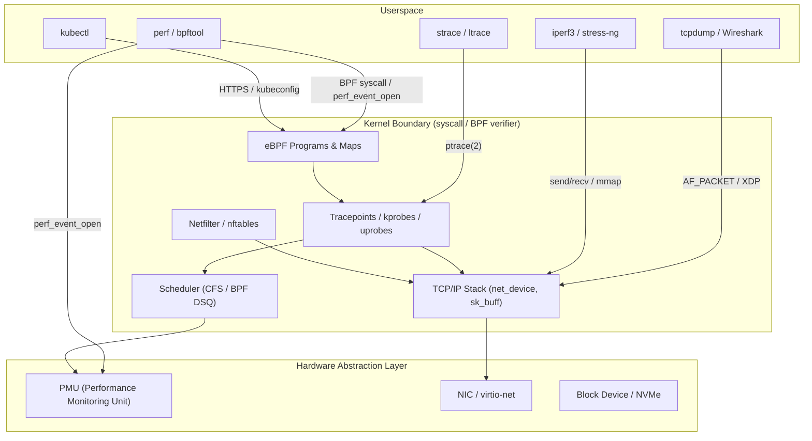
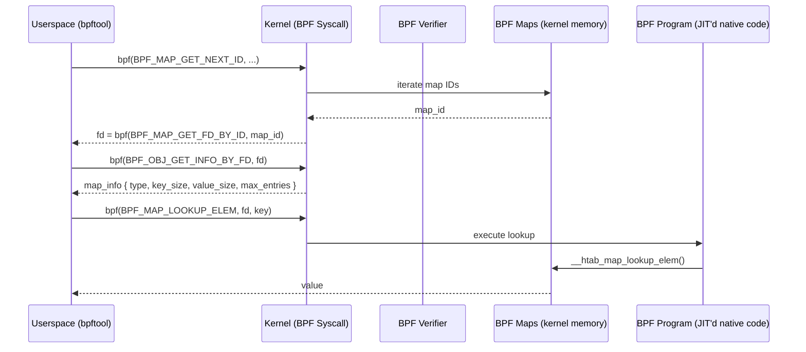
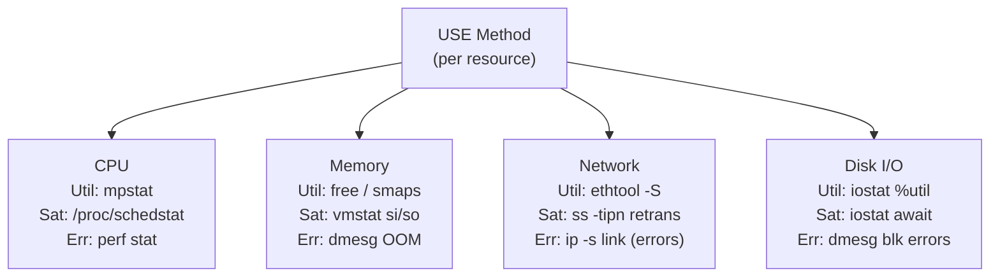
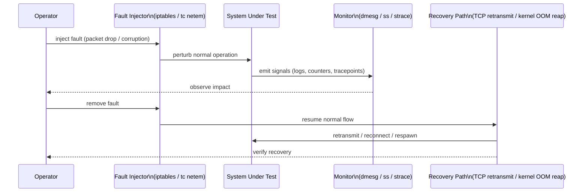

# Operational Verification Labs: Core Systems Automation & Introspection

## Preface: Why Operational Verification Matters

Modern Linux systems are composed of layered abstractions: hardware, kernel subsystems, system calls, networking stacks, schedulers, and userspace daemons. Operational verification is the discipline of asserting, at every layer, that the system behaves according to its specification under both nominal and adversarial conditions. This lab does not treat CLI tools as incantations — it explains *why* each tool works, what kernel subsystem it interrogates, and what the output signals architecturally.

The lab is structured around three progressive exercises: live state inspection (what is the system doing right now?), saturation profiling (where are the bottlenecks?), and fault injection with recovery analysis (how does the system fail, and how does it recover?). Each exercise reinforces the feedback loop central to systems automation: **observe → measure → perturb → analyze**.

---

## Architecture Overview

The following diagram shows the observability surface of a Linux system and how the tools in this lab map to kernel subsystems.



---

## Environment Setup

### Hardware and Kernel Requirements

The exercises require a kernel with eBPF JIT compilation enabled, BPF Type Format (BTF) support, and a network stack capable of XDP. These features are available in mainline kernels since 5.6, though 5.15 LTS or later is recommended for production parity. FreeBSD 13+ supports eBPF via the `bpf(4)` device but lacks full Linux BPF program type coverage — the eBPF-specific exercises apply to Linux only.

| Requirement | Minimum | Recommended |
|---|---|---|
| Kernel version | 5.10 | 5.15 LTS or 6.1 LTS |
| Distribution | Ubuntu 20.04 / RHEL 8 | Ubuntu 22.04 / RHEL 9 |
| RAM | 4 GB | 8 GB |
| CPU cores | 2 | 4+ (for scheduler saturation tests) |
| Disk | 10 GB | 20 GB (for perf data capture) |
| BTF enabled | Required | Required |

Verify BTF support before beginning:

```bash
# BTF is exposed as a CO-RE (Compile Once, Run Everywhere) blob
ls -lh /sys/kernel/btf/vmlinux
# Should output a non-zero file; absence means kernel was built without CONFIG_DEBUG_INFO_BTF=y
```

### Environment Configuration

```bash
# Enable IP forwarding (required for Kubernetes CNI plugins and bridge networking)
# This writes to the kernel parameter via sysctl(8), which calls write(2) on
# /proc/sys/net/ipv4/ip_forward — a procfs virtual file backed by a kernel sysctl handler.
sudo sysctl -w net.ipv4.ip_forward=1
sudo sysctl -w net.bridge.bridge-nf-call-iptables=1

# Persist across reboots
echo "net.ipv4.ip_forward = 1" | sudo tee /etc/sysctl.d/99-forwarding.conf
sudo sysctl --system

# Create a bridge interface for inter-container communication
sudo ip link add name br0 type bridge
sudo ip addr add 192.168.100.1/24 dev br0
sudo ip link set br0 up

# Increase inotify limits (required for Kubernetes controllers watching many resources)
sudo sysctl -w fs.inotify.max_user_watches=1048576
sudo sysctl -w fs.inotify.max_user_instances=8192
```

### Required Packages and Tools

```bash
# Ubuntu 22.04 / Debian 12
sudo apt-get update && sudo apt-get install -y \
    linux-tools-$(uname -r) \   # perf, bound to the running kernel version
    bpftool \                    # eBPF program and map introspection
    iproute2 \                   # ip, ss, tc — netlink-based tools
    tcpdump \                    # libpcap-based packet capture
    strace \                     # syscall tracing via ptrace(2)
    iperf3 \                     # NOTE: use iperf3, not iperf; iperf2 is a different codebase
    stress-ng \                  # NOTE: use stress-ng, not stress; stress is unmaintained
    conntrack \                  # Netfilter connection tracking table inspection
    ethtool \                    # NIC statistics and driver feature negotiation
    numactl \                    # NUMA topology and memory policy control
    sysstat                      # iostat, mpstat, sar — historical system accounting

# RHEL 9 / CentOS Stream 9
sudo dnf install -y perf bpftool iproute tcpdump strace iperf3 stress-ng \
    conntrack-tools ethtool numactl sysstat
```

> **Note on `kubectl` installation**: `kubectl` is not in standard distribution package repositories. Install it via the official Kubernetes release channel. The `kubectl create cluster` command in the original material is **incorrect** — `kubectl` is a cluster management client, not a cluster provisioner. Use `kind`, `k3s`, or `kubeadm` to bootstrap a cluster locally. `kubectl` then speaks to that cluster's API server.

```bash
# Install kubectl (Linux amd64)
KUBECTL_VERSION=$(curl -sL https://dl.k8s.io/release/stable.txt)
curl -sLO "https://dl.k8s.io/release/${KUBECTL_VERSION}/bin/linux/amd64/kubectl"
sudo install -o root -g root -m 0755 kubectl /usr/local/bin/kubectl

# Bootstrap a local single-node cluster using kind (Kubernetes IN Docker)
# kind provisions control-plane and worker nodes as Docker containers
curl -sLo ./kind "https://kind.sigs.k8s.io/dl/v0.23.0/kind-linux-amd64"
sudo install -o root -g root -m 0755 kind /usr/local/bin/kind

cat <<EOF > kind-config.yaml
kind: Cluster
apiVersion: kind.x-k8s.io/v1alpha4
nodes:
  - role: control-plane
  - role: worker
  - role: worker
networking:
  podSubnet: "10.244.0.0/16"
  serviceSubnet: "10.96.0.0/12"
EOF

kind create cluster --config=kind-config.yaml --name=lab-cluster
kubectl cluster-info --context kind-lab-cluster
```

---

## Exercise 1: Live State & Internal Subsystem Inspection

### 1.1 eBPF Map Introspection with `bpftool`

eBPF (extended Berkeley Packet Filter) is a kernel execution environment that allows sandboxed programs to run in kernel context, verified by a static analyzer (the BPF verifier) before loading. eBPF programs communicate with userspace via **maps** — shared memory regions backed by specific data structures: hash tables, arrays, ring buffers, LRU caches, and more. These maps are referenced by file descriptors and pinned under the BPF virtual filesystem (`/sys/fs/bpf`).



```bash
# List all loaded BPF maps with type, ID, key/value sizes, and max entries
sudo bpftool map show
# Example output:
# 42: hash  name execve_calls  flags 0x0
#         key 8B  value 16B  max_entries 10240  memlock 1052672B

# Dump all entries in a specific map (replace 42 with actual map ID)
sudo bpftool map dump id 42

# Inspect all loaded BPF programs, showing their attach points and verifier stats
sudo bpftool prog show --pretty

# Show the JIT-compiled native instructions for a specific program
sudo bpftool prog dump jited id 1

# Show the BPF bytecode (pre-JIT) for a specific program
sudo bpftool prog dump xlated id 1

# Enumerate all BPF programs attached to a specific network interface
sudo bpftool net show dev eth0

# Inspect the BPF filesystem (programs pinned to persistent paths)
sudo ls -la /sys/fs/bpf/
sudo bpftool map pin id 42 /sys/fs/bpf/lab_map
```

Understanding map types is critical for diagnosing eBPF-based tools (Cilium, Falco, bpftrace, etc.):

| Map Type | Kernel Constant | Use Case |
|---|---|---|
| Hash | `BPF_MAP_TYPE_HASH` | Per-connection state, syscall counting |
| Array | `BPF_MAP_TYPE_ARRAY` | Indexed per-CPU counters |
| Ring buffer | `BPF_MAP_TYPE_RINGBUF` | High-throughput event streaming to userspace |
| LRU Hash | `BPF_MAP_TYPE_LRU_HASH` | Flow tracking with automatic eviction |
| Perf event array | `BPF_MAP_TYPE_PERF_EVENT_ARRAY` | perf_event output per-CPU |
| Sock map | `BPF_MAP_TYPE_SOCKMAP` | Accelerated socket redirection (bypass TCP stack) |

### 1.2 Memory Subsystem Deep Inspection

The Linux memory model distinguishes between physical pages (tracked by the page allocator via `struct page`), virtual address spaces (tracked per-process via `struct mm_struct`), and the page cache (a unified cache of filesystem and anonymous pages managed by the LRU algorithm). The numbers from `free(1)` correspond to these kernel accounting structures.

```bash
# Parse /proc/meminfo directly — this is the authoritative kernel memory accounting file
# Values are in kibibytes (KiB), not kilobytes
cat /proc/meminfo

# Key fields to understand:
# MemTotal:        Total usable RAM (excludes reserved/firmware regions)
# MemFree:         Completely unallocated pages (not useful as "available" metric)
# MemAvailable:    Estimated memory available without swapping (more accurate than MemFree)
# Buffers:         Page cache for block device metadata (inodes, dentries, superblocks)
# Cached:          Page cache for file data
# SwapCached:      Pages evicted to swap but re-read (still in swap as a safety net)
# Slab:            Kernel slab allocator (kmalloc) usage
# KernelStack:     Kernel stack per thread (default 8KB/16KB depending on arch)
# PageTables:      Memory used by page table entries (grows with VMA fragmentation)

# Inspect NUMA topology — critical for multi-socket or large-memory systems
numactl --hardware
cat /sys/devices/system/node/node*/meminfo

# Inspect slab allocator caches (kernel object pools)
# High fragmentation here indicates memory pressure without page cache pressure
sudo slabtop -s c   # sort by cache size

# Per-process memory maps with physical page resolution
# This requires CAP_SYS_PTRACE; shows RSS, PSS, and dirty page counts
sudo cat /proc/$(pgrep -f "containerd")/smaps_rollup

# Check transparent hugepage usage (2MB pages coalesce 4KB pages for TLB efficiency)
cat /proc/meminfo | grep -i huge
cat /sys/kernel/mm/transparent_hugepage/enabled
```

### 1.3 Network Stack Inspection

The Linux network stack processes packets through a layered pipeline. Understanding this pipeline is essential for diagnosing latency, drops, and misconfigurations. The `ip`, `ss`, and `ethtool` tools interrogate different layers of this stack via Netlink sockets (not procfs, despite the historical `/proc/net/` interface still existing for backwards compatibility).


```bash
# Show all network interfaces with their state and statistics
ip -s link show
# -s flag shows RX/TX byte/packet/error/drop counters from the kernel's net_device stats

# Inspect IP addresses with prefix lengths and scope
ip addr show

# Inspect routing table (FIB — Forwarding Information Base)
ip route show table main
ip route show table all   # includes policy routing tables

# Show all TCP/UDP sockets with process ownership and kernel buffer state
# ss is the modern replacement for netstat; uses Netlink (AF_NETLINK) instead of /proc/net/tcp
sudo ss -tupna
# -t: TCP  -u: UDP  -p: show process  -n: numeric  -a: all states

# Show TCP socket internal state (congestion window, RTT, retransmits)
# This queries tcp_info struct from the kernel via getsockopt(SO_TCP_INFO)
sudo ss -tipn

# Inspect NIC hardware statistics and driver-level counters
# These are below the kernel net_device abstraction — NIC-specific rings, coalescing, etc.
sudo ethtool -S eth0        # extended NIC statistics
sudo ethtool -k eth0        # offload features (TSO, GSO, GRO, checksum offload)
sudo ethtool -g eth0        # ring buffer sizes (RX/TX descriptor counts)

# Inspect Netfilter conntrack table
# Each row represents an active connection with state, timeout, and packet counters
sudo conntrack -L
sudo conntrack -L | wc -l   # total tracked connections (compare to nf_conntrack_max)
sudo sysctl net.netfilter.nf_conntrack_max
sudo sysctl net.netfilter.nf_conntrack_count

# Inspect network namespaces (critical for container networking diagnosis)
sudo ip netns list
sudo ip netns exec <ns-name> ip link show
sudo ip netns exec <ns-name> ss -tupna
```

### 1.4 Process and Scheduler Inspection

```bash
# Full process tree with kernel threads, namespaces, and cgroup membership
ps -eo pid,ppid,pgid,sid,cls,pri,ni,vsz,rss,stat,wchan:20,comm --sort=-rss | head -40
# wchan shows the kernel function a sleeping process is blocked in
# cls: scheduling class (TS=SCHED_OTHER, FF=SCHED_FIFO, RR=SCHED_RR, B=SCHED_BATCH)

# Inspect cgroup v2 hierarchy (resource accounting and limits)
# systemd uses cgroups to enforce CPU, memory, and IO limits per service unit
systemctl status --all | head -20
cat /sys/fs/cgroup/system.slice/memory.current
cat /sys/fs/cgroup/system.slice/cpu.stat

# Real-time scheduler statistics per CPU
# Shows run queue length, idle time, and scheduling latency
mpstat -P ALL 1 5

# Inspect the CFS (Completely Fair Scheduler) run queue via /proc/schedstat
# Columns: CPU id, yield_count, legacy_count, legacy_count, nr_failed_migrations, ...
cat /proc/schedstat

# Inspect per-process scheduling latency (time spent waiting on run queue)
# vruntime is the CFS virtual runtime — the basis for fair scheduling
cat /proc/$(pgrep -f containerd | head -1)/sched

# System-wide performance counters (PMU-backed hardware events)
# This calls perf_event_open(2) which programs the hardware PMU
sudo perf stat -a sleep 5
# Key metrics: instructions/cycle (IPC), cache-miss rate, branch-miss rate
# IPC < 1.0 often indicates memory-bound workload; > 2.5 indicates compute-bound
```

### 1.5 Kernel Parameter and Subsystem Inspection

```bash
# Display all sysctl parameters — the kernel's runtime configuration surface
# /proc/sys is a pseudofilesystem; each file maps to a kernel variable via sysctl handlers
sysctl -a 2>/dev/null | grep -E "(net\.core|net\.ipv4\.tcp|vm\.|kernel\.)" | sort

# Critical networking parameters
sysctl net.core.somaxconn          # maximum listen() backlog per socket
sysctl net.ipv4.tcp_max_syn_backlog  # SYN queue depth before SYN cookies activate
sysctl net.core.rmem_max           # maximum socket receive buffer (bytes)
sysctl net.core.wmem_max           # maximum socket send buffer (bytes)
sysctl net.ipv4.tcp_mem            # TCP memory pressure thresholds (pages)

# VM subsystem parameters (critical for high-throughput I/O workloads)
sysctl vm.swappiness               # tendency to swap anonymous pages (0=avoid, 100=aggressive)
sysctl vm.dirty_ratio              # % of RAM that can be dirty before write throttling
sysctl vm.dirty_background_ratio   # % of RAM at which background writeback begins
sysctl vm.overcommit_memory        # 0=heuristic, 1=always, 2=never overcommit

# Kernel ring buffer — dmesg backed by /dev/kmsg
# Timestamps are in seconds since boot; use -T for human-readable timestamps
sudo dmesg -T --level=err,warn | tail -50
```

---

## Exercise 2: Benchmarking & Saturation Profiling

Saturation occurs when a resource has work it cannot service. The USE method (Utilization, Saturation, Errors), formalized by Brendan Gregg, provides a systematic framework: for every resource, measure utilization (% busy), saturation (queue depth or latency), and errors (failed operations). The tools in this exercise target different resources under this framework.



### 2.1 Network Throughput Benchmarking with `iperf3`

`iperf3` measures TCP/UDP throughput by opening a data stream between a client and server, saturating the path, and reporting goodput (application-layer bytes delivered per second). It is distinct from `iperf` (iperf2), which uses a different protocol and has different defaults.

```bash
# Start the iperf3 server on the target node (listens on TCP port 5201 by default)
iperf3 -s -D --logfile /tmp/iperf3-server.log
# -D: daemonize  --logfile: redirect output

# Run a TCP throughput test: 10 seconds, 4 parallel streams, 1-second intervals
# Parallel streams are critical — a single TCP stream is limited by its congestion window (cwnd)
iperf3 -c <server_ip> -t 10 -P 4 -i 1

# Run a UDP throughput test targeting 1 Gbps with MTU-sized datagrams
iperf3 -c <server_ip> -u -b 1G -l 1400 -t 10

# Bidirectional test (simultaneous TX and RX) — reveals half vs full duplex asymmetry
iperf3 -c <server_ip> -t 10 --bidir

# Zero-copy mode (sendfile(2) path) — reduces kernel/userspace copy overhead
iperf3 -c <server_ip> -t 10 -Z

# Reverse mode: server sends to client (tests download path)
iperf3 -c <server_ip> -t 10 -R

# Interpret results:
# sender bitrate vs receiver bitrate — gap indicates packet loss or reordering
# Retr (retransmissions) > 0 on a LAN indicates congestion or MTU mismatch
# CPU utilization % — high CPU with low throughput indicates kernel-level bottleneck

# Validate with kernel-level counters before/after (should show TX/RX byte deltas)
ethtool -S eth0 | grep -E "(tx_bytes|rx_bytes|tx_dropped|rx_dropped)"
```

### 2.2 CPU and Memory Saturation Profiling with `perf` and `stress-ng`

```bash
# Generate a controlled CPU saturation workload
# stress-ng (not the abandoned 'stress' package) supports precise load types
sudo stress-ng --cpu 4 --cpu-method matrixprod \
               --vm 2 --vm-bytes 512M --vm-method flip \
               --io 2 \
               --timeout 60s \
               --metrics-brief

# While stress-ng runs, capture system-wide perf data with hardware PMU events
# perf record samples the PMU at ~1000 Hz (configurable), capturing call graphs
sudo perf record -g -a -F 999 -- sleep 30
sudo perf report --stdio --no-children | head -60
# -g: capture call graphs  -a: system-wide  -F 999: 999 Hz sampling

# Flamegraph generation (requires Brendan Gregg's FlameGraph scripts)
git clone --depth=1 https://github.com/brendangregg/FlameGraph /opt/FlameGraph
sudo perf script | /opt/FlameGraph/stackcollapse-perf.pl | \
    /opt/FlameGraph/flamegraph.pl > /tmp/flamegraph.svg

# CPU cache efficiency analysis (hardware performance counters via PMU)
sudo perf stat -e \
  cache-references,cache-misses,\
  instructions,cycles,\
  branch-instructions,branch-misses,\
  dTLB-load-misses,iTLB-load-misses \
  -a sleep 10

# Memory pressure: watch for page scanning (kswapd activity)
# vmstat fields: si=swap-in, so=swap-out, pgfault, pgmajfault
vmstat 1 30
# pgmajfault > 0 indicates major page faults (disk I/O required to satisfy fault)

# Track per-CPU scheduler statistics in real time
mpstat -P ALL 1 10
# iowait > 10% suggests I/O saturation; steal > 0% indicates hypervisor CPU contention
```

### 2.3 Network Saturation Profiling with `tcpdump` and `ss`

```bash
# Capture packets on any interface, no hostname resolution, 65535-byte snaplen
# Writing to a file is preferred over terminal output — avoids userspace decode overhead
# -Z root: drop privileges after opening capture file (security best practice)
sudo tcpdump -i any -n -s 65535 -w /tmp/capture.pcap &
TCPDUMP_PID=$!

# Run iperf3 test to generate traffic
iperf3 -c <server_ip> -t 15 -P 4

# Stop capture
sudo kill $TCPDUMP_PID

# Analyze with tcpdump post-capture
sudo tcpdump -r /tmp/capture.pcap -n 'tcp[tcpflags] & (tcp-rst) != 0'  # RST packets
sudo tcpdump -r /tmp/capture.pcap -n 'tcp[tcpflags] & (tcp-syn) != 0 and not (tcp[tcpflags] & (tcp-ack) != 0)'  # SYN without SYN-ACK (half-open)

# Monitor TCP socket statistics during load — retransmits indicate congestion
watch -n 1 'ss -tipn | grep -E "retrans:[^0]"'

# Track kernel drop counters (incremented by NET_RX softirq on ring overflow)
watch -n 1 'cat /proc/net/dev | column -t'

# NIC-level drop detection
watch -n 1 'ethtool -S eth0 | grep -i drop'

# Socket buffer overflow detection
# rx_queue overflow means the application is not reading fast enough
watch -n 1 'ss -tupna | awk "NR>1 {print \$2, \$3, \$5}" | sort -k2 -rn | head -20'
```

### 2.4 Disk I/O Saturation Profiling

```bash
# iostat: reports I/O statistics from /proc/diskstats (kernel block layer accounting)
# %util = % of time the device had I/O in flight (not necessarily saturated — depends on queue depth)
# await = average I/O completion time (ms); >10ms on NVMe indicates saturation
iostat -xdm 1 10
# Key columns: r/s, w/s (IOPS), rMB/s, wMB/s, await, r_await, w_await, %util, aqu-sz

# Generate disk I/O stress to observe saturation behavior
sudo stress-ng --hdd 2 --hdd-bytes 1G --timeout 30s --metrics-brief &
iostat -xdm 1 15

# eBPF-based I/O latency histogram (requires bcc-tools or bpftrace)
# This instruments the block layer I/O completion path non-intrusively
sudo bpftrace -e '
  tracepoint:block:block_rq_issue { @start[args->sector] = nsecs; }
  tracepoint:block:block_rq_complete {
    if (@start[args->sector]) {
      @latency_us = hist((nsecs - @start[args->sector]) / 1000);
      delete(@start[args->sector]);
    }
  }
  interval:s:10 { print(@latency_us); clear(@latency_us); exit(); }
'
```

---

## Exercise 3: Fault Injection & Recovery Analysis

Fault injection is the deliberate introduction of failures to verify system resilience, timeout behavior, and recovery paths. The goal is not simply to break things but to validate that the system behaves predictably under failure conditions — a core tenet of chaos engineering formalized by Netflix's Simian Army and the subsequent Chaos Engineering discipline.



### 3.1 Network Fault Injection

The Linux `tc` (traffic control) subsystem with the `netem` (Network Emulator) qdisc provides far more precise fault injection than `iptables` alone. `iptables` operates at the Netfilter hook level, applying binary accept/drop semantics. `tc netem` operates at the qdisc layer (between the IP stack and the driver TX ring), enabling probabilistic drops, latency, jitter, corruption, and reordering.

```bash
# Scenario A: Stateless packet drop via Netfilter (iptables)
# CAUTION: This will terminate your SSH session if applied to your management interface.
# Scope this to a test interface (e.g., a loopback alias or a veth pair).

# Create a test veth pair to scope fault injection safely
sudo ip link add veth0 type veth peer name veth1
sudo ip addr add 10.99.0.1/24 dev veth0
sudo ip addr add 10.99.0.2/24 dev veth1
sudo ip link set veth0 up
sudo ip link set veth1 up

# Inject a 50% packet drop on the test interface using tc netem
sudo tc qdisc add dev veth0 root netem loss 50%
# Verify: ping should show ~50% packet loss
ping -c 20 -I veth0 10.99.0.2

# Replace with latency + jitter (simulating a congested WAN link)
sudo tc qdisc replace dev veth0 root netem delay 100ms 20ms distribution normal
ping -c 20 -I veth0 10.99.0.2

# Replace with packet corruption (bit errors — tests protocol error detection)
sudo tc qdisc replace dev veth0 root netem corrupt 1%

# Replace with packet reordering (triggers TCP SACK, out-of-order processing)
sudo tc qdisc replace dev veth0 root netem delay 10ms reorder 50% 25%

# Remove all tc qdiscs (restore normal behavior)
sudo tc qdisc del dev veth0 root

# Scenario B: Connection tracking manipulation
# Drop established connections by removing them from the conntrack table
sudo conntrack -D --proto tcp --dst-port 8080

# Scenario C: iptables-based fault injection on the test interface only
# Always use specific source/destination to scope the blast radius
sudo iptables -A OUTPUT -o veth0 -p tcp --dport 8080 -m statistic \
    --mode random --probability 0.1 -j DROP
# -m statistic: probabilistic match  --probability 0.1: 10% drop rate

# Verify iptables rule and counters
sudo iptables -v -L OUTPUT -n --line-numbers

# Remove the fault injection rule
sudo iptables -D OUTPUT -o veth0 -p tcp --dport 8080 -m statistic \
    --mode random --probability 0.1 -j DROP
```

### 3.2 Process and System Call Tracing with `strace`

`strace` intercepts system calls and signals using the `ptrace(2)` syscall. The kernel pauses the tracee at each syscall entry and exit, copies arguments and return values to the tracer, then resumes execution. This introduces ~10–100x slowdown, making it unsuitable for production profiling but invaluable for debugging.

```bash
# Trace all syscalls of a new process, with timestamps and string dereferencing
strace -tt -f -s 256 ls /tmp
# -tt: microsecond timestamps  -f: follow forks  -s 256: string truncation length

# Attach to a running process by PID
sudo strace -p $(pgrep -f "containerd-shim") -f -e trace=network,ipc 2>&1 | head -50

# Trace only specific syscall classes relevant to I/O diagnosis
sudo strace -p <pid> -e trace=read,write,sendto,recvfrom,epoll_wait \
    -T -tt 2>&1 | head -100
# -T: show time spent in each syscall (latency)

# Count syscalls by type — identifies hot syscall paths
strace -c -f -- stress-ng --cpu 1 --timeout 5s 2>&1
# Output: syscall name, count, total time, per-call time

# Detect slow I/O syscalls (> 1ms threshold)
sudo strace -p <pid> -T 2>&1 | awk -F'<' '/read|write|fsync/ { if ($2+0 > 0.001) print }'

# Trace file descriptor operations to diagnose "too many open files" errors
sudo strace -e trace=open,openat,close,dup,dup2,socket,accept,connect \
    -p <pid> -f 2>&1 | head -50
```

### 3.3 Recovery Analysis

```bash
# Monitor TCP retransmission recovery in real time
# ss queries tcp_info.tcpi_retransmits (kernel counter, not sampled)
watch -n 0.5 'ss -tipn dst <server_ip> | grep -v "^Netid"'

# Observe TCP keepalive behavior and dead connection detection
# TCP keepalives send empty ACK segments after tcp_keepalive_time seconds of inactivity
sysctl net.ipv4.tcp_keepalive_time    # default: 7200s (2 hours) — often too long
sysctl net.ipv4.tcp_keepalive_intvl   # probe interval after first keepalive
sysctl net.ipv4.tcp_keepalive_probes  # probe count before ETIMEDOUT

# Reduce keepalive for the lab to observe rapid dead connection detection
sudo sysctl -w net.ipv4.tcp_keepalive_time=10
sudo sysctl -w net.ipv4.tcp_keepalive_intvl=5
sudo sysctl -w net.ipv4.tcp_keepalive_probes=3

# Monitor kernel ring buffer for OOM kills, interface errors, and BPF verifier messages
sudo dmesg -w &
DMESG_PID=$!

# Inject a memory pressure condition (allocate 90% of available RAM)
AVAILABLE_MB=$(awk '/MemAvailable/ {print int($2/1024 * 0.9)}' /proc/meminfo)
sudo stress-ng --vm 1 --vm-bytes "${AVAILABLE_MB}M" --vm-keep --timeout 20s &

# Observe OOM killer behavior in dmesg
sleep 25
sudo kill $DMESG_PID

# Analyze the OOM kill event
sudo dmesg -T | grep -A 20 "Out of memory"
# Output includes: OOM score of killed process, memory maps, reclaim statistics
```

### 3.4 Kubernetes Control Plane Fault Injection

```bash
# Inject a node NotReady condition by stopping the kubelet
sudo systemctl stop kubelet
sleep 5
kubectl get nodes   # Should transition to NotReady after node-monitor-grace-period (default 40s)

# Observe pod eviction and rescheduling via event stream
kubectl get events --sort-by=.metadata.creationTimestamp -w &

# Restore kubelet
sudo systemctl start kubelet
sleep 10
kubectl get nodes   # Should return to Ready

# Inject an etcd latency fault (simulates etcd write latency — impacts API server responsiveness)
# Requires tc netem on the etcd network interface
sudo tc qdisc add dev lo root handle 1: prio
sudo tc filter add dev lo protocol ip handle 1: u32 \
    match ip dport 2379 0xffff flowid 1:1
sudo tc qdisc add dev lo parent 1:1 handle 10: netem delay 500ms
kubectl get pods -A   # Observe increased latency on API responses

# Remove latency fault
sudo tc qdisc del dev lo root

# Inspect etcd health directly
kubectl -n kube-system exec etcd-$(hostname) -- etcdctl endpoint health \
    --endpoints=https://127.0.0.1:2379 \
    --cacert=/etc/kubernetes/pki/etcd/ca.crt \
    --cert=/etc/kubernetes/pki/etcd/healthcheck-client.crt \
    --key=/etc/kubernetes/pki/etcd/healthcheck-client.key
```

---

## Diagnostic Reference

### Cheat Sheet: Tools, Subsystems, and Kernel Interfaces

| Tool | Kernel Interface | Subsystem | Key Flags & Notes |
|---|---|---|---|
| `bpftool map show` | `bpf(2)` syscall | eBPF verifier / JIT | `--pretty` for JSON; `dump id <n>` for map contents |
| `bpftool prog show` | `bpf(2)` syscall | eBPF JIT | `dump jited id <n>` for native code |
| `bpftrace` | `bpf(2)` + tracepoints | eBPF + kprobes | Requires kernel >= 4.9; BTF improves ergonomics |
| `perf stat` | `perf_event_open(2)` | PMU (hardware counters) | `-a` system-wide; `-e` selects specific events |
| `perf record` | `perf_event_open(2)` | PMU + call graph | `-g` for call graphs; `-F` for sample frequency |
| `ss -tipn` | `AF_NETLINK` / `getsockopt(SO_TCP_INFO)` | TCP stack | Shows cwnd, RTT, retransmits, recv-Q, send-Q |
| `ip -s link` | `AF_NETLINK` (RTM_GETLINK) | net\_device | RX/TX bytes, errors, drops per interface |
| `ethtool -S` | `ioctl(SIOCETHTOOL)` | NIC driver | NIC-level ring stats, not kernel-level |
| `tc qdisc show` | `AF_NETLINK` (RTM_GETQDISC) | Traffic control | qdisc type, handle, parent, stats |
| `conntrack -L` | `nfnetlink` | Netfilter conntrack | Shows all tracked flows with state and timeout |
| `strace -p <pid>` | `ptrace(2)` | Syscall interface | `-T` for latency; `-c` for aggregated counts |
| `dmesg -T -w` | `/dev/kmsg` | Kernel ring buffer | `-l err,warn` to filter severity |
| `vmstat 1` | `/proc/vminfo` | VM subsystem | `si`/`so` for swap; `b` for blocked processes |
| `iostat -xdm 1` | `/proc/diskstats` | Block layer | `%util`, `await`, `aqu-sz` for saturation |
| `mpstat -P ALL 1` | `/proc/stat` | Scheduler | Per-CPU `iowait`, `steal`, `sys` |
| `iperf3 -c` | `socket(2)` / `send(2)` | TCP/UDP stack | `-P` parallel streams; `-Z` zero-copy |
| `stress-ng` | Various | Configurable | `--metrics-brief` for per-stressor output |
| `numactl --hardware` | `/sys/devices/system/node` | NUMA topology | Critical for multi-socket memory analysis |

### Operational Verification Checklist

**Kernel & eBPF Layer**
- [ ] Verify BTF blob exists at `/sys/kernel/btf/vmlinux`
- [ ] Confirm eBPF JIT is enabled: `sysctl net.core.bpf_jit_enable` should return `1`
- [ ] No unexpected BPF programs attached to network interfaces: `bpftool net show`
- [ ] BPF map memory within expected bounds: `bpftool map show` total `memlock`

**Memory**
- [ ] `MemAvailable` in `/proc/meminfo` > 20% of `MemTotal`
- [ ] `pgmajfault` rate from `vmstat` near zero under normal load
- [ ] Slab usage (`sudo slabtop`) not growing unboundedly
- [ ] No OOM kill events in `dmesg`

**Network**
- [ ] Zero `dropped` and `errors` in `ip -s link show` under normal load
- [ ] NIC ring buffer not overflowing: `ethtool -S | grep drop`
- [ ] `conntrack` count < 80% of `nf_conntrack_max`
- [ ] TCP retransmission rate < 0.1%: `ss -tipn | grep retrans`
- [ ] No unexpected RSTs in packet capture

**CPU & Scheduler**
- [ ] `iowait` < 5% under normal load (`mpstat`)
- [ ] `steal` time near zero (hypervisor not over-subscribing CPU)
- [ ] Run queue length (`vmstat r` column) ≤ number of CPUs

**Disk I/O**
- [ ] `%util` < 70% for HDDs, < 90% for NVMe under normal load
- [ ] `await` < 1ms for NVMe, < 10ms for HDD
- [ ] No block layer errors in `dmesg`

**Kubernetes**
- [ ] All nodes in `Ready` state: `kubectl get nodes`
- [ ] etcd endpoint healthy and latency < 10ms
- [ ] No `Evicted` or `OOMKilled` pods: `kubectl get pods -A | grep -v Running`
- [ ] API server latency p99 < 1s: `kubectl get --raw /metrics | grep apiserver_request_duration`

---

## Appendix: Python Automation Script for Verification Checks

The following script automates the verification checklist by running checks programmatically and emitting structured output. It runs only read-only, non-destructive commands.

```python
#!/usr/bin/env python3
"""
Operational verification automation script.
Requires: Python 3.9+, root privileges for most checks.
"""

import subprocess
import re
import sys
import json
from dataclasses import dataclass, field
from typing import Optional


@dataclass
class CheckResult:
    name: str
    status: str          # "PASS", "FAIL", "WARN", "SKIP"
    detail: str
    metric: Optional[float] = None
    unit: Optional[str] = None


def run_cmd(args: list[str], timeout: int = 10) -> tuple[int, str, str]:
    """Run a command and return (returncode, stdout, stderr)."""
    try:
        proc = subprocess.run(
            args,
            capture_output=True,
            text=True,
            timeout=timeout,
        )
        return proc.returncode, proc.stdout, proc.stderr
    except subprocess.TimeoutExpired:
        return -1, "", "Command timed out"
    except FileNotFoundError:
        return -1, "", f"Command not found: {args[0]}"


def check_btf_support() -> CheckResult:
    rc, out, err = run_cmd(["ls", "-la", "/sys/kernel/btf/vmlinux"])
    if rc == 0:
        return CheckResult("BTF Support", "PASS", "vmlinux BTF blob present")
    return CheckResult("BTF Support", "FAIL", "Missing /sys/kernel/btf/vmlinux — rebuild kernel with CONFIG_DEBUG_INFO_BTF=y")


def check_bpf_jit() -> CheckResult:
    rc, out, _ = run_cmd(["sysctl", "-n", "net.core.bpf_jit_enable"])
    if rc == 0:
        val = out.strip()
        if val == "1":
            return CheckResult("BPF JIT", "PASS", "JIT compilation enabled", float(val))
        return CheckResult("BPF JIT", "WARN", f"JIT not enabled (value={val}); set net.core.bpf_jit_enable=1")
    return CheckResult("BPF JIT", "SKIP", "sysctl unavailable")


def check_memory_available() -> CheckResult:
    rc, out, _ = run_cmd(["cat", "/proc/meminfo"])
    if rc != 0:
        return CheckResult("Memory Available", "SKIP", "Cannot read /proc/meminfo")
    total = avail = None
    for line in out.splitlines():
        if line.startswith("MemTotal:"):
            total = int(line.split()[1])
        elif line.startswith("MemAvailable:"):
            avail = int(line.split()[1])
    if total and avail:
        pct = (avail / total) * 100
        status = "PASS" if pct >= 20 else "WARN" if pct >= 10 else "FAIL"
        return CheckResult(
            "Memory Available", status,
            f"{avail // 1024} MiB available ({pct:.1f}% of total)",
            round(pct, 1), "%"
        )
    return CheckResult("Memory Available", "SKIP", "Could not parse /proc/meminfo")


def check_conntrack_usage() -> CheckResult:
    rc_cur, out_cur, _ = run_cmd(["sysctl", "-n", "net.netfilter.nf_conntrack_count"])
    rc_max, out_max, _ = run_cmd(["sysctl", "-n", "net.netfilter.nf_conntrack_max"])
    if rc_cur != 0 or rc_max != 0:
        return CheckResult("Conntrack Usage", "SKIP", "Netfilter conntrack not loaded")
    current = int(out_cur.strip())
    maximum = int(out_max.strip())
    pct = (current / maximum) * 100
    status = "PASS" if pct < 80 else "WARN" if pct < 95 else "FAIL"
    return CheckResult(
        "Conntrack Usage", status,
        f"{current}/{maximum} entries ({pct:.1f}%)",
        round(pct, 1), "%"
    )


def check_ip_forwarding() -> CheckResult:
    rc, out, _ = run_cmd(["sysctl", "-n", "net.ipv4.ip_forward"])
    if rc == 0 and out.strip() == "1":
        return CheckResult("IP Forwarding", "PASS", "net.ipv4.ip_forward=1")
    return CheckResult("IP Forwarding", "FAIL", "IP forwarding disabled; Kubernetes CNI requires it")


def check_dmesg_errors() -> CheckResult:
    rc, out, _ = run_cmd(["dmesg", "--level=err,crit,emerg", "--time-format=reltime"])
    if rc != 0:
        return CheckResult("Kernel Errors", "SKIP", "dmesg unavailable or insufficient privileges")
    lines = [l for l in out.splitlines() if l.strip()]
    count = len(lines)
    if count == 0:
        return CheckResult("Kernel Errors", "PASS", "No critical/error messages in kernel ring buffer")
    sample = lines[-3:]  # last 3 errors
    return CheckResult(
        "Kernel Errors", "WARN",
        f"{count} error/critical messages in dmesg. Recent: {'; '.join(sample)}"
    )


def main():
    checks = [
        check_btf_support,
        check_bpf_jit,
        check_memory_available,
        check_conntrack_usage,
        check_ip_forwarding,
        check_dmesg_errors,
    ]

    results: list[CheckResult] = []
    for check_fn in checks:
        result = check_fn()
        results.append(result)

    # Structured JSON output for integration with CI/CD pipelines
    output = {
        "schema_version": "1.0",
        "results": [
            {
                "name": r.name,
                "status": r.status,
                "detail": r.detail,
                **({"metric": r.metric, "unit": r.unit} if r.metric is not None else {}),
            }
            for r in results
        ],
        "summary": {
            "total": len(results),
            "pass": sum(1 for r in results if r.status == "PASS"),
            "warn": sum(1 for r in results if r.status == "WARN"),
            "fail": sum(1 for r in results if r.status == "FAIL"),
            "skip": sum(1 for r in results if r.status == "SKIP"),
        },
    }

    print(json.dumps(output, indent=2))

    # Exit non-zero if any check failed (suitable for CI gate)
    if output["summary"]["fail"] > 0:
        sys.exit(1)


if __name__ == "__main__":
    main()
```

### eBPF Observability Probe (bpftrace): Syscall Latency Distribution

This `bpftrace` one-liner instruments the `read(2)` syscall entry and exit tracepoints to build a latency histogram, without modifying the target process or its file descriptors.

```bash
# Histogram of read(2) latency in microseconds, aggregated across all processes
# Requires: bpftrace >= 0.12, kernel >= 5.5 for tracepoint args stability
sudo bpftrace -e '
tracepoint:syscalls:sys_enter_read {
    @start[tid] = nsecs;
}
tracepoint:syscalls:sys_exit_read
/@start[tid]/
{
    $latency_us = (nsecs - @start[tid]) / 1000;
    @read_latency_us = hist($latency_us);
    delete(@start[tid]);
}
interval:s:15 {
    print(@read_latency_us);
    exit();
}
'
```

```bash
# Track new TCP connections with process name, PID, source/dest IP and port
# Uses the tracepoint:sock:inet_sock_set_state tracepoint (kernel >= 4.16)
sudo bpftrace -e '
#include <net/sock.h>
tracepoint:sock:inet_sock_set_state
/args->newstate == 1/
{
    printf("%-6d %-20s %-16s:%-6d -> %-16s:%-6d\n",
        pid, comm,
        ntop(args->family, args->saddr),
        args->sport,
        ntop(args->family, args->daddr),
        args->dport);
}
'
```

---

*All commands in this lab target read-only or explicitly scoped interfaces unless noted under a Fault Injection section. Before running fault injection exercises, verify that the target interface or namespace is isolated from production traffic. The iptables and tc netem commands in Exercise 3 include cleanup steps — always execute cleanup before concluding the lab session.*
