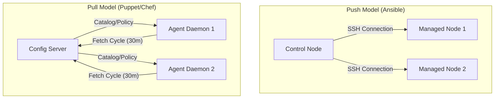

# Lesson 1: Configuration Management Fundamentals

## 1. First-Principles Intuition & Invariants

Configuration management (CM) is the codification of infrastructure state. It transitions system administration from an imperative, manual process (`ssh` into a box, run `apt-get install`) to a declarative, version-controlled model where the system's desired state is defined in code. This shift is mandated by the scale of modern distributed systems, where the entropy of manual intervention guarantees divergence between environments.

The fundamental invariant of configuration management is **idempotency**: the property that applying a configuration operation multiple times has the same effect as applying it once. Mathematically, for an operation $f$ and system state $x$, $f(x) = f(f(x))$. This is distinct from a shell script, which often accumulates side effects (e.g., appending duplicate lines to a config file). Idempotency enables **convergence**, the process by which a system continuously or periodically reconciles its current state toward the declared desired state.

The architectural distinction between CM tools lies in their execution model: **imperative ordering** versus **declarative dependency resolution**. Ansible executes tasks linearly, top-to-bottom, relying on module-level idempotency. Puppet and Chef construct a Directed Acyclic Graph (DAG) of resources and resolve their execution order based on declared dependencies (e.g., "Service N requires Package M"), allowing the engine to optimize the execution path or parallelize independent operations.

The core invariants of a robust CM system are:
1.  **State Consistency**: The running system matches the declared configuration within an acceptable tolerance window.
2.  **Reconciliation Reliability**: The transition process is fault-tolerant and capable of recovering from transient failures (network partitions, package mirror syncs).
3.  **Source of Truth**: The configuration codebase (usually Git) is the single source of truth, not the runtime state of the server.

## 2. Core Architecture & Mechanics

Configuration management tools differ primarily in their transport mechanism (push vs. pull) and their compilation strategy. Understanding these mechanics is critical for diagnosing performance bottlenecks and failure modes.

### Push vs. Pull Architecture

The most significant architectural divergence is how the configuration reaches the target node.



### Ansible: Agentless Push and Linear Execution

Ansible operates on a push model. A control node connects to managed nodes over SSH (or WinRM) without requiring a resident agent daemon on the target. The architecture is ephemeral; Ansible does not maintain a persistent state database on the target by default, executing tasks and disconnecting.

Ansible's execution engine processes playbooks linearly. When a playbook run begins, the control node reads the inventory, connects to the hosts, and transfers Python code (modules) to the target nodes. The module executes, checks the current state against the desired state, applies changes if necessary, returns a JSON status to the control node, and is then cleaned up.

**Idempotency in Ansible** is not a feature of the tool itself, but a contract of the module design. Core modules guarantee idempotency by checking the current state before acting. If a developer writes a custom module or uses `shell` tasks carelessly, idempotency breaks.

```yaml
---
# A robust Ansible play demonstrating dependency handling and handlers
- name: Configure Web Server Stack
  hosts: webservers
  become: true
  vars:
    apache_version: "2.4.52"
    doc_root: "/var/www/html"

  tasks:
    - name: Ensure Apache package is installed
      apt:
        name: "apache2={{ apache_version }}*"
        state: present
        update_cache: yes
      notify: restart apache

    - name: Deploy custom index file
      copy:
        src: files/index.html
        dest: "{{ doc_root }}/index.html"
        owner: www-data
        group: www-data
        mode: '0644'
      notify: restart apache

  handlers:
    - name: restart apache
      service:
        name: apache2
        state: restarted
```

### Puppet: Catalog Compilation and the RAL

Puppet uses a pull model. A resident daemon (`puppet agent`) periodically connects to the `puppet master` (or Puppet Server). The agent sends facts (system data like OS version, IP, memory) to the master. The master compiles these facts against the declared manifests to produce a **Catalog**—a compiled, static graph of resources specific to that node. The agent applies this catalog locally.

Puppet's Resource Abstraction Layer (RAL) separates the declaration of the resource (the type) from the implementation (the provider). For example, a `package` resource can be declared, but the underlying provider might be `apt` on Debian or `yum` on RHEL. This abstraction allows the same manifest to apply across heterogeneous OS distributions.

Idempotency is guaranteed by the providers. The provider inspects the system state (`is`) and compares it to the desired state (`should`). It only executes the command to change state if `is != should`.

```puppet
# Class definition with parameterized defaults
class apache (
  String $version = 'installed',
  String $doc_root = '/var/www/html',
) {
  package { 'apache2':
    ensure => $version,
  }

  file { "${doc_root}/index.html":
    ensure  => file,
    content => "<html><body>Hello from Puppet</body></html>",
    owner   => 'www-data',
    group   => 'www-data',
    mode    => '0644',
    require => Package['apache2'],
  }

  service { 'apache2':
    ensure     => running,
    enable     => true,
    hasrestart => true,
    subscribe  => File["${doc_root}/index.html"],
  }
}
```

### Chef: Ruby DSL and Compile vs. Execute Phases

Chef also uses a pull model, but unlike Puppet's DSL, Chef uses pure Ruby as its configuration language. Chef client execution occurs in two phases:
1.  **Compile Phase**: The client evaluates the Ruby code in the recipes, building a "Resource Collection" in memory.
2.  **Execute Phase**: The client iterates over the Resource Collection, calling providers to perform the actual work.

This separation allows for dynamic configuration generation (e.g., looping through a Ruby array to define multiple packages) during the compile phase, which is then executed idempotently during the execute phase.

```ruby
# Chef recipe demonstrating compile-time search and resource definition
package 'apache2' do
  action :install
end

# Dynamically generate configs based on node attributes
node['apache']['sites'].each do |site_name, site_data|
  template "/etc/apache2/sites-available/#{site_name}.conf" do
    source 'vhost.conf.erb'
    variables(
      docroot: site_data['docroot'],
      domain: site_data['domain']
    )
    notifies :reload, 'service[apache2]'
  end
end

service 'apache2' do
  action [:enable, :start]
end
```

### Custom Automation: Building an Ansible Module in Python

To truly understand the mechanics of configuration management, one must understand how a module enforces idempotency. Below is a minimal Ansible module written in Python. It uses the AnsibleModule API to handle arguments, check state, and report changes.

```python
#!/usr/bin/python

from ansible.module_utils.basic import AnsibleModule

def run_module():
    # Define the arguments the module accepts
    module_args = dict(
        path=dict(type='str', required=True),
        content=dict(type='str', required=True)
    )

    # Instantiate the module
    module = AnsibleModule(
        argument_spec=module_args,
        supports_check_mode=True
    )

    path = module.params['path']
    content = module.params['content']

    # Check current state (Idempotency check)
    try:
        with open(path, 'r') as f:
            current_content = f.read()
        if current_content == content:
            # State is already correct, no change needed
            module.exit_json(changed=False, msg="File already in desired state")
    except FileNotFoundError:
        current_content = None

    # If we are in check mode, report what *would* happen but don't do it
    if module.check_mode:
        module.exit_json(changed=True, msg="File would be created/updated")

    # Execute the change
    try:
        with open(path, 'w') as f:
            f.write(content)
    except Exception as e:
        module.fail_json(msg=f"Failed to write file: {str(e)}")

    # Report success
    module.exit_json(changed=True, msg="File updated successfully")

def main():
    run_module()

if __name__ == '__main__':
    main()
```

## 3. High-Performance Optimization & Failure Modes

At scale (thousands of nodes), the architectural choices of CM tools become the primary bottleneck. Performance optimization requires addressing connection overhead, compilation latency, and state storage.

### Push Model Bottlenecks (Ansible)

Ansible's performance is constrained by the control node's capacity to manage SSH connections and fork processes.
1.  **SSH Multiplexing**: Ansible can reuse a single SSH connection for multiple sessions using `ControlMaster` and `ControlPersist`. This dramatically reduces handshake overhead.
    ```ini
    # ansible.cfg
    [ssh_connection]
    pipelining = True
    control_path = %(directory)s/%%h-%%r
    ```
2.  **Forks**: The `forks` parameter determines how many parallel SSH sessions are maintained. Default is 5. Scaling to 50-100 forks on a capable control node is standard for large inventories.
3.  **Fact Caching**: Gathering facts (system profiling) on every run is expensive. Configuring a fact cache (Redis, JSON files) allows Ansible to skip this step if facts are recently gathered.

### Pull Model Bottlenecks (Puppet/Chef)

In pull models, the bottleneck shifts to the configuration server's compile time and the database storing node states.
1.  **Catalog Compilation**: The Puppet Master compiles a unique graph for every node. Under load, Ruby CPU usage spikes. Scaling requires load-balanced compile masters.
2.  **PuppetDB**: Puppet uses a PostgreSQL-backed database to store facts, catalogs, and exported resources. A slow PuppetDB query degrades the entire compilation cycle.
3.  **Splay Time**: When 10,000 agents wake up simultaneously to pull configurations, they DDoS the master. Chef and Puppet utilize "splay time"—a randomized delay (e.g., 0-300 seconds) before the agent polls—to flatten the request curve.

### Boundary Edge Cases and Failure Mitigations

1.  **Configuration Drift**: A system administrator manually edits a config file. On the next pull cycle, the CM tool overwrites the change, causing a service disruption if that manual change was critical. **Mitigation**: Use `audit` modes or run in `noop` mode to detect drift before enforcing it.
2.  **Split-Brain (Exported Resources)**: Puppet's exported resources allow one node to declare a resource (e.g., a firewall rule) that other nodes collect. If PuppetDB fails or lags, nodes collect stale rules, leading to security holes. **Mitigation**: Strict PuppetDB replication and health checks.
3.  **Long-Running Tasks**: Ansible blocks execution waiting for a command to finish. If a task involves a long reboot or large download, the SSH connection times out. **Mitigation**: Use `async` and `poll` to background the task and check on it later.
    ```yaml
    - name: Download massive dataset
      get_url:
        url: http://example.com/hugefile.tar.gz
        dest: /tmp/hugefile.tar.gz
      async: 3600
      poll: 15
    ```

### Reconciliation Loops: The Controller Pattern

Modern configuration management (e.g., Kubernetes Operators) moves away from periodic pulls to continuous reconciliation loops. This architecture watches an API server for state changes and immediately acts to converge the system.

```go
// Example: A simplified Kubernetes controller reconciliation loop in Go
package controller

import (
    "context"
    "fmt"
    "time"
)

// Reconciler implements the reconciliation logic
type Reconciler struct {
    // client, queue, etc.
}

// Reconcile attempts to move the current state closer to the desired state
func (r *Reconciler) Reconcile(ctx context.Context, key string) error {
    // 1. Fetch the current state of the object
    currentState, err := r.fetchState(key)
    if err != nil {
        return err
    }

    // 2. Fetch the desired state
    desiredState, err := r.fetchDesiredState(key)
    if err != nil {
        return err
    }

    // 3. Compare and act (Idempotent operations)
    if currentState != desiredState {
        fmt.Printf("Drift detected for %s. Applying changes...\n", key)
        if err := r.applyChanges(key, desiredState); err != nil {
            // Requeue on failure
            return fmt.Errorf("failed to apply changes: %w", err)
        }
    }

    return nil
}

// Run starts the reconciliation loop
func (r *Reconciler) Run(ctx context.Context) {
    ticker := time.NewTicker(5 * time.Second)
    defer ticker.Stop()
    
    for {
        select {
        case <-ctx.Done():
            return
        case <-ticker.C:
            // Simulate processing work queue items
            items := r.queue.Items()
            for _, item := range items {
                if err := r.Reconcile(ctx, item); err != nil {
                    // Log error and requeue item
                    r.queue.Add(item)
                }
            }
        }
    }
}
```

This shift from periodic pull to event-driven reconciliation represents the current frontier of automation, bridging traditional configuration management with cloud-native orchestration.
