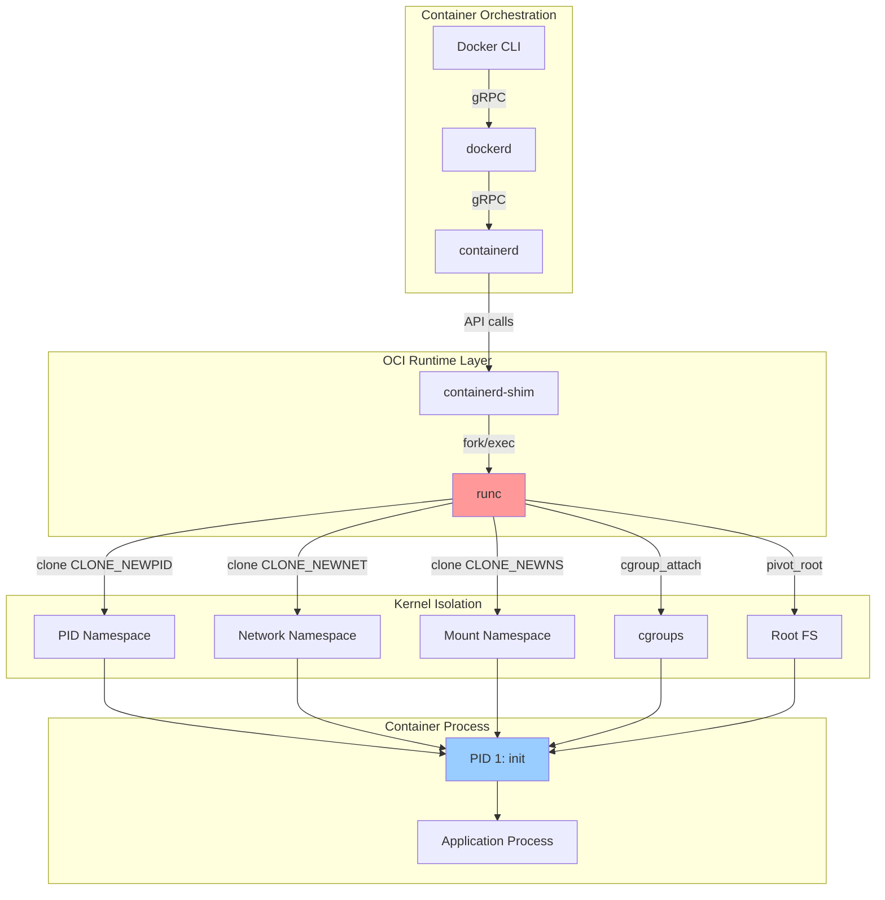
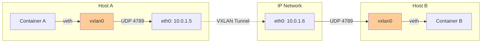
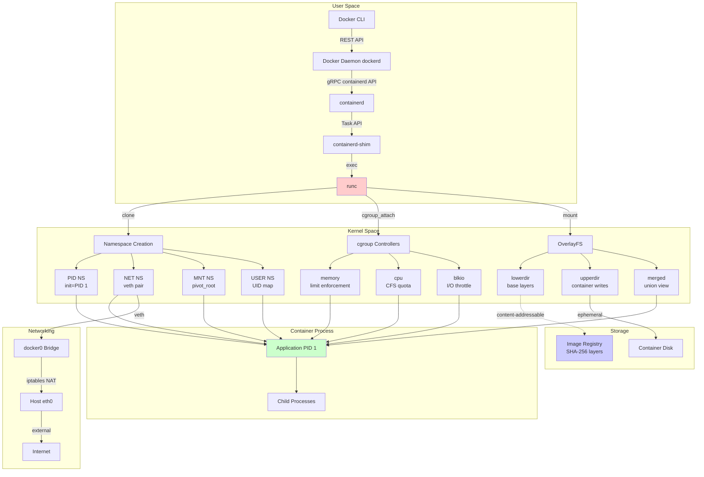

# Lesson 2: Containerization Basics

## 1. First-Principles Intuition & Invariants

Containerization emerged from the collision of two fundamental computing problems: the "matrix from hell" of dependency management across heterogeneous environments, and the underutilization of physical hardware in traditional deployment models. At its foundation, containerization is an operating system-level virtualization technique that creates isolated execution environments sharing a single kernel, standing in stark contrast to hardware virtualization (hypervisors), which emulates entire machines with separate kernels.

The theoretical basis rests on three kernel primitives introduced to Linux between 2002-2013: **namespaces** (process isolation), **cgroups** (resource allocation), and **union filesystems** (layered storage). These primitives enable the creation of lightweight execution contexts that provide application-level isolation without the overhead of full virtualization. A container is fundamentally a collection of processes running in a restricted view of system resources, where restrictions are enforced by kernel mechanisms rather than a hypervisor.

### The Mathematical Invariants

Containerization maintains several critical invariants:

1. **Process Isolation Invariant**: For any container C with process set P_C, and host process set P_H, there exists a bijection between P_C's view of PIDs and a subset of P_H's actual PIDs, but P_C cannot observe or signal processes outside its namespace without explicit capability grants.

2. **Resource Bound Invariant**: For any container C with resource allocation R_C (CPU, memory, I/O), the kernel guarantees that ∑(R_i) ≤ R_total for all containers i, where R_total represents physical host capacity. Crucially, this bound is enforced at scheduling time, not allocation time.

3. **Filesystem Immutability Invariant**: A container image I is a directed acyclic graph (DAG) of filesystem layers L_1 → L_2 → ... → L_n, where each layer is cryptographically content-addressable (typically SHA-256). Once created, a layer hash h(L_i) never changes, enabling reproducible builds and efficient deduplication.

4. **Network Namespace Invariant**: Each container network namespace N_i maintains its own network stack (routing tables, iptables rules, sockets), with connectivity to other namespaces mediated through virtual ethernet pairs (veth) that function as bidirectional pipes at Layer 2.

### Problem Space Analysis

Traditional deployment suffers from what we term "environmental entropy": as software moves from development → staging → production, subtle differences in library versions (glibc 2.28 vs 2.31), kernel parameters (vm.swappiness), filesystem layouts (/opt vs /usr/local), and dynamic linker paths accumulate, creating state spaces too large to exhaustively test. A system with n dependencies, each with m versions, yields m^n possible configurations.

Containerization collapses this state space by encoding dependencies explicitly in the image manifest. The Docker Image Specification v1.2 (now OCI Image Spec) defines a configuration object containing:

```json
{
  "architecture": "amd64",
  "os": "linux",
  "config": {
    "Env": ["PATH=/usr/local/sbin:/usr/local/bin:/usr/sbin:/usr/bin:/sbin:/bin"],
    "Cmd": ["/bin/sh"],
    "WorkingDir": "/app"
  },
  "rootfs": {
    "type": "layers",
    "diff_ids": [
      "sha256:e692418e4...",
      "sha256:3c3a4604a..."
    ]
  }
}
```

This manifest is deterministic: given identical inputs, the build process produces identical layer hashes, enabling bit-for-bit reproducibility.

## 2. Core Architecture & Mechanics

### Namespace Implementation Details

Linux namespaces are implemented through the `clone()`, `unshare()`, and `setns()` system calls. When a process creates a new namespace, the kernel allocates a new instance of the corresponding data structure and associates it with the process's `task_struct`. The kernel maintains a reference count for each namespace, deallocating it when the count reaches zero.

**Mount Namespace (CLONE_NEWNS)**: Implemented via `struct mnt_namespace` in the kernel, which contains a tree of `struct mount` objects representing the mount hierarchy. When a process calls `mount()` within a mount namespace, the kernel modifies only that namespace's mount tree, leaving other namespaces unaffected. The initial mount namespace is copied from the parent process, implementing copy-on-write semantics for mount propagation.

```c
// Simplified kernel structure (linux/mount.h)
struct mnt_namespace {
    atomic_t count;           // Reference count
    struct ns_common ns;      // Common namespace fields
    struct mount *root;       // Root of mount tree
    struct list_head list;    // List of mounts
    struct user_namespace *user_ns;
    u64 seq;                  // Sequence number for /proc/mounts
    wait_queue_head_t poll;
};
```

**PID Namespace (CLONE_NEWPID)**: Creates a hierarchical PID structure where a process can have multiple PIDs: one in each ancestor PID namespace. The kernel's `struct pid` maintains a `struct upid` array indexed by namespace level. PID 1 within a namespace becomes the init process for that namespace, responsible for reaping orphaned child processes.

```c
// Simplified from linux/pid.h
struct pid {
    atomic_t count;
    unsigned int level;      // Namespace nesting level
    struct hlist_head tasks[PIDTYPE_MAX];
    struct upid numbers[1];  // Variable length array
};

struct upid {
    int nr;                  // PID value in this namespace
    struct pid_namespace *ns;
};
```

**Network Namespace (CLONE_NEWNET)**: Allocates `struct net` containing network stack state: routing tables (`struct fib_table`), iptables rules (`struct xt_table`), network devices (`struct net_device`), and socket state. The kernel routes packets between namespaces using virtual ethernet pairs (veth), implemented as paired `net_device` structures where transmitting to one device's TX queue places packets in the other's RX queue.

```c
// Simplified from linux/net_namespace.h
struct net {
    atomic_t passive;        // Reference count
    atomic_t count;
    struct list_head list;   // Global list of namespaces
    struct list_head exit_list;
    
    struct net_device *loopback_dev;
    struct netns_ipv4 ipv4;  // IPv4 specific data
    struct netns_ipv6 ipv6;  // IPv6 specific data
    struct sock *rtnl;       // Routing netlink socket
    struct net_generic *gen; // Per-namespace private data
};
```

**User Namespace (CLONE_NEWUSER)**: Maps UIDs and GIDs between namespaces via `/proc/<pid>/uid_map` and `/proc/<pid>/gid_map`. This mapping is one-way and hierarchical: a process in a user namespace can map its UIDs to the parent namespace but not vice versa. This enables rootless containers where UID 0 inside the container maps to an unprivileged UID on the host.

```
# Example uid_map: inside_uid outside_uid count
0 1000 1       # Map container root (0) to host UID 1000
1 100000 65536 # Map container UIDs 1-65536 to host UIDs 100000-165535
```

### Control Groups (cgroups) Architecture

cgroups v1 (legacy) and cgroups v2 (unified hierarchy) provide resource control through a virtual filesystem mounted at `/sys/fs/cgroup`. Each controller (cpu, memory, blkio, etc.) exposes control files that processes write to configure limits.

**Memory Controller**: Tracks memory usage through `struct mem_cgroup` in the kernel, which maintains per-cgroup statistics (RSS, cache, swap) and enforces limits. When a cgroup exceeds its memory limit (`memory.limit_in_bytes` in v1, `memory.max` in v2), the kernel invokes the OOM (out-of-memory) killer to select and terminate a process. The selection algorithm prioritizes processes by an OOM score computed from memory usage and `oom_score_adj` values.

```c
// Simplified from linux/memcontrol.h
struct mem_cgroup {
    struct cgroup_subsys_state css;
    
    // Resource counters
    struct page_counter memory;   // Total memory
    struct page_counter swap;     // Swap usage
    struct page_counter memsw;    // Memory + swap
    struct page_counter kmem;     // Kernel memory
    struct page_counter tcpmem;   // TCP buffer memory
    
    // Limits
    unsigned long soft_limit;
    
    // Statistics
    struct mem_cgroup_stat_cpu __percpu *stat_cpu;
    atomic_long_t nr_pages;       // Total pages charged
    
    // OOM control
    struct oom_control oom_control;
};
```

**CPU Controller**: Uses the Completely Fair Scheduler (CFS) bandwidth control mechanism. Each cgroup receives a `cpu.cfs_quota_us` (microseconds of CPU time per period) and `cpu.cfs_period_us` (period length, typically 100ms). The kernel tracks elapsed runtime per cgroup and throttles processes when quota is exhausted within a period.

The scheduling equation: if a cgroup has quota Q and period P, it receives at most (Q/P) × 100% CPU time. For example, Q=50000µs and P=100000µs yields 50% CPU allocation.

```c
// Simplified from kernel/sched/sched.h
struct cfs_bandwidth {
    raw_spinlock_t lock;
    ktime_t period;              // Refresh period
    u64 quota;                   // Quota per period
    u64 runtime;                 // Remaining runtime
    s64 hierarchical_quota;      // Inherited quota
    
    int idle;                    // CFS bandwidth idle flag
    int nr_periods;              // Number of periods
    int nr_throttled;            // Times throttled
    u64 throttled_time;          // Total throttled time
    
    struct hrtimer period_timer; // Period refresh timer
    struct list_head throttled_cfs_rq;
};
```

**Block I/O Controller**: Implements proportional weight (`blkio.weight`) and absolute limit (`blkio.throttle.read_bps_device`) policies. The kernel's block layer intercepts I/O requests and schedules them through the CFQ (Completely Fair Queuing) or BFQ (Budget Fair Queuing) scheduler, which allocates I/O bandwidth proportional to cgroup weights.

### Union Filesystems & Image Layering

Container images use union filesystem overlays (OverlayFS, AUFS, Btrfs) to stack read-only layers with a writable top layer. OverlayFS, now the default in Docker and containerd, implements this through four directories:

- **lowerdir**: Colon-separated list of read-only layers (base image + intermediate layers)
- **upperdir**: Writable layer for container modifications
- **workdir**: Temporary workspace for atomic operations
- **merged**: Union view presented to container processes

```bash
# OverlayFS mount example
mount -t overlay overlay \
  -o lowerdir=/var/lib/docker/overlay2/l/ABC123:/var/lib/docker/overlay2/l/DEF456 \
  -o upperdir=/var/lib/docker/overlay2/XYZ789/diff \
  -o workdir=/var/lib/docker/overlay2/XYZ789/work \
  /var/lib/docker/overlay2/XYZ789/merged
```

When a process reads a file, OverlayFS searches layers top-to-bottom (upperdir → lowerdir) and returns the first match. When writing, OverlayFS performs copy-on-write: if the file exists in a lower layer, it's copied to upperdir before modification. This implements true immutability for base layers while allowing per-container state.

**Layer Caching Algorithm**: During image builds, the Docker daemon computes a cache key for each Dockerfile instruction:

```
cache_key = SHA256(parent_layer_id + instruction_type + instruction_args + context_files)
```

If a matching cache key exists, the build reuses the existing layer. This explains why reordering Dockerfile instructions or modifying files invalidates cache from that point forward.

### Container Runtime Architecture

The OCI Runtime Specification defines a standard interface for container runtimes, with `runc` (written in Go) being the reference implementation. A runtime must implement:

1. **create**: Allocate namespaces, cgroups, and root filesystem but don't start the process
2. **start**: Execute the user-specified command within the container
3. **kill**: Send a signal to the container's init process
4. **delete**: Destroy the container and clean up resources



The `containerd-shim` serves a critical role: it persists after `runc` exits, allowing containerd to restart without disrupting running containers. The shim:

- Reaps zombie processes (acting as PID 1's parent)
- Reports exit status back to containerd
- Maintains container stdio streams
- Implements attach/exec operations

### Container Networking Models

**Bridge Mode**: Default networking. Docker creates a virtual bridge (`docker0`) and assigns it a subnet (typically 172.17.0.0/16). Each container receives a veth pair: one end in the container's network namespace (typically `eth0`), the other attached to `docker0`. The kernel bridges all containers on this network, performing NAT for outbound traffic via iptables MASQUERADE rules.

```bash
# iptables NAT rule for container outbound traffic
iptables -t nat -A POSTROUTING -s 172.17.0.0/16 ! -o docker0 -j MASQUERADE
```

**Host Mode**: Container shares the host's network namespace, eliminating network isolation. Useful for performance-critical applications that need native network performance.

**Overlay Networks**: For multi-host networking, overlay drivers (e.g., Docker's libnetwork, Flannel, Calico) encapsulate container traffic in VXLAN tunnels. A VXLAN header adds the VNI (VXLAN Network Identifier) to Ethernet frames, allowing Layer 2 adjacency across Layer 3 networks.



**CNI (Container Network Interface)**: A specification and library for configuring network interfaces in Linux containers. CNI plugins are executables that configure networking based on JSON input:

```json
{
  "cniVersion": "0.4.0",
  "name": "my-network",
  "type": "bridge",
  "bridge": "cni0",
  "isGateway": true,
  "ipMasq": true,
  "ipam": {
    "type": "host-local",
    "subnet": "10.22.0.0/16",
    "routes": [{"dst": "0.0.0.0/0"}]
  }
}
```

### Image Build Process Deep Dive

A Dockerfile build proceeds through lexing, parsing, and execution phases:

```dockerfile
FROM ubuntu:22.04
RUN apt-get update && apt-get install -y python3
COPY app.py /app/
WORKDIR /app
CMD ["python3", "app.py"]
```

**Build Execution**:

1. **Layer 0**: Pull `ubuntu:22.04` base image (multiple layers from Docker Hub)
2. **Layer 1**: Execute `RUN` instruction in a temporary container:
   - Create container from Layer 0
   - Run `/bin/sh -c "apt-get update && apt-get install -y python3"`
   - Commit filesystem changes as Layer 1 (diff from Layer 0)
   - Store layer with SHA-256 hash
3. **Layer 2**: Execute `COPY`:
   - Compute hash of `app.py` from build context
   - If changed, create new layer with file added at `/app/app.py`
4. **Metadata Layer**: Store `WORKDIR` and `CMD` in image config (no filesystem layer)

**Content-Addressable Storage**: Docker stores layers in `/var/lib/docker/overlay2/<layer-hash>/diff`. The image manifest references layers by their SHA-256 digest:

```json
{
  "schemaVersion": 2,
  "mediaType": "application/vnd.docker.distribution.manifest.v2+json",
  "config": {
    "mediaType": "application/vnd.docker.container.image.v1+json",
    "digest": "sha256:b5b2d2d6..."
  },
  "layers": [
    {
      "mediaType": "application/vnd.docker.image.rootfs.diff.tar.gzip",
      "digest": "sha256:e692418e4...",
      "size": 27145431
    },
    {
      "mediaType": "application/vnd.docker.image.rootfs.diff.tar.gzip",
      "digest": "sha256:3c3a4604a...",
      "size": 45123896
    }
  ]
}
```

This content-addressability enables:
- **Deduplication**: Identical layers shared across images consume storage only once
- **Integrity verification**: Layer tampering detected via digest mismatch
- **Distributed caching**: Registries identify layers universally by digest

## 3. High-Performance Optimization & Failure Modes

### Performance Characteristics

**Startup Latency**: Container startup consists of:
- Namespace creation: ~1-2ms (dominated by `clone()` system call)
- cgroup configuration: ~0.5-1ms (writing to cgroupfs)
- Filesystem setup (OverlayFS mount): ~5-50ms (depends on layer count and filesystem cache state)
- Process execution: ~10-100ms (application-specific)

Total cold-start latency typically ranges 50-200ms, orders of magnitude faster than VM boot times (5-20 seconds). However, this advantage erodes with:
- **Deep layer stacks**: Each additional layer adds mount complexity (OverlayFS limit: ~500 layers practical, though technically higher)
- **Large images**: Pulling multi-GB images over network dominates startup time
- **Registry latency**: Distant or rate-limited registries create bottlenecks

**Runtime Overhead**: Namespace and cgroup overhead is typically <2% CPU and <1% memory compared to bare-metal execution. The primary costs are:
- **Syscall filtering** (seccomp): ~5-10% overhead for syscall-heavy workloads
- **Network address translation** (iptables MASQUERADE): ~1-5% throughput reduction for bridge-mode networking
- **Filesystem indirection** (OverlayFS): ~2-8% I/O latency increase for write-heavy workloads due to copy-on-write

### Scaling & Resource Limits

**Memory Management Edge Cases**:

1. **Page Cache Accounting**: The kernel's page cache is shared across containers, but charged to the container that first brings a page into cache. This creates non-deterministic memory accounting when multiple containers access the same files (e.g., shared libraries).

2. **Memory Cgroup OOM Behavior**: When a container exceeds `memory.limit_in_bytes`, the kernel's OOM killer selects a victim process within that cgroup. The selection is non-deterministic if multiple processes have similar OOM scores, leading to unpredictable failures.

3. **Swap Accounting**: Setting `memory.memsw.limit_in_bytes` (memory + swap) without configuring swap on the host causes subtle failures. Containers may OOM even when total usage is below the limit if swap isn't available.

**CPU Throttling Pathologies**:

1. **CFS Bandwidth Timer Granularity**: CFS quota enforcement uses a periodic timer (default 100ms period). High-frequency, short-burst workloads can be throttled mid-burst even when average utilization is below quota, causing latency spikes.

2. **Multi-core Allocation**: `cpu.cfs_quota_us` is a total quota across all cores. A container with quota=100000 (100ms) on an 8-core system can use at most 1 full core continuously, even though instantaneous burst might use all 8 cores briefly within a period.

3. **CPU Pinning Conflicts**: Combining `cpuset.cpus` (pin to specific cores) with `cpu.cfs_quota_us` can lead to underutilization. If a container is pinned to 2 cores but has quota for only 1 core, the other core remains idle.

### Filesystem Performance & Optimization

**OverlayFS Write Amplification**: Copy-on-write creates hidden costs:

```python
# Performance test: write amplification in OverlayFS
import os
import time

# Create a large file in base layer (lowerdir)
base_file = "/data/large_base.bin"
os.system(f"dd if=/dev/urandom of={base_file} bs=1M count=1024")  # 1GB file

# Modify a single byte (triggers full file copy to upperdir)
start = time.time()
with open(base_file, "r+b") as f:
    f.seek(0)
    f.write(b"X")
elapsed = time.time() - start

print(f"Modifying 1 byte required copying entire 1GB file: {elapsed:.2f}s")
```

**Mitigation**: Use volumes (bind mounts) for high-throughput I/O workloads, bypassing OverlayFS entirely:

```bash
docker run -v /host/data:/container/data myimage
```

**Layer Optimization Strategies**:

1. **Multi-stage Builds**: Separate build dependencies from runtime artifacts:

```dockerfile
# Stage 1: Build
FROM golang:1.21 AS builder
WORKDIR /src
COPY go.mod go.sum ./
RUN go mod download
COPY . .
RUN CGO_ENABLED=0 go build -o /app

# Stage 2: Runtime (minimal image)
FROM scratch
COPY --from=builder /app /app
ENTRYPOINT ["/app"]
```

This pattern reduces final image size by 10-100x by excluding compilers, headers, and build tools.

2. **Layer Ordering**: Place frequently changing instructions (COPY source code) after infrequently changing ones (RUN apt-get install) to maximize cache hits:

```dockerfile
# Anti-pattern: cache invalidated by code changes
FROM ubuntu:22.04
COPY . /app          # Changes frequently
RUN apt-get update   # Re-runs on every code change

# Optimized: dependencies cached independently
FROM ubuntu:22.04
RUN apt-get update && apt-get install -y python3  # Cached
COPY requirements.txt /app/
RUN pip install -r /app/requirements.txt          # Cached if requirements.txt unchanged
COPY . /app                                       # Only this layer regenerates
```

### Security Boundaries & Vulnerabilities

**Kernel Sharing**: All containers on a host share the same kernel. A kernel exploit in any container compromises the entire host. Historical examples:

- **CVE-2016-5195 (Dirty COW)**: Race condition in memory subsystem allowed container escape via write to read-only memory mappings
- **CVE-2019-5736 (runc vulnerability)**: Malicious container image could overwrite host runc binary during `docker exec`, achieving host root access

**Mitigation Layers**:

1. **Seccomp Profiles**: Whitelist allowed system calls. Docker's default profile blocks ~44/330 syscalls, including `keyctl`, `add_key`, `ptrace`, and kernel module operations:

```json
{
  "defaultAction": "SCMP_ACT_ERRNO",
  "architectures": ["SCMP_ARCH_X86_64"],
  "syscalls": [
    {
      "names": ["read", "write", "open", "close", "stat", "fstat", "lstat", "poll"],
      "action": "SCMP_ACT_ALLOW"
    }
  ]
}
```

2. **AppArmor/SELinux**: Mandatory Access Control (MAC) policies restrict file access, network operations, and capabilities beyond discretionary access control (DAC):

```
# AppArmor profile snippet
profile docker-default flags=(attach_disconnected,mediate_deleted) {
  # Deny write access to /proc/sys, /sys except for specific paths
  deny /proc/sys/** wklx,
  deny /sys/** wklx,
  
  # Allow network operations
  network inet stream,
  network inet dgram,
}
```

3. **User Namespaces**: Map container root (UID 0) to unprivileged host UID (e.g., 100000). Even if container is compromised, attacker has limited host privileges:

```bash
# Enable user namespace remapping in Docker daemon
dockerd --userns-remap=default
```

4. **Capabilities Dropping**: Linux capabilities partition root privileges. Drop unnecessary capabilities:

```bash
docker run --cap-drop=ALL --cap-add=NET_BIND_SERVICE myimage
```

### Network Performance & Failure Modes

**Bridge Mode Throughput**: NAT traversal (iptables MASQUERADE + DNAT for port mappings) adds per-packet CPU cost. For 10Gbps networks, this can saturate CPU before saturating network bandwidth.

**Benchmark** (iperf3 between containers on same host):

```bash
# Host networking (no NAT): ~9.5 Gbps
docker run --net=host iperf3-server
docker run --net=host iperf3-client

# Bridge mode (NAT): ~7.2 Gbps
docker run --name server iperf3-server
docker run --link server iperf3-client
```

**Mitigation**: Use host networking (`--net=host`) for high-throughput applications, or hardware offload (SR-IOV for VMs, macvlan for containers) to bypass software bridges.

**DNS Resolution Quirks**: Docker's embedded DNS server (127.0.0.11) resolves container names via `/etc/resolv.conf`. This introduces failure modes:

1. **Race Condition on Startup**: If a container queries DNS before the embedded server is ready, resolution fails. Applications must implement retry logic.
2. **Search Domain Expansion**: Docker appends search domains, causing unexpected query patterns. `curl api` might resolve to `api.default.svc.cluster.local` in Kubernetes.

### Resource Starvation Scenarios

**The "Noisy Neighbor" Problem**: Without proper cgroup limits, one container can starve others:

```python
# CPU-bound "noisy neighbor"
while True:
    pass  # Spin-loop consumes 100% of one core

# I/O-bound "noisy neighbor"
while True:
    with open("/dev/shm/test", "w") as f:
        f.write("X" * 1024 * 1024)  # 1MB writes in tight loop
```

**Detection**: Monitor per-container metrics:

```bash
# CPU usage per container
docker stats --no-stream --format "{{.Container}}: {{.CPUPerc}}"

# cgroup-level CPU accounting
cat /sys/fs/cgroup/cpu/docker/<container-id>/cpuacct.usage
```

**Remediation**: Enforce proportional limits:

```bash
# Limit to 50% CPU (50000µs / 100000µs period)
docker run --cpu-quota=50000 --cpu-period=100000 myimage

# Limit to 512MB memory with 100MB reservation
docker run --memory=512m --memory-reservation=100m myimage
```

### Advanced Debugging Techniques

**Namespace Introspection**: Enter a running container's namespaces for debugging:

```bash
# Find container PID
docker inspect --format '{{.State.Pid}}' mycontainer
# Output: 12345

# Enter all namespaces of PID 12345
nsenter -t 12345 -n -p -m -u -i /bin/bash
```

This places you in the container's namespace context without going through Docker's layering.

**cgroup Hierarchy Traversal**:

```bash
# Find container's cgroup path
cat /proc/<container-pid>/cgroup
# Output: 12:memory:/docker/abc123...

# Inspect actual memory usage
cat /sys/fs/cgroup/memory/docker/abc123.../memory.usage_in_bytes
cat /sys/fs/cgroup/memory/docker/abc123.../memory.stat
# Shows: cache, rss, swap, etc.
```

**OverlayFS Layer Inspection**:

```bash
# Find upperdir for running container
docker inspect -f '{{.GraphDriver.Data.UpperDir}}' mycontainer
# Output: /var/lib/docker/overlay2/abc123.../diff

# Files modified by container (not in base image)
find /var/lib/docker/overlay2/abc123.../diff -type f
```

### Failure Recovery Patterns

**Graceful Degradation**: Design containers to handle resource limits gracefully:

```go
// Detect memory pressure and shed load
func monitorMemoryPressure() {
    ticker := time.NewTicker(1 * time.Second)
    for range ticker.C {
        memUsage := getCurrentMemoryUsage()
        memLimit := getMemoryLimit()
        
        if float64(memUsage) / float64(memLimit) > 0.9 {
            log.Warn("Memory pressure detected, dropping non-critical caches")
            dropNonCriticalCaches()
        }
    }
}
```

**Health Checks**: Implement container health checks to detect and recover from failures:

```dockerfile
HEALTHCHECK --interval=30s --timeout=3s --start-period=5s --retries=3 \
  CMD curl -f http://localhost:8080/health || exit 1
```

Docker automatically restarts unhealthy containers based on restart policy (`--restart=on-failure`).

**Circuit Breaker Pattern**: Prevent cascading failures when a containerized service degrades:

```python
import time
from enum import Enum

class State(Enum):
    CLOSED = 1  # Normal operation
    OPEN = 2    # Failing, reject requests
    HALF_OPEN = 3  # Testing if service recovered

class CircuitBreaker:
    def __init__(self, failure_threshold=5, timeout=60):
        self.failure_threshold = failure_threshold
        self.timeout = timeout
        self.failures = 0
        self.state = State.CLOSED
        self.last_failure_time = None
    
    def call(self, func, *args, **kwargs):
        if self.state == State.OPEN:
            if time.time() - self.last_failure_time > self.timeout:
                self.state = State.HALF_OPEN
            else:
                raise Exception("Circuit breaker OPEN, rejecting request")
        
        try:
            result = func(*args, **kwargs)
            if self.state == State.HALF_OPEN:
                self.state = State.CLOSED
                self.failures = 0
            return result
        except Exception as e:
            self.failures += 1
            self.last_failure_time = time.time()
            if self.failures >= self.failure_threshold:
                self.state = State.OPEN
            raise e
```

### Production Deployment Considerations

**Image Scanning**: Scan images for vulnerabilities before deployment:

```bash
# Using Trivy scanner
trivy image --severity HIGH,CRITICAL myimage:latest
```

Integrate scanning into CI/CD pipelines to block vulnerable images.

**Resource Quotas at Scale**: In orchestration systems (Kubernetes), enforce resource quotas at namespace level to prevent cluster-wide resource exhaustion:

```yaml
apiVersion: v1
kind: ResourceQuota
metadata:
  name: compute-quota
spec:
  hard:
    requests.cpu: "100"
    requests.memory: "200Gi"
    limits.cpu: "200"
    limits.memory: "400Gi"
```

**Log Aggregation**: Container stdout/stderr is ephemeral. Use logging drivers to persist logs:

```bash
docker run --log-driver=fluentd --log-opt fluentd-address=localhost:24224 myimage
```

Or mount a volume for application-level logging:

```bash
docker run -v /var/log/myapp:/app/logs myimage
```

### Comprehensive System Diagram



This architecture demonstrates the complete stack from user command to isolated process execution, showing how kernel primitives combine to provide containerization's security and resource isolation guarantees. The system maintains strict separation between control plane (Docker/containerd) and data plane (runc/kernel), enabling daemon restarts without container disruption through the containerd-shim persistence layer.
