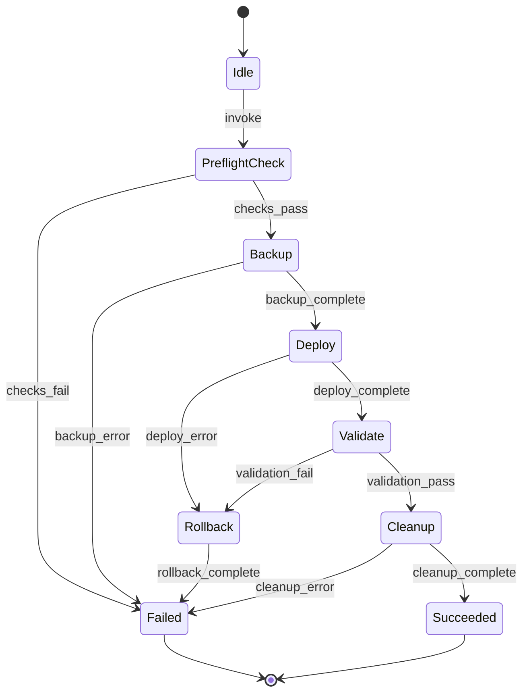
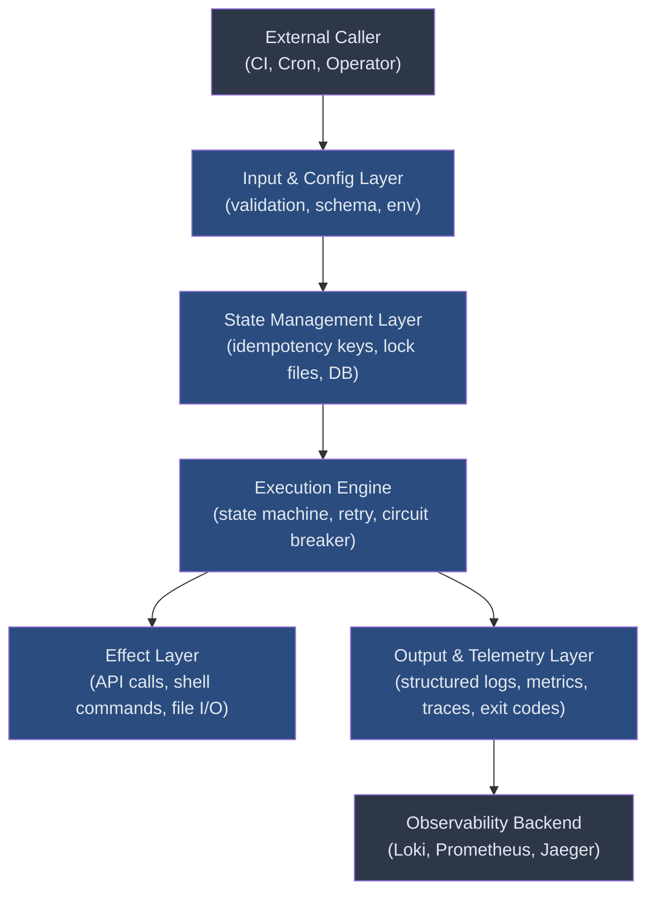
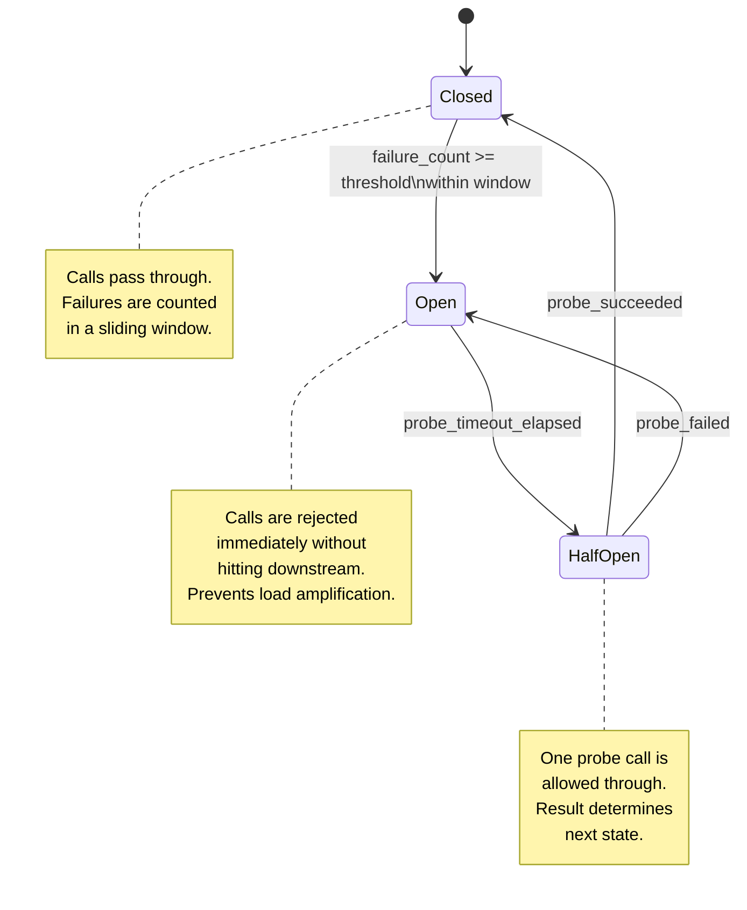

# Lesson 3: Writing Robust Automation Scripts

## 1. First-Principles Intuition & Invariants

Automation is the codification of operational knowledge into executable logic. It is not a convenience layer on top of manual processes—it is a fundamental shift in the governance model of a system. When a human operator executes a task, the execution is stateful in the operator's mind: they observe the environment, make decisions, and adapt. When that knowledge is encoded into a script, the implicit context must become explicit, the adaptive reasoning must become deterministic logic, and the tolerance for ambiguity must be replaced by well-defined invariants.

The three invariants that underpin every reliable automation artifact are **idempotency**, **atomicity**, and **observability**. These are not stylistic preferences—they are formal properties with mathematical grounding that determine whether a script is fit for production use in an environment that tolerates partial failures, retries, and concurrent execution.

### Idempotency

An operation *f* is idempotent if and only if *f(f(x)) = f(x)* for all valid inputs *x*. In operational terms, executing the script once must produce the same system state as executing it *n* times. This property is non-negotiable in distributed systems where network partitions, process preemptions, and watchdog restarts will cause scripts to re-execute mid-operation.

Consider a script that creates an S3 bucket. A naïve implementation calls `aws s3api create-bucket` and fails if the bucket already exists. An idempotent implementation first checks whether the bucket exists and skips creation if it does—or uses an API that provides upsert semantics. The difference is not cosmetic: the former will cause a retry loop to fail permanently; the latter will converge to the correct state regardless of how many times it is invoked.

Idempotency is enforced through three patterns, applied in combination:

1. **Precondition guards**: Check whether the desired state already exists before attempting to create or modify it.
2. **Declarative reconciliation**: Define the *desired* state and compute a diff against the *actual* state. Apply only the delta. This is the model used by Terraform, Ansible's `state: present`, and Kubernetes controllers.
3. **Conditional writes**: Use atomic compare-and-swap semantics at the storage layer (e.g., `IF NOT EXISTS` in SQL, `--if-match` ETags in object storage) to prevent duplicate creation under concurrent execution.

### Atomicity

A script that partially succeeds and leaves the system in a half-modified state is worse than one that fails cleanly, because the corrupted intermediate state may be invisible to monitoring and difficult to reason about. Atomicity means that a logical unit of work either completes fully or leaves no observable side effects.

In practice, true atomicity across distributed resources is impossible without a distributed transaction coordinator (and even then, consensus protocols like Two-Phase Commit introduce their own failure modes). The pragmatic engineering approach is **saga decomposition**: break the operation into a sequence of compensatable steps. For each step that can succeed, define a compensating operation that reverses it. If any step fails, execute the compensation chain in reverse order. This is the pattern used by long-running business process frameworks and by deployment systems like Spinnaker.

### Observability

A script that executes silently is operationally blind. Robust automation must emit **structured telemetry** at every significant state transition. This means:

- **Structured logs**: JSON or logfmt, not free-text strings, so that log aggregators (Splunk, Loki, CloudWatch) can index and query fields.
- **Exit codes**: POSIX-compliant, with a well-defined mapping from codes to failure categories (see §4).
- **Metrics**: Duration, retry count, error rate—emitted to a time-series database (Prometheus, Datadog) so that degradation trends are detectable before they become outages.
- **Distributed trace context propagation**: When a script is invoked as part of a larger pipeline, it must propagate `traceparent` headers (W3C Trace Context) or vendor-specific equivalents so that the full execution graph is reconstructable post-hoc.

### The State Machine Model

Every automation script is a finite-state automaton. Making this model explicit—rather than leaving it implicit in a tangle of conditionals—is the single most effective technique for eliminating entire classes of bugs. The states and transitions for a deployment script are shown below.



Each transition is guarded by a predicate. No state may be entered unless its preconditions are satisfied. This model eliminates the most common class of automation bugs: assuming the system is in a particular state when it is not. When you encode the state machine explicitly (as a `match` statement in Rust, a `transitions` table in Python, or a workflow definition in a DAG engine), the guard conditions become compile-time or start-time checkable invariants rather than silent runtime assumptions.

---

## 2. Core Architecture & Mechanics

The architecture of a production-grade automation script is a layered stack. Each layer has a single responsibility, and the interfaces between layers are narrow and well-typed. The layers from bottom to top are: **Configuration & Input Validation**, **State Management**, **Execution Engine**, and **Output & Telemetry**.



### Layer 1: Configuration & Input Validation

Input validation is the boundary between the hostile external world and the trusted interior of your script. Every argument, environment variable, and configuration file value is an adversarial input until proven otherwise. Validation must happen eagerly—at startup, before any side effects are produced—so that the script fails fast with a clear diagnostic rather than corrupting state halfway through.

The following Python example uses Pydantic v2 for schema-driven validation. Pydantic v2 (released 2023) uses a Rust-backed core (`pydantic-core`) that is 5–50× faster than v1's pure-Python validation. The model defines not just types but semantic constraints: regex patterns, numeric bounds, and cross-field validators.

```python
# config.py — Production-grade configuration schema using Pydantic v2
from __future__ import annotations

import os
import re
import sys
from enum import Enum
from pathlib import Path
from typing import Annotated

from pydantic import (
    BaseModel,
    Field,
    field_validator,
    model_validator,
    AnyHttpUrl,
)
from pydantic_settings import BaseSettings, SettingsConfigDict


# Semantic version regex: https://semver.org/
_SEMVER_RE = re.compile(
    r"^(0|[1-9]\d*)\.(0|[1-9]\d*)\.(0|[1-9]\d*)"
    r"(?:-([\w.-]+))?(?:\+([\w.-]+))?$"
)

# Docker image tag: alphanumeric + . _ - (max 128 chars per OCI spec)
_IMAGE_TAG_RE = re.compile(r"^[a-zA-Z0-9][a-zA-Z0-9._-]{0,127}$")


class LogLevel(str, Enum):
    DEBUG = "DEBUG"
    INFO = "INFO"
    WARNING = "WARNING"
    ERROR = "ERROR"
    CRITICAL = "CRITICAL"


class DeploymentEnvironment(str, Enum):
    DEVELOPMENT = "development"
    STAGING = "staging"
    PRODUCTION = "production"


class RetryConfig(BaseModel):
    max_attempts: Annotated[int, Field(ge=1, le=10)] = 3
    base_delay_seconds: Annotated[float, Field(ge=0.1, le=60.0)] = 1.0
    max_delay_seconds: Annotated[float, Field(ge=1.0, le=300.0)] = 30.0
    jitter: bool = True

    @model_validator(mode="after")
    def validate_delay_ordering(self) -> "RetryConfig":
        if self.base_delay_seconds >= self.max_delay_seconds:
            raise ValueError(
                f"base_delay_seconds ({self.base_delay_seconds}) must be "
                f"less than max_delay_seconds ({self.max_delay_seconds})"
            )
        return self


class DeploymentConfig(BaseSettings):
    """
    Configuration for the deployment automation script.

    Sources (in priority order):
      1. Environment variables (prefixed DEPLOY_)
      2. .env file at CWD/.env
      3. Field defaults
    """

    model_config = SettingsConfigDict(
        env_prefix="DEPLOY_",
        env_file=".env",
        env_file_encoding="utf-8",
        case_sensitive=False,
        # Fail loudly on unknown env vars to surface typos
        extra="forbid",
    )

    # --- Required fields (no defaults) ---
    namespace: Annotated[
        str,
        Field(
            pattern=r"^[a-z0-9][a-z0-9-]{0,61}[a-z0-9]$",
            description="Kubernetes namespace (RFC 1123 label rules)",
        ),
    ]
    deployment_name: Annotated[
        str,
        Field(
            pattern=r"^[a-z0-9][a-z0-9-]{0,251}[a-z0-9]$",
            description="Kubernetes deployment name",
        ),
    ]
    image_tag: Annotated[
        str,
        Field(description="Docker image tag to deploy"),
    ]
    environment: DeploymentEnvironment

    # --- Optional fields with defaults ---
    registry: AnyHttpUrl = "https://registry.example.com"  # type: ignore[assignment]
    kubeconfig: Path = Path.home() / ".kube" / "config"
    log_level: LogLevel = LogLevel.INFO
    dry_run: bool = False
    retry: RetryConfig = RetryConfig()
    timeout_seconds: Annotated[int, Field(ge=10, le=3600)] = 300

    @field_validator("image_tag")
    @classmethod
    def validate_image_tag(cls, v: str) -> str:
        if not _IMAGE_TAG_RE.match(v):
            raise ValueError(
                f"image_tag '{v}' violates OCI image tag format. "
                "Must start with alphanumeric, max 128 chars, "
                "characters: [a-zA-Z0-9._-]"
            )
        return v

    @field_validator("kubeconfig")
    @classmethod
    def validate_kubeconfig_exists(cls, v: Path) -> Path:
        if not v.exists():
            raise ValueError(f"kubeconfig path does not exist: {v}")
        if not v.is_file():
            raise ValueError(f"kubeconfig path is not a file: {v}")
        # Check permissions: kubeconfig should not be world-readable
        mode = v.stat().st_mode & 0o777
        if mode & 0o044:  # group-read or other-read
            import warnings
            warnings.warn(
                f"kubeconfig {v} has overly permissive mode {oct(mode)}. "
                "Recommended: 0o600",
                stacklevel=2,
            )
        return v

    @model_validator(mode="after")
    def production_guard(self) -> "DeploymentConfig":
        """Enforce additional constraints for production deployments."""
        if self.environment == DeploymentEnvironment.PRODUCTION:
            if self.dry_run:
                raise ValueError(
                    "dry_run=True is not permitted in production. "
                    "This prevents accidental no-op production runs."
                )
            # Semver is required for production; arbitrary tags (e.g. 'latest') are banned
            if not _SEMVER_RE.match(self.image_tag):
                raise ValueError(
                    f"Production deployments require a semver image_tag. "
                    f"Got: '{self.image_tag}'. Expected format: X.Y.Z[-prerelease][+build]"
                )
        return self
```

The `model_validator(mode="after")` decorator runs after all individual field validators have passed. This is the correct place for cross-field business rules (e.g., "production requires semver"). The separation of field-level and model-level validators maps directly to the distinction between syntactic and semantic validity.

### Layer 2: State Management & Idempotency

State management serves two purposes: enabling idempotency (by recording what has already been done) and enabling resumability (by checkpointing progress so that a restarted script does not redo completed work). Both require a persistent, atomic state store.

For single-host scripts, a lock file with `flock(2)` semantics suffices. For distributed automation, you need a consensus-backed store (etcd, ZooKeeper, Consul) or a database with row-level locking.

The following Go implementation demonstrates idempotent execution using a PostgreSQL-backed idempotency key store with `SELECT ... FOR UPDATE SKIP LOCKED` to allow concurrent workers to safely claim work without deadlocking:

```go
// idempotency.go — Postgres-backed idempotency key management
package automation

import (
	"context"
	"database/sql"
	"errors"
	"fmt"
	"time"

	"github.com/google/uuid"
	_ "github.com/lib/pq"
)

// ExecutionStatus mirrors the state machine transitions defined in §1.
type ExecutionStatus string

const (
	StatusPending    ExecutionStatus = "pending"
	StatusRunning    ExecutionStatus = "running"
	StatusSucceeded  ExecutionStatus = "succeeded"
	StatusFailed     ExecutionStatus = "failed"
	StatusRolledBack ExecutionStatus = "rolled_back"
)

// IdempotencyRecord represents one execution attempt of an operation.
type IdempotencyRecord struct {
	Key         string
	OperationID string
	Status      ExecutionStatus
	Payload     []byte // JSON-serialized operation parameters
	Result      []byte // JSON-serialized result (nil if not yet complete)
	CreatedAt   time.Time
	UpdatedAt   time.Time
	LockedUntil time.Time // used for lease-based locking
}

var ErrAlreadySucceeded = errors.New("operation already succeeded; skipping (idempotent)")
var ErrLockContended = errors.New("operation is currently being executed by another worker")

// IdempotencyStore provides linearizable check-and-set semantics for
// automation operations.
type IdempotencyStore struct {
	db *sql.DB
}

// NewIdempotencyStore initializes the store and ensures the schema exists.
// The schema uses a partial unique index so that only one (key, status=running)
// row can exist at a time.
func NewIdempotencyStore(dsn string) (*IdempotencyStore, error) {
	db, err := sql.Open("postgres", dsn)
	if err != nil {
		return nil, fmt.Errorf("open db: %w", err)
	}
	db.SetMaxOpenConns(10)
	db.SetMaxIdleConns(5)
	db.SetConnMaxLifetime(5 * time.Minute)

	const schema = `
CREATE TABLE IF NOT EXISTS automation_idempotency (
    key          TEXT NOT NULL,
    operation_id TEXT NOT NULL DEFAULT gen_random_uuid()::TEXT,
    status       TEXT NOT NULL DEFAULT 'pending',
    payload      JSONB,
    result       JSONB,
    created_at   TIMESTAMPTZ NOT NULL DEFAULT NOW(),
    updated_at   TIMESTAMPTZ NOT NULL DEFAULT NOW(),
    locked_until TIMESTAMPTZ NOT NULL DEFAULT NOW(),
    PRIMARY KEY (key)
);
-- Prevent duplicate in-flight executions at the DB level
CREATE UNIQUE INDEX IF NOT EXISTS uq_automation_idempotency_key_running
    ON automation_idempotency (key)
    WHERE status = 'running';
`
	if _, err := db.Exec(schema); err != nil {
		return nil, fmt.Errorf("apply schema: %w", err)
	}
	return &IdempotencyStore{db: db}, nil
}

// AcquireOrSkip attempts to begin execution of an operation identified by key.
//
//   - If no record exists for key: inserts a new record with status=running,
//     sets locked_until = now + leaseDuration, and returns the record.
//   - If a record with status=succeeded exists: returns ErrAlreadySucceeded.
//     The caller must treat this as a successful no-op (idempotent behavior).
//   - If a record with status=running and locked_until > now exists:
//     returns ErrLockContended. The caller should back off and retry.
//   - If a record with status=running and locked_until <= now exists:
//     the previous worker's lease has expired (crashed without cleanup).
//     This call steals the lock by updating locked_until.
func (s *IdempotencyStore) AcquireOrSkip(
	ctx context.Context,
	key string,
	payload []byte,
	leaseDuration time.Duration,
) (*IdempotencyRecord, error) {
	tx, err := s.db.BeginTx(ctx, &sql.TxOptions{Isolation: sql.LevelSerializable})
	if err != nil {
		return nil, fmt.Errorf("begin tx: %w", err)
	}
	defer tx.Rollback() //nolint:errcheck // rollback on non-committed tx is safe

	// Attempt to read an existing record, locking the row.
	var rec IdempotencyRecord
	err = tx.QueryRowContext(ctx, `
		SELECT key, operation_id, status, payload, result, created_at, updated_at, locked_until
		FROM automation_idempotency
		WHERE key = $1
		FOR UPDATE
	`, key).Scan(
		&rec.Key, &rec.OperationID, &rec.Status,
		&rec.Payload, &rec.Result,
		&rec.CreatedAt, &rec.UpdatedAt, &rec.LockedUntil,
	)

	now := time.Now().UTC()

	switch {
	case errors.Is(err, sql.ErrNoRows):
		// First execution: insert a new running record.
		rec = IdempotencyRecord{
			Key:         key,
			OperationID: uuid.New().String(),
			Status:      StatusRunning,
			Payload:     payload,
			CreatedAt:   now,
			UpdatedAt:   now,
			LockedUntil: now.Add(leaseDuration),
		}
		_, err = tx.ExecContext(ctx, `
			INSERT INTO automation_idempotency
			    (key, operation_id, status, payload, created_at, updated_at, locked_until)
			VALUES ($1, $2, $3, $4, $5, $6, $7)
		`, rec.Key, rec.OperationID, rec.Status, rec.Payload,
			rec.CreatedAt, rec.UpdatedAt, rec.LockedUntil)
		if err != nil {
			return nil, fmt.Errorf("insert idempotency record: %w", err)
		}

	case err != nil:
		return nil, fmt.Errorf("query idempotency record: %w", err)

	case rec.Status == StatusSucceeded:
		// Already completed successfully; return sentinel error to trigger skip.
		return &rec, ErrAlreadySucceeded

	case rec.Status == StatusRunning && rec.LockedUntil.After(now):
		// Another worker holds a valid lease.
		return nil, ErrLockContended

	case rec.Status == StatusRunning && !rec.LockedUntil.After(now):
		// Lease expired (previous worker crashed). Steal the lock.
		rec.LockedUntil = now.Add(leaseDuration)
		rec.UpdatedAt = now
		_, err = tx.ExecContext(ctx, `
			UPDATE automation_idempotency
			SET locked_until = $1, updated_at = $2
			WHERE key = $3
		`, rec.LockedUntil, rec.UpdatedAt, rec.Key)
		if err != nil {
			return nil, fmt.Errorf("steal lock: %w", err)
		}
	}

	if err := tx.Commit(); err != nil {
		return nil, fmt.Errorf("commit tx: %w", err)
	}
	return &rec, nil
}

// Complete marks the operation as succeeded and stores its result.
func (s *IdempotencyStore) Complete(
	ctx context.Context,
	key string,
	result []byte,
) error {
	_, err := s.db.ExecContext(ctx, `
		UPDATE automation_idempotency
		SET status = $1, result = $2, updated_at = NOW()
		WHERE key = $3 AND status = 'running'
	`, StatusSucceeded, result, key)
	return err
}

// Fail marks the operation as failed.
func (s *IdempotencyStore) Fail(ctx context.Context, key string) error {
	_, err := s.db.ExecContext(ctx, `
		UPDATE automation_idempotency
		SET status = $1, updated_at = NOW()
		WHERE key = $2 AND status = 'running'
	`, StatusFailed, key)
	return err
}
```

**Why Serializable isolation?** `READ COMMITTED` (Postgres default) allows two concurrent transactions to both read "no rows for key X" and both proceed to insert, causing a duplicate-key violation or a lost update. `REPEATABLE READ` prevents dirty reads and non-repeatable reads but does not prevent phantom rows. `SERIALIZABLE` guarantees that concurrent transactions produce a result equivalent to some serial execution, eliminating the check-then-act race entirely. The partial unique index on `(key) WHERE status = 'running'` acts as a belt-and-suspenders defense at the storage layer.

### Layer 3: The Execution Engine — Retry, Backoff, and Circuit Breakers

The execution engine is where the script's business logic runs. Its two primary concerns are **retry with exponential backoff and jitter** and **circuit breaking** to prevent a failing downstream system from causing cascading load amplification.

#### Exponential Backoff with Full Jitter

Naive retry logic (retry every *n* seconds) causes the **thundering herd problem**: if a dependency fails and recovers, all waiting clients retry simultaneously, overwhelming the recovering system. Exponential backoff spreads retries out over time. Full jitter (randomizing the entire backoff window, not just adding noise to a fixed interval) is the most effective anti-thundering-herd variant, as demonstrated empirically by the AWS Architecture Blog (Exponential Backoff and Jitter, Marc Brooker, 2015).

The correct formula is: `sleep = random_between(0, min(cap, base * 2^attempt))`

```rust
// retry.rs — Production-grade retry engine with exponential backoff and jitter
use std::future::Future;
use std::time::Duration;

use rand::Rng;
use thiserror::Error;
use tracing::{error, info, warn};

/// Configuration for the retry engine.
#[derive(Debug, Clone)]
pub struct RetryConfig {
    /// Maximum number of attempts (including the initial attempt).
    pub max_attempts: u32,
    /// Base delay for the exponential backoff formula.
    pub base_delay: Duration,
    /// Maximum delay cap. The exponential growth is capped at this value
    /// before jitter is applied.
    pub max_delay: Duration,
}

impl Default for RetryConfig {
    fn default() -> Self {
        Self {
            max_attempts: 5,
            base_delay: Duration::from_millis(500),
            max_delay: Duration::from_secs(30),
        }
    }
}

/// A categorized error returned by a retried operation.
#[derive(Debug, Error)]
pub enum RetryError<E> {
    /// The operation failed with a non-retryable error. Retrying would not help.
    #[error("non-retryable error: {0}")]
    Fatal(E),
    /// All retry attempts were exhausted. Contains the last error.
    #[error("exhausted {attempts} retry attempts; last error: {last_error}")]
    Exhausted { attempts: u32, last_error: E },
}

/// Classifies an error as retryable or fatal. Callers implement this trait
/// to encode domain-specific retry semantics (e.g., HTTP 429 → retryable,
/// HTTP 404 → fatal).
pub trait RetryDecision {
    fn is_retryable(&self) -> bool;
}

/// Execute an async operation with exponential backoff and full jitter.
///
/// # Arguments
/// * `config`     - Retry parameters.
/// * `operation`  - A closure that returns a Future resolving to `Result<T, E>`.
/// * `op_name`    - Human-readable operation name for structured log emission.
///
/// # Type Parameters
/// * `T`   - The success value type.
/// * `E`   - The error type. Must implement `RetryDecision` to categorize errors.
/// * `F`   - The closure type producing the future.
/// * `Fut` - The future type.
pub async fn retry_with_backoff<T, E, F, Fut>(
    config: &RetryConfig,
    op_name: &str,
    mut operation: F,
) -> Result<T, RetryError<E>>
where
    E: std::fmt::Debug + RetryDecision,
    F: FnMut() -> Fut,
    Fut: Future<Output = Result<T, E>>,
{
    let mut rng = rand::thread_rng();

    for attempt in 1..=config.max_attempts {
        match operation().await {
            Ok(value) => {
                if attempt > 1 {
                    info!(
                        op = op_name,
                        attempt = attempt,
                        "Operation succeeded after retry"
                    );
                }
                return Ok(value);
            }
            Err(err) if !err.is_retryable() => {
                error!(
                    op = op_name,
                    attempt = attempt,
                    error = ?err,
                    "Non-retryable error; aborting"
                );
                return Err(RetryError::Fatal(err));
            }
            Err(err) if attempt == config.max_attempts => {
                error!(
                    op = op_name,
                    attempts = config.max_attempts,
                    error = ?err,
                    "Exhausted all retry attempts"
                );
                return Err(RetryError::Exhausted {
                    attempts: config.max_attempts,
                    last_error: err,
                });
            }
            Err(err) => {
                // Full-jitter exponential backoff:
                // sleep = random_between(0, min(max_delay, base * 2^(attempt-1)))
                let exp_cap = config
                    .base_delay
                    .saturating_mul(2u32.saturating_pow(attempt - 1));
                let capped = exp_cap.min(config.max_delay);
                let jittered_ms = rng.gen_range(0..=capped.as_millis() as u64);
                let sleep = Duration::from_millis(jittered_ms);

                warn!(
                    op = op_name,
                    attempt = attempt,
                    max_attempts = config.max_attempts,
                    sleep_ms = jittered_ms,
                    error = ?err,
                    "Retryable error; sleeping before next attempt"
                );

                tokio::time::sleep(sleep).await;
            }
        }
    }

    unreachable!("loop always returns before exhausting max_attempts without returning")
}

// --- Example usage ---

#[cfg(test)]
mod tests {
    use super::*;
    use std::sync::atomic::{AtomicU32, Ordering};
    use std::sync::Arc;

    #[derive(Debug)]
    struct TestError {
        retryable: bool,
        message: String,
    }

    impl RetryDecision for TestError {
        fn is_retryable(&self) -> bool {
            self.retryable
        }
    }

    #[tokio::test]
    async fn succeeds_on_third_attempt() {
        let call_count = Arc::new(AtomicU32::new(0));
        let cc = call_count.clone();

        let config = RetryConfig {
            max_attempts: 5,
            base_delay: Duration::from_millis(1), // fast in tests
            max_delay: Duration::from_millis(10),
        };

        let result = retry_with_backoff(&config, "test_op", || {
            let count = cc.clone();
            async move {
                let n = count.fetch_add(1, Ordering::SeqCst) + 1;
                if n < 3 {
                    Err(TestError { retryable: true, message: "transient".into() })
                } else {
                    Ok(n)
                }
            }
        })
        .await;

        assert!(result.is_ok());
        assert_eq!(call_count.load(Ordering::SeqCst), 3);
    }

    #[tokio::test]
    async fn aborts_immediately_on_fatal_error() {
        let call_count = Arc::new(AtomicU32::new(0));
        let cc = call_count.clone();

        let config = RetryConfig::default();

        let result: Result<(), _> = retry_with_backoff(&config, "fatal_op", || {
            let count = cc.clone();
            async move {
                count.fetch_add(1, Ordering::SeqCst);
                Err(TestError { retryable: false, message: "permission denied".into() })
            }
        })
        .await;

        assert!(matches!(result, Err(RetryError::Fatal(_))));
        // Should NOT retry a fatal error
        assert_eq!(call_count.load(Ordering::SeqCst), 1);
    }
}
```

#### Circuit Breaker

A circuit breaker is a state machine with three states: **Closed** (normal operation, calls pass through), **Open** (failure threshold exceeded, calls are short-circuited without hitting the downstream), and **Half-Open** (a probe period where a limited number of calls are allowed through to test recovery).



The circuit breaker's key parameter is the **failure rate threshold** within a **sliding time window** (not a fixed count). A fixed count is fragile under variable load: at high throughput, 5 failures in 10 seconds may be trivial; at low throughput, it may represent a 100% error rate. Use a sliding window (e.g., 50% failure rate over the last 60 seconds with a minimum request volume of 20) to make the threshold traffic-proportional.

---

## 3. High-Performance Optimization & Failure Modes

### Where the Latency Actually Lives

Before optimizing, instrument. The common assumption that "external API calls are slow" conflates three distinct latency components:

1. **DNS resolution** — typically 1–50 ms, frequently overlooked, cumulatively significant when calling many distinct hostnames.
2. **TCP connection establishment** — 1 RTT (~1–100 ms depending on distance). Mitigated by connection pooling.
3. **TLS handshake** — 1–2 RTTs for TLS 1.2; 1 RTT for TLS 1.3 (or 0 RTT with session resumption). Mitigated by HTTP/2 multiplexing over a single persistent connection.
4. **Request serialization and server processing** — application-dependent.
5. **Response deserialization** — often CPU-bound; can be parallelized.

A script that opens a new TCP connection per API call will spend most of its wall time in handshakes. The fix is a persistent HTTP client with a connection pool, not algorithmic optimization.

The following Python example demonstrates concurrent API calls with proper connection pooling using `httpx`, which supports HTTP/2 and async:

```python
# batch_api.py — Concurrent API calls with connection pooling, rate limiting,
# and structured telemetry
from __future__ import annotations

import asyncio
import logging
import time
from dataclasses import dataclass, field
from typing import Any

import httpx
from opentelemetry import trace
from opentelemetry.trace import StatusCode

logger = logging.getLogger(__name__)
tracer = trace.get_tracer(__name__)


@dataclass
class ApiCallResult:
    service_id: str
    status: str           # "healthy" | "unhealthy" | "error"
    response_time_ms: float
    error: str | None = None
    metadata: dict[str, Any] = field(default_factory=dict)


async def check_service_health(
    client: httpx.AsyncClient,
    service_id: str,
    base_url: str,
    semaphore: asyncio.Semaphore,
) -> ApiCallResult:
    """
    Check health of a single service endpoint.

    The semaphore limits in-flight concurrent requests globally, acting
    as a soft rate limiter to prevent overwhelming the target services.
    """
    async with semaphore:
        with tracer.start_as_current_span(
            "check_service_health",
            attributes={"service.id": service_id, "http.url": base_url},
        ) as span:
            start = time.monotonic()
            try:
                resp = await client.get(
                    f"{base_url}/health",
                    timeout=httpx.Timeout(connect=2.0, read=5.0, write=2.0, pool=1.0),
                )
                elapsed_ms = (time.monotonic() - start) * 1000
                resp.raise_for_status()

                span.set_attribute("http.status_code", resp.status_code)
                span.set_status(StatusCode.OK)

                return ApiCallResult(
                    service_id=service_id,
                    status="healthy",
                    response_time_ms=elapsed_ms,
                    metadata=resp.json() if resp.headers.get("content-type", "").startswith("application/json") else {},
                )

            except httpx.HTTPStatusError as exc:
                elapsed_ms = (time.monotonic() - start) * 1000
                span.set_attribute("http.status_code", exc.response.status_code)
                span.set_status(StatusCode.ERROR, str(exc))
                logger.warning(
                    "service_health_check_failed",
                    extra={
                        "service_id": service_id,
                        "status_code": exc.response.status_code,
                        "response_time_ms": elapsed_ms,
                    },
                )
                return ApiCallResult(
                    service_id=service_id,
                    status="unhealthy",
                    response_time_ms=elapsed_ms,
                    error=f"HTTP {exc.response.status_code}",
                )

            except (httpx.ConnectError, httpx.TimeoutException) as exc:
                elapsed_ms = (time.monotonic() - start) * 1000
                span.set_status(StatusCode.ERROR, str(exc))
                logger.error(
                    "service_health_check_error",
                    extra={
                        "service_id": service_id,
                        "error_type": type(exc).__name__,
                        "response_time_ms": elapsed_ms,
                    },
                )
                return ApiCallResult(
                    service_id=service_id,
                    status="error",
                    response_time_ms=elapsed_ms,
                    error=str(exc),
                )


async def batch_health_check(
    services: dict[str, str],  # {service_id: base_url}
    max_concurrency: int = 20,
) -> list[ApiCallResult]:
    """
    Check health of all services concurrently with bounded concurrency.

    Uses a single AsyncClient across all calls to share the connection pool.
    HTTP/2 multiplexing is enabled to allow multiple requests over one TCP
    connection per host.
    """
    semaphore = asyncio.Semaphore(max_concurrency)

    # A single client instance for connection pool sharing.
    # limits.max_connections controls the pool size per host.
    async with httpx.AsyncClient(
        http2=True,
        limits=httpx.Limits(
            max_connections=max_concurrency,
            max_keepalive_connections=max_concurrency // 2,
            keepalive_expiry=30,
        ),
        # Follow redirects transparently; cap at 3 to detect redirect loops
        follow_redirects=True,
        max_redirects=3,
    ) as client:
        tasks = [
            check_service_health(client, svc_id, url, semaphore)
            for svc_id, url in services.items()
        ]
        # asyncio.gather with return_exceptions=True ensures that one failed
        # coroutine does not cancel the others. Exceptions are returned as
        # values and handled below.
        raw_results = await asyncio.gather(*tasks, return_exceptions=True)

    results: list[ApiCallResult] = []
    for svc_id, raw in zip(services.keys(), raw_results):
        if isinstance(raw, BaseException):
            # Unhandled exception from the coroutine itself (not from the
            # HTTP call, which is already handled above). Should not happen,
            # but log and produce an error result rather than crashing.
            logger.critical(
                "unexpected_exception_in_health_check",
                extra={"service_id": svc_id, "exception": repr(raw)},
                exc_info=raw,
            )
            results.append(ApiCallResult(
                service_id=svc_id,
                status="error",
                response_time_ms=0.0,
                error=f"Unexpected exception: {raw!r}",
            ))
        else:
            results.append(raw)

    return results
```

### Bash: The POSIX Layer and Its Sharp Edges

Bash automation is pervasive in infrastructure tooling. Its failure modes are not obvious, and the defaults are hostile to robust scripting. The following example demonstrates a production-grade Bash preamble and common patterns, with detailed commentary on the semantics of each option.

```bash
#!/usr/bin/env bash
# deploy.sh — Production-grade deployment script
# Requires: bash >= 4.0, kubectl, jq, curl
#
# Usage: DEPLOY_NAMESPACE=prod DEPLOY_IMAGE_TAG=1.2.3 ./deploy.sh <deployment-name>
#
# Exit codes:
#   0  — Success
#   1  — General error (unexpected)
#   2  — Configuration / argument validation error
#   3  — Precondition check failed (e.g., namespace not found)
#   4  — Deployment timed out
#   5  — Validation failed post-deploy
#   6  — Rollback failed (most severe: requires human intervention)

# --- Strict mode ----------------------------------------------------------------
# -e: Exit immediately if any command returns non-zero.
#     NOTE: Does NOT apply inside `if` conditions, `while`/`until` conditions,
#     or commands followed by `||` / `&&`. This is a common source of confusion.
# -u: Treat unset variables as errors. Prevents silent use of empty strings.
# -o pipefail: The return status of a pipeline is the status of the last command
#     to exit non-zero, rather than always the last command. Without this,
#     `false | true` succeeds.
# -E: ERR traps are inherited by shell functions and subshells.
set -eEuo pipefail

# --- Global trap ----------------------------------------------------------------
# Traps run when the script exits (EXIT), on errors (ERR), or on signals.
# The ERR trap fires before `set -e` exits the shell, giving you a chance
# to log context. BASH_COMMAND is the command that triggered the error.
# LINENO and BASH_LINENO give the line number.
readonly SCRIPT_NAME="$(basename "${BASH_SOURCE[0]}")"
readonly SCRIPT_DIR="$(cd "$(dirname "${BASH_SOURCE[0]}")" && pwd)"

# Structured log emitter: outputs JSON to stderr for log aggregator consumption.
# Parameters: level, message, [key=value ...]
log() {
    local level="$1" message="$2"
    shift 2
    local -A fields=(
        [timestamp]="$(date -u +%Y-%m-%dT%H:%M:%S.%3NZ)"
        [level]="$level"
        [script]="$SCRIPT_NAME"
        [pid]="$$"
        [message]="$message"
    )
    # Append extra key=value pairs as fields
    while [[ $# -gt 0 ]]; do
        local kv="$1"; shift
        local k="${kv%%=*}" v="${kv#*=}"
        fields["$k"]="$v"
    done
    # Build JSON manually using jq to handle escaping correctly.
    # Do NOT use printf with hand-rolled JSON; control characters in values
    # will produce malformed JSON.
    local json
    json=$(
        for k in "${!fields[@]}"; do
            printf '%s\0%s\0' "$k" "${fields[$k]}"
        done | jq -Rsc '
            split("\u0000")
            | . as $a
            | reduce range(0; length / 2) as $i (
                {};
                . + {($a[$i*2]): $a[$i*2+1]}
              )
        '
    )
    printf '%s\n' "$json" >&2
}

cleanup() {
    local exit_code=$?
    if [[ $exit_code -ne 0 ]]; then
        log "ERROR" "Script exited abnormally" \
            "exit_code=$exit_code" \
            "last_command=${BASH_COMMAND:-unknown}"
    fi
}
trap cleanup EXIT

on_error() {
    log "ERROR" "Command failed" \
        "line=${BASH_LINENO[0]}" \
        "command=${BASH_COMMAND}" \
        "function=${FUNCNAME[1]:-main}"
}
trap on_error ERR

# --- Argument & environment validation ------------------------------------------
# Validate early. All validation before the first side-effecting operation.
readonly DEPLOYMENT_NAME="${1:?Usage: $SCRIPT_NAME <deployment-name>}"
readonly NAMESPACE="${DEPLOY_NAMESPACE:?DEPLOY_NAMESPACE is required}"
readonly IMAGE_TAG="${DEPLOY_IMAGE_TAG:?DEPLOY_IMAGE_TAG is required}"
readonly TIMEOUT="${DEPLOY_TIMEOUT_SECONDS:-300}"
readonly DRY_RUN="${DEPLOY_DRY_RUN:-false}"

# Validate image tag: must be non-empty, max 128 chars, [a-zA-Z0-9._-]
# POSIX character classes in bash ERE require [[ =~ ]]
if ! [[ "$IMAGE_TAG" =~ ^[a-zA-Z0-9][a-zA-Z0-9._-]{0,127}$ ]]; then
    log "ERROR" "Invalid image tag" "image_tag=$IMAGE_TAG"
    exit 2
fi

# Validate that required tools are on PATH
for tool in kubectl jq curl; do
    if ! command -v "$tool" &>/dev/null; then
        log "ERROR" "Required tool not found on PATH" "tool=$tool"
        exit 2
    fi
done

# --- Precondition checks --------------------------------------------------------
preflight_check() {
    log "INFO" "Running preflight checks" \
        "namespace=$NAMESPACE" \
        "deployment=$DEPLOYMENT_NAME"

    # kubectl exits non-zero if the resource is not found (with set -e, this
    # would abort the script). We use `|| true` only for the check itself,
    # then inspect the output explicitly.
    local ns_json
    if ! ns_json=$(kubectl get namespace "$NAMESPACE" -o json 2>&1); then
        log "ERROR" "Namespace not found" "namespace=$NAMESPACE"
        exit 3
    fi

    local ns_phase
    ns_phase=$(printf '%s' "$ns_json" | jq -r '.status.phase')
    if [[ "$ns_phase" != "Active" ]]; then
        log "ERROR" "Namespace is not Active" \
            "namespace=$NAMESPACE" \
            "phase=$ns_phase"
        exit 3
    fi

    if ! kubectl get deployment "$DEPLOYMENT_NAME" \
        --namespace "$NAMESPACE" &>/dev/null; then
        log "ERROR" "Deployment not found" \
            "namespace=$NAMESPACE" \
            "deployment=$DEPLOYMENT_NAME"
        exit 3
    fi

    log "INFO" "Preflight checks passed"
}

# --- Core deployment logic ------------------------------------------------------
deploy() {
    log "INFO" "Starting deployment" \
        "namespace=$NAMESPACE" \
        "deployment=$DEPLOYMENT_NAME" \
        "image_tag=$IMAGE_TAG" \
        "dry_run=$DRY_RUN"

    local kubectl_args=(
        set image
        deployment/"$DEPLOYMENT_NAME"
        "${DEPLOYMENT_NAME}=${IMAGE_TAG}"
        --namespace "$NAMESPACE"
        --record=false   # --record is deprecated since k8s 1.19
    )

    if [[ "$DRY_RUN" == "true" ]]; then
        kubectl_args+=(--dry-run=server)
    fi

    kubectl "${kubectl_args[@]}"

    log "INFO" "Waiting for rollout to complete" "timeout=${TIMEOUT}s"

    # kubectl rollout status blocks until all pods are ready or timeout is hit.
    # Exit code 1 on timeout, which triggers our ERR trap and cleanup.
    if ! kubectl rollout status deployment/"$DEPLOYMENT_NAME" \
        --namespace "$NAMESPACE" \
        --timeout="${TIMEOUT}s"; then
        log "ERROR" "Rollout timed out" "timeout=${TIMEOUT}s"
        exit 4
    fi
}

validate() {
    log "INFO" "Validating deployment"

    local available_replicas
    available_replicas=$(
        kubectl get deployment "$DEPLOYMENT_NAME" \
            --namespace "$NAMESPACE" \
            -o jsonpath='{.status.availableReplicas}'
    )
    local desired_replicas
    desired_replicas=$(
        kubectl get deployment "$DEPLOYMENT_NAME" \
            --namespace "$NAMESPACE" \
            -o jsonpath='{.spec.replicas}'
    )

    if [[ "$available_replicas" -lt "$desired_replicas" ]]; then
        log "ERROR" "Post-deploy validation failed: insufficient replicas" \
            "desired=$desired_replicas" \
            "available=$available_replicas"
        exit 5
    fi

    log "INFO" "Validation passed" \
        "desired_replicas=$desired_replicas" \
        "available_replicas=$available_replicas"
}

rollback() {
    log "WARNING" "Initiating rollback" \
        "deployment=$DEPLOYMENT_NAME" \
        "namespace=$NAMESPACE"

    if ! kubectl rollout undo deployment/"$DEPLOYMENT_NAME" \
        --namespace "$NAMESPACE"; then
        log "CRITICAL" "Rollback failed — MANUAL INTERVENTION REQUIRED" \
            "deployment=$DEPLOYMENT_NAME" \
            "namespace=$NAMESPACE"
        exit 6
    fi

    log "INFO" "Rollback completed"
}

# --- Main execution flow --------------------------------------------------------
main() {
    preflight_check
    if ! deploy; then
        rollback
        exit 4
    fi
    if ! validate; then
        rollback
        exit 5
    fi
    log "INFO" "Deployment successful" \
        "deployment=$DEPLOYMENT_NAME" \
        "image_tag=$IMAGE_TAG"
}

main "$@"
```

**Critical Bash semantics to understand:**

`set -e` does not cause the script to exit if a failing command is part of a conditional test (`if cmd; then ...`), is followed by `||` or `&&`, or runs in a subshell that is part of an assignment (`x=$(false)` does *not* exit with `set -e` in all Bash versions; always check the return code explicitly). The `-E` flag ensures that `ERR` traps defined in the main shell are also inherited by functions and command substitutions, which is necessary for the `on_error` trap to fire correctly inside `preflight_check` and `deploy`.

The `jq`-based JSON log emission is intentional: constructing JSON with `printf` or string interpolation will silently produce invalid JSON whenever a value contains a double quote, newline, or backslash. Using `jq` as the serializer ensures correctness at the cost of a process fork per log line—acceptable for infrastructure scripts where log volume is low relative to I/O wait time.

### Failure Mode Analysis

The following table enumerates the primary failure modes for automation scripts and the design patterns that address each. Understanding these at the architectural level is what separates a script that works in the happy path from one that is production-safe.

| Failure Mode | Root Cause | Detection | Mitigation Pattern |
|---|---|---|---|
| **Partial execution** | Process killed mid-run (OOM, SIGKILL, power loss) | Checkpoint files; idempotency key status | Saga decomposition + compensation; atomic rename for file operations |
| **Thundering herd on retry** | All retrying clients fire simultaneously after shared dependency recovers | Sudden spike in dependency metrics | Full-jitter exponential backoff |
| **Cascading failure** | Slow dependency causes thread/goroutine exhaustion in caller | Latency percentiles rising; connection pool exhaustion | Circuit breaker + bulkhead (separate thread pools per dependency) |
| **Race condition on shared state** | TOCTOU (check-then-act) between concurrent script instances | Missing outputs; duplicate work | Distributed lock (flock, Redis SETNX, DB `SELECT FOR UPDATE`) |
| **Silent data corruption** | Partial write to file; non-atomic update | Checksum mismatch; schema validation failure | Write-then-rename (atomic on POSIX); WAL-backed storage |
| **Configuration drift** | Script assumes environment that has changed | Unexpected exits; wrong behavior | Precondition guards at startup; pinned dependency versions |
| **Log injection** | Attacker-controlled input contains newlines or JSON metacharacters | --- | Sanitize/escape inputs before interpolation into log strings; use a serializer |
| **Credential leakage in logs** | Secrets interpolated into command strings or log messages | Secret scanning in CI | Never log secrets; pass via env var or file, not CLI args |

---

## 4. Output, Telemetry & Exit Code Design

### Exit Code Conventions

The POSIX standard reserves exit codes 1 and 2 for general errors. Exit code 0 is success. Codes 3–125 are available for application use (126 and 127 are reserved for "command not executable" and "command not found" respectively; codes ≥ 128 indicate termination by signal: `128 + signal_number`).

A well-designed script defines a semantic exit code namespace that allows the caller (a CI system, an orchestration engine, an alerting rule) to categorize failures without parsing log output:

```
0   — Success
1   — Unhandled/unexpected error (should not occur; indicates a script bug)
2   — Input validation / configuration error (do not retry; fix the config)
3   — Precondition failure (may be retryable if the precondition is transient)
4   — Timeout (retryable with backoff)
5   — Post-execution validation failure (may need rollback)
6   — Rollback failure (requires human intervention; page on-call)
```

An alerting rule that pages on-call only for exit code 6 (rollback failure) while routing codes 2–5 to a ticket queue is a direct consequence of a well-designed exit code space. This is not achievable if all failures return exit code 1.

### Structured Logging Schema

Logs emitted by automation scripts must be structured for machine consumption. The minimum schema for a log line is:

```json
{
  "timestamp": "2024-01-15T10:30:45.123Z",
  "level": "INFO",
  "script": "deploy.sh",
  "pid": 12345,
  "trace_id": "4bf92f3577b34da6a3ce929d0e0e4736",
  "span_id": "00f067aa0ba902b7",
  "message": "Deployment successful",
  "deployment": "api-gateway",
  "namespace": "production",
  "image_tag": "1.4.2",
  "duration_ms": 47312
}
```

The `trace_id` and `span_id` fields implement the W3C Trace Context specification. When a script is invoked by a CI pipeline or orchestration engine, those systems propagate `traceparent` headers that the script must parse and embed into its logs. This correlates the script's logs with the upstream pipeline's traces in a distributed tracing backend (Jaeger, Zipkin, Datadog APM), making root cause analysis across systems tractable.

### Full Telemetry Architecture

```mermaid
graph LR
    subgraph Script["Automation Script"]
        A["Structured Logger<br/>(JSON/logfmt)"]
        B["Metrics Client<br/>(Prometheus push or<br/>StatsD)"]
        C["Trace Exporter<br/>(OTLP)"]
    end

    subgraph Backends["Observability Backends"]
        D["Log Aggregator<br/>(Loki / CloudWatch)"]
        E["TSDB<br/>(Prometheus / Datadog)"]
        F["Trace Backend<br/>(Jaeger / Tempo)"]
    end

    subgraph Alerting["Alerting & Response"]
        G["Alert Manager<br/>(PagerDuty, OpsGenie)"]
        H["Dashboards<br/>(Grafana)"]
    end

    A -->| "stderr / file" | D
    B -->| "UDP / HTTP" | E
    C -->| "gRPC OTLP" | F
    D --> H
    E --> G
    E --> H
    F --> H

    style Script fill:#2b4c7e,color:#e2e8f0
    style Backends fill:#1a3a1a,color:#e2e8f0
    style Alerting fill:#3a1a1a,color:#e2e8f0
```

---

## 5. The Declarative Model: Infrastructure as Code

Imperative automation scripts encode *how* to reach a desired state: `apt-get install nginx`, `kubectl set image`, `adduser deploy`. Declarative automation encodes *what* the desired state is—`nginx` is installed, the deployment runs image tag `1.4.2`, the user `deploy` exists—and delegates the *how* to a reconciler that computes the diff between actual and desired state and applies it.

The declarative model is not strictly superior in all contexts, but it has two properties that make it the preferred approach for stateful infrastructure:

1. **Idempotency is structural, not incidental.** A declarative reconciler that determines the desired state is already present and skips the apply step is idempotent by construction. An imperative script that achieves idempotency by manually checking preconditions before every operation achieves the same result, but the correctness of each check must be verified individually.

2. **Drift detection is first-class.** A declarative system can compare actual state against the desired state manifest at any time and report divergence, without running the full apply. This is the basis for compliance scanning tools (Terraform `plan`, `kubectl diff`, Ansible `--check`).

The correct mental model for where imperative automation scripts fit alongside declarative IaC is: scripts handle **procedural workflows** (deploy this artifact, run this database migration, execute this batch job) while IaC handles **resource lifecycle** (this VPC should exist, these IAM roles should exist, these security groups should have these rules). The boundary is enforced by asking: "Does this operation have a natural desired-state representation?" If yes, model it declaratively. If the operation is inherently transient (run a migration that transforms data irreversibly), use an imperative script but ensure it is idempotent and records its completion in a durable state store (e.g., a migrations table).

---

## 6. Lab: Building a Production-Grade Deployment Automation Script

This lab synthesizes the concepts from §§1–5 into a complete, testable implementation. The goal is a script that deploys a container image to a Kubernetes deployment and satisfies all the invariants defined in §1.

### Lab Objectives

By the end of this lab, you will have implemented and verified:

1. Schema-validated configuration loading with Pydantic v2.
2. Postgres-backed idempotency key management with serializable transactions.
3. Retry with full-jitter exponential backoff.
4. Structured JSON logging with OpenTelemetry trace context.
5. POSIX-compliant exit codes with semantic meaning.
6. A test suite that exercises the idempotency, retry, and failure path behaviors.

### Setup

```bash
# Python 3.11+ is required (match statement, ExceptionGroup support)
python3 --version

# Create isolated environment
python3 -m venv .venv && source .venv/bin/activate

# Pin exact versions to ensure reproducible builds.
# In production, generate this with: pip-compile requirements.in
pip install \
    pydantic==2.7.1 \
    pydantic-settings==2.3.4 \
    httpx[http2]==0.27.0 \
    opentelemetry-api==1.24.0 \
    opentelemetry-sdk==1.24.0 \
    opentelemetry-exporter-otlp-proto-grpc==1.24.0 \
    psycopg2-binary==2.9.9 \
    structlog==24.1.0 \
    pytest==8.2.0 \
    pytest-asyncio==0.23.6
```

### Core Implementation

```python
# automation/deploy.py — Full deployment automation implementation
from __future__ import annotations

import asyncio
import os
import sys
import time
from contextlib import asynccontextmanager
from typing import AsyncIterator

import structlog
from opentelemetry import trace
from opentelemetry.sdk.trace import TracerProvider
from opentelemetry.sdk.trace.export import BatchSpanProcessor
from opentelemetry.exporter.otlp.proto.grpc.trace_exporter import OTLPSpanExporter

from automation.config import DeploymentConfig, DeploymentEnvironment
from automation.idempotency import IdempotencyStore, ErrAlreadySucceeded, ErrLockContended
from automation.retry import retry_with_backoff, RetryConfig


# --- Telemetry setup ------------------------------------------------------------

def configure_telemetry(service_name: str) -> trace.Tracer:
    """
    Initialize OpenTelemetry with OTLP gRPC export.
    Falls back to no-op if OTLP_ENDPOINT is not set (useful in local dev).
    """
    provider = TracerProvider()
    endpoint = os.getenv("OTLP_ENDPOINT")
    if endpoint:
        exporter = OTLPSpanExporter(endpoint=endpoint, insecure=True)
        provider.add_span_processor(BatchSpanProcessor(exporter))
    trace.set_tracer_provider(provider)
    return trace.get_tracer(service_name)


def configure_logging(log_level: str) -> structlog.BoundLogger:
    """
    Configure structlog for JSON output with OpenTelemetry context injection.
    structlog is preferred over stdlib logging for automation scripts because:
    - Processors are composable pipeline stages (not a monolithic Formatter).
    - Context is bound to a logger instance, not a global thread-local.
    - JSON rendering is built-in and correct (handles all Unicode and control chars).
    """
    structlog.configure(
        processors=[
            structlog.contextvars.merge_contextvars,
            structlog.processors.add_log_level,
            structlog.processors.TimeStamper(fmt="iso", utc=True),
            structlog.processors.StackInfoRenderer(),
            structlog.processors.ExceptionRenderer(),
            structlog.processors.JSONRenderer(),
        ],
        wrapper_class=structlog.BoundLogger,
        context_class=dict,
        logger_factory=structlog.PrintLoggerFactory(file=sys.stderr),
        cache_logger_on_first_use=True,
    )
    return structlog.get_logger()


# --- Kubernetes interaction (abstracted for testability) -------------------------

class KubernetesClient:
    """
    Thin wrapper around kubectl for deployment operations.

    In a production codebase, replace with the official kubernetes-client/python
    library for type-safe API access without shelling out. The subprocess approach
    is used here to avoid adding a heavy dependency for illustrative purposes.
    """

    def __init__(self, kubeconfig: str, namespace: str, dry_run: bool = False) -> None:
        self._kubeconfig = kubeconfig
        self._namespace = namespace
        self._dry_run = dry_run
        self._logger = structlog.get_logger().bind(component="kubernetes_client")

    async def _kubectl(self, *args: str, capture: bool = False) -> str:
        """Execute a kubectl command asynchronously."""
        base_cmd = [
            "kubectl",
            f"--kubeconfig={self._kubeconfig}",
            f"--namespace={self._namespace}",
        ]
        if self._dry_run and args[0] not in ("get", "rollout"):
            base_cmd.append("--dry-run=server")

        cmd = base_cmd + list(args)
        self._logger.debug("kubectl_exec", cmd=" ".join(cmd))

        proc = await asyncio.create_subprocess_exec(
            *cmd,
            stdout=asyncio.subprocess.PIPE,
            stderr=asyncio.subprocess.PIPE,
        )
        stdout, stderr = await proc.communicate()

        if proc.returncode != 0:
            raise RuntimeError(
                f"kubectl failed (rc={proc.returncode}): {stderr.decode().strip()}"
            )
        return stdout.decode().strip() if capture else ""

    async def deployment_exists(self, name: str) -> bool:
        try:
            await self._kubectl("get", "deployment", name)
            return True
        except RuntimeError:
            return False

    async def set_image(self, deployment: str, image_tag: str) -> None:
        await self._kubectl(
            "set", "image",
            f"deployment/{deployment}",
            f"{deployment}={image_tag}",
        )

    async def wait_for_rollout(self, deployment: str, timeout_seconds: int) -> None:
        await self._kubectl(
            "rollout", "status",
            f"deployment/{deployment}",
            f"--timeout={timeout_seconds}s",
        )

    async def rollback(self, deployment: str) -> None:
        await self._kubectl("rollout", "undo", f"deployment/{deployment}")

    async def get_replica_counts(self, deployment: str) -> tuple[int, int]:
        """Returns (desired, available) replica counts."""
        desired_str = await self._kubectl(
            "get", "deployment", deployment,
            "-o", "jsonpath={.spec.replicas}",
            capture=True,
        )
        available_str = await self._kubectl(
            "get", "deployment", deployment,
            "-o", "jsonpath={.status.availableReplicas}",
            capture=True,
        )
        return int(desired_str or "0"), int(available_str or "0")


# --- Deployment orchestrator ----------------------------------------------------

class DeploymentOrchestrator:
    """
    Orchestrates a deployment using the saga pattern:
    each step is compensatable, and failures trigger the compensation chain.
    """

    def __init__(
        self,
        config: DeploymentConfig,
        k8s: KubernetesClient,
        idempotency_store: IdempotencyStore,
        tracer: trace.Tracer,
    ) -> None:
        self._config = config
        self._k8s = k8s
        self._store = idempotency_store
        self._tracer = tracer
        self._log = structlog.get_logger().bind(
            deployment=config.deployment_name,
            namespace=config.namespace,
            image_tag=config.image_tag,
            environment=config.environment.value,
        )

    async def run(self) -> int:
        """
        Execute the deployment. Returns a POSIX exit code.

        The idempotency key is a deterministic hash of the deployment's
        (namespace, deployment_name, image_tag) tuple. Re-running the script
        with the same parameters will detect the prior success and skip execution.
        """
        import hashlib, json

        idempotency_key = hashlib.sha256(
            json.dumps({
                "namespace": self._config.namespace,
                "deployment_name": self._config.deployment_name,
                "image_tag": self._config.image_tag,
            }, sort_keys=True).encode()
        ).hexdigest()

        payload = json.dumps({
            "namespace": self._config.namespace,
            "deployment_name": self._config.deployment_name,
            "image_tag": self._config.image_tag,
            "environment": self._config.environment.value,
        }).encode()

        try:
            rec = await asyncio.to_thread(
                self._store.acquire_or_skip_sync,
                idempotency_key,
                payload,
            )
        except ErrAlreadySucceeded:
            self._log.info(
                "deployment_skipped_idempotent",
                idempotency_key=idempotency_key,
                reason="A deployment with these exact parameters already succeeded.",
            )
            return 0
        except ErrLockContended:
            self._log.warning(
                "deployment_lock_contended",
                idempotency_key=idempotency_key,
                reason="Another deployment with these parameters is currently running.",
            )
            return 3  # Precondition failure; retryable

        with self._tracer.start_as_current_span("deployment") as span:
            span.set_attribute("deployment.namespace", self._config.namespace)
            span.set_attribute("deployment.name", self._config.deployment_name)
            span.set_attribute("deployment.image_tag", self._config.image_tag)

            start = time.monotonic()
            try:
                exit_code = await self._execute(idempotency_key)
            except Exception as exc:
                self._log.exception("deployment_unexpected_error", error=str(exc))
                exit_code = 1
            finally:
                duration_ms = (time.monotonic() - start) * 1000
                self._log.info("deployment_complete", exit_code=exit_code, duration_ms=round(duration_ms, 2))

        return exit_code

    async def _execute(self, idempotency_key: str) -> int:
        cfg = self._config
        retry_cfg = RetryConfig(
            max_attempts=cfg.retry.max_attempts,
            base_delay_seconds=cfg.retry.base_delay_seconds,
            max_delay_seconds=cfg.retry.max_delay_seconds,
        )

        # Step 1: Preflight
        self._log.info("preflight_start")
        if not await self._k8s.deployment_exists(cfg.deployment_name):
            self._log.error("preflight_failed", reason="deployment_not_found")
            await asyncio.to_thread(self._store.fail_sync, idempotency_key)
            return 3

        # Step 2: Deploy with retry
        self._log.info("deploy_start")
        try:
            await retry_with_backoff(
                config=retry_cfg,
                op_name="k8s_set_image",
                operation=lambda: self._k8s.set_image(cfg.deployment_name, cfg.image_tag),
            )
        except Exception as exc:
            self._log.error("deploy_failed", error=str(exc))
            await asyncio.to_thread(self._store.fail_sync, idempotency_key)
            return 4

        # Step 3: Wait for rollout
        self._log.info("rollout_wait_start", timeout_seconds=cfg.timeout_seconds)
        try:
            await self._k8s.wait_for_rollout(cfg.deployment_name, cfg.timeout_seconds)
        except RuntimeError as exc:
            self._log.error("rollout_timeout", error=str(exc))
            await self._compensate(idempotency_key)
            return 4

        # Step 4: Validate
        self._log.info("validate_start")
        desired, available = await self._k8s.get_replica_counts(cfg.deployment_name)
        if available < desired:
            self._log.error(
                "validation_failed",
                desired_replicas=desired,
                available_replicas=available,
            )
            await self._compensate(idempotency_key)
            return 5

        # Step 5: Mark success
        import json
        result = json.dumps({"desired": desired, "available": available}).encode()
        await asyncio.to_thread(self._store.complete_sync, idempotency_key, result)
        self._log.info("deployment_succeeded", desired_replicas=desired)
        return 0

    async def _compensate(self, idempotency_key: str) -> None:
        """Compensation step: rollback the deployment."""
        self._log.warning("rollback_start")
        try:
            await self._k8s.rollback(self._config.deployment_name)
            self._log.info("rollback_succeeded")
        except RuntimeError as exc:
            self._log.critical(
                "rollback_failed_manual_intervention_required",
                error=str(exc),
                deployment=self._config.deployment_name,
                namespace=self._config.namespace,
            )
        finally:
            await asyncio.to_thread(self._store.fail_sync, idempotency_key)


# --- Entrypoint -----------------------------------------------------------------

async def main() -> int:
    config = DeploymentConfig()  # Loads from DEPLOY_* env vars
    tracer = configure_telemetry("deploy-automation")
    log = configure_logging(config.log_level.value)
    log.info("automation_script_start", config=config.model_dump(exclude={"kubeconfig"}))

    k8s = KubernetesClient(
        kubeconfig=str(config.kubeconfig),
        namespace=config.namespace,
        dry_run=config.dry_run,
    )

    db_dsn = os.environ.get("AUTOMATION_DB_DSN", "")
    if not db_dsn:
        log.error("missing_required_env", var="AUTOMATION_DB_DSN")
        return 2

    store = await asyncio.to_thread(IdempotencyStore, db_dsn)
    orchestrator = DeploymentOrchestrator(config, k8s, store, tracer)
    return await orchestrator.run()


if __name__ == "__main__":
    sys.exit(asyncio.run(main()))
```

### Test Suite

```python
# tests/test_deploy.py — Unit tests for idempotency and retry behavior
from __future__ import annotations

import asyncio
import pytest
from unittest.mock import AsyncMock, MagicMock, patch, call
from automation.retry import retry_with_backoff, RetryConfig, RetryError


class TransientError(Exception):
    def is_retryable(self) -> bool:
        return True


class FatalError(Exception):
    def is_retryable(self) -> bool:
        return False


@pytest.mark.asyncio
async def test_retry_succeeds_on_third_attempt():
    """The operation should be attempted exactly 3 times before succeeding."""
    attempt_count = 0

    async def flaky_op():
        nonlocal attempt_count
        attempt_count += 1
        if attempt_count < 3:
            raise TransientError("transient")
        return "ok"

    cfg = RetryConfig(max_attempts=5, base_delay_seconds=0.001, max_delay_seconds=0.01)
    result = await retry_with_backoff(cfg, "test", flaky_op)
    assert result == "ok"
    assert attempt_count == 3


@pytest.mark.asyncio
async def test_retry_does_not_retry_fatal_errors():
    """A fatal (non-retryable) error must abort immediately after one attempt."""
    attempt_count = 0

    async def op():
        nonlocal attempt_count
        attempt_count += 1
        raise FatalError("permission denied")

    cfg = RetryConfig(max_attempts=5, base_delay_seconds=0.001, max_delay_seconds=0.01)
    with pytest.raises(RetryError):
        await retry_with_backoff(cfg, "test", op)

    assert attempt_count == 1, "Fatal errors must not be retried"


@pytest.mark.asyncio
async def test_retry_exhausts_all_attempts():
    """After max_attempts failures, RetryError.Exhausted is raised."""
    attempt_count = 0

    async def always_fails():
        nonlocal attempt_count
        attempt_count += 1
        raise TransientError("always fails")

    cfg = RetryConfig(max_attempts=3, base_delay_seconds=0.001, max_delay_seconds=0.01)
    with pytest.raises(RetryError):
        await retry_with_backoff(cfg, "test", always_fails)

    assert attempt_count == 3


@pytest.mark.asyncio
async def test_orchestrator_skips_on_idempotent_success():
    """
    When the idempotency store reports ErrAlreadySucceeded, the orchestrator
    must return exit code 0 without calling kubectl at all.
    """
    from automation.deploy import DeploymentOrchestrator
    from automation.idempotency import ErrAlreadySucceeded

    mock_config = MagicMock()
    mock_config.namespace = "prod"
    mock_config.deployment_name = "api"
    mock_config.image_tag = "1.0.0"
    mock_config.environment.value = "production"

    mock_k8s = AsyncMock()
    mock_store = MagicMock()
    # Simulate: this deployment already succeeded
    mock_store.acquire_or_skip_sync = MagicMock(side_effect=ErrAlreadySucceeded)
    mock_tracer = MagicMock()
    mock_tracer.start_as_current_span.return_value.__enter__ = MagicMock(return_value=MagicMock())
    mock_tracer.start_as_current_span.return_value.__exit__ = MagicMock(return_value=False)

    orch = DeploymentOrchestrator(mock_config, mock_k8s, mock_store, mock_tracer)
    exit_code = await orch.run()

    assert exit_code == 0
    mock_k8s.set_image.assert_not_called()
    mock_k8s.wait_for_rollout.assert_not_called()
```

### Lab Verification Checklist

After completing the implementation, verify each invariant explicitly:

1. **Idempotency**: Run the deployment script twice with identical parameters. The second run must log `deployment_skipped_idempotent` and return exit code 0 without issuing any `kubectl` commands.

2. **Retry behavior**: Introduce an artificial transient failure in `KubernetesClient.set_image` (raise `RuntimeError` on the first two calls, succeed on the third). Verify that the script succeeds after 3 attempts and that the sleep durations between attempts are non-uniform (jitter is working).

3. **Compensation on timeout**: Configure `DEPLOY_TIMEOUT_SECONDS=1` against a cluster with a slow rollout. Verify that the script invokes `kubectl rollout undo` and returns exit code 4.

4. **Fatal exit code on rollback failure**: Simulate a `kubectl rollout undo` failure. Verify that the script logs `rollback_failed_manual_intervention_required` at CRITICAL level and that the idempotency record is marked `failed`.

5. **Production semver guard**: Set `DEPLOY_ENVIRONMENT=production` and `DEPLOY_IMAGE_TAG=latest`. Verify that `DeploymentConfig` raises a `ValidationError` before any external call is made.

---

## 7. Summary

Robust automation is an engineering discipline, not a scripting exercise. The properties that make automation production-safe—idempotency, atomicity, observability, and resilience—must be deliberately designed in at the architectural level. They cannot be bolted on after the fact.

The key insights from this lesson:

The **state machine model** makes implicit behavioral assumptions explicit and checkable. Every automation workflow has states and transitions; modeling them explicitly eliminates the class of bugs that arise from assuming the system is in a state it is not.

**Idempotency** requires more than a manual `if-exists-skip` check at the top of a script. For distributed automation, it requires a consensus-backed state store with serializable transaction semantics and lease-based locking to handle concurrent execution and crashed-worker recovery correctly.

**Retry with full-jitter exponential backoff** is the correct default for all transient failures. Naive fixed-interval retry causes thundering herd. The formula `random(0, min(cap, base × 2^attempt))` is well-established in the literature (AWS 2015, Google SRE Book) and should be the default in every retry implementation.

**Exit codes** are part of the script's API contract with its callers. A semantic exit code space allows monitoring systems, alerting rules, and CI pipelines to categorize failures programmatically. Exit code 1 for all failures is an anti-pattern.

**Structured logging with trace context** is what makes distributed automation observable. Free-text logs are write-only artifacts that cannot be queried, correlated, or alerting on reliably at scale.
