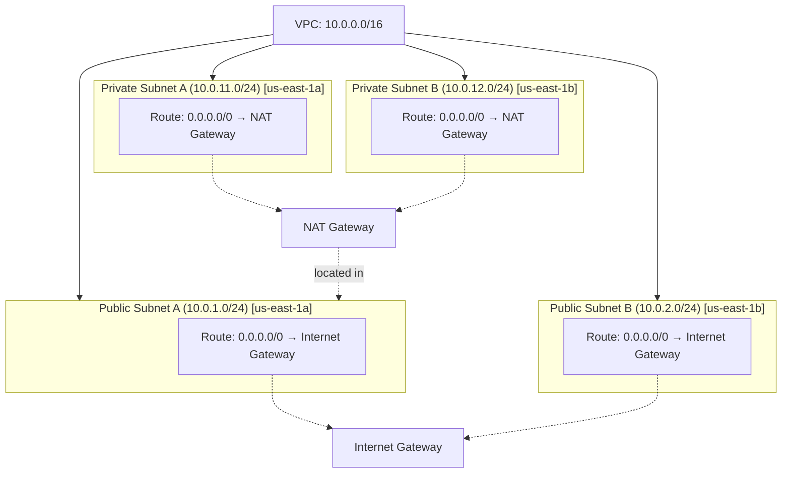

# Lesson 3: Network Architecture and Access Control

## 1. First-Principles Intuition & Invariants

Amazon Web Services approaches network security through the lens of defense-in-depth, a principle borrowed from military fortification strategy where multiple independent layers of control collectively enforce access boundaries. Unlike traditional enterprise networks where a single perimeter firewall mediates all traffic flows, AWS distributes security enforcement across architectural boundaries that map to natural isolation primitives: the Virtual Private Cloud forms the outermost network container, security groups operate as stateful instance-level firewalls, Network Access Control Lists provide stateless subnet-level filtering, and IAM policies govern programmatic access to the control plane itself. This multi-layered model acknowledges a fundamental invariant in distributed systems: trust boundaries must be established at every architectural seam where data crosses between actors of differing privilege levels.

The Virtual Private Cloud represents a software-defined network overlay carved from Amazon's physical substrate. When you provision a VPC, you claim an IP address space from the private RFC 1918 ranges—typically a /16 CIDR block like 10.0.0.0/16, yielding 65,536 addresses. This address space exists purely as a logical construct; behind the scenes, AWS maps your private IPs onto a fabric of physical switches and routers using network virtualization technologies similar to VXLAN or Geneve encapsulation. Each VPC operates as an isolated broadcast domain with its own routing table, DNS resolver, and egress path to the internet. No packet can traverse from one VPC to another without explicit configuration of peering connections or transit gateways, establishing VPC boundaries as hard security perimeters enforced by the hypervisor's virtual switch.

Within a VPC, subnets partition the address space into smaller blocks aligned with availability zones. A subnet represents both a routing domain and a failure domain: instances launched into a subnet inherit that subnet's route table and availability zone placement, binding network topology to physical datacenter geography. This coupling reflects a critical invariant in cloud architecture—high availability requires distributing workloads across multiple failure domains, and subnet design directly encodes these placement decisions. When you create a subnet, you specify both its CIDR block (a subset of the VPC's range) and its availability zone. A web tier might occupy 10.0.1.0/24 in us-east-1a, while a database tier resides in 10.0.2.0/24 in us-east-1b. The subnet boundary becomes a natural control plane for applying Network Access Control Lists, which filter traffic at ingress and egress based on five-tuple match criteria: source IP, destination IP, source port, destination port, and protocol.

Routing within a VPC follows a longest-prefix-match algorithm familiar from traditional IP networks. Each subnet associates with a route table containing ordered rules that map destination CIDR blocks to target gateways. The VPC's default route table includes an implicit local route covering the entire VPC CIDR, ensuring intra-VPC traffic forwards directly through the virtual switch without leaving the software-defined network boundary. Additional routes direct traffic toward specific targets: an Internet Gateway for public internet access, a NAT Gateway for private subnet egress, a Virtual Private Gateway for VPN connections, or a VPC Peering connection for cross-VPC communication. The route table evaluation occurs before security group or NACL filtering, establishing routing as the first gate in the packet processing pipeline.

Security groups and Network Access Control Lists provide complementary filtering mechanisms operating at different layers of the network stack. Security groups function as stateful, instance-level firewalls attached directly to elastic network interfaces. When you permit inbound TCP port 443 traffic in a security group, the return path automatically opens for response packets, maintaining connection state in the hypervisor's flow table. This statefulness mirrors the behavior of iptables with connection tracking enabled, where the kernel remembers established TCP sessions and permits return traffic without explicit rules. Security groups default to deny-all inbound and allow-all outbound, forcing you to explicitly enumerate permitted ingress paths—a principle of least privilege codified in the default policy.

Network Access Control Lists, by contrast, operate as stateless filters at subnet boundaries. Each rule in a NACL explicitly matches five-tuple criteria and either allows or denies the packet, with no memory of prior flows. If you permit inbound TCP port 443 in a NACL, you must separately permit the ephemeral port range (typically 1024-65535) for return traffic, as the NACL has no concept of connection state. This stateless design enables simpler, faster packet filtering in the virtual switch's fast path at the cost of more verbose rule sets. NACLs process rules in numerical order, with the first match terminating evaluation—a behavior inherited from traditional firewall chains that prioritize low-latency filtering over expressiveness.

The interaction between security groups and NACLs establishes a two-stage filtering pipeline. A packet destined for an EC2 instance first encounters the subnet's NACL at ingress, which evaluates the inbound rule set. If permitted, the packet proceeds to the instance's elastic network interface, where the attached security group performs a second evaluation. On the return path, the security group's stateful tracking automatically permits the response, but the subnet NACL must explicitly allow the outbound traffic through its egress rules. This layered model provides defense-in-depth: an overly permissive security group can be backstopped by restrictive NACL rules, while fine-grained instance-level controls in security groups avoid the blunt subnet-wide blocking of NACLs.

Identity and Access Management extends the layered security model into the control plane, governing API calls that provision, configure, and terminate infrastructure resources. IAM policies are JSON documents that grant or deny permissions to principals—users, roles, or services—across AWS services. Policy evaluation follows a deterministic algorithm: an explicit Deny always wins, absence of an Allow results in implicit denial, and multiple policies attached to a principal combine through union semantics. This evaluation model reflects a fundamental security invariant: in the absence of affirmative permission, actions default to forbidden. When an EC2 instance assumes an IAM role, the role's policy grants permissions to call specific APIs like `s3:GetObject` or `ec2:DescribeInstances`, scoping the instance's capabilities to the minimum required for its workload.

Resource-based policies invert the principal-based model by attaching permissions directly to resources like S3 buckets or KMS keys. A bucket policy might grant `s3:GetObject` to all principals in a specific AWS account, while simultaneously denying access unless the request arrives over TLS. The interplay between identity-based and resource-based policies requires understanding the evaluation chain: if both exist, AWS computes the intersection of permissions, granting access only when both policies allow the action. This intersection logic enables cross-account access patterns where the resource owner grants permission in a bucket policy while the principal's account administrator grants complementary permissions in an identity policy, requiring collaboration from both parties before access succeeds.

Encryption provides the final layer in the defense-in-depth model, protecting data confidentiality both in transit and at rest. TLS encryption for data in motion relies on asymmetric cryptography—RSA or ECDSA key exchange—to establish symmetric session keys, which encrypt bulk data via AES in Galois/Counter Mode. AWS Application Load Balancers and CloudFront distributions terminate TLS connections using certificates managed by AWS Certificate Manager, which automates certificate issuance, renewal, and deployment through integration with the Let's Encrypt protocol. Encryption at rest employs envelope encryption: a master key stored in AWS Key Management Service encrypts per-object data keys, which in turn encrypt the actual data blobs. This two-tier hierarchy enables efficient key rotation—updating the master key requires re-encrypting only the data keys, not the underlying data itself—while allowing KMS to audit every decryption request, providing cryptographic access control independent of network-layer filtering.

The convergence of network segmentation, stateful filtering, IAM authorization, and cryptographic protection establishes a security model resilient to failure of any single control. An attacker who bypasses the NACL still encounters security group rules; compromise of an IAM credential remains constrained by the credential's policy scope; interception of network traffic yields only ciphertext without access to KMS decryption keys. This layered architecture mirrors the design of secure operating systems, where rings of privilege isolation prevent escalation from user space to kernel space, and where capability-based security limits each process to its minimum required permissions.

## 2. Core Architecture & Mechanics

The Virtual Private Cloud architecture begins with address space allocation and subnet carving. When you create a VPC, you define a primary CIDR block—say, 10.0.0.0/16—which establishes the universe of private IP addresses available for assignment to instances, load balancers, and network interfaces. This /16 prefix provides 65,536 addresses, though AWS reserves five addresses per subnet: the network address, the VPC router address (network + 1), the DNS server address (network + 2), a reserved address for future use (network + 3), and the broadcast address (network + 255 for a /24 subnet). A subnet carved as 10.0.1.0/24 from the parent VPC CIDR thus provides 251 usable addresses rather than the theoretical 256.

Subnet creation couples IP address ranges with availability zone placement, embedding fault tolerance directly into the network topology. You might allocate 10.0.1.0/24 and 10.0.2.0/24 as public subnets in us-east-1a and us-east-1b respectively, each with a route to an Internet Gateway, while 10.0.11.0/24 and 10.0.12.0/24 serve as private subnets in the same zones, routing outbound traffic through a NAT Gateway in one of the public subnets. This topology ensures that failure of an entire availability zone impacts only half of your capacity, as instances in the surviving zone continue serving traffic. The mapping between subnet and availability zone remains immutable after creation—you cannot move a subnet between zones without recreating it—reflecting the physical reality that the subnet's IP range associates with specific racks and switches within a datacenter.



Routing tables govern traffic forwarding between subnets and external networks. Each route table contains an ordered list of destination CIDR blocks paired with target gateways. The implicit local route—10.0.0.0/16 → local—ensures that a packet from 10.0.1.5 destined for 10.0.11.8 forwards directly through the VPC's virtual switch without traversing an external gateway. This local route takes precedence over all other routes through longest-prefix matching: a /16 is less specific than any /24 subnet, so the route table evaluates the local route before considering narrower prefixes. Additional routes might include 0.0.0.0/0 → igw-abc123 for internet-bound traffic, or 192.168.0.0/16 → vgw-def456 for VPN-connected on-premises networks. Route table evaluation occurs in the VPC's virtual router, a distributed forwarding engine that exists as software running on the hypervisors hosting your instances, processing routing decisions at line rate before packets ever reach the instance's network interface.

The Internet Gateway provides stateful NAT and routing for instances with public IP addresses. When you attach an Internet Gateway to a VPC and add a 0.0.0.0/0 route pointing to it, instances in subnets with that route can initiate connections to the public internet. However, merely having a route is insufficient—the instance must also possess a public IP address, either an Elastic IP permanently allocated to the account or an auto-assigned public IP from Amazon's pool. The Internet Gateway performs 1:1 NAT, translating the instance's private 10.0.1.5 address to its public 54.192.1.5 address in outbound packets, and reversing the translation for inbound responses. This translation is stateful and bidirectional: once an outbound connection establishes a flow entry in the gateway's NAT table, return traffic automatically maps back to the private IP. For instances without public IPs—those in private subnets—the Internet Gateway refuses to forward traffic, enforcing the boundary between public and private network segments.

NAT Gateways enable private subnet instances to initiate outbound internet connections without exposing inbound attack surface. Unlike the Internet Gateway's 1:1 NAT, a NAT Gateway performs port address translation, mapping many private IPs onto a single public Elastic IP by multiplexing connections through ephemeral source port ranges. When an instance at 10.0.11.8:52341 sends a packet to 8.8.8.8:53, the NAT Gateway rewrites the source to its own public IP 54.192.2.1 and an available ephemeral port like 48392, records the mapping in its connection tracking table, and forwards the packet through the Internet Gateway. The DNS server at 8.8.8.8 observes the source as 54.192.2.1:48392 and returns its response to that address, which the NAT Gateway translates back to 10.0.11.8:52341 using its tracked state. This design allows hundreds of private instances to share a single public IP while preventing any inbound-initiated connections—the NAT table only contains entries for flows originated from the private side.

Security groups attach to elastic network interfaces, forming a stateful firewall that filters traffic at the instance level. Each security group contains inbound and outbound rules specified as five-tuple patterns: protocol (TCP, UDP, ICMP, or protocol number), port range (single port or range), and source or destination (CIDR block, security group ID, or prefix list). An inbound rule permitting TCP port 443 from 0.0.0.0/0 allows any internet client to initiate HTTPS connections to the instance, while the security group's stateful tracking automatically permits return traffic without requiring an explicit outbound rule. Security groups default to deny-all inbound, permit-all outbound, forcing you to explicitly enumerate allowed ingress paths. You can reference other security groups as sources, enabling rule patterns like "allow TCP 3306 from sg-database-clients," which dynamically adjusts as instances join or leave the client security group without manual rule updates.

```
Security Group: web-servers (sg-web123)
  Inbound:
    - Protocol: TCP, Port: 443, Source: 0.0.0.0/0
    - Protocol: TCP, Port: 22, Source: sg-bastion
  Outbound:
    - Protocol: All, Port: All, Destination: 0.0.0.0/0

Security Group: database-servers (sg-db456)
  Inbound:
    - Protocol: TCP, Port: 3306, Source: sg-web123
  Outbound:
    - Protocol: TCP, Port: 443, Destination: 0.0.0.0/0
```

The security group engine evaluates rules in parallel rather than sequentially, checking whether the packet matches any inbound allow rule. If multiple rules match, the most permissive wins—there is no first-match-wins ordering as in traditional firewall chains. This parallel evaluation enables the hypervisor to implement security groups in hardware-accelerated flow tables, achieving near-line-rate filtering without per-packet rule traversal overhead. The stateful connection tracking maintains a five-tuple hash table indexed by source IP, destination IP, source port, destination port, and protocol, with entries expiring after a timeout (typically 350 seconds for established TCP flows, 300 seconds for UDP). This state allows the security group to permit return packets without re-evaluating the full rule set, matching the efficiency of Linux's conntrack subsystem.

Network Access Control Lists complement security groups with stateless, subnet-level filtering. Each NACL contains numbered rules evaluated in ascending order, with processing stopping at the first match. A rule consists of a rule number (1-32766), protocol, port range, source or destination CIDR, and action (allow or deny). Unlike security groups, NACLs support explicit deny rules, enabling you to block specific IP ranges while allowing broader patterns. For example, rule 100 might allow TCP port 443 from 0.0.0.0/0, while rule 90 denies TCP port 443 from 198.51.100.0/24, effectively blacklisting that subnet while permitting the rest of the internet. The NACL evaluates inbound and outbound traffic separately with distinct rule sets, and because it is stateless, you must explicitly permit return traffic in the opposite direction. An inbound HTTPS rule requires a corresponding outbound rule allowing TCP ports 1024-65535 to handle ephemeral return ports from clients.

```
Network ACL: public-subnet-acl
  Inbound Rules:
    100: TCP, Port 443, Source 0.0.0.0/0, Allow
    110: TCP, Port 80, Source 0.0.0.0/0, Allow
    120: TCP, Port 22, Source 203.0.113.0/24, Allow
    32767: All, All, Source 0.0.0.0/0, Deny (implicit)
  
  Outbound Rules:
    100: TCP, Ports 1024-65535, Dest 0.0.0.0/0, Allow
    110: TCP, Port 443, Dest 0.0.0.0/0, Allow
    32767: All, All, Dest 0.0.0.0/0, Deny (implicit)
```

The packet processing pipeline sequences these filtering layers in a defined order. An inbound packet destined for an EC2 instance first encounters the subnet's NACL inbound rules at the virtual router. If permitted, it proceeds to the instance's elastic network interface, where the security group evaluates its inbound rules. Assuming both filters pass, the packet reaches the instance's network stack. On the return path, the instance sends a response packet which the security group automatically permits due to stateful tracking. The packet then encounters the subnet NACL's outbound rules, which must explicitly allow the ephemeral port. This two-stage pipeline with one stateful and one stateless layer provides defense-in-depth: the NACL can enforce coarse-grained subnet-wide blocks like geo-IP filtering or protocol restrictions, while security groups handle fine-grained, instance-specific policies.

IAM policy evaluation adds a control plane layer governing API operations that configure network infrastructure. An IAM principal—user, role, or service—must possess permissions to invoke APIs like `ec2:CreateSubnet`, `ec2:AuthorizeSecurityGroupIngress`, or `ec2:ModifyVpcAttribute`. Policies consist of JSON statements containing Effect (Allow or Deny), Action (API operation), Resource (ARN pattern), and optional Condition (context-based matching). A policy might allow `ec2:*` on resources tagged with `Environment=Development` while denying `ec2:DeleteVpc` regardless of tags, scoping administrative permissions to read-write development infrastructure but preserving production VPCs from accidental deletion. The policy evaluation algorithm starts with an implicit deny, processes all applicable policies to collect allows and explicit denies, and applies deny-override semantics where any explicit deny blocks the action.

```json
{
  "Version": "2012-10-17",
  "Statement": [
    {
      "Effect": "Allow",
      "Action": [
        "ec2:CreateVpc",
        "ec2:CreateSubnet",
        "ec2:CreateRouteTable",
        "ec2:CreateSecurityGroup"
      ],
      "Resource": "*",
      "Condition": {
        "StringEquals": {
          "aws:RequestedRegion": "us-east-1"
        }
      }
    },
    {
      "Effect": "Deny",
      "Action": [
        "ec2:DeleteVpc",
        "ec2:DeleteSubnet"
      ],
      "Resource": "*",
      "Condition": {
        "StringEquals": {
          "ec2:ResourceTag/Environment": "Production"
        }
      }
    }
  ]
}
```

Service Control Policies in AWS Organizations layer organization-wide restrictions atop individual IAM policies. An SCP acts as a permissions boundary, defining the maximum permissions available to accounts within an organizational unit. Even if a user's IAM policy grants `ec2:TerminateInstances`, an SCP that denies that action prevents its execution. This hierarchical model mirrors the privilege separation in operating systems, where kernel mode can perform any operation, but user mode processes operate within capabilities granted by the kernel. SCPs apply deny-before-allow logic: an explicit deny in an SCP cannot be overridden by any identity-based policy, enforcing organization-wide guardrails like preventing root account usage or restricting operations to specific regions.

Encryption in transit relies on Transport Layer Security negotiated through certificate-based authentication. When a client connects to an Application Load Balancer over HTTPS, the load balancer presents an X.509 certificate issued by AWS Certificate Manager, which the client validates against trusted root certificate authorities. The TLS handshake proceeds through key exchange (typically ECDHE for forward secrecy), cipher suite negotiation (preferring AES-128-GCM or ChaCha20-Poly1305), and session key derivation via HKDF. The negotiated symmetric session key encrypts application data with authenticated encryption, preventing both eavesdropping and tampering. AWS services like RDS and ElastiCache enforce TLS connections through parameter groups that reject plaintext clients, closing the encryption gap for database and cache traffic.

Encryption at rest employs envelope encryption managed by AWS Key Management Service. A KMS Customer Master Key—a 256-bit AES key that never leaves KMS hardware security modules—encrypts per-object data encryption keys. When storing an object in S3 with server-side encryption, S3 generates a random 256-bit data key, encrypts the object with that key via AES-256-GCM, requests KMS to encrypt the data key with the CMK, and stores both the ciphertext object and the encrypted data key. Retrieval reverses the process: S3 calls KMS to decrypt the data key, uses the plaintext key to decrypt the object, and returns the object to the client while discarding the plaintext data key from memory. KMS enforces policy-based access control on CMKs, requiring principals to possess both `kms:Decrypt` permissions and network access to the KMS API, providing cryptographic access control independent of network-layer security groups.

```
Envelope Encryption Flow:

1. Encrypt:
   - Generate random Data Encryption Key (DEK)
   - Encrypt data with DEK using AES-256-GCM
   - Call KMS to encrypt DEK with Customer Master Key (CMK)
   - Store: Encrypted Data + Encrypted DEK

2. Decrypt:
   - Retrieve Encrypted Data + Encrypted DEK
   - Call KMS to decrypt DEK using CMK
   - Decrypt data using plaintext DEK
   - Return plaintext data, discard plaintext DEK
```

VPC Flow Logs capture network telemetry at the elastic network interface, subnet, or VPC level, recording accepted and rejected traffic in a structured format. Each flow log entry contains source and destination IPs, ports, protocol, packet and byte counts, start and end timestamps, and action (ACCEPT or REJECT). The action field indicates whether security groups or NACLs blocked the traffic, enabling you to diagnose firewall misconfigurations. Flow logs publish to CloudWatch Logs or S3, where you can query them with CloudWatch Logs Insights or Athena to identify traffic patterns, detect anomalies, or investigate security incidents. The logging occurs asynchronously in the hypervisor's virtual switch, capturing a sample of packets rather than every packet to minimize performance impact while still providing representative visibility into traffic flows.

## 3. High-Performance Optimization & Failure Modes

VPC design for high availability begins with multi-AZ subnet topology and zone-aware service placement. Distributing subnets across at least two availability zones ensures that failure of a single datacenter does not render your application unreachable. Application Load Balancers span multiple zones by registering target instances in subnets across zones, distributing requests via cross-zone load balancing. When an availability zone fails, the load balancer detects unhealthy targets through health checks and removes them from the rotation, shifting traffic to surviving zones without manual intervention. This self-healing behavior requires that each zone maintains sufficient capacity to absorb the load of failed zones—a two-zone deployment must provision instances at 200% of steady-state demand in each zone to survive a zone failure without degradation.

NAT Gateway high availability requires provisioning a gateway in each availability zone rather than centralizing egress through a single gateway. A centralized NAT Gateway in us-east-1a becomes a single point of failure if that zone fails, cutting off internet access for private instances in us-east-1b even though their zone remains healthy. Deploying a NAT Gateway per zone and configuring each private subnet's route table to target the NAT Gateway in its local zone prevents cross-zone dependencies. This topology incurs higher cost—NAT Gateways bill per hour and per gigabyte processed—but eliminates availability zone correlation, ensuring that zone-local failures remain isolated.

Security group rule scaling impacts the virtual switch's flow table performance. Each rule permitting a CIDR block or security group reference expands into individual flow entries in the hypervisor's packet filter. A security group allowing TCP port 443 from 0.0.0.0/0 generates a single flow entry, but allowing 50 specific IP addresses expands into 50 entries, consuming more flow table space and increasing rule evaluation latency. Referencing another security group as the source is more efficient than enumerating IPs because the hypervisor maintains a dynamic mapping of security group membership to instance IPs, updating the flow table automatically as instances join or leave the group. The practical limit for security groups scales to hundreds of rules, but rule sets exceeding thousands of entries introduce noticeable packet processing latency, motivating consolidation of rules through CIDR aggregation or security group references.

Network Access Control List rule ordering creates failure modes where overly broad allow rules early in the sequence inadvertently permit traffic intended to be blocked by later deny rules. Consider a NACL with rule 100 allowing TCP port 22 from 0.0.0.0/0 and rule 200 denying TCP port 22 from 198.51.100.0/24. Because NACLs evaluate rules in numerical order and stop at the first match, traffic from 198.51.100.1 matches rule 100 and gains access, with rule 200 never evaluated. Correcting this requires inserting the deny rule at a lower number than the allow rule, such as rule 90, ensuring the specific denial processes before the broader allowance. This first-match-wins behavior differs from security groups' parallel evaluation, demanding careful attention to rule ordering and regular audits to prevent misconfigurations.

IAM policy overprivilege represents a common failure mode where developers grant `*:*` permissions to simplify initial development, then fail to tighten policies before production deployment. An EC2 instance role with `s3:*` permissions can read, write, or delete any object in any bucket, including those containing sensitive data or critical application state. Principle of least privilege dictates scoping policies to the minimum actions and resources required: `s3:GetObject` on `arn:aws:s3:::my-app-data/*` permits reading application data without allowing writes or access to other buckets. IAM Access Analyzer identifies overly permissive policies by analyzing cross-account access patterns, alerting you when an S3 bucket policy grants access to external accounts or when a role's trust policy allows assumption from unexpected principals.

Encryption key management failure modes center on lost or leaked Customer Master Keys. If you delete a KMS CMK, all data encrypted with that key becomes permanently unrecoverable—the encrypted data keys cannot be decrypted without the CMK, and KMS provides no backdoor decryption mechanism. AWS enforces a mandatory seven-day waiting period before completing CMK deletion, during which you can cancel the operation if the deletion was accidental. Key rotation policy mitigates the impact of key compromise by generating a new CMK version annually while preserving old versions for decrypting historical data. When you enable automatic key rotation, KMS transparently uses the new key version for encryption while retaining the ability to decrypt using any prior version, ensuring seamless access to data encrypted before rotation.

VPC Flow Log analysis for security monitoring requires filtering actionable signals from vast volumes of benign traffic. A typical production VPC generates millions of flow records per hour, the majority representing legitimate application communication. Anomaly detection focuses on traffic patterns deviating from baselines: connections to unusual destination ports, traffic spikes from specific source IPs, or rejected connection attempts that might indicate reconnaissance scanning. You can configure CloudWatch Metric Filters to increment counters when flow logs record REJECT actions, then alarm when rejections exceed thresholds, alerting you to potential attacks. More sophisticated analysis uses machine learning models trained on historical flow logs to identify deviations such as data exfiltration attempts characterized by sustained outbound traffic to external IPs.

Transit Gateway scalability enables hub-and-spoke network topologies where dozens of VPCs peer through a central routing hub rather than requiring full-mesh peering connections. A Transit Gateway eliminates the $N^2$ scaling problem of VPC peering—where 10 VPCs require 45 peering connections—by centralizing routing through a single shared router. Each VPC attaches to the Transit Gateway via an elastic network interface in each availability zone, and the gateway's route tables determine how traffic flows between VPCs. You can isolate VPCs into routing domains using separate route tables, preventing direct communication between development and production VPCs while allowing both to access shared services like centralized DNS or logging. Transit Gateway bandwidth scales to 50 Gbps per VPC attachment, sufficient for most enterprise workloads, with the ability to scale further through multiple attachments.

VPN performance over Virtual Private Gateways caps at 1.25 Gbps per tunnel due to single-core IPsec encryption processing. A Site-to-Site VPN connection establishes two IPsec tunnels for high availability, but each tunnel processes on a single CPU core, limiting throughput. For workloads requiring higher bandwidth, AWS Direct Connect provides dedicated physical connections from 1 Gbps to 100 Gbps, bypassing the public internet entirely. Direct Connect introduces deterministic latency and avoids IPsec encryption overhead, but requires provisioning physical circuits that take weeks to deploy. A hybrid approach uses Direct Connect for bulk data transfer while maintaining VPN tunnels as failover paths, ensuring connectivity survives Direct Connect circuit failures at the cost of reduced bandwidth during failover.

Security group rule auditing through AWS Config records every change to security group rules as configuration items with timestamps and actor attribution. Config tracks who added a rule allowing TCP port 3389 from 0.0.0.0/0, when the change occurred, and whether it violated organizational policies. Combining Config with Config Rules enables automated compliance checks: a rule that detects security groups allowing SSH from 0.0.0.0/0 triggers an SNS notification or Lambda function to automatically revoke the overly permissive rule. This automated remediation closes the window between misconfiguration and exploitation, reducing the mean time to remediation from hours (manual detection) to seconds (automated enforcement).

IAM credential rotation automates the replacement of access keys and passwords on a regular schedule, limiting the exposure window if credentials leak. An IAM user with access keys older than 90 days represents elevated risk—the longer a credential exists, the greater the probability of compromise through phishing, credential stuffing, or code leaks. AWS Identity Center (formerly SSO) eliminates long-lived access keys entirely by issuing temporary session tokens valid for hours rather than months, integrating with SAML identity providers to federate authentication from corporate directories. For programmatic access, EC2 instance profiles deliver temporary credentials that auto-rotate every six hours, ensuring stolen credentials expire rapidly without requiring application logic changes.

Network performance optimization for high-throughput workloads leverages Enhanced Networking, which uses single-root I/O virtualization to bypass the hypervisor's virtual switch. Enhanced Networking exposes the physical NIC directly to the instance via SR-IOV, eliminating software switching overhead and achieving near-line-rate performance up to 100 Gbps on larger instance types. The ENA (Elastic Network Adapter) driver in the instance operating system interfaces directly with the physical NIC, bypassing the hypervisor's packet processing and reducing latency from milliseconds to microseconds. This optimization requires instances from the Nitro family—m5, c5, r5, and newer—as older instance types lack SR-IOV hardware support.

Failure modes in encrypted communication include TLS version downgrade attacks and weak cipher suite negotiation. An attacker performing a man-in-the-middle attack might intercept the TLS handshake and falsely advertise that the server only supports TLS 1.0 with RC4 encryption, tricking the client into downgrading to a weak protocol vulnerable to BEAST or POODLE attacks. AWS Application Load Balancers mitigate this through security policies that define minimum TLS versions and permitted cipher suites. The ELBSecurityPolicy-TLS13-1-2-2021-06 policy enforces TLS 1.2 or 1.3 with only strong ciphers like AES-GCM and ChaCha20-Poly1305, rejecting weak ciphers and legacy protocols entirely. Regularly auditing and updating security policies ensures that as new vulnerabilities emerge, your load balancers adopt cryptographic best practices without requiring application changes.
