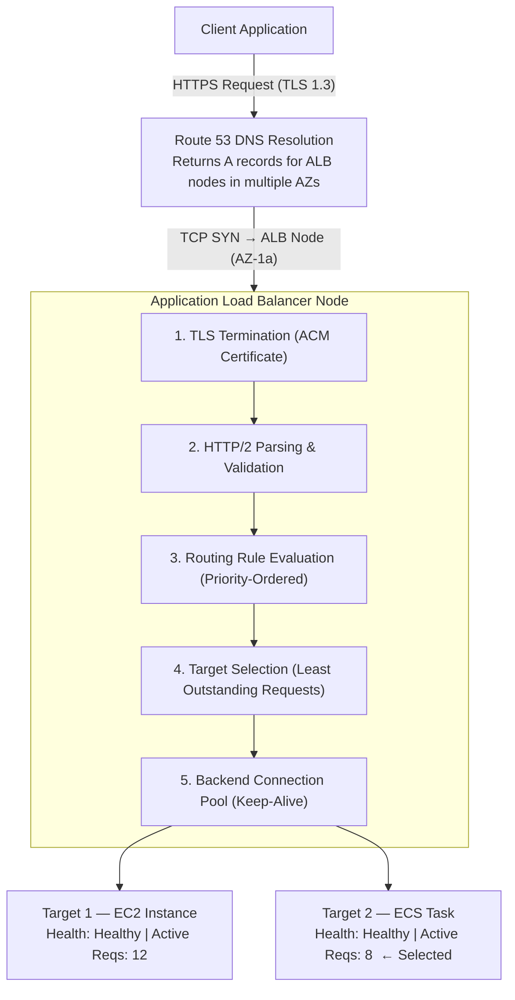

# Lesson 4: Load Balancing and Traffic Distribution

## 1. First-Principles Intuition & Invariants

The fundamental challenge of distributed systems at scale is orchestrating the smooth, equitable distribution of incoming connection streams across a dynamically shifting pool of stateful compute endpoints. Load balancing is not merely a convenience layer for horizontal scaling—it is the critical control plane that transforms a fragile collection of independent servers into a fault-tolerant, self-healing distributed system capable of withstanding cascading failures, traffic surges, and rolling deployments without dropping a single client request.

At its core, a load balancer is a stateful intermediary that terminates inbound connections, applies routing policy derived from real-time health signals, and forwards traffic to backend targets while maintaining connection affinity semantics that preserve application-layer session state. The OSI model provides the natural taxonomy for understanding the trade-offs inherent in load balancing architecture: layer 4 balancing operates on transport-layer flows, treating each TCP or UDP stream as an opaque byte sequence and routing based solely on IP quintuple (source IP, source port, destination IP, destination port, protocol). Layer 7 balancing, by contrast, terminates the full HTTP or gRPC session, parses application headers and payloads, and routes based on semantic content such as URI paths, request methods, cookies, or even JWT claims embedded in authorization headers.

Amazon Web Services offers three distinct Elastic Load Balancing products, each occupying a unique position in the latency-flexibility-cost design space. The Classic Load Balancer (ELB) is the original incarnation, a now-deprecated hybrid that supports both layer 4 and limited layer 7 routing but lacks the sophisticated rule-based forwarding and WebSocket support of modern balancers. The Application Load Balancer (ALB) is purpose-built for HTTP/HTTPS and HTTP/2 traffic, providing deep content-based routing, native support for microservices patterns such as host-based and path-based routing, and integration with AWS certificate management for transparent TLS termination. The Network Load Balancer (NLB) operates at layer 4, offering ultra-low latency, source IP preservation, and the ability to handle millions of requests per second with minimal jitter—essential for latency-sensitive protocols such as game servers, real-time bidding exchanges, and high-frequency trading systems.

The invariants that govern all AWS load balancer architectures stem from the CAP theorem and the physics of distributed consensus. A load balancer must continuously reconcile two competing imperatives: maximizing availability by routing around failed targets, and maintaining consistency by respecting session affinity so that stateful applications see the same backend across sequential requests. AWS balancers achieve this through a distributed control plane that maintains eventual consistency across multiple availability zones, coupled with sub-second health check convergence that propagates target state changes through the routing layer faster than most applications can detect a connection timeout.

Health checking is the sensory nervous system of a load balancer, the continuous feedback loop that distinguishes a responsive target from a failed or overloaded one. AWS health checks operate on two dimensions: the transport-layer liveness probe, which establishes a raw TCP connection to verify network reachability, and the application-layer readiness probe, which issues a full HTTP request and validates both the response status code and optional response body pattern matching. The health check state machine is deliberately hysteretic, requiring multiple consecutive successes to mark a target healthy and multiple consecutive failures to mark it unhealthy, thereby filtering out transient network glitches and preventing oscillation that would otherwise manifest as client-visible connection resets during state transitions.

Connection draining and graceful shutdown semantics are the mechanisms by which load balancers enable zero-downtime deployments and rolling upgrades. When an operator deregisters a target or an autoscaling policy scales down capacity, the load balancer immediately stops routing new connections to the condemned target but continues to honor existing persistent connections for a configurable drain period, typically 300 seconds. During this window, long-lived WebSocket streams, chunked transfer-encoded downloads, and gRPC bidirectional streams can complete naturally without interruption. The target itself must cooperate by implementing graceful shutdown: upon receiving SIGTERM, it stops accepting new connections, finishes processing in-flight requests, closes idle keep-alive connections, and only then exits the process. This choreography requires tight coupling between the load balancer's connection tracking state, the application's signal handlers, and the orchestration layer's termination grace period.

Target group affinity, often called session stickiness or sticky sessions, binds a client to a specific backend target for the duration of a logical session, solving the state synchronization problem for applications that maintain in-memory session stores or user authentication tokens. AWS implements affinity through duration-based cookies (ALB-managed, with a configurable TTL) or application-controlled cookies (where the backend sets an explicit session identifier). The trade-off is stark: enabling stickiness improves application correctness by avoiding mid-session target migration, but it undermines load distribution uniformity and complicates failure recovery, since a target failure now discards all pinned sessions rather than affecting only the in-flight requests.

The layer 4 versus layer 7 routing decision is a fundamental architectural choice that cascades through every dimension of system performance, operational visibility, and security posture. Layer 4 balancing offers minimal latency overhead—typically sub-millisecond—because the balancer performs no deep packet inspection and maintains no application state beyond the flow quintuple hash. Source IP preservation becomes trivial since the balancer can operate in direct server return (DSR) mode or use proxy protocol headers to forward the original client IP. However, layer 4 balancing is blind to application semantics: a single misbehaving HTTP client issuing long-polling requests can monopolize a backend thread, and the balancer has no insight into request-level success rates, P99 latencies, or error code distributions. Layer 7 balancing inverts these trade-offs: by terminating TLS and parsing HTTP, the ALB can route requests based on URL paths, enabling sophisticated microservices architectures where a single hostname multiplexes traffic across dozens of backend services. The cost is increased latency—typically 1-3 milliseconds of additional buffering and parsing overhead—and the loss of end-to-end encryption unless the balancer re-encrypts traffic to backends.

The physics of connection establishment and termination impose fundamental limits on load balancer throughput and client-perceived latency. Each new TCP connection requires a three-way handshake (SYN, SYN-ACK, ACK), imposing a minimum latency equal to one round-trip time between client and balancer. TLS 1.2 adds two additional round trips for the certificate exchange and key negotiation, while TLS 1.3 reduces this to a single round trip through pre-shared keys or session resumption. HTTP/2 multiplexing amortizes connection overhead by pipelining dozens of concurrent requests over a single TCP stream, but it introduces head-of-line blocking if the underlying TCP connection experiences packet loss. HTTP/3 and QUIC resolve this by replacing TCP with UDP and implementing per-stream flow control, but as of this writing, ALB does not natively support HTTP/3, requiring operators to deploy a separate proxy layer or rely on CloudFront's QUIC termination.

The distributed nature of AWS load balancers introduces eventual consistency semantics that can surprise operators accustomed to on-premises hardware balancers. When you register a new target or update a health check configuration, the change must propagate through the load balancer's control plane—a distributed Raft-like consensus system spanning multiple availability zones. This propagation is not instantaneous; it typically completes within a few seconds, but during this convergence window, different load balancer nodes may route traffic based on stale target state. This eventual consistency is the price of high availability: because no single load balancer node can become a coordination bottleneck, the system can continue routing traffic even if an entire availability zone fails, but it cannot guarantee strict linearizability of configuration updates.

The monetary cost model for AWS load balancers is multidimensional, charging separately for provisioned capacity (measured in load balancer capacity units, or LCUs), data transfer, and the number of routing rules evaluated per request. An LCU represents a composite metric: the maximum of new connections per second, active connections per minute, data processed per hour, and rule evaluations per second. For ALBs, a single LCU can handle 25 new connections per second, 3,000 active connections, 1 GB of data transfer, or 1,000 rule evaluations. NLBs use a different metric: 800 new connections per second, 100,000 active connections, 1 GB of data transfer, or—for TLS-terminating NLBs—50 new TLS connections per second. Understanding this cost structure is essential for capacity planning: a high-volume API serving small requests will exhaust the connection rate dimension first, while a video streaming service will hit the data transfer ceiling.

## 2. Core Architecture & Mechanics

AWS load balancers are implemented as a distributed control plane and data plane architecture, where the control plane manages target registration, health check orchestration, and routing policy propagation, while the data plane consists of a horizontally scaled fleet of stateless packet forwarding nodes. Each load balancer is deployed across multiple availability zones for fault tolerance, with DNS-based geographic routing distributing client connections across these zones. When a client resolves the load balancer's DNS name, Route 53 returns multiple A records representing load balancer nodes in different availability zones, and the client's operating system resolver typically selects one at random or in round-robin fashion.

The ALB request processing pipeline begins with TLS termination, where the load balancer decrypts the client's TLS session using certificates provisioned through AWS Certificate Manager or uploaded directly. The decrypted HTTP request is then parsed and validated against HTTP/1.1 or HTTP/2 framing rules, with malformed requests rejected before reaching the routing engine. The routing engine evaluates a prioritized list of listener rules, each consisting of conditions (host header, path pattern, HTTP method, source IP CIDR, query string parameters, HTTP headers) and actions (forward to target group, redirect, return fixed response, authenticate via Cognito or OIDC). Rules are evaluated in ascending priority order, and the first matching rule determines the request's fate. If the winning action is a forward, the ALB selects a target from the destination target group using the configured load balancing algorithm.

The selection algorithm choices differ subtly but meaningfully. Round-robin cycling is the simplest: the ALB maintains a logical cursor over the target list and advances it with each request, ensuring perfectly uniform distribution assuming all targets have equal capacity and all requests impose equal load. Least outstanding requests is a dynamic algorithm that tracks the number of active HTTP requests per target and routes new requests to the target with the smallest backlog, naturally adapting to heterogeneous target capacity and request processing times. This algorithm excels for workloads with high variance in request latency—imagine an API where 90% of requests complete in 10 milliseconds but 10% involve database queries that take 500 milliseconds. Least outstanding requests automatically shields fast targets from being overwhelmed by slow requests.

Target health state transitions follow a strict state machine to prevent flapping. A newly registered target begins in the `initial` state and immediately receives health check probes. After `HealthyThresholdCount` consecutive successful probes (default 5, configurable from 2 to 10), the target transitions to `healthy` and begins receiving production traffic. If a healthy target fails `UnhealthyThresholdCount` consecutive probes (default 2), it transitions to `unhealthy`, and the load balancer immediately stops routing new requests but allows existing connections to drain. If health checks subsequently succeed, the target transitions back to `healthy` through the same consecutive success requirement. The interval between probes is configurable from 5 to 300 seconds, with a timeout from 2 to 120 seconds, and the total time to detect a failure is therefore `UnhealthyThresholdCount × Interval`, typically 10 to 20 seconds for default configurations.

Connection draining is implemented through a deregistration delay timer, configurable from 0 to 3600 seconds with a default of 300 seconds. When a target enters the `draining` state—either through explicit deregistration or autoscaling scale-down—the load balancer sets a timestamp and continues to forward traffic for existing connections but refuses to initiate new requests. HTTP keep-alive connections are particularly subtle: the ALB sends a `Connection: close` header on the next response to signal the client to close the connection after receiving the current response, but it does not forcefully terminate the socket. Long-polling requests, WebSocket upgrades, and HTTP/2 streams persist until the application or client closes them or the drain timer expires. Once the timer fires, the load balancer forcefully closes all remaining sockets, sending TCP RST packets to both client and target.

NLB architecture diverges fundamentally from ALB because it operates at layer 4, forwarding TCP and UDP packets without terminating or parsing them. Each NLB node maintains a connection tracking table mapping client flow quintuples to backend target addresses, typically implemented as a high-performance hash table with collision chaining. When the first packet of a new flow arrives, the NLB applies the configured load balancing algorithm—either flow hash (deterministic 5-tuple hashing) or least outstanding connections—to select a target, creates an entry in the connection table, and forwards the packet with minimal modification. Subsequent packets in the same flow perform a hash table lookup and are forwarded to the same target, ensuring connection affinity without application-layer session cookies.

Source IP preservation is a critical feature for applications that require client IP visibility for geolocation, rate limiting, or access control. NLB supports three modes. In standard mode, the NLB performs source NAT, rewriting the source IP address to the NLB node's private IP, which means backend targets see all traffic originating from the load balancer. In client IP preservation mode, available when targets are specified by instance ID (not IP address), the NLB forwards packets with the original client IP intact, allowing the backend to inspect the true source. The third mode uses the proxy protocol, where the NLB prepends a human-readable or binary header containing the original source IP and port before the first data byte, and the backend application must explicitly parse this header.

Health check mechanics for NLB differ from ALB because the NLB cannot parse application-layer responses. A TCP health check establishes a three-way handshake with the target and immediately closes the connection, marking the target healthy if the handshake completes successfully. A UDP health check is more complex because UDP is connectionless: the NLB sends a UDP datagram to the target and waits for any response or an ICMP port unreachable message. If the target is a UDP echo service, it reflects the packet back; if it's a real application, the health check cannot distinguish between "healthy but ignoring our probe" and "unhealthy," so UDP health checks are often supplemented by application-level monitoring.

Cross-zone load balancing is disabled by default for NLB and enabled by default for ALB, reflecting a deliberate cost-versus-availability trade-off. When cross-zone balancing is disabled, each load balancer node distributes traffic only to targets in its own availability zone, minimizing inter-AZ data transfer costs but risking uneven distribution if zones have different target counts. Enabling cross-zone balancing allows each node to route to targets in any zone, achieving perfect distribution at the cost of inter-AZ data transfer charges (typically $0.01 per GB). For high-availability systems, the operational benefit of uniform load distribution almost always outweighs the marginal cost increase.

Target group attributes provide fine-grained control over connection handling and request routing behavior. The deregistration delay controls drain timeout as previously discussed. The stickiness configuration enables session affinity through duration-based cookies, with the ALB setting an `AWSALB` cookie in HTTP responses containing an encrypted target identifier and TTL. The slow start mode gradually increases the weight of newly healthy targets over a warm-up period (30 to 900 seconds), preventing a cold cache from being overwhelmed by a full traffic load immediately upon returning to service. The load balancing algorithm attribute selects between round-robin and least outstanding requests for ALBs, or flow hash and least outstanding connections for NLBs.

Advanced routing patterns leverage ALB listener rules to implement sophisticated traffic shaping. Weighted target groups enable canary deployments by splitting traffic across multiple target groups, for example routing 95% of requests to the stable version and 5% to the canary. Header-based routing allows a single ALB to multiplex traffic for multiple microservices based on custom HTTP headers, reducing the number of load balancers required and simplifying DNS management. Fixed-response actions serve static HTTP responses directly from the load balancer for health checks or API documentation endpoints, eliminating unnecessary backend requests. Redirect actions enforce HTTPS, append trailing slashes, or rewrite URLs without involving backend targets.

The internal packet flow for an ALB-forwarded HTTPS request illustrates the full request lifecycle. The client initiates a TCP three-way handshake with the ALB node, then performs a TLS handshake, presenting SNI (Server Name Indication) to select the correct certificate. The ALB decrypts the HTTP request, parses headers, evaluates routing rules, and selects a target. If connection reuse is enabled and the ALB has an existing connection to the chosen target, it writes the request over this persistent connection; otherwise, it establishes a new backend connection, potentially with TLS re-encryption if backend authentication is enabled. The backend processes the request, streams the response back to the ALB, which buffers or streams it to the client depending on the response size and content encoding. Connection keep-alive timers on both client-facing and target-facing connections determine when idle connections are closed, with typical defaults of 60 seconds for client connections and 350 seconds for backend connections.

Network Load Balancer packet forwarding operates at a lower layer, with correspondingly lower latency and higher throughput. When a TCP SYN packet arrives at an NLB node, the node computes a hash of the flow quintuple, uses consistent hashing to select a target, and forwards the SYN with optional source IP preservation. The target responds with SYN-ACK, which the NLB forwards back to the client, completing the handshake. All subsequent packets in this flow are hashed to the same target through connection tracking, with typical per-packet latency under 100 microseconds. The NLB node maintains minimal per-flow state—just the mapping from flow tuple to target address—allowing it to handle millions of concurrent flows with minimal memory overhead.

Connection tracking state lifetime is controlled by idle timeout settings, configurable from 60 to 432,000 seconds for TCP and 30 to 600 seconds for UDP. When no packets traverse a flow for the idle timeout period, the NLB removes the connection tracking entry, and subsequent packets from the same client may hash to a different target, breaking application-level session affinity. For long-lived connections such as database replication streams or persistent gRPC channels, operators must carefully tune idle timeouts to exceed the maximum expected inter-packet gap, or implement application-level keepalives to prevent premature connection reaping.

Elastic IP addresses and static IP support differentiate NLB from ALB. Each NLB node in an availability zone can be assigned a static Elastic IP address, allowing operators to whitelist load balancer IPs in firewall rules and maintain stable endpoint addressing even as the NLB scales. ALBs, by contrast, use dynamic IP addresses that change as the load balancer scales or during maintenance events, requiring operators to whitelist based on security group rules or DNS names rather than static IPs. This architectural difference stems from the NLB's layer 4 nature: because it does not terminate TLS or parse HTTP, it can operate as a nearly transparent packet forwarder, whereas the ALB's deep inspection requires a more dynamic, horizontally scaled architecture.

## 3. High-Performance Optimization & Failure Modes

Optimizing load balancer performance begins with right-sizing the deployment topology and provisioned capacity. For ALBs, operators must estimate peak load across four dimensions: new connections per second, active connections, data transfer rate, and rule evaluation rate. A typical web application serving 10,000 requests per second with 50 KB average response size and connection keep-alive enabled might sustain 1,000 new connections per second (assuming 10 requests per connection), 5,000 active connections (with 500 ms average response time), 500 MB/s data transfer (10,000 requests × 50 KB), and 10,000 rule evaluations per second (assuming a single matching rule per request). Converting to LCUs: 1,000/25 = 40 LCUs for new connections, 5,000/3,000 = 1.67 LCUs for active connections, 1,800 GB/hour / 1 GB = 1,800 LCUs for data transfer, and 10,000/1,000 = 10 LCUs for rule evaluations. The load balancer must provision capacity for the maximum dimension, in this case 1,800 LCUs, though AWS automatically scales capacity in response to traffic patterns with a warm-up period of several minutes.

Pre-warming is essential for anticipated traffic surges such as product launches, seasonal sales, or scheduled maintenance cutover events. AWS load balancers automatically scale capacity, but the scaling process is not instantaneous—it typically requires 5 to 7 minutes to double capacity. If your traffic will increase more than 50% within a 5-minute window, you should submit a pre-warming request to AWS Support, specifying the expected traffic pattern, duration, and load balancer ARN. AWS will then manually provision additional capacity ahead of the event. For NLBs, pre-warming is less critical because the stateless, connection-tracking architecture scales more elastically, but extremely high connection rates (above 1 million new connections per second) still benefit from advance notification.

Connection pooling on the backend application tier dramatically improves ALB efficiency by reducing the overhead of repeated TCP and TLS handshakes. When an ALB forwards requests to the same target repeatedly, it reuses existing backend connections through HTTP keep-alive, but the application must cooperate by keeping sockets open rather than closing them after each response. Application frameworks differ in their default behavior: Node.js HTTP servers enable keep-alive by default, while Python WSGI servers often require explicit configuration. The ideal pool size depends on request concurrency: a backend handling 100 concurrent requests should maintain at least 100 connections to avoid queueing delays, but excessive pools waste memory and file descriptors. Monitoring the `TargetConnectionErrorCount` and `TargetResponseTime` CloudWatch metrics reveals whether connection pooling is working effectively.

TLS session resumption reduces handshake latency for returning clients by caching session keys and reusing them across multiple connections. ALBs support both session ID-based resumption (TLS 1.2) and session ticket-based resumption (TLS 1.2 and 1.3), with tickets encrypted using a key that rotates every 12 hours. Session resumption can reduce handshake latency from two round trips to one for TLS 1.2 and eliminate the extra round trip entirely for TLS 1.3. Operators should monitor the `ClientTLSNegotiationErrorCount` metric to detect misconfigured cipher suites or certificate issues that prevent successful resumption.

Target response time variance is the enemy of predictable latency. Even if the median response time is 50 milliseconds, a P99 of 5 seconds will cause user-visible timeouts and retries. The least outstanding requests algorithm helps by avoiding overloaded targets, but it cannot compensate for fundamental application bottlenecks such as slow database queries or unbounded thread pool growth. Operators should implement request timeout enforcement at both the ALB and application layers: the ALB idle timeout (default 60 seconds) determines how long the load balancer will wait for a target to send data before forcefully closing the connection, while the application should set aggressive internal timeouts (typically 1 to 5 seconds for API calls) to fail fast and release resources rather than accumulating blocked threads.

Sticky session failure modes arise when a pinned target becomes unhealthy or is deregistered. If stickiness is enabled and the target specified in the `AWSALB` cookie is unavailable, the ALB falls back to selecting a new target using the load balancing algorithm, but any session state stored in memory on the original target is lost, potentially logging out the user or discarding a shopping cart. Distributed session stores such as ElastiCache or DynamoDB eliminate this failure mode by externalizing state, allowing any backend target to service a request, but they introduce additional latency and cost. For applications that require stickiness, operators should tune the cookie TTL to match the application's session timeout and implement health check endpoints that fail when the application is unable to serve requests, ensuring that the ALB detects failures before clients do.

Health check tuning requires balancing responsiveness against false positives. Aggressive settings such as a 5-second interval, 2-second timeout, and 2 consecutive failure threshold detect failures in 10 seconds but may mark targets unhealthy due to transient network hiccups or garbage collection pauses. Conservative settings such as a 30-second interval and 5 failure threshold take 150 seconds to detect failures, during which clients experience connection timeouts. The optimal configuration depends on application characteristics: stateless services with fast startup times benefit from aggressive health checks and rapid failover, while stateful services such as databases should use conservative settings to avoid unnecessary failover and state loss.

Connection draining edge cases emerge during autoscaling scale-down events. Imagine an autoscaling group with a 300-second deregistration delay and a 180-second instance termination grace period. If the autoscaling policy scales down during peak traffic, the ALB places targets in draining state, but the EC2 instances terminate after 180 seconds, forcefully closing connections that have not yet completed. To prevent this, the termination grace period must exceed the deregistration delay, and the application should handle SIGTERM by immediately stopping new request acceptance, completing in-flight requests within the remaining grace period, and exiting cleanly. Kubernetes users deploying to EKS should align the pod `terminationGracePeriodSeconds` with the target group deregistration delay and implement preStop hooks that call the application's graceful shutdown endpoint.

Cross-zone load balancing failure modes occur when availability zone imbalances interact with disabled cross-zone routing. Suppose an autoscaling group deploys 10 instances: 7 in us-east-1a and 3 in us-east-1b. If cross-zone balancing is disabled, clients hashing to the us-east-1b load balancer node will distribute traffic across only the 3 local targets, imposing more than twice the load per instance compared to us-east-1a. If one of the 3 instances fails, the remaining 2 will experience 50% load increase, potentially cascading into overload. Enabling cross-zone balancing eliminates this pathology at the cost of inter-AZ data transfer fees, which for most applications is a negligible fraction of total AWS spend.

Rule evaluation performance degrades linearly with the number of rules configured on a listener. Each request evaluates rules in priority order until a match is found, so placing the most frequently matched rules at the top minimizes evaluation cost. Rules with complex conditions—particularly those using query string or header matching with multiple key-value pairs—consume more CPU cycles than simple path-based rules. For ALBs serving high request rates, operators should minimize the number of rules, consolidate similar patterns using wildcard path matching, and avoid regular expression rules unless absolutely necessary. The `RuleEvaluations` CloudWatch metric tracks the total number of rule evaluations per second, and if this metric approaches 1,000 LCUs worth of evaluations, rule consolidation becomes critical.

NLB connection tracking table exhaustion is a rare but catastrophic failure mode. Each NLB node maintains a finite connection tracking table, typically sized to handle millions of concurrent flows. If clients establish connections faster than they close them—for example, a misbehaving application that leaks sockets or a distributed denial-of-service attack—the tracking table fills, and the NLB begins dropping new connection attempts. Monitoring the `ActiveFlowCount` and `NewFlowCount` metrics reveals tracking table pressure. Mitigation strategies include implementing connection rate limiting at the application layer, deploying AWS WAF in front of the NLB (if using ALB in front of NLB), or increasing idle timeout values to encourage faster connection reaping.

TLS performance optimization for NLB focuses on cipher suite selection and session resumption. Modern TLS 1.3 cipher suites such as TLS_AES_128_GCM_SHA256 offer superior performance and security compared to legacy TLS 1.2 suites, reducing CPU overhead and handshake latency. NLBs support custom security policies that allow operators to disable weak ciphers and enforce forward secrecy through ephemeral Diffie-Hellman key exchange. For applications requiring maximum security, operators should select the `TLS-1-3-2021-06` security policy, which restricts connections to TLS 1.3 exclusively. For applications requiring compatibility with older clients, the `ELBSecurityPolicy-TLS13-1-2-2021-06` policy provides a balanced default supporting both TLS 1.3 and strong TLS 1.2 ciphers.

Failure isolation through availability zone partitioning is a critical high-availability pattern. By deploying at least one load balancer node and multiple targets in each of three availability zones, the system can tolerate a complete zone failure without service disruption. Clients in the failed zone will experience connection failures, but Route 53 health checks will detect the outage and remove the failed zone's load balancer nodes from DNS responses within 30 to 60 seconds, after which subsequent requests resolve to healthy zones. Applications should implement client-side retry logic with exponential backoff to ride through the brief DNS convergence window.

Monitoring and alerting on load balancer health requires tracking several key CloudWatch metrics. The `UnHealthyHostCount` metric indicates degraded capacity and should trigger alerts when it exceeds 0 for more than 5 minutes. The `TargetResponseTime` metric at P99 reveals latency outliers that may indicate application bottlenecks. The `HTTPCode_Target_5XX_Count` metric distinguishes backend errors from client errors and should trigger investigation when the error rate exceeds 1% of total requests. The `RejectedConnectionCount` metric indicates that the load balancer's connection queue is full, suggesting insufficient provisioned capacity or a sudden traffic surge requiring pre-warming.

Capacity planning for future growth requires extrapolating current metrics and adding headroom for traffic spikes. If your ALB currently handles 1,000 requests per second during peak hours and you anticipate 50% year-over-year growth, you should plan for 1,500 requests per second next year. Adding 2x headroom for unexpected traffic surges yields a target of 3,000 requests per second. Converting to LCUs depends on your application's specific characteristics, but for a typical API with 100 KB average response size, connection keep-alive, and single-rule routing, you would need approximately 120 new connections per second (assuming 25 requests per connection), 750 active connections (assuming 250 ms average response time), 300 MB/s data transfer, and 3,000 rule evaluations per second. This translates to approximately 1,080 LCUs for data transfer as the dominant dimension.

Disaster recovery and regional failover require multi-region load balancer deployment with Route 53 health checks and failover routing policies. The primary region runs an ALB serving production traffic, while a secondary region maintains a warm standby ALB with a smaller autoscaling group. Route 53 health checks continuously probe the primary region's ALB health endpoint, and if the health check fails for three consecutive intervals (typically 30 seconds), Route 53 automatically updates DNS records to point to the secondary region. This architecture tolerates complete regional failures but imposes RPO (Recovery Point Objective) equal to the replication lag between primary and secondary databases, and RTO (Recovery Time Objective) equal to the Route 53 failover detection time plus the secondary region's autoscaling warm-up period, typically 5 to 10 minutes total.

Cost optimization for load balancers focuses on minimizing LCU consumption and data transfer charges. Enabling HTTP/2 and connection keep-alive reduces new connection rates, lowering the new connections per second LCU dimension. Compressing responses with gzip or Brotli encoding reduces data transfer, lowering the bytes processed per hour dimension. Consolidating multiple small load balancers into a single ALB with path-based routing reduces the fixed hourly charge (currently $0.0225 per hour per ALB) at the cost of reduced failure isolation. For extremely high-throughput applications, NLB offers better cost efficiency than ALB because layer 4 forwarding consumes fewer LCUs per request, though operators sacrifice content-based routing and native WebSocket support.

The future evolution of AWS load balancers will likely focus on reduced latency through edge computing integration, improved observability through native distributed tracing, and enhanced security through automatic anomaly detection and DDoS mitigation. AWS Global Accelerator already provides anycast IP addresses that route client connections to the nearest AWS edge location, reducing initial connection latency by up to 60% for geographically distributed clients. X-Ray integration allows ALBs to inject trace IDs into requests, enabling end-to-end distributed tracing across microservices. Machine learning-based anomaly detection could automatically identify and block malicious traffic patterns without requiring manual WAF rule configuration. As these capabilities mature, load balancers will evolve from simple traffic distribution mechanisms into intelligent traffic management layers that optimize performance, security, and cost simultaneously.
