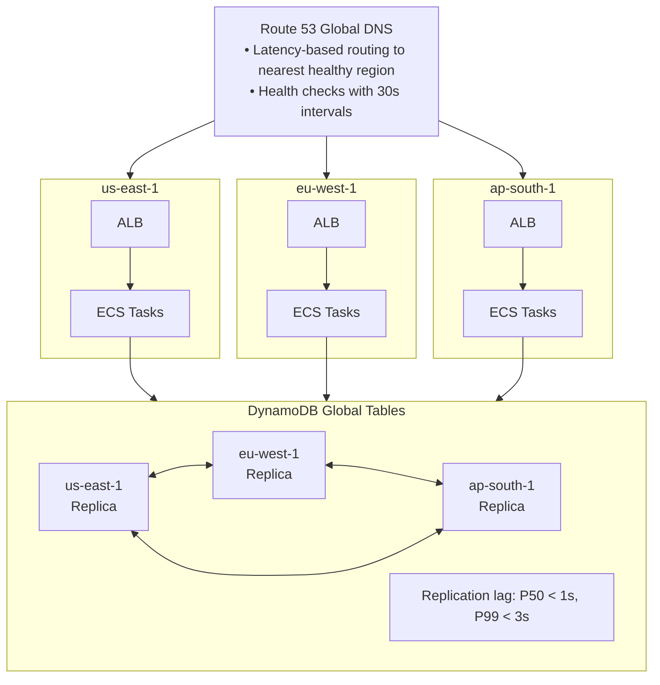

# Lesson 6: Distributed Systems Patterns and Resilience

## 1. First-Principles Intuition & Invariants

Distributed systems fundamentally challenge our intuitions about computation. In a monolithic application running on a single machine, we operate within a shared memory space where state transitions occur atomically, time progresses monotonically through a single system clock, and failure modes reduce to binary outcomes: the process either runs or crashes. Distributed systems shatter these comfortable assumptions. State becomes partitioned across independent failure domains separated by unreliable networks. Time loses its global meaning as clocks drift and network latency introduces unbounded delay. Failures manifest not as clean crashes but as partial degradations, network partitions, and Byzantine behaviors where components appear alive yet produce incorrect results.

The CAP theorem, formalized by Eric Brewer and proven by Seth Gilbert and Nancy Lynch, establishes the fundamental impossibility result that governs all distributed data stores. Any networked shared-data system can provide at most two of three guarantees: Consistency (all nodes see the same data simultaneously), Availability (every request receives a response), and Partition tolerance (the system continues operating despite arbitrary message loss). Since network partitions are a physical reality in distributed systems—routers fail, cables degrade, switch fabric becomes congested—we must always choose partition tolerance, forcing an explicit tradeoff between consistency and availability. Amazon Web Services architect Werner Vogels captured this pragmatic reality when he coined the term "eventual consistency," acknowledging that most real-world systems prioritize availability and accept temporary inconsistency, guaranteeing only that all replicas converge to the same state given sufficient time without updates.

AWS infrastructure embodies these principles through deliberate architectural choices. The platform partitions the world into twenty-eight geographic Regions, each containing multiple isolated Availability Zones connected by high-bandwidth, low-latency private fiber links. Within a Region, Availability Zones provide independent power supplies, cooling systems, and network connectivity, implementing failure domains at the physical data center level. Cross-region replication occurs over the public internet or dedicated AWS backbone, introducing higher latency and lower bandwidth compared to intra-region links. This topology forces architects to reason explicitly about failure domains, data locality, and consistency models.

The mathematics of distributed consensus underpin reliable state replication. The Raft consensus algorithm, which powers etcd, Consul, and many AWS internal control planes, requires a quorum of $Q = \lfloor N/2 \rfloor + 1$ nodes to agree before committing any state change. In a five-node cluster, three nodes must acknowledge each write. This quorum requirement ensures safety during network partitions: at most one partition can contain a majority, preventing split-brain scenarios where divergent state gets committed in isolated subgroups. The latency cost of consensus becomes evident in the critical path: every write must traverse the network to $Q-1$ remote nodes, wait for disk fsync operations, and receive acknowledgments before returning to the client. For a cross-AZ Raft cluster with 2ms inter-AZ latency and 5ms disk commit time, the minimum write latency approaches 7ms even under ideal conditions.

AWS services implement consistency models along a spectrum. DynamoDB offers tunable consistency through read and write capacity modes: strongly consistent reads query a single authoritative replica, while eventually consistent reads may return stale data from any replica but cost half the capacity units. RDS Multi-AZ deployments use synchronous replication to a standby in a different Availability Zone, blocking commits until both copies reach durable storage, providing strong consistency at the cost of increased write latency. S3 implements read-after-write consistency for new object PUTs and eventual consistency for overwrite PUTs and DELETEs, reflecting the architectural reality that distributing petabytes of data across thousands of storage nodes requires accepting temporary inconsistency windows.

The resilience of distributed systems emerges not from perfect components but from probabilistic failure mitigation through redundancy, isolation, and graceful degradation. Netflix's Simian Army tools, particularly Chaos Monkey which randomly terminates production instances, embody the philosophy that systems must be continuously validated under failure conditions. This approach inverts traditional testing: instead of attempting to enumerate all possible failure modes in staging environments, inject real failures into production and verify that the system's self-healing mechanisms work as designed. The mathematics of availability compound across dependencies. If a service depends on three independent backends, each with 99.9% availability, and any single backend failure causes request failure, the effective availability drops to $0.999^3 = 0.997$, or 99.7%. Defense against this multiplicative degradation requires circuit breakers, request hedging, and fallback strategies.

## 2. Core Architecture & Mechanics

Multi-region architectures on AWS require explicit coordination between autonomous regional control planes. Each Region operates as an independent deployment with its own API endpoints, resource identifiers, and failure domain. The Route 53 DNS service provides the global entry point, routing traffic to regional endpoints based on latency, geolocation, or health checks. When designing multi-region systems, architects must decide between active-passive and active-active topologies. Active-passive maintains one Region as the authoritative primary, replicating data asynchronously to secondary Regions that serve only during failover events. Active-active distributes load across multiple Regions simultaneously, requiring conflict resolution strategies for concurrent writes.

Consider a globally distributed web application backed by DynamoDB Global Tables. The Global Tables feature replicates data across multiple Regions using a last-write-wins conflict resolution strategy based on timestamp. Each regional DynamoDB deployment operates independently, accepting writes and serving reads from local replicas. Replication streams capture item-level changes through DynamoDB Streams, a durable, ordered log of table modifications. Background replication processes consume these streams, transforming regional writes into cross-region update operations. The replication topology forms a mesh: a three-region deployment establishes six unidirectional replication streams, one for each ordered pair of regions.



Serverless event-driven architectures decouple producers from consumers through message queues and publish-subscribe topics. Lambda functions execute in response to events without managing server infrastructure, auto-scaling from zero to thousands of concurrent executions. SQS provides durable message queuing with at-least-once delivery guarantees. Producers send messages to the queue, which replicates them across multiple Availability Zones before acknowledging receipt. Consumers poll the queue, receiving batches of messages with a visibility timeout that prevents other consumers from processing the same messages concurrently. If processing fails, messages return to the queue after the visibility timeout expires, enabling automatic retry.

SNS implements pub-sub messaging where publishers send messages to topics and multiple subscribers receive copies. A critical distinction: SQS guarantees message durability through persistent storage, while SNS optimizes for fan-out delivery without durable queueing. For scenarios requiring both fan-out and durability, architects compose SNS topics with SQS queues as subscribers, creating a durable pub-sub pattern. Lambda functions can subscribe directly to SNS topics or poll SQS queues, with different invocation characteristics. SNS triggers Lambda synchronously, blocking the publisher until the function completes, while SQS polling allows Lambda to batch messages and control concurrency independently.

The Lambda execution model operates on ephemeral compute containers initialized on-demand. When an event triggers a function, the Lambda control plane selects an execution environment—either reusing a warm container from a previous invocation or cold-starting a new container. Cold starts incur 100–1000ms latency as AWS provisions a MicroVM, initializes the language runtime, and loads function code. The container's lifecycle includes an initialization phase outside the handler function where global variables get evaluated and connections get established. Subsequent invocations reuse the same container and its initialized state until AWS reclaims it after periods of inactivity.

```python
import boto3
import json
import os
from datetime import datetime

# Initialization - runs once per container lifecycle
# Database connections, SDK clients initialized here
dynamodb = boto3.resource('dynamodb')
table = dynamodb.Table(os.environ['DYNAMODB_TABLE'])

def lambda_handler(event, context):
    """
    Process SQS messages with batch failure handling.
    Returns partial batch response for failed messages.
    """
    batch_item_failures = []
    
    for record in event['Records']:
        message_id = record['messageId']
        try:
            # Parse message body
            body = json.loads(record['body'])
            
            # Business logic with strong consistency read
            response = table.get_item(
                Key={'id': body['user_id']},
                ConsistentRead=True
            )
            
            if 'Item' in response:
                # Conditional update to prevent lost updates
                table.update_item(
                    Key={'id': body['user_id']},
                    UpdateExpression='SET last_activity = :timestamp, '
                                   'activity_count = activity_count + :inc',
                    ExpressionAttributeValues={
                        ':timestamp': datetime.utcnow().isoformat(),
                        ':inc': 1,
                        ':current': response['Item']['last_activity']
                    },
                    ConditionExpression='last_activity = :current'
                )
            
        except dynamodb.meta.client.exceptions.ConditionalCheckFailedException:
            # Concurrent update detected - message will retry
            batch_item_failures.append({'itemIdentifier': message_id})
        except Exception as e:
            # Log error and mark for retry
            print(f"Error processing {message_id}: {str(e)}")
            batch_item_failures.append({'itemIdentifier': message_id})
    
    # Return partial batch response - only failed messages retry
    return {'batchItemFailures': batch_item_failures}
```

Lambda's concurrency model scales horizontally by instantiating multiple execution environments in parallel. Each function has a concurrency limit—by default 1000 concurrent executions per Region, configurable through reserved and provisioned concurrency. Reserved concurrency guarantees capacity allocation, preventing other functions from consuming your quota. Provisioned concurrency pre-initializes containers to eliminate cold starts for latency-sensitive workloads, charging for idle warm containers. The execution environment's local filesystem at `/tmp` provides 512MB of ephemeral storage, persisting across invocations within the same container but lost during scale-down.

Event-driven systems require careful attention to idempotency and message ordering. SQS Standard queues provide best-effort ordering with at-least-once delivery, meaning messages may arrive out of sequence and duplicate deliveries can occur. SQS FIFO queues guarantee exactly-once processing and strict ordering within a message group, using deduplication IDs to detect duplicate sends within a 5-minute window. The message group ID partitions the queue into ordered subgroups, enabling parallel processing of independent workflows while maintaining per-group ordering. Throughput limits differ: Standard queues scale to nearly unlimited TPS, while FIFO queues support 300 messages per second (3000 with batching).

Dead-letter queues (DLQ) provide a failure handling mechanism for messages that exceed the maximum receive count. When a message fails processing repeatedly—indicating a persistent bug or data issue rather than transient failure—SQS moves it to the configured DLQ for manual inspection. The redrive policy specifies the maximum receive count before DLQ movement. Monitoring DLQ depth provides signal about systemic processing failures. A sudden spike in DLQ messages indicates a breaking change in message schema, deployment of buggy code, or downstream service degradation.

```yaml
# CloudFormation template defining event-driven architecture
# with observability and fault tolerance

Resources:
  ProcessingQueue:
    Type: AWS::SQS::Queue
    Properties:
      QueueName: order-processing-queue
      VisibilityTimeout: 300  # 5 minutes - must exceed Lambda timeout
      MessageRetentionPeriod: 1209600  # 14 days
      RedrivePolicy:
        deadLetterTargetArn: !GetAtt ProcessingDLQ.Arn
        maxReceiveCount: 3
      KmsMasterKeyId: alias/aws/sqs  # Encryption at rest

  ProcessingDLQ:
    Type: AWS::SQS::Queue
    Properties:
      QueueName: order-processing-dlq
      MessageRetentionPeriod: 1209600

  ProcessingTopic:
    Type: AWS::SNS::Topic
    Properties:
      TopicName: order-events
      KmsMasterKeyId: alias/aws/sns
      Subscription:
        - Protocol: sqs
          Endpoint: !GetAtt ProcessingQueue.Arn

  QueuePolicy:
    Type: AWS::SQS::QueuePolicy
    Properties:
      Queues:
        - !Ref ProcessingQueue
      PolicyDocument:
        Statement:
          - Effect: Allow
            Principal:
              Service: sns.amazonaws.com
            Action: sqs:SendMessage
            Resource: !GetAtt ProcessingQueue.Arn
            Condition:
              ArnEquals:
                aws:SourceArn: !Ref ProcessingTopic

  ProcessorFunction:
    Type: AWS::Lambda::Function
    Properties:
      FunctionName: order-processor
      Runtime: python3.11
      Handler: index.lambda_handler
      Timeout: 60
      MemorySize: 512
      ReservedConcurrentExecutions: 100
      Environment:
        Variables:
          DYNAMODB_TABLE: !Ref OrdersTable
          POWERTOOLS_SERVICE_NAME: order-processor
          LOG_LEVEL: INFO
      Code:
        ZipFile: |
          # Function code inline for brevity
          def lambda_handler(event, context):
              return {'statusCode': 200}
      Policies:
        - AWSLambdaBasicExecutionRole
        - Version: '2012-10-17'
          Statement:
            - Effect: Allow
              Action:
                - dynamodb:GetItem
                - dynamodb:UpdateItem
                - dynamodb:PutItem
              Resource: !GetAtt OrdersTable.Arn
            - Effect: Allow
              Action:
                - xray:PutTraceSegments
                - xray:PutTelemetryRecords
              Resource: '*'

  EventSourceMapping:
    Type: AWS::Lambda::EventSourceMapping
    Properties:
      FunctionName: !Ref ProcessorFunction
      EventSourceArn: !GetAtt ProcessingQueue.Arn
      BatchSize: 10
      MaximumBatchingWindowInSeconds: 5
      FunctionResponseTypes:
        - ReportBatchItemFailures

  OrdersTable:
    Type: AWS::DynamoDB::Table
    Properties:
      TableName: orders
      BillingMode: PAY_PER_REQUEST
      AttributeDefinitions:
        - AttributeName: order_id
          AttributeType: S
        - AttributeName: user_id
          AttributeType: S
      KeySchema:
        - AttributeName: order_id
          KeyType: HASH
      GlobalSecondaryIndexes:
        - IndexName: user-index
          KeySchema:
            - AttributeName: user_id
              KeyType: HASH
          Projection:
            ProjectionType: ALL
      StreamSpecification:
        StreamViewType: NEW_AND_OLD_IMAGES
      PointInTimeRecoverySpecification:
        PointInTimeRecoveryEnabled: true

  ProcessorLogGroup:
    Type: AWS::Logs::LogGroup
    Properties:
      LogGroupName: !Sub /aws/lambda/${ProcessorFunction}
      RetentionInDays: 7

  QueueDepthAlarm:
    Type: AWS::CloudWatch::Alarm
    Properties:
      AlarmName: order-queue-depth-high
      MetricName: ApproximateNumberOfMessagesVisible
      Namespace: AWS/SQS
      Statistic: Average
      Period: 300
      EvaluationPeriods: 2
      Threshold: 1000
      ComparisonOperator: GreaterThanThreshold
      Dimensions:
        - Name: QueueName
          Value: !GetAtt ProcessingQueue.QueueName

  DLQDepthAlarm:
    Type: AWS::CloudWatch::Alarm
    Properties:
      AlarmName: order-dlq-messages-present
      MetricName: ApproximateNumberOfMessagesVisible
      Namespace: AWS/SQS
      Statistic: Sum
      Period: 60
      EvaluationPeriods: 1
      Threshold: 1
      ComparisonOperator: GreaterThanOrEqualToThreshold
      Dimensions:
        - Name: QueueName
          Value: !GetAtt ProcessingDLQ.QueueName
```

Observability in distributed systems requires correlation across service boundaries through structured logging, metrics, and distributed tracing. CloudWatch Logs aggregates log streams from Lambda functions, container tasks, and EC2 instances into centralized log groups. The CloudWatch Logs Insights query language enables ad-hoc analysis with commands like `fields @timestamp, @message | filter @message like /ERROR/ | stats count() by bin(5m)`. Structured logging in JSON format enables field extraction without regex parsing. The AWS Lambda Powertools library provides decorators that inject correlation IDs, capture context, and emit structured logs automatically.

CloudWatch Metrics stores time-series data with one-minute resolution for standard metrics and one-second resolution for high-resolution custom metrics. Each metric exists in a namespace with dimensions that partition the data—for example, Lambda metrics include dimensions for FunctionName and Resource (for alias/version). The GetMetricStatistics API retrieves statistical aggregations over time windows: Average, Sum, Minimum, Maximum, and SampleCount. Percentile statistics (p50, p90, p99) require custom metrics published with the PutMetricData API, which accepts individual data points or statistical sets for efficient batching.

```python
import json
from aws_lambda_powertools import Logger, Tracer, Metrics
from aws_lambda_powertools.metrics import MetricUnit
from aws_lambda_powertools.utilities.typing import LambdaContext

# Initialize observability tools
logger = Logger(service="order-processor")
tracer = Tracer(service="order-processor")
metrics = Metrics(namespace="OrderProcessing", service="order-processor")

@metrics.log_metrics(capture_cold_start_metric=True)
@tracer.capture_lambda_handler
@logger.inject_lambda_context(log_event=True)
def lambda_handler(event: dict, context: LambdaContext) -> dict:
    """
    Lambda handler with comprehensive observability instrumentation.
    Powertools decorators inject structured logging, tracing, and metrics.
    """
    
    for record in event['Records']:
        message_id = record['messageId']
        
        # Create subsegment for external service call
        with tracer.provider.in_subsegment("process_order") as subsegment:
            try:
                body = json.loads(record['body'])
                order_id = body['order_id']
                
                # Add trace metadata
                subsegment.put_metadata("order_id", order_id)
                subsegment.put_annotation("user_id", body['user_id'])
                
                # Structured logging with context
                logger.info("Processing order", extra={
                    "order_id": order_id,
                    "user_id": body['user_id'],
                    "message_id": message_id
                })
                
                # Business logic here
                process_order(body)
                
                # Emit custom metrics
                metrics.add_metric(
                    name="OrderProcessed",
                    unit=MetricUnit.Count,
                    value=1
                )
                metrics.add_metric(
                    name="OrderValue",
                    unit=MetricUnit.Count,
                    value=body.get('total_amount', 0)
                )
                
            except ValueError as e:
                logger.error("Invalid message format", extra={
                    "error": str(e),
                    "message_id": message_id
                })
                metrics.add_metric(
                    name="ProcessingError",
                    unit=MetricUnit.Count,
                    value=1
                )
                # Mark trace as error
                subsegment.put_annotation("error", True)
                raise
    
    return {'statusCode': 200, 'body': json.dumps({'status': 'success'})}

@tracer.capture_method
def process_order(order_data: dict) -> None:
    """
    Business logic wrapped in trace subsegment.
    """
    # Implementation details
    pass
```

AWS X-Ray provides distributed tracing by instrumenting requests with trace context headers that propagate across service boundaries. Each service participating in the trace emits segments containing timing information, annotations, and metadata. The X-Ray daemon running alongside application code batches segments and sends them to the X-Ray API asynchronously. Trace IDs follow requests through API Gateway, Lambda, DynamoDB, SQS, and downstream microservices, constructing a service map that visualizes dependencies and latency distribution. The trace timeline reveals which service calls contribute most to end-to-end latency, exposing optimization opportunities.

X-Ray segments contain subsegments representing internal operations or downstream calls. The segment's start and end times define the overall request duration, while subsegments break down time spent in specific operations. Annotations are indexed key-value pairs used for filtering traces—for example, annotating traces with customer_id enables querying all traces for a specific customer. Metadata stores arbitrary data for context but is not indexed. Sampling rules control what percentage of requests get traced, balancing observability with overhead. The default sampling rule traces the first request each second and 5% of additional requests, providing representative coverage without overwhelming the tracing backend.

## 3. High-Performance Optimization & Failure Modes

Multi-region failover requires explicit automation and continuous validation. Route 53 health checks probe regional endpoints every 30 seconds by default (configurable to 10 seconds for fast-interval checks), declaring an endpoint unhealthy after three consecutive failures. Health check types include HTTP/HTTPS probes expecting specific status codes, TCP connection establishment, and calculated health checks that aggregate child health checks with boolean logic. For HTTPS health checks, Route 53 validates SSL certificates and follows redirects up to a configurable depth. Fast-interval health checks reduce failover detection time at the cost of increased traffic to endpoints.

The Route 53 failover routing policy designates primary and secondary resource records, automatically routing traffic to the secondary when the primary fails health checks. This active-passive pattern provides simple regional failover but wastes secondary capacity during normal operation. Latency-based routing distributes traffic to the Region with the lowest measured latency from the client's location, implementing active-active at the cost of eventual consistency across regions. Geolocation routing maps specific countries or continents to designated Regions, useful for data sovereignty compliance. Geoproximity routing considers both geographic distance and bias values that shift traffic toward or away from specific Regions.

```python
import boto3
from datetime import datetime

route53 = boto3.client('route53')
cloudwatch = boto3.client('cloudwatch')

def automated_failover(primary_region: str, secondary_region: str, 
                      hosted_zone_id: str, record_name: str) -> None:
    """
    Automated multi-region failover orchestration.
    Validates health checks and performs DNS cutover with metrics.
    """
    
    # Query health check status for primary region
    health_checks = route53.list_health_checks()
    primary_health_check = next(
        (hc for hc in health_checks['HealthChecks'] 
         if hc['HealthCheckConfig']['FullyQualifiedDomainName'] == 
            f"{primary_region}.example.com"),
        None
    )
    
    if not primary_health_check:
        raise ValueError(f"Health check not found for {primary_region}")
    
    # Check current health status
    status = route53.get_health_check_status(
        HealthCheckId=primary_health_check['Id']
    )
    
    healthy_checkers = sum(
        1 for checker in status['HealthCheckObservations']
        if checker['StatusReport']['Status'] == 'Success'
    )
    
    total_checkers = len(status['HealthCheckObservations'])
    health_percentage = (healthy_checkers / total_checkers) * 100
    
    # Emit health metric
    cloudwatch.put_metric_data(
        Namespace='Failover',
        MetricData=[{
            'MetricName': 'HealthCheckPercentage',
            'Value': health_percentage,
            'Unit': 'Percent',
            'Timestamp': datetime.utcnow(),
            'Dimensions': [
                {'Name': 'Region', 'Value': primary_region}
            ]
        }]
    )
    
    # Determine if failover needed (< 50% checkers healthy)
    if health_percentage < 50:
        print(f"Initiating failover from {primary_region} to {secondary_region}")
        
        # Update Route53 record to point to secondary
        response = route53.change_resource_record_sets(
            HostedZoneId=hosted_zone_id,
            ChangeBatch={
                'Comment': f'Automated failover at {datetime.utcnow().isoformat()}',
                'Changes': [{
                    'Action': 'UPSERT',
                    'ResourceRecordSet': {
                        'Name': record_name,
                        'Type': 'A',
                        'SetIdentifier': 'Primary',
                        'Failover': 'PRIMARY',
                        'AliasTarget': {
                            'HostedZoneId': 'Z123456EXAMPLE',
                            'DNSName': f"alb-{secondary_region}.us-west-2.elb.amazonaws.com",
                            'EvaluateTargetHealth': True
                        }
                    }
                }]
            }
        )
        
        # Wait for DNS propagation
        waiter = route53.get_waiter('resource_record_sets_changed')
        waiter.wait(Id=response['ChangeInfo']['Id'])
        
        cloudwatch.put_metric_data(
            Namespace='Failover',
            MetricData=[{
                'MetricName': 'FailoverEvent',
                'Value': 1,
                'Unit': 'Count',
                'Timestamp': datetime.utcnow()
            }]
        )
```

DynamoDB Global Tables handle cross-region replication conflicts through last-write-wins semantics based on timestamp. Each write carries a microsecond-precision timestamp from the DynamoDB service's synchronized clock. When concurrent writes occur in different Regions, the write with the latest timestamp wins, and its value propagates to all replicas. This conflict resolution strategy works well for independent updates to different items but can cause lost updates when concurrent transactions modify the same item. Applications requiring stronger consistency must implement optimistic locking using version numbers or conditional writes that reject concurrent modifications.

The replication lag between Global Table regions typically remains under one second at the 50th percentile but can spike to several seconds at the 99th percentile during region-wide load spikes or network congestion. Monitoring `ReplicationLatency` metrics for each source-destination region pair reveals asymmetric replication delays. Architectures sensitive to replication lag must implement application-level versioning or read-from-write-region patterns. For example, after a user profile update in `us-east-1`, subsequent reads for that user should target `us-east-1` until replication completes, typically by including a region hint in the session token.

Lambda function performance optimization begins with right-sizing memory allocation. Lambda allocates CPU power proportionally to memory: a function with 1792 MB gets one full vCPU, while 3008 MB receives approximately 1.7 vCPUs. For CPU-bound workloads, increasing memory beyond what the application actually needs can reduce execution duration and total cost despite higher per-millisecond pricing. Provisioned concurrency eliminates cold starts by keeping containers warm, essential for latency-sensitive synchronous invocations but costly for infrequent workloads. The price-performance inflection point typically occurs when a function executes more than once per minute, justifying the provisioned concurrency overhead.

Connection pooling in Lambda requires careful lifecycle management. Each container initialization establishes database connections and SDK clients that persist across invocations. For RDS databases, Lambda functions sharing a connection pool can quickly exhaust available connections during burst scaling. RDS Proxy solves this by multiplexing thousands of Lambda connections onto a smaller pool of database connections, reducing connection churn and preventing database overload. The proxy's connection pooling algorithm maintains connection state, handling authentication, transaction boundaries, and query pinning transparently.

```python
import os
import psycopg2
from psycopg2.pool import SimpleConnectionPool
from contextlib import contextmanager

# Initialize connection pool during container init
# Pool persists across invocations in the same container
db_pool = None

def init_db_pool():
    global db_pool
    if db_pool is None:
        db_pool = SimpleConnectionPool(
            minconn=1,
            maxconn=1,  # Lambda functions are single-threaded
            host=os.environ['DB_PROXY_ENDPOINT'],
            database=os.environ['DB_NAME'],
            user=os.environ['DB_USER'],
            password=os.environ['DB_PASSWORD'],
            connect_timeout=5,
            options='-c statement_timeout=30000'
        )

@contextmanager
def get_db_connection():
    """
    Context manager for database connections with proper cleanup.
    Connection returns to pool on context exit.
    """
    init_db_pool()
    conn = db_pool.getconn()
    try:
        yield conn
        conn.commit()
    except Exception:
        conn.rollback()
        raise
    finally:
        db_pool.putconn(conn)

def lambda_handler(event, context):
    with get_db_connection() as conn:
        with conn.cursor() as cur:
            # Use prepared statements to prevent SQL injection
            cur.execute(
                "SELECT * FROM orders WHERE user_id = %s AND status = %s",
                (event['user_id'], 'pending')
            )
            results = cur.fetchall()
            
            # Process results
            for row in results:
                cur.execute(
                    "UPDATE orders SET status = %s WHERE order_id = %s",
                    ('processed', row[0])
                )
    
    return {'statusCode': 200, 'body': f'Processed {len(results)} orders'}
```

Chaos engineering on AWS requires deliberate fault injection at multiple layers. AWS Fault Injection Simulator (FIS) provides managed chaos experiments targeting EC2 instances, ECS tasks, RDS databases, and network connectivity. Experiment templates define actions like terminating random instances, throttling API calls, or injecting latency into network paths. The service includes safety rails through stop conditions that halt experiments if critical metrics breach thresholds. A production-ready chaos experiment targeting Lambda might inject SQS message delays to test timeout handling, or throttle DynamoDB capacity to validate backoff and retry logic.

The failure modes of distributed systems extend beyond simple crashes. Network partitions isolate subsets of nodes, creating divergent state. Clock skew causes timestamp-based ordering to fail. Slow nodes appear dead, triggering cascading timeouts across dependent services. Thundering herds occur when many clients simultaneously retry after a service recovers, overwhelming the newly-healthy backend. Request amplification happens when a single user request fans out to dozens of backend calls, magnifying load at lower layers. Rate limiting at every service boundary prevents cascading overload, while exponential backoff with jitter spreads retry attempts over time, avoiding synchronized thundering herds.

Circuit breakers provide fail-fast behavior when downstream dependencies become unhealthy. The pattern tracks error rates and latency for calls to a specific dependency. When failures exceed a threshold—for example, 50% error rate over 10 requests—the circuit opens, immediately rejecting new calls without attempting the doomed operation. After a timeout period, the circuit enters half-open state, allowing a single probe request. If the probe succeeds, the circuit closes and normal operation resumes. If it fails, the circuit reopens for another timeout period. This pattern prevents threads from blocking on slow or failing dependencies, preserving capacity for healthy request paths.

```python
import time
from enum import Enum
from typing import Callable, Any
import boto3

class CircuitState(Enum):
    CLOSED = "closed"
    OPEN = "open"
    HALF_OPEN = "half_open"

class CircuitBreaker:
    """
    Circuit breaker implementation for protecting Lambda from
    downstream dependency failures.
    """
    
    def __init__(self, failure_threshold: int = 5,
                 success_threshold: int = 2,
                 timeout: float = 60.0):
        self.failure_threshold = failure_threshold
        self.success_threshold = success_threshold
        self.timeout = timeout
        
        self.state = CircuitState.CLOSED
        self.failure_count = 0
        self.success_count = 0
        self.last_failure_time = None
        
        self.cloudwatch = boto3.client('cloudwatch')
    
    def call(self, func: Callable, *args, **kwargs) -> Any:
        """
        Execute function with circuit breaker protection.
        """
        
        # Check if circuit should transition from OPEN to HALF_OPEN
        if (self.state == CircuitState.OPEN and 
            time.time() - self.last_failure_time > self.timeout):
            self.state = CircuitState.HALF_OPEN
            self.success_count = 0
            self._emit_state_metric()
        
        # Fail fast if circuit is OPEN
        if self.state == CircuitState.OPEN:
            raise Exception("Circuit breaker is OPEN - failing fast")
        
        try:
            result = func(*args, **kwargs)
            self._on_success()
            return result
        except Exception as e:
            self._on_failure()
            raise
    
    def _on_success(self):
        self.failure_count = 0
        
        if self.state == CircuitState.HALF_OPEN:
            self.success_count += 1
            if self.success_count >= self.success_threshold:
                self.state = CircuitState.CLOSED
                self._emit_state_metric()
    
    def _on_failure(self):
        self.failure_count += 1
        self.last_failure_time = time.time()
        
        if self.failure_count >= self.failure_threshold:
            self.state = CircuitState.OPEN
            self._emit_state_metric()
    
    def _emit_state_metric(self):
        """Emit circuit breaker state to CloudWatch."""
        state_value = {
            CircuitState.CLOSED: 0,
            CircuitState.HALF_OPEN: 1,
            CircuitState.OPEN: 2
        }[self.state]
        
        self.cloudwatch.put_metric_data(
            Namespace='CircuitBreaker',
            MetricData=[{
                'MetricName': 'State',
                'Value': state_value,
                'Unit': 'None'
            }]
        )

# Global circuit breaker instance persists across invocations
api_breaker = CircuitBreaker(failure_threshold=5, timeout=30.0)

def call_external_api(endpoint: str) -> dict:
    """Protected external API call."""
    import requests
    response = requests.get(endpoint, timeout=5)
    response.raise_for_status()
    return response.json()

def lambda_handler(event, context):
    try:
        data = api_breaker.call(
            call_external_api,
            event['api_endpoint']
        )
        return {'statusCode': 200, 'body': data}
    except Exception as e:
        return {
            'statusCode': 503,
            'body': {'error': 'Service temporarily unavailable'}
        }
```

Request hedging reduces tail latency by sending duplicate requests to multiple backends simultaneously, using the first response received. For read-heavy workloads with high percentile latency variance, hedging the slowest 5% of requests can significantly improve P99 latency. The strategy works when tail latency stems from random factors like CPU throttling, cache misses, or garbage collection pauses rather than systematic bottlenecks. Hedging doubles load on backends, so it requires excess capacity and applies only to idempotent read operations. AWS SDKs implement adaptive retry with exponential backoff but not hedging; applications must implement hedging explicitly.

DynamoDB adaptive capacity handles hot partitions by borrowing unused capacity from cooler partitions within the same table. Historically, DynamoDB required careful key design to avoid hot partitions that exceeded per-partition throughput limits. Adaptive capacity allows brief bursts beyond partition limits, but sustained hot keys still require mitigation. For write-heavy hot keys, composite keys with random suffixes distribute load across multiple partitions. Read-heavy hot keys benefit from DynamoDB Accelerator (DAX), an in-memory cache that intercepts read traffic before it reaches the table, reducing load on hot partitions.

SQS visibility timeout tuning prevents message reprocessing while allowing reasonable retry latency. Setting the timeout too low causes messages to reappear while still being processed, leading to duplicate work. Setting it too high delays retry after transient failures. The visibility timeout should exceed the maximum expected processing time plus network round-trip. For batch processing, the timeout must accommodate the worst-case batch duration. When a Lambda function processes SQS batches, individual message failures return to the queue with partial batch responses, allowing successful messages to be deleted while failed messages remain visible after the timeout expires.

Step Functions orchestrate complex workflows with built-in retry and error handling, implementing the Saga pattern for distributed transactions. Each state in the state machine can define retry policies specifying which error types trigger retries, backoff rates, and maximum attempts. Catch clauses route errors to compensation logic that undoes partially completed transactions. For example, an order processing workflow might reserve inventory, charge payment, and send confirmation. If payment fails, the catch clause executes a compensation task that releases the inventory reservation, maintaining consistency without distributed locks.

```json
{
  "Comment": "Order processing workflow with compensation",
  "StartAt": "ReserveInventory",
  "States": {
    "ReserveInventory": {
      "Type": "Task",
      "Resource": "arn:aws:lambda:us-east-1:123456789012:function:reserve-inventory",
      "Retry": [{
        "ErrorEquals": ["States.TaskFailed"],
        "IntervalSeconds": 2,
        "MaxAttempts": 3,
        "BackoffRate": 2.0
      }],
      "Catch": [{
        "ErrorEquals": ["States.ALL"],
        "Next": "InventoryReservationFailed"
      }],
      "Next": "ChargePayment"
    },
    "ChargePayment": {
      "Type": "Task",
      "Resource": "arn:aws:lambda:us-east-1:123456789012:function:charge-payment",
      "Retry": [{
        "ErrorEquals": ["PaymentGatewayTimeout"],
        "IntervalSeconds": 5,
        "MaxAttempts": 2,
        "BackoffRate": 1.5
      }],
      "Catch": [{
        "ErrorEquals": ["States.ALL"],
        "ResultPath": "$.error",
        "Next": "ReleaseInventory"
      }],
      "Next": "SendConfirmation"
    },
    "SendConfirmation": {
      "Type": "Task",
      "Resource": "arn:aws:lambda:us-east-1:123456789012:function:send-confirmation",
      "End": true
    },
    "ReleaseInventory": {
      "Type": "Task",
      "Resource": "arn:aws:lambda:us-east-1:123456789012:function:release-inventory",
      "Next": "PaymentFailed"
    },
    "PaymentFailed": {
      "Type": "Fail",
      "Error": "PaymentProcessingError",
      "Cause": "Payment could not be processed after retries"
    },
    "InventoryReservationFailed": {
      "Type": "Fail",
      "Error": "InventoryError",
      "Cause": "Could not reserve inventory"
    }
  }
}
```

CloudWatch Contributor Insights identifies high-cardinality contributors to operational metrics, such as which API endpoints receive the most traffic or which users generate the most errors. The service analyzes CloudWatch Logs with rules defining log format, aggregation fields, and contribution metrics. For example, a rule analyzing ALB access logs can report the top 10 client IPs by request count, revealing potential DDoS sources. Contributor Insights updates every minute, providing near-real-time visibility into operational patterns without custom metric publishing code.

Cross-region latency profoundly impacts user experience and replication lag. The speed of light imposes physical lower bounds: a photon traversing the 4,000 km between Virginia and Ireland requires at least 13 milliseconds each direction, plus switching delays and protocol overhead. Measured inter-region latency between `us-east-1` and `eu-west-1` typically ranges from 70–90ms round-trip. Architectures requiring synchronous cross-region operations face this latency tax on every request. Active-active multi-region designs must either accept eventual consistency or pay the latency cost of cross-region coordination. Split-brain scenarios arise when network partitions allow both regions to accept writes simultaneously, requiring conflict resolution or consensus protocols that serialize operations globally.

The runbook for regional failover begins with validation that secondary infrastructure can handle full production load. Provisioned capacity must account for the entire global user base failing over, not just the secondary region's normal load. DNS TTLs affect failover propagation: clients cache DNS records for the TTL duration, delaying cutover. Setting TTLs to 60 seconds enables fast failover but increases DNS query load and cost. Database replication lag must be acceptable; failing over with a 30-second lag means accepting that window of data loss. Some organizations prefer active-passive with synchronous replication and manual failover over active-active with automatic failover and eventual consistency, trading complexity for stronger guarantees.

Autoscaling in serverless architectures operates at millisecond granularity but faces cold start penalties and concurrency limits. Lambda's scaling behavior instantiates new containers at 500–1000 per minute until reaching the account's concurrency limit. For sudden traffic spikes, pre-warming through provisioned concurrency or periodic invocations keeps containers warm. Application Load Balancer health checks and target deregistration delay affect ECS autoscaling responsiveness. Tasks marked unhealthy remain in service for the deregistration delay, typically 300 seconds, preventing instant capacity reduction during deployments or transient failures. Scaling policies using target tracking automatically adjust desired count to maintain a metric like CPU utilization or request count per target.

The economics of reserved capacity versus on-demand capacity create optimization opportunities. Reservations and Savings Plans provide steep discounts for committed usage but require forecasting steady-state load. Architecting for burst capacity with on-demand supplementation allows scaling beyond reserved baseline during peaks without over-provisioning. DynamoDB on-demand mode charges per-request without capacity planning, ideal for unpredictable workloads, while provisioned capacity with autoscaling costs less for sustained throughput. The crossover point depends on access patterns: on-demand becomes cheaper than provisioned below approximately 30% utilization of the equivalent provisioned capacity.

Distributed tracing overhead scales with sampling rate. Tracing 100% of requests doubles the volume of telemetry data, increasing X-Ray costs and potentially throttling trace ingestion. Adaptive sampling adjusts rates dynamically: trace all errors, sample a fixed rate of successful requests, and boost sampling for specific routes or users. The X-Ray SDK's sampling decisions occur client-side using rules synchronized periodically from the X-Ray service, ensuring consistent sampling across distributed service instances without centralized coordination.

Security in distributed systems requires defense in depth across network boundaries, authentication, authorization, and audit logging. VPC private subnets isolate backend resources from direct internet access. Security groups implement stateful firewalls at the instance level, while Network ACLs provide stateless filtering at the subnet boundary. IAM roles attached to Lambda functions, ECS tasks, and EC2 instances grant temporary credentials with minimal required permissions, following the principle of least privilege. S3 bucket policies, KMS encryption keys, and Secrets Manager protect data at rest. API Gateway request validation rejects malformed requests before invoking backend logic, preventing injection attacks. CloudTrail records all API calls across AWS services, providing an immutable audit log for security forensics and compliance.
