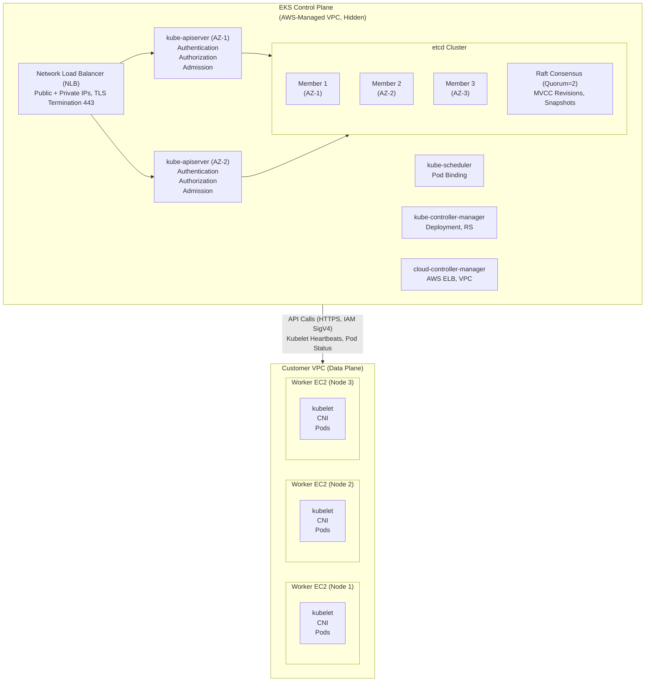

# Lesson 1: EKS Architecture, Control Plane Mechanics, and Managed Kubernetes Fundamentals

## 1. First-Principles Intuition & Invariants

Amazon Elastic Kubernetes Service represents a fundamental departure from self-managed Kubernetes deployments by severing the traditional coupling between cluster operators and control plane lifecycle management. At its core, EKS is an exercise in distributed systems compartmentalization: AWS assumes responsibility for the control plane's availability, durability, and upgrade lifecycle, while cluster operators retain full control over the data plane where application workloads execute. This separation introduces both liberation and constraint. Operators no longer configure etcd replication factors, provision load balancers for API server high availability, or orchestrate rolling upgrades across control plane components, yet they simultaneously surrender fine-grained control over control plane tunables, metrics collection intervals, and the physical topology of master node placement.

The architecture rests on an invariant that governs all managed Kubernetes offerings: the control plane must present a standard Kubernetes API surface while abstracting away implementation details that would otherwise leak provider-specific coupling. EKS achieves this by running unmodified upstream Kubernetes components—`kube-apiserver`, `kube-controller-manager`, `kube-scheduler`, and `etcd`—inside AWS-managed Virtual Private Cloud boundaries that remain invisible to cluster operators. These components communicate over private networking fabrics that never traverse the public internet, yet the API server endpoint itself must be reachable by both data plane nodes and external clients, introducing a network topology problem that EKS solves through dual-mode endpoint exposure.

Every EKS cluster is identified by a globally unique cluster name scoped to an AWS region and account tuple. This name serves as the primary key for control plane state, IAM principal mappings, and CloudWatch log stream associations. When you invoke `aws eks create-cluster`, the request triggers a multi-stage provisioning workflow that materializes a control plane across multiple AWS Availability Zones, configures cross-zone etcd replication with Raft consensus quorum requirements, provisions Network Load Balancers for API server traffic distribution, and initializes AWS-specific admission controllers that enforce IAM authentication and authorization policies. The control plane operates within a declarative state machine where desired cluster configuration—Kubernetes version, endpoint accessibility, logging flags, encryption settings—is reconciled continuously against actual state, mirroring the level-triggered reconciliation pattern that Kubernetes itself employs for managing workload resources.

The separation of concerns between control plane and data plane manifests physically in network segmentation and IAM policy boundaries. The control plane resides in an AWS-managed VPC that cluster operators never directly access. Data plane worker nodes—whether EC2 instances managed through node groups or Fargate pods—live in customer-owned VPCs and establish outbound connections to the control plane API server endpoint. This asymmetric connectivity model means worker nodes pull configuration and receive imperative commands from the control plane, but the control plane never initiates connections into the customer VPC except through webhooks for admission control or custom resource validation. The implication for network security posture is significant: traditional firewall rules that restrict inbound traffic to worker nodes do not impede control plane communication, because all control plane interactions are initiated from the data plane side.

Etcd, the distributed key-value store that functions as Kubernetes' source of truth, operates as a hidden implementation detail in EKS. AWS runs etcd clusters with replication factors determined by availability zone topology—typically three or five members depending on regional characteristics—and handles snapshot backups, compaction, and defragmentation without exposing these operations to cluster operators. The etcd data model organizes all cluster state into a single linearizable namespace where every write increments a monotonic revision counter, enabling efficient watch operations that drive controller reconciliation loops. When a client writes a Pod specification to `/registry/pods/default/nginx`, etcd assigns a revision number and broadcasts a watch event to all subscribers, including the scheduler and kubelet instances. This MVCC architecture allows consistent reads at historical revisions and supports optimistic concurrency control through compare-and-swap operations that guard against lost updates during concurrent modifications.

The API server functions as the singular gateway to this etcd-backed state machine. In self-managed clusters, operators often distribute API server load by provisioning multiple replicas behind a Layer 4 load balancer and tuning parameters like `--max-requests-inflight` and `--max-mutating-requests-inflight` to control admission under load. EKS abstracts these decisions entirely, dynamically scaling API server capacity in response to request volume and throttling clients when aggregate load exceeds control plane capacity. The API server's core responsibility extends beyond simple HTTP request routing: it performs authentication by validating AWS IAM credentials or OIDC tokens, executes authorization checks against RBAC policies stored in etcd, runs admission controllers that mutate or validate resources before persistence, and finally commits serialized resource representations to etcd using protocol buffers for efficient encoding.

Kubernetes version management introduces temporal complexity into cluster operations. The community releases minor versions quarterly and supports each version for approximately fourteen months, creating a forcing function for regular upgrades. EKS standardizes this lifecycle by supporting multiple Kubernetes versions concurrently, allowing operators to select a version during cluster creation and subsequently trigger in-place control plane upgrades through API calls. The upgrade process exemplifies EKS's commitment to zero-downtime operations: AWS performs rolling replacements of control plane components, maintains API server availability throughout the transition, and guarantees version skew compatibility between control plane and data plane components according to Kubernetes' upstream skew policy. This policy permits worker nodes to lag the control plane by up to two minor versions, enabling phased data plane upgrades that decouple application workload disruption from control plane maintenance windows.

The AWS-specific integration surface manifests through IAM authentication, VPC networking constructs, and CloudWatch observability hooks. Unlike vanilla Kubernetes clusters that rely on X.509 client certificates or bearer tokens for authentication, EKS implements an authentication webhook that validates AWS STS GetCallerIdentity responses, mapping IAM principals—users, roles, or service accounts—to Kubernetes identities. This mapping is persisted in a ConfigMap named `aws-auth` in the `kube-system` namespace, which contains a static table of IAM ARNs and their corresponding Kubernetes RBAC bindings. The ConfigMap represents a unidirectional trust relationship: IAM credentials grant the bearer the ability to authenticate to the Kubernetes API, but Kubernetes RBAC policies still govern authorization for cluster operations.

## 2. Core Architecture & Mechanics

The physical topology of an EKS control plane spans multiple Availability Zones within a single AWS region, ensuring that single-zone failures do not render the cluster inoperable. AWS provisions at least two API server instances and distributes them across zones, fronting them with a Network Load Balancer that terminates TLS and distributes requests using connection-level load balancing. The etcd cluster follows a similar multi-zone placement strategy, with member count determined by regional availability zone count and AWS's internal reliability calculations. Each etcd member runs on dedicated compute with provisioned IOPS storage to guarantee consistent write latency, because etcd's consensus protocol requires a majority quorum to commit writes, making write latency sensitive to tail latencies across cluster members.

The API server's request processing pipeline implements a sophisticated series of gates that transform raw HTTP requests into committed etcd writes. When a client issues a `POST` to `/api/v1/namespaces/default/pods`, the request first passes through authentication, where EKS evaluates either an AWS IAM Sigv4 signature in the HTTP headers or a Kubernetes bearer token. For IAM-based authentication, the API server invokes the AWS authentication webhook, which calls `sts:GetCallerIdentity` to verify the credential's validity and extract the IAM principal ARN. This ARN is then matched against entries in the `aws-auth` ConfigMap to determine the corresponding Kubernetes username and group memberships.

Authorization follows authentication, executing a chain of authorizers that includes Node, RBAC, and Webhook authorizers. The RBAC authorizer evaluates whether the authenticated user possesses the necessary verbs—`create`, `get`, `list`, `watch`, `update`, `delete`—on the target resource type within the specified namespace. RBAC policies are themselves stored in etcd as `Role`, `ClusterRole`, `RoleBinding`, and `ClusterRoleBinding` resources, creating a bootstrap dependency that requires the API server to seed initial permissions during cluster creation. EKS provisions default cluster roles and bindings that grant `system:masters` group full cluster-admin privileges, and maps the IAM principal who created the cluster into this group automatically.

Admission control represents the final gate before etcd persistence. Admission controllers are compiled into the API server binary and execute in two phases: mutating admission and validating admission. Mutating controllers modify resource specifications, injecting default values, adding labels, or rewriting container image references. The Pod Security Policy controller—deprecated in upstream Kubernetes but still present in older EKS versions—exemplifies mutating admission by applying security constraints defined in PSP resources. Validating controllers reject resources that violate invariants, such as the ResourceQuota controller blocking pod creation when namespace limits are exceeded. EKS also runs AWS-specific admission controllers that enforce integration constraints, such as validating that requested EBS volume types are supported in the cluster's region.

The scheduler operates as an independent control plane component that watches for pods in the `Pending` state and assigns them to nodes by solving a constraint satisfaction problem. The scheduler maintains an internal cache of node capacity—CPU, memory, ephemeral storage—and pod resource requests, filtering nodes that satisfy hard constraints like node selectors, taints and tolerations, and inter-pod affinity rules. Among feasible nodes, the scheduler applies a scoring function that balances resource utilization, spreading pods across failure domains, and honoring pod priority. Once a node is selected, the scheduler writes a binding object to the API server, which updates the pod's `spec.nodeName` field, triggering the kubelet on the assigned node to begin container runtime operations.

Controller manager hosts a collection of controllers that implement Kubernetes' declarative reconciliation model. The Deployment controller watches Deployment resources and synthesizes ReplicaSet children that represent versioned pod templates. The ReplicaSets controller in turn watches ReplicaSets and creates or deletes Pod resources to match the desired replica count. Each controller runs an independent watch loop against the API server, maintaining a local informer cache synchronized via etcd watch streams. When a relevant resource changes—detected by comparing etcd revision numbers—the controller enqueues a work item into a rate-limited queue and executes reconciliation logic that computes the delta between desired and observed state, issuing API calls to close the gap.

The cloud controller manager embodies AWS-specific integration logic that standard Kubernetes components cannot handle. When a Service of type `LoadBalancer` is created, the cloud controller manager provisions an AWS Elastic Load Balancer, configures target groups pointing to worker node NodePorts, and writes the load balancer's DNS name back into the Service's `status.loadBalancer.ingress` field. Similarly, when a PersistentVolumeClaim requests an EBS-backed volume, the cloud controller manager invokes EC2 APIs to create a volume in the appropriate availability zone and attaches it to the worker node hosting the pod. This tight coupling between Kubernetes abstractions and AWS primitives is what enables EKS clusters to feel native to the AWS ecosystem while maintaining portable Kubernetes semantics.

Cluster endpoint configuration determines API server reachability from both data plane nodes and external clients. EKS supports three endpoint modes: public-only, private-only, and public-and-private. In public-only mode, the API server's Network Load Balancer binds to public IP addresses, allowing access from the internet subject to security group rules and optional CIDR restrictions. Worker nodes communicate with the control plane over public internet paths unless they reside in subnets with NAT gateways that mask their source IPs. Private-only mode restricts API server access to clients within the VPC or connected networks like VPN or Direct Connect, binding the NLB exclusively to private IP addresses. Public-and-private mode provisions both public and private NLB listeners, allowing external administrative access while enabling data plane nodes to communicate over private networking for reduced latency and enhanced security posture.

Cluster authentication integrates deeply with AWS IAM through a webhook token reviewer implementation. When a client presents a token to the API server, EKS checks whether the token is a valid AWS credential by attempting to decode it as a base64-encoded JSON structure containing a pre-signed STS GetCallerIdentity URL. The API server invokes this URL, which returns the IAM principal ARN if the credential is valid. This ARN is then resolved to a Kubernetes identity by consulting the `aws-auth` ConfigMap, which contains two primary sections: `mapRoles` and `mapUsers`. The `mapRoles` section maps IAM role ARNs to Kubernetes usernames and groups, while `mapUsers` performs the analogous mapping for IAM user ARNs. This indirection allows cluster administrators to grant Kubernetes access to entire IAM roles, enabling patterns like granting developer teams access by adding their assumed role ARN rather than individual user ARNs.

The ConfigMap structure follows a straightforward YAML schema where each entry specifies the IAM ARN, the Kubernetes username to assign, and a list of Kubernetes groups. For instance, mapping an IAM role used by worker nodes into the `system:bootstrappers` and `system:nodes` groups grants those nodes permission to register with the API server and report pod status. This mapping is critical for data plane functionality: without appropriate `aws-auth` entries, worker nodes cannot authenticate to the control plane and will fail to join the cluster. EKS managed node groups configure this mapping automatically, but self-managed node groups and Fargate profiles require manual `aws-auth` ConfigMap updates.

Cluster upgrade orchestration exemplifies EKS's operational maturity. When you invoke `aws eks update-cluster-version`, EKS initiates a control plane upgrade that replaces API server instances, controller manager, scheduler, and internal add-ons like CoreDNS with newer versions. The process maintains API availability by upgrading components sequentially with health checks between stages. During the upgrade, the API server's external endpoint remains reachable, and in-flight requests are allowed to complete before old instances are terminated. Etcd data is preserved across the upgrade, with backup snapshots taken before and after the transition to enable rollback in catastrophic scenarios. The upgrade process respects Kubernetes version skew policies, refusing to upgrade to versions that would violate compatibility constraints with existing data plane node versions.

Data plane upgrades are decoupled from control plane upgrades, granting operators flexibility in scheduling node replacements to minimize workload disruption. EKS managed node groups support in-place version upgrades triggered via `aws eks update-nodegroup-version`, which performs rolling replacements of EC2 instances with new AMIs containing updated kubelet and container runtime binaries. The rolling replacement honors pod disruption budgets, cordoning and draining nodes before termination to allow pods to be rescheduled onto healthy nodes. Self-managed node groups require manual upgrade orchestration, typically implemented by launching new Auto Scaling Groups with updated launch templates and gradually shifting traffic before terminating old groups.

Logging and observability surface through CloudWatch Logs integration that captures control plane component logs. EKS supports selective log export for API server audit logs, authenticator logs, controller manager logs, scheduler logs, and API server logs. Audit logs record every API request with full details including authenticated principal, requested resource, and outcome, enabling compliance and security forensics. Authenticator logs capture IAM authentication decisions, revealing which IAM principals successfully authenticated and their mapped Kubernetes identities. These logs flow into CloudWatch Log Groups named `/aws/eks/<cluster-name>/cluster`, where they can be queried using CloudWatch Insights or exported to S3 for long-term retention.

The cluster's internal DNS resolution is managed by CoreDNS, a DNS server implemented as a Kubernetes Deployment running on the data plane. CoreDNS is installed by default as an add-on and watches Service resources to synthesize DNS records mapping service names to cluster IP addresses. When a pod queries `nginx.default.svc.cluster.local`, CoreDNS returns the cluster IP of the corresponding Service, enabling service discovery without hard-coded addresses. CoreDNS configuration is stored in a ConfigMap that supports customization of forwarding rules, caching policies, and conditional resolution for split-horizon DNS scenarios where private hosted zones coexist with cluster DNS.

## 3. High-Performance Optimization & Failure Modes

Control plane capacity scaling in EKS is entirely opaque to cluster operators, creating both convenience and constraint. AWS dynamically provisions additional API server instances in response to request load, with scaling thresholds based on requests-per-second and pending request queue depth. When aggregate load exceeds capacity, the API server begins throttling requests by returning HTTP 429 responses with exponential backoff headers. Clients must implement retry logic with jitter to avoid thundering herd scenarios when throttling occurs. Controllers, informers, and kubectl all include built-in backoff mechanisms, but custom clients must implement similar logic to maintain control plane stability under load.

Optimizing control plane utilization requires understanding request cost asymmetry. List operations that return large result sets—such as `kubectl get pods --all-namespaces`—impose significant CPU and memory load on the API server and etcd, because the entire result set must be serialized and transmitted. Informers mitigate this cost by establishing long-lived watch connections that incrementally stream updates rather than repeatedly listing resources. Watch requests transform etcd's MVCC revision stream into a client-observable event stream, allowing controllers to maintain eventually consistent local caches without incurring repeated list overhead. Cluster operators should prefer watches over repeated list operations whenever maintaining current state is required.

Etcd performance characteristics dominate control plane latency profiles. Etcd commits writes synchronously using Raft consensus, requiring a quorum of replicas to acknowledge before returning success. Write latency therefore depends on inter-zone network latency and disk flush times. AWS provisions etcd on IOPS-optimized storage with sub-millisecond fsync latency, but network round-trip times between availability zones introduce 1-3 millisecond base latency. Under high write load, etcd's consensus protocol can experience head-of-line blocking where slow writes delay subsequent operations. EKS mitigates this through careful capacity provisioning and automated defragmentation that reclaims space from compacted revisions.

The etcd database size has hard limits that cluster operators must respect despite lacking direct access to etcd metrics. Kubernetes stores every resource revision in etcd, causing the database to grow monotonically until compaction removes old revisions. EKS performs automated compaction based on revision count thresholds, but pathological workloads that create and delete large numbers of resources rapidly can exhaust etcd capacity. ConfigMaps and Secrets are particularly problematic because they store arbitrary byte strings that count against etcd's 1.5GB default member size limit. Cluster operators should avoid using ConfigMaps as general-purpose data stores and instead rely on external storage systems like S3 or DynamoDB for large datasets.

API server request authentication latency introduces a hidden cost in EKS deployments. Every API request requires validation of AWS credentials through the authentication webhook, which invokes the STS GetCallerIdentity API. This external call adds 10-50 milliseconds to every request, compared to nearly instantaneous certificate-based authentication in self-managed clusters. High-frequency operations like kubelet heartbeats and controller reconciliation loops amplify this cost. EKS partially mitigates authentication latency through caching of successful authentication results, but cache misses remain expensive. Operators should consolidate API calls where possible, using patch operations to update multiple fields in a single request rather than issuing sequential writes.

Control plane high availability guarantees are bounded by AWS regional failure modes. EKS distributes control plane components across multiple availability zones, ensuring that single-zone failures do not render the cluster inoperable. However, regional outages that affect all zones simultaneously will cause control plane unavailability. During such events, data plane pods continue executing because the kubelet's control loop is level-triggered and does not require continuous API server connectivity. Pods that are already running will continue running, but new pods cannot be scheduled, failed pods will not be replaced, and kubectl commands will fail. This failure mode highlights the importance of designing applications with transient control plane unavailability in mind, ensuring that steady-state operation does not depend on continuous API access.

Network partition scenarios between control plane and data plane trigger cascading failure modes that operators must anticipate. If worker nodes lose connectivity to the API server, kubelets cannot report pod status or receive new pod assignments, but running pods continue executing. The API server marks nodes as `NotReady` after a timeout period defined by the node controller's `--node-monitor-grace-period`, defaulting to 40 seconds. Once nodes are marked `NotReady`, the scheduler stops placing pods on them, and the ReplicaSet controller may create replacement pods on healthy nodes, potentially causing resource contention if the partitioned nodes eventually reconnect. Operators should configure appropriate pod disruption budgets and resource quotas to prevent cascading failures when partitions heal and duplicate pods briefly coexist.

IAM credential management introduces a failure mode unique to EKS deployments. Worker nodes require IAM instance profiles that grant permissions for pulling container images from ECR, writing CloudWatch logs, and accessing other AWS services. If the instance profile is misconfigured or IAM policies are overly restrictive, nodes may fail to join the cluster or pods may fail to access required AWS resources. The error messages for these failures often appear in kubelet logs rather than Kubernetes events, making troubleshooting opaque. Operators should validate IAM policies through least-privilege testing, ensuring that nodes possess only the permissions required for their roles and that application pods use IAM Roles for Service Accounts to access AWS APIs rather than inheriting node-level permissions.

IRSA—IAM Roles for Service Accounts—implements fine-grained IAM permission assignment to individual pods without requiring node-level credentials. This mechanism relies on a Kubernetes admission controller that injects AWS credential environment variables into pods annotated with service account identities. The credential provider configuration maps Kubernetes service accounts to IAM roles through an OIDC identity provider that EKS exposes per cluster. When a pod starts, the admission controller mutates the pod spec to mount a projected token volume and sets environment variables that configure the AWS SDK to assume the associated IAM role. This indirection allows pods to authenticate to AWS APIs using short-lived credentials scoped to the pod's service account, implementing defense-in-depth by limiting credential lifetime and blast radius.

Cluster version skew management requires coordinated upgrade orchestration across control plane, data plane, and add-ons. Kubernetes enforces version skew policies that permit kubelets to lag the API server by up to two minor versions but prohibit kubelets from running ahead of the control plane. EKS enforces these policies by refusing to downgrade control planes and warning when node versions exceed skew limits. Operators must sequence upgrades by first upgrading the control plane, then upgrading managed add-ons like CoreDNS and kube-proxy, and finally upgrading data plane nodes. Skipping this sequence risks incompatibilities where newer kubelets communicate with older API servers using unsupported protocol features, causing cryptic serialization errors.

Add-on management in EKS is partially automated through the EKS Add-ons API, which tracks versions of critical cluster components like VPC CNI, CoreDNS, and kube-proxy. Unlike manually deployed add-ons installed via kubectl, EKS-managed add-ons receive automatic updates and can be reverted through API calls. The add-ons API maintains a desired version and reconciles actual deployed versions, rolling out updates during maintenance windows. However, add-on updates can introduce breaking changes—such as CNI plugin updates that modify pod networking behavior—requiring operators to test updates in non-production clusters before applying them to production workloads.

Troubleshooting control plane issues in EKS differs fundamentally from self-managed clusters because operators lack direct access to control plane logs and metrics beyond what CloudWatch exposes. When API requests fail with cryptic errors, operators must correlate CloudWatch audit logs with client-side debugging to reconstruct request paths. The audit logs record every API request with metadata including authenticated user, requested resource, and outcome, but they lack internal API server state like admission controller execution order or etcd write latency. Operators should enable all log types during troubleshooting to maximize observability, understanding that log volume increases proportionally and CloudWatch Logs incurs per-GB ingestion and storage costs.

The interplay between cluster endpoint configuration and security posture requires careful consideration. Public endpoints simplify administrative access but expose the API server to internet-based attacks. Even with IP CIDR restrictions configured through EKS endpoint access controls, the attack surface remains larger than private-only deployments. Private endpoints eliminate internet exposure but require VPN, Direct Connect, or bastion hosts for administrative access. Hybrid public-and-private configurations offer operational flexibility at the cost of maintaining dual networking paths, with private endpoints serving data plane traffic and public endpoints serving administrative access. Operators should prefer private-only endpoints for production clusters and implement bastion architectures or AWS Systems Manager Session Manager for secure administrative access.

Cluster authentication sprawl emerges as teams grow and IAM principal management becomes unwieldy. The `aws-auth` ConfigMap's static mapping model forces administrators to manually update entries whenever IAM roles change, creating operational toil and increasing the risk of stale mappings that grant excessive permissions. Kubernetes RBAC bindings can reference groups rather than individual users, allowing operators to map entire IAM roles to Kubernetes groups and manage permissions through RBAC rather than IAM. This pattern scales better than per-user mappings but requires discipline in maintaining group semantics and auditing group membership through IAM policy analysis.

Resource exhaustion in the control plane manifests as API request throttling, watch stream disconnections, and kubelet heartbeat failures. While AWS scales control plane capacity automatically, sudden load spikes can exceed scaling velocity, causing temporary degradation. Operators should implement client-side rate limiting and backoff to smooth request patterns, avoiding patterns like periodic list operations across all namespaces from multiple clients simultaneously. Watch streams should be resilient to transient disconnections, implementing reconnection logic that resynchronizes local caches from bookmarked resource versions rather than re-listing all resources.

The separation between control plane and data plane failure domains creates an operational boundary that influences disaster recovery planning. Control plane state resides entirely in AWS-managed infrastructure, meaning operators cannot directly back up etcd or restore from snapshots. However, all cluster state is accessible through the Kubernetes API, enabling logical backups through tools like Velero that serialize cluster resources to S3. Disaster recovery strategies must account for the control plane's managed nature, focusing on recreating cluster configurations through infrastructure-as-code rather than restoring control plane state. Data plane state—persistent volumes, EBS snapshots, application databases—remains the operator's responsibility and should be backed up independently of cluster state.
