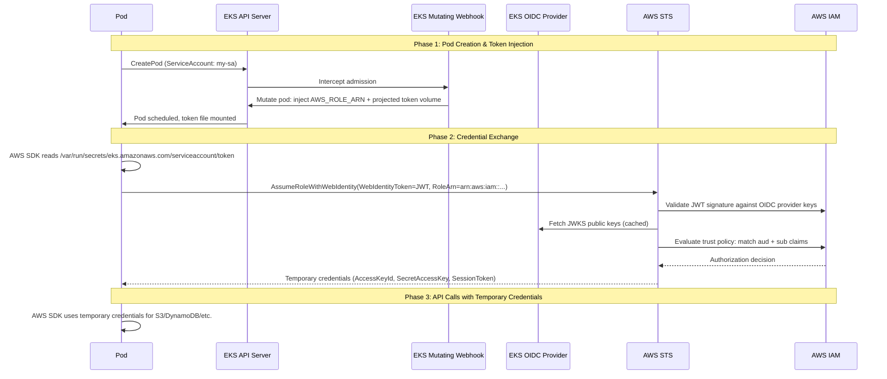

# Lesson 4: Identity, Authorization, RBAC, and Security Boundaries

## 1. First-Principles Intuition & Invariants

In a self-managed Kubernetes cluster, identity is self-contained: the API server issues client certificates, manages service account tokens, and evaluates Role-Based Access Control (RBAC) entirely within its own etcd-backed state. The moment that cluster is instantiated on AWS Elastic Kubernetes Service (EKS), a second identity plane enters the picture—one governed by AWS Identity and Access Management (IAM). An EKS cluster does not exist in isolation; it is provisioned inside a VPC, backed by EBS volumes, fronted by Application Load Balancers, and integrated with services like Secrets Manager, S3, and DynamoDB. Every one of those AWS resources requires authenticated, authorized access. The central architectural challenge of EKS security is therefore not merely configuring Kubernetes RBAC, but engineering a coherent trust bridge between two completely independent identity systems that have different token formats, different lifetimes, different evaluation engines, and different granularity models.

The fundamental invariant of this bridge is that AWS IAM has no native knowledge of Kubernetes concepts—no namespace, no pod, no service account. Conversely, the Kubernetes API server has no native knowledge of AWS account structure, IAM principals, or STS session tokens. The bridge between them is constructed using two distinct mechanisms depending on the direction of the trust. For AWS principals authenticating to the Kubernetes API server, EKS uses an authentication webhook backed by a component called the `aws-iam-authenticator`, which maps IAM role ARNs to Kubernetes users and groups via a `ConfigMap` maintained in the `kube-system` namespace. For Kubernetes pods that need to call AWS APIs, the mechanism is IAM Roles for Service Accounts (IRSA), which federates the cluster's own OpenID Connect (OIDC) identity provider into AWS IAM, allowing a Kubernetes service account to assume an IAM role via short-lived STS tokens.

The governing invariants are these. First, credentials must be short-lived and workload-scoped: no long-lived AWS access keys should ever be embedded in a Kubernetes Secret, ConfigMap, or environment variable. IRSA enforces this by issuing OIDC JSON Web Tokens (JWTs) with a maximum lifetime controlled by the cluster's service account token controller, typically one hour, which are exchanged for STS session credentials lasting from fifteen minutes to twelve hours. Second, authorization must be explicit and deny-by-default: a pod without an IRSA-annotated service account receives no AWS credentials whatsoever, and an IAM role without a correct trust policy referencing the cluster's OIDC provider URL and the specific service account subject cannot be assumed. Third, the Kubernetes RBAC system and the IAM policy system are evaluated independently and must be configured in concert—there is no automatic inheritance or propagation of permissions across the boundary.

Pod security in EKS has undergone a generational shift. The original Pod Security Policy (PSP) API was deprecated in Kubernetes 1.21 and removed entirely in 1.25, replaced by the Pod Security Admission (PSA) controller, which enforces predefined baseline, restricted, and privileged profiles as namespace-level labels. EKS clusters running current versions ship with PSA enabled by default, and the operational responsibility shifts from authoring complex PSP YAML to assigning the appropriate `pod-security.kubernetes.io/enforce` label to each namespace. Network segmentation, meanwhile, is enforced not by Security Groups alone—though EKS integrates VPC CNI natively, assigning each pod a routable ENI IP address—but by Kubernetes NetworkPolicy resources, which require a supporting CNI plugin like Calico or Cilium to provide an enforcement datapath. The EKS default VPC CNI handles IP allocation and connectivity but does not implement NetworkPolicy enforcement; a policy controller must be installed separately.

Encryption at rest in EKS operates on two layers. The etcd datastore backing the control plane is encrypted by default using AWS-managed KMS keys, but clusters can be configured at creation time with a customer-managed KMS key for envelope encryption of Kubernetes Secrets. This adds a layer where every Secret object written to etcd is encrypted under a data key, which is itself encrypted under the KMS master key. The audit logging architecture completes the security boundary by capturing every API call—authenticated or not, authorized or not—into CloudWatch Logs and optionally S3, providing a tamper-evident record that can be correlated with CloudTrail for cross-plane attribution.

## 2. Core Architecture & Mechanics

### The IRSA Authentication Flow

IAM Roles for Service Accounts eliminates the need for static AWS credentials inside pods by chaining three independent trust relationships. The chain begins at cluster creation, when EKS provisions an OIDC identity provider with a public discovery endpoint at a URL of the form `oidc.eks.<region>.amazonaws.com/id/<cluster-id>`. This OIDC provider is registered as a trusted identity source in the AWS IAM account. Each Kubernetes ServiceAccount that needs AWS access is annotated with the ARN of an IAM role. The IAM role's trust policy, in turn, references the OIDC provider URL and restricts the `aud` (audience) claim and the `sub` (subject) claim to match that specific service account.

The mechanical flow executes as follows. When a pod is scheduled, the EKS mutating admission webhook intercepts the pod creation request and injects two environment variables—`AWS_ROLE_ARN` and `AWS_WEB_IDENTITY_TOKEN_FILE`—along with a projected service account token volume mounted at `/var/run/secrets/eks.amazonaws.com/serviceaccount/token`. The token file contains a JWT signed by the cluster's private signing key, with claims specifying the issuer URL, the service account name, the namespace, and an expiry timestamp. The AWS SDK in the pod (whether it is boto3, the Go AWS SDK, or the AWS CLI) reads the role ARN and token file, and calls `sts:AssumeRoleWithWebIdentity`, passing the JWT as the `WebIdentityToken` parameter. IAM validates the JWT signature against the OIDC provider's public keys fetched from the discovery endpoint, checks that the `aud` and `sub` claims match the trust policy conditions, and if valid, returns temporary credentials consisting of an access key ID, a secret access key, and a session token.



The complete setup requires registering the OIDC provider in IAM and creating the IAM role with a precise trust policy. The following Terraform configuration provisions a complete IRSA role for an S3-access workload. The `oidc` data source extracts the cluster's OIDC issuer URL, the `iam_openid_connect_provider` resource registers it in IAM, and the `iam_role` resource defines the trust relationship that permits only the specified service account in the specified namespace to assume the role.

```hcl
terraform {
  required_providers {
    aws = {
      source  = "hashicorp/aws"
      version = "~> 5.40"
    }
  }
  required_version = ">= 1.7"
}

provider "aws" {
  region = "us-east-1"
}

data "aws_eks_cluster" "production" {
  name = "production-cluster"
}

data "aws_caller_identity" "current" {}

locals {
  oidc_issuer_url = trimprefix(data.aws_eks_cluster.production.identity[0].oidc[0].issuer, "https://")
  oidc_arn        = aws_iam_openid_connect_provider.eks_oidc.arn
  aws_account_id  = data.aws_caller_identity.current.account_id
}

resource "aws_iam_openid_connect_provider" "eks_oidc" {
  url             = data.aws_eks_cluster.production.identity[0].oidc[0].issuer
  client_id_list  = ["sts.amazonaws.com"]
  thumbprint_list = ["9e99a48a9960b14926bb7f3b02e22da2b0ab277c"]
}

resource "aws_iam_policy" "s3_workload" {
  name        = "eks-s3-workload-policy"
  description = "Grants read access to the application S3 bucket"
  policy = jsonencode({
    Version = "2012-10-17"
    Statement = [
      {
        Effect = "Allow"
        Action = [
          "s3:GetObject",
          "s3:ListBucket"
        ]
        Resource = [
          "arn:aws:s3:::production-app-data-bucket",
          "arn:aws:s3:::production-app-data-bucket/*"
        ]
      },
      {
        Effect = "Allow"
        Action = [
          "kms:Decrypt",
          "kms:DescribeKey"
        ]
        Resource = "arn:aws:kms:us-east-1:${data.aws_caller_identity.current.account_id}:key/production-s3-cmk"
      }
    ]
  })
}

resource "aws_iam_role" "irsa_role" {
  name        = "eks-irsa-s3-workload"
  description = "IRSA role for the s3-accessor service account in the data-pipeline namespace"
  assume_role_policy = jsonencode({
    Version = "2012-10-17"
    Statement = [
      {
        Effect = "Allow"
        Principal = {
          Federated = local.oidc_arn
        }
        Action = "sts:AssumeRoleWithWebIdentity"
        Condition = {
          StringEquals = {
            "${local.oidc_issuer_url}:aud" = "sts.amazonaws.com"
            "${local.oidc_issuer_url}:sub" = "system:serviceaccount:data-pipeline:s3-accessor"
          }
        }
      }
    ]
  })
}

resource "aws_iam_role_policy_attachment" "irsa_policy_attach" {
  role       = aws_iam_role.irsa_role.name
  policy_arn = aws_iam_policy.s3_workload.arn
}

output "irsa_role_arn" {
  value = aws_iam_role.irsa_role.arn
}
```

The Kubernetes side requires the service account with the IAM role annotation and a pod that references it. The following manifest is complete and deployable. The service account carries the annotation `eks.amazonaws.com/role-arn`, the deployment references the service account by name, and the pod specification includes a security context that enforces non-root execution with read-only root filesystem, consistent with restricted Pod Security Admission standards.

```yaml
apiVersion: v1
kind: Namespace
metadata:
  name: data-pipeline
  labels:
    pod-security.kubernetes.io/enforce: restricted
    pod-security.kubernetes.io/audit: restricted
    pod-security.kubernetes.io/warn: restricted
---
apiVersion: v1
kind: ServiceAccount
metadata:
  name: s3-accessor
  namespace: data-pipeline
  annotations:
    eks.amazonaws.com/role-arn: arn:aws:iam::123456789012:role/eks-irsa-s3-workload
---
apiVersion: apps/v1
kind: Deployment
metadata:
  name: s3-data-loader
  namespace: data-pipeline
  labels:
    app: s3-data-loader
spec:
  replicas: 3
  selector:
    matchLabels:
      app: s3-data-loader
  template:
    metadata:
      labels:
        app: s3-data-loader
    spec:
      serviceAccountName: s3-accessor
      securityContext:
        runAsNonRoot: true
        runAsUser: 10001
        runAsGroup: 10001
        fsGroup: 10001
        seccompProfile:
          type: RuntimeDefault
      containers:
      - name: loader
        image: public.ecr.aws/aws-cli/aws-cli:2.15.45
        command:
        - /bin/sh
        - -c
        - |
          while true; do
            echo "$(date) - Listing bucket contents:"
            aws s3 ls s3://production-app-data-bucket/ --region us-east-1
            sleep 300
          done
        securityContext:
          allowPrivilegeEscalation: false
          readOnlyRootFilesystem: true
          capabilities:
            drop:
            - ALL
        resources:
          requests:
            cpu: 100m
            memory: 128Mi
          limits:
            cpu: 500m
            memory: 512Mi
        volumeMounts:
        - name: tmp
          mountPath: /tmp
      volumes:
      - name: tmp
        emptyDir:
          medium: Memory
          sizeLimit: 64Mi
```

### The aws-auth ConfigMap and IAM-to-Kubernetes Mapping

While IRSA handles the Kubernetes-to-AWS direction, the reverse direction—allowing AWS IAM principals to authenticate to the Kubernetes API server—uses a different mechanism. The EKS control plane runs the `aws-iam-authenticator` as an authentication webhook. When `kubectl` is invoked with the EKS-vendored AWS authenticator (or the built-in `aws eks get-token` command), it generates a pre-signed STS `GetCallerIdentity` URL, signs it with the caller's AWS credentials, and passes that token in the Kubernetes API request's bearer token field. The API server forwards the token to the authenticator webhook, which calls the pre-signed URL to determine the caller's IAM identity, then consults the `aws-auth` ConfigMap in `kube-system` to map that IAM ARN to a Kubernetes username and group assignments.

The `aws-auth` ConfigMap has three map types: `mapRoles` maps IAM roles to Kubernetes identities, `mapUsers` maps IAM users, and `mapAccounts` maps AWS account IDs (allowing any principal in that account to authenticate, subject to their IAM permissions). The following ConfigMap is a complete, production-grade configuration that grants the EKS cluster creator role full cluster-admin access, grants a dedicated CI/CD role deployment permissions in specific namespaces, and grants a read-only role to the SRE observability team.

```yaml
apiVersion: v1
kind: ConfigMap
metadata:
  name: aws-auth
  namespace: kube-system
data:
  mapRoles: |
    - rolearn: arn:aws:iam::123456789012:role/EKSClusterAdmin
      username: cluster-admin
      groups:
      - system:masters
    - rolearn: arn:aws:iam::123456789012:role/EKSCICDDeployRole
      username: ci-cd-deployer
      groups:
      - system:deployers
    - rolearn: arn:aws:iam::123456789012:role/EKSSREReadOnly
      username: sre-readonly
      groups:
      - system:read-only-viewers
  mapUsers: |
    - userarn: arn:aws:iam::123456789012:user/breakglass-admin
      username: breakglass-admin
      groups:
      - system:masters
  mapAccounts: |
    - "123456789012"
```

The Kubernetes RBAC layer then evaluates permissions based on the groups assigned by the ConfigMap mapping. The following RBAC manifests define the `system:deployers` and `system:read-only-viewers` groups referenced above, granting scoped, namespace-level permissions. The deployer role allows full management of common workload resources in the `data-pipeline` and `application` namespaces, while the read-only role grants cluster-wide get/list/watch across all non-secret resources.

```yaml
apiVersion: rbac.authorization.k8s.io/v1
kind: ClusterRole
metadata:
  name: read-only-viewer
rules:
- apiGroups: ["", "apps", "batch", "extensions"]
  resources: ["*"]
  verbs: ["get", "list", "watch"]
- apiGroups: [""]
  resources: ["secrets", "configmaps"]
  verbs: ["get", "list"]
---
apiVersion: rbac.authorization.k8s.io/v1
kind: ClusterRoleBinding
metadata:
  name: read-only-viewers-binding
subjects:
- kind: Group
  name: system:read-only-viewers
  apiGroup: rbac.authorization.k8s.io
roleRef:
  kind: ClusterRole
  name: read-only-viewer
  apiGroup: rbac.authorization.k8s.io
---
apiVersion: rbac.authorization.k8s.io/v1
kind: Role
metadata:
  name: namespace-deployer
  namespace: data-pipeline
rules:
- apiGroups: [""]
  resources: ["pods", "pods/log", "services", "configmaps", "events"]
  verbs: ["get", "list", "watch", "create", "update", "patch", "delete"]
- apiGroups: ["apps"]
  resources: ["deployments", "replicasets", "statefulsets"]
  verbs: ["get", "list", "watch", "create", "update", "patch", "delete"]
- apiGroups: ["batch"]
  resources: ["jobs", "cronjobs"]
  verbs: ["get", "list", "watch", "create", "update", "patch", "delete"]
---
apiVersion: rbac.authorization.k8s.io/v1
kind: RoleBinding
metadata:
  name: deployer-binding-data-pipeline
  namespace: data-pipeline
subjects:
- kind: Group
  name: system:deployers
  apiGroup: rbac.authorization.k8s.io
roleRef:
  kind: Role
  name: namespace-deployer
  apiGroup: rbac.authorization.k8s.io
---
apiVersion: rbac.authorization.k8s.io/v1
kind: RoleBinding
metadata:
  name: deployer-binding-application
  namespace: application
subjects:
- kind: Group
  name: system:deployers
  apiGroup: rbac.authorization.k8s.io
roleRef:
  kind: Role
  name: namespace-deployer
  apiGroup: rbac.authorization.k8s.io
```

### Network Policy Enforcement

The EKS VPC CNI plugin assigns each pod a native VPC IP address from the subnet's ENI pool, making pods directly routable within the VPC. This architectural choice is excellent for performance and network transparency but means that by default, any pod can communicate with any other pod across any namespace—the VPC network is flat at the pod level. NetworkPolicy resources provide the enforcement layer, but they require a policy controller. The following commands install Amazon's EKS-calico addon and then apply a complete set of network policies implementing a zero-trust segmentation model.

```bash
# Install the Calico managed add-on via the EKS API
aws eks create-addon \
  --cluster-name production-cluster \
  --addon-name amazon-calico \
  --region us-east-1

# Verify the Calico daemon set is running
kubectl get daemonset calico-node -n kube-system
kubectl get pods -n kube-system -l k8s-app=calico-node -o wide

# Verify the NetworkPolicy CRD is available
kubectl get crd networkpolicies.networking.k8s.io
```

The following network policy manifest implements a tiered segmentation strategy for the `data-pipeline` namespace. The default-deny policy blocks all ingress and egress by default. The database-allow policy permits ingress to the database pods only from the loader pods on port 5432, and the egress-dns policy permits all pods to reach the CoreDNS service in `kube-system`. The egress-s3 policy permits outbound traffic to the S3 VPC endpoint, identified by its security group.

```yaml
apiVersion: networking.k8s.io/v1
kind: NetworkPolicy
metadata:
  name: default-deny-all
  namespace: data-pipeline
spec:
  podSelector: {}
  policyTypes:
  - Ingress
  - Egress
---
apiVersion: networking.k8s.io/v1
kind: NetworkPolicy
metadata:
  name: database-ingress-allow
  namespace: data-pipeline
spec:
  podSelector:
    matchLabels:
      app: postgres
  policyTypes:
  - Ingress
  ingress:
  - from:
    - podSelector:
        matchLabels:
          app: s3-data-loader
    ports:
    - protocol: TCP
      port: 5432
---
apiVersion: networking.k8s.io/v1
kind: NetworkPolicy
metadata:
  name: egress-allow-dns
  namespace: data-pipeline
spec:
  podSelector: {}
  policyTypes:
  - Egress
  egress:
  - to:
    - namespaceSelector:
        matchLabels:
          kubernetes.io/metadata.name: kube-system
      podSelector:
        matchLabels:
          k8s-app: kube-dns
    ports:
    - protocol: UDP
      port: 53
    - protocol: TCP
      port: 53
---
apiVersion: networking.k8s.io/v1
kind: NetworkPolicy
metadata:
  name: egress-allow-s3-vpc-endpoint
  namespace: data-pipeline
spec:
  podSelector:
    matchLabels:
      app: s3-data-loader
  policyTypes:
  - Egress
  egress:
  - to:
    - ipBlock:
        cidr: 10.0.0.0/8
    ports:
    - protocol: TCP
      port: 443
```

### Encryption at Rest with Customer-Managed KMS Keys

EKS encrypts etcd at rest by default using AWS-managed keys, but Secrets encryption with a customer-managed KMS key must be specified at cluster creation time. The key must exist in the same region and grant the EKS service principal `kms:Encrypt`, `kms:Decrypt`, `kms:ReEncryptFrom`, `kms:ReEncryptTo`, `kms:DescribeKey`, and `kms:GenerateDataKey` permissions. The following Terraform provisions a dedicated KMS key with a key policy that grants the EKS service principal the required permissions and enables automatic annual rotation.

```hcl
resource "aws_kms_key" "eks_secrets" {
  description             = "EKS Secrets encryption key for production-cluster"
  deletion_window_in_days = 30
  enable_key_rotation     = true
  policy = jsonencode({
    Version = "2012-10-17"
    Statement = [
      {
        Sid    = "Enable IAM root permissions"
        Effect = "Allow"
        Principal = {
          AWS = "arn:aws:iam::${local.aws_account_id}:root"
        }
        Action   = "kms:*"
        Resource = "*"
      },
      {
        Sid    = "Allow EKS service to use the key"
        Effect = "Allow"
        Principal = {
          Service = "eks.${data.aws_region.current.name}.amazonaws.com"
        }
        Action = [
          "kms:Encrypt",
          "kms:Decrypt",
          "kms:ReEncryptFrom",
          "kms:ReEncryptTo",
          "kms:DescribeKey",
          "kms:GenerateDataKey"
        ]
        Resource = "*"
      },
      {
        Sid    = "Allow EKS cluster admin to describe key"
        Effect = "Allow"
        Principal = {
          AWS = "arn:aws:iam::${local.aws_account_id}:role/EKSClusterAdmin"
        }
        Action = [
          "kms:DescribeKey",
          "kms:ListKeys",
          "kms:ListAliases"
        ]
        Resource = "*"
      }
    ]
  })
}

resource "aws_kms_alias" "eks_secrets_alias" {
  name          = "alias/eks-production-secrets"
  target_key_id = aws_kms_key.eks_secrets.key_id
}

resource "aws_eks_cluster" "production" {
  name     = "production-cluster"
  role_arn = "arn:aws:iam::${local.aws_account_id}:role/EKSClusterRole"
  version  = "1.30"

  vpc_config {
    subnet_ids = [
      "subnet-0a1b2c3d4e5f6a7b8",
      "subnet-0c1d2e3f4a5b6c7d8",
      "subnet-0e1f2a3b4c5d6e7f8"
    ]
    security_group_ids = ["sg-0a1b2c3d4e5f6a7b8"]
  }

  encryption_config {
    resources = ["secrets"]
    provider {
      key_arn = aws_kms_key.eks_secrets.arn
    }
  }

  enabled_log_types = [
    "api",
    "audit",
    "authenticator",
    "controllerManager",
    "scheduler"
  ]
}

data "aws_region" "current" {}
```

### Audit Logging Architecture

When log types are enabled in the EKS cluster configuration, the control plane components send logs directly to CloudWatch Logs under log group names following the pattern `/aws/eks/<cluster-name>/cluster`. The audit log, in particular, captures every API request with full metadata including the user identity, source IP, request verb, resource type, and response code. For long-term retention and compliance requirements, these logs should be exported to S3 with a lifecycle policy. The following Terraform provisions a complete audit log pipeline: a CloudWatch Logs subscription filter that streams audit events to a Kinesis Data Firehose, which delivers them to an S3 bucket with a ninety-day transition to Glacier and a seven-year retention period.

```hcl
resource "aws_s3_bucket" "eks_audit_archive" {
  bucket = "eks-production-audit-archive-123456789012"
}

resource "aws_s3_bucket_lifecycle_configuration" "audit_archive" {
  bucket = aws_s3_bucket.eks_audit_archive.id

  rule {
    id     = "audit-log-lifecycle"
    status = "Enabled"
    filter {
      prefix = "eks-audit/"
    }
    transition {
      days          = 90
      storage_class = "GLACIER_IR"
    }
    expiration {
      days = 2555
    }
  }
}

resource "aws_s3_bucket_policy" "audit_archive" {
  bucket = aws_s3_bucket.eks_audit_archive.id
  policy = jsonencode({
    Version = "2012-10-17"
    Statement = [
      {
        Effect = "Allow"
        Principal = {
          Service = "firehose.amazonaws.com"
        }
        Action   = "s3:PutObject"
        Resource = "${aws_s3_bucket.eks_audit_archive.arn}/eks-audit/*"
        Condition = {
          StringEquals = {
            "s3:x-amz-acl" = "bucket-owner-full-control"
          }
        }
      }
    ]
  })
}

resource "aws_kinesis_firehose_delivery_stream" "audit_firehose" {
  name        = "eks-audit-firehose"
  destination = "extended_s3"

  extended_s3_configuration {
    role_arn   = aws_iam_role.firehose_role.arn
    bucket_arn = aws_s3_bucket.eks_audit_archive.arn
    prefix     = "eks-audit/!{partitionKey:clusterName}/!{partitionTimeformat:yyyy/MM/dd}/"
    error_log_prefix = "eks-audit-errors/"
    buffering_size = 64
    buffering_interval = 300
    compression_format = "GZIP"
  }

  data_format_conversion_configuration {
    enabled = true
    input_format {
      deserializer {
        open_x_json_ser_de {}
      }
    }
    output_format {
      serializer {
        parquet_ser_de {}
      }
    }
  }
}

resource "aws_iam_role" "firehose_role" {
  name = "eks-audit-firehose-role"
  assume_role_policy = jsonencode({
    Version = "2012-10-17"
    Statement = [{
      Effect = "Allow"
      Principal = {
        Service = "firehose.amazonaws.com"
      }
      Action = "sts:AssumeRole"
    }]
  })
}

resource "aws_iam_role_policy" "firehose_s3" {
  name = "firehose-s3-access"
  role = aws_iam_role.firehose_role.id
  policy = jsonencode({
    Version = "2012-10-17"
    Statement = [
      {
        Effect = "Allow"
        Action = [
          "s3:AbortMultipartUpload",
          "s3:GetBucketLocation",
          "s3:GetObject",
          "s3:ListBucket",
          "s3:ListBucketMultipartUploads",
          "s3:PutObject"
        ]
        Resource = [
          aws_s3_bucket.eks_audit_archive.arn,
          "${aws_s3_bucket.eks_audit_archive.arn}/*"
        ]
      }
    ]
  })
}

resource "aws_cloudwatch_log_subscription_filter" "audit_subscription" {
  name            = "eks-audit-subscription"
  log_group_name  = "/aws/eks/production-cluster/cluster"
  filter_pattern  = "{ $.logType = \"audit\" }"
  destination_arn = aws_kinesis_firehose_delivery_stream.audit_firehose.arn
  role_arn        = aws_iam_role.subscription_role.arn
}

resource "aws_iam_role" "subscription_role" {
  name = "eks-audit-subscription-role"
  assume_role_policy = jsonencode({
    Version = "2012-10-17"
    Statement = [
      {
        Effect = "Allow"
        Principal = {
          Service = [
            "logs.${data.aws_region.current.name}.amazonaws.com",
            "firehose.amazonaws.com"
          ]
        }
        Action = "sts:AssumeRole"
      }
    ]
  })
}

resource "aws_iam_role_policy" "subscription_policy" {
  name = "subscription-firehose-access"
  role = aws_iam_role.subscription_role.id
  policy = jsonencode({
    Version = "2012-10-17"
    Statement = [
      {
        Effect = "Allow"
        Action = [
          "firehose:PutRecord",
          "firehose:PutRecordBatch"
        ]
        Resource = aws_kinesis_firehose_delivery_stream.audit_firehose.arn
      }
    ]
  })
}
```

For practitioners who need to query audit logs directly via the AWS CLI during incident response, the following command extracts all failed API requests from the audit log stream, filtering for `responseStatus.code` greater than or equal to 400, and formats the output as readable JSON.

```bash
# Query the audit log for failed API calls in the last hour
QUERY_ID=$(aws logs start-query \
  --log-group-name "/aws/eks/production-cluster/cluster" \
  --start-time $(date -d '1 hour ago' +%s) \
  --end-time $(date +%s) \
  --query-string 'fields @timestamp, @message
    | filter $.logType = "audit"
    | filter $.responseStatus.code >= 400
    | parse @message "{\"username\":\"*\",\"verb\":\"*\",\"resource\":\"*\",\"responseStatus\":{\"code\":*}}" as user, verb, resource, code
    | display @timestamp, user, verb, resource, code
    | sort @timestamp desc
    | limit 100' \
  --region us-east-1 \
  --query 'queryId' \
  --output text)

# Poll for query results (may take a few seconds to complete)
sleep 5
aws logs get-query-results \
  --query-id "$QUERY_ID" \
  --region us-east-1 \
  --output table
```

## 3. High-Performance Optimization & Failure Modes

### IRSA Credential Refresh and STS Rate Limiting

The most common production failure in an IRSA-architecture cluster is STS throttling during scale events. When a deployment scales from ten replicas to three hundred, every new pod performs an `AssumeRoleWithWebIdentity` call to STS within seconds of starting. STS enforces a default rate limit of approximately 100 transactions per second per account in each region for the `AssumeRoleWithWebIdentity` API. At scale, this limit is easily exceeded, resulting in pods that start without valid AWS credentials and fail their first API calls. The mitigation strategy has three layers.

First, the AWS SDK credential provider chain caches STS credentials in memory and refreshes them only when they reach approximately 80% of their lifetime, so steady-state operations do not repeatedly hit STS. However, the initial burst at startup is uncached by definition. Second, pod startup should be staggered using a `maxSurge` and `maxUnavailable` configuration that limits the rate of new pod creation. Third, the STS session duration should be set to the minimum practical value—four hours is the EKS default and is reasonable for most workloads—so that credentials expire and refresh in a distributed manner rather than all-at-once after a fixed interval.

The following deployment configuration demonstrates a properly rate-limited rollout for a high-scale IRSA workload. The `maxSurge: 25%` and `maxUnavailable: 0` settings ensure that new pods are created incrementally, and the `progressDeadlineSeconds` gives the deployment controller adequate time to process the STS calls without declaring a rollout failure.

```yaml
apiVersion: apps/v1
kind: Deployment
metadata:
  name: high-throughput-processor
  namespace: data-pipeline
spec:
  replicas: 300
  strategy:
    type: RollingUpdate
    rollingUpdate:
      maxSurge: 25%
      maxUnavailable: 0
  progressDeadlineSeconds: 1200
  minReadySeconds: 10
  selector:
    matchLabels:
      app: high-throughput-processor
  template:
    metadata:
      labels:
        app: high-throughput-processor
    spec:
      serviceAccountName: s3-accessor
      terminationGracePeriodSeconds: 60
      affinity:
        podAntiAffinity:
          preferredDuringSchedulingIgnoredDuringExecution:
          - weight: 100
            podAffinityTerm:
              labelSelector:
                matchLabels:
                  app: high-throughput-processor
              topologyKey: kubernetes.io/hostname
      containers:
      - name: processor
        image: public.ecr.aws/aws-cli/aws-cli:2.15.45
        command:
        - /bin/sh
        - -c
        - |
          # Exponential backoff retry for initial STS credential fetch
          MAX_RETRIES=10
          for i in $(seq 1 $MAX_RETRIES); do
            if aws sts get-caller-identity --region us-east-1 2>/dev/null; then
              echo "STS credentials obtained successfully"
              break
            fi
            echo "Attempt $i/$MAX_RETRIES failed, backing off $((i*i)) seconds..."
            sleep $((i*i))
          done
          # Main processing loop
          while true; do
            aws s3 sync s3://production-app-data-bucket/incoming/ /tmp/work/ \
              --region us-east-1 \
              --exclude "*" \
              --include "*.json"
            # Process files...
            sleep 60
          done
        resources:
          requests:
            cpu: 200m
            memory: 256Mi
          limits:
            cpu: 1000m
            memory: 1Gi
        securityContext:
          runAsNonRoot: true
          runAsUser: 10001
          allowPrivilegeEscalation: false
          readOnlyRootFilesystem: true
          capabilities:
            drop: ["ALL"]
        volumeMounts:
        - name: tmp
          mountPath: /tmp
      volumes:
      - name: tmp
        emptyDir:
          medium: Memory
          sizeLimit: 512Mi
```

### aws-auth ConfigMap Corruption and Recovery

The `aws-auth` ConfigMap is a single point of failure for cluster access. If it is corrupted, deleted, or modified incorrectly, AWS IAM principals may lose the ability to authenticate to the Kubernetes API server entirely. The most dangerous scenario is the accidental removal of the `system:masters` group mapping for the cluster creator role, which locks out all administrative access. Recovery requires the EKS `UpdateClusterConfig` API or direct API server access via the EKS managed endpoint, which bypasses the authenticator webhook.

The following diagnostic and recovery procedure should be executed when access is lost. First, verify the current state of the ConfigMap using the EKS API directly, bypassing kubectl authentication:

```bash
# Attempt to read the aws-auth ConfigMap via the EKS API
# This requires the caller to have eks:DescribeCluster and the original
# cluster creator IAM role or a role with sufficient EKS permissions.

# Step 1: Verify your current AWS identity
aws sts get-caller-identity --region us-east-1

# Step 2: Attempt to authenticate via kubectl
kubectl get configmap aws-auth -n kube-system -o yaml 2>&1

# Step 3: If kubectl fails, use the EKS API to get the cluster endpoint
CLUSTER_ENDPOINT=$(aws eks describe-cluster \
  --name production-cluster \
  --region us-east-1 \
  --query 'cluster.endpoint' \
  --output text)
echo "Cluster endpoint: $CLUSTER_ENDPOINT"

# Step 4: Generate a fresh token using the cluster creator role
TOKEN=$(aws eks get-token \
  --cluster-name production-cluster \
  --region us-east-1 \
  --query 'status.token' \
  --output text)

# Step 5: Use the raw token to query the API server directly via curl
curl -s -k \
  -H "Authorization: Bearer $TOKEN" \
  "${CLUSTER_ENDPOINT}/api/v1/namespaces/kube-system/configmaps/aws-auth" | python3 -m json.tool

# Step 6: If the ConfigMap is corrupted or missing, recreate it
# using a patch applied via the raw API
cat <<'PATCHFILE' > /tmp/aws-auth-patch.json
{
  "kind": "ConfigMap",
  "apiVersion": "v1",
  "metadata": {
    "name": "aws-auth",
    "namespace": "kube-system"
  },
  "data": {
    "mapRoles": "- rolearn: arn:aws:iam::123456789012:role/EKSClusterAdmin\n  username: cluster-admin\n  groups:\n  - system:masters\n",
    "mapUsers": "",
    "mapAccounts": ""
  }
}
PATCHFILE

# Apply the patch via the raw API endpoint
curl -s -k -X POST \
  -H "Authorization: Bearer $TOKEN" \
  -H "Content-Type: application/json" \
  -d @/tmp/aws-auth-patch.json \
  "${CLUSTER_ENDPOINT}/api/v1/namespaces/kube-system/configmaps"

# Step 7: Verify access is restored
kubectl get nodes
```

### Network Policy Debugging with Calico

When network policies silently block traffic, the failure mode is opaque: pods appear healthy, no error is logged, but connections time out. Calico provides the `calicoctl` tool and the `kubectl calico` plugin for inspecting policy evaluation. The following diagnostic sequence identifies which policy is denying traffic between two pods.

```bash
# Install calicoctl as a kubectl plugin
kubectl apply -f https://raw.githubusercontent.com/projectcalico/calico/v3.27.0/manifests/calicoctl.yaml

# Create a debug pod in the target namespace
kubectl run network-debug --image=nicolaka/netshoot:latest \
  --namespace=data-pipeline \
  --serviceaccount=s3-accessor \
  --rm -it --restart=Never -- sh

# Inside the debug pod, test connectivity to the database
# and capture the connection attempt details
nslookup postgres.data-pipeline.svc.cluster.local
nc -zv postgres.data-pipeline.svc.cluster.local 5432 -w 5

# Exit the debug pod, then inspect Calico policy evaluation
# from a node that runs a calico-node pod
NODE_NAME=$(kubectl get pods -n data-pipeline \
  -l app=s3-data-loader \
  -o jsonpath='{.items[0].spec.nodeName}')
echo "Source pod runs on node: $NODE_NAME"

# Get the calico-node pod on that specific node
CALICO_POD=$(kubectl get pods -n kube-system \
  -l k8s-app=calico-node \
  --field-selector spec.nodeName=$NODE_NAME \
  -o jsonpath='{.items[0].metadata.name}')
echo "Calico pod: $CALICO_POD"

# Execute calicoctl inside the calico-node pod to inspect policies
kubectl exec -n kube-system $CALICO_POD -- calicoctl get networkpolicy \
  --namespace=data-pipeline -o wide

# Trace the specific workload endpoint policy evaluation
kubectl exec -n kube-system $CALICO_POD -- calicoctl get workloadendpoints \
  --namespace=data-pipeline -o wide

# Check Calico flow logs for denied packets
kubectl exec -n kube-system $CALICO_POD -- calicoctl get flows \
  --namespace=data-pipeline \
  --json | python3 -c "
import sys, json
flows = json.load(sys.stdin)
for f in flows:
    if f.get('action') == 'deny':
        src = f.get('source', {}).get('name', 'unknown')
        dst = f.get('dest', {}).get('name', 'unknown')
        port = f.get('dest', {}).get('port', 'unknown')
        policy = f.get('policy', {}).get('name', 'no-policy')
        print(f'DENY: {src} -> {dst}:{port} (policy: {policy})')
"
```

### KMS Key Rotation and Secrets Re-encryption

When a customer-managed KMS key used for EKS Secrets encryption is rotated, the key material changes but previously encrypted Secrets are not automatically re-encrypted. They remain decryptable using the new key version, but the ciphertext still references the old key version. To ensure all Secrets are encrypted with the current key version, a manual re-encryption operation is required. The following bash script iterates all Secrets across all namespaces, triggering a re-encrypt by touching each one and applying a no-op annotation update.

```bash
#!/bin/bash
set -euo pipefail

CLUSTER_NAME="production-cluster"
REGION="us-east-1"

# Verify the KMS key is enabled and rotation is active
KEY_ID=$(aws eks describe-cluster \
  --name "$CLUSTER_NAME" \
  --region "$REGION" \
  --query 'cluster.encryptionConfig[0].provider.keyArn' \
  --output text)
echo "EKS Secrets KMS Key: $KEY_ID"

aws kms describe-key \
  --key-id "$KEY_ID" \
  --region "$REGION" \
  --query 'KeyMetadata.{State:KeyState,Rotation:Enabled,Description:Description}' \
  --output table

# Check if automatic key rotation is enabled
ROTATION_STATUS=$(aws kms get-key-rotation-status \
  --key-id "$KEY_ID" \
  --region "$REGION" \
  --query 'KeyRotationEnabled' \
  --output text)
echo "Key rotation enabled: $ROTATION_STATUS"

# Force re-encryption of all secrets
# EKS uses envelope encryption: a data key encrypts the secret,
# and the KMS key encrypts the data key. Touching a secret
# causes the API server to re-encrypt it with a new data key
# derived from the current KMS key version.

echo "Re-encrypting all secrets across all namespaces..."
RE_ENCRYPT_COUNT=0
for ns in $(kubectl get namespaces -o jsonpath='{.items[*].metadata.name}'); do
  echo "Processing namespace: $ns"
  for secret in $(kubectl get secrets -n "$ns" \
    -o jsonpath='{.items[?(@.type!="kubernetes.io/service-account-token")].metadata.name}'); do

    # Apply a no-op annotation to force re-encryption
    kubectl annotate secret "$secret" \
      -n "$ns" \
      reencryption-timestamp="$(date -u +%Y-%m-%dT%H:%M:%SZ)" \
      --overwrite=true >/dev/null 2>&1 && \
      RE_ENCRYPT_COUNT=$((RE_ENCRYPT_COUNT + 1))
  done
done

echo "Re-encrypted $RE_ENCRYPT_COUNT secrets"

# Verify by checking the resourceVersion of a sample secret
SAMPLE_SECRET=$(kubectl get secrets -n kube-system \
  -o jsonpath='{.items[0].metadata.name}')
echo "Sample secret verification: $SAMPLE_SECRET"
kubectl get secret "$SAMPLE_SECRET" -n kube-system -o jsonpath='{.metadata.annotations.reencryption-timestamp}'
echo ""
echo "Re-encryption complete."
```

### Audit Log Forensic Analysis with CloudTrail Correlation

When investigating a security incident, the EKS audit log provides the Kubernetes API perspective, but correlating with AWS CloudTrail provides the complete cross-plane picture—for example, matching a pod's IRSA credential usage to specific S3 API calls. The following Python script uses boto3 to query both CloudWatch Logs (for EKS audit events) and CloudTrail (for AWS API events) within a specified time window, joining them on the IAM role ARN used by the pod.

```python
#!/usr/bin/env python3
"""
EKS Audit Log + CloudTrail Correlation Script

Correlates Kubernetes API audit events with AWS CloudTrail events
by matching IRSA-assumed role ARNs across both log sources.
Requires: boto3 >= 1.34.0
"""

import boto3
import json
import time
from datetime import datetime, timedelta, timezone
from typing import Dict, List, Optional, Tuple

class EKSForensicCorrelator:
    def __init__(
        self,
        cluster_name: str,
        region: str,
        audit_log_group: str,
        trail_name: str,
    ):
        self.cluster_name = cluster_name
        self.region = region
        self.audit_log_group = audit_log_group
        self.trail_name = trail_name

        self.logs = boto3.client("logs", region_name=region)
        self.cloudtrail = boto3.client("cloudtrail", region_name=region)
        self.sts = boto3.client("sts", region_name=region)

        self.account_id = self.sts.get_caller_identity()["Account"]

    def query_eks_audit_logs(
        self,
        start_time: datetime,
        end_time: datetime,
        username_filter: Optional[str] = None,
    ) -> List[Dict]:
        """Query EKS audit logs for all API calls, optionally filtered by username."""
        query_string = (
            'fields @timestamp, @message\n'
            '| filter $.logType = "audit"\n'
        )
        if username_filter:
            query_string += f'| filter $.user.username = "{username_filter}"\n'
        query_string += (
            '| sort @timestamp desc\n'
            '| limit 1000'
        )

        response = self.logs.start_query(
            logGroupName=self.audit_log_group,
            startTime=int(start_time.timestamp()),
            endTime=int(end_time.timestamp()),
            queryString=query_string,
        )

        query_id = response["queryId"]
        results = []
        for _ in range(30):
            time.sleep(2)
            response = self.logs.get_query_results(queryId=query_id)
            if response["status"] == "Complete":
                results = response["results"]
                break

        audit_events = []
        for row in results:
            event = {}
            for field in row:
                field_name = field["field"].lstrip("@")
                if field_name == "message":
                    try:
                        parsed = json.loads(field["value"])
                        event.update(parsed)
                    except json.JSONDecodeError:
                        event["raw_message"] = field["value"]
                else:
                    event[field_name] = field["value"]
            audit_events.append(event)

        return audit_events

    def query_cloudtrail_events(
        self,
        start_time: datetime,
        end_time: datetime,
        role_name_filter: Optional[str] = None,
    ) -> List[Dict]:
        """Query CloudTrail for events attributed to IRSA-assumed roles."""
        lookup_attributes = []
        if role_name_filter:
            lookup_attributes.append({
                "AttributeKey": "RoleName",
                "AttributeValue": role_name_filter,
            })

        all_events = []
        paginator = self.cloudtrail.get_paginator("lookup_events")

        kwargs = {
            "StartTime": start_time,
            "EndTime": end_time,
        }
        if lookup_attributes:
            kwargs["LookupAttributes"] = lookup_attributes

        for page in paginator.paginate(**kwargs):
            all_events.extend(page.get("Events", []))

        return all_events

    def correlate(
        self,
        start_time: datetime,
        end_time: datetime,
        target_username: Optional[str] = None,
    ) -> Tuple[List[Dict], List[Dict], List[Tuple[Dict, Dict]]]:
        """
        Correlate EKS audit events with CloudTrail events.

        Returns a tuple of (audit_events, cloudtrail_events, matched_pairs)
        where matched_pairs contains (audit_event, cloudtrail_event) tuples
        joined on the IAM role ARN and time proximity.
        """
        print(f"Querying EKS audit logs from {start_time} to {end_time}...")
        audit_events = self.query_eks_audit_logs(start_time, end_time, target_username)
        print(f"  Found {len(audit_events)} audit events")

        print(f"Querying CloudTrail events from {start_time} to {end_time}...")
        cloudtrail_events = self.query_cloudtrail_events(start_time, end_time)
        print(f"  Found {len(cloudtrail_events)} CloudTrail events")

        matched_pairs = []
        for audit_event in audit_events:
            user = audit_event.get("user", {}).get("username", "")
            if not user.startswith("system:serviceaccount:"):
                continue

            ts_str = audit_event.get("timestamp") or audit_event.get(
                "@timestamp", ""
            )
            try:
                if isinstance(ts_str, str):
                    audit_ts = datetime.fromisoformat(
                        ts_str.replace("Z", "+00:00")
                    )
                else:
                    continue
            except (ValueError, TypeError):
                continue

            for ct_event in cloudtrail_events:
                ct_raw = json.loads(ct_event.get("CloudTrailEvent", "{}"))
                session_context = ct_raw.get("sessionContext", {})
                session_issuer = session_context.get("sessionIssuer", {})
                assumed_role_arn = session_issuer.get("arn", "")

                ct_ts = ct_raw.get("eventTime")
                if ct_ts:
                    try:
                        ct_dt = datetime.fromisoformat(
                            ct_ts.replace("Z", "+00:00")
                        )
                    except (ValueError, TypeError):
                        continue

                    time_delta = abs((audit_ts - ct_dt).total_seconds())
                    if time_delta < 300:
                        ct_event["parsed_event"] = ct_raw
                        matched_pairs.append((audit_event, ct_event))

        print(f"  Correlated {len(matched_pairs)} event pairs")
        return audit_events, cloudtrail_events, matched_pairs

    def generate_report(self, matched_pairs: List[Tuple[Dict, Dict]]) -> str:
        """Generate a human-readable correlation report."""
        lines = []
        lines.append("=" * 80)
        lines.append("EKS Audit Log + CloudTrail Correlation Report")
        lines.append(f"Cluster: {self.cluster_name}")
        lines.append(f"Generated: {datetime.now(timezone.utc).isoformat()}")
        lines.append("=" * 80)
        lines.append("")

        if not matched_pairs:
            lines.append("No correlated events found in the specified time window.")
            return "\n".join(lines)

        for idx, (audit, ct) in enumerate(matched_pairs, 1):
            lines.append(f"--- Correlated Event {idx} ---")
            lines.append("")

            audit_user = audit.get("user", {}).get("username", "unknown")
            audit_verb = audit.get("verb", "unknown")
            audit_resource = audit.get("resource", "unknown")
            audit_uri = audit.get("requestURI", "")
            audit_code = audit.get(
                "responseStatus", {}
            ).get("code", "unknown")
            audit_ts = audit.get("timestamp") or audit.get("@timestamp", "")

            lines.append(f"EKS Audit:")
            lines.append(f"  Timestamp:    {audit_ts}")
            lines.append(f"  User:         {audit_user}")
            lines.append(f"  Verb:         {audit_verb}")
            lines.append(f"  Resource:     {audit_resource}")
            lines.append(f"  URI:          {audit_uri}")
            lines.append(f"  Response:     {audit_code}")

            ct_parsed = ct.get("parsed_event", {})
            ct_event_name = ct_parsed.get("eventName", "unknown")
            ct_source = ct_parsed.get("eventSource", "unknown")
            ct_time = ct_parsed.get("eventTime", "unknown")
            ct_user = ct_parsed.get("userIdentity", {}).get("arn", "unknown")
            ct_ip = ct_parsed.get("sourceIPAddress", "unknown")
            ct_region = ct_parsed.get("awsRegion", "unknown")
            ct_resources = ct_parsed.get("resources", [])
            resource_strs = []
            for r in ct_resources:
                resource_strs.append(
                    f"{r.get('ResourceType', '?')}:{r.get('ResourceName', '?')}"
                )

            lines.append(f"CloudTrail:")
            lines.append(f"  Timestamp:    {ct_time}")
            lines.append(f"  Event:        {ct_event_name}")
            lines.append(f"  Source:       {ct_source}")
            lines.append(f"  Caller ARN:   {ct_user}")
            lines.append(f"  Source IP:    {ct_ip}")
            lines.append(f"  Region:       {ct_region}")
            if resource_strs:
                lines.append(f"  Resources:    {', '.join(resource_strs)}")

            lines.append("")

        return "\n".join(lines)


if __name__ == "__main__":
    correlator = EKSForensicCorrelator(
        cluster_name="production-cluster",
        region="us-east-1",
        audit_log_group="/aws/eks/production-cluster/cluster",
        trail_name="production-trail",
    )

    end = datetime.now(timezone.utc)
    start = end - timedelta(hours=6)

    audit_events, cloudtrail_events, matched = correlator.correlate(
        start_time=start,
        end_time=end,
        target_username=None,
    )

    report = correlator.generate_report(matched)
    print(report)

    with open("eks_forensic_report.txt", "w") as f:
        f.write(report)
    print("Report saved to eks_forensic_report.txt")
```

This script demonstrates the critical forensic technique of joining the two identity planes. The EKS audit log records which Kubernetes user (including IRSA service account identities) made which API call to the Kubernetes API server. CloudTrail records which AWS principal made which AWS API call. When both log sources are queried for the same time window and joined on the assumed role ARN, the result is a complete timeline showing both what happened inside the cluster (pod creation, secret access, RBAC changes) and what happened in the AWS account (S3 reads, DynamoDB writes, IAM role assumption) attributable to the same workload identity. This cross-plane correlation is the definitive technique for incident response in EKS environments, and it depends entirely on the correct configuration of IRSA, RBAC, audit logging, and CloudTrail established throughout this lesson.
