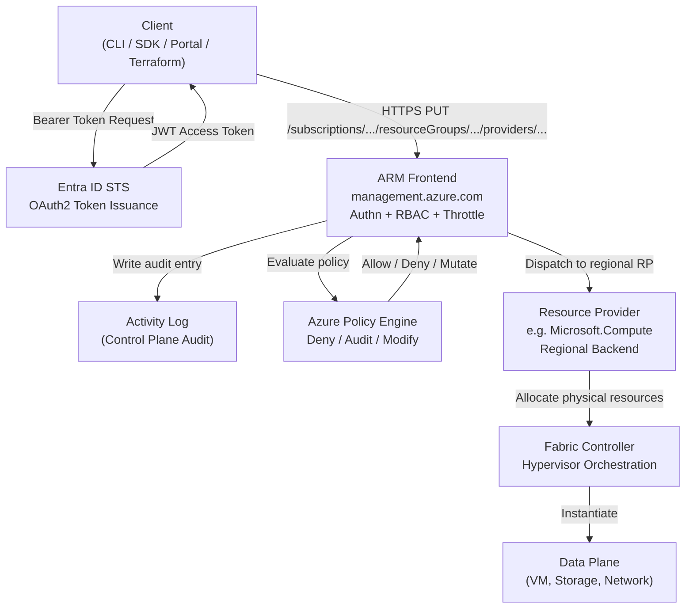

# Lesson 1: Foundational Architecture

## 1. First-Principles Intuition & Invariants

Every cloud platform is, at its core, a distributed operating system running on planetary-scale hardware. Azure is no different. What distinguishes it architecturally from a naive collection of virtualized servers is its global, hierarchical control plane: a consistent, policy-enforced, audit-traced management layer that sits above every compute node, storage array, and network fabric the platform owns. To work effectively with Azure at the infrastructure level, you must internalize this control plane not as an abstract portal feature but as a concrete software system with its own consistency guarantees, failure modes, and latency characteristics.

The architectural foundation Microsoft built is called Azure Resource Manager, commonly abbreviated ARM. It debuted in 2014 as a replacement for the original Azure Service Management API, which had grown organically and was suffering from the same disease that afflicts every ad-hoc distributed system built under delivery pressure: inconsistent state, partial failure opacity, and the absence of any atomic notion of a deployment unit. ARM solved these problems by introducing a declarative, intent-based model in which the desired state of a group of resources is expressed as a JSON document, submitted as a single transactional unit, and reconciled against the actual state of the platform. This is the same level-triggered reconciliation philosophy that Kubernetes would later make famous, though ARM predates it and is architecturally distinct.

The ARM model is grounded in a strict invariant: every interaction with Azure infrastructure, whether from the portal, the Azure CLI, a Terraform provider, or a Kubernetes controller, travels through a single, authenticated, role-enforced HTTP gateway. This gateway is the ARM endpoint at `management.azure.com`. It is not merely a proxy. It performs authentication via Azure Active Directory (now Entra ID), evaluates Azure Role-Based Access Control (RBAC) policies, validates resource provider schemas, records activity log entries, and routes the request to the appropriate regional resource provider backend. The implication for systems architects is profound: the control plane is a globally consistent, centralized authority, while the data plane is regionally distributed and independently scaled. This separation is not incidental. It is a deliberate design constraint with direct consequences for availability, compliance, and failure isolation that any serious cloud practitioner must understand at a mechanical level.

Before examining the internal mechanics of ARM, it is worth establishing the ownership and billing hierarchy it enforces. Azure organizes resources into a four-tier tree. At the root sits the Entra ID tenant, the identity boundary that owns all credentials, service principals, and directory objects. Beneath the tenant are management groups, which exist purely for policy and RBAC inheritance. Beneath management groups are subscriptions, which are the unit of billing, quota enforcement, and resource limit isolation. Beneath subscriptions are resource groups, which are the atomic deployment and lifecycle container for a collection of related resources.

This hierarchy is not bureaucratic overhead. Each boundary encodes a specific invariant. A subscription carries hard quota limits on vCPUs, public IP addresses, and storage accounts, enforced independently by each resource provider. It also carries a trust boundary for cost: charges aggregate to the subscription and roll up through the management group tree to a billing account. A resource group carries a lifecycle invariant: deleting a resource group is an atomic operation that deprovisions every resource it contains, subject to the resource providers honoring soft-delete and lock semantics. Because both RBAC assignments and Azure Policy assignments are inherited down this tree, an administrator who assigns a policy at the management group level can enforce tagging requirements, region restrictions, or allowed SKU lists across dozens of subscriptions without touching each one individually. This is the operational leverage the hierarchy was designed to provide.

The physical geography of Azure adds a second dimension orthogonal to the ownership hierarchy. Microsoft divides the world into geographies, regions, region pairs, and availability zones, and each of these constructs carries a distinct service-level and compliance contract. A geography is a data residency and sovereignty boundary, typically aligned to a country or regulatory jurisdiction. Within a geography, Microsoft defines one or more region pairs: two regions separated by at least 300 miles and connected by a dedicated low-latency backbone. Region pairs matter operationally because Azure platform updates are rolled out to one region in the pair before the other, reducing the probability that a botched platform rollout affects both simultaneously. When Azure-initiated failovers occur during large-scale incidents, the platform preferentially restores one region in a pair before the other, and cross-region replication for services like Azure Storage GRS and Azure SQL geo-replication flows along the pair boundary. For compliance-sensitive workloads, the region pair determines where replicated data at rest will physically reside, which is frequently a contractual constraint.

Within a single region, Microsoft physically separates infrastructure into availability zones. Each zone is an independent data center facility with its own power supply, cooling, and network path to the region backbone. Azure guarantees electrical and network isolation between zones such that a failure in one zone, whether from hardware, power, or cooling, should not propagate to another. The SLA for virtual machines deployed across two or more availability zones within the same region is 99.99% uptime, compared to 99.9% for a single VM with premium storage and 99.95% for a single VM within an availability set. These numbers have precise mathematical meaning: 99.99% permits approximately 52 minutes of downtime per year, while 99.9% permits approximately 8.7 hours. For a system running a stateful database cluster or an API gateway handling financial transactions, the choice of deployment topology is therefore a business-continuity decision with quantifiable consequences.

---

## 2. Core Architecture & Mechanics

Understanding ARM as a distributed system requires examining what actually happens when you execute `az deployment group create`. The request lifecycle traverses multiple independent subsystems before a single resource is created, and each transition point is a potential failure domain.



The ARM frontend receives every management request as an HTTPS call with an Entra ID-issued JWT Bearer token in the `Authorization` header. The token carries the caller's object ID, tenant ID, and the audience claim `https://management.azure.com/`. ARM validates the token signature against Entra ID's public key set, extracts the principal's identity, and evaluates all RBAC role assignments that apply at or above the target resource scope in the ownership hierarchy. If the caller lacks the required permission on the target scope, ARM returns `403 Forbidden` and writes the denial to the Activity Log. This check happens before the request reaches any resource provider, which means RBAC enforcement is centralized and cannot be bypassed by calling a resource provider's proprietary API endpoint, since those endpoints require a data-plane token with a different audience claim.

After the RBAC check passes, the Azure Policy engine evaluates all policy assignments that apply to the subscription containing the target resource group. Policy assignments can carry three effects relevant here. A `Deny` effect causes ARM to reject the request with a structured error message identifying which policy was violated and what the remediation path is. An `Audit` effect allows the request to proceed but writes a compliance record to the policy compliance store, which surfaces in the Azure Policy compliance dashboard. A `Modify` effect mutates the request payload before forwarding it to the resource provider, which is commonly used to enforce tag inheritance or to inject mandatory diagnostic settings. This mutation happens transparently to the caller; the Activity Log records both the original and mutated intent.

Once policy evaluation completes, ARM routes the request to the appropriate regional resource provider backend. Each resource provider is an independently operated microservice registered with ARM under a namespace like `Microsoft.Compute`, `Microsoft.Network`, or `Microsoft.Storage`. The registration manifests through the Resource Provider API, and you can enumerate all providers registered in a subscription and their operational state directly:

```bash
az provider list --query "[].{Namespace:namespace, State:registrationState}" \
  --output table
```

A resource provider must be registered in a subscription before resources of its type can be created. Registration is usually automatic when you first use a service, but in locked-down enterprise subscriptions with restrictive Azure Policy, unregistered providers will cause deployments to fail with `NoRegisteredProviderFound`. Explicitly pre-registering required providers as part of your subscription vending pipeline eliminates this class of deployment failure:

```bash
az provider register --namespace Microsoft.Compute --wait
az provider register --namespace Microsoft.Network --wait
az provider register --namespace Microsoft.Storage --wait
az provider register --namespace Microsoft.ContainerService --wait
```

The resource provider backend holds the authoritative desired-state model for its resource types. When it receives a `PUT` request from ARM, it parses and validates the resource payload against its own JSON schema, persists the desired state to its internal store, and begins asynchronous reconciliation against physical infrastructure. For long-running operations, the resource provider returns `202 Accepted` with an `Azure-AsyncOperation` or `Location` header pointing to an operation status endpoint. The ARM SDK and CLI poll this endpoint using exponential backoff until the operation reaches a terminal state of `Succeeded`, `Failed`, or `Canceled`. This asynchronous contract is a critical operational invariant: a `202` response from ARM means the control plane accepted the intent, not that the resource exists.

The separation between control plane and data plane is architecturally sharpest in services like Azure Storage and Azure Key Vault. The ARM endpoint governs the lifecycle of a storage account, its replication configuration, its network access rules, and its diagnostic settings. But reading and writing blobs does not involve ARM at all. It goes directly to the storage service endpoint at `<account>.blob.core.windows.net`, authenticated with a separate token bearing the audience `https://storage.azure.com/`. This means ARM downtime does not interrupt in-flight data-plane workloads. A production cluster reading from Azure Blob Storage continues operating normally even if the ARM frontend experiences a regional outage, because the data plane is independently scaled and independently available. This is the core resilience argument for the separation, and it is the reason mission-critical workloads should never place management-plane operations in the hot path of a production request handler.

The physical architecture of a region is organized around availability zones, which ARM surfaces through the `zones` property on zone-aware resource types. When you create a VM and specify `zones: ["1"]`, the ARM request instructs the Microsoft.Compute resource provider to place the VM's hypervisor instance on physical hardware assigned to zone 1 in the target region. The Fabric Controller, Azure's hypervisor orchestration layer descended from the technology that powers Bing's server fleet, selects a physical host within that zone's fault domain inventory, allocates the requested vCPU and memory shares from the host's NUMA topology, and configures the virtual NIC binding to the zone-local network segment. The latency between zones within a single region is bounded at under 2ms round-trip, which is sufficient for synchronous replication in clustered workloads.

The relationship between management groups, subscriptions, and policy is defined by a scope resolution algorithm that merges assignments from all ancestors in the tree and applies the most restrictive net effect. If a `Deny` policy at the management group level prohibits creating resources outside of approved regions, no subscription-level `Allow` can override it. This precedence rule is called the "deny overrides" model, and it means that platform teams who own the management group layer hold a veto over all workloads running in every subscription beneath them, regardless of what individual subscription owners configure. The practical consequence is that organizations building a landing zone architecture must design their policy hierarchy before onboarding workload teams, because retrofitting restrictive policies onto subscriptions containing existing resources invariably produces compliance violations that require remediation effort proportional to the number of non-compliant resources already deployed.

---

## 3. High-Performance Optimization & Failure Modes

Production experience with Azure at scale surfaces a set of failure modes that are invisible when you are running a small workload but become critical bottlenecks as infrastructure grows. The most common of these is ARM throttling. The ARM frontend enforces per-subscription, per-resource-provider rate limits on read and write requests. The specific limits vary by resource provider, but the pattern is consistent: each subscription is allocated a fixed bucket of requests per minute, shared across all callers operating in that subscription. When you are running Terraform at scale across dozens of pipelines, or when you have a Kubernetes cluster running the Azure Cloud Provider controller, every node join, load balancer reconciliation, and disk attachment generates ARM API calls. These calls aggregate in the subscription's rate limit bucket, and when the bucket empties, ARM returns `429 Too Many Requests` with a `Retry-After` header specifying the number of seconds to wait.

The standard mitigation for ARM throttling is to distribute workloads across multiple subscriptions, which gives each workload its own independent rate limit bucket. This is the subscription-per-workload or subscription-per-environment pattern advocated by Microsoft's Cloud Adoption Framework, and it has throttling isolation as one of its primary technical motivations, not just billing separation. When designing a landing zone, the subscription vending pipeline should therefore treat subscription count not as an administrative burden but as a horizontal scaling mechanism for control-plane throughput.

For workloads that must operate within a single subscription, the ARM SDK's built-in retry logic handles transient `429` responses, but you need to ensure that your automation tooling does not suppress the `Retry-After` hint. Terraform with the AzureRM provider respects this header by default. The Azure CLI does as well. Custom automation that calls the ARM REST API directly must implement the following pattern:

```bash
#!/usr/bin/env bash
set -euo pipefail

ARM_TOKEN=$(az account get-access-token \
  --resource https://management.azure.com/ \
  --query accessToken --output tsv)

SUBSCRIPTION_ID=$(az account show --query id --output tsv)

arm_request_with_retry() {
  local method="$1"
  local url="$2"
  local body="${3:-}"
  local max_attempts=8
  local attempt=0

  while (( attempt < max_attempts )); do
    response=$(curl --silent --write-out "\n%{http_code}" \
      --request "$method" \
      --header "Authorization: Bearer ${ARM_TOKEN}" \
      --header "Content-Type: application/json" \
      --data "${body}" \
      "https://management.azure.com${url}?api-version=2023-07-01")

    http_code=$(echo "$response" | tail -n1)
    body_response=$(echo "$response" | head -n -1)

    if [[ "$http_code" == "200" || "$http_code" == "201" || "$http_code" == "202" ]]; then
      echo "$body_response"
      return 0
    elif [[ "$http_code" == "429" ]]; then
      retry_after=$(echo "$body_response" | \
        python3 -c "import sys,json; \
        h=json.load(sys.stdin); \
        print(h.get('error',{}).get('additionalInfo',[{}])[0].get('info',{}).get('retryAfter',30))" \
        2>/dev/null || echo 30)
      echo "ARM throttled (429). Waiting ${retry_after}s before retry ${attempt}/${max_attempts}." >&2
      sleep "$retry_after"
    else
      echo "ARM error ${http_code}: ${body_response}" >&2
      return 1
    fi

    (( attempt++ ))
  done

  echo "Max retry attempts exceeded." >&2
  return 1
}

# Example: list resource groups in a subscription
arm_request_with_retry GET \
  "/subscriptions/${SUBSCRIPTION_ID}/resourcegroups"
```

A second critical failure mode involves availability zone placement and what Azure calls "zonal pinning." When you create a managed disk independently and then attach it to a VM, both resources must reside in the same availability zone. If you create the disk without specifying a zone and later create a zonal VM, the attach operation will fail with `DiskAndVmZoneMismatch`. The correct pattern is to always co-locate stateful resources in an ARM deployment template so the resource provider can enforce co-placement atomically. In a Bicep or ARM template, expressing the zone dependency explicitly ensures the Fabric Controller allocates both the compute and storage within the same zone's physical boundary:

```bicep
param location string = resourceGroup().location
param vmZone string = '1'

resource networkInterface 'Microsoft.Network/networkInterfaces@2023-06-01' = {
  name: 'nic-prod-eastus-001'
  location: location
  properties: {
    ipConfigurations: [
      {
        name: 'ipconfig1'
        properties: {
          subnet: {
            id: '/subscriptions/${subscription().subscriptionId}/resourceGroups/rg-network/providers/Microsoft.Network/virtualNetworks/vnet-prod/subnets/snet-compute'
          }
          privateIPAllocationMethod: 'Dynamic'
        }
      }
    ]
  }
}

resource osDisk 'Microsoft.Compute/disks@2023-04-02' = {
  name: 'disk-os-prod-eastus-001'
  location: location
  zones: [vmZone]
  sku: {
    name: 'Premium_LRS'
  }
  properties: {
    creationData: {
      createOption: 'Empty'
    }
    diskSizeGB: 128
    osType: 'Linux'
  }
}

resource virtualMachine 'Microsoft.Compute/virtualMachines@2023-07-01' = {
  name: 'vm-prod-eastus-001'
  location: location
  zones: [vmZone]
  properties: {
    hardwareProfile: {
      vmSize: 'Standard_D4s_v5'
    }
    storageProfile: {
      osDisk: {
        createOption: 'Attach'
        managedDisk: {
          id: osDisk.id
        }
        osType: 'Linux'
      }
    }
    networkProfile: {
      networkInterfaces: [
        {
          id: networkInterface.id
        }
      ]
    }
  }
  dependsOn: [osDisk, networkInterface]
}
```

A third failure mode is less obvious and relates to region pair behavior during platform-initiated failovers. Azure Storage accounts configured with Geo-Redundant Storage replicate synchronously to locally redundant copies within the primary region and asynchronously to the paired region. The `Recovery Point Objective` for GRS replication is typically under 15 minutes, but Microsoft does not contractually guarantee a specific RPO for the asynchronous leg. During a declared regional outage, Microsoft may initiate a failover of the storage account to the paired region, after which the original primary becomes a read-only replica. If your application is not designed to handle the endpoint change and the temporary read-only state of the original primary, you will experience write failures that look like storage errors but are actually a consequence of a control-plane failover decision made without direct interaction with your workload.

The mitigation is to explicitly configure storage accounts with `allowBlobPublicAccess: false`, use Azure Private Endpoints to bind the data plane to your virtual network's DNS, and test failover behavior with Azure Storage Explorer or the CLI before you are in an incident:

```bash
# Initiate a manual failover to the paired region (irreversible until re-replication completes)
az storage account failover \
  --name stprodeastus001 \
  --resource-group rg-storage-prod \
  --no-wait

# Poll the failover status
az storage account show \
  --name stprodeastus001 \
  --resource-group rg-storage-prod \
  --query "{FailoverInProgress:failoverInProgress, PrimaryLocation:primaryLocation, SecondaryLocation:secondaryLocation}" \
  --output table
```

Compliance boundary management is the final operational concern a production architect must internalize before treating Azure as a platform for regulated workloads. Compliance boundaries in Azure are enforced through a combination of resource location policies, data residency guarantees, and service-specific certifications. Azure Policy is the enforcement mechanism: a `Deny` policy with the built-in definition `Allowed locations` restricts all resource deployments to a specified list of regions, preventing accidental provisioning of regulated data into an uncertified geography. For workloads subject to data sovereignty requirements, this policy should be assigned at the management group level, not the subscription level, to prevent a misconfigured subscription from bypassing the constraint.

The `az policy assignment create` command combined with a parameter file encodes this constraint declaratively, which makes it auditable in source control and deployable as part of a landing zone pipeline:

```bash
cat > allowed-locations-params.json << 'EOF'
{
  "listOfAllowedLocations": {
    "value": [
      "eastus",
      "eastus2",
      "westus2",
      "westeurope",
      "northeurope"
    ]
  }
}
EOF

az policy assignment create \
  --name "enforce-allowed-regions" \
  --display-name "Enforce Approved Azure Regions" \
  --policy "/providers/Microsoft.Authorization/policyDefinitions/e56962a6-4747-49cd-b67b-bf8b01975c4f" \
  --params @allowed-locations-params.json \
  --scope "/providers/Microsoft.Management/managementGroups/mg-corp-platform" \
  --enforcement-mode Default
```

The enforcement mode `Default` causes ARM to actively deny non-compliant deployments. Setting it to `DoNotEnforce` enables a pilot phase where violations are audited without being blocked, which is the correct migration path when applying new policies to a management group that already contains deployed resources.

Taken together, the ARM hierarchy, the control plane / data plane separation, the region pair topology, the availability zone SLA model, and the compliance enforcement pipeline form a coherent architectural system. Each component addresses a specific failure mode or operational constraint, and each one imposes invariants you can rely on when designing for resilience, throughput, and regulatory compliance. The practitioner who understands these invariants at the mechanical level, not just the conceptual level, can reason from first principles about why a deployment failed, why a failover behaved unexpectedly, or why a compliance audit produced violations in a subscription they believed was locked down. That reasoning ability is the core competency this lesson is designed to build.
