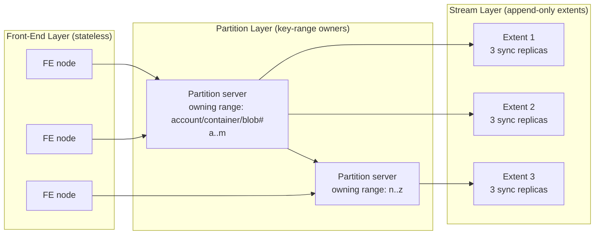
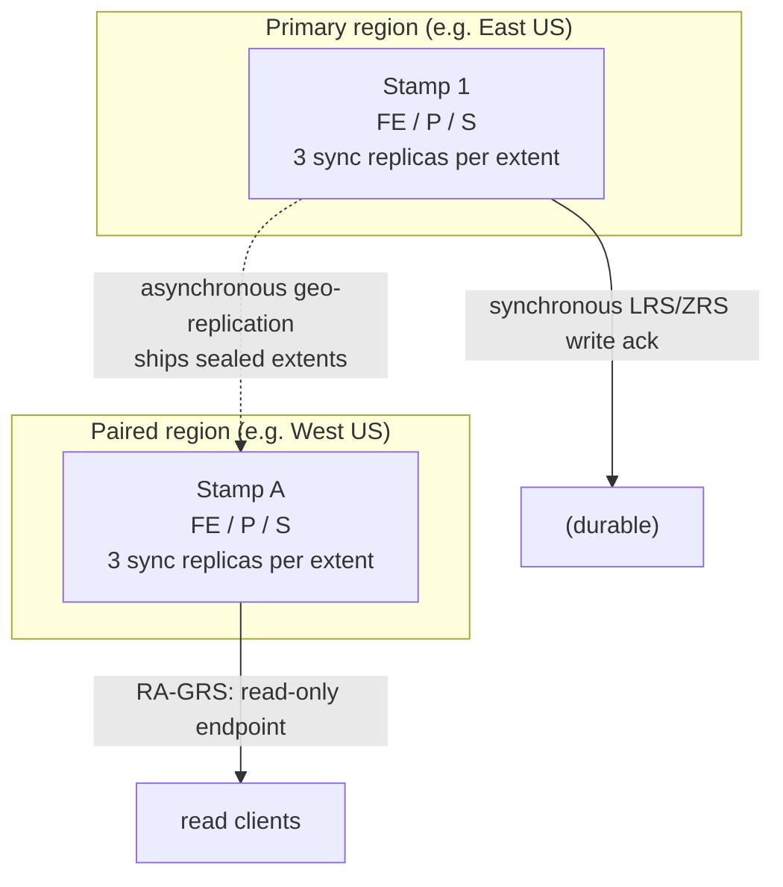

# Lesson 3: Storage Persistence

## 1. First-Principles Intuition & Invariants

Every persistence problem reduces to the same negotiation between three enemies: bit rot at the media layer, correlated failure at the rack and power-distribution layer, and the cost of synchronous coordination across wide geographic distances. Azure Storage answers this negotiation with a deliberately narrow contract. It does not attempt to give you a globally linearizable, strongly consistent, multi-region read-write store at the lowest SKU. Instead, it exposes a small set of replication tiers — LRS, ZRS, GRS, RA-GRS, and their GZRS variants — each of which encodes a specific position on the durability-availability-cost triangle, and it puts a strong-consistency boundary precisely around the synchronous replication domain. Reads inside that domain are linearizable; reads that cross it are eventual, and the system tells you the watermark via `LastSyncTime`.

The durability numbers published for these tiers are not marketing; they are the arithmetic of independent failure domains. Locally Redundant Storage keeps three synchronous copies within a single stamp, so the annualized loss probability is approximately the cube of the per-replica failure rate, which works out to eleven nines (99.999999999 percent). Zone-Redundant Storage spreads those three copies across three fault domains that map to physically distinct availability zones, removing the correlated datacenter failure mode and lifting the figure to twelve nines. Geo-Redundant Storage adds an asynchronous second region, which means a failure must destroy three synchronous copies in the primary region *and* three synchronous copies in the paired region before data is lost — a quadratically smaller probability that reaches sixteen nines. The point of understanding these numbers as a kernel engineer is that they are not a property of "the cloud" handing you something magical; they are a property of the geometry of independent failures, and the same geometry applies to your own replicated services.

The invariants you must internalize before writing any client are these. First, a successful write to a primary returns only after it has been durably replicated within the synchronous domain; there is no acknowledgment-before-replication window. Second, reads against the primary reflect all acknowledged writes — read-your-writes and monotonic-read are guaranteed within the primary region. Third, the moment you read against a secondary in RA-GRS, you are in an eventually consistent domain; the only thing the system owes you is a watermark, and you must honor that watermark or your application will see data that moves backwards in time. Fourth, the storage account is the throughput and request unit, not the container or the blob; throttling is enforced at the account scope first and at the partition scope second. Fifth, the storage account name forms part of a globally unique DNS namespace, which means it is also the addressing primitive and the throttling key — choose it carefully, because renaming is not supported.

The consequence of these invariants is that building correct high-throughput applications on Azure Storage is not a question of tuning; it is a question of partitioning. A single blob is bound to a single partition server for its entire life, which means a single hot blob cannot be horizontally scaled by the platform no matter how much you pay. The platform can scale *across* partitions, but not *through* one. This is the single most important fact about Azure Blob Storage, and the rest of this chapter is largely an exploration of how to live within it.

## 2. Core Architecture & Mechanics

Azure Storage is implemented as a fleet of "storage stamps," each stamp being an autonomous cluster of rack-scale storage nodes running a three-layer software stack. The architecture, originally described by Calder et al. in the SOSP 2011 Windows Azure Storage paper, has been refined continuously, but the layering remains recognizable: a Front-End (FE) layer, a Partition (P) layer, and a Stream (S) layer.



The FE layer terminates the TLS connection, performs shared-key or token authentication, and forwards the request into the partition layer. FEs are stateless and horizontally scalable; they hold no authoritative metadata. The Partition layer is where the three-level namespace — `account/container/blob` — is resolved into a single partition key, and where the partition server that owns that key range is identified. A partition server maintains an in-memory map from object name to the streams that hold its data and the commit sequence number of the most recent durable write. The Stream layer is an append-only, log-structured, distributed file system. Every write to a blob is appended to a stream; the stream is segmented into extents; each extent is sealed at a target size and triple-replicated synchronously across three stream nodes, with a fourth "durable" copy written to a separate failure domain if the extent is large. Sealed extents are immutable, which is what gives the system its strong consistency: a read returns either the latest committed sequence or nothing, never a partial overwrite.

The replication topology across stamps looks like this:



The key mechanistic insight is what "synchronous" actually means here. When `Put Blob` returns 201, three replicas of the relevant extent have acknowledged the write to stable storage in the primary stamp. For ZRS, those three replicas are in three distinct availability zones, which means three separate datacenters with independent power, cooling, and network. The cost of this synchronous domain is latency — a ZRS write is roughly two to four milliseconds slower than LRS because of cross-zone network round trips. For GRS, the secondary region write is fire-and-forget; the primary returns success before the secondary has it, and a regional catastrophe that destroys the primary before the async queue drains will lose the in-flight tail. That tail is bounded — typically under fifteen seconds for hot data, longer for cool — but it is real, and your recovery point objective must account for it.

Partitioning is the single most important mechanic to understand. Azure Storage's three-level namespace collapses into a single partition key per blob: the partition key for a blob named `logs/2024/09/app.log` in container `telemetry` in account `stprod` is the full path string `stprod/telemetry/logs/2024/09/app.log`. A partition server owns a contiguous range of these keys; the partition manager observes load and splits or migrates ranges. Because the unit of ownership is the full path, two blobs in the same container but with different path prefixes may or may not be on the same partition server — but the same blob will always be on exactly one partition server, and so will always be throttled as a single entity. The default account-level limits for a general-purpose v2 standard account are 20,000 IOPS and an ingress of 10 Gbps for LRS or 20 Gbps for GRS, with an egress of 20 Gbps for LRS and 50 Gbps for RA-GRS. Per-partition limits are roughly 5,000 IOPS for writes and 500 requests per second sustained. A single block blob has historically been capped at 60 MB/s and 500 IOPS, though premium block-blob accounts lift this.

To create a production-grade storage account that pins all of these dials correctly:

```bash
az storage account create \
  --name stprodkortheus001 \
  --resource-group rg-storage-prod \
  --location eastus \
  --sku Standard_GZRS \
  --kind StorageV2 \
  --access-tier Hot \
  --min-tls-version TLS1_2 \
  --allow-blob-public-access false \
  --allow-shared-key-access true \
  --enable-hierarchical-namespace false \
  --publish-internet-endpoints false \
  --publish-microsoft-endpoints true \
  --require-infrastructure-encryption true \
  --default-action Deny \
  --tags env=prod team=platform
```

Note the choices: GZRS gives you ZRS-class durability in the primary with geo-replication to the paired region, so you get zone resilience plus regional resilience plus read access to the secondary. The `--require-infrastructure-encryption true` flag adds a platform-managed second encryption layer beneath your customer-managed key, an option that exists for compliance regimes that demand defense in depth. The `--default-action Deny` flips the storage firewall into whitelist mode, after which you must explicitly add service endpoints, private endpoints, or IP rules.

The physical layout of a blob differs by type. Block blobs, which are the workhorse for object storage, are split into blocks of up to 4,000 MiB each; a block is uploaded via `Put Block`, returns a block ID, and is only made visible when `Put Block List` commits the ordered list of block IDs. This two-phase commit is what makes block blobs resumable and parallelizable — ten thousand concurrent `Put Block` calls can saturate the account ingress, and a single `Put Block List` of ten milliseconds commits them atomically. Page blobs are fundamentally different: they are a flat 512-byte-aligned random-access array of pages, used as the substrate for virtual machine disks. Uncommitted pages are returned as zeros; committed pages persist across reboots. Append blobs expose a single append-only operation and are the only blob type that allows concurrent appenders to interleave safely without a client-side lock — the partition server atomically appends to the end of the underlying stream.

Managed disks are page blobs with a resource provider wrapper. The disk RP handles the storage account allocation, the lease management that prevents a disk from being attached to two VMs simultaneously, and the burst credit accounting that distinguishes Premium SSD SKUs from one another. The disk itself is a page blob in a Microsoft-managed storage account that is invisible to your subscription's storage account list — you interact only with the disk resource:

```bash
az disk create \
  --resource-group rg-vm-prod \
  --name disk-data-01 \
  --size-gb 1024 \
  --sku Premium_ZRS \
  --os-type Linux \
  --encryption-type EncryptionAtPlatformWithCustomerKey \
  --network-access-policy AllowPrivateEndpoint \
  --tier P30
```

The `--sku Premium_ZRS` choice matters operationally: ZRS-managed disks survive a single-zone failure without VM reboot, because the disk is replicated across three zones synchronously. LRS-managed disks do not, and a zone failure forces a VM reboot onto a surviving zone once the platform's VM-reservation system finds capacity. The trade is write latency, which is typically one to three milliseconds higher on ZRS-managed disks.

For Ultra Disks, the model is different again. Ultra Disk storage bypasses the page blob abstraction and uses a direct block-store service that lets you provision IOPS and throughput independently of capacity:

```bash
az disk create \
  --resource-group rg-vm-prod \
  --name ultra-disk-01 \
  --sku UltraSSD_LRS \
  --disk-size-gb 1024 \
  --disk-iops-read-write 50000 \
  --disk-mbps-read-write 500
```

The IOPS you provision here are guaranteed at the ninety-ninth percentile; you are not bursting. This is the disk you reach for when you have a database that needs deterministic latency at submillisecond tails, and the trade-off is that Ultra Disks are LRS only — they do not support ZRS or GRS — and they cannot be moved between VMs without detach, because they require a VM size that exposes the NVMe-over-fabric capability.

Azure Files terminates the SMB or NFS protocol on a separate gateway front-end that is distinct from the blob front-end. The file share is backed by either an append-only log structure on standard accounts or page-blob-style storage on premium accounts. The protocol gateway translates SMB or NFS semantics into storage-account operations, which is why the same storage account can expose both blob and file endpoints with different performance envelopes. SMB 3.x connections use AES-GCM encryption in transit by default, integrate with Active Directory for Kerberos-based identity, and enforce NTFS-style ACLs that the gateway translates into the storage layer. NFS 4.1 connections are POSIX-only, do not integrate with Active Directory, and require the storage account to be exposed only through private endpoints, because NFS over the public internet is not a supported configuration:

```bash
az storage share-rm create \
  --resource-group rg-files-prod \
  --storage-account stfilesprodkortheus \
  --name share-archive \
  --quota 1024 \
  --enabled-protocols SMB \
  --root-squash NoRootSquash \
  --provisioned-bandwidth-mibps 100

az storage share-rm create \
  --resource-group rg-files-prod \
  --storage-account stfilesnfsprodkortheus \
  --name share-nfs \
  --quota 1024 \
  --enabled-protocols NFS \
  --root-squash RootSquash
```

On the client side, the mount commands expose the protocol distinction directly:

```bash
# SMB 3.1.1 from a Linux client, using a credentials file
sudo mount -t cifs \
  //stfilesprodkortheus.file.core.windows.net/share-archive /mnt/archive \
  -o vers=3.1.1,credentials=/etc/smbcredentials/stfilesprodkortheu.cred,\
dir_mode=0777,file_mode=0777,serverino,mfsymlinks,actimeo=30

# NFS 4.1 from a Linux client in the same VNet with private endpoint
sudo mount -t nfs -o vers=4.1,sec=sys,rsize=1048576,wsize=1048576,hard,timeo=600,retrans=2 \
  stfilesnfsprodkortheus.file.core.windows.net:/stfilesnfsprodkortheus/share-nfs /mnt/nfs
```

The `serverino` option forces the gateway to return server-stable inode numbers, which is critical for tools like `rsync` and `find` that depend on inode stability across mounts. The `mfsymlinks` option enables the Microsoft-style symlink emulation that the SMB gateway supports, without which symlinks in a Windows-authored share appear as regular files on Linux. For NFS, the `hard` mount type is mandatory for correctness — a `soft` mount silently truncates files when the gateway becomes momentarily unreachable, which is a class of corruption that you should never accept.

## 3. High-Performance Optimization & Failure Modes

The first performance lever is partition sharding. Because the partition key is the full blob path, and because a single partition cannot exceed its per-partition quota, your key namespace must be designed so that high-traffic objects do not collide. The canonical anti-pattern is a single container holding millions of audit-log blobs under a flat prefix like `logs/2024-09-30-app.log` — every read and write on that blob routes to the same partition server, and once the partition is hot, the platform will eventually migrate it to a dedicated server, but that migration is reactive, not predictive. The correct pattern is to spread the namespace across many containers or many path prefixes: `container-audit-00` through `container-audit-FF`, with the first byte of a content hash as the container selector. This guarantees that no single partition server becomes the bottleneck for a write-heavy workload, because each blob lands on a partition that is statistically independent of the others.

AzCopy is the production tool for high-throughput transfer precisely because it understands this partitioning at the block level. A 1 TB upload does not happen as a single PUT; it happens as thousands of `Put Block` calls across many concurrent connections, each block sized to the optimal point on the latency-bandwidth curve:

```bash
azcopy copy "/data/large.parquet" \
  "https://stprodkortheus001.blob.core.windows.net/warehouse/large.parquet$(az storage account generate-sas \
    --name stprodkortheus001 --permissions w --expiry 2024-12-31T23:59:59Z --https-only \
    --output tsv --auth-mode login)" \
  --block-size-mb=100 \
  --put-block-size-mb=256 \
  --log-level=INFO \
  --output-level=essential
```

The `--block-size-mb=100` flag controls the size of each `Put Block` request, and `--put-block-size-mb=256` controls how AzCopy splits the source file. For a hot-path workload on a Premium block-blob account, you want larger blocks because each block upload incurs a per-request overhead and you want to amortize it across more bytes. For a workload dominated by small files, you want the opposite: smaller blocks, more parallelism, no single file dominating the queue.

Optimistic concurrency is the second lever. Every blob response includes an ETag header, and the `If-Match` and `If-None-Match` request headers turn that ETag into a precondition. If you have multiple writers updating a counter or a configuration file, do not build a distributed lock. Use ETags:

```python
from azure.storage.blob import BlobServiceClient, BlobClient
from azure.core.match_conditions import MatchConditions
import os, json, time, random

service = BlobServiceClient.from_connection_string(os.environ["AZURE_STORAGE_CONNECTION_STRING"])
blob = service.get_blob_client("config", "service-config.json")

def update_with_retry(fn, max_attempts=10):
    for attempt in range(max_attempts):
        props = blob.get_blob_properties()
        current = json.loads(blob.download_blob().readall())
        updated = fn(current)
        try:
            blob.upload_blob(
                json.dumps(updated).encode(),
                overwrite=True,
                etag=props.etag,
                match_condition=MatchConditions.IfNotModified,
            )
            return
        except Exception as e:
            if attempt == max_attempts - 1:
                raise
            time.sleep((2 ** attempt) * 0.1 + random.uniform(0, 0.05))

update_with_retry(lambda c: {**c, "revision": c["revision"] + 1})
```

The blob service returns 412 Precondition Failed if the ETag no longer matches, which means another writer committed first. The exponential backoff with jitter — the same pattern you would use for any retry — converges quickly under low contention and degrades gracefully under high contention.

For RA-GRS reads, the equivalent of an ETag is the `LastSyncTime` header returned by the secondary endpoint. Any read against `stprodkortheus001-secondary.blob.core.windows.net` includes a header that tells you the wall-clock time of the last successfully replicated write. Reads against the secondary that return data newer than `LastSyncTime` are guaranteed; reads that return data older than `LastSyncTime` are not guaranteed to reflect the latest primary state, but they are guaranteed to be consistent with the secondary's view at that moment:

```bash
# Inspect the LastSyncTime of a storage account from the secondary
az storage blob show \
  --account-name stprodkortheus001 \
  --container-name config \
  --name service-config.json \
  --account-name stprodkortheus001-secondary \
  --query properties.lastSyncedOn \
  --output tsv
```

If your application reads from the secondary under failover pressure and you require that every read reflect the latest primary state, you must block until `LastSyncTime` advances past your last known primary write timestamp. In practice, most applications do not require this — they tolerate eventual consistency for read paths that serve eventually-correct views, and they require strong consistency only for paths that go through the primary.

Customer-managed failover is the most consequential operation you will perform against a GRS account. The `az storage account failover` command flips the secondary region into primary mode, breaking the geo-replication pairing and accepting the data loss window that exists between `LastSyncTime` and the moment of failure. The command is destructive in the sense that it cannot be reversed without re-establishing replication from the new primary to a new secondary, which takes hours to days for terabyte-scale accounts. The platform will refuse a failover if the primary is still reachable in most cases, because the operation is intended for genuine regional unavailability:

```bash
# Initiate account failover (irreversible; use only when primary is down)
az storage account failover \
  --name stprodkortheus001 \
  --yes \
  --no-wait
```

After the failover, your application's connection strings continue to work because the DNS names are remapped at the Azure edge, but any cached client that pinned to a primary IP address must be recycled, because the underlying stamp addressing has changed. Modern SDKs handle this transparently, but if you have hand-rolled HTTP clients with connection pooling, you must drain and reconnect them.

Throttling manifests as HTTP 503 with the `ServerBusy` error code, or HTTP 429 with `RetryAfter`. The correct response is exponential backoff with jitter, capped at the documented retry-after value, and you must respect the cap on the number of in-flight requests to avoid amplifying the problem. The Azure SDK does this by default via the `RetryPolicy` pipeline, but if you are using raw REST, you must implement it yourself:

```python
import time, random, requests
from datetime import datetime, timezone

def put_blob_with_backoff(url, headers, data, max_attempts=8):
    for attempt in range(max_attempts):
        r = requests.put(url, headers=headers, data=data)
        if r.status_code == 201:
            return r
        if r.status_code in (429, 503):
            retry_after = int(r.headers.get("Retry-After", "5"))
            jitter = random.uniform(0, 0.5)
            time.sleep(min(retry_after, 2 ** attempt) + jitter)
            continue
        r.raise_for_status()
    raise RuntimeError("exhausted retries")
```

The `Retry-After` header is authoritative; the platform uses it to tell you how long the throttling is expected to persist, and ignoring it is the fastest way to drive your account into a longer throttle window. A subtler failure mode is the slow-partition scenario: the partition is not technically throttled, but it is processing at the edge of its capacity, and you see p99 latency climb while p50 stays flat. The only effective response is to reduce the traffic to that partition by sharding your keys, which is a design change, not a runtime change. This is why partition design must happen at the data-modeling stage, not at the incident-response stage.

The final failure mode worth dissecting is silent corruption. Azure Storage computes end-to-end CRCs on every block at upload and verifies them on every read, which means the platform will detect bit rot at the media layer before it surfaces it to you — the data is read from a healthy replica instead. This is what gives the durability numbers their teeth: the system is not just storing three copies, it is continuously verifying them and healing the bad one. The risk you actually face is not silent corruption in storage, but silent corruption in transit between your client and the platform, which is why the SDK validates CRCs on every response and why you should never disable TLS on storage connections regardless of the perceived latency cost.

Taken together, the operational discipline that Azure Storage rewards is design-time partitioning, runtime backoff, and an honest accounting of the consistency boundary. Get the partition keys right and the platform scales with you; get them wrong and no amount of premium SKU spending will save you. Honor `Retry-After` and `LastSyncTime`, and your application survives the inevitable throttling and failover events; ignore them and you will discover the exact moment that eventual consistency becomes a user-visible bug.
