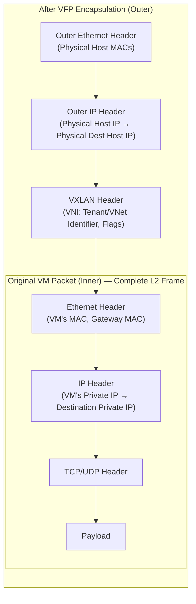
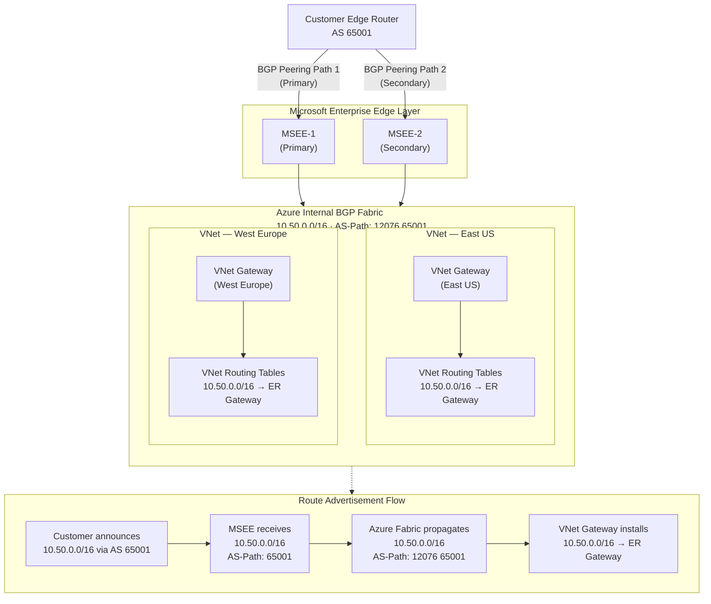
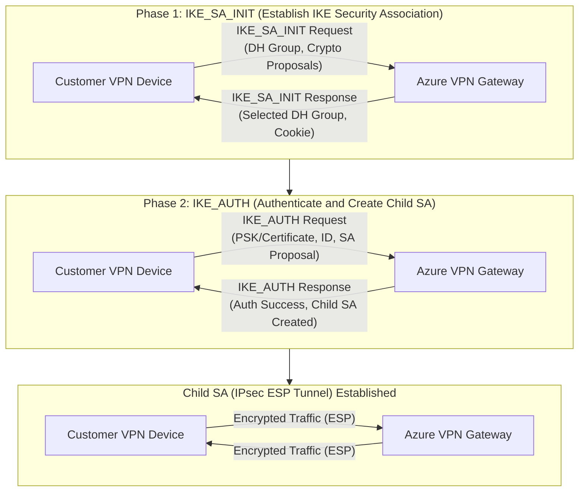

# Lesson 4: Networking Connectivity

## 1. First-Principles Intuition & Invariants

Azure's networking substrate represents a radical departure from traditional data center architecture. Where classical enterprise networks relied on physical switches, VLANs, and manually configured routing tables, Azure builds its connectivity layer atop a massively distributed software-defined overlay that abstracts the physical topology entirely. This abstraction enables tenant isolation, elastic scaling, and geographic distribution while presenting the illusion of a dedicated Layer 2 broadcast domain to each customer workload.

At the foundation lies the Virtual Network (VNet), Azure's logical isolation boundary. A VNet carves out a private RFC 1918 address space from the Azure substrate, enforcing network-level segmentation through a distributed stateful firewall fabric that operates beneath the virtualization layer. Unlike traditional network boundaries enforced by physical router ACLs, VNet isolation relies on encapsulation tags embedded in packet headers at the hypervisor level. The Azure host networking stack intercepts every packet egressing a virtual machine, consults a distributed forwarding table maintained by the Azure fabric controller, and applies encapsulation (typically VXLAN or NVGRE) that carries tenant context across the physical underlay.

This encapsulation mechanism creates a critical invariant: **tenant traffic never traverses the physical network in plaintext**. Every packet leaving a VM carries an outer header containing only Azure infrastructure addressing, while the customer's original IP headers remain encapsulated within. This design provides both security—network sniffing on the physical fabric reveals only infrastructure metadata—and mobility, since the outer header's source and destination reflect physical host locations that can change during VM migrations without disrupting the logical network topology.

The VNet address space itself operates under strict constraints. Azure reserves the first four addresses and the last address in every subnet for infrastructure purposes: `.0` represents the network address per IP conventions, `.1` serves as the default gateway (implemented by the Azure Software Defined Network stack, not a physical router), `.2` and `.3 map to Azure DNS resolvers, and the broadcast address `.255` remains reserved despite Azure's unicast-only forwarding model that deliberately omits broadcast support to prevent network storms in multi-tenant environments.

Connectivity between VNets requires explicit peering relationships that establish bidirectional routing without transitive properties. If VNet A peers with VNet B, and VNet B peers with VNet C, traffic between A and C remains blocked unless a direct A-to-C peering exists. This anti-transitivity design prevents unintended access paths and maintains the principle of least privilege at the network layer. VNet peering operates through the same encapsulation mechanism as intra-VNet traffic, but the fabric controller updates forwarding tables to permit cross-VNet flows only after cryptographic proof of both tenants' consent.

Global VNet peering extends this model across Azure regions, introducing latency as the dominant performance consideration. Traffic between globally peered VNets traverses Microsoft's private backbone—a dedicated wide-area network separate from the public internet—but must still cross intercontinental fiber spans. A packet traveling from East US to West Europe VNets incurs approximately 80-100ms of round-trip latency purely from the speed-of-light propagation delay through ~7,500 kilometers of fiber. This immutable physical constraint shapes architecture decisions: globally distributed applications must embrace eventual consistency models rather than synchronous cross-region database transactions.

The routing substrate within a VNet operates through system routes automatically injected by the Azure control plane. Every subnet receives routes for its own address space and all peered VNet ranges, plus a default route (`0.0.0.0/0`) pointing to the internet. These routes exist in a conceptual routing table maintained per-subnet, not per-VM, reflecting the subnet's role as the atomic unit of network policy. User-defined routes (UDRs) override system routes through longest-prefix matching, enabling traffic steering through network virtual appliances or forced tunneling to on-premises networks.

ExpressRoute circuits introduce a fundamentally different connectivity paradigm by establishing dedicated physical links between customer premises and Azure regions. Unlike VPN tunnels that traverse the public internet and rely on IPsec cryptography for security, ExpressRoute circuits operate as Layer 2 or Layer 3 private connections provisioned through telecommunications carriers. These circuits bypass the internet entirely, connecting customer routers directly to Microsoft Enterprise Edge (MSEE) routers at peering locations. This physical isolation provides predictable latency, higher throughput (up to 100 Gbps), and immunity to internet routing instability.

The ExpressRoute architecture employs redundant paths as a core design principle. Every circuit provisions two physical cross-connects to separate MSEE routers, implementing Active-Active load sharing through BGP equal-cost multipath routing. This redundancy operates at both the physical layer—diverse fiber paths to different line cards—and the logical layer, where BGP sessions announce identical route prefixes with equal AS-path lengths. The customer's edge routers distribute traffic across both links, and upon failure detection through BGP keepalive timeouts (typically 3 seconds with 10-second hold timers), traffic fails over to the surviving path within subsecond intervals.

Azure's load balancing infrastructure consists of two distinct planes operating at different protocol layers. The Basic Load Balancer implements a stateless hash-based distribution algorithm that examines five-tuple packet headers (source IP, source port, destination IP, destination port, protocol) and applies a consistent hash function to select a backend target. This hash remains stable for the lifetime of a flow, ensuring all packets in a TCP connection reach the same backend instance. However, the stateless design means the load balancer maintains no connection tracking state—it simply computes the hash on every packet and forwards accordingly.

The Standard Load Balancer introduces stateful connection tracking through a distributed flow table that persists the mapping between client flows and backend instances. This state enables features impossible with hash-based distribution: connection draining during backend maintenance (new connections route to healthy instances while existing connections continue to drained backends), precise health probe integration (removing failed backends from distribution instantly rather than waiting for hash redistribution to naturally shift traffic), and zone redundancy through cross-availability-zone failover.

Application Gateway operates at Layer 7, terminating TLS connections and inspecting HTTP headers to make routing decisions. This deep packet inspection enables URL path-based routing, where requests to `/api/*` route to backend API servers while `/static/*` traffic routes to storage-optimized instances. The gateway maintains a full HTTP proxy implementation that parses request headers, applies Web Application Firewall rules, and generates new backend requests with modified headers. This request rewriting capability enables cookie-based session affinity (inserting `ARRAffinity` cookies that pin subsequent requests to the same backend), host header manipulation, and URL rewrite rules that present a unified external API while routing to heterogeneous internal services.

Private endpoints solve a fundamental tension in Azure's networking model. Platform-as-a-Service resources like Azure Storage and Azure SQL Database traditionally exposed only public IP addresses, requiring traffic to exit VNets, traverse internet-facing load balancers, and re-enter Azure's network. Private endpoints inject network interfaces directly into customer VNets, assigning RFC 1918 private IPs to PaaS services. These interfaces operate through Azure Private Link, a reverse-proxy infrastructure that accepts connections on the private IP and forwards them over the Azure backbone to the actual service endpoints. DNS resolution becomes critical: the private endpoint service updates Azure DNS zones to return private IPs for the PaaS service's fully qualified domain name, ensuring applications transparently connect through the private path.

Service endpoints implement an alternative approach through VNet-level routing policies rather than injected network interfaces. Enabling a service endpoint for Azure Storage on a subnet installs routes that direct storage traffic directly to Azure's backbone network, bypassing the internet egress path. The storage service identifies the request's origin VNet through metadata in the packet encapsulation and applies firewall rules permitting only traffic from authorized VNets. This design avoids the network interface proliferation of private endpoints but sacrifices granular per-resource access control—service endpoints operate at the subnet and service level, not per-storage-account.

Network Security Groups (NSGs) enforce stateful packet filtering at the network interface and subnet boundaries. Unlike traditional stateless ACLs that require explicit rules for both request and response traffic, NSGs automatically track connection state. An inbound rule permitting TCP port 443 implicitly allows response packets on high-numbered ephemeral ports without explicit outbound rules. The state table maintains a five-tuple hash of established connections, and response packets matching tracked connections bypass rule evaluation entirely. This stateful design prevents common firewall misconfigurations where reply traffic gets blocked, but introduces a critical failure mode: the state table has finite capacity, and SYN floods or connection exhaustion attacks can fill the table, causing legitimate connection establishment failures.

The NSG rule evaluation engine processes rules in priority order (100-4096, lowest first) until a match occurs, then immediately allows or denies the packet without evaluating subsequent rules. This first-match-wins behavior differs from Linux iptables' sequential processing and requires careful rule ordering. A common anti-pattern places a broad deny rule at low priority (processed early), then attempts to permit specific traffic at higher priorities (processed later)—the deny rule matches first and blocks everything. Effective NSG rule design follows least-privilege principles: start with a high-priority (low-number) default-deny rule at priority 4000, then add specific permit rules at lower priorities (higher numbers, evaluated first).

Azure's routing hierarchy introduces complexity through multiple conflicting route sources. System routes exist by default, user-defined routes override them, BGP-learned routes (from ExpressRoute or VPN gateways) take precedence over UDRs, and specific-prefix routes override less-specific ones. This hierarchy reflects a policy engine that must reconcile customer intent (UDRs), dynamic routing protocols (BGP), and platform defaults (system routes). Understanding this precedence becomes critical when troubleshooting asymmetric routing, where request traffic flows through one path (perhaps an ExpressRoute circuit) while responses return via another (perhaps a VPN gateway backup path), causing connection failures due to stateful firewall rules that expect symmetric flows.

VPN gateways implement IPsec tunnels between Azure VNets and remote networks, establishing encrypted overlay networks atop the public internet. Azure provisions VPN gateway instances as managed virtual machines running StrongSwan or equivalent IPsec implementations, fronted by public IP addresses that serve as tunnel endpoints. The gateway negotiates IKEv2 parameters (encryption algorithms, Diffie-Hellman groups, authentication methods) with remote peers, establishes IPsec Security Associations, and encapsulates all VNet traffic destined for on-premises ranges in ESP (Encapsulating Security Payload) packets. These encrypted packets traverse the public internet to the customer's VPN concentrator, which decrypts them and forwards the plaintext traffic to the internal network.

Gateway SKUs determine fundamental performance characteristics: the Basic SKU supports up to 100 Mbps aggregate throughput and 10 site-to-site tunnels, while the VpnGw5 SKU scales to 10 Gbps and 100 tunnels. This throughput limitation stems from the gateway's single-threaded packet processing model—each packet must traverse the encryption pipeline serially. Unlike ExpressRoute's hardware-accelerated forwarding at MSEE routers, VPN gateways perform cryptographic operations in software on the gateway VM's vCPUs, creating a hard throughput ceiling. Applications requiring consistent multi-gigabit throughput must use ExpressRoute or deploy multiple VPN gateways with traffic distribution.

## 2. Core Architecture & Mechanics

Azure's networking dataplane consists of three distinct layers: the physical underlay, the software-defined overlay, and the control plane that coordinates them. The physical underlay comprises commodity Ethernet switches running proprietary Microsoft firmware, arranged in a leaf-spine topology where every leaf switch (connected to servers) maintains multiple 40Gbps or 100Gbps uplinks to spine switches (providing inter-rack connectivity). This topology ensures any server can reach any other server through at most three hops: leaf-to-spine-to-leaf. The spine switches themselves interconnect across availability zones and regions through Microsoft's global backbone network, a dedicated wide-area infrastructure separate from the commercial internet.

Every physical server in Azure's fleet runs a hypervisor host agent that implements the software-defined overlay. When a VM transmits a packet, the virtual network interface presents itself to the guest operating system as a standard Ethernet adapter, typically the Mellanox ConnectX synthetic NIC driver for Linux VMs or the Azure Accelerated Networking driver for SR-IOV passthrough scenarios. The packet traverses the guest kernel's networking stack, exits through the virtual NIC, and enters the hypervisor's Virtual Filtering Platform (VFP), a kernel-mode packet processing engine analogous to Linux's netfilter but optimized for encapsulation and policy enforcement.

The VFP consults local policy tables maintained by the Azure Host Networking Service (HNS), a control plane agent that receives configuration updates from the Azure fabric controller. These policy tables encode the complete network topology relevant to VMs on this host: VNet CIDR ranges, peering relationships, NSG rules, UDR entries, and load balancer backends. For every egressing packet, VFP performs a longest-prefix match on the destination IP against the routing table, determines the encapsulation type (VXLAN or NVGRE), and wraps the original packet in an outer header containing the physical destination host's IP address.



The VXLAN Network Identifier (VNI) in the encapsulation header serves as the tenant isolation boundary. Azure assigns a unique 24-bit VNI to every VNet, ensuring packets from different customers remain cryptographically separated even when sharing physical network paths. The physical switches treat encapsulated packets as opaque UDP datagrams (VXLAN uses UDP port 4789) and forward them based solely on the outer IP header. Upon arrival at the destination host, the receiving VFP examines the VNI, validates it against allowed VNets for the destination VM, strips the outer headers, and delivers the original packet to the VM's virtual NIC.

NSG enforcement occurs at two distinct points in this pipeline. For traffic between VMs in the same subnet on different hosts, VFP applies NSG rules at the source host before encapsulation and at the destination host after decapsulation. This dual evaluation creates defense-in-depth: even if the source host's VFP were compromised, the destination host would still block unauthorized traffic. For traffic entering from external sources (internet, ExpressRoute, VPN), the ingress point applies NSG rules before encapsulation, and the destination VM's host applies them again after decapsulation.

Load balancer distribution operates through a distributed hash algorithm implemented in VFP. When a VM sends a packet to a load balancer's frontend IP (a virtual IP address with no physical instantiation), VFP recognizes the destination as a load balancer probe and computes a hash over the five-tuple. The hash function employs a consistent hashing ring where backend instances occupy positions determined by their IP addresses and health probe status. This ring structure ensures even distribution and minimal disruption during backend scaling—adding a new backend shifts only 1/N of flows to the new instance, where N is the backend count.

For Standard Load Balancers, VFP maintains a distributed flow table indexed by the five-tuple hash. New connections trigger a health probe verification: VFP sends a probe packet to the selected backend's health endpoint (typically HTTP GET to a specific URL or TCP SYN to a specific port) and awaits a response within the probe timeout (default 5 seconds). Only after successful probe response does VFP insert the flow into the table and permit traffic. Subsequent packets matching the five-tuple retrieve the cached backend selection, bypassing both hash computation and health probe checks. Flow table entries persist until an explicit TCP FIN/RST or a configurable idle timeout (default 4 minutes for TCP, 4 minutes for UDP).

Application Gateway's Layer 7 processing introduces significantly higher latency than Layer 4 load balancers due to full TLS termination and HTTP parsing. When a client connects, the gateway performs a complete TLS handshake (ClientHello, ServerHello, certificate exchange, cipher negotiation), decrypts the request, parses HTTP headers, evaluates routing rules, and opens a new backend connection. This sequence typically adds 10-50ms of processing latency beyond network round-trip time, compared to Layer 4 forwarding's sub-millisecond overhead.

The gateway's routing engine evaluates rules in priority order against request properties:

```
Request: GET https://api.contoso.com/v2/users/123

Rule Evaluation:
1. Multi-site listener match: Host header == "api.contoso.com" ✓
2. Path-based routing: URL path starts with "/v2/" ✓
   → Route to backend pool "api-v2-servers"
3. Backend pool selection: Round-robin between healthy instances
   → Current: 192.168.1.5 (health probe OK, response time 15ms)
4. Request rewrite: Add header "X-Forwarded-Proto: https"
5. Open backend connection: TLS handshake to 192.168.1.5:443
6. Forward modified request: GET /v2/users/123 HTTP/1.1
```

Private endpoints leverage Azure Private Link's reverse-proxy architecture. When a customer creates a private endpoint for an Azure Storage account, the Azure control plane performs several operations atomically: provisions a network interface in the customer's subnet, assigns it a private IP from the subnet's available range, updates the Private Link service with the mapping between the private IP and the storage account's internal identifier, and creates a DNS A record in the Azure Private DNS zone mapping the storage account's FQDN to the private IP.

Traffic flow through a private endpoint follows this path:

```
VM (10.0.1.4) → Storage Account (storageacct.blob.core.windows.net)

Traditional Service Endpoint Path:
VM → VNet Gateway → Internet → Azure Storage Public IP → Storage Backend
(Subject to internet routing, ~10-50ms additional latency)

Private Endpoint Path:
VM → Private Endpoint NIC (10.0.1.10) → Private Link Service →
→ Azure Backbone (Internal) → Storage Backend
(Never exits VNet, ~1-5ms latency)

DNS Resolution:
storageacct.blob.core.windows.net → CNAME → 
  storageacct.privatelink.blob.core.windows.net → A Record → 10.0.1.10
```

The Private Link service maintains a mapping table of private IPs to backend service instances, updated through the Azure Resource Manager control plane. When packets arrive at the private endpoint NIC, VFP forwards them to a Private Link proxy instance that strips the private source/destination IPs, replaces them with internal service fabric addresses, and forwards the traffic over Microsoft's backbone to the actual storage cluster. Response packets undergo the reverse transformation, ensuring the VM sees replies from its private IP destination.

ExpressRoute circuit provisioning establishes a complex chain of BGP peering relationships. The customer's edge router peers with Microsoft Enterprise Edge (MSEE) routers at the peering location, exchanging routes via eBGP (typically using private AS numbers in the 64512-65535 range). MSEE routers propagate customer-learned routes into Azure's internal BGP fabric, which distributes them to Virtual Network Gateways in subscribed regions. The gateway then injects these routes into VNet routing tables, enabling VM-to-on-premises connectivity.



Traffic engineering across ExpressRoute circuits relies on AS-path prepending and BGP communities. Customers can influence inbound traffic (Azure to on-premises) by announcing routes from their preferred circuit with a shorter AS-path, causing MSEE routers to prefer that path via standard BGP best-path selection. For outbound traffic (on-premises to Azure), customers configure local preference on their edge routers or use route filtering to prevent less-preferred paths from learning Azure routes entirely.

VPN gateway architecture implements high availability through active-active or active-standby configurations. Active-active gateways provision two gateway instances, each with a public IP address, and establish parallel IPsec tunnels to the customer's VPN device. The customer's device must support multiple tunnel configurations, typically via separate tunnel interfaces (e.g., `tunnel0` and `tunnel1` on Cisco IOS). Traffic distributes across tunnels through equal-cost multipath routing, and upon failure of one gateway instance (detected via IKE dead peer detection or IPsec SA expiry), all traffic shifts to the surviving tunnel within seconds.

The IPsec tunnel establishment sequence follows IKEv2 protocol phases:



Each Child SA contains bidirectional Security Associations with negotiated encryption (typically AES-256-GCM) and integrity algorithms (SHA-256 HMAC). The gateway applies these algorithms to every packet traversing the tunnel, encapsulating it in ESP format with an authentication tag covering the entire ESP packet. This cryptographic overhead reduces effective throughput—a 1 Gbps gateway SKU delivers approximately 700-800 Mbps of usable bandwidth after accounting for encryption processing and ESP header overhead.

## 3. High-Performance Optimization & Failure Modes

Optimizing Azure networking for high-throughput workloads requires understanding the hardware acceleration capabilities of Accelerated Networking. Standard VMs route all packets through the hypervisor's software-defined networking stack, which processes traffic on general-purpose CPU cores shared with other host functions. Accelerated Networking enables SR-IOV (Single Root I/O Virtualization), where the physical NIC creates virtual functions (VFs) that pass directly to the VM's PCI bus, bypassing the hypervisor entirely for dataplane traffic.

Enabling Accelerated Networking on an existing VM requires deallocation, configuration change, and reallocation—a process that triggers VM migration to a host with SR-IOV capable NICs. Post-enablement, the VM's kernel sees a Mellanox ConnectX-3 or newer adapter, and network-intensive workloads like memcached or Redis observe 3-5x throughput improvements and 40-60% latency reduction compared to synthetic NICs. However, SR-IOV introduces subtle failure modes: the physical NIC's firmware must still enforce VNet isolation and NSG rules, now offloaded to hardware. Firmware bugs can cause packet drops or, in rare cases, permit unauthorized traffic until corrected via host reboots.

VNet peering performance degrades under asymmetric traffic patterns. Azure's distributed encapsulation design assumes bidirectional flows exit and enter through the same physical paths, enabling stateful optimizations in VFP. Asymmetric routing—where requests flow through one peering path and responses return via another—forces VFP to treat each direction as an independent flow, doubling state table entries and preventing connection tracking optimizations. This scenario commonly occurs when both direct VNet peering and hub-spoke topologies with UDRs coexist, causing requests to traverse the direct peer while responses follow UDRs through a central hub.

Diagnosing routing asymmetry requires packet captures at multiple points. The Azure Network Watcher's packet capture feature provisions a temporary extension on target VMs that dumps packets to a storage account, but this only captures post-routing traffic. For end-to-end visibility, combine VM-level captures with NSG flow logs (which record every allow/deny decision with source and destination details) and enable VNet flow logs to capture encapsulated packet metadata at the physical host layer. Cross-referencing these logs reveals where traffic diverges—for instance, NSG flow logs might show a request allowed from VM A to VM B, but VM B's packet capture shows no arrival, indicating the packet routed to a different backend than expected.

Load balancer health probe tuning critically affects application availability. The default probe configuration (HTTP GET to `/` every 5 seconds, requiring 2 consecutive failures before marking a backend unhealthy) introduces a 10-second window where failed backends continue receiving new connections. For latency-sensitive applications, reduce probe interval to 5 seconds and failure threshold to 1, achieving failure detection within 5 seconds at the cost of increased health probe overhead. Each backend instance receives one probe per interval multiplied by the number of load balancer instances (Azure provisions at least two for redundancy), so a 5-second interval generates 0.4 probes/second per backend—negligible for HTTP endpoints but potentially impactful for resource-constrained containers.

Application Gateway's connection pooling behavior causes connection exhaustion under certain conditions. The gateway maintains persistent backend connections (default 60-second idle timeout) and reuses them for subsequent client requests to the same backend. However, if backends enforce per-connection rate limits or exhibit connection-based licensing restrictions, this pooling creates an impedance mismatch. A gateway with 100 concurrent client connections might reuse only 10 backend connections, causing backend connection limits to reject requests despite backend CPU and memory remaining underutilized. Mitigation requires either increasing the gateway's backend pool size (distributing connections across more instances) or configuring connection draining to periodically close and reestablish backend connections.

Private endpoint DNS resolution failures represent the most common connectivity issue. The private endpoint creates DNS records in Azure Private DNS zones (e.g., `privatelink.blob.core.windows.net`), but VM DNS resolution only uses these zones if the VNet links to them. Without this link, VMs continue resolving to public IPs, causing connections to fail with "connection refused" errors because the public IPs now reject traffic from VNet address spaces (as intended, to force private endpoint usage). Troubleshooting requires verifying three components: the private endpoint exists and shows "Approved" state, the Private DNS zone contains the A record mapping the FQDN to the private IP, and the VNet has a virtual network link to the Private DNS zone.

ExpressRoute circuit throughput limitations often surprise customers expecting dedicated bandwidth. A 1 Gbps ExpressRoute circuit provides 1 Gbps aggregate across all VNets in all regions that connect to it, not per-VNet or per-connection. A circuit serving 10 VNets delivers only 100 Mbps average per VNet under saturated conditions. Compounding this, ExpressRoute bandwidth allocation uses fair queuing—each VNet receives proportional bandwidth only when contention exists. A single VNet aggressively transferring data can consume the entire circuit until other VNets begin transmitting, at which point the circuit divides capacity equally. Workloads requiring guaranteed bandwidth must either provision larger circuits or deploy ExpressRoute Direct (which provides dedicated 10/100 Gbps circuits without oversubscription).

BGP route propagation delays through ExpressRoute introduce transient blackhole periods during on-premises network changes. When a customer modifies route advertisements from their edge router, MSEE routers receive the update within seconds via BGP, but propagating this change to VNet gateways across multiple regions requires control plane operations that span 30-120 seconds. During this window, VNet routing tables contain stale routes pointing to unreachable destinations. The impact varies by route change type: advertising a new prefix causes minimal disruption (traffic fails until routes propagate), but withdrawing a prefix creates blackholes (Azure continues routing to the old destination, dropping packets). Mitigating this requires pre-announcing new routes before cutting over traffic and using BGP graceful shutdown procedures (setting LOCAL_PREF to 0) before withdrawing old routes.

VPN gateway throughput degrades significantly under small-packet workloads due to per-packet encryption overhead. A VpnGw2 gateway rated for 1 Gbps achieves that throughput with 1500-byte packets (MTU-sized), delivering approximately 83,000 packets/second. With 64-byte packets (common in high-frequency trading or database replication), throughput drops to 5.3 million packets/second theoretical maximum, but actual throughput reaches only 200-400 Mbps due to encryption processing serialization. Each packet must traverse the IPsec cryptographic pipeline sequentially—encrypt, authenticate, encapsulate, transmit—limiting parallelism. Applications generating small packets should consider payload aggregation, increasing packet sizes through application-level batching before transmission.

NSG rule evaluation performance remains constant regardless of rule count due to hash table lookups rather than linear rule scanning. Each five-tuple packet header maps to a hash table bucket containing applicable rules sorted by priority. VFP performs a single hash computation and binary search within the bucket, achieving O(log n) complexity. However, NSG rule limits (1000 rules per NSG, 200 NSGs per subscription by default) exist to constrain control plane metadata size, not dataplane performance. Customers requiring more than 1000 rules should consolidate using service tags (e.g., `Storage`, `AzureCloud.EastUS`) or augmented security rules that accept multiple source/destination CIDR ranges in a single rule, reducing rule count while preserving identical filtering semantics.

Connection tracking state exhaustion manifests as sporadic new connection failures despite backends remaining healthy. The VFP flow table size varies by VM size, ranging from 64,000 flows for single-vCPU VMs to 1 million flows for 32+ vCPU instances. These limits apply per network interface, and exceeding them causes new connection attempts to fail silently—the SYN packet arrives, but VFP drops it because the flow table is full. Monitoring requires Azure Monitor metrics for "SNAT port exhaustion" (for outbound connections) and "Failed Connections" (for inbound). Mitigation involves either scaling to larger VM SKUs (increasing flow table capacity) or implementing connection pooling at the application layer to reduce concurrent connection counts.

Cross-region traffic optimization exploits Azure's backbone network topology. Traffic between VNets in the same region traverses only the local spine switches, incurring sub-millisecond latency. Traffic between regions in the same geography (e.g., East US to West US) routes through dedicated intercontinental links with ~30-40ms RTT. Traffic between geographies (e.g., US to Europe) crosses underwater fiber cables with 80-150ms RTT depending on path. For latency-sensitive globally distributed applications, deploying read replicas in each region and routing requests to the nearest replica reduces RTT by 50-100ms compared to cross-geography queries. The tradeoff requires consistency management—eventual consistency models tolerate replication lag, while strong consistency demands cross-region coordination that negates latency benefits.

User-defined routing black holes occur when UDRs point to non-existent next hops. If a UDR specifies a virtual appliance at 10.0.1.5 as the next hop, but that VM has stopped or the NIC detached, packets matching the route silently drop without ICMP unreachable responses (Azure disables ICMP for security). Detecting this requires enabling NSG flow logs with "traffic analytics," which aggregates flows and identifies destinations with high transmission counts but zero receipts—indicating packet loss. Preventing this failure mode demands health monitoring for appliances used as UDR next hops, with automation to remove UDRs when appliances become unavailable or failover to secondary appliances through priority-based routing.

The intersection of multiple networking features creates emergent complexity. A VM with Accelerated Networking enabled, attached to a subnet with an NSG, connecting through a VNet peered globally to another VNet with service endpoints enabled, reaching an Application Gateway fronting backends with private endpoints—each layer applies independent policies that compound latency and introduce failure surfaces. Debugging such configurations requires methodical elimination: test connectivity with all policies removed, then add one layer at a time, validating functionality and measuring latency at each step. Network Watcher's connection troubleshoot tool automates portions of this, testing paths from source VMs to destinations and reporting where packets drop, but cannot diagnose application-layer issues like incorrect HTTP headers rejected by Application Gateway WAF rules.

Ultimately, Azure networking performance optimization demands alignment between application communication patterns and Azure's distributed overlay architecture. Chatty protocols with numerous small requests benefit from geographic proximity and private endpoints to minimize round-trip overhead. Bandwidth-intensive bulk transfers require ExpressRoute or large VPN gateway SKUs to avoid cryptographic bottlenecks. Broadcast-heavy protocols fail entirely because Azure's unicast-only forwarding deliberately omits broadcast support—multicast and broadcast require application-level redesign using Azure Service Bus or Event Hubs for message distribution. Understanding these constraints transforms Azure networking from an opaque platform into a predictable, mechanically explainable infrastructure that behaves according to well-defined rules governing encapsulation, routing, and policy enforcement.
