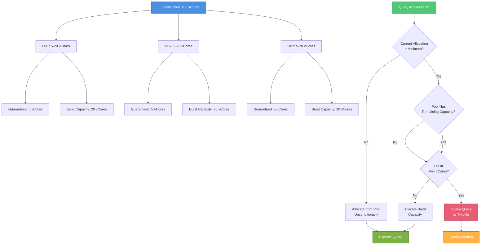
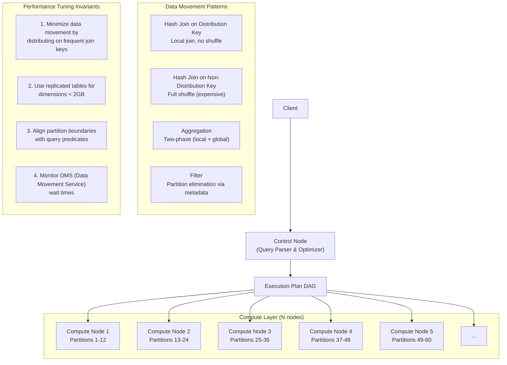
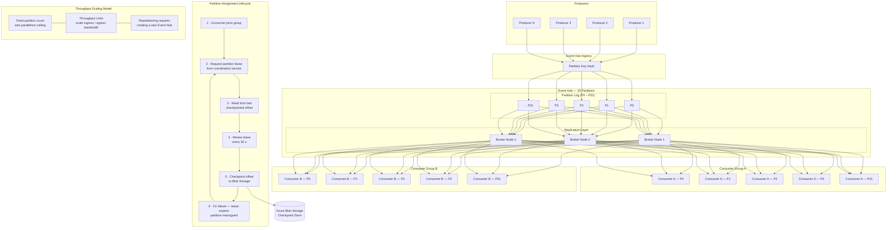
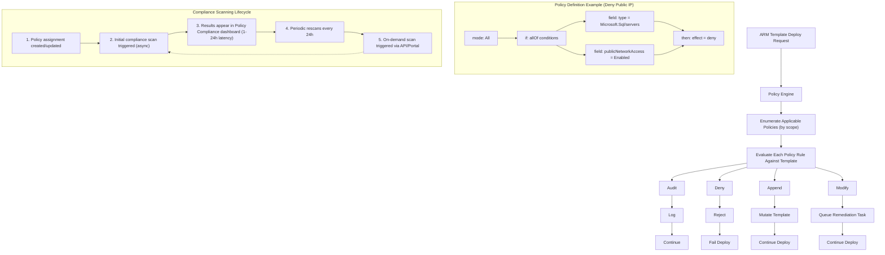

# Lesson 6: Data Services Governance

## 1. First-Principles Intuition & Invariants

Modern cloud data platforms present a fundamental tradeoff between the declarative simplicity of managed services and the resource governance complexity that emerges when multiple workloads compete for shared infrastructure. Azure's data services—spanning Cosmos DB's globally distributed multi-model databases, SQL Database elastic pools, Synapse Analytics massively parallel processing clusters, Event Hub partitioned streaming ingestion, and Service Bus reliable messaging—each implement distinct resource allocation strategies, consistency models, and failure domains. The governance challenge lies not in understanding individual service APIs, but in orchestrating cross-service resource limits, enforcing compliance policies at the control plane, and tracking cost allocation across heterogeneous workloads that share nothing except a common subscription billing boundary.

At the infrastructure layer, Azure data services decompose into three orthogonal concerns: the data plane where application workloads execute queries and stream events, the control plane where ARM templates and Azure Policy definitions enforce declarative configuration state, and the billing plane where Azure Cost Management aggregates resource consumption metrics into hierarchical cost centers. Unlike monolithic on-premises databases where a single DBA controls all three layers through vendor-specific tooling, Azure distributes governance responsibility across infrastructure-as-code templates, role-based access control policies, and runtime resource telemetry. This architectural separation enables horizontal scaling and multi-tenancy but introduces coordination complexity when a single logical workload spans Cosmos DB for operational writes, Event Hub for real-time ingestion, Synapse for analytical queries, and Service Bus for asynchronous task orchestration.

The first-principles invariant governing all Azure data services is the distinction between provisioned throughput measured in request units or compute nodes, and actual workload demand that fluctuates based on application behavior. Cosmos DB charges for provisioned request units per second regardless of utilization, SQL Database elastic pools amortize compute costs across multiple databases sharing a fixed vCore allocation, Synapse Analytics bills for active compute node hours during query execution, Event Hub partitions distribute ingestion load but require pre-provisioned throughput units, and Service Bus queues provide elastic message storage with tier-based feature restrictions. Each service implements its own resource reservation model because the underlying failure domains and replication topologies differ fundamentally: Cosmos DB replicates across geographic regions with tunable consistency, SQL Database maintains synchronous replicas within a single region, Synapse scales compute independently from storage through separation of MPP query nodes and Azure Data Lake blob tier, Event Hub partitions provide ordering guarantees within partition boundaries, and Service Bus enforces exactly-once delivery through distributed transaction coordination.

The second invariant is that Azure Policy operates exclusively at the ARM control plane through declarative JSON policy definitions that Azure Resource Manager evaluates during resource creation and configuration updates. Policies cannot inspect data plane query patterns, enforce runtime throughput limits, or trigger alerts based on cost overruns—those capabilities require separate implementations through Azure Monitor metric alerts, Cosmos DB server-side stored procedures, or custom cost allocation logic. This separation reflects the architectural reality that ARM manages infrastructure lifecycle state while data services manage application workload execution, and the two planes communicate only through asynchronous provisioning operations and telemetry export. An infrastructure architect attempting to enforce a "no public endpoint" governance policy must understand that Azure Policy can audit and deny ARM template deployments that specify public IP addresses, but cannot retroactively disable network access on already-deployed resources or prevent applications from opening firewall rules through the data plane API.

The third invariant centers on Azure Cost Management's resource tagging and hierarchical scope model. Cost allocation tracking depends entirely on ARM resource tags applied at deployment time, propagated through tag inheritance policies, and aggregated into cost center hierarchies defined by management group, subscription, and resource group boundaries. Unlike AWS Cost and Usage Reports that capture per-API-call billing dimensions, Azure Cost Management operates at the resource-hour granularity, meaning that granular cost attribution for individual Cosmos DB queries, Event Hub consumer groups, or Service Bus message deliveries requires custom instrumentation through Application Insights or third-party observability platforms. The billing model assumes that infrastructure teams deploy resources into isolated resource groups with clear ownership tags, but real-world workloads frequently span multiple resource groups, share elastic pools across organizational boundaries, and stream events through hub-and-spoke topologies where the cost of shared infrastructure cannot be cleanly attributed to individual consumers.

These three invariants—resource reservation models, control plane versus data plane governance boundaries, and cost allocation granularity—establish the architectural constraints that shape practical data services governance. An engineer designing a multi-region Cosmos DB deployment must provision request units in each region despite uneven geographic load distribution, accept that Azure Policy cannot enforce query-level throttling, and implement custom tagging automation to track cost back to originating application teams. Similarly, an architect consolidating SQL databases into elastic pools must balance the resource efficiency gains from statistical multiplexing against the governance complexity of shared resource contention and cross-tenant noisy neighbor effects. The remainder of this lesson dissects the internal mechanics of each service's resource model and explores how Azure Policy, Cost Management, and runtime telemetry integrate into coherent governance workflows.

## 2. Core Architecture & Mechanics

### Cosmos DB Multi-Model Consistency Levels

Cosmos DB implements distributed consistency through a five-level hierarchy that trades latency for linearizability guarantees across globally replicated partition sets. At the hardware level, each Cosmos DB account maps to a set of physical partitions distributed across availability zones within a region and asynchronously replicated to secondary regions through Azure's backbone network. Each partition stores up to 50GB of logical data indexed by partition key and replicates writes through a quorum-based protocol derived from the Raft consensus algorithm. The consistency level configured at the account or request scope determines how many replicas must acknowledge a write before the client receives success confirmation and which replica read operations target.

Strong consistency, the most restrictive level, enforces linearizability by requiring write quorum acknowledgment from all replicas in the primary region and blocking reads until all outstanding writes complete. This provides the familiar single-system illusion of traditional ACID databases but incurs cross-availability-zone network latency on every write operation and prohibits serving reads from secondary regions. The physical implementation maintains a monotonically increasing logical timestamp vector for each partition, with read operations waiting until all timestamps match the client's session token. Strong consistency is suitable only for workloads like financial ledgers where correctness demands global ordering, and practitioners pay a 2-4x latency penalty compared to weaker levels.

Bounded staleness relaxes linearizability by allowing replicas to lag by a configurable time window (measured in seconds) or version count (measured in write operations). Cosmos DB's implementation tracks the maximum staleness bound using a sliding window of committed timestamps and rejects read requests that would violate the configured lag threshold. This model enables reading from geographically distributed replicas while bounding the degree of inconsistency, making it appropriate for scenarios like content delivery networks where users tolerate stale data as long as updates propagate within a known time window. The physical implementation requires secondary regions to maintain catch-up streams that apply primary region writes within the staleness window, introducing operational complexity around network partition handling when cross-region bandwidth saturates.

Session consistency guarantees monotonic reads and read-your-writes semantics within a single client session by tagging each response with a session token representing the logical timestamp of the last observed write. Subsequent read operations from the same client session pass this token to Cosmos DB, which ensures that replica selection returns data at least as recent as the token timestamp. The distributed protocol implementation relies on a per-session state machine that tracks the high-water mark of committed writes and routes read requests to replicas that have applied all prior session writes. This provides causal consistency within a session boundary while allowing different sessions to observe different versions, reflecting the reality that most applications care about per-user consistency rather than global linearizability.

Consistent prefix and eventual consistency further relax ordering guarantees. Consistent prefix ensures that reads never observe out-of-order writes by serving data from replicas that maintain version vector monotonicity, preventing scenarios where a client sees a later write before an earlier one. Eventual consistency, the weakest level, allows replicas to serve arbitrarily stale data subject only to the replication lag imposed by network bandwidth and replica catch-up throughput. In practice, eventual consistency provides median read latencies under 10ms by serving from local replicas without coordination overhead, making it suitable for high-throughput telemetry ingestion or activity feed workloads where transient inconsistency does not affect correctness.

The request unit abstraction unifies these consistency levels into a single billing model by normalizing the compute and I/O cost of each operation into a synthetic metric. A single request unit represents approximately the cost of a 1KB point read operation under eventual consistency, with more expensive operations like range queries, updates, and stronger consistency levels consuming proportionally more request units. The physical implementation maps request units to backend compute threads, storage IOPS, and inter-region bandwidth, dynamically adjusting partition assignments to balance load. Practitioners provision request units at the database or container scope, with Cosmos DB enforcing throttling through HTTP 429 responses when workload demand exceeds the provisioned ceiling.

```
Cosmos DB Consistency Lattice:

  Strong           ← Linearizable, all replicas synchronized
    ↓
  Bounded Staleness ← Lag bounded by time/version window
    ↓
  Session          ← Per-client monotonic reads/writes
    ↓
  Consistent Prefix ← No out-of-order observation
    ↓
  Eventual         ← No coordination, minimum latency

Request Unit Cost Multipliers (relative to 1KB point read):
- Strong consistency: 2x (quorum write + blocking read)
- Bounded staleness: 1.5x (catch-up coordination)
- Session/Prefix: 1x (baseline)
- Eventual: 1x (baseline)
- Range query: 1 RU per KB scanned
- Indexed write: 5-10 RU depending on index breadth
- Cross-region write: +1 RU per secondary region
```

### SQL Database Elastic Pool Resource Sharing

Azure SQL Database elastic pools implement statistical multiplexing by consolidating multiple databases onto shared vCore compute nodes and amortizing peak load across workloads with non-overlapping demand patterns. At the infrastructure layer, an elastic pool provisions a fixed allocation of compute cores, memory, and storage IOPS mapped to a tier-specific hardware SKU (General Purpose on standard SSDs, Business Critical on local NVMe) and distributes these resources dynamically across member databases based on runtime utilization telemetry.

The resource governor subsystem, inherited from SQL Server's on-premises implementation, enforces per-database limits through kernel-level thread scheduling and I/O throttling. Each database in an elastic pool receives a minimum guaranteed allocation specified in eDTUs (elastic database transaction units) or vCores, ensuring baseline performance even when other databases saturate pool resources. When a database's workload exceeds its minimum allocation, the resource governor allows it to consume additional pool capacity up to a per-database maximum cap, preventing a single tenant from monopolizing shared resources. The physical implementation tracks resource consumption through lightweight performance counters updated on every query execution and recalculates allocation assignments at 100ms intervals.

The cost model for elastic pools exploits the statistical likelihood that not all databases peak simultaneously. A pool provisioned with 100 vCores can support 50 databases each configured with a 20 vCore maximum if typical utilization patterns show that fewer than five databases hit peak load concurrently. This provides 2-4x cost reduction compared to provisioning individual databases at their peak capacity, but introduces operational complexity around capacity planning and noisy neighbor detection. Infrastructure teams must monitor per-database CPU, IOPS, and memory metrics to identify workloads that violate the statistical independence assumption and either migrate heavy consumers to dedicated instances or expand pool capacity.

Elastic pools expose three dimensions of resource control: the pool-level vCore or eDTU allocation that determines total available compute, per-database minimum guarantees that establish baseline performance floors, and per-database maximum caps that prevent resource monopolization. These parameters map directly to SQL Server's resource governor configuration but operate at the Azure control plane through ARM template properties. The internal implementation uses a hierarchical scheduling tree where the pool represents the root resource class, and each database maps to a child workload group with specified min/max resource ratios.



The failure domain for elastic pools spans all databases within the pool. A hardware fault affecting the underlying compute node triggers automatic failover to a standby replica, during which all databases in the pool experience a brief connectivity interruption. This differs from single-database deployments where failover operates independently per database, introducing a shared-fate coupling that violates blast radius isolation. Critical workloads that cannot tolerate correlated failures should deploy into separate pools or individual databases despite higher cost.

### Synapse Analytics MPP Architecture

Azure Synapse Analytics implements massively parallel processing through a distributed query execution engine that separates compute nodes from storage, enabling independent scaling of processing capacity and data volume. At the architectural level, Synapse provisions a SQL pool consisting of a control node that parses and optimizes queries, and a set of compute nodes that execute parallel data processing tasks. Each compute node maps to a dedicated VM instance running a specialized SQL Server kernel optimized for bulk data operations, with local SSD caching for intermediate shuffle operations.

The underlying storage layer resides in Azure Data Lake Gen2, a globally replicated blob store that provides effectively infinite capacity and survives compute node failures without data loss. Synapse distributes table data across 60 fixed hash partitions or round-robin shards, with each compute node responsible for processing a subset of partitions during query execution. The control node decomposes each query into a directed acyclic graph of execution stages, with each stage representing a parallelizable operation like hash join, aggregation, or filter. Compute nodes fetch partition data from blob storage over the Azure backbone network, materialize intermediate results in local SSD, and shuffle data between stages using RDMA-over-Converged-Ethernet for low-latency inter-node communication.

The distribution strategy—hash, round-robin, or replicated—determines how table data spreads across the 60 partitions and critically affects query performance. Hash distribution assigns rows to partitions by hashing a chosen distribution column, ensuring that rows with the same key co-locate on the same compute node. This enables local join operations without cross-node data movement when queries join on the distribution key, but introduces data skew if key cardinality is uneven. Round-robin distribution spreads rows evenly across partitions regardless of column values, providing uniform load distribution but requiring data movement for all joins. Replicated distribution copies small dimension tables to every compute node, eliminating join shuffle at the cost of redundant storage.

The cost model for Synapse charges separately for compute node hours and storage capacity, reflecting the architectural separation between processing and persistence. Compute nodes bill continuously while the SQL pool is active, even during idle periods with no query execution. Practitioners optimize cost by pausing SQL pools during off-peak hours and resuming on-demand, incurring a 1-2 minute cold-start latency while compute nodes reattach to storage. Storage costs accrue based on compressed data volume in Data Lake Gen2, with Synapse automatically applying columnstore compression that achieves 5-10x reduction for analytical workloads.



The critical failure mode in Synapse involves data skew, where uneven distribution keys cause some compute nodes to process disproportionately large partition volumes while others idle. A table distributed on customer ID might encounter a scenario where one enterprise customer generates 40% of total rows, concentrating that workload on a single compute node and negating the parallelism benefits of MPP. Detecting skew requires querying system DMVs that expose per-partition row counts and implementing redistribution strategies like salting hash keys or switching to round-robin for highly skewed dimensions.

### Event Hub Partitioned Streaming

Azure Event Hub implements a distributed streaming ingestion pipeline through a fixed set of partitions that provide ordering guarantees within partition boundaries while enabling parallel consumption across multiple consumer group subscribers. At the physical layer, each Event Hub namespace maps to a Kafka-compatible message broker cluster deployed across availability zones, with each partition replicated to three broker nodes for fault tolerance. Event producers append messages to partition logs identified by a partition key, and Event Hub assigns each message a monotonically increasing sequence number that establishes total ordering within the partition.

The partition key determines which logical partition receives each event, with Event Hub applying a hash function to distribute keys evenly across the configured partition count. Messages with the same partition key always route to the same partition, ensuring that related events maintain causal ordering—critical for scenarios like user activity streams where out-of-order processing would violate business logic. The tradeoff is that partition count fixes the maximum degree of consumer parallelism: a 32-partition Event Hub supports at most 32 concurrent consumer instances per consumer group, with additional consumers idle until an active instance fails.

Throughput units control the provisioned network bandwidth and storage throughput allocated to an Event Hub namespace. Each throughput unit provides 1 MB/s ingress, 2 MB/s egress, and 84 GB of retention storage, with Event Hub enforcing throttling through server-side HTTP 429 responses when producers exceed capacity. The underlying implementation buffers ingress traffic in broker memory and flushes batches to replicated storage at configurable intervals, balancing latency against throughput efficiency. Auto-inflate policies dynamically adjust throughput units based on ingress load, but cannot react faster than 1-2 minute evaluation intervals, requiring practitioners to provision baseline capacity for expected burst peaks.

Consumer groups provide isolated checkpointing state for independent subscriber applications processing the same event stream. Each consumer group maintains a per-partition offset cursor tracking the last processed message sequence number, enabling consumers to resume from their last checkpoint after transient failures. The physical implementation stores checkpoint state in Azure Blob Storage with optimistic concurrency control, requiring consumers to handle race conditions when multiple instances compete for partition ownership. The lease-based partition assignment protocol ensures that each partition within a consumer group has at most one active consumer at any time, preventing duplicate processing but introducing rebalancing latency when consumers join or leave the group.



The primary operational failure mode involves partition hotspots, where a single high-cardinality partition key generates disproportionate traffic and saturates the assigned broker node. A telemetry pipeline that uses device ID as partition key might encounter a scenario where a single IoT gateway aggregating thousands of sensors overwhelms one partition while others remain underutilized. Mitigating this requires either pre-sharding high-cardinality keys into multiple synthetic partitions or redesigning the partition key to distribute load more evenly.

### Service Bus Message Delivery Guarantees

Azure Service Bus implements reliable messaging through queues and topics that provide exactly-once delivery semantics via distributed transaction coordination and durable message storage. At the architectural level, Service Bus maintains replicated message stores across availability zones within a region, with each message assigned a unique sequence number and expiration timestamp. Queues provide point-to-point delivery where each message is consumed by exactly one receiver, while topics support publish-subscribe patterns where each subscriber receives a copy through isolated subscription queues.

The delivery guarantee model centers on peek-lock semantics, where receivers temporarily lock messages without removing them from the queue, process the message payload, and explicitly complete or abandon the lock. If a receiver crashes or exceeds the lock timeout before completing the message, Service Bus automatically unlocks the message and makes it available to other receivers, ensuring exactly-once processing despite transient failures. The physical implementation maintains lock state in a distributed coordination service with millisecond-precision expiration tracking, requiring receivers to configure lock durations that exceed their maximum expected processing time.

Dead-letter queues capture messages that exceed maximum delivery attempts or violate application-specific processing rules, preventing poison messages from blocking queue progress. Service Bus automatically moves messages to the dead-letter queue after they reach the configured delivery count threshold (default 10 attempts), preserving the original message properties and failure reason for offline analysis. This decouples failure handling from mainline processing and enables operators to inspect, replay, or discard problematic messages without affecting healthy message flow.

Sessions extend Service Bus with strict message ordering within session boundaries, enabling scenarios like multi-step workflows where messages must process in the order they were sent. Each session maps to a unique session ID, with Service Bus ensuring that only one receiver holds the session lock at any time. Messages within a session queue until a receiver accepts the session, processes all enqueued messages in sequence, and closes the session. This provides stronger ordering guarantees than partitioned Event Hubs at the cost of reduced parallelism, since the maximum concurrent session count limits receiver scalability.

```
Service Bus Peek-Lock Protocol:

Queue:  [M1] [M2] [M3] [M4] [M5]
          ↓
Receiver 1: PeekLock(M1, timeout=60s)
          ↓
Queue:  [M1:locked] [M2] [M3] [M4] [M5]
          ↓
Receiver 1: ProcessMessage(M1) → Complete(M1)
          ↓
Queue:  [M2] [M3] [M4] [M5]  (M1 deleted)

Failure Scenario:
Receiver 2: PeekLock(M2, timeout=60s)
          ↓
Queue:  [M2:locked] [M3] [M4] [M5]
          ↓
Receiver 2: ProcessMessage(M2) → CRASH
          ↓
[60s lock timeout expires]
          ↓
Queue:  [M2:unlocked, delivery_count=1] [M3] [M4] [M5]
          ↓
Receiver 3: PeekLock(M2, timeout=60s)
          ↓
[Process and Complete normally]

Dead-Letter Transition:
After 10 failed delivery attempts:
Queue → Dead-Letter Queue (preserves all message properties)
```

The cost model for Service Bus stratifies into three tiers—Basic, Standard, and Premium—with feature restrictions and resource isolation boundaries. Basic queues lack topic support and restrict message size to 256KB, suitable only for lightweight task distribution. Standard queues add topics and increase message size to 1MB but share backend infrastructure across tenants, introducing latency variability from noisy neighbors. Premium queues provision dedicated compute and storage resources isolated within a single customer's namespace, providing predictable single-digit-millisecond latency at 10x the cost of Standard tier. Practitioners select tiers based on latency requirements and cost sensitivity, recognizing that Premium's resource isolation justifies its price premium only for latency-critical workloads.

### Azure Policy Enforcement Mechanisms

Azure Policy operates at the ARM control plane by evaluating JSON policy definitions against resource creation, update, and compliance audit operations. Each policy definition declares a JSON schema rule that matches resource types and property patterns, paired with an effect that Azure Resource Manager applies when the rule evaluates to true. The core effects—Audit, Deny, Append, Modify, and DeployIfNotExists—differ fundamentally in their enforcement timing and remediation behavior.

Audit policies passively log non-compliant resources to the Activity Log without blocking deployments, enabling operators to identify configuration drift for manual remediation. Deny policies reject ARM deployment operations that would create non-compliant resources, failing infrastructure-as-code pipelines at template validation time. Append policies automatically inject additional properties into resource definitions during deployment, such as adding required tags or network security group rules. Modify policies update existing resource properties during compliance remediation, requiring explicit remediation tasks since ARM does not automatically mutate deployed resources. DeployIfNotExists policies conditionally deploy ancillary resources like diagnostic settings or monitoring agents when primary resources lack required dependencies, implementing declarative configuration through template composition.

The policy evaluation engine processes rules during three distinct phases: template validation before ARM begins resource deployment, compliance scanning that periodically audits all resources within a policy scope, and remediation tasks that apply Modify or DeployIfNotExists effects to existing non-compliant resources. Template validation runs synchronously during ARM operations with sub-second latency, while compliance scanning operates asynchronously on a 24-hour cadence by default. Remediation tasks execute as separate ARM deployments queued through the policy engine, requiring explicit operator approval for policies with modify effects.

Policy assignments scope policies to management groups, subscriptions, resource groups, or individual resources through a hierarchical inheritance model. A policy assigned at the management group level applies to all descendent subscriptions and resource groups, with child scopes able to exclude specific resources through exemption assignments. The physical implementation caches policy assignment state in ARM's distributed metadata store, indexed by resource scope path, enabling millisecond-latency policy evaluation during template deployment operations.



The critical limitation of Azure Policy is its confinement to the ARM control plane. Policies cannot enforce data plane constraints like Cosmos DB query patterns, Event Hub partition key distributions, or Service Bus message processing logic. An infrastructure team attempting to prevent developers from provisioning publicly accessible Cosmos DB accounts can implement a Deny policy that rejects ARM templates with public network access enabled, but cannot block a developer from subsequently enabling public access through the Cosmos DB data plane SDK. This architectural gap requires complementary enforcement through role-based access control policies that restrict data plane permissions and runtime monitoring through Azure Monitor alerts that detect configuration drift.

### Cost Management Allocation Tracking

Azure Cost Management aggregates resource consumption telemetry into a hierarchical cost reporting structure indexed by subscription, resource group, resource, and ARM resource tags. The billing pipeline collects meter data from each Azure service—Cosmos DB request units, SQL Database vCore hours, Synapse compute node time, Event Hub throughput units, Service Bus message operations—and normalizes these metrics into common currency units based on negotiated pricing agreements. Cost data exports to Azure Storage as daily CSV files with per-resource line items, enabling external analytics platforms to join billing data with operational telemetry.

The tag-based cost allocation model assumes that infrastructure teams consistently apply tags like cost center, application name, environment, and owner to all deployed resources. Cost Management provides built-in tag-based grouping and filtering through the Azure Portal, but tag coverage and consistency directly determine allocation accuracy. A resource group that mixes production and development databases without environment tags produces aggregate cost reports that hide per-environment breakdowns, requiring manual reconciliation or retroactive tagging remediation.

The inheritance model for tags operates through Azure Policy definitions that automatically append required tags during resource deployment and propagate parent scope tags to child resources. A policy assigned at the subscription level can enforce that all resource groups inherit a cost center tag from the subscription's tag set, simplifying governance for large organizations. However, tag inheritance executes only at deployment time—existing resources do not automatically acquire new tags when parent scope policies change, requiring explicit remediation tasks.

Budget alerts provide proactive cost control by evaluating accumulated spending against configured thresholds and triggering email notifications or webhook callbacks when forecasts predict overspend. The alerting engine evaluates budgets every 6-24 hours based on the previous day's metered consumption, introducing up to 48 hours of latency between actual resource usage and alert delivery. This delay renders budget alerts unsuitable for real-time cost enforcement, requiring complementary controls like service-level spending limits or automated shutdown logic triggered by Azure Functions.

```
Cost Management Data Flow:

Azure Service Meters (every 1-24h depending on service)
    ↓
Billing Pipeline (meter aggregation & pricing)
    ↓
Cost Management Data Store (24-72h latency)
    ↓
Cost Analysis UI & Exports
    ↓
External BI Tools (Power BI, Grafana, custom analytics)

Tag-Based Allocation Example:

Resource: cosmos-account-prod
Tags:
  - costCenter: "engineering"
  - application: "api-backend"
  - environment: "production"
  - owner: "platform-team"

Cost Management Query:
GROUP BY Tags['costCenter']
→ engineering: $1,245.67
GROUP BY Tags['application']
→ api-backend: $876.34

Missing Tag Impact:
Resource: sql-elastic-pool-01
Tags: (none)
→ Appears in "Untagged" cost bucket
→ Requires manual attribution

Budget Alert Configuration:
Scope: Resource Group "production-rg"
Threshold: $5,000/month
Current Spend: $4,200 (as of 2 days ago)
Forecast: $5,300 by month end
→ Alert triggered 2 days ago
→ Actual current spend might be $4,600 (unknown due to lag)
```

The operational challenge in cost management stems from the multi-day latency between resource consumption and cost data availability. An engineer debugging a cost spike on Tuesday might not see the associated meter data in Cost Management until Thursday, requiring correlation with Azure Monitor metrics and Azure Resource Graph queries to identify the causal resource. This latency reflects the architectural reality that Azure's billing pipeline operates asynchronously from resource provisioning, aggregating meter data in batches rather than in real-time streams.

## 3. High-Performance Optimization & Failure Modes

Optimizing Azure data services for production workloads requires balancing provisioned capacity against cost while maintaining resilience to transient failures and permanent outages. The following sections dissect operational workflows and common failure patterns across service boundaries.

### Cosmos DB Request Unit Optimization

The primary performance lever in Cosmos DB is request unit provisioning at the container or database level, with the critical decision being whether to overprovision for peak load or implement autoscaling policies that dynamically adjust capacity. Overprovisioning guarantees capacity during burst traffic but wastes cost during off-peak hours, while autoscaling introduces 5-10 second adaptation latency that can cause throttling during sudden load spikes. Practitioners typically provision baseline capacity at P50 load and configure autoscaling to handle P95 bursts, accepting transient throttling during extreme outlier spikes rather than paying for permanent peak capacity.

The failure mode that practitioners encounter most frequently is partition key hotspotting, where a poorly chosen partition key concentrates write traffic onto a single logical partition and exhausts its 10,000 RU/s throughput ceiling regardless of total provisioned capacity. A social media application that partitions posts by user ID might encounter a celebrity account generating millions of interactions, saturating the partition assigned to that user's ID while other partitions idle. Detecting this requires querying Cosmos DB's diagnostic metrics for per-partition request unit consumption and redesigning the partition key to distribute high-cardinality entities across multiple synthetic partitions, such as hashing user ID combined with a timestamp shard.

Indexing policies dramatically affect request unit consumption because Cosmos DB by default indexes every property in every document, incurring write amplification costs for fields that queries never reference. An application ingesting telemetry documents with 50 properties but querying only on timestamp and device ID should configure an indexing policy that excludes all other paths, reducing write RU cost by 60-80%. The tradeoff is that excluded paths become non-queryable, requiring careful analysis of query patterns before restricting indexes.

Cross-region replication multiplies write costs by the configured region count since Cosmos DB charges one request unit per region for each write operation. A globally distributed application with four read regions incurs 4x write cost compared to a single-region deployment, requiring practitioners to balance geographic latency reduction against budget constraints. Read-heavy workloads benefit disproportionately from multi-region replication since read operations from secondary regions consume request units from the target region's provisioned capacity, offloading the primary region.

### SQL Database Elastic Pool Capacity Planning

The central optimization problem for elastic pools is selecting the pool size and per-database limits that maximize resource sharing efficiency without introducing noisy neighbor contention. Statistical capacity planning requires analyzing the P95 concurrent database count and per-database CPU/IOPS distributions to estimate the probability that aggregate demand exceeds pool capacity. A pool provisioned at the sum of per-database minimums guarantees baseline performance but eliminates cost savings from statistical multiplexing, while a pool sized at the average concurrent load risks saturation during correlated demand spikes.

The operational workflow for capacity planning involves collecting per-database CPU, IOPS, and transaction log metrics through Azure Monitor over a representative time window (typically 30 days) and constructing a correlation matrix that identifies workloads with synchronized peak patterns. Databases that peak simultaneously reduce the benefits of pooling and should either move to separate pools or provision dedicated capacity. Databases with anti-correlated patterns (one peaks while others idle) maximize pooling efficiency and can share aggressive oversubscription ratios.

Detecting noisy neighbor effects requires monitoring per-database resource governor wait statistics through dynamic management views that expose CPU throttling delays and I/O queue depths. A database experiencing frequent RESOURCE_SEMAPHORE waits indicates memory pressure from other pool members, while PAGEIOLATCH_SH waits suggest storage IOPS contention. Resolving these issues requires either expanding pool capacity, migrating heavy workloads to dedicated instances, or adjusting per-database maximum caps to isolate resource consumption.

The failure mode unique to elastic pools is correlated outage during pool-level failover. When the underlying compute node fails, Azure triggers a synchronized failover for all databases in the pool, introducing a brief connectivity disruption that affects every application simultaneously. Critical workloads that cannot tolerate correlated downtime should deploy into separate pools or adopt active-passive database pairs across multiple pools to minimize shared-fate coupling.

### Synapse Analytics Query Performance Tuning

Optimizing Synapse query performance centers on minimizing data movement between compute nodes by aligning table distributions with query join patterns. The fundamental principle is that hash-distributed tables enable local joins when the join predicate matches the distribution key, eliminating cross-node shuffles that dominate query latency. A star schema with fact tables distributed on customer ID and dimension tables replicated to all nodes enables performant queries that filter on customer attributes and aggregate fact metrics, since all necessary data co-locates on each compute node.

The diagnostic workflow for identifying performance bottlenecks involves querying Synapse's execution plan DMVs to expose data movement operations and their associated row counts. The EXPLAIN command generates a query plan tree annotated with operation costs, highlighting expensive shuffle operations that warrant table redistribution. High-latency queries typically exhibit one of three anti-patterns: full table scans on large fact tables without partition elimination, cross-distribution-key joins that shuffle billions of rows, or data skew where a single compute node processes 10x more data than peers.

Partition elimination optimization requires aligning table partition boundaries with query filter predicates. A fact table partitioned by date enables Synapse to skip reading irrelevant partitions when queries filter on date ranges, reducing I/O by orders of magnitude. The physical implementation relies on partition metadata stored in Data Lake Gen2 that indexes minimum and maximum column values per partition, enabling the query optimizer to prune partitions at planning time. Practitioners configure partitions at monthly or weekly granularity depending on typical query date ranges, balancing pruning efficiency against partition management overhead.

Materialized views provide an alternative optimization strategy by precomputing expensive aggregations and storing results as indexed tables. A dashboard query that aggregates sales by region and product category over the past year can materialize the aggregation result and refresh it incrementally as new fact rows arrive, reducing query latency from minutes to milliseconds. The tradeoff is storage cost for the materialized view and refresh overhead during data ingestion, requiring analysis of query frequency to justify materialization.

### Event Hub Throughput Scaling and Partition Rebalancing

Scaling Event Hub throughput requires understanding that partition count fixes the maximum degree of consumer parallelism and cannot be altered after creation, while throughput units scale ingress and egress bandwidth elastically. A common anti-pattern involves creating an Event Hub with four partitions for initial testing and subsequently discovering that production workloads require 32 parallel consumers, forcing a disruptive migration to a new Event Hub with higher partition count.

The partition count selection heuristic is to provision for the maximum anticipated consumer parallelism regardless of initial load, since unused partitions incur no cost beyond nominal storage. A telemetry pipeline that might eventually scale to 64 consumer instances should create an Event Hub with 64 partitions from the start, accepting slight overhead from unused partitions during early deployment rather than suffering migration downtime later.

Throughput unit auto-inflate policies mitigate the risk of ingress throttling during unexpected traffic spikes by automatically provisioning additional capacity when utilization exceeds 80% for more than 60 seconds. The limitation is that auto-inflate cannot react to sub-minute bursts, requiring baseline provisioning to handle short-duration spikes. Practitioners typically configure baseline throughput units at P90 ingress rate and enable auto-inflate to P99, accepting transient throttling during extreme outliers that occur less than 0.1% of the time.

Consumer group checkpoint management introduces subtle failure modes when multiple consumer instances compete for partition ownership. The lease-based protocol requires consumers to periodically renew partition leases and store checkpoint offsets in Blob Storage, with lease renewals failing when network latency to Blob Storage exceeds the renewal interval. A consumer deployed in a region distant from the Event Hub and checkpoint storage experiences frequent lease losses that trigger continuous partition rebalancing, degrading end-to-end throughput. Resolving this requires co-locating consumers with the Event Hub or extending lease renewal intervals to accommodate cross-region latency.

### Service Bus Session-Aware Processing

Session-based message processing in Service Bus enables strict ordering guarantees but introduces scalability constraints because the maximum concurrent session count limits consumer parallelism. A workflow processing thousands of user sessions can achieve high throughput only if sessions process quickly and release locks frequently, preventing session backlog accumulation that would saturate the available consumer pool.

The operational pattern for session-aware processing involves configuring session timeouts that balance processing latency against lock renewal overhead. Long session timeouts (5-10 minutes) accommodate complex multi-step workflows but risk prolonged session locks when consumer instances crash, delaying recovery. Short session timeouts (30-60 seconds) enable fast failover but require frequent lock renewals that increase coordination overhead and Service Bus operation costs.

Session state management through Service Bus's built-in session state API provides a lightweight mechanism for maintaining workflow context between messages without external storage dependencies. The state API stores up to 256KB of arbitrary data per session, sufficient for accumulating intermediate computation results or tracking workflow progress. The physical implementation persists session state alongside message data in the replicated storage backend, ensuring that state survives consumer failures and migrates with session ownership during rebalancing.

The failure mode unique to sessions involves deadlocks when dependent sessions block on each other's completion. A payment processing workflow that splits a transaction into separate sessions for authorization and settlement can deadlock if the authorization session awaits settlement confirmation while the settlement session blocks on authorization completion. Resolving this requires redesigning workflow state machines to eliminate cyclic dependencies or implementing timeout-based deadlock detection that automatically aborts stalled sessions.

### Azure Policy Compliance Remediation at Scale

Operating Azure Policy across large organizations with thousands of resources requires automation to handle compliance drift and remediation at scale. The built-in compliance dashboard exposes non-compliant resources but requires manual intervention to trigger remediation tasks, creating operational burden when hundreds of resources violate policies simultaneously.

The operational workflow for automated remediation involves deploying Azure Functions or Logic Apps that periodically query the Policy API for non-compliant resources, evaluate whether automatic remediation is safe (no risk of data loss or service disruption), and trigger remediation tasks through the ARM API. This effectively closes the control loop by moving from passive compliance reporting to active enforcement, though it introduces complexity around idempotency and retry logic when remediation operations fail transiently.

The critical safety consideration in automated remediation is preventing cascading failures when policy-driven configuration changes trigger application downtime. A policy that enforces minimum SQL Database SKU sizes might attempt to scale up hundreds of databases simultaneously, overwhelming ARM's control plane rate limits and causing widespread deployment failures. Mitigating this requires implementing jitter and backoff in remediation scheduling to spread operations over time and circuit breaker logic that halts remediation campaigns when error rates exceed acceptable thresholds.

Policy exemptions provide an escape hatch for resources that legitimately violate policies due to business requirements or technical constraints. Exemptions scope to specific resources or policy assignments and include expiration timestamps that force periodic review of exceptional configurations. The governance workflow for exemptions involves requiring approval workflows through ServiceNow or Azure DevOps pipelines, ensuring that exemptions include documented justifications and auto-expire after 90-180 days unless explicitly renewed.

### Cost Management Real-Time Monitoring

The inherent 24-72 hour latency in Azure Cost Management data renders it unsuitable for real-time cost control, requiring alternative strategies that combine Azure Monitor metrics with custom cost estimation logic. An infrastructure team attempting to prevent runaway Cosmos DB request unit consumption cannot rely on Cost Management alerts but must instead deploy Azure Monitor metric alerts on Cosmos DB provisioned throughput and request unit consumption rates, estimating cost impact from real-time telemetry.

The operational pattern for near-real-time cost monitoring involves deploying Azure Functions that subscribe to Azure Monitor metric streams, maintain a rolling cost estimate based on current resource utilization rates and published pricing tables, and trigger webhook notifications when estimated spending trajectories exceed budget thresholds. This provides cost visibility within minutes rather than days but requires maintaining custom pricing logic that mirrors Azure's rate cards and staying synchronized with pricing updates.

Tagging automation through Azure Policy Append effects ensures consistent cost center and application tags on newly deployed resources but does not retroactively tag existing infrastructure. The remediation workflow for tag coverage involves querying Azure Resource Graph for untagged resources, cross-referencing ownership through deployment history or Azure AD app registrations, and bulk-applying tags through ARM template deployments. This represents a significant operational burden for organizations with legacy infrastructure that predates tag governance policies.

The architectural reality underpinning cost governance is that Azure fundamentally separates resource provisioning (ARM control plane), workload execution (data plane), and billing aggregation (billing pipeline) into loosely coupled systems with distinct latency characteristics. Effective governance requires orchestrating controls across all three layers: Azure Policy for control plane enforcement, role-based access control and runtime monitoring for data plane constraints, and Cost Management budgets for aggregated spending oversight. No single mechanism provides comprehensive governance, forcing infrastructure teams to compose layered controls that collectively bound resource consumption, enforce compliance, and track cost attribution despite architectural impedance mismatches between control planes.
