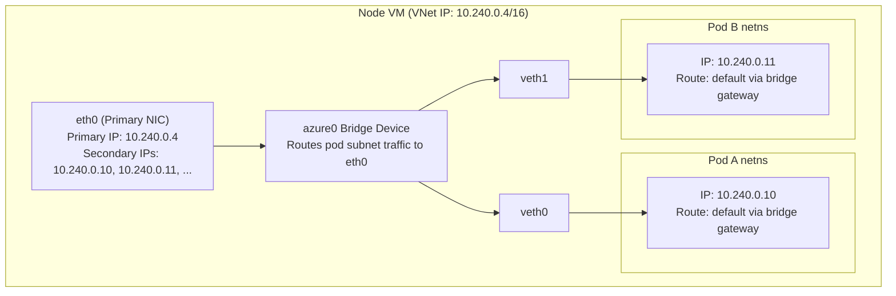
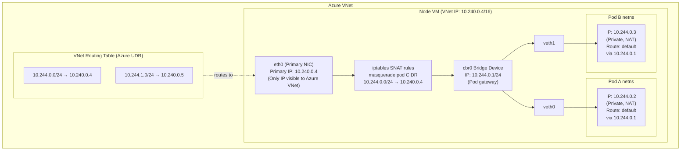

# Lesson 2: Networking Architecture in AKS

## 1. First-Principles Intuition & Invariants

Azure Kubernetes Service networking exists at the confluence of two fundamentally different abstraction models: the flat, ephemeral pod networking model inherited from Kubernetes upstream, and the hierarchical, routed virtual network topology imposed by Azure's Software-Defined Networking infrastructure. Understanding AKS networking requires recognizing that every packet traversing a cluster must simultaneously satisfy both Kubernetes' expectation of a clusterwide L3 overlay where every pod can reach every other pod without NAT, and Azure's requirement that all traffic respect VNet routing tables, network security groups, and subnet CIDR boundaries enforced by the underlying hypervisor.

The Container Network Interface specification defines a plugin contract where the kubelet delegates pod network setup to an external binary that must configure a network namespace with appropriate routes, IP addresses, and interface bindings before the pod's first container starts. In AKS, this contract manifests through two primary implementations: Azure CNI, which allocates routable Azure VNet IP addresses directly to pods, and kubenet, which creates a private overlay network using bridge devices and source NAT translation. The choice between these models is not merely a configuration preference but a fundamental architectural decision that determines IP address consumption patterns, network policy enforcement mechanisms, latency characteristics, and failure domains.

Azure CNI operates by pre-allocating a pool of secondary IP configurations on the node's primary network interface, then assigning these addresses to pod network namespaces through veth pair creation and bridge forwarding rules. Each pod receives an IP address from the same subnet as the node itself, making pods first-class citizens in the Azure VNet routing domain. This direct integration eliminates an entire layer of address translation, allowing pods to communicate with VNet-peered resources, on-premises networks connected via ExpressRoute or VPN gateways, and Azure PaaS services protected by service endpoints without requiring additional NAT traversal or overlay encapsulation. The tradeoff materializes in address space consumption: a node configured with a maximum pod count of thirty requires thirty secondary IP addresses from the subnet, independent of actual pod scheduling, because the CNI plugin must pre-provision the address pool before the kubelet can schedule workloads.

Kubenet adopts the opposite philosophy, creating a private RFC1918 address space for pod networking entirely decoupled from the underlying VNet addressing scheme. Each node runs a Linux bridge device that assigns pod IPs from a per-node /24 CIDR block, with the kubelet programming iptables SNAT rules to masquerade outbound traffic behind the node's primary IP address. This approach minimizes VNet address consumption since only node IPs occupy subnet space, but introduces NAT traversal for all pod-originated traffic leaving the node. Inbound traffic from external sources cannot reach pods directly because their addresses exist only within the node's network namespace, requiring kube-proxy to DNAT service traffic through NodePort or LoadBalancer abstractions.

The fundamental invariant governing both models is that pod networking must integrate with Azure's routing fabric in a way that preserves Kubernetes' flat network semantics while respecting Azure's security boundaries and routing constraints. Azure CNI achieves this through direct VNet integration at the cost of address consumption, while kubenet achieves it through NAT translation at the cost of connectivity transparency. Neither model violates the Kubernetes networking principles that every pod must have a unique IP address, pods must communicate without NAT within the cluster, and nodes must communicate with pods without NAT, but they satisfy these requirements through fundamentally different mechanisms that propagate throughout the networking stack.

Service discovery in Kubernetes relies on a DNS-based abstraction where each Service object receives a stable virtual IP address and a corresponding DNS A record in the cluster's internal DNS zone. The kube-dns or CoreDNS pod running in the kube-system namespace answers queries for service names by resolving them to ClusterIP addresses, which are virtual IPs that exist only in iptables or IPVS forwarding rules maintained by kube-proxy. When a pod issues a DNS query for a service name, the query traverses the pod's network namespace to the node's DNS resolver, which forwards it to CoreDNS, which returns the ClusterIP, which the pod then uses as the destination address for TCP or UDP connections. The packet reaches the node's network stack, where kube-proxy's forwarding rules intercept traffic destined for the ClusterIP and rewrite the destination address to a selected backend pod IP using DNAT. The response path requires conntrack state to reverse the translation, maintaining the illusion that the pod communicated directly with the service's virtual address.

Network policies in AKS represent distributed firewall rules encoded as Kubernetes resources and enforced by the CNI plugin or an overlay enforcement agent. The NetworkPolicy API allows cluster operators to define ingress and egress rules using pod label selectors, namespace selectors, and IP CIDR blocks, expressing intent such as "pods labeled app=frontend may only receive traffic from pods labeled app=gateway on port 8080." Enforcement semantics differ dramatically between Azure CNI and kubenet deployments. Azure CNI with Azure Network Policies translates these rules into Azure Network Security Group entries applied at the NIC level, leveraging the hypervisor's packet filtering capabilities to enforce policy before packets reach the pod's network namespace. Calico network policies, compatible with both CNI models, instead program iptables chains or Linux BPF hooks on each node to filter traffic at the kernel level before forwarding to pod interfaces.

The architectural consequence of these enforcement models is that Azure CNI network policies operate at a lower layer in the stack, filtering traffic before it reaches the node's TCP/IP implementation, while Calico policies filter at the node's iptables layer after packets have been processed by the kernel's routing subsystem. Azure-enforced policies can leverage hardware offload capabilities in the underlying SmartNIC infrastructure, potentially achieving line-rate filtering for high-throughput workloads, but require synchronization with Azure's control plane whenever policy objects change. Calico policies execute entirely within the node's kernel, avoiding cloud API latency but consuming CPU cycles for packet inspection on every forwarded frame.

Ingress controllers expose HTTP and HTTPS services to external clients by implementing L7 reverse proxy logic within the cluster, accepting traffic from an Azure Load Balancer and routing requests to backend pods based on host headers and URL paths. The Ingress resource defines routing rules declaratively, but the actual traffic handling requires a controller pod running nginx, Traefik, HAProxy, or another reverse proxy implementation that watches the Kubernetes API for Ingress objects and dynamically reconfigures its routing tables. The controller pod receives traffic through a LoadBalancer Service, which triggers AKS to provision an Azure Load Balancer with a public IP address, configure backend pool members pointing to the node IPs where the controller pods are scheduled, and program health probe endpoints to detect controller failures.

The packet flow for an ingress request begins when a client DNS resolution returns the public IP of the Azure Load Balancer, which forwards the TCP SYN packet to one of the backend pool nodes using the configured load balancing algorithm. The node's iptables rules maintained by kube-proxy DNAT the packet to the ingress controller pod's IP address, the controller pod's nginx process terminates the TLS connection, inspects the Host and path headers, and initiates a new TCP connection to the backend service's ClusterIP. This second connection undergoes another kube-proxy DNAT translation to reach the actual application pod, introducing two layers of TCP connection state and two opportunities for asymmetric routing or connection tracking failures. Response packets traverse the reverse path, with conntrack ensuring SNAT rewrites maintain the illusion of direct communication between client and load balancer.

DNS resolution within the cluster depends on search domain suffixes configured in each pod's /etc/resolv.conf, which the kubelet populates based on the pod's namespace and the cluster DNS domain suffix. A query for "database" from a pod in the "production" namespace first attempts "database.production.svc.cluster.local", then "database.svc.cluster.local", then falls back to external DNS resolution if no cluster service matches. This search behavior optimizes for namespace-local service discovery while allowing cross-namespace references using fully qualified service names. CoreDNS serves these queries using a watch-based cache of Service and Endpoint objects, answering A record queries with ClusterIP addresses and SRV queries with backend pod IP addresses for headless services.

The interaction between cluster DNS and Azure Private DNS zones introduces complexity when pods need to resolve Azure PaaS service names like "mydb.postgres.database.azure.com". Without additional configuration, these queries would exit the cluster through the node's upstream DNS resolvers, returning public IP addresses even when the Azure resource is configured with a private endpoint in the cluster's VNet. Integrating private DNS requires either configuring CoreDNS with forward rules to Azure's private DNS resolver IP (168.63.129.16) or deploying a DNS proxy that can conditionally forward queries based on domain suffix, ensuring that Azure-specific names resolve to private endpoint addresses while cluster service names continue to resolve through CoreDNS.

Inter-pod communication patterns expose the performance characteristics and failure modes of the chosen CNI model. In Azure CNI deployments, pod-to-pod traffic between nodes traverses the Azure VNet fabric, subject to the same latency and throughput characteristics as VM-to-VM traffic within the same VNet. Packets flow from the source pod's veth interface through the node's bridge device, then through the node's primary NIC to the Azure SDN fabric, which forwards based on VNet routing tables to the destination node's NIC, where another bridge and veth pair deliver the packet to the destination pod's network namespace. This path involves multiple kernel context switches and memory copies but avoids any encapsulation overhead since packets remain native Ethernet frames throughout.

Kubenet inter-pod communication requires source NAT when crossing node boundaries, introducing asymmetry in the packet flow. Outbound packets from the source pod receive SNAT masquerading to the source node's IP before entering the VNet fabric, which forwards them to the destination node based on iptables rules programmed by kubelet that route the per-node pod CIDR to the appropriate node IP. The destination node receives the packet with the source address set to the originating node's IP rather than the pod's IP, applies DNAT to forward to the destination pod, and relies on conntrack state to reverse the translation on response packets. This NAT traversal breaks any protocol that embeds IP addresses in application payloads, requires conntrack table space for every concurrent connection, and prevents direct pod-to-pod communication for debugging tools that might want to establish connections based on pod IP addresses discovered through the Kubernetes API.

## 2. Core Architecture & Mechanics

Azure CNI's address allocation mechanism begins during node bootstrap when the kubelet initializes the CNI plugin with configuration specifying the maximum pod count and the subnet CIDR from which to allocate addresses. The Azure CNI binary makes Azure Resource Manager API calls to attach secondary IP configurations to the node's network interface, pre-allocating a pool of IP addresses equal to the maximum pod count. These secondary IPs are actual Azure VNet addresses allocated from the subnet's available address space and visible in the Azure portal as secondary IP configurations on the node's NIC resource. The allocation is synchronous and must complete before the kubelet transitions to Ready state, meaning node startup can fail if insufficient addresses remain in the subnet or if Azure API rate limits are exceeded during cluster scale operations.

When the kubelet needs to start a pod, it invokes the CNI plugin's ADD command with a JSON payload describing the container ID, network namespace path, and interface name. The Azure CNI plugin selects an available IP from the pre-allocated pool, creates a veth pair with one end in the pod's network namespace and the other in the node's root namespace, attaches the root-side veth to the Linux bridge device (typically azure0), assigns the allocated IP address to the pod-side veth interface, configures a default route pointing to the bridge device, and returns a JSON response containing the allocated IP address and gateway configuration. The pod's network namespace now contains a fully configured network interface with a routable Azure VNet IP address, and the bridge device forwards traffic between pod interfaces and the node's primary NIC using standard Linux bridge forwarding rules.

Kubenet constructs a fundamentally different topology where pod addresses live in a private address space disconnected from the VNet's routing domain. During node initialization, the kubelet assigns each node a /24 CIDR block from the cluster's pod CIDR range, typically a large RFC1918 range like 10.244.0.0/16, subdividing it into per-node blocks like 10.244.0.0/24, 10.244.1.0/24, and so forth. The kubelet creates a cbr0 bridge device, assigns the first address from the node's CIDR as the bridge's IP address (e.g., 10.244.0.1), and configures iptables rules to SNAT all traffic leaving the node from the pod CIDR range to the node's primary IP address.

When starting a pod, the kubenet plugin creates a veth pair connecting the pod's network namespace to the cbr0 bridge, assigns an IP from the node's pod CIDR to the pod interface, configures the pod's default route to point to the bridge's gateway address, and returns without making any Azure API calls since no VNet-level resource allocation is required. Outbound traffic from the pod reaches the cbr0 bridge, where the kernel's routing table forwards it to the eth0 interface, and iptables POSTROUTING rules in the NAT table match packets with source addresses in the pod CIDR range, applying SNAT masquerading to replace the pod's source IP with the node's eth0 primary IP before packets enter the VNet fabric.

Inbound traffic to kubenet pods requires Azure User-Defined Routes that direct traffic for each node's pod CIDR to that node's IP address as the next hop. The AKS control plane automatically maintains these routes in the VNet's route table, watching the Kubernetes node objects for pod CIDR assignments and creating corresponding UDR entries. When a packet destined for 10.244.0.2 enters the VNet from a peered network or VPN gateway, the route table lookup matches the 10.244.0.0/24 entry and forwards the packet to node IP 10.240.0.4, where iptables rules in the FORWARD chain permit the traffic and the kernel's routing table forwards it through the cbr0 bridge to the destination pod.

Service load balancing through kube-proxy operates identically in both CNI models at the logical level but differs in implementation details. The kube-proxy pod running on each node watches the Kubernetes API for Service and Endpoints objects, maintaining a local cache of the cluster's desired service topology. When a Service is created with type ClusterIP, kube-proxy allocates a virtual IP from the cluster's service CIDR range and programs iptables rules or IPVS virtual servers to intercept traffic destined for that ClusterIP and DNAT it to one of the backend pod IPs listed in the corresponding Endpoints object. The default mode uses iptables NAT table rules with statistic matching for random load balancing, while IPVS mode uses the kernel's IPVS subsystem for more efficient hash-based selection.

In iptables mode, kube-proxy generates a chain of rules in the NAT table's PREROUTING and OUTPUT chains that match packets destined for ClusterIPs. For a service with three backend pods, the chain contains three rules using the statistic match module with probability 1/3, 1/2, and 1/1 to randomly select a backend. Each rule performs DNAT to rewrite the destination address from the ClusterIP to the selected pod IP, and conntrack maintains state to reverse the translation on response packets. The iptables ruleset grows linearly with the number of services and pods, causing measurable performance degradation in clusters with thousands of services as every packet traverses the entire ruleset during connection establishment.

IPVS mode delegates load balancing to the kernel's IPVS module, which implements efficient hash table lookups for virtual server destination selection. Kube-proxy creates an IPVS virtual server for each ClusterIP with one or more real servers corresponding to backend pod IPs, configuring the scheduling algorithm (round-robin, least-connection, source-hash) and connection tracking semantics. IPVS rules execute in kernel space using hash table lookups rather than linear rule evaluation, providing consistent O(1) performance regardless of cluster size. The tradeoff is increased kernel memory consumption for IPVS connection tracking tables and the requirement for the IPVS kernel module to be loaded on all nodes.

LoadBalancer services trigger integration with Azure's load balancing infrastructure through the cloud-controller-manager component running in the control plane. When a LoadBalancer Service is created, the cloud-controller-manager makes Azure Resource Manager API calls to provision an Azure Load Balancer resource, allocate a public IP address, configure a frontend IP configuration, create a backend pool containing the IP addresses of all nodes in the cluster, and define a load balancing rule mapping the service's port to the backend pool. Health probes are configured to monitor the kube-proxy health endpoint on each node, removing nodes from the backend pool if health checks fail. The allocated public IP address is reported back to the Kubernetes API, updating the Service object's status field with the LoadBalancer ingress IP.

Traffic entering through an Azure Load Balancer arrives at a node's primary IP address on the service's NodePort, where kube-proxy's iptables or IPVS rules DNAT the traffic to a backend pod. Azure Load Balancer uses five-tuple hash-based distribution by default, hashing the source IP, source port, destination IP, destination port, and protocol to select a backend node, with session affinity ensuring that connections from the same client IP reach the same node during the session lifetime. This distribution happens independently of Kubernetes' service endpoint selection, introducing two layers of load balancing: the Azure Load Balancer distributes across nodes, and kube-proxy distributes across pods within the selected node.

The externalTrafficPolicy setting controls whether kube-proxy performs additional NAT operations to preserve client source IP addresses. With the default Cluster policy, kube-proxy SNAT's incoming traffic to the node's IP address before forwarding to backend pods, allowing the pod to respond through any node but obscuring the original client IP address. Local policy disables SNAT, preserving the client source IP but restricting load balancing to pods running on the node that received the traffic, potentially causing imbalanced load distribution if pods are not evenly distributed across nodes. The Local policy also requires the Azure Load Balancer to use Direct Server Return mode, which can introduce compatibility issues with certain network topologies.

Network policy enforcement in Azure CNI with Azure Network Policies relies on the Azure SDN fabric to filter traffic at the hypervisor level before packets reach the VM's network interface. When a NetworkPolicy object is created, the AKS control plane translates the policy's pod selector, ingress rules, and egress rules into Azure Network Security Group rules applied to each affected pod's secondary IP configuration. The translation maps Kubernetes label selectors to NSG application security groups, which are Azure resources that represent logical groupings of NICs, allowing NSG rules to reference groups rather than individual IP addresses. When a pod is created, its secondary IP is automatically added to the application security groups corresponding to its labels, and when the pod is deleted, the IP is removed, maintaining dynamic membership without requiring NSG rule updates.

The enforcement happens in Azure's SDN data plane, where the hypervisor's virtual switch evaluates NSG rules before forwarding packets to the VM's virtual NIC. Packets that match deny rules are dropped at the hypervisor level, never reaching the node's kernel, while allowed packets are forwarded normally. This approach offloads filtering from the node's CPU to the hypervisor infrastructure, avoiding iptables rule evaluation overhead, but introduces latency for policy synchronization since NSG rule updates must propagate through Azure's control plane to all hypervisors hosting affected nodes.

Calico network policies provide an alternative enforcement model that operates entirely within the Linux kernel on each node, independent of the underlying CNI plugin. Calico runs a DaemonSet pod on each node that watches NetworkPolicy objects from the Kubernetes API and programs iptables rules or Berkeley Packet Filter programs to filter traffic at the node's network stack. For ingress policies, Calico adds rules to the FORWARD chain that match packets destined for local pod IPs, evaluating the source IP or source pod labels against the policy's allowed sources. For egress policies, rules match packets originating from local pod IPs and evaluate the destination against the policy's allowed destinations.

Calico's label-based policy enforcement requires maintaining a mapping from pod labels to pod IP addresses on each node, which Calico implements through its own datastore synced from the Kubernetes API. When a packet arrives, Calico's iptables rules perform IP address lookups against this cache to determine if the source or destination pod has labels matching the policy selectors. The lookup overhead scales with the number of policies and pods in the cluster, but Calico optimizes common cases by grouping rules hierarchically and using ipset matches for bulk IP address matching when multiple pods share the same labels.

DNS resolution flow begins when a pod's application issues a getaddrinfo() or gethostbyname() call, which consults /etc/resolv.conf to determine the nameserver addresses and search domains. The kubelet populates this file during pod creation with nameserver entries pointing to the ClusterIP of the kube-dns or CoreDNS service, typically 10.0.0.10, and search domains including the pod's namespace, the cluster domain suffix "svc.cluster.local", and the node's external DNS suffix. A query for "postgres" from a pod in namespace "production" generates DNS lookups for "postgres.production.svc.cluster.local", "postgres.svc.cluster.local", and finally "postgres" against the node's upstream DNS if no cluster service matches.

The query packet leaves the pod's network namespace with destination IP 10.0.0.10 port 53, traverses the bridge device to the node's network stack, where kube-proxy's NAT rules DNAT it to one of the CoreDNS pod IPs. The CoreDNS pod receives the query, parses the domain name, and consults its watch-based cache of Service objects. If the query matches a Service name, CoreDNS constructs a DNS A record response containing the Service's ClusterIP and returns it to the client. The response undergoes reverse NAT translation through conntrack, restoring the source address to 10.0.0.10 so the application sees the response as coming from the expected nameserver.

For headless services (those with clusterIP: None), CoreDNS returns the IP addresses of all ready endpoint pods rather than a ClusterIP, enabling client-side load balancing. The application receives multiple A records in the DNS response and can either connect to the first address, round-robin across all addresses, or implement custom load balancing logic. This pattern is essential for stateful workloads like databases where clients need to discover the IP address of the current primary pod or distribute queries across read replicas.

External DNS integration allows services and ingresses to automatically create DNS records in Azure DNS zones, providing human-readable domain names for cluster resources. The external-dns controller watches Ingress and LoadBalancer Service objects, extracting host names from annotations or Ingress rules, and makes Azure DNS API calls to create A records pointing to the LoadBalancer's public IP address. This integration requires granting the external-dns controller identity appropriate Azure RBAC permissions to modify DNS zones, typically through a managed identity assigned to the controller's pod or workload identity federation mapping the Kubernetes service account to an Azure AD identity.

The CoreDNS configuration map allows cluster operators to customize DNS behavior through the Corefile syntax, defining plugins for forwarding, caching, rewriting, and logging. A common customization forwards queries for specific domains to Azure's internal DNS resolver at 168.63.129.16, ensuring that private DNS zones resolve correctly. The forward plugin configuration specifies the domain suffix to forward and the destination nameserver addresses, with options for health checking and retry behavior. CoreDNS evaluates plugins sequentially, allowing chains like kubernetes → forward azure.com → cache → forward upstream to handle cluster services, Azure private DNS, and external internet domains through different code paths.

## 3. High-Performance Optimization & Failure Modes

Subnet sizing for Azure CNI deployments requires careful capacity planning because address exhaustion is a hard failure condition that prevents node scaling and pod creation. The formula for required subnet addresses is `(number of nodes × maximum pods per node) + number of nodes + reserve`, where the reserve accounts for Azure's reservation of five addresses per subnet for the VNet gateway, DNS, and future use. A cluster expecting to scale to 100 nodes with 30 max pods per node requires a /18 subnet providing 16,384 addresses to accommodate 3,100 addresses for pods and nodes plus headroom for rolling updates and burst scaling. Undersizing the subnet results in node bootstrap failures when secondary IP allocation exhausts available addresses, requiring subnet expansion or migration to a larger address space, both of which disrupt running workloads.

The maximum pods per node setting directly controls IP address consumption and node density. The kubelet's --max-pods flag defaults to 110 but can be reduced to 30 or increased to 250 depending on workload requirements. Lower values conserve subnet addresses but reduce node utilization, potentially requiring more nodes for the same workload capacity and increasing cluster management overhead. Higher values improve density but consume more addresses per node and increase the resource contention on the node's CPU, memory, and network bandwidth as more pods compete for shared resources. The optimal setting balances address efficiency against operational complexity, typically settling around 30-50 pods per node for general-purpose workloads.

Azure CNI's IP address management introduces a hidden scaling bottleneck in the form of Azure API rate limits for attaching secondary IP configurations to network interfaces. During cluster scale operations that add multiple nodes simultaneously, each node makes serial API calls to attach its pool of secondary IPs, subject to Azure Resource Manager's per-subscription throttling limits. Exceeding these limits causes API calls to return 429 Too Many Requests responses, delaying node bootstrap until the rate limit window resets. Mitigating this requires distributing scale operations over time, using multiple node pools across different regions to parallelize against separate rate limit buckets, or reducing the max pods per node setting to reduce the number of API calls per node.

Kubenet's route table dependency creates a single point of failure for inter-node pod communication because Azure UDR entries are the authority for routing pod CIDR traffic to the correct node. If the route table becomes inconsistent with the actual node-to-pod-CIDR assignments due to control plane bugs, API timeouts during route updates, or manual route modifications, pods on certain nodes become unreachable from pods on other nodes. Diagnosing these failures requires comparing the route table entries visible through `az network route-table route list` with the pod CIDR assignments visible through `kubectl get nodes -o jsonpath='{.items[*].spec.podCIDR}'` and manually reconciling any discrepancies. Preventing this failure mode requires ensuring the AKS control plane has reliable connectivity to Azure APIs and avoiding any manual modifications to the cluster's route table or subnet configurations.

The maximum number of routes in an Azure route table is 400, creating a hard limit on kubenet cluster size since each node requires one route table entry for its pod CIDR. A cluster exceeding 400 nodes with kubenet exhausts the route table capacity, preventing additional nodes from being routable and causing pod networking failures on new nodes. The solution requires either switching to Azure CNI before reaching this limit, which necessitates recreating the entire cluster with a new CNI configuration, or implementing a custom routing solution using BGP peering between nodes to exchange pod CIDR reachability information, eliminating the centralized route table dependency at the cost of increased operational complexity.

Network policy performance degradation scales with policy count and pod churn rate because each policy change requires reprogramming iptables rules or NSG configurations across affected nodes. Clusters with hundreds of NetworkPolicy objects can experience multi-second delays for policy updates to propagate to all nodes, during which newly created pods may be accessible in violation of the intended policy or existing pods may be incorrectly blocked. Azure Network Policies mitigate this through hypervisor-level enforcement that happens asynchronously from NSG API updates, while Calico policies require iptables rule reloads on every node, causing brief disruptions to packet filtering during the reload window. Reducing policy count by consolidating rules, using broader label selectors, and avoiding rapid policy updates minimizes this overhead.

DNS performance bottlenecks emerge in large clusters where thousands of pods simultaneously query CoreDNS during application startup, overwhelming the CoreDNS pods with query volume and causing timeouts or connection refusals. The default CoreDNS deployment runs two replicas, each handling tens of thousands of queries per second before hitting CPU saturation. Scaling CoreDNS vertically by increasing CPU limits or horizontally by adding more replicas alleviates the bottleneck but introduces its own complexities: vertical scaling increases memory consumption for CoreDNS's cache, while horizontal scaling requires ensuring the load balancer (kube-proxy) distributes queries evenly across replicas. Enabling CoreDNS query caching with longer TTLs reduces upstream query volume but can cause stale service resolution if services change frequently.

Client-side DNS caching in application containers can inadvertently cause prolonged outages if the application caches DNS responses beyond the record's TTL. Many programming language standard libraries and HTTP clients implement aggressive DNS caching with default TTLs of minutes or hours, continuing to connect to stale IP addresses after the backend pod has been deleted and its IP reassigned. Disabling client-side caching or reducing cache TTLs to single-digit seconds prevents stale connection attempts but increases DNS query volume. The correct solution configures applications to respect DNS TTLs from the authoritative server, re-resolve names when connections fail, and implement connection pooling with periodic connection health checks to detect backend failures quickly.

Azure Load Balancer session affinity based on source IP hash creates uneven load distribution when clients are behind a NAT gateway or CDN that presents many clients with the same source IP. The five-tuple hash algorithm routes all requests from the same source IP to the same backend node, concentrating load on a small subset of nodes while others remain idle. Disabling session affinity enables round-robin distribution but breaks stateful applications that rely on session stickiness. The architectural solution decouples session state from individual pod instances by externalizing session storage to Redis or a database, allowing requests to be routed to any pod without breaking sessions, or implements consistent hash-based routing at the ingress controller level with client-side session identifiers rather than source IP.

The externalTrafficPolicy Local setting prevents cross-node traffic forwarding but can cause health probe failures if a node has no local backend pods for the service. Azure Load Balancer health probes target the NodePort on each node, expecting kube-proxy to respond successfully only if at least one backend pod is ready on that node. If all pods are scheduled to a subset of nodes, the remaining nodes fail health probes and are removed from the load balancer's backend pool, reducing the effective capacity of the load balancer and potentially causing cascading failures if the remaining nodes become overloaded. Preventing this requires using pod anti-affinity rules to spread pods across nodes or accepting the Cluster policy's source IP masquerading tradeoff.

Network policy enforcement gaps during pod startup create brief windows where newly created pods are accessible before network policies apply, allowing unauthorized access to protected workloads during the startup race condition. Azure Network Policies and Calico differ in their synchronization guarantees: Azure Network Policies applied at the hypervisor level may filter traffic before the pod's network namespace is fully configured, while Calico policies programmed through iptables rules on the node may allow the first few packets through before rules are installed. Mitigating this race requires implementing application-level authentication and authorization in addition to network policies, treating network policies as defense-in-depth rather than the sole security boundary.

VNet peering latency introduces measurable overhead for pod-to-resource communication when backend services live in different VNets or on-premises networks connected through ExpressRoute or VPN gateways. Each packet traverses the Azure SDN fabric's cross-region or cross-subscription routing infrastructure, adding round-trip latencies from single-digit milliseconds for intra-region peering to double-digit milliseconds for inter-region peering. Workloads sensitive to latency should colocate pods and backend resources in the same VNet and subnet when possible, using Azure CNI to eliminate NAT overhead and minimize packet path length. When cross-VNet communication is unavoidable, implementing application-level caching, connection pooling, and asynchronous messaging patterns can mask the latency overhead.

Diagnosing connectivity failures in AKS requires a methodical approach that separates pod networking, service discovery, and Azure networking layers. Begin by validating pod-to-pod connectivity using `kubectl exec` to run `ping` or `curl` directly between pod IPs, bypassing service abstractions and DNS resolution. If direct IP connectivity works but service names fail, the issue lies in DNS resolution or kube-proxy forwarding rules. Inspect CoreDNS logs with `kubectl logs -n kube-system -l k8s-app=kube-dns` for query patterns and errors, and verify kube-proxy rules with `iptables-save -t nat | grep <clusterIP>` on a node to confirm DNAT rules are installed. If pod-to-pod connectivity fails, examine CNI plugin logs, verify pod IP addresses fall within expected CIDR ranges, check that Azure UDRs exist for kubenet pod CIDRs, or validate NSG rules for Azure CNI pods.

Azure Network Watcher packet capture and connection troubleshooting tools extend diagnostics beyond the cluster boundary to the Azure SDN fabric. Packet capture on a node's NIC records traffic entering and leaving the VM, revealing whether packets reach the node from the load balancer or peer VNet. Connection troubleshooting simulates a connection from a source resource to a destination IP, traversing the entire path through route tables, NSGs, and service endpoints to identify which hop causes the failure. Combining Kubernetes-level diagnostics with Azure-level networking tools builds a complete picture of the packet flow and isolates failures to the specific layer where they occur.

Performance optimization for ingress controllers focuses on minimizing request latency through connection pooling, HTTP/2 multiplexing, and efficient TLS termination. Default nginx ingress controller configurations limit backend connections and use HTTP/1.1 without keepalive, forcing the controller to establish a new TCP connection for every upstream request. Enabling keepalive with `proxy_http_version 1.1` and `proxy_set_header Connection ""` maintains persistent connections to backends, amortizing TCP handshake and TLS negotiation costs across multiple requests. Tuning worker process count and connection limits based on CPU core count maximizes throughput, while enabling HTTP/2 reduces head-of-line blocking for multiplexed requests from browsers. Monitoring ingress controller metrics for connection queue depth, request duration percentiles, and upstream connection errors identifies bottlenecks for further tuning.

Cluster autoscaler integration with Azure CNI requires careful coordination between pod scheduling and subnet capacity to prevent autoscaler deadlocks where no node can be added because the subnet lacks available addresses. The autoscaler simulates pod scheduling onto potential new nodes to determine if scaling is beneficial, but cannot detect Azure CNI's address exhaustion condition until the node bootstrap actually fails. Preventing this requires maintaining subnet headroom equal to at least the maximum scale increment times max pods per node, monitoring subnet available addresses through Azure metrics, and configuring autoscaler limits that respect subnet capacity. When subnet expansion is needed, planning the change during a maintenance window and pre-allocating sufficient address space for projected growth prevents emergency scaling failures.
