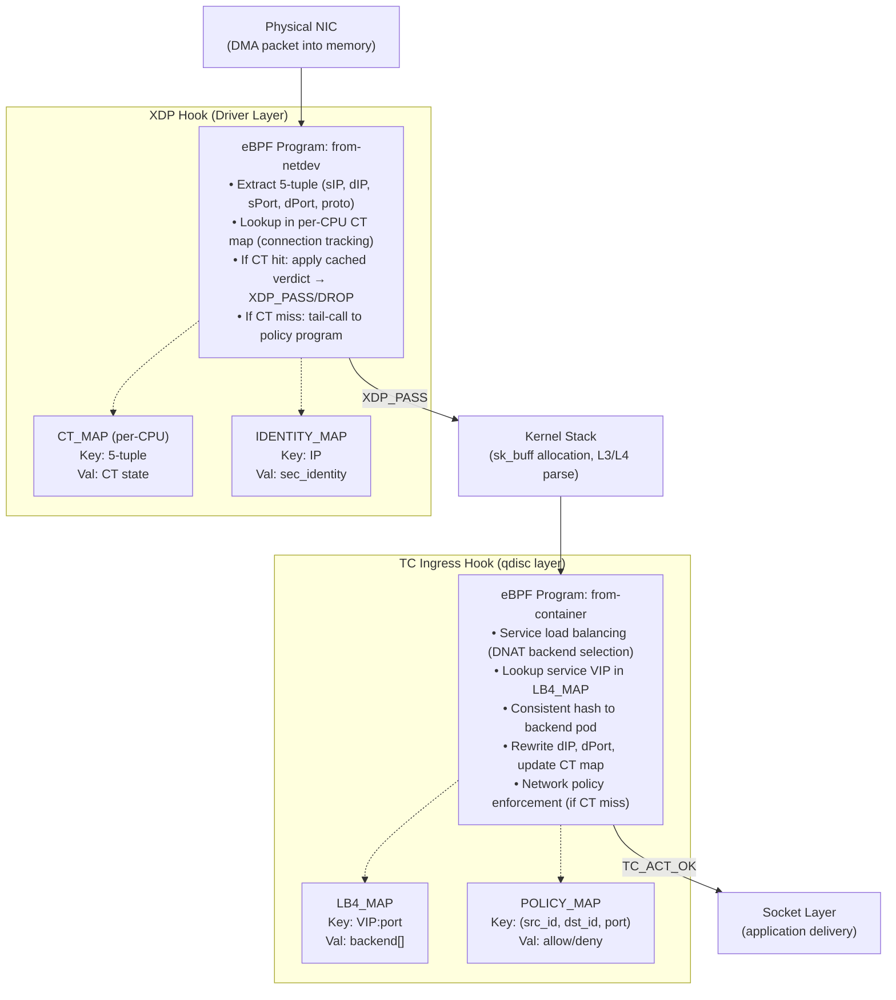

# Lesson 1: eBPF Dataplane Architecture

## 1. First-Principles Intuition & Invariants

The emergence of eBPF (extended Berkeley Packet Filter) represents a fundamental architectural shift in how we construct dataplanes for modern cloud-native infrastructure. Historically, network packet processing in Linux has been dominated by two opposing paradigms: the kernel's native Netfilter subsystem with its iptables interface, which offers deep integration at the cost of performance and operational complexity, and userspace solutions like DPDK that deliver raw throughput by bypassing the kernel entirely but sacrifice the rich ecosystem and security model that kernel integration provides. eBPF dissolves this dichotomy by enabling arbitrary, verifiably safe programs to execute within kernel context at strategic hook points in the network stack, achieving both safety and performance through a novel combination of static verification, Just-In-Time compilation, and lockless data structures.

At its conceptual core, eBPF is a restricted instruction set architecture—a 64-bit RISC virtual machine with eleven general-purpose registers (R0 through R10) and a bounded program size initially capped at 4096 instructions, later extended to over one million instructions through function calls and program chaining. The constraint that matters most is verifiability: every eBPF program must pass through a static verifier that performs data-flow analysis to prove termination (no unbounded loops), memory safety (no out-of-bounds accesses), and type safety (no arbitrary pointer arithmetic) before the kernel will load it. This verification phase is what distinguishes eBPF from traditional kernel modules, which can crash the system with a single null pointer dereference. The verifier constructs a directed acyclic graph of all possible execution paths, tracking the range and alignment of every register at every instruction, pruning equivalent states, and rejecting any program where it cannot prove safety within bounded time.

The verifier's conservatism is both eBPF's greatest strength and its most notorious constraint. It rejects patterns that might be safe in practice if they cannot be proven safe in theory. Early eBPF networking programs frequently encountered verifier errors like "back-edge from insn X to insn Y" when attempting loops, or "invalid access to packet, off=N size=M" when the verifier lost track of packet boundary invariants after complex branching. Modern eBPF development has evolved a discipline of writing programs that guide the verifier: explicit bounds checks immediately after pointer arithmetic, loop unrolling for predictable iteration counts, and strategic use of BPF helper functions that carry verifier annotations about their side effects and invariants. This discipline transforms eBPF from a general-purpose VM into a domain-specific language for packet processing, where idiomatic patterns emerge from the interplay between programmer intent and verifier capabilities.

Once a program passes verification, the kernel's BPF Just-In-Time compiler translates the virtual instructions into native machine code for the host architecture—x86-64, ARM64, or others. This JIT compilation step is critical for performance: interpreted execution of BPF instructions would introduce unacceptable overhead in the fast path of packet processing where latency budgets are measured in hundreds of nanoseconds. The JIT compiler performs optimizations like dead code elimination, constant propagation, and instruction combining, often producing machine code competitive with hand-written assembly for tight loops. The result is that eBPF programs execute at near-native speed while maintaining the safety guarantees of verification, achieving single-digit nanosecond overhead for simple programs and sub-microsecond latency even for complex multi-program chains.

The architectural invariant that makes eBPF viable for production dataplanes is the combination of verifier-enforced safety, JIT-compiled performance, and strategic placement of hook points throughout the kernel network stack. These hooks—XDP (eXpress Data Path) at the driver layer, TC (Traffic Control) at the qdisc layer, socket filter at the socket layer, and others—expose different tradeoffs between processing flexibility and stack traversal cost. An XDP program executes immediately after packet DMA into kernel memory, before any sk_buff allocation or protocol parsing, offering minimum latency and the ability to drop or redirect packets with zero overhead. A TC program runs after sk_buff allocation and basic protocol parsing, providing access to richer packet metadata and the ability to modify packets in place. Socket filters attach to individual sockets and can make per-connection decisions based on application-layer context. Cilium orchestrates this hierarchy of hook points to construct a complete dataplane that handles load balancing, network policy enforcement, transparent encryption, and observability across the entire packet lifecycle.

The second foundational invariant is the BPF map abstraction, which serves as the shared state mechanism between eBPF programs executing in kernel space and userspace control plane processes. Unlike traditional kernel programming where global variables and data structures can be freely accessed, eBPF programs have no direct access to kernel memory beyond what is explicitly provided through their context argument and BPF helper functions. BPF maps are typed key-value stores (hash tables, arrays, LRU caches, ring buffers, etc.) that the kernel manages and both kernel eBPF programs and userspace processes can access through system calls. This architecture enforces a clean separation between control plane and data plane: userspace daemons populate maps with routing tables, policy decisions, connection tracking state, and configuration, while kernel eBPF programs perform lookups against these maps at packet processing time to make forwarding decisions in tens of nanoseconds.

The performance characteristics of BPF maps are central to understanding eBPF dataplane design. A hash table lookup in a BPF_MAP_TYPE_HASH map typically completes in 30-100 nanoseconds depending on CPU cache state and collision chain length. Array maps (BPF_MAP_TYPE_ARRAY) offer constant-time O(1) access with minimal overhead since they degrade to simple pointer arithmetic: base_address + (index * element_size). Per-CPU maps (BPF_MAP_TYPE_PERCPU_HASH, BPF_MAP_TYPE_PERCPU_ARRAY) eliminate lock contention by maintaining separate instances per processor core, allowing lockless updates at the cost of memory overhead and userspace aggregation complexity. LRU maps (BPF_MAP_TYPE_LRU_HASH) implement automatic eviction for connection tracking scenarios where state must be bounded but access patterns exhibit temporal locality. Ring buffers (BPF_MAP_TYPE_RINGBUF) provide efficient event streaming from kernel to userspace for observability, using a lockless design with memory ordering guarantees that avoid the per-CPU fragmentation of the older perf buffer design.

Cilium's dataplane architecture exploits these map primitives to implement a stateful, policy-aware network without traversing the kernel's Netfilter subsystem. Connection tracking state resides in per-CPU hash maps keyed by 5-tuple (source IP, destination IP, source port, destination port, protocol), with values encoding policy verdicts, NAT translations, and service endpoints. Network policies compile down to nested map lookups: first an identity map translates source IP to security identity, then a policy map checks whether that identity is authorized to communicate with the destination identity on the requested protocol and port. Service load balancing uses a combination of consistent hashing and Maglev tables stored in BPF maps to distribute traffic across backend pods while maintaining connection affinity. This architecture achieves policy enforcement in 200-400 nanoseconds per packet, compared to 2-10 microseconds for equivalent iptables rulesets with hundreds of rules.

The contrast with iptables illuminates eBPF's architectural advantages. Netfilter processes packets through a linear chain of rules, evaluating match conditions sequentially until a terminal verdict (ACCEPT, DROP, etc.) is reached. For a Kubernetes cluster with 1000 services, iptables generates tens of thousands of rules distributed across multiple chains (PREROUTING, INPUT, FORWARD, OUTPUT, POSTROUTING) with jumps between them. Each rule evaluation performs string comparisons, bitmask operations, and conditional branches that pollute CPU instruction caches and branch predictors. Worse, iptables rules are monolithic: adding a single service requires regenerating and atomically swapping the entire ruleset, an operation that introduces millisecond-scale latency spikes during which packets may be dropped. Netfilter also provides no built-in connection tracking scalability beyond the global conntrack table, which becomes a contention bottleneck at high connection rates.

eBPF inverts these pathologies through data structure choice and algorithmic efficiency. Map lookups replace linear rule scans with hash table operations that scale logarithmically or better. Per-CPU maps eliminate lock contention. Incremental map updates replace monolithic ruleset swaps: adding a service means inserting entries into existing maps without disturbing ongoing packet processing. The verifier-enforced bounded execution guarantee means eBPF programs cannot introduce unbounded latency, whereas pathological iptables rulesets can consume tens of microseconds per packet. The ability to chain multiple eBPF programs through tail calls enables modular dataplane construction where different programs handle different protocol layers or policy domains, sharing state through maps while maintaining independent upgrade paths.

## 2. Core Architecture & Mechanics

The eBPF program lifecycle begins in userspace with high-level language compilation. While eBPF programs can theoretically be written in raw BPF assembly, production dataplanes like Cilium generate eBPF programs from C source using the Clang/LLVM compiler with BPF target backend. The compilation process produces an ELF object file containing BPF bytecode, map definitions, and relocation metadata. The LLVM BPF backend performs aggressive optimizations tailored to the verifier's analysis capabilities: it unrolls loops when iteration bounds are statically known, inlines helper function calls to reduce branch mispredictions, and reorders instructions to minimize register pressure within the eleven-register constraint.

Compile-Once Run-Everywhere (CO-RE) is the mechanism that makes eBPF programs portable across kernel versions despite frequent changes to internal kernel data structures. Traditional kernel modules must be compiled against specific kernel headers and break when structure layouts change between versions. CO-RE solves this through BTF (BPF Type Format), a compact metadata format that encodes the layout of every kernel structure. When an eBPF program accesses a field within a kernel structure, the compiler emits a relocation record rather than a hardcoded offset. At program load time, the kernel's BTF information and the program's embedded BTF are compared, and the loader patches the field offsets to match the running kernel. This architecture enabled Cilium to distribute pre-compiled eBPF programs that work across kernel 4.9 through 6.x without recompilation, a critical capability for enterprise deployment.

The program loading phase transfers the ELF object from userspace to kernel through the bpf() system call with BPF_PROG_LOAD command. This initiates the verification phase, where the kernel constructs a control-flow graph and performs abstract interpretation over the program's instruction sequence. The verifier maintains a state tuple for each instruction containing the type and value range of every register, the stack slot contents, and the current privilege level. As it traverses each path through the program, it propagates these states forward, checking that pointer dereferences are bounds-checked, that register types match helper function signatures, and that all paths terminate within the instruction limit.

The verifier's state pruning optimization is critical for programs with complex control flow. If the verifier reaches an instruction it has already analyzed with an equivalent or less privileged register state, it prunes that path without re-analyzing the continuation. Two states are equivalent if they prove the same safety properties: for example, a register known to contain a value in range [0, 100] is equivalent to a register in range [0, 50] for the purpose of subsequent bounds checks. This pruning transforms exponential path explosion into polynomial complexity, but it requires careful programming: patterns that cause state divergence (like accumulating packet offset in a register through many conditional increments) can exhaust the verifier's ~1 million instruction evaluation budget even for small programs.

Once verification succeeds, the JIT compiler activates. The x86-64 JIT translates BPF instructions to x86 instructions with a generally one-to-many mapping: a single BPF ALU64 addition becomes a single x64 ADD instruction, but a BPF_CALL to a helper function becomes a sequence of argument marshaling instructions, a CALL instruction, and return value handling. The JIT allocates the eleven BPF registers to machine registers (typically R0→RAX, R1→RDI, R2→RSI, R6-R9→RBX,R13,R14,R15, with others spilled to stack), optimizes away redundant moves, and fuses instruction sequences where possible. The JIT-compiled code is allocated in kernel executable memory with the same lifetime as the BPF program object itself.

The program must then be attached to one or more kernel hook points. For XDP programs, attachment uses the netlink interface to configure the network device driver, which stores a pointer to the eBPF program in the device's receive queue structure. When a packet arrives and the driver's NAPI poll function is invoked, it calls the XDP program before allocating an sk_buff. The program receives a struct xdp_md context containing only the packet data pointer, data_end pointer, and metadata pointer—a minimal context designed for maximum performance. The program returns an action verdict: XDP_PASS to continue normal stack processing, XDP_DROP to discard the packet immediately, XDP_TX to bounce the packet back out the receiving interface, XDP_REDIRECT to send to another interface, or XDP_ABORTED for error conditions.

TC (Traffic Control) programs attach to the qdisc (queuing discipline) layer, either on ingress before routing decisions or egress after routing. The attachment uses the TC netlink subsystem to install a BPF classifier in the filter chain. TC programs receive a struct __sk_buff context, which is a stable API facade over the kernel's internal sk_buff structure. This context provides access to packet data like XDP, but also to extensive metadata: VLAN tags, protocol fields, packet mark, priority, and hardware offload hints. Critically, TC programs can modify packet data in place through helper functions like bpf_skb_store_bytes, enabling NAT translations, encapsulation (VXLAN, Geneve), and header rewrites that XDP cannot perform. The TC program returns TC_ACT_OK to continue processing, TC_ACT_SHOT to drop, or TC_ACT_REDIRECT to send to another interface.

The interaction between eBPF programs and BPF maps defines the dataplane's runtime behavior. Consider a connection tracking scenario: when a TCP SYN packet arrives, the XDP program extracts the 5-tuple from packet headers, hashes it, and performs a lookup in a per-CPU hash map using the bpf_map_lookup_elem helper. If the map returns NULL (no existing entry), this is a new connection requiring policy evaluation. The program then looks up the source and destination security identities in separate maps, checks a policy map to determine whether this connection is allowed, and if permitted, creates a new connection tracking entry with bpf_map_update_elem. Subsequent packets in the same connection hit the connection tracking entry directly and bypass policy evaluation, a fast-path optimization that reduces per-packet cost from 300ns to 50ns.

Map design choices profoundly impact performance. Hash maps incur cache misses on lookup since they must follow pointer chains through the kernel heap. Array maps are cache-friendly but require dense, small key spaces. Per-CPU maps scale to millions of operations per second by eliminating atomics, but userspace must aggregate across CPUs to obtain global state. LRU maps prevent memory exhaustion but introduce eviction overhead that can cause connection tracking state loss under DoS conditions. Cilium uses a hybrid approach: connection tracking in per-CPU LRU hash maps for scalability and bounded memory, service load balancing backends in shared hash maps since service topology changes are control-plane operations, and policy decisions in nested maps (maps-of-maps) to enable atomic policy updates without disrupting active connections.

The tail call mechanism enables program composition beyond the single-program instruction limit. A BPF program can invoke bpf_tail_call(ctx, prog_array_map, index) to transfer control to another program stored in a BPF_MAP_TYPE_PROG_ARRAY map. This is not a function call in the traditional sense: it replaces the current program entirely, reusing the stack and register state, and never returns. Tail calls enable Cilium to construct a multi-stage packet processing pipeline: an initial program performs fast-path connection tracking lookup, tail-calling to a policy enforcement program only for new connections, which may tail-call to a NAT program, which may tail-call to an encapsulation program. Each stage can be independently loaded and upgraded without disrupting the others, and the verifier checks each program in isolation, simplifying the verification problem.

The kernel's eBPF runtime provides helper functions that serve as the system call interface for eBPF programs. These functions are the only way eBPF programs can interact with kernel state beyond their immediate context. The bpf_map_lookup_elem and bpf_map_update_elem helpers access map contents. The bpf_skb_load_bytes and bpf_skb_store_bytes helpers safely read and write packet data with automatic bounds checking. The bpf_get_prandom_u32 helper provides randomness for ECMP hashing without exposing kernel RNG state. The bpf_ktime_get_ns helper reads the monotonic clock for timestamping and rate limiting. Each helper function carries verifier annotations about its preconditions (which register types it accepts), postconditions (which registers it modifies), and side effects (whether it may modify packet data), enabling the verifier to track safety properties across helper calls.

The diagram below illustrates the complete dataplane architecture for an ingress packet in Cilium:

This architecture demonstrates the principle of progressive refinement: the XDP layer handles the common case (existing connections) with minimal overhead, while TC programs handle the exceptional cases (new connections, load balancing) that require richer context and more complex transformations. The separation of connection tracking from policy enforcement through tail calls enables independent scaling: connection tracking state is per-CPU for lock-free updates, while policy maps are shared across CPUs since policy changes are rare and can tolerate occasional cache misses.

## 3. High-Performance Optimization & Failure Modes

The performance characteristics of an eBPF dataplane emerge from the interaction between program logic, map access patterns, CPU cache behavior, and kernel runtime overhead. A minimal XDP program that performs a single map lookup and returns XDP_PASS typically adds 20-40 nanoseconds to per-packet latency on modern server CPUs (Intel Xeon Skylake or AMD EPYC). This overhead decomposes into roughly 10ns for the XDP hook invocation and context setup, 15-30ns for the map lookup depending on cache state, and 5ns for the return path. By contrast, a comparable iptables ruleset with 100 rules adds 1-3 microseconds, a 30-50× penalty. At 10 million packets per second (a single 100GbE NIC at minimum packet size), this difference translates to 0.4% CPU utilization for eBPF versus 30% for iptables, fundamentally changing the economics of packet processing.

Cache efficiency dominates eBPF performance optimization. Modern CPUs have three-level cache hierarchies: L1 is 32-64KB per core with ~4 cycle latency, L2 is 256KB-1MB per core with ~12 cycle latency, and L3 is 8-64MB shared across cores with ~40 cycle latency. A cache miss to DRAM incurs 60-100ns latency, comparable to the entire XDP program budget. eBPF programs that fit within L1 instruction cache (typically achievable for programs under 1000 instructions after JIT compilation) experience minimal fetch latency. Map data structures that fit within L3 cache (feasible for connection tracking tables under ~100k entries with compact value structures) see hit rates above 95% under typical traffic distributions with temporal locality.

The per-CPU map design pattern explicitly optimizes for cache locality by eliminating inter-core cache line bouncing. When multiple cores update shared hash map entries, the cache coherence protocol (MESI on x86) forces cache line migrations between cores, adding 40-100ns per migration. Per-CPU maps guarantee that each core only writes to its own memory region, eliminating coherence traffic at the cost of CPU-count multiplied memory usage. For connection tracking with 100k active connections and 48-core servers, this trades 100MB of memory (negligible) for 2× throughput improvement (critical).

CPU branch prediction interacts subtly with eBPF performance. Modern CPUs predict branch outcomes using pattern history tables and maintain 20-30 in-flight speculative instructions. Predictable branches (like checking if a map lookup returned NULL, which is rare for connection tracking) incur zero cycle penalty after the first few iterations. Unpredictable branches (like policy decisions that vary across packets) flush the pipeline and cost 10-20 cycles. The verifier's requirement for explicit bounds checking after every pointer operation introduces branches that are highly predictable (packet sizes are typically 64, 1024, or 1500 bytes, not random), so these checks optimize away in the branch predictor. However, complex policy logic with many conditional rules can introduce branch mispredictions that double per-packet CPU cost.

NUMA (Non-Uniform Memory Access) topology becomes relevant at scale. On multi-socket servers, memory attached to socket 0 is faster to access from cores on socket 0 than from cores on socket 1. NIC receive queues are typically bound to specific CPU cores via IRQ affinity, and those cores should process packets with memory allocated from the local NUMA node. BPF maps are allocated from kernel memory that may span NUMA nodes. For optimal performance, large maps should be explicitly allocated on the same NUMA node as the NIC processing the traffic, reducing map access latency from ~80ns (remote NUMA) to ~60ns (local NUMA). This optimization is typically handled by pinning the NIC IRQs and the userspace control plane process to the same NUMA node.

The verifier's complexity limit represents a hard failure mode that manifests as program load rejection. The verifier tracks a bounded number of states (configurable, typically ~1 million processed states) and a maximum instruction evaluation count. Programs that generate excessive state divergence exhaust this budget. Common patterns that trigger verifier failures include loops with variable bounds derived from packet content (the verifier cannot prove termination), deeply nested if-else chains where each branch modifies many registers (state explosion), and packet parsing loops that iterate over variable-length headers without sufficient bounds assertions. The mitigation is to restructure programs: use tail calls to split complex logic across multiple programs, add explicit bounds checks that help the verifier prove safety earlier, and unroll loops when iteration counts are small.

Map size limits impose capacity constraints. Hash maps have a maximum element count specified at creation time. For connection tracking, this limit must accommodate the maximum concurrent connection count plus headroom for attack traffic. Undersizing causes map update failures when new connections arrive and the map is full. LRU maps mitigate this by evicting old entries, but eviction of active connections causes spurious policy re-evaluation and potential connection drops. The correct sizing formula accounts for connection duration distribution and arrival rate: for average connection duration T seconds and arrival rate λ connections per second, the map must hold at least λT entries. For a service handling 100k requests/second with 1-second average connection duration, the map requires 100k entries. A 2× safety factor accounts for variance, yielding 200k entries.

The interaction between eBPF and kernel upgrades introduces compatibility risks. While CO-RE provides binary portability for structure offsets, helper function semantics occasionally change between kernel versions. A helper function that was safe to call in arbitrary context in kernel 5.10 might require additional preconditions in kernel 5.15. Cilium maintains a kernel version matrix testing eBPF programs against kernel 4.9, 4.19, 5.4, 5.10, 5.15, 6.1, and latest mainline to catch these incompatibilities. The mitigation is feature detection: programs query kernel version at load time and conditionally enable features only on supported kernels, degrading gracefully on older kernels by falling back to alternative implementations (often with reduced performance).

Stack size limitations (512 bytes per program) constrain local variable usage. eBPF programs cannot use dynamic allocation and the 512-byte stack must hold all local variables and spilled registers. Parsing complex packet headers (like nested IP-in-IP tunnels or IPv6 extension headers) can exhaust stack space. The solution is to use BPF maps as heap: allocate a per-CPU array map with a single entry, look it up at program start, and use the returned pointer as a 4KB scratch buffer. This pattern trades a map lookup (30ns) for effectively unlimited local storage, enabling arbitrarily complex packet transformations.

Race conditions in map updates require careful consideration despite eBPF's atomicity guarantees. The bpf_map_update_elem helper atomically replaces a map entry, and bpf_map_lookup_elem returns a pointer that remains valid until program return. However, time-of-check to time-of-use vulnerabilities exist: if a program looks up a connection tracking entry, makes a decision based on its contents, then updates it, another CPU might modify the entry between lookup and update. Per-CPU maps eliminate this race for single-CPU-scope decisions, but shared maps require careful ordering: read the entry, make all decisions based on that snapshot, then perform at most one update with the new state. Compound operations (read-modify-write) require either per-CPU maps or acceptance of eventual consistency.

The failure mode of eBPF program crashes differs fundamentally from kernel module crashes. If a kernel module dereferences a null pointer, the system panics. If an eBPF program would do so, the verifier rejects it at load time. However, verifier bugs or JIT compiler bugs can theoretically allow unsafe programs to load. If an eBPF program manages to crash at runtime (vanishingly rare), the kernel's BPF runtime converts the fault into a BPF_ABORT return code, increments an error counter, and continues processing subsequent packets. This isolation property means eBPF dataplane bugs are self-healing: a crashing program stops processing traffic for that program instance but does not bring down the node, and the control plane can detect the error counter increment and reload the program.

Observability of eBPF dataplanes leverages the same map infrastructure used for packet processing. Programs can maintain statistics maps (counters for packets processed, dropped, redirected) and event maps (ring buffers containing sampled packet headers or policy violation events) that userspace daemons poll. The overhead of incrementing a per-CPU counter is negligible (2-3ns), so fine-grained statistics are feasible. Ring buffer events incur 20-50ns overhead to reserve space and commit the event, so they should be sampled (emit 1% of events) or triggered by exceptional conditions (policy denials) rather than emitted for every packet. This approach provides microsecond-granularity insight into dataplane behavior without the overhead of kernel tracepoints or logging.

The integration between eBPF and hardware offload extends dataplane performance to line-rate for SmartNICs. Some network adapters (Netronome, Mellanox) contain programmable processors that can execute eBPF bytecode directly in hardware, processing packets at wire speed (100Gbps+) without consuming any host CPU. The kernel's eBPF infrastructure supports an offload mode where programs are compiled for the NIC's architecture instead of the host CPU. Not all eBPF features are offloadable (map-in-map, helper functions that access kernel state), so offloadable programs must restrict themselves to a subset: basic map lookups, arithmetic, and header rewrites. Cilium detects offload-capable NICs and automatically generates simplified XDP programs for offload while running full-featured programs on the host CPU as a fallback path.

The memory consumption of an eBPF dataplane scales with map size and program complexity. Connection tracking dominates memory usage: a 64-byte CT entry for 1 million connections consumes 64MB per CPU, or 3GB on a 48-core server. Policy maps are typically small (thousands of entries) and negligible. Service load balancing maps scale with backend count: 1000 services with 10 backends each at 128 bytes per backend entry consume 1.28MB. Program memory is trivial: JIT-compiled programs are 1-50KB each, and a complete Cilium dataplane loads 10-30 programs totaling under 1MB. The total memory footprint is 3-5GB for large-scale deployments, less than 1% of typical server memory, making eBPF dataplanes far more efficient than userspace alternatives that require dedicated huge pages.

The evolution of eBPF continues to expand its capabilities and performance envelope. Recent kernel versions introduced bounded loops (eliminating the need for manual unrolling), BPF-to-BPF function calls (reducing code duplication), and global variables (simplifying configuration). Each generation of CPU microarchitecture improves JIT compilation through better instruction set support: AVX-512 for fast checksumming, AES-NI for encryption, CRC32c for hashing. The combination of a stable, verifiable execution model with continuous performance improvement positions eBPF as the foundational dataplane technology for cloud-native infrastructure, displacing both legacy kernel subsystems and userspace bypass solutions through superior safety, performance, and operational simplicity.
