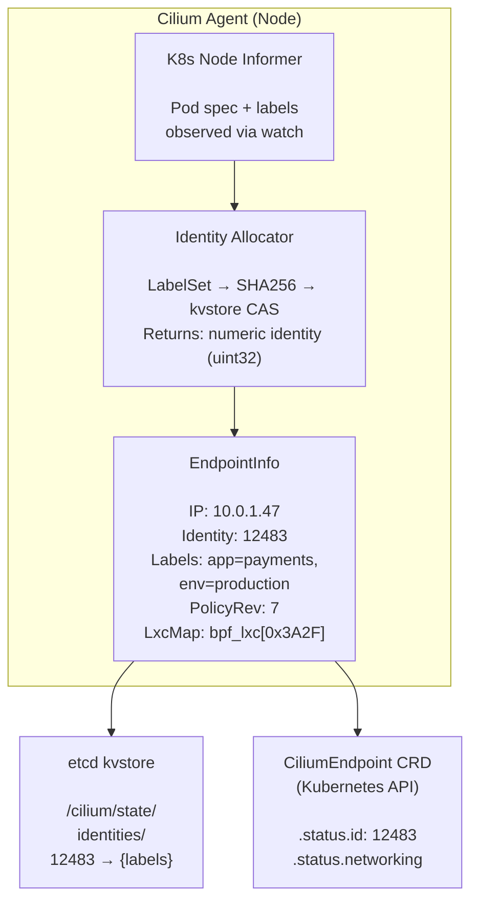
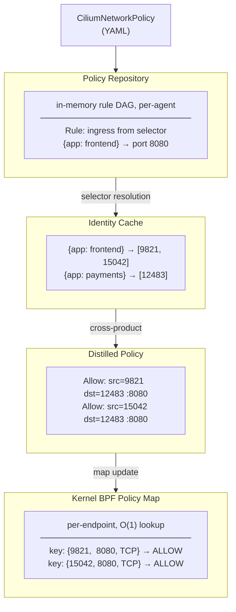

# Lesson 2: Identity-Based Security Model

## 1. First-Principles Intuition & Invariants

Traditional network security was built on the assumption that topology is a proxy for trust. A firewall rule permitting traffic from `10.0.1.0/24` to port 443 on `10.0.2.5` encodes a spatial belief: that the machines in that subnet are the right machines, that the IP addresses are stable, and that ownership of an address implies authorization. In the physical datacenter era, this assumption held tolerably well. Rack assignments were static, IP addresses were manually administered, and the blast radius of a misconfigured subnet was at least bounded by the physical network segment.

Kubernetes obliterated every premise that model rests on. Pod IP addresses are ephemeral artifacts of scheduling decisions. A single IP that belonged to a payment-processing pod at 09:00 may belong to a log-scraping sidecar at 09:04, with no network-layer signal distinguishing the two events. A CIDR-based firewall rule written against that address space does not encode authorization at all — it encodes a momentary collision between a scheduler's output and a security policy, and the collision is fundamentally unreliable. The correct abstraction is not *where* a workload is running, but *what* a workload is. That shift from location to identity is the founding invariant of Cilium's security model.

Cilium's identity model is derived from Kubernetes labels, which are themselves the canonical mechanism by which operators declare the semantic meaning of a workload. When a Deployment specifies `app: payments, env: production, version: v3`, those labels are not operational metadata — they are the workload's declared identity within the cluster's trust domain. Cilium captures this declaration at the moment an endpoint comes into existence and distills it into a numeric security identity, a 32-bit integer that is consistent across every node in the cluster and that persists for the lifetime of the labeled pod set. Every packet that enters or leaves a Cilium-managed endpoint is tagged with or inspected against this identity, and policy decisions are made in terms of identity pairs rather than address pairs.

The fundamental invariant this creates is that authorization follows the workload, not the network slot. If the payments pod is rescheduled from node A to node B, its IP address changes but its identity — derived from its unchanged labels — does not. Any network policy permitting traffic from the frontend identity to the payments identity remains valid through the reschedule without any control-plane update to firewall rules. This is not a convenience optimization; it is a correctness property. It means the security model is consistent with the Kubernetes reconciliation model, in which the desired state of a workload is expressed through labels and controllers are responsible for making reality match that declaration.

A second invariant governs how identities interact with external traffic. Workloads outside the cluster — legacy VMs, managed databases, external APIs — do not carry Kubernetes labels, so they cannot participate in the identity model directly. Cilium handles this boundary condition through CIDR-based identity allocation: a synthetic identity is assigned to an IP prefix or a specific address, and policies can be written against that synthetic identity using the same mechanism used for label-derived identities. This means the enforcement path is uniform regardless of whether the peer is a pod, a node, or a remote IP. The difference is epistemological: label-derived identity is cryptographically grounded in the cluster's admission chain (the labels are set by the API server and are part of the workload's etcd record), while CIDR identity is address-based and inherits the trust limitations of IP attribution.

The third invariant is that identity is a global, cluster-wide concept. Because a numeric identity encodes the same set of labels everywhere, a node that has never seen a particular pod can still enforce policy against traffic from that pod the moment it receives a packet carrying that identity. The identity is the out-of-band channel through which policy is applied before any application-layer connection is fully established. This property is what makes Cilium's enforcement model horizontally scalable: policy enforcement is fully local to the datapath of the receiving node, and that datapath only needs the identity-to-label mapping for the peers it is currently communicating with, not for the entire cluster.

---

## 2. Core Architecture & Mechanics

### Identity Allocation and the Endpoint Lifecycle

The identity lifecycle begins the moment the Cilium agent on a node observes a pod being created by the container runtime. The agent reads the pod's labels from the local Kubernetes node informer cache, constructs a canonical label set by stripping well-known non-security labels (Kubernetes internal labels prefixed with `kubernetes.io/` and certain operator-injected labels are filtered by configuration), and then computes a deterministic hash over the resulting set. That hash becomes the lookup key into the identity store.

The identity store is backed by the cluster's kvstore, which in production deployments is a dedicated etcd cluster managed by Cilium (distinct from the Kubernetes etcd, though a single etcd can be shared in smaller installations). The agent performs a compare-and-swap operation: if the hash already has a numeric identity allocated in the kvstore, it retrieves that identity and assigns it locally to the new endpoint. If the hash is new — meaning this exact combination of labels has not been seen before in the cluster — the agent allocates a fresh numeric identity, writes the mapping to the kvstore, and assigns it. The allocation uses a distributed counter to ensure uniqueness across concurrent allocations on different nodes.

The resulting endpoint state on the local node is a data structure called `EndpointInfo`, which the Cilium agent maintains in its own in-memory store and also materializes as a `CiliumEndpoint` custom resource in the Kubernetes API. The `EndpointInfo` record contains the endpoint's IP address, its assigned security identity, its current policy revision, and the set of active datapath programs pinned in the kernel for that endpoint. The relationship between these components is shown in the following diagram.



The numeric identity space is partitioned by reserved ranges. Identities 1 through 999 are reserved for well-known cluster entities: identity 1 is the host itself, identity 2 represents the cluster aggregate (any in-cluster IP), identity 3 represents the world (any IP not covered by in-cluster CIDRs), and identity 4 is used for unmanaged endpoints — pods running without Cilium instrumentation. This reservation scheme means that a node's datapath can make a policy decision against traffic from the host network namespace without consulting the kvstore at all; the identity is a compile-time constant.

### The Policy Computation Graph

A `CiliumNetworkPolicy` (CNP) or standard `NetworkPolicy` resource describes intent in terms of label selectors. The policy engine must translate that intent into a concrete set of identity pairs that the datapath can evaluate in constant time. This translation is the policy computation graph.

Consider a policy that permits ingress to pods labeled `app: payments` from pods labeled `app: frontend`. The policy selector `app: payments` resolves to a set of endpoints — in practice, a set of numeric identities — by querying the local endpoint store for all endpoints whose label sets match the selector. The peer selector `app: frontend` similarly resolves to a set of identities. The result is a Cartesian relationship: for every identity I₁ in the payments set and every identity I₂ in the frontend set, the pair (I₂ → I₁) is an allowed ingress flow.

This computation is not static. As pods are created and destroyed and as their labels change, the selector-to-identity mappings change, and the policy computation graph must be re-evaluated. Cilium's policy engine maintains a dependency graph between selectors and identities so that a change to a single identity — say, a new pod with the frontend labels comes up and receives identity 15042 — triggers a targeted recomputation only for the policies that reference a selector matching that label set. The recomputed policy is then pushed to the kernel datapath as an updated policy map entry.

The datapath representation of a computed policy is a BPF hash map called `cilium_policy` (or `cilium_ct_any4_global` for connection tracking). For each endpoint, there is a per-endpoint policy map keyed by the tuple `(identity, destination port, protocol)` with a value encoding the action (allow, deny, redirect to L7 proxy). A packet arriving at an endpoint's ingress hook carries the source identity in a metadata field, and the datapath performs a single map lookup to determine whether the flow is permitted. The critical performance property is that this lookup is O(1) — it does not iterate over CIDR ranges or rule lists.



### CIDR-Based vs. Identity-Based Enforcement

The distinction between these two enforcement modes is not merely syntactic — it reflects a fundamental difference in trust derivation and enforcement guarantees.

Identity-based enforcement operates at the point where a packet enters the Cilium datapath on the source node. When a pod sends a packet, the local datapath on the sending node marks the packet with the source endpoint's numeric identity. In a VXLAN or Geneve overlay deployment, this mark is encoded in the tunnel header. In direct routing deployments without an overlay, Cilium uses the IP-in-IP option or, more commonly, relies on the ipcache — a BPF map that correlates destination IP addresses to their known identities — to allow the receiving node to perform the identity lookup locally. The receiving node's datapath then consults the per-endpoint policy map using the resolved identity, not the source IP address.

CIDR-based enforcement works differently. When traffic arrives from an external source — an IP address that is not registered in the cluster's identity store — the receiving node must derive an identity from the IP address itself. Cilium constructs a synthetic identity for the CIDR block containing that address. The ipcache maps the IP prefix to this synthetic identity, and the same O(1) policy map lookup applies. The limitation is that this synthetic identity is only as reliable as IP attribution: if the external peer is behind NAT or a load balancer, the CIDR identity may correspond to infrastructure rather than the actual workload.

The practical architectural guidance is to use identity-based policies for all east-west traffic within the cluster and to use CIDR policies only for north-south egress to known external services or for ingress from known external IP ranges. The two modes compose cleanly — a policy can permit ingress from identity 9821 on port 443 and also permit egress to `0.0.0.0/0` on port 443 for DNS, without any semantic conflict.

### Distributed Identity Propagation via the KVStore

The kvstore's role in identity propagation is a critical path in cluster-wide policy coherence, and understanding its mechanics is essential for diagnosing convergence latency.

When a new identity is allocated on node A because a pod with a novel label combination has been scheduled there, the allocation is written to the etcd kvstore under the path `/cilium/state/identities/v1/id/<numeric-id>`. Every Cilium agent in the cluster maintains a watch on this keyspace prefix. Within the etcd watch latency window — typically single-digit milliseconds in a healthy cluster — every other node receives the new identity mapping and updates its local identity cache. This local cache is the data structure that the policy engine uses during selector resolution, so a policy on node B that selects `app: frontend` will begin matching the new identity the moment the watch event is processed.

The critical interaction is between identity propagation and traffic arrival. If a pod on node A sends a packet to a pod on node B before node B has received the identity watch event for the sender's identity, the datapath on node B will encounter an unknown identity and, depending on policy configuration, will either drop the packet or fall back to a default action. This is not a theoretical edge case — it occurs during rolling deployments when new pods come up rapidly. Cilium addresses this with an identity heartbeat mechanism: the sending node will retransmit identity announcements periodically, and the connection tracking table's timeout ensures that dropped initial packets result in TCP retransmission rather than silent failure.

The kvstore also serves as the synchronization point for the ipcache, which maps IP-to-identity bindings. When a pod receives a new IP assignment, the Cilium agent on the pod's node writes the IP-to-identity mapping under `/cilium/state/ip/v1/`. Remote nodes consume these entries via watch and update their local ipcache BPF maps accordingly. The convergence time for the full pipeline — pod scheduled, IP assigned, identity allocated, ipcache propagated to all nodes — is bounded by the etcd watch round-trip time and local agent processing latency, and in practice lands between 50ms and 300ms depending on cluster size and etcd performance.

---

## 3. High-Performance Optimization & Failure Modes

### Scaling the Identity Allocator

The numeric identity space is 32 bits wide, but Cilium reserves the upper bits for special categories, leaving approximately 16 million identities available for user workloads. In clusters with aggressive autoscaling or frequent redeployments, identity churn becomes a real concern. Each unique combination of security-relevant labels generates a distinct identity, and if operators use deployment-specific labels — build SHA values, timestamp annotations, canary weights — in label sets that Cilium includes in identity computation, the identity space fragments rapidly and the kvstore accumulates stale entries that must be garbage collected.

The mitigation is label selection configuration. Cilium's `--labels` flag (or the `labels` field in `CiliumConfig`) specifies which label sources and prefixes are included in identity computation. The correct production configuration includes only labels that have genuine security semantics — typically `k8s:app`, `k8s:env`, `k8s:component`, and any custom labels your organization uses to encode trust zones. Build metadata labels should be explicitly excluded. The following `CiliumConfig` fragment demonstrates the correct configuration:

```yaml
apiVersion: v1
kind: ConfigMap
metadata:
  name: cilium-config
  namespace: kube-system
data:
  # Include only labels with security semantics in identity computation.
  # Excludes build SHA, timestamp, and canary weight labels from identity hash.
  labels: "k8s:!controller-revision-hash,k8s:!pod-template-generation,k8s:!pod-template-hash"
  # Identity GC interval: reclaim stale identities after 10 minutes of disuse.
  identity-gc-interval: "10m0s"
  # Heartbeat timeout for identity liveness: agents re-assert identity
  # ownership every 2 minutes to prevent premature GC.
  identity-heartbeat-timeout: "2m0s"
```

### Policy Map Pressure and Per-Endpoint Limits

Each endpoint's policy map has a default capacity of 16,384 entries. This limit is consumed by the cross-product of allowed identity pairs and port/protocol combinations. In a cluster where many services are permitted to communicate — for example, a service mesh with broad allow policies between microservices — an endpoint that receives traffic from 1,000 distinct identities across 20 port combinations consumes 20,000 entries, which exceeds the default map size.

Exceeding the policy map capacity does not cause a silent policy bypass. Cilium logs a `policy map overflow` error and falls back to a catch-all entry that permits or denies based on the endpoint's default policy. The correct response is to increase the map size via the `--bpf-policy-map-max` flag, though this increases per-endpoint kernel memory consumption. The more surgical mitigation is to reduce policy granularity: if 50 frontend pods all carry the same label set and therefore the same identity, they consume a single policy map entry on the payments endpoint, not 50. This is the economic incentive for ensuring that your label taxonomy assigns identical security-relevant labels to workloads that share the same authorization profile.

To inspect the current policy map utilization for a specific endpoint, identify the endpoint ID and use the Cilium CLI against the agent on the node where the pod is running:

```bash
# List all endpoints on the current node with their identity and policy revision.
cilium endpoint list

# Inspect the distilled policy for endpoint ID 3892, showing all allowed
# identity/port pairs as computed by the policy engine.
cilium endpoint get 3892 | jq '.[0].status.policy'

# Dump the raw BPF policy map for endpoint 3892 to inspect kernel-side entries.
# This reveals the exact (identity, port, proto) tuples installed in the datapath.
cilium bpf policy get 3892
```

### KVStore Degradation and Identity Propagation Failures

The kvstore is a synchronous dependency during identity allocation. If etcd becomes unavailable — due to a quorum loss, network partition, or certificate expiry — Cilium agents cannot allocate new identities. Pods whose labels map to an already-allocated identity will continue operating normally, because the identity is cached locally and the datapath does not need to re-validate it against the kvstore on every packet. Pods with novel label combinations, however, will be held in a pending state: the agent will log `identity allocation failed` and will not program the endpoint's datapath until a successful kvstore write completes.

This failure mode has a specific operational signature. In a partial etcd failure where the leader is reachable from some nodes but not others, you will observe that pods on nodes that cannot reach etcd are admitted to the network only if their identity was already cached by the local agent from a prior successful watch. New pods on those nodes will be isolated. The diagnostic path is to check etcd health directly:

```bash
# Check etcd cluster member health from within the cilium-operator pod,
# which shares the same etcd client configuration as the agents.
kubectl exec -n kube-system deployment/cilium-operator -- \
  etcdctl \
    --endpoints=https://etcd-client.kube-system.svc:2379 \
    --cacert=/var/lib/etcd-secrets/etcd-client-ca.crt \
    --cert=/var/lib/etcd-secrets/etcd-client.crt \
    --key=/var/lib/etcd-secrets/etcd-client-key.key \
    endpoint health

# Inspect the Cilium agent's kvstore connectivity status on a specific node.
# The 'kvstore' section of the status output reports last successful
# write/read timestamps and current connection state.
cilium status --verbose | grep -A 10 "KVStore"
```

A less obvious failure mode is identity cache staleness caused by watch stream interruption without reconnection. If the etcd watch stream drops silently — a known failure pattern under certain network proxies that do not correctly handle HTTP/2 stream resets — the agent stops receiving identity update events but does not detect the failure, because the gRPC connection at the transport layer appears healthy. The result is that the agent's identity cache diverges from the kvstore ground truth over time, and policy computed against the stale cache may grant or deny flows based on identities that no longer correspond to the current workload set. Cilium mitigates this with a periodic full resync: every `--kvstore-opt etcd.heartbeat` interval (default 30 seconds), the agent issues a range query to retrieve the full identity key space and reconciles its local cache. If the full resync shows divergence, the agent logs a warning and triggers a policy re-push to the datapath.

### CIDR Policy and ipcache Scaling

In environments with large numbers of distinct CIDR policies — for example, a multi-tenant platform where each tenant's egress policy lists dozens of external service IP ranges — the ipcache BPF map can become a bottleneck. The ipcache is a global per-node map with a default capacity of 512,000 entries, and each distinct IP-to-identity mapping consumes one entry. When CIDR policies use narrow prefixes (`/32` per external IP rather than aggregated `/24` ranges), entry consumption grows linearly with the number of distinct external IPs referenced across all policies on the cluster.

The correct architectural response is CIDR aggregation: express external service allowlists at the prefix granularity that reflects the actual trust boundary rather than the finest-grained addressing available. If an external database cluster occupies a stable `/26` prefix, the CIDR policy should reference that `/26` rather than listing each of the 62 host addresses individually. This reduces ipcache pressure by a factor of 62 for that policy entry and also makes the policy semantics more robust against address changes within the prefix.

For platforms where dynamic CIDR discovery is unavoidable — where workloads resolve external FQDNs that may map to frequently rotating IP addresses — Cilium provides FQDN-based policies backed by a DNS proxy. The DNS proxy intercepts DNS responses from pods, records the returned IPs, and dynamically synthesizes CIDR policy entries for those IPs with a TTL tied to the DNS record's TTL. This keeps the ipcache entries bounded to the set of IPs that are currently resolvable for a given FQDN, rather than accumulating a growing unbounded set of stale CIDR entries. Enabling this requires the `toCIDRSet` entries in a `CiliumNetworkPolicy` to be replaced with `toFQDNs` entries:

```yaml
apiVersion: "cilium.io/v2"
kind: CiliumNetworkPolicy
metadata:
  name: payments-egress-external-api
  namespace: production
spec:
  endpointSelector:
    matchLabels:
      app: payments
      env: production
  egress:
    # Allow DNS resolution through the Cilium DNS proxy for all upstreams.
    # The proxy records returned IPs and generates dynamic CIDR entries.
    - toEndpoints:
        - matchLabels:
            "k8s:io.kubernetes.pod.namespace": kube-system
            k8s-app: kube-dns
      toPorts:
        - ports:
            - port: "53"
              protocol: UDP
          rules:
            dns:
              - matchPattern: "*.stripe.com"
              - matchPattern: "*.amazonaws.com"
    # Allow egress to IPs dynamically resolved for the FQDN pattern.
    # Cilium's DNS proxy populates the backing CIDR entries automatically
    # and expires them when the DNS TTL elapses.
    - toFQDNs:
        - matchPattern: "api.stripe.com"
        - matchPattern: "*.s3.amazonaws.com"
      toPorts:
        - ports:
            - port: "443"
              protocol: TCP
```

The combination of well-scoped label taxonomy, correctly sized policy maps, kvstore health monitoring, and CIDR aggregation forms the operational foundation of a Cilium identity model that remains correct and performant as the cluster scales. Each of these properties traces back to the same first principle: identity must be a durable, semantically grounded property of the workload, not an artifact of its momentary position in the network. When that principle is applied consistently — in label design, in policy authorship, and in infrastructure dimensioning — the security model becomes self-consistent in a way that IP-based approaches can never achieve in a dynamic scheduling environment.
