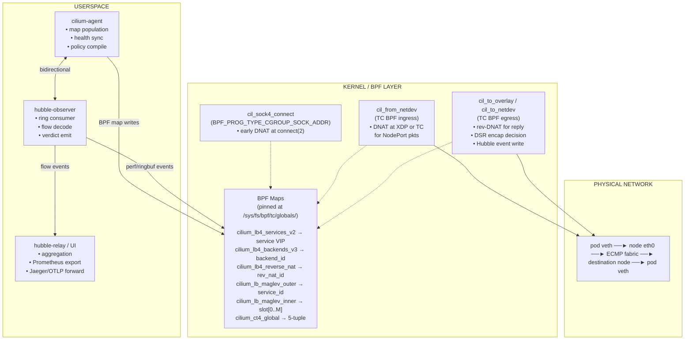

# Lesson 4: Service Load Balancing Observability

## 1. First-Principles Intuition & Invariants

The story of Kubernetes service load balancing is, at its core, a story about the tension between two irreconcilable properties: the need for packet-level performance at the data plane, and the need for operator-level visibility into what that data plane is actually doing. For a decade, `kube-proxy` owned both sides of this bargain, and it delivered on neither with particular grace. Its iptables backend accumulated O(n) rule-chain complexity as service counts grew, forcing every packet on every node through a linear sequence of netfilter matches that bore no resemblance to how modern kernel networking actually works. When an operator asked "why is this service slow?" the answer was always the same: carefully crafted `iptables -L -n -v` pipelines, manual IPVS session table dumps, and a great deal of guesswork.

Cilium's kube-proxy replacement is not merely a re-implementation of the same semantics in a faster runtime. It is a fundamental rethinking of service load balancing as a problem in kernel-resident state management, where the forwarding plane is a set of eBPF programs pinned to well-defined hook points, the backing data structures are BPF maps with O(1) lookup complexity, and observability is a first-class citizen built into the same code paths that make forwarding decisions. Understanding why this architecture is both correct and necessary requires grounding yourself in the physical realities of what a service lookup actually costs.

When a pod on a node sends a TCP SYN to a ClusterIP, three distinct problems must be solved before the packet can be delivered. First, the destination address must be translated from the virtual ClusterIP to a real endpoint IP — this is destination NAT (DNAT). Second, a specific backend must be selected from among all healthy endpoints for that service — this is load balancing. Third, the selection must be stable across the lifetime of the connection, so that subsequent packets in the same flow are not scattered across different backends — this is session affinity, or connection tracking. In the iptables model, all three of these problems are solved by stateful netfilter rules evaluated sequentially in `PREROUTING` and `OUTPUT` chains. The conntrack table holds the DNAT state; the probability-match rules implement randomized backend selection; and the interaction between them produces the emergent property of per-connection stickiness.

The pathological case emerges not when you have ten services, but when you have ten thousand. At that scale, the iptables ruleset for a single node can exceed 100,000 individual rules. Each new TCP connection traverses this entire chain in the worst case, and because netfilter rule processing is serialized under a single spinlock in the kernel, high connection-establishment rates on busy nodes translate directly to CPU contention that has nothing to do with the actual application workload. This is not a theoretical concern: production clusters at large-scale Kubernetes deployments have documented cases where service lookup overhead consumed more CPU than the application processes being balanced.

Cilium eliminates this pathology by replacing the entire netfilter forwarding path with eBPF programs attached at the socket level and at the TC (Traffic Control) ingress/egress hooks. The key insight is that BPF hash maps provide O(1) lookup with a fixed, deterministic cost regardless of the number of services or endpoints in the cluster. The load balancing decision — which backend to send this new connection to — is made in a single map lookup chain: service VIP to service metadata, service metadata to backend selection, backend selection to endpoint tuple. The entire decision completes in tens of nanoseconds, independent of fleet size. This is the core invariant of the Cilium data plane: **the per-packet forwarding cost is bounded by the depth of the BPF map lookup chain, not by the number of services, endpoints, or policies in the cluster.**

The observability invariant follows directly from this architecture. Because every forwarding decision passes through the same eBPF programs, every decision can be instrumented. Cilium's Hubble layer is not a separate monitoring system bolted onto the side of a black-box data plane. It is a structured observation channel built into the same eBPF programs that make forwarding decisions, using BPF ring buffers to export per-flow verdicts with their associated service context, backend selection, and policy outcome to a userspace daemon that aggregates and exports them. This means that the observability path is causally coupled to the forwarding path: you cannot have a forwarding decision that escapes observation, and you cannot have an observation that does not correspond to a real forwarding decision.

The second invariant worth establishing before moving to mechanics is the nature of Maglev consistent hashing. Cilium inherits Google's Maglev algorithm, originally published for their L4 load balancers, and applies it to the backend selection problem in Kubernetes services. The classical round-robin or random selection used by kube-proxy has a critical flaw: when a backend is added or removed, the selection function changes globally, and ongoing connections that were not yet in the conntrack table can be incorrectly routed. Maglev solves this by constructing a fixed-size lookup table, typically 65537 entries, where each entry maps to a specific backend. The table is constructed such that each backend occupies a roughly equal share of entries, and the assignment is stable under partial backend set changes: adding or removing one backend displaces only the minimum necessary number of entries in the table, leaving the rest unchanged. This means that in-progress connection states survive backend churn, a property that is essential in environments where backends are frequently scaled or restarted.

## 2. Core Architecture & Mechanics

The Cilium data plane architecture for service load balancing consists of four physically distinct layers that interact through BPF maps and ring buffers. Understanding how data flows between these layers, and where observability hooks are inserted, is the foundation for being able to diagnose any production issue you will encounter.



The first layer is the BPF cgroup socket program, `cil_sock4_connect`, attached to the cgroup of every pod on the node at the `BPF_CGROUP_INET4_CONNECT` hook. This hook fires when a pod calls `connect(2)`, before the kernel has even created a socket buffer for the outgoing flow. At this point, Cilium performs DNAT in software: the program looks up the destination IP and port in `cilium_lb4_services_v2`, resolves a backend using the Maglev table or the conntrack map if the connection is already tracked, and rewrites the destination address in the socket structure before the kernel constructs the first packet. The implication is profound: for pod-originated traffic to ClusterIPs, **the DNAT happens before any packet is ever constructed**, which means there is no netfilter involvement whatsoever, and no need for conntrack entries in the kernel's connection tracking subsystem for this class of traffic. This is what gives Cilium its conntrack bypass capability, reducing memory pressure significantly in clusters with high ephemeral connection rates.

The second layer handles NodePort and external traffic, where the socket-level hook is not available because the connection is arriving from outside the node. Here, Cilium uses XDP (eXpress Data Path) or TC BPF programs attached to the physical NIC. The `cil_from_netdev` program fires on ingress, identifies NodePort packets by their destination port, looks up the service in the same `cilium_lb4_services_v2` map, selects a backend via Maglev, and applies DNAT. The key difference from the cgroup path is that this translation must be undone on the return path: the program also writes a reverse NAT entry into `cilium_lb4_reverse_nat`, keyed by the backend's address and port, so that reply packets can be translated back to the original VIP before being returned to the client.

Maglev backend selection is worth examining at the data structure level. The Cilium implementation uses a two-level map structure: `cilium_lb_maglev_outer` is a hash map keyed by service ID that stores file descriptors to per-service inner maps. Each inner map, stored in `cilium_lb_maglev_inner`, is an array of `M` entries where `M` defaults to 65537 (a prime number, as the Maglev paper requires for uniform distribution). Each slot in the inner array holds a backend ID. The selection algorithm computes a hash of the 5-tuple (source IP, source port, destination IP, destination port, protocol) using a stable hash function, takes the result modulo `M`, and reads the backend ID from that slot. Because the table construction algorithm fills slots by cycling through backends using offset and skip values derived from each backend's hash, adding or removing one backend reshuffles only the minimum fraction of slots, preserving all existing flow assignments that have already been established.

You can inspect the actual Maglev table population for a specific service directly through the BPF map filesystem. The following sequence identifies the service entry for a ClusterIP, finds its Maglev inner map, and samples the backend distribution:

```bash
# Identify service entry — service VIP lookup key is {addr, port, proto, scope}
# Cilium stores IPv4 as big-endian in the map; use cilium service list for human output
cilium service list

# Inspect the raw BPF map entry for a specific service (e.g., service ID 42)
# cilium-dbg exposes map introspection without requiring kernel tools
cilium-dbg bpf lb list --frontends

# Dump all backends for a given service ID
cilium-dbg bpf lb list --backends

# Inspect the Maglev lookup table slot distribution for service 42
# This shows how many slots each backend_id occupies (should be ~65537/num_backends)
cilium-dbg bpf lb maglev list
```

Direct State/Redirect (DSR) mode deserves careful mechanical exposition because it changes the return-path topology in a way that has significant implications for both performance and observability. In standard SNAT mode, when an external client hits a NodePort on node A and the selected backend lives on node B, node A performs DNAT (changing destination to backend IP), forwards the packet to node B, and must also perform SNAT (changing source to node A's IP) so that reply packets return via node A for reverse NAT. This means node A handles both forward and return paths for every connection, and its network bandwidth is consumed twice per flow byte.

In DSR mode, node A still performs DNAT and forwards the packet to node B, but it encodes the original client IP and port into the packet (either as a TCP option using Cilium's custom option type 26, or inside a GUE/Geneve tunnel header). Node B, upon receiving the packet, reconstructs the original client address from this annotation, processes the request with its backend application, and returns the reply **directly to the client** without routing back through node A. The return path bypasses node A entirely. This halves the inter-node bandwidth for asymmetric workloads like HTTP APIs where responses are large relative to requests.

The observability challenge in DSR mode is that the return flow never traverses node A's BPF programs, which means Hubble running on node A never sees the reply packets and cannot compute accurate flow latency or byte counts for external traffic. Hubble compensates by correlating request-side observations from node A with reply-side observations from node B through the Hubble relay aggregation layer. This requires that both nodes are running `hubble-agent` and that their flow logs are correlated by the 5-tuple identity. It is a distributed observation problem, and understanding this limitation prevents misinterpretation of incomplete flow records in DSR environments.

Hubble's internal architecture for per-flow verdict export is built on the BPF ring buffer (`BPF_MAP_TYPE_RINGBUF`), which replaced the older perf event array in Cilium 1.11+. The ring buffer has two important properties: it supports variable-length records without padding waste, and it provides a lock-free multi-producer, single-consumer design where the BPF program is the producer and the `hubble-agent` userspace daemon is the consumer. When a Cilium BPF program makes a forwarding verdict — whether that is `CT_NEW` (new connection, full DNAT lookup), `CT_REPLY` (reply packet, reverse NAT), `CT_ESTABLISHED` (mid-flow packet, conntrack hit), or `CT_RELATED` — it writes a structured `trace_notify` or `drop_notify` event into the ring buffer. This event includes the full 5-tuple, the verdict type, the source and destination security identities (Cilium's numeric representation of pod labels), the matched policy rule, the service ID and backend ID for load-balanced flows, and a nanosecond timestamp from `bpf_ktime_get_ns()`.

The `hubble-agent` process reads these events from the ring buffer in a tight polling loop, deserializes them using the generated protobuf definitions from the Cilium API, enriches them with Kubernetes metadata (namespace, pod name, service name) by joining against its local cache of Kubernetes API objects, and writes them to a local in-memory circular flow log. The `hubble-relay` daemon then federates the logs from all nodes in the cluster, deduplicates symmetric flow records (which appear on both source and destination nodes), and serves them through a gRPC API that both the `hubble observe` CLI and the Hubble UI consume.

## 3. High-Performance Optimization & Failure Modes

The gap between a Cilium deployment that works and one that performs optimally under production load is almost entirely determined by three configuration dimensions: the socket-level DNAT bypass, the XDP offload path for NodePort traffic, and the Hubble ring buffer sizing. Each of these has a distinct failure mode that manifests at a different traffic threshold, and recognizing the symptoms in Prometheus metrics allows precise, targeted remediation rather than broad configuration changes.

### Enabling the Full kube-proxy Replacement and Socket-Level Bypass

The baseline configuration for a production kube-proxy-free Cilium deployment requires explicit opt-in to both the kube-proxy replacement mode and the socket-level DNAT. The Helm values that govern this are more subtle than the documentation implies, because partial replacement mode (the default for upgrades) leaves iptables rules in place as a fallback, which can mask BPF path failures during rollouts.

```yaml
# cilium-values-production.yaml
kubeProxyReplacement: "true"

k8sServiceHost: "192.168.1.100"   # API server IP — required when kubeProxyReplacement=true
k8sServicePort: "6443"

# Socket-level load balancing: DNAT at connect(2) for pod->ClusterIP traffic
socketLB:
  enabled: true
  hostNamespaceOnly: false          # Apply to pod cgroups, not just host namespace

# NodePort XDP acceleration — requires a supported NIC driver
nodePort:
  enabled: true
  acceleration: "native"            # Options: disabled | generic | native
  mode: "dsr"                       # Options: snat | dsr | hybrid
  dsrEncap: "opt"                   # DSR via TCP option (opt) or GUE tunnel (ipip/geneve)
  bindProtection: false             # Set true to prevent non-Cilium listeners on NodePort range

# Maglev consistent hashing
loadBalancer:
  algorithm: "maglev"               # Options: random | maglev
  mode: "dsr"                       # Mirrors nodePort.mode
  tableSize: 65537                  # Must be prime; increase for >32k backends per service

# Conntrack bypass for socket-lb traffic
bpf:
  lbMapMax: 65536                   # Max service entries in lb4_services_v2
  natMax: 524288                    # Max NAT table entries
  ctTcpMax: 524288                  # Conntrack TCP table max entries
  ctAnyMax: 262144                  # Conntrack non-TCP table max entries
  monitorAggregation: "medium"      # Options: none | low | medium | maximum
  monitorFlags: "syn,fin,rst"       # Only emit Hubble events on these TCP flags at medium level

# Hubble observability
hubble:
  enabled: true
  metrics:
    enabled:
      - "dns:query;ignoreAAAA"
      - "drop"
      - "tcp"
      - "flow"
      - "port-distribution"
      - "icmp"
      - "httpV2:exemplars=true;labelsContext=source_ip,source_namespace,source_workload,destination_ip,destination_namespace,destination_workload,traffic_direction"
  relay:
    enabled: true
  ui:
    enabled: true
  export:
    static:
      enabled: true
      filePath: "/var/run/cilium/hubble/events.log"
      fieldMask:
        - "time"
        - "source"
        - "destination"
        - "verdict"
        - "drop_reason"
        - "l4"
        - "source.namespace"
        - "source.pod_name"
        - "destination.namespace"
        - "destination.pod_name"
        - "destination.service"
        - "summary"
      allowList:
        - '{"verdict":["DROPPED","ERROR"]}'
  tls:
    enabled: true
    auto:
      enabled: true
      method: "helm"
```

Apply this configuration during initial installation or as a targeted upgrade:

```bash
helm upgrade --install cilium cilium/cilium \
  --namespace kube-system \
  --version 1.15.6 \
  -f cilium-values-production.yaml

# Verify kube-proxy replacement is active on each node
kubectl -n kube-system exec ds/cilium -- cilium-dbg status | grep -E "KubeProxyReplacement|NodePort"

# Confirm XDP acceleration mode per interface
kubectl -n kube-system exec ds/cilium -- cilium-dbg bpf nodeport list
```

### Diagnosing Backend Selection and Maglev Table Consistency

The most common production failure in Cilium load balancing is a backend that the control plane considers healthy but the BPF data plane has stale or missing state for. This happens during rapid backend churn — fast pod restarts during a rolling deployment, for example — when the `cilium-agent`'s endpoint controller has not yet propagated the new backend set to the BPF maps. The symptom is a small but persistent rate of connection errors to a service, specifically new connections that hash to slots occupied by a just-deleted backend before the Maglev table is rebuilt.

The diagnostic workflow begins with correlating the error rate visible in Hubble with the actual backend state in the BPF maps:

```bash
# Observe live drop events for a specific destination service
hubble observe \
  --namespace production \
  --to-service my-api-service \
  --verdict DROPPED \
  --follow \
  --output json | jq '{time: .time, src: .source.pod_name, dst: .destination.pod_name, reason: .drop_reason_desc, summary: .summary}'

# Check current backend health state as known to the agent
cilium-dbg bpf lb list --backends | grep -A5 "10.96.45.0"

# Verify the Maglev table is consistent — backend IDs in the table should all exist in lb4_backends_v3
# A backend ID present in the Maglev table but absent from lb4_backends_v3 means stale state
cilium-dbg bpf lb maglev list 2>/dev/null | awk '{print $2}' | sort -u > /tmp/maglev_bids.txt
cilium-dbg bpf lb list --backends 2>/dev/null | grep "^ID" | awk '{print $2}' | sort -u > /tmp/actual_bids.txt
comm -23 /tmp/maglev_bids.txt /tmp/actual_bids.txt  # Lines here are stale Maglev entries
```

A non-empty diff output from that last command means you have Maglev slots pointing at deleted backends. In practice, the Cilium agent rebuilds the Maglev table atomically when any backend in a service changes: it computes the entire new table in userspace, writes it to a new inner map, and then atomically replaces the outer map's pointer. This means the window for stale entries is bounded by the agent's endpoint reconciliation latency, typically under 100 milliseconds. If you see persistent stale entries, the agent's reconciliation loop has stalled, which is diagnosable through the agent's own metrics:

```bash
# Stalled endpoint regenerations indicate BPF map update failures
kubectl -n kube-system exec ds/cilium -- cilium-dbg metrics list | grep -E "endpoint_regeneration|policy_regeneration"

# Check for map update errors (ENOMEM most common — lb_map_max too small)
kubectl -n kube-system logs ds/cilium --since=5m | grep -E "BPF map|lb.*error|failed to update"
```

### Hubble Flow Observability: Ring Buffer Sizing and Aggregation Tuning

The Hubble ring buffer has a default size of 4096 events, which is appropriate for development clusters but inadequate for production nodes processing tens of thousands of connections per second. When the ring buffer is full, the BPF producer program drops events, and those events never reach `hubble-agent`. The agent tracks this through the `hubble_lost_events_total` counter, which is the most important Hubble health metric. It is not a warning — a non-zero value means you have blind spots in your observability data, potentially covering the exact flows you will need when debugging an incident.

```bash
# Check event loss rate on all nodes
kubectl -n kube-system exec -l app.kubernetes.io/name=hubble -c hubble \
  -- hubble-agent metrics --format prometheus 2>/dev/null | grep hubble_lost_events_total

# Increase ring buffer capacity — expressed as number of 2KB events (default: 4096)
# For a node doing 50k new connections/sec, 65536 entries provides ~1.3s of buffer depth
helm upgrade cilium cilium/cilium \
  --namespace kube-system \
  --reuse-values \
  --set hubble.listenAddress=":4244" \
  --set bpf.events.drop.rateLimit="" \
  --set hubble.eventQueueSize=65536 \
  --set hubble.eventBufferCapacity=65535
```

Monitor aggregation mode is a second lever that controls ring buffer pressure from the write side rather than the capacity side. At `bpf.monitorAggregation=maximum`, the BPF programs suppress events for established connections, only emitting events when TCP flags matching `bpf.monitorFlags` are observed (`syn`, `fin`, `rst` being the natural choices). This reduces the event volume by roughly 95% on HTTP workloads, since only connection setup and teardown are recorded rather than every packet. The trade-off is that mid-connection drops become invisible to Hubble; you will see that a connection opened and closed but not that individual packets were dropped in the middle. For most load balancing observability purposes — detecting backend failures, measuring connection setup latency, tracking policy drops — maximum aggregation is the correct choice.

### Prometheus Metrics Architecture for Service Load Balancing

Cilium exposes metrics at two distinct points in the architecture, and conflating them leads to incorrect dashboards. The `cilium-agent` process exposes `localhost:9090/metrics` on each node, containing low-level data plane counters directly extracted from BPF maps: service lookup counts, Maglev table rebuild durations, conntrack table utilization, NAT table utilization, and XDP drop reasons. The `hubble-agent` process exposes `localhost:9091/metrics`, containing flow-level metrics derived from the Hubble ring buffer: per-service HTTP request rates, error rates (derived from TCP RST and DROPPED verdict counts), per-identity policy drop counts, and DNS resolution outcomes.

The correct architecture for a production observability stack is to scrape both endpoints and join their time series in Grafana rather than treating them as alternatives. The agent metrics tell you about data plane health (is the BPF infrastructure working correctly?), while the Hubble metrics tell you about workload behavior (is my application behaving correctly given that the data plane is healthy?).

The following `ServiceMonitor` resources configure Prometheus to scrape both correctly:

```yaml
apiVersion: monitoring.coreos.com/v1
kind: ServiceMonitor
metadata:
  name: cilium-agent
  namespace: monitoring
  labels:
    release: prometheus
spec:
  namespaceSelector:
    matchNames:
      - kube-system
  selector:
    matchLabels:
      k8s-app: cilium
  endpoints:
    - port: prometheus
      interval: 10s
      path: /metrics
      relabelings:
        - sourceLabels: [__meta_kubernetes_pod_node_name]
          targetLabel: node
        - sourceLabels: [__meta_kubernetes_pod_name]
          targetLabel: pod
---
apiVersion: monitoring.coreos.com/v1
kind: ServiceMonitor
metadata:
  name: hubble-metrics
  namespace: monitoring
  labels:
    release: prometheus
spec:
  namespaceSelector:
    matchNames:
      - kube-system
  selector:
    matchLabels:
      k8s-app: hubble
  endpoints:
    - port: hubble-metrics
      interval: 10s
      path: /metrics
      relabelings:
        - sourceLabels: [__meta_kubernetes_pod_node_name]
          targetLabel: node
```

The key Prometheus queries for load balancing observability, expressed as recording rules that amortize the query cost on large clusters:

```yaml
apiVersion: monitoring.coreos.com/v1
kind: PrometheusRule
metadata:
  name: cilium-lb-recording-rules
  namespace: monitoring
  labels:
    release: prometheus
spec:
  groups:
    - name: cilium.lb.rates
      interval: 30s
      rules:
        # New connection rate per service (from Hubble flow metrics)
        - record: cilium:lb_service:new_connections_per_second
          expr: |
            sum by (destination_service, destination_namespace) (
              rate(hubble_flows_processed_total{
                type="L3_L4",
                verdict="FORWARDED",
                direction="ingress"
              }[2m])
            )

        # Backend error rate — RST-terminated connections as fraction of total
        - record: cilium:lb_service:error_rate
          expr: |
            sum by (destination_service, destination_namespace) (
              rate(hubble_tcp_flags_total{flags="RST"}[2m])
            )
            /
            sum by (destination_service, destination_namespace) (
              rate(hubble_tcp_flags_total{flags=~"SYN|RST"}[2m])
            )

        # Policy drop rate — connections blocked before reaching a backend
        - record: cilium:policy:drop_rate
          expr: |
            sum by (source_namespace, source_workload, destination_namespace, destination_workload) (
              rate(hubble_drop_total[2m])
            )

        # Maglev table rebuild duration (p99) — spikes here indicate backend churn
        - record: cilium:maglev:rebuild_duration_p99
          expr: |
            histogram_quantile(0.99,
              sum by (le) (
                rate(cilium_lb_maglev_populate_duration_seconds_bucket[5m])
              )
            )

        # NAT table utilization — approaching 100% causes new connection failures
        - record: cilium:nat_table:utilization_ratio
          expr: |
            cilium_nat_total / cilium_nat_capacity
```

### Distributed Tracing Integration with OpenTelemetry

Hubble's per-flow verdict export becomes substantially more powerful when correlated with application-level distributed traces. The standard integration path uses Hubble's static export feature to write JSON flow logs to a file, then ships them via a Fluent Bit or OpenTelemetry Collector sidecar to a trace backend such as Jaeger or Grafana Tempo. The network-layer flow records from Hubble can be correlated with application spans by matching the 5-tuple (source IP, source port, destination IP, destination port, protocol) against the peer address attributes in OTLP spans, which gRPC and HTTP instrumentation libraries record by default.

The OpenTelemetry Collector configuration for this integration requires a file log receiver on the Hubble export path and a transform processor that maps Hubble's JSON schema to OTLP span attributes:

```yaml
# otel-collector-hubble.yaml  — deployed as DaemonSet on each node
apiVersion: v1
kind: ConfigMap
metadata:
  name: otel-collector-hubble-config
  namespace: monitoring
data:
  config.yaml: |
    receivers:
      filelog:
        include:
          - /var/run/cilium/hubble/events.log
        start_at: end
        operators:
          - type: json_parser
            timestamp:
              parse_from: attributes.time
              layout: "2006-01-02T15:04:05.999999999Z07:00"
          - type: add
            field: attributes.source_type
            value: "hubble_flow"

    processors:
      transform:
        log_statements:
          - context: log
            statements:
              # Map Hubble verdict to OTLP span status
              - set(attributes["otel.status_code"], "ERROR")
                  where attributes["verdict"] == "DROPPED"
              - set(attributes["otel.status_code"], "OK")
                  where attributes["verdict"] == "FORWARDED"
              # Compose a trace name from service context
              - set(attributes["span.name"],
                  Concat(["lb/", attributes["destination.service"]], ""))
                  where attributes["destination.service"] != nil

      batch:
        send_batch_size: 512
        timeout: 2s

    exporters:
      otlp:
        endpoint: "tempo.monitoring.svc.cluster.local:4317"
        tls:
          insecure: false
          ca_file: /etc/ssl/certs/ca-certificates.crt

    service:
      pipelines:
        logs:
          receivers: [filelog]
          processors: [transform, batch]
          exporters: [otlp]
```

The architectural payoff of this integration is that when an application span shows elevated latency for calls to a downstream service, the engineer can immediately query Tempo for Hubble flow records with matching source and destination IPs during the same time window. If the Hubble records show `CT_NEW` verdicts with normal inter-node forwarding latency, the bottleneck is in the application layer. If they show `DROP_REASON_POLICY` verdicts, a network policy is intermittently blocking traffic — a failure mode that is essentially invisible without this layer of observability. If they show unusually high `CT_NEW` rates, it means connections are not being reused and the application's connection pool is thrashing, which is a load balancing problem manifesting as an application problem.

This is the ultimate value proposition of Cilium's load balancing observability architecture: not that it provides more data, but that it provides data at the correct abstraction level, with causal fidelity from the socket call through the BPF forwarding decision to the network packet, and with enough structured metadata to correlate with every other layer of the observability stack. The iptables era gave operators a black box with error counters on the outside. Cilium gives them a glass box with a structured event stream flowing out of every decision point inside it.
