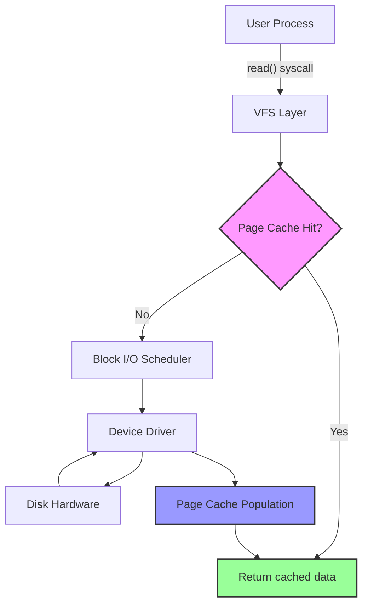
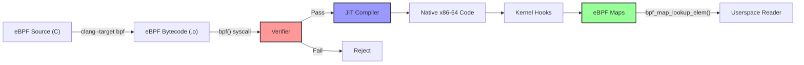
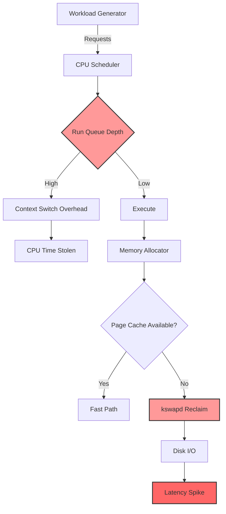
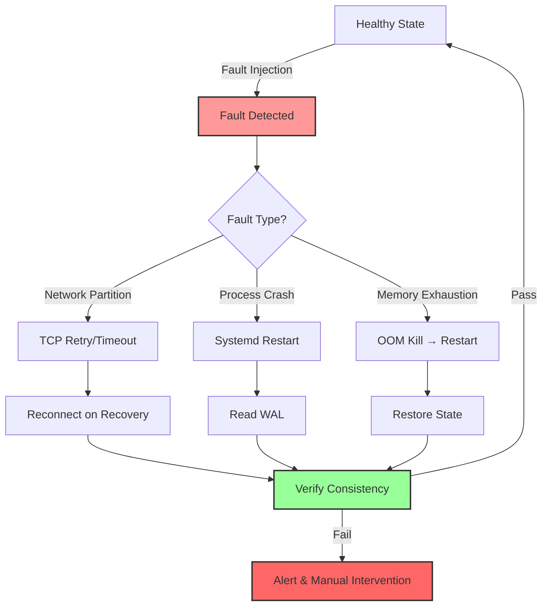

# Operational Verification Labs: Core Infrastructure & Kernel Subsystems

## Objective & Environment Setup

This operational verification lab provides rigorous, production-grade training in diagnosing, profiling, and validating Linux kernel subsystems, eBPF tracing infrastructure, and distributed system primitives under load and fault conditions. The lab is structured for systems engineers, SREs, and infrastructure developers who must understand kernel behavior at the architectural level, perform live diagnostics on production-like systems, and validate distributed consistency guarantees.

The lab emphasizes **first-principles understanding**: why page cache behavior affects I/O latency, how eBPF maps enable zero-copy kernel-to-userspace telemetry, and why network namespaces isolate container traffic without virtualization overhead. Each exercise combines theoretical foundation with hands-on verification, ensuring participants can map abstract concepts to concrete system state.

### Required CLI Tools

Install the following tools before beginning. Version constraints ensure compatibility with modern kernel features:

- **bpftool** (≥ v5.4): Inspect eBPF programs, maps, and BTF metadata. Essential for kernel observability.
- **kubectl** (≥ v1.24): Interact with Kubernetes API server for container orchestration diagnostics.
- **iproute2** (≥ v5.10): Manipulate routing tables, network namespaces, and tc (traffic control) subsystems.
- **tcpdump** (≥ v4.99): Packet-level network analysis with BPF filtering.
- **strace** (≥ v5.10): System call tracing with filtering and statistics aggregation.
- **perf** (≥ v5.4): Hardware performance counter sampling and kernel symbol resolution.
- **bpftrace** (≥ v0.12): High-level eBPF scripting for custom kernel probes (recommended).
- **stress-ng** (≥ v0.13): Multi-dimensional stress testing (CPU, memory, I/O, network).
- **iperf3** (≥ v3.10): Network throughput and latency measurement.
- **containerd** or **Docker** (≥ v1.6 / v20.10): Container runtime for namespace isolation experiments.

**Installation (Debian/Ubuntu):**
```bash
apt update && apt install -y \
    linux-tools-common linux-tools-$(uname -r) \
    bpftool iproute2 tcpdump strace perf-tools-unstable \
    bpftrace stress-ng iperf3 containerd kubectl
```

**Privilege Requirements:**  
Most exercises require `CAP_SYS_ADMIN`, `CAP_NET_ADMIN`, and `CAP_BPF` capabilities. Run as root or configure granular capabilities via `setcap`. Production systems should use capability bounding sets to limit exposure.

### Environment Configuration

#### 1. Kernel Version & eBPF Support

Modern eBPF features require kernel ≥ 5.4 with BTF (BPF Type Format) enabled. BTF eliminates the need for kernel headers at runtime by embedding type information directly in the kernel image.

**Check kernel version:**
```bash
uname -r
```

**Verify BTF availability:**
```bash
ls /sys/kernel/btf/vmlinux
```
If the file exists, BTF is enabled. If absent, recompile the kernel with `CONFIG_DEBUG_INFO_BTF=y`.

**Verify eBPF JIT compiler:**
```bash
cat /proc/sys/net/core/bpf_jit_enable
```
Output `1` indicates JIT compilation is enabled, reducing eBPF program overhead by ~5x compared to interpreter mode. JIT translates eBPF bytecode into native machine code at load time.

**Check eBPF program limits:**
```bash
cat /proc/sys/kernel/unprivileged_bpf_disabled
```
Output `1` restricts unprivileged eBPF loading, a critical security measure after CVE-2021-3490. For lab environments, set to `0` temporarily:
```bash
sysctl -w kernel.unprivileged_bpf_disabled=0
```

#### 2. Kubernetes Cluster Configuration

A minimal cluster requires one control plane node and at least one worker node. This lab uses kubeadm for simplicity, but any distribution (k3s, kind, EKS) suffices.

**Verify cluster connectivity:**
```bash
kubectl cluster-info
kubectl get nodes -o wide
```

**Check API server response time:**
```bash
time kubectl get --raw /healthz
```
Response should be < 50ms. Higher latency indicates API server saturation or etcd contention.

**Inspect etcd cluster health (if accessible):**
```bash
ETCDCTL_API=3 etcdctl \
    --endpoints=https://127.0.0.1:2379 \
    --cacert=/etc/kubernetes/pki/etcd/ca.crt \
    --cert=/etc/kubernetes/pki/etcd/server.crt \
    --key=/etc/kubernetes/pki/etcd/server.key \
    endpoint health
```

#### 3. Network Interface Identification

Identify the primary network interface for packet capture and routing analysis. Modern systems use predictable naming (e.g., `enp0s3`, `ens192`).

**List all interfaces:**
```bash
ip link show
```

**Identify default route interface:**
```bash
ip route show default
```

**Check interface statistics:**
```bash
ip -s link show <interface>
```
The `RX errors` and `TX dropped` counters indicate hardware-level packet loss or driver issues.

#### 4. Container Runtime Verification

Ensure containerd or Docker is operational. Containerd uses the CRI (Container Runtime Interface) protocol, while Docker wraps containerd with additional features.

**Check containerd status:**
```bash
systemctl status containerd
ctr version
```

**List running containers (containerd):**
```bash
ctr containers list
```

**List running containers (Docker):**
```bash
docker ps
```

**Verify cgroup v2 support (required for modern resource isolation):**
```bash
mount | grep cgroup2
```
If absent, enable via kernel parameter: `systemd.unified_cgroup_hierarchy=1`.

---

## Exercise 1: Live State & Internal Subsystem Inspection

### Architectural Context

Linux kernel memory management operates through a hierarchical structure: physical pages → page frames → zones (DMA, Normal, HighMem) → nodes (NUMA). The buddy allocator manages physically contiguous memory, while slab allocators (SLUB, SLAB, SLOB) handle small objects like inodes and dentries. Understanding this hierarchy is critical for diagnosing OOM kills, memory fragmentation, and cache behavior.

eBPF programs attach to kernel hooks (kprobes, tracepoints, XDP, TC) and store telemetry in maps (hash, array, ringbuf). Maps provide zero-copy communication between kernel and userspace, enabling sub-microsecond observability without context switches.



### 1.1 Kernel Memory Subsystem Inspection

**Memory Zones & Allocation Behavior:**

The kernel divides physical memory into zones to handle hardware constraints (e.g., DMA-capable memory for legacy devices). The `/proc/zoneinfo` interface exposes per-zone statistics including fragmentation indices and watermarks.

```bash
# Display memory zones and free pages per order
cat /proc/zoneinfo | grep -A 20 "^Node 0, zone"
```

**Key metrics:**
- `pages free`: Immediately allocatable pages.
- `pages min/low/high`: Watermarks triggering kswapd (background reclaim) and direct reclaim.
- `nr_free_cma`: Contiguous Memory Allocator pages reserved for DMA.

**Page Table Walks & TLB Efficiency:**

The Translation Lookaside Buffer (TLB) caches virtual-to-physical address translations. TLB misses force expensive page table walks (4-5 memory accesses on x86-64).

```bash
# Display TLB and page fault statistics
cat /proc/vmstat | grep -E "(pgfault|pgmajfault|tlb)"
```

**Metric interpretation:**
- `pgfault`: Minor faults (page in memory, not in process page table). Indicates VMA expansion or copy-on-write.
- `pgmajfault`: Major faults (page not in memory, requires disk I/O). Each major fault incurs ~5-10ms latency.
- `nr_tlb_remote_flush`: Cross-CPU TLB shootdowns, costly on NUMA systems.

**Memory Pressure Analysis:**

```bash
# Display slab allocator statistics
cat /proc/slabinfo | head -20
```

Slab fragmentation occurs when objects are freed non-uniformly, leaving partially filled slabs. Monitor `active_objs / num_objs` ratio; < 50% indicates waste.

**Huge Page Utilization:**

Huge pages (2MB or 1GB on x86-64) reduce TLB pressure for memory-intensive workloads. Transparent Huge Pages (THP) provide automatic promotion.

```bash
# Check THP configuration
cat /sys/kernel/mm/transparent_hugepage/enabled
cat /sys/kernel/mm/transparent_hugepage/defrag

# Display huge page statistics
grep Huge /proc/meminfo
```

**Optimal settings for low-latency workloads:**
```bash
echo madvise > /sys/kernel/mm/transparent_hugepage/enabled
echo defer+madvise > /sys/kernel/mm/transparent_hugepage/defrag
```

### 1.2 Process State & System Call Tracing

**Process Scheduling Analysis:**

The Completely Fair Scheduler (CFS) allocates CPU time proportionally to process weight (nice value). Context switches degrade throughput due to cache invalidation and TLB flushes.

```bash
# Display per-process scheduling statistics
cat /proc/<PID>/sched
```

**Key metrics:**
- `nr_switches`: Total context switches.
- `nr_voluntary_switches`: Yields (I/O waits, sleeps).
- `nr_involuntary_switches`: Preemptions (time slice exhaustion).

**System Call Tracing with Filtering:**

Strace introduces significant overhead (~10x slowdown) due to ptrace. Use filtering to minimize noise.

```bash
# Trace file operations only
strace -p <PID> -e trace=openat,read,write,close,fsync -f -tt -T -o trace.log
```

**Flags:**
- `-f`: Follow child processes (critical for multi-process apps).
- `-tt`: Microsecond timestamps.
- `-T`: Per-syscall execution time.

**Analyzing trace output:**
```bash
# Aggregate syscall time consumption
grep -oP '\d+\.\d+$' trace.log | awk '{s+=$1} END {print s " seconds total"}'
```

**Low-Overhead Alternative: eBPF-Based Tracing**

```bash
# Trace syscall latency distribution (requires bpftrace)
bpftrace -e 'tracepoint:raw_syscalls:sys_enter { @start[tid] = nsecs; }
             tracepoint:raw_syscalls:sys_exit / @start[tid] / {
                 @latency_us = hist((nsecs - @start[tid]) / 1000);
                 delete(@start[tid]);
             }'
```

This approach adds < 1% overhead by avoiding context switches.

### 1.3 Network Stack Inspection

**Interface State & Statistics:**

```bash
# Display detailed interface statistics
ip -s -s link show <interface>
```

**Critical counters:**
- `RX-DRP`: Dropped by driver (ring buffer overflow). Indicates insufficient `rx_ring` size.
- `TX-CLS`: Collisions (rare on modern switches, indicates duplex mismatch).
- `RX-OVR`: FIFO overruns (CPU cannot drain NIC buffer fast enough).

**Increase ring buffer size:**
```bash
ethtool -G <interface> rx 4096 tx 4096
```

**Routing Table & Policy Routing:**

```bash
# Display main routing table
ip route show table main

# Display all routing tables
ip rule show
```

Policy routing allows multiple routing tables based on source IP, mark, or interface. Used in multi-homed servers or VPN configurations.

**Connection State Tracking:**

```bash
# Display all listening sockets with process info
ss -tulnp

# Display established connections with memory usage
ss -temoi
```

**Key fields:**
- `Recv-Q`: Bytes in receive buffer (> 0 indicates slow consumer).
- `Send-Q`: Bytes in send buffer (> 0 indicates slow receiver or network congestion).

**TCP Congestion Control:**

```bash
# Display available congestion control algorithms
sysctl net.ipv4.tcp_available_congestion_control

# Set BBR (Bottleneck Bandwidth and RTT)
sysctl -w net.ipv4.tcp_congestion_control=bbr
sysctl -w net.core.default_qdisc=fq
```

BBR achieves higher throughput and lower latency than CUBIC on high-BDP (Bandwidth-Delay Product) networks.

### 1.4 eBPF Program & Map Inspection

**Architectural Overview:**

eBPF programs execute in a sandboxed VM with restricted instruction set (no unbounded loops, limited stack). The verifier performs static analysis to guarantee termination and memory safety.



**List Loaded Programs:**

```bash
# Display all eBPF programs with metadata
bpftool prog show

# Display program in human-readable form (post-JIT)
bpftool prog dump xlated id <prog_id>

# Display raw eBPF instructions (pre-JIT)
bpftool prog dump jited id <prog_id>
```

**Map Inspection & Data Extraction:**

Maps persist data across program invocations. Common types:
- `BPF_MAP_TYPE_HASH`: Key-value store (O(1) lookup).
- `BPF_MAP_TYPE_ARRAY`: Index-based (pre-allocated).
- `BPF_MAP_TYPE_RINGBUF`: Lock-free ring buffer for event streaming.

```bash
# List all maps
bpftool map show

# Dump map contents (for hash/array maps)
bpftool map dump id <map_id>

# Monitor map updates in real-time
bpftool map event <map_name>
```

**Pinning Maps for Userspace Access:**

Maps can be pinned to `/sys/fs/bpf/` for multi-process access.

```bash
# Pin a map
bpftool map pin id <map_id> /sys/fs/bpf/mymap

# Access from another process
bpftool map lookup pinned /sys/fs/bpf/mymap key 0x01 0x02
```

**BTF Introspection:**

BTF enables field-level struct access without recompilation.

```bash
# Display BTF information for a program
bpftool btf dump id <prog_id>

# Dump kernel BTF data
bpftool btf dump file /sys/kernel/btf/vmlinux format c > vmlinux.h
```

**Example: Trace TCP Connection Establishment**

```bash
bpftrace -e 'kprobe:tcp_v4_connect {
    printf("PID %d connecting to %s\n", pid, ntop(arg0->daddr));
}'
```

---

## Exercise 2: Benchmarking & Saturation Profiling

### Architectural Context

System saturation manifests differently across subsystems:
- **CPU:** Scheduler run queue depth increases, context switches rise.
- **Memory:** Page cache shrinks, reclaim (kswapd) activates, swap begins.
- **Disk:** I/O queue depth saturates, await time increases.
- **Network:** NIC ring buffers overflow, TCP retransmits spike.

The Universal Scalability Law predicts throughput degradation under contention:

```
λ(N) = N / (1 + α(N-1) + βN(N-1))
```

Where:
- N = number of workers
- α = contention coefficient (lock overhead)
- β = coherency coefficient (cache line bouncing)



### 2.1 CPU Saturation & Scheduler Behavior

**Multi-Core Stress Test:**

```bash
# Stress all CPU cores for 60 seconds
stress-ng --cpu $(nproc) --cpu-method matrixprod --timeout 60s --metrics
```

**Monitor scheduler statistics:**

```bash
# Display per-CPU run queue and context switch rate
sar -q 1 10

# Display CPU utilization breakdown
mpstat -P ALL 1 10
```

**Key metrics:**
- `runq-sz`: Processes waiting for CPU. > 2 * num_cores indicates saturation.
- `%iowait`: Processes blocked on I/O. High values indicate disk bottleneck, not CPU.
- `%steal`: Time stolen by hypervisor (VM environments). > 10% indicates overcommit.

**Perf-Based Hotspot Analysis:**

```bash
# Profile CPU cycles for 30 seconds
perf record -F 99 -a -g -- sleep 30

# Generate flamegraph
perf script | ~/FlameGraph/stackcollapse-perf.pl | ~/FlameGraph/flamegraph.pl > cpu.svg
```

Flamegraphs reveal time distribution across call stacks. Wide plateaus indicate hotspots.

**Cache Miss Profiling:**

```bash
# Profile L1/L2/L3 cache misses
perf stat -e L1-dcache-load-misses,L1-dcache-loads,LLC-load-misses,LLC-loads stress-ng --cpu 4 --timeout 10s
```

L3 (LLC) miss rate > 10% indicates poor cache locality. Optimize by reducing working set size or improving data alignment.

### 2.2 Memory Saturation & Reclaim Behavior

**Controlled Memory Pressure:**

```bash
# Allocate 80% of available memory
TOTAL_MEM=$(awk '/MemAvailable/ {print int($2*0.8)}' /proc/meminfo)
stress-ng --vm 4 --vm-bytes ${TOTAL_MEM}K --vm-method all --timeout 60s --metrics
```

**Monitor memory reclaim activity:**

```bash
# Display page cache and reclaim statistics
watch -n 1 'grep -E "(Cached|Dirty|Writeback|Slab)" /proc/meminfo'

# Monitor kswapd wakeups
perf record -e vmscan:mm_vmscan_kswapd_wake -a -- sleep 30
perf script
```

**Analyze OOM kill events:**

```bash
dmesg -T | grep -i "killed process"
```

**OOM score calculation:**

```bash
# Display OOM scores for all processes
for pid in /proc/[0-9]*; do
    printf "%6d %6d %s\n" \
        $(cat $pid/oom_score 2>/dev/null || echo 0) \
        $(basename $pid) \
        "$(cat $pid/cmdline 2>/dev/null | tr '\0' ' ')"
done | sort -rn | head -20
```

Processes with high RSS and low `oom_score_adj` are prioritized for killing.

**Huge Page Fragmentation:**

```bash
# Display memory fragmentation index
cat /sys/kernel/debug/extfrag/extfrag_index
```

Values > 0.5 indicate fragmentation prevents huge page allocation.

### 2.3 Disk I/O Saturation & Latency Analysis

**Sequential I/O Benchmark:**

```bash
# Write 4GB sequential, 1MB blocks
dd if=/dev/zero of=/tmp/testfile bs=1M count=4096 oflag=direct

# Read 4GB sequential
dd if=/tmp/testfile of=/dev/null bs=1M iflag=direct
```

**Random I/O Benchmark with fio:**

```bash
# 70% read, 30% write, 4KB blocks, 16 parallel jobs
fio --name=randmix --ioengine=libaio --iodepth=32 --rw=randrw \
    --rwmixread=70 --bs=4k --direct=1 --size=1G --numjobs=16 \
    --runtime=60 --group_reporting
```

**Monitor I/O scheduler statistics:**

```bash
# Display I/O statistics per device
iostat -xz 1 10
```

**Key metrics:**
- `avgqu-sz`: Average request queue length. > 1 indicates saturation.
- `await`: Average I/O latency (ms). > 10ms for SSD indicates queue depth saturation.
- `%util`: Device utilization. 100% indicates bottleneck (caveat: misleading for NVMe).

**Inspect I/O scheduler configuration:**

```bash
# Display active scheduler
cat /sys/block/sda/queue/scheduler

# For NVMe, use none (NOOP) or mq-deadline
echo none > /sys/block/nvme0n1/queue/scheduler
```

**Block Layer Tracing with blktrace:**

```bash
# Capture block I/O events
blktrace -d /dev/sda -o - | blkparse -i -

# Analyze seek patterns
btt -i /sys/kernel/debug/tracing/trace_pipe
```

### 2.4 Network Throughput & Latency Profiling

**Baseline Throughput Measurement:**

```bash
# Server: listen on port 5201
iperf3 -s

# Client: test for 60s with 4 parallel streams
iperf3 -c <server_ip> -t 60 -P 4
```

**Monitor NIC statistics during test:**

```bash
# Display packet rate and error counters
watch -n 1 'ip -s link show <interface>'
```

**TCP Window Scaling Verification:**

```bash
# Capture SYN packets
tcpdump -i any -n 'tcp[tcpflags] & tcp-syn != 0' -c 10

# Verify window scale option is present
```

Without window scaling, maximum throughput is capped at `(window_size / RTT)`. Default 64KB window limits throughput to ~640 Mbps on 100ms RTT links.

**Increase TCP buffer sizes:**

```bash
# Allow up to 128MB buffers (for high-BDP networks)
sysctl -w net.core.rmem_max=134217728
sysctl -w net.core.wmem_max=134217728
sysctl -w net.ipv4.tcp_rmem="4096 87380 134217728"
sysctl -w net.ipv4.tcp_wmem="4096 65536 134217728"
```

**XDP-Based Packet Filtering (Advanced):**

XDP (eXpress Data Path) allows packet processing before sk_buff allocation, reducing CPU overhead by ~40%.

```bash
# Load XDP program to drop UDP port 1234
ip link set dev <interface> xdp obj xdp_drop.o sec xdp
```

**Latency Measurement with qperf:**

```bash
# Server
qperf

# Client: measure TCP latency and bandwidth
qperf <server_ip> tcp_lat tcp_bw
```

**Application-Layer HTTP Benchmarking:**

```bash
# ApacheBench: 100k requests, 100 concurrent
ab -n 100000 -c 100 http://<server_ip>/

# wrk: 4 threads, 100 connections, 30s
wrk -t4 -c100 -d30s http://<server_ip>/
```

### 2.5 Kernel Event Profiling with perf

**System-Wide Event Sampling:**

```bash
# Sample all events at 999 Hz (avoid resonance with timer interrupts)
perf record -F 999 -a -g -- sleep 30

# Generate interactive report
perf report --stdio

# Annotate hot functions with assembly
perf annotate --stdio <function_name>
```

**Hardware Counter Analysis:**

```bash
# Display available hardware counters
perf list hw cache

# Profile instructions per cycle (IPC)
perf stat -e cycles,instructions,cache-references,cache-misses stress-ng --cpu 4 --timeout 10s
```

**Optimal IPC values:**
- IPC < 1.0: Memory-bound (cache misses).
- IPC 1.0-2.0: Balanced.
- IPC > 2.0: CPU-bound (good cache locality).

**Off-CPU Analysis (Scheduler Latency):**

```bash
# Record scheduler events
perf record -e sched:sched_switch -e sched:sched_stat_sleep -a -g -- sleep 10

# Analyze time spent off-CPU
perf script | ~/FlameGraph/stackcollapse-perf.pl | ~/FlameGraph/flamegraph.pl --color=io > offcpu.svg
```

---

## Exercise 3: Fault Injection & Recovery Analysis

### Architectural Context

Distributed systems must tolerate partial failures: network partitions, process crashes, and resource exhaustion. The **CAP theorem** proves that a distributed system cannot simultaneously guarantee Consistency, Availability, and Partition tolerance. Most cloud-native systems choose AP (eventual consistency) over CP (strong consistency with availability sacrifice).

Recovery mechanisms include:
- **Crash-recovery:** Restart failed process (systemd, Kubernetes).
- **State recovery:** Restore from checkpoint or WAL (Write-Ahead Log).
- **Failover:** Redirect traffic to healthy replica (load balancer health checks).



### 3.1 Network Partition Simulation

**Using iptables for Targeted Blocking:**

```bash
# Block outbound traffic to specific IP
iptables -A OUTPUT -d <target_ip> -j DROP

# Block inbound traffic from specific IP
iptables -A INPUT -s <target_ip> -j DROP

# Verify rules
iptables -L -v -n
```

**Monitor connection timeouts:**

```bash
# Watch TCP connection state transitions
ss -t -o state all dst <target_ip>
```

**Restore connectivity:**

```bash
# Remove rules by line number
iptables -D OUTPUT 1
iptables -D INPUT 1

# Or flush all rules (use cautiously)
iptables -F
```

**Using tc (Traffic Control) for Latency Injection:**

```bash
# Add 100ms latency to all packets on interface
tc qdisc add dev <interface> root netem delay 100ms

# Add 100ms latency with 10ms jitter
tc qdisc add dev <interface> root netem delay 100ms 10ms

# Add 1% packet loss
tc qdisc add dev <interface> root netem loss 1%

# Remove all tc rules
tc qdisc del dev <interface> root
```

**Verify latency:**

```bash
ping -c 10 <target_ip>
```

**Using Network Namespaces for Isolation:**

```bash
# Create two network namespaces
ip netns add ns1
ip netns add ns2

# Create veth pair
ip link add veth0 type veth peer name veth1

# Move veth endpoints to namespaces
ip link set veth0 netns ns1
ip link set veth1 netns ns2

# Configure interfaces
ip netns exec ns1 ip addr add 10.0.0.1/24 dev veth0
ip netns exec ns1 ip link set veth0 up
ip netns exec ns2 ip addr add 10.0.0.2/24 dev veth1
ip netns exec ns2 ip link set veth1 up

# Test connectivity
ip netns exec ns1 ping -c 3 10.0.0.2

# Simulate partition by shutting down veth0
ip netns exec ns1 ip link set veth0 down

# Cleanup
ip netns del ns1
ip netns del ns2
```

### 3.2 Process Crash & Restart Behavior

**Systemd-Managed Service Recovery:**

Create a test service:

```bash
cat <<EOF > /etc/systemd/system/crashtest.service
[Unit]
Description=Crash Test Service
After=network.target

[Service]
Type=simple
ExecStart=/bin/bash -c 'while true; do echo "Running"; sleep 5; done'
Restart=always
RestartSec=2s
StartLimitInterval=60s
StartLimitBurst=5

[Install]
WantedBy=multi-user.target
EOF

systemctl daemon-reload
systemctl start crashtest.service
```

**Inject crash:**

```bash
# Find PID
systemctl status crashtest.service | grep PID

# Send SIGKILL (ungraceful termination)
kill -9 <PID>

# Verify restart
sleep 3
systemctl status crashtest.service
```

**Analyze restart behavior:**

```bash
# Display restart count
systemctl show crashtest.service | grep NRestarts

# View restart logs
journalctl -u crashtest.service --since "5 minutes ago"
```

**Kubernetes Pod Crash Simulation:**

```yaml
# crashtest-pod.yaml
apiVersion: v1
kind: Pod
metadata:
  name: crashtest
spec:
  restartPolicy: Always
  containers:
  - name: crashtest
    image: busybox
    command: ["/bin/sh", "-c", "sleep 30; exit 1"]
```

```bash
kubectl apply -f crashtest-pod.yaml

# Monitor restart count
kubectl get pod crashtest --watch

# Inspect restart events
kubectl describe pod crashtest
```

**CrashLoopBackOff Analysis:**

If a pod fails repeatedly, Kubernetes applies exponential backoff (10s, 20s, 40s, ..., max 5m).

```bash
# Display backoff timer
kubectl get pod crashtest -o jsonpath='{.status.containerStatuses[0].state.waiting.reason}'
```

### 3.3 Memory Exhaustion & OOM Behavior

**Controlled Memory Bomb:**

```bash
# Allocate memory until OOM kill
stress-ng --vm 1 --vm-bytes 16G --vm-hang 0 --timeout 60s
```

**Monitor OOM killer activation:**

```bash
# Watch for OOM events in real-time
journalctl -kf | grep -i "out of memory"

# Alternative: dmesg
dmesg -wT | grep -i "killed process"
```

**OOM Event Analysis:**

```bash
# Display last OOM event details
dmesg -T | grep -A 20 "Out of memory"
```

Output includes:
- Process killed and its OOM score.
- Memory state at kill time (MemTotal, MemFree, cached).
- Call trace of the allocation that triggered OOM.

**Kubernetes Memory Limit Enforcement:**

```yaml
# memlimit-pod.yaml
apiVersion: v1
kind: Pod
metadata:
  name: memlimit
spec:
  containers:
  - name: memlimit
    image: progrium/stress
    resources:
      limits:
        memory: "128Mi"
    command: ["stress", "--vm", "1", "--vm-bytes", "256M", "--vm-hang", "0"]
```

```bash
kubectl apply -f memlimit-pod.yaml

# Monitor pod status (will be OOMKilled)
kubectl get pod memlimit --watch

# Check termination reason
kubectl get pod memlimit -o jsonpath='{.status.containerStatuses[0].lastState.terminated.reason}'
```

**cgroup Memory Accounting:**

```bash
# Find cgroup path for container
CGROUP=$(cat /proc/<PID>/cgroup | grep memory | cut -d: -f3)

# Display memory usage
cat /sys/fs/cgroup/memory/${CGROUP}/memory.usage_in_bytes
cat /sys/fs/cgroup/memory/${CGROUP}/memory.limit_in_bytes

# Display OOM kill count
cat /sys/fs/cgroup/memory/${CGROUP}/memory.oom_control
```

### 3.4 Disk Exhaustion & I/O Fault Injection

**Fill Disk to Trigger No-Space Errors:**

```bash
# Fill /tmp filesystem (use with caution)
dd if=/dev/zero of=/tmp/fill bs=1M count=10000

# Monitor disk usage
df -h /tmp
```

**Application Impact:**

```bash
# Attempt write operation
echo "test" > /tmp/testfile
# Expected: "No space left on device"
```

**Cleanup:**

```bash
rm /tmp/fill
```

**Simulating Disk I/O Errors with dm-flakey:**

Device Mapper's flakey target simulates I/O failures.

```bash
# Create test file
dd if=/dev/zero of=/tmp/testfile bs=1M count=100

# Setup loopback device
losetup /dev/loop0 /tmp/testfile

# Create flakey device (fail every 5 I/Os)
dmsetup create flakey --table "0 204800 flakey /dev/loop0 0 5 1"

# Mount flakey device
mkfs.ext4 /dev/mapper/flakey
mount /dev/mapper/flakey /mnt/test

# Test: writes will intermittently fail
dd if=/dev/zero of=/mnt/test/data bs=1M count=10

# Check I/O errors in dmesg
dmesg | grep -i "error"

# Cleanup
umount /mnt/test
dmsetup remove flakey
losetup -d /dev/loop0
rm /tmp/testfile
```

### 3.5 Recovery Validation & Consistency Checks

**Systemd Service Health:**

```bash
# Verify service is active
systemctl is-active <service>

# Check failed unit count
systemctl --failed
```

**Kubernetes Pod Health:**

```bash
# Display pod readiness status
kubectl get pods -o wide

# Check liveness probe failures
kubectl describe pod <pod_name> | grep -A 10 "Liveness"
```

**etcd Consistency Check (Kubernetes):**

```bash
# Verify etcd cluster health
kubectl -n kube-system exec etcd-<node> -- \
    etcdctl --endpoints=https://127.0.0.1:2379 \
    --cacert=/etc/kubernetes/pki/etcd/ca.crt \
    --cert=/etc/kubernetes/pki/etcd/server.crt \
    --key=/etc/kubernetes/pki/etcd/server.key \
    endpoint health
```

**Database Consistency Verification:**

For PostgreSQL:

```sql
-- Check for unindexed foreign keys
SELECT c.conrelid::regclass AS table_name,
       c.confrelid::regclass AS referenced_table,
       c.conname AS constraint_name
FROM pg_constraint c
LEFT JOIN pg_index i ON i.indrelid = c.conrelid
    AND array_to_string(i.indkey, ' ') = array_to_string(c.conkey, ' ')
WHERE c.contype = 'f' AND i.indrelid IS NULL;

-- Verify referential integrity
SELECT conname, conrelid::regclass
FROM pg_constraint
WHERE contype = 'f' AND NOT convalidated;
```

**Log Correlation Post-Recovery:**

```bash
# Correlate events across systemd and application logs
journalctl -u <service> --since "10 minutes ago" -o json | \
    jq -r '.MESSAGE' | \
    grep -i "error\|restart\|fail"
```

---

## Diagnostic Cheat Sheet & Verification Checklist

### Quick Reference Table

| **Subsystem** | **Inspection Command** | **Key Metric** | **Healthy Range** |
|---------------|------------------------|----------------|-------------------|
| **Kernel Version** | `uname -r` | Kernel version | ≥ 5.4 |
| **eBPF JIT** | `cat /proc/sys/net/core/bpf_jit_enable` | JIT enabled | 1 |
| **BTF Support** | `ls /sys/kernel/btf/vmlinux` | File exists | Present |
| **Memory Zones** | `cat /proc/zoneinfo` | Pages free | > min watermark |
| **Page Faults** | `cat /proc/vmstat \| grep pgfault` | pgmajfault rate | < 100/s |
| **Slab Fragmentation** | `cat /proc/slabinfo` | Active/total ratio | > 50% |
| **THP Status** | `grep Huge /proc/meminfo` | AnonHugePages | > 0 (for large workloads) |
| **Process Scheduling** | `cat /proc/<PID>/sched` | nr_involuntary_switches | < 1000/s |
| **System Call Trace** | `strace -c -p <PID>` | Syscall time % | No single call > 50% |
| **Network Interface** | `ip -s link show` | RX-DRP, TX-DRP | 0 |
| **Routing Table** | `ip route show` | Default route | Present |
| **Connection State** | `ss -s` | Recv-Q, Send-Q | 0 (for established) |
| **TCP Congestion** | `sysctl net.ipv4.tcp_congestion_control` | Algorithm | bbr (for high-BDP) |
| **eBPF Programs** | `bpftool prog show` | Program count | Varies by monitoring stack |
| **eBPF Maps** | `bpftool map show` | Map type | Appropriate for use case |
| **CPU Saturation** | `sar -q 1 10` | runq-sz | < 2 * num_cores |
| **Memory Pressure** | `grep kswapd /proc/vmstat` | Kswapd wakeups | < 10/s |
| **Disk I/O** | `iostat -xz 1` | await, %util | < 10ms, < 90% |
| **Network Throughput** | `iperf3 -c <server>` | Bandwidth | > 1 Gbps (GigE) |
| **Cache Efficiency** | `perf stat -e cache-misses` | LLC miss rate | < 10% |
| **Off-CPU Time** | `perf record -e sched:sched_switch` | Off-CPU % | < 30% |
| **OOM Events** | `dmesg \| grep "Out of memory"` | Kill count | 0 |
| **Systemd Restart** | `systemctl show <svc> \| grep NRestarts` | Restart count | 0 (after stabilization) |
| **Kubernetes Pod** | `kubectl get pod <name>` | Restart count | 0 (after stabilization) |
| **etcd Health** | `etcdctl endpoint health` | Health status | healthy |

### Comprehensive Verification Workflow

**Phase 1: Baseline State Capture**

```bash
#!/bin/bash
# baseline.sh - Capture system baseline metrics

echo "=== System Information ==="
uname -a
cat /proc/meminfo | head -10
ip link show
kubectl get nodes -o wide 2>/dev/null || echo "Kubernetes not available"

echo -e "\n=== eBPF Configuration ==="
cat /proc/sys/net/core/bpf_jit_enable
ls /sys/kernel/btf/vmlinux 2>/dev/null || echo "BTF not available"

echo -e "\n=== Memory State ==="
free -h
cat /proc/vmstat | grep -E "(pgfault|pgmajfault)"

echo -e "\n=== Network State ==="
ss -s
ip route show

echo -e "\n=== eBPF Programs ==="
bpftool prog show 2>/dev/null | wc -l || echo "bpftool not available"

echo -e "\n=== Top Processes ==="
ps aux --sort=-%cpu | head -10
```

**Phase 2: Saturation Testing**

```bash
#!/bin/bash
# saturation_test.sh - Apply controlled load

echo "Starting CPU saturation test..."
stress-ng --cpu $(nproc) --timeout 30s --metrics &

echo "Starting memory saturation test..."
TOTAL_MEM=$(awk '/MemAvailable/ {print int($2*0.5)}' /proc/meminfo)
stress-ng --vm 2 --vm-bytes ${TOTAL_MEM}K --timeout 30s --metrics &

echo "Monitoring resource usage..."
for i in {1..30}; do
    echo "=== Second $i ==="
    top -b -n 1 | head -5
    free -h | grep Mem
    sleep 1
done

wait
echo "Saturation test complete."
```

**Phase 3: Fault Injection & Recovery**

```bash
#!/bin/bash
# fault_injection.sh - Inject and recover from faults

SERVICE="crashtest.service"

echo "Injecting fault: Killing service process..."
PID=$(systemctl show -p MainPID --value $SERVICE)
kill -9 $PID

echo "Waiting for recovery..."
sleep 5

if systemctl is-active --quiet $SERVICE; then
    echo "SUCCESS: Service recovered automatically."
    systemctl status $SERVICE | grep "Active:"
else
    echo "FAILURE: Service did not recover."
    systemctl status $SERVICE
    exit 1
fi

echo "Verifying restart count..."
RESTARTS=$(systemctl show -p NRestarts --value $SERVICE)
echo "Total restarts: $RESTARTS"
```

**Phase 4: Post-Test Verification**

```bash
#!/bin/bash
# verify.sh - Verify system returned to healthy state

echo "=== Memory Health ==="
KSWAPD_WAKEUPS=$(awk '/pswpin/ {print $2}' /proc/vmstat)
if [ $KSWAPD_WAKEUPS -lt 100 ]; then
    echo "PASS: Low swap activity"
else
    echo "WARN: High swap activity detected"
fi

echo -e "\n=== Network Health ==="
DROPPED=$(ip -s link show | grep -A 1 RX: | tail -1 | awk '{print $4}')
if [ $DROPPED -eq 0 ]; then
    echo "PASS: No packet drops"
else
    echo "WARN: Packet drops detected: $DROPPED"
fi

echo -e "\n=== Process Health ==="
DEFUNCT=$(ps aux | grep defunct | wc -l)
if [ $DEFUNCT -eq 1 ]; then
    echo "PASS: No zombie processes"
else
    echo "WARN: Zombie processes found: $((DEFUNCT - 1))"
fi

echo -e "\n=== Systemd Services ==="
FAILED=$(systemctl --failed --no-pager | grep failed | wc -l)
if [ $FAILED -eq 0 ]; then
    echo "PASS: No failed services"
else
    echo "FAIL: Failed services detected"
    systemctl --failed --no-pager
fi
```

### Conclusion

This lab provides production-grade training in kernel-level diagnostics, eBPF observability, and distributed system fault tolerance. Mastery requires understanding not just the commands, but the underlying kernel subsystems and distributed consistency protocols. Each exercise builds on first-principles knowledge to enable deep system understanding and autonomous troubleshooting in complex cloud-native environments.
