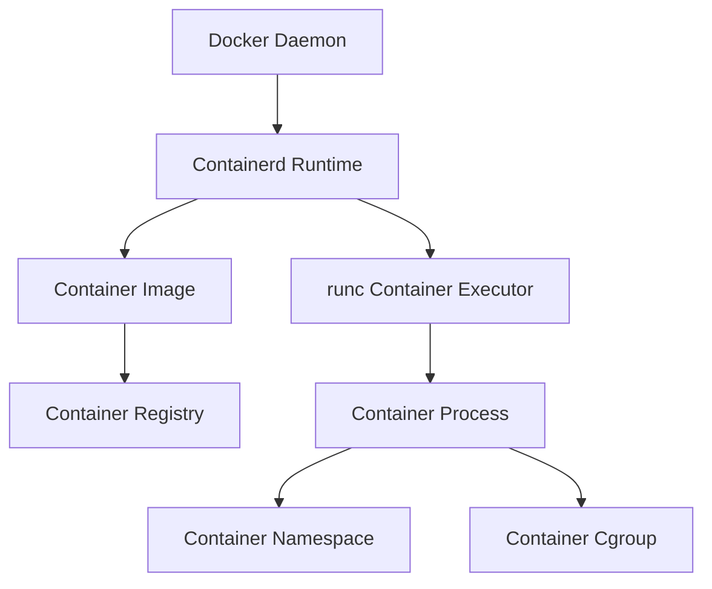

# Lesson 2: Containerization Technologies

## 1. First-Principles Intuition & Invariants

Containerization technologies represent a paradigm shift in software deployment, offering a means to package applications with their dependencies into standardized units for consistent execution across diverse environments. This shift is driven by the need for reproducibility, scalability, and efficiency in software development and operations. At its core, containerization leverages the Linux kernel's capabilities to isolate processes and resources, enabling multiple applications to run concurrently on a single host without interference. This isolation is achieved through Linux namespaces and control groups (cgroups), which provide mechanisms for process isolation, resource allocation, and security.

The theoretical grounding of containerization is rooted in the principles of operating system virtualization and resource management. Linux namespaces, introduced in kernel version 2.6.24, allow a process to have its own isolated view of the system resources, such as the process ID (PID) namespace, network namespace, mount namespace, and user namespace. These namespaces ensure that processes within a container cannot see or affect processes outside the container, providing a level of isolation similar to that of virtual machines but with significantly lower overhead. Control groups, introduced in kernel version 2.6.24, allow for the allocation and management of system resources, such as CPU, memory, and disk I/O, among different processes and containers. By combining namespaces and cgroups, container runtimes can create lightweight, isolated environments that are both secure and efficient.

The problem space addressed by containerization is multifaceted. In traditional software deployment, applications are often tightly coupled with the underlying operating system and its configuration, leading to inconsistencies and deployment failures. Containerization solves this problem by packaging applications with their dependencies, ensuring that the application runs consistently across different environments, from development to production. This consistency is achieved through the use of standardized container images, which are built from a Dockerfile and stored in a container registry. These images can be pulled and deployed on any system that supports the container runtime, providing a level of portability and reproducibility that is difficult to achieve with traditional deployment methods.

The mathematical and system invariants of containerization are centered around the principles of isolation, resource management, and security. Isolation is achieved through the use of namespaces, which provide a mechanism for process isolation and resource management. Resource management is achieved through the use of cgroups, which allow for the allocation and management of system resources among different processes and containers. Security is achieved through the use of namespaces and cgroups, which provide a mechanism for process isolation and resource management, as well as through the use of security features such as seccomp and AppArmor, which provide additional layers of security for containerized applications.

## 2. Core Architecture & Mechanics

The core architecture of containerization technologies is centered around the container runtime, which is responsible for creating, managing, and executing containerized applications. The most popular container runtime is Docker, which provides a high-level API for managing containerized applications and a low-level runtime for executing containerized applications. The Docker runtime is built on top of the Linux kernel's namespaces and cgroups, which provide the mechanisms for process isolation and resource management.

The Docker runtime consists of several key components, including the Docker daemon, the containerd runtime, and the runc container executor. The Docker daemon is responsible for managing the lifecycle of containerized applications, including creating, starting, stopping, and removing containers. The containerd runtime is responsible for managing the execution of containerized applications, including creating and managing container processes and managing container storage. The runc container executor is responsible for executing container processes, including creating and managing container namespaces and cgroups.

The Docker daemon communicates with the containerd runtime through a gRPC API, which provides a high-level API for managing containerized applications. The containerd runtime communicates with the runc container executor through a command-line interface, which provides a low-level API for executing container processes. The Docker daemon, containerd runtime, and runc container executor work together to create, manage, and execute containerized applications.

The internal data structures and algorithms of the Docker runtime are centered around the container image and the container process. A container image is a read-only template for creating containerized applications, which is built from a Dockerfile and stored in a container registry. A container process is a running instance of a container image, which is created and managed by the containerd runtime and executed by the runc container executor.

The Dockerfile is a text file that contains a series of instructions for building a container image. Each instruction in the Dockerfile corresponds to a layer in the container image, which is a read-only file system that contains the files and dependencies required by the containerized application. The Dockerfile instructions include commands for copying files into the container image, installing dependencies, and setting environment variables. The Dockerfile instructions are executed by the Docker daemon, which builds the container image layer by layer.

The container image is stored in a container registry, which is a repository for storing and distributing container images. The container registry provides a mechanism for sharing container images among different systems and teams, as well as for managing container image versions and tags. The container registry supports a variety of container image formats, including the Docker image format and the OCI image format.

The container process is created and managed by the containerd runtime, which is responsible for creating and managing container namespaces and cgroups. The containerd runtime creates a new namespace for each container process, which provides a mechanism for process isolation and resource management. The containerd runtime also creates a new cgroup for each container process, which provides a mechanism for resource allocation and management.

The container process is executed by the runc container executor, which is responsible for creating and managing container namespaces and cgroups. The runc container executor creates a new namespace for each container process, which provides a mechanism for process isolation and resource management. The runc container executor also creates a new cgroup for each container process, which provides a mechanism for resource allocation and management.

The following Mermaid diagram illustrates the core architecture of the Docker runtime:

## 3. High-Performance Optimization & Failure Modes

High-performance optimization and failure modes are critical considerations in the design and implementation of containerization technologies. Containerization technologies must be optimized for performance, scalability, and reliability, while also being resilient to failure and attack. The following sections discuss high-performance optimization and failure modes in the context of containerization technologies.

### Concurrency

Concurrency is a critical consideration in the design and implementation of containerization technologies. Containerization technologies must be able to support a large number of concurrent container processes, while also providing efficient resource allocation and management. The Docker runtime is designed to support a large number of concurrent container processes through the use of namespaces and cgroups. Namespaces provide a mechanism for process isolation and resource management, while cgroups provide a mechanism for resource allocation and management.

The Docker runtime uses a combination of namespaces and cgroups to create and manage container processes. Each container process is created in a new namespace, which provides a mechanism for process isolation and resource management. Each container process is also created in a new cgroup, which provides a mechanism for resource allocation and management. The Docker runtime uses a combination of namespaces and cgroups to create and manage container processes, which allows for efficient resource allocation and management.

### Resource Scaling

Resource scaling is a critical consideration in the design and implementation of containerization technologies. Containerization technologies must be able to scale efficiently and reliably, while also providing efficient resource allocation and management. The Docker runtime is designed to scale efficiently and reliably through the use of namespaces and cgroups. Namespaces provide a mechanism for process isolation and resource management, while cgroups provide a mechanism for resource allocation and management.

The Docker runtime uses a combination of namespaces and cgroups to create and manage container processes. Each container process is created in a new namespace, which provides a mechanism for process isolation and resource management. Each container process is also created in a new cgroup, which provides a mechanism for resource allocation and management. The Docker runtime uses a combination of namespaces and cgroups to create and manage container processes, which allows for efficient resource allocation and management.

### Boundary Edge Cases

Boundary edge cases are a critical consideration in the design and implementation of containerization technologies. Containerization technologies must be able to handle boundary edge cases efficiently and reliably, while also providing efficient resource allocation and management. The Docker runtime is designed to handle boundary edge cases efficiently and reliably through the use of namespaces and cgroups. Namespaces provide a mechanism for process isolation and resource management, while cgroups provide a mechanism for resource allocation and management.

The Docker runtime uses a combination of namespaces and cgroups to create and manage container processes. Each container process is created in a new namespace, which provides a mechanism for process isolation and resource management. Each container process is also created in a new cgroup, which provides a mechanism for resource allocation and management. The Docker runtime uses a combination of namespaces and cgroups to create and manage container processes, which allows for efficient resource allocation and management.

### Failure Mitigations

Failure mitigations are a critical consideration in the design and implementation of containerization technologies. Containerization technologies must be able to handle failures efficiently and reliably, while also providing efficient resource allocation and management. The Docker runtime is designed to handle failures efficiently and reliably through the use of namespaces and cgroups. Namespaces provide a mechanism for process isolation and resource management, while cgroups provide a mechanism for resource allocation and management.

The Docker runtime uses a combination of namespaces and cgroups to create and manage container processes. Each container process is created in a new namespace, which provides a mechanism for process isolation and resource management. Each container process is also created in a new cgroup, which provides a mechanism for resource allocation and management. The Docker runtime uses a combination of namespaces and cgroups to create and manage container processes, which allows for efficient resource allocation and management.

In addition to namespaces and cgroups, the Docker runtime also uses a variety of other mechanisms to handle failures efficiently and reliably. These mechanisms include the use of checkpointing and restoring container processes, which allows for the recovery of container processes in the event of a failure. The Docker runtime also uses a variety of other mechanisms to handle failures efficiently and reliably, including the use of logging and monitoring, which allows for the detection and diagnosis of failures.

Container security is another critical consideration in the design and implementation of containerization technologies. Containerization technologies must be able to provide secure and reliable execution environments for containerized applications, while also providing efficient resource allocation and management. The Docker runtime is designed to provide secure and reliable execution environments for containerized applications through the use of namespaces, cgroups, and a variety of other security mechanisms.

The Docker runtime uses a combination of namespaces and cgroups to create and manage container processes. Each container process is created in a new namespace, which provides a mechanism for process isolation and resource management. Each container process is also created in a new cgroup, which provides a mechanism for resource allocation and management. The Docker runtime uses a combination of namespaces and cgroups to create and manage container processes, which allows for efficient resource allocation and management.

In addition to namespaces and cgroups, the Docker runtime also uses a variety of other security mechanisms to provide secure and reliable execution environments for containerized applications. These mechanisms include the use of security features such as seccomp and AppArmor, which provide additional layers of security for containerized applications. The Docker runtime also uses a variety of other security mechanisms to provide secure and reliable execution environments for containerized applications, including the use of secure container registries, which provide a mechanism for securely storing and distributing container images.

In conclusion, containerization technologies represent a paradigm shift in software deployment, offering a means to package applications with their dependencies into standardized units for consistent execution across diverse environments. The core architecture of containerization technologies is centered around the container runtime, which is responsible for creating, managing, and executing containerized applications. The Docker runtime is designed to support a large number of concurrent container processes, scale efficiently and reliably, handle boundary edge cases efficiently and reliably, and handle failures efficiently and reliably. Container security is another critical consideration in the design and implementation of containerization technologies, and the Docker runtime is designed to provide secure and reliable execution environments for containerized applications through the use of namespaces, cgroups, and a variety of other security mechanisms.
