# Lesson 02: Containerization Technologies

## Introduction

Containerization represents a fundamental shift in how we package, distribute, and run software. At its core, containerization solves the ancient "works on my machine" problem through OS-level virtualization that provides process isolation while sharing the host kernel. This lesson explores the theoretical foundations, architectural principles, and practical implementations of container technologies that form the backbone of cloud-native computing.

## Learning Objectives

By the end of this lesson, you will:

- Understand the kernel mechanisms (namespaces, cgroups, union filesystems) that enable containerization
- Master Docker and containerd runtime architectures
- Build production-grade container images with multi-stage builds and security hardening
- Implement container orchestration patterns and lifecycle management
- Apply resource isolation, security boundaries, and networking primitives
- Evaluate container alternatives (Podman, CRI-O, gVisor) and their tradeoffs

## 1. Theoretical Foundations

### 1.1 The Containerization Abstraction

Containerization provides an abstraction layer between application processes and the host operating system. Unlike virtual machines that virtualize hardware, containers virtualize the operating system itself.

**Definition (Container):** A container is a runtime instance of an isolated process tree with its own filesystem, network stack, and resource limits, sharing the host kernel but maintaining logical separation through kernel primitives.

**Mathematical Model:**

Let $H$ be the host system with kernel $K$, and $C = \{c_1, c_2, ..., c_n\}$ be the set of containers.

For each container $c_i$:
- Process isolation: $P(c_i) \cap P(c_j) = \emptyset$ for $i \neq j$
- Filesystem isolation: $FS(c_i)$ is a layered union filesystem with copy-on-write semantics
- Resource allocation: $R(c_i) \subseteq R(H)$ where $\sum_{i=1}^{n} R(c_i) \leq R(H)$

**Invariants:**
1. **Kernel sharing**: All containers share kernel $K$, thus $\forall c_i: kernel(c_i) = K$
2. **Process tree isolation**: Each container maintains independent PID namespace
3. **Resource bounds**: No container can exceed its allocated resource quota

### 1.2 Kernel Mechanisms

#### Namespaces

Namespaces partition kernel resources so that one set of processes sees one set of resources while another set sees a different set.

**Linux Namespace Types:**

| Namespace | Isolates | System Call |
|-----------|----------|-------------|
| PID | Process IDs | `CLONE_NEWPID` |
| NET | Network devices, stacks, ports | `CLONE_NEWNET` |
| MNT | Mount points | `CLONE_NEWNS` |
| UTS | Hostname and domain | `CLONE_NEWUTS` |
| IPC | Inter-process communication | `CLONE_NEWIPC` |
| USER | User and group IDs | `CLONE_NEWUSER` |
| CGROUP | Cgroup root directory | `CLONE_NEWCGROUP` |

**Namespace Properties:**

For namespace $N$ with processes $P(N)$:
- **Isolation**: $\forall p_i \in P(N), p_j \notin P(N): visibility(p_i, p_j) = false$
- **Hierarchical**: Namespaces form a tree structure with inheritance
- **Transitivity**: Process in namespace $N_1$ can create child namespace $N_2$ where $N_2 \subset N_1$

#### Control Groups (cgroups)

Cgroups provide resource limitation and accounting for process groups.

**Resource Controllers:**
- `cpu`: CPU time distribution via CFS (Completely Fair Scheduler)
- `memory`: Memory usage limits and OOM control
- `blkio`: Block device I/O access
- `pids`: Process number limits
- `cpuset`: CPU and memory node assignment

**Mathematical Model for CPU Shares:**

Given processes $P = \{p_1, p_2, ..., p_n\}$ with CPU shares $s_1, s_2, ..., s_n$:

$$CPU_{allocation}(p_i) = \frac{s_i}{\sum_{j=1}^{n} s_j} \times CPU_{total}$$

For memory limits with soft limit $M_{soft}$ and hard limit $M_{hard}$:
- Under memory pressure: processes limited to $M_{soft}$
- Always enforced: $Memory(p) \leq M_{hard}$, else OOM kill

#### Union Filesystems

Union filesystems enable layering multiple directories into a single view, critical for container image efficiency.

**OverlayFS Architecture:**

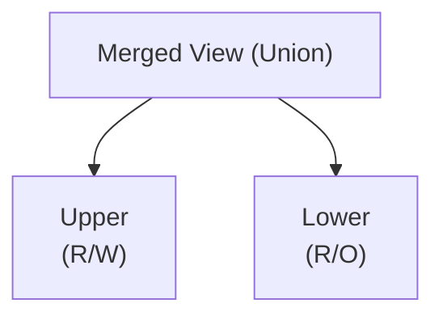

**Layer Properties:**
- **Copy-on-Write**: Modification to lower layer file creates copy in upper layer
- **Whiteout files**: Deletions recorded as special markers
- **Storage efficiency**: $Storage_{total} = \sum_{i=1}^{n} |Layer_i|$, shared layers reduce duplication

### 1.3 Container vs Virtual Machine

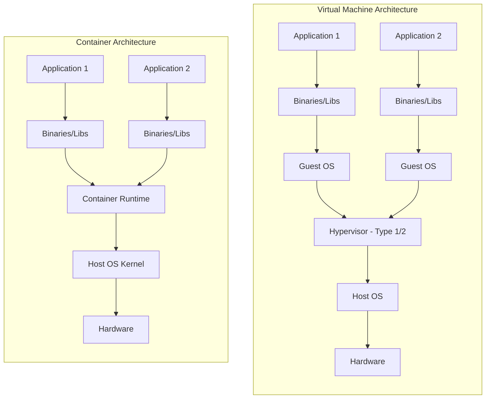

**Performance Characteristics:**

| Metric | Virtual Machine | Container |
|--------|----------------|-----------|
| Boot time | 10-60 seconds | < 1 second |
| Memory overhead | GB per VM | MB per container |
| Isolation | Hardware-level | Process-level |
| Performance | ~10% overhead | Near-native |
| Density | 10s per host | 100s-1000s per host |

**Isolation Boundary Theorem:**

Let $I_{VM}$ be VM isolation strength and $I_{C}$ be container isolation strength.

$$I_{VM} > I_{C}$$

Because VMs provide hardware virtualization boundary while containers share kernel, making kernel exploits a potential cross-container attack vector.

## 2. Docker Architecture and Runtime

### 2.1 Docker Component Architecture

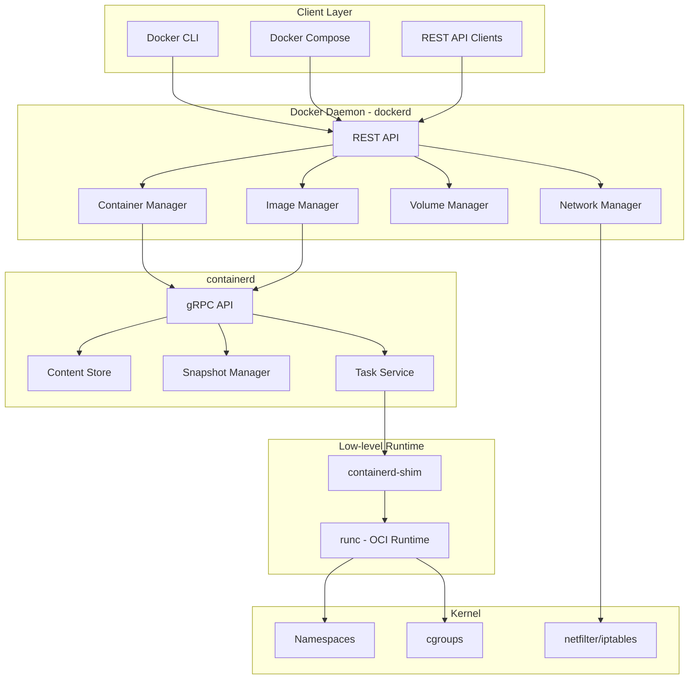

### 2.2 Container Lifecycle State Machine

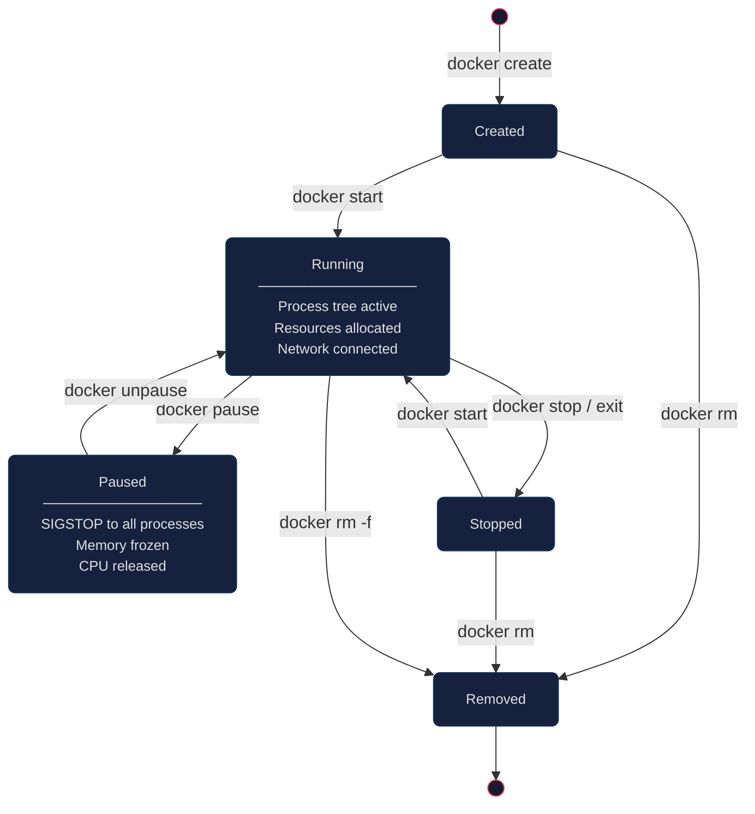

### 2.3 Image Layer Architecture

Docker images are built from layers using content-addressable storage.

**Image Manifest Structure:**

```json
{
  "schemaVersion": 2,
  "mediaType": "application/vnd.docker.distribution.manifest.v2+json",
  "config": {
    "mediaType": "application/vnd.docker.container.image.v1+json",
    "size": 7023,
    "digest": "sha256:b5b2b2c507..."
  },
  "layers": [
    {
      "mediaType": "application/vnd.docker.image.rootfs.diff.tar.gzip",
      "size": 32654,
      "digest": "sha256:e692418e35..."
    },
    {
      "mediaType": "application/vnd.docker.image.rootfs.diff.tar.gzip",
      "size": 16724,
      "digest": "sha256:3c3a4604a54..."
    }
  ]
}
```

**Content Addressability:**

Each layer is identified by its SHA256 digest:
$$Digest(Layer) = SHA256(Content)$$

This ensures:
- **Immutability**: $Digest(L_1) = Digest(L_2) \iff L_1 = L_2$
- **Deduplication**: Identical layers stored once
- **Integrity**: Corruption detected via digest mismatch

### 2.4 Dockerfile Best Practices

```dockerfile
# Multi-stage build for minimal production images
# Stage 1: Build environment
FROM golang:1.21-alpine AS builder

# Install build dependencies
RUN apk add --no-cache git make

# Set working directory
WORKDIR /build

# Copy dependency definitions first (layer caching optimization)
COPY go.mod go.sum ./
RUN go mod download

# Copy source code
COPY . .

# Build with optimizations and static linking
RUN CGO_ENABLED=0 GOOS=linux GOARCH=amd64 go build \
    -ldflags='-w -s -extldflags "-static"' \
    -a -installsuffix cgo \
    -o app ./cmd/server

# Stage 2: Minimal runtime
FROM scratch

# Copy CA certificates for HTTPS
COPY --from=builder /etc/ssl/certs/ca-certificates.crt /etc/ssl/certs/

# Copy binary from builder
COPY --from=builder /build/app /app

# Non-root user (even in scratch)
USER 65534:65534

# Metadata
LABEL maintainer="engineering@example.com" \
      version="1.0.0" \
      description="Production-grade microservice"

# Expose port (documentation only)
EXPOSE 8080

# Health check
HEALTHCHECK --interval=30s --timeout=3s --start-period=5s --retries=3 \
    CMD ["/app", "healthcheck"]

# Run application
ENTRYPOINT ["/app"]
CMD ["serve"]
```

**Layer Optimization Theorem:**

For Dockerfile with $n$ instructions:
- Each RUN, COPY, ADD creates a new layer $L_i$
- Layer reusability: $R = \frac{\sum_{i=1}^{k} Size(L_i)}{Total\_Image\_Size}$ where $k$ is cached layers
- Optimal ordering: frequently changing instructions last

### 2.5 Production-Grade Multi-Service Application

```dockerfile
# Node.js application with production hardening
FROM node:20-alpine AS base

# Install dumb-init for proper signal handling
RUN apk add --no-cache dumb-init

# Create app directory with proper ownership
RUN mkdir -p /home/node/app && chown -R node:node /home/node/app
WORKDIR /home/node/app

# Development stage
FROM base AS development
ENV NODE_ENV=development
USER node
COPY --chown=node:node package*.json ./
RUN npm ci
COPY --chown=node:node . .
CMD ["dumb-init", "npm", "run", "dev"]

# Build stage
FROM base AS build
ENV NODE_ENV=production
USER node
COPY --chown=node:node package*.json ./
RUN npm ci --only=production && npm cache clean --force
COPY --chown=node:node . .
RUN npm run build

# Production stage
FROM base AS production
ENV NODE_ENV=production
USER node
COPY --chown=node:node --from=build /home/node/app/node_modules ./node_modules
COPY --chown=node:node --from=build /home/node/app/dist ./dist
COPY --chown=node:node package*.json ./

# Security: read-only root filesystem
# Application must write only to /tmp
VOLUME /tmp
ENV TMPDIR=/tmp

EXPOSE 3000

HEALTHCHECK --interval=30s --timeout=10s --start-period=40s --retries=3 \
    CMD node -e "require('http').get('http://localhost:3000/health', (r) => process.exit(r.statusCode === 200 ? 0 : 1))"

ENTRYPOINT ["dumb-init", "node"]
CMD ["dist/server.js"]
```

### 2.6 Docker Compose for Multi-Container Applications

```yaml
version: '3.9'

services:
  # Application service
  web:
    build:
      context: .
      dockerfile: Dockerfile
      target: production
      args:
        - BUILD_DATE=${BUILD_DATE}
        - VERSION=${VERSION}
    image: myapp:${VERSION:-latest}
    container_name: myapp_web
    restart: unless-stopped
    
    # Resource limits
    deploy:
      resources:
        limits:
          cpus: '2'
          memory: 2G
        reservations:
          cpus: '0.5'
          memory: 512M
    
    # Security
    security_opt:
      - no-new-privileges:true
    cap_drop:
      - ALL
    cap_add:
      - NET_BIND_SERVICE
    read_only: true
    
    # Tmpfs for writable directories
    tmpfs:
      - /tmp:noexec,nosuid,size=100m
      - /app/logs:noexec,nosuid,size=500m
    
    # Environment
    environment:
      - NODE_ENV=production
      - DATABASE_URL=postgresql://postgres:password@db:5432/myapp
      - REDIS_URL=redis://cache:6379
      - LOG_LEVEL=info
    env_file:
      - .env.production
    
    # Networking
    ports:
      - "3000:3000"
    networks:
      - frontend
      - backend
    
    # Dependencies
    depends_on:
      db:
        condition: service_healthy
      cache:
        condition: service_started
    
    # Health check
    healthcheck:
      test: ["CMD", "node", "-e", "require('http').get('http://localhost:3000/health', (r) => process.exit(r.statusCode === 200 ? 0 : 1))"]
      interval: 30s
      timeout: 10s
      retries: 3
      start_period: 40s
    
    # Logging
    logging:
      driver: "json-file"
      options:
        max-size: "10m"
        max-file: "3"
        labels: "service,environment"
    
    # Volumes
    volumes:
      - app_data:/app/data:rw
      - ./config:/app/config:ro

  # Database service
  db:
    image: postgres:15-alpine
    container_name: myapp_db
    restart: unless-stopped
    
    # Security
    security_opt:
      - no-new-privileges:true
    
    # Environment
    environment:
      - POSTGRES_DB=myapp
      - POSTGRES_USER=postgres
      - POSTGRES_PASSWORD=password
      - PGDATA=/var/lib/postgresql/data/pgdata
    
    # Resource limits
    deploy:
      resources:
        limits:
          cpus: '1'
          memory: 1G
    
    # Volumes
    volumes:
      - postgres_data:/var/lib/postgresql/data
      - ./init.sql:/docker-entrypoint-initdb.d/init.sql:ro
    
    # Networking
    networks:
      - backend
    
    # Health check
    healthcheck:
      test: ["CMD-SHELL", "pg_isready -U postgres"]
      interval: 10s
      timeout: 5s
      retries: 5
    
    # Logging
    logging:
      driver: "json-file"
      options:
        max-size: "10m"
        max-file: "3"

  # Cache service
  cache:
    image: redis:7-alpine
    container_name: myapp_cache
    restart: unless-stopped
    
    # Security
    security_opt:
      - no-new-privileges:true
    
    # Command
    command: >
      redis-server
      --appendonly yes
      --appendfsync everysec
      --maxmemory 512mb
      --maxmemory-policy allkeys-lru
    
    # Resource limits
    deploy:
      resources:
        limits:
          cpus: '0.5'
          memory: 512M
    
    # Volumes
    volumes:
      - redis_data:/data
    
    # Networking
    networks:
      - backend
    
    # Health check
    healthcheck:
      test: ["CMD", "redis-cli", "ping"]
      interval: 10s
      timeout: 3s
      retries: 5
    
    # Logging
    logging:
      driver: "json-file"
      options:
        max-size: "10m"
        max-file: "3"

  # Nginx reverse proxy
  nginx:
    image: nginx:1.25-alpine
    container_name: myapp_nginx
    restart: unless-stopped
    
    # Ports
    ports:
      - "80:80"
      - "443:443"
    
    # Volumes
    volumes:
      - ./nginx.conf:/etc/nginx/nginx.conf:ro
      - ./ssl:/etc/nginx/ssl:ro
      - nginx_cache:/var/cache/nginx
    
    # Networking
    networks:
      - frontend
    
    # Dependencies
    depends_on:
      - web
    
    # Security
    security_opt:
      - no-new-privileges:true
    
    # Logging
    logging:
      driver: "json-file"
      options:
        max-size: "10m"
        max-file: "3"

networks:
  frontend:
    driver: bridge
    ipam:
      config:
        - subnet: 172.20.0.0/16
  backend:
    driver: bridge
    internal: true
    ipam:
      config:
        - subnet: 172.21.0.0/16

volumes:
  postgres_data:
    driver: local
  redis_data:
    driver: local
  app_data:
    driver: local
  nginx_cache:
    driver: local
```

## 3. Container Networking

### 3.1 Network Modes

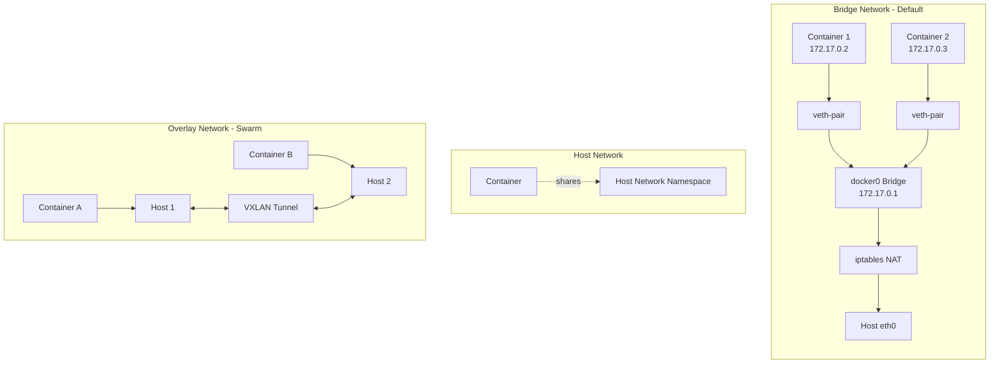

**Network Mode Comparison:**

| Mode | Isolation | Performance | Use Case |
|------|-----------|-------------|----------|
| Bridge | Strong | Good | Default, isolated services |
| Host | None | Native | Performance-critical, legacy apps |
| Overlay | Strong | Good | Multi-host orchestration |
| Macvlan | Strong | Native | Legacy network integration |
| None | Complete | N/A | Custom networking |

### 3.2 Container Network Interface (CNI)

CNI defines a plugin interface for configuring network interfaces in containers.

**CNI Plugin Execution Flow:**

```
Container Created → CNI ADD → IP Allocated → Interface Configured
                       ↓
                   Plugin Chain
                       ↓
         [bridge] → [firewall] → [portmap]
```

**CNI Configuration Example:**

```json
{
  "cniVersion": "1.0.0",
  "name": "mynet",
  "type": "bridge",
  "bridge": "cni0",
  "isGateway": true,
  "ipMasq": true,
  "ipam": {
    "type": "host-local",
    "subnet": "10.22.0.0/16",
    "routes": [
      { "dst": "0.0.0.0/0" }
    ],
    "ranges": [
      [
        {
          "subnet": "10.22.0.0/16",
          "rangeStart": "10.22.0.10",
          "rangeEnd": "10.22.0.250",
          "gateway": "10.22.0.1"
        }
      ]
    ]
  }
}
```

### 3.3 Custom Bridge Network Implementation

```bash
#!/bin/bash
# Create custom bridge network with specific subnet

# Network parameters
NETWORK_NAME="app_network"
SUBNET="172.25.0.0/16"
GATEWAY="172.25.0.1"
IP_RANGE="172.25.1.0/24"

# Create network
docker network create \
  --driver=bridge \
  --subnet=${SUBNET} \
  --gateway=${GATEWAY} \
  --ip-range=${IP_RANGE} \
  --opt "com.docker.network.bridge.name=br_${NETWORK_NAME}" \
  --opt "com.docker.network.bridge.enable_icc=true" \
  --opt "com.docker.network.bridge.enable_ip_masquerade=true" \
  --opt "com.docker.network.driver.mtu=1500" \
  --label "environment=production" \
  ${NETWORK_NAME}

# Run containers on custom network
docker run -d \
  --name web \
  --network ${NETWORK_NAME} \
  --ip 172.25.1.10 \
  nginx:alpine

docker run -d \
  --name api \
  --network ${NETWORK_NAME} \
  --ip 172.25.1.11 \
  myapp:latest

# Verify connectivity
docker exec web ping -c 3 api
```

### 3.4 Service Discovery with DNS

Docker provides built-in DNS resolution for container names.

**DNS Resolution Flow:**

```
Container "web" → DNS Query for "api" → Embedded DNS Server (127.0.0.11)
                                               ↓
                                    Container IP Resolution
                                               ↓
                                    Return IP: 172.25.1.11
```

**Implementation:**

```bash
# Create user-defined bridge network (automatic DNS)
docker network create app_net

# Start containers
docker run -d --name database --network app_net postgres:15
docker run -d --name cache --network app_net redis:7
docker run -d --name app --network app_net \
  -e DATABASE_HOST=database \
  -e CACHE_HOST=cache \
  myapp:latest

# DNS resolution works automatically
docker exec app ping -c 1 database  # Resolves to database container IP
docker exec app nslookup cache      # DNS lookup for cache container
```

## 4. Storage and Volumes

### 4.1 Storage Drivers

Docker supports multiple storage drivers for managing image layers and container filesystems.

**Storage Driver Architecture:**

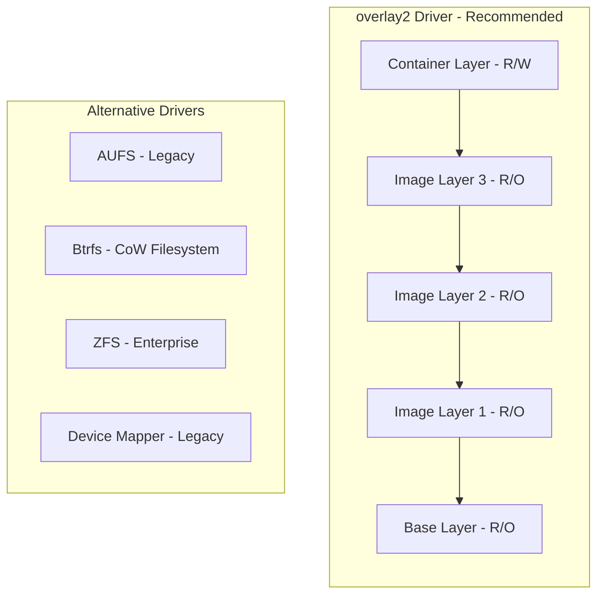

**Storage Driver Characteristics:**

| Driver | Performance | Stability | Use Case |
|--------|-------------|-----------|----------|
| overlay2 | Excellent | Stable | Production default |
| btrfs | Good | Stable | Native CoW benefits |
| zfs | Good | Very Stable | Enterprise, snapshots |
| aufs | Good | Legacy | Old Ubuntu |
| devicemapper | Fair | Legacy | RHEL 7 |

### 4.2 Volume Types

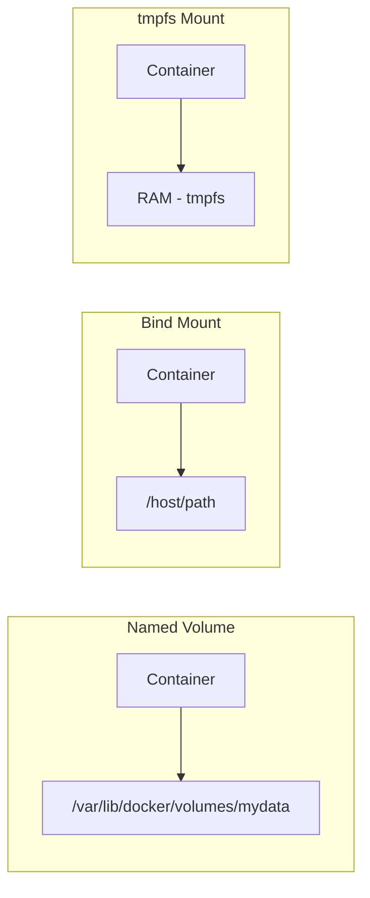

**Volume Properties:**

Let $V$ be a volume, $C$ be a container, and $H$ be the host:

1. **Named volumes**: Managed by Docker, $V \in Docker_{volumes}$
   - Location: `/var/lib/docker/volumes/<name>/_data`
   - Lifecycle: Independent of containers
   - Backing: Host filesystem

2. **Bind mounts**: Direct host path mapping, $V = Path_H$
   - Location: User-specified
   - Lifecycle: Host-controlled
   - Permissions: Inherited from host

3. **tmpfs mounts**: Memory-backed temporary storage
   - Location: RAM
   - Lifecycle: Container lifetime
   - Persistence: None (ephemeral)

### 4.3 Volume Management

```bash
#!/bin/bash
# Comprehensive volume management

# Create named volume
docker volume create \
  --driver local \
  --opt type=none \
  --opt o=bind \
  --opt device=/mnt/data \
  app_data

# Inspect volume
docker volume inspect app_data

# Use volume in container
docker run -d \
  --name app \
  --mount source=app_data,target=/data \
  myapp:latest

# Bind mount with options
docker run -d \
  --name dev \
  --mount type=bind,source=$(pwd)/src,target=/app/src,readonly \
  myapp:dev

# tmpfs mount for sensitive data
docker run -d \
  --name secure_app \
  --mount type=tmpfs,target=/run/secrets,tmpfs-mode=1770,tmpfs-size=100m \
  myapp:latest

# Backup volume
docker run --rm \
  --mount source=app_data,target=/data,readonly \
  --mount type=bind,source=$(pwd)/backups,target=/backup \
  alpine \
  tar czf /backup/app_data_$(date +%Y%m%d_%H%M%S).tar.gz -C /data .

# Restore volume
docker run --rm \
  --mount source=app_data,target=/data \
  --mount type=bind,source=$(pwd)/backups,target=/backup \
  alpine \
  tar xzf /backup/app_data_20240115_120000.tar.gz -C /data

# Remove unused volumes
docker volume prune -f

# Volume with driver options
docker volume create \
  --driver local \
  --opt type=nfs \
  --opt o=addr=192.168.1.100,rw \
  --opt device=:/exported/path \
  nfs_volume
```

### 4.4 Production Volume Patterns

```yaml
# Production-grade volume configuration
services:
  postgresql:
    image: postgres:15
    volumes:
      # Data persistence
      - type: volume
        source: postgres_data
        target: /var/lib/postgresql/data
        volume:
          nocopy: true
      
      # Configuration (read-only)
      - type: bind
        source: ./postgresql.conf
        target: /etc/postgresql/postgresql.conf
        read_only: true
      
      # Initialization scripts
      - type: bind
        source: ./init-scripts
        target: /docker-entrypoint-initdb.d
        read_only: true
      
      # Temporary files (tmpfs)
      - type: tmpfs
        target: /tmp
        tmpfs:
          size: 1073741824  # 1GB
          mode: 1777

  app:
    image: myapp:latest
    volumes:
      # Application data
      - type: volume
        source: app_data
        target: /app/data
      
      # Logs (separate volume for log rotation)
      - type: volume
        source: app_logs
        target: /app/logs
      
      # Cache (tmpfs for performance)
      - type: tmpfs
        target: /app/cache
        tmpfs:
          size: 536870912  # 512MB
      
      # Secrets (tmpfs for security)
      - type: tmpfs
        target: /run/secrets
        tmpfs:
          size: 10485760  # 10MB
          mode: 0400

volumes:
  postgres_data:
    driver: local
    driver_opts:
      type: none
      o: bind
      device: /mnt/fast-ssd/postgres
  
  app_data:
    driver: local
    driver_opts:
      type: none
      o: bind
      device: /mnt/storage/app-data
  
  app_logs:
    driver: local
    driver_opts:
      type: none
      o: bind
      device: /mnt/storage/app-logs
```

## 5. Security Hardening

### 5.1 Security Principles

**Container Security Model:**

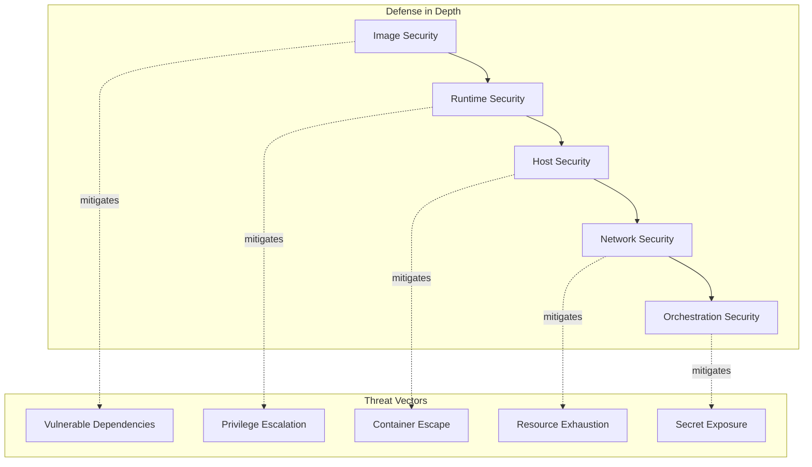

### 5.2 Capability Management

Linux capabilities divide root privileges into distinct units.

**Capability Model:**

Default Docker capabilities: $C_{default} = \{CHOWN, DAC\_OVERRIDE, FOWNER, ...\}$

For secure container: $C_{secure} = C_{default} - C_{dangerous} + C_{required}$

Where $C_{dangerous} = \{SYS\_ADMIN, NET\_ADMIN, SYS\_MODULE, ...\}$

**Practical Implementation:**

```dockerfile
# Dockerfile with minimal capabilities
FROM alpine:3.19

# Install app
COPY app /usr/local/bin/app

# Create non-root user
RUN addgroup -g 1001 app && \
    adduser -D -u 1001 -G app app

USER app

# Capabilities dropped at runtime
```

```bash
# Run with minimal capabilities
docker run -d \
  --name secure_app \
  --cap-drop=ALL \
  --cap-add=NET_BIND_SERVICE \
  --security-opt=no-new-privileges:true \
  --read-only \
  --tmpfs /tmp:noexec,nosuid,size=100m \
  myapp:latest
```

### 5.3 Security Scanning

```bash
#!/bin/bash
# Container image security scanning pipeline

IMAGE="myapp:latest"

# Build image
docker build -t ${IMAGE} .

# Scan with Trivy
echo "Running Trivy vulnerability scan..."
trivy image \
  --severity HIGH,CRITICAL \
  --exit-code 1 \
  --ignore-unfixed \
  --format json \
  --output trivy-report.json \
  ${IMAGE}

# Scan with Docker Scout
echo "Running Docker Scout analysis..."
docker scout cves ${IMAGE} \
  --only-severity high,critical \
  --format json \
  --output scout-report.json

# Scan with Grype
echo "Running Grype scan..."
grype ${IMAGE} \
  --fail-on high \
  --output json \
  --file grype-report.json

# Custom security checks
echo "Running custom security checks..."

# Check for secrets in image
docker run --rm \
  -v /var/run/docker.sock:/var/run/docker.sock \
  trufflesecurity/trufflehog:latest \
  docker --image ${IMAGE} \
  --json > secrets-report.json

# Verify image is using non-root user
NONROOT_CHECK=$(docker inspect ${IMAGE} --format='{{.Config.User}}')
if [ -z "$NONROOT_CHECK" ] || [ "$NONROOT_CHECK" = "0" ] || [ "$NONROOT_CHECK" = "root" ]; then
    echo "ERROR: Image runs as root"
    exit 1
fi

# Check for latest tag (antipattern)
if [[ ${IMAGE} == *":latest" ]]; then
    echo "WARNING: Using 'latest' tag is not recommended for production"
fi

# Verify image signature (Notary)
docker trust inspect --pretty ${IMAGE}

echo "Security scanning complete"
```

### 5.4 AppArmor and SELinux Profiles

```bash
# AppArmor profile for container
# File: /etc/apparmor.d/docker-nginx

#include <tunables/global>

profile docker-nginx flags=(attach_disconnected,mediate_deleted) {
  #include <abstractions/base>

  network inet tcp,
  network inet udp,
  network inet icmp,

  deny @{PROC}/* w,   # deny write for all files directly in /proc
  deny @{PROC}/{[^1-9],[^1-9][^0-9],[^1-9s][^0-9y][^0-9s],[^1-9][^0-9][^0-9][^0-9]*}/** w,
  deny @{PROC}/sys/[^k]** w,  # deny /proc/sys except /proc/sys/kernel/shm*
  deny @{PROC}/sysrq-trigger rwklx,
  deny @{PROC}/mem rwklx,
  deny @{PROC}/kmem rwklx,
  deny @{PROC}/kcore rwklx,

  deny mount,

  deny /sys/[^f]*/** wklx,
  deny /sys/f[^s]*/** wklx,
  deny /sys/fs/[^c]*/** wklx,
  deny /sys/fs/c[^g]*/** wklx,
  deny /sys/fs/cg[^r]*/** wklx,
  deny /sys/firmware/efi/efivars/** rwklx,
  deny /sys/kernel/security/** rwklx,

  # Allow nginx specific operations
  /usr/sbin/nginx ix,
  /etc/nginx/** r,
  /var/cache/nginx/** rw,
  /var/log/nginx/** rw,
  /var/run/nginx.pid rw,
  /run/nginx.pid rw,
}
```

```bash
# Load and use AppArmor profile
sudo apparmor_parser -r -W /etc/apparmor.d/docker-nginx

docker run -d \
  --security-opt apparmor=docker-nginx \
  --name nginx \
  nginx:alpine
```

### 5.5 Seccomp Profiles

```json
{
  "defaultAction": "SCMP_ACT_ERRNO",
  "defaultErrnoRet": 1,
  "archMap": [
    {
      "architecture": "SCMP_ARCH_X86_64",
      "subArchitectures": [
        "SCMP_ARCH_X86",
        "SCMP_ARCH_X32"
      ]
    },
    {
      "architecture": "SCMP_ARCH_AARCH64",
      "subArchitectures": [
        "SCMP_ARCH_ARM"
      ]
    }
  ],
  "syscalls": [
    {
      "names": [
        "accept",
        "accept4",
        "access",
        "adjtimex",
        "alarm",
        "bind",
        "brk",
        "capget",
        "capset",
        "chdir",
        "chmod",
        "chown",
        "chown32",
        "clock_adjtime",
        "clock_getres",
        "clock_gettime",
        "clock_nanosleep",
        "close",
        "connect",
        "copy_file_range",
        "creat",
        "dup",
        "dup2",
        "dup3",
        "epoll_create",
        "epoll_create1",
        "epoll_ctl",
        "epoll_ctl_old",
        "epoll_pwait",
        "epoll_wait",
        "epoll_wait_old",
        "eventfd",
        "eventfd2",
        "execve",
        "execveat",
        "exit",
        "exit_group",
        "faccessat",
        "fadvise64",
        "fadvise64_64",
        "fallocate",
        "fanotify_mark",
        "fchdir",
        "fchmod",
        "fchmodat",
        "fchown",
        "fchown32",
        "fchownat",
        "fcntl",
        "fcntl64",
        "fdatasync",
        "fgetxattr",
        "flistxattr",
        "flock",
        "fork",
        "fremovexattr",
        "fsetxattr",
        "fstat",
        "fstat64",
        "fstatat64",
        "fstatfs",
        "fstatfs64",
        "fsync",
        "ftruncate",
        "ftruncate64",
        "futex",
        "futimesat",
        "getcpu",
        "getcwd",
        "getdents",
        "getdents64",
        "getegid",
        "getegid32",
        "geteuid",
        "geteuid32",
        "getgid",
        "getgid32",
        "getgroups",
        "getgroups32",
        "getitimer",
        "getpeername",
        "getpgid",
        "getpgrp",
        "getpid",
        "getppid",
        "getpriority",
        "getrandom",
        "getresgid",
        "getresgid32",
        "getresuid",
        "getresuid32",
        "getrlimit",
        "get_robust_list",
        "getrusage",
        "getsid",
        "getsockname",
        "getsockopt",
        "get_thread_area",
        "gettid",
        "gettimeofday",
        "getuid",
        "getuid32",
        "getxattr",
        "inotify_add_watch",
        "inotify_init",
        "inotify_init1",
        "inotify_rm_watch",
        "io_cancel",
        "ioctl",
        "io_destroy",
        "io_getevents",
        "io_pgetevents",
        "ioprio_get",
        "ioprio_set",
        "io_setup",
        "io_submit",
        "ipc",
        "kill",
        "lchown",
        "lchown32",
        "lgetxattr",
        "link",
        "linkat",
        "listen",
        "listxattr",
        "llistxattr",
        "_llseek",
        "lremovexattr",
        "lseek",
        "lsetxattr",
        "lstat",
        "lstat64",
        "madvise",
        "memfd_create",
        "mincore",
        "mkdir",
        "mkdirat",
        "mknod",
        "mknodat",
        "mlock",
        "mlock2",
        "mlockall",
        "mmap",
        "mmap2",
        "mprotect",
        "mq_getsetattr",
        "mq_notify",
        "mq_open",
        "mq_timedreceive",
        "mq_timedsend",
        "mq_unlink",
        "mremap",
        "msgctl",
        "msgget",
        "msgrcv",
        "msgsnd",
        "msync",
        "munlock",
        "munlockall",
        "munmap",
        "nanosleep",
        "newfstatat",
        "_newselect",
        "open",
        "openat",
        "pause",
        "pipe",
        "pipe2",
        "poll",
        "ppoll",
        "prctl",
        "pread64",
        "preadv",
        "preadv2",
        "prlimit64",
        "pselect6",
        "pwrite64",
        "pwritev",
        "pwritev2",
        "read",
        "readahead",
        "readlink",
        "readlinkat",
        "readv",
        "recv",
        "recvfrom",
        "recvmmsg",
        "recvmsg",
        "remap_file_pages",
        "removexattr",
        "rename",
        "renameat",
        "renameat2",
        "restart_syscall",
        "rmdir",
        "rt_sigaction",
        "rt_sigpending",
        "rt_sigprocmask",
        "rt_sigqueueinfo",
        "rt_sigreturn",
        "rt_sigsuspend",
        "rt_sigtimedwait",
        "rt_tgsigqueueinfo",
        "sched_getaffinity",
        "sched_getattr",
        "sched_getparam",
        "sched_get_priority_max",
        "sched_get_priority_min",
        "sched_getscheduler",
        "sched_rr_get_interval",
        "sched_setaffinity",
        "sched_setattr",
        "sched_setparam",
        "sched_setscheduler",
        "sched_yield",
        "seccomp",
        "select",
        "semctl",
        "semget",
        "semop",
        "semtimedop",
        "send",
        "sendfile",
        "sendfile64",
        "sendmmsg",
        "sendmsg",
        "sendto",
        "setfsgid",
        "setfsgid32",
        "setfsuid",
        "setfsuid32",
        "setgid",
        "setgid32",
        "setgroups",
        "setgroups32",
        "setitimer",
        "setpgid",
        "setpriority",
        "setregid",
        "setregid32",
        "setresgid",
        "setresgid32",
        "setresuid",
        "setresuid32",
        "setreuid",
        "setreuid32",
        "setrlimit",
        "set_robust_list",
        "setsid",
        "setsockopt",
        "set_thread_area",
        "set_tid_address",
        "setuid",
        "setuid32",
        "setxattr",
        "shmat",
        "shmctl",
        "shmdt",
        "shmget",
        "shutdown",
        "sigaltstack",
        "signalfd",
        "signalfd4",
        "sigprocmask",
        "sigreturn",
        "socket",
        "socketcall",
        "socketpair",
        "splice",
        "stat",
        "stat64",
        "statfs",
        "statfs64",
        "statx",
        "symlink",
        "symlinkat",
        "sync",
        "sync_file_range",
        "syncfs",
        "sysinfo",
        "tee",
        "tgkill",
        "time",
        "timer_create",
        "timer_delete",
        "timer_getoverrun",
        "timer_gettime",
        "timer_settime",
        "times",
        "tkill",
        "truncate",
        "truncate64",
        "ugetrlimit",
        "umask",
        "uname",
        "unlink",
        "unlinkat",
        "utime",
        "utimensat",
        "utimes",
        "vfork",
        "vmsplice",
        "wait4",
        "waitid",
        "waitpid",
        "write",
        "writev"
      ],
      "action": "SCMP_ACT_ALLOW",
      "args": [],
      "comment": "",
      "includes": {},
      "excludes": {}
    }
  ]
}
```

```bash
# Use custom seccomp profile
docker run -d \
  --security-opt seccomp=./seccomp-profile.json \
  --name app \
  myapp:latest
```

## 6. Resource Management

### 6.1 CPU Resource Control

```bash
#!/bin/bash
# CPU resource management examples

# CPU shares (relative weight)
# Default: 1024
# If container A has 1024 shares and B has 512,
# under contention A gets 2/3 and B gets 1/3
docker run -d \
  --name high_priority \
  --cpu-shares 2048 \
  myapp:latest

docker run -d \
  --name low_priority \
  --cpu-shares 512 \
  myapp:latest

# CPU quota and period (absolute limit)
# --cpu-quota: microseconds per --cpu-period
# Example: 50000/100000 = 50% of one CPU
docker run -d \
  --name limited_app \
  --cpu-quota 50000 \
  --cpu-period 100000 \
  myapp:latest

# CPUs (simpler syntax)
# --cpus=1.5 means up to 1.5 CPUs
docker run -d \
  --name app \
  --cpus 1.5 \
  myapp:latest

# CPU pinning (cpuset)
# Run on CPUs 0 and 1 only
docker run -d \
  --name pinned_app \
  --cpuset-cpus 0,1 \
  myapp:latest

# Realtime scheduling (requires privileges)
docker run -d \
  --name realtime_app \
  --cpu-rt-runtime 950000 \
  --cpu-rt-period 1000000 \
  --cap-add SYS_NICE \
  myapp:latest
```

**CPU Allocation Formula:**

For container $c_i$ with shares $s_i$ competing with containers $C$:

$$CPU_i = \frac{s_i}{\sum_{j \in C} s_j} \times CPU_{available}$$

Subject to hard limits:
$$CPU_i \leq \frac{quota_i}{period_i}$$

### 6.2 Memory Resource Control

```bash
#!/bin/bash
# Memory resource management

# Hard memory limit (OOM kill at limit)
docker run -d \
  --name app \
  --memory 512m \
  --memory-swap 1g \
  myapp:latest

# Memory reservation (soft limit)
docker run -d \
  --name app \
  --memory 1g \
  --memory-reservation 512m \
  myapp:latest

# Disable OOM killer for container
# Requires kernel memory accounting
docker run -d \
  --name critical_app \
  --memory 2g \
  --oom-kill-disable \
  myapp:latest

# Memory swappiness (0-100)
# Lower = prefer not to swap
docker run -d \
  --name app \
  --memory 1g \
  --memory-swappiness 10 \
  myapp:latest

# Kernel memory limit
docker run -d \
  --name app \
  --kernel-memory 100m \
  myapp:latest
```

**Memory Hierarchy:**

```
Total Memory = Container Memory + Swap
              ↓                    ↓
         Hard Limit           Hard Limit
              ↓                    
      Soft Reservation
              ↓
         Working Set
```

**OOM Score Calculation:**

Docker adjusts the OOM score: $OOM_{score} = OOM_{base} + OOM_{adjust}$

Where $OOM_{adjust}$ is based on container memory usage and priority.

### 6.3 I/O Resource Control

```bash
#!/bin/bash
# Block I/O resource management

# Block I/O weight (relative, 10-1000, default 500)
docker run -d \
  --name app \
  --blkio-weight 750 \
  myapp:latest

# Device-specific weight
docker run -d \
  --name app \
  --blkio-weight-device /dev/sda:500 \
  --blkio-weight-device /dev/sdb:1000 \
  myapp:latest

# Read/write rate limits (bytes per second)
docker run -d \
  --name app \
  --device-read-bps /dev/sda:10mb \
  --device-write-bps /dev/sda:5mb \
  myapp:latest

# IOPS limits
docker run -d \
  --name app \
  --device-read-iops /dev/sda:1000 \
  --device-write-iops /dev/sda:500 \
  myapp:latest
```

### 6.4 PID Limits

```bash
#!/bin/bash
# Process number limits to prevent fork bombs

# Limit to 100 processes
docker run -d \
  --name app \
  --pids-limit 100 \
  myapp:latest

# System-wide default in daemon.json
# {
#   "default-pids-limit": 200
# }
```

### 6.5 Comprehensive Resource Profile

```yaml
# Production resource configuration
services:
  web:
    image: nginx:alpine
    deploy:
      resources:
        limits:
          cpus: '2.0'
          memory: 2G
          pids: 100
        reservations:
          cpus: '0.5'
          memory: 512M
    
    # Additional cgroup settings
    cpu_shares: 1024
    cpu_quota: 200000
    cpu_period: 100000
    cpuset: "0,1"
    
    mem_limit: 2g
    mem_reservation: 512m
    mem_swappiness: 10
    oom_kill_disable: false
    oom_score_adj: 0
    
    blkio_config:
      weight: 500
      device_read_bps:
        - path: /dev/sda
          rate: '10mb'
      device_write_bps:
        - path: /dev/sda
          rate: '5mb'
      device_read_iops:
        - path: /dev/sda
          rate: 1000
      device_write_iops:
        - path: /dev/sda
          rate: 500

  database:
    image: postgres:15
    deploy:
      resources:
        limits:
          cpus: '4.0'
          memory: 8G
        reservations:
          cpus: '2.0'
          memory: 4G
    
    cpu_shares: 2048
    cpuset: "2-5"
    
    mem_limit: 8g
    mem_reservation: 4g
    mem_swappiness: 0
    
    blkio_config:
      weight: 1000
```

## 7. Container Alternatives and Advanced Runtimes

### 7.1 Podman

Podman is a daemonless container engine with Docker-compatible CLI.

**Architecture Comparison:**

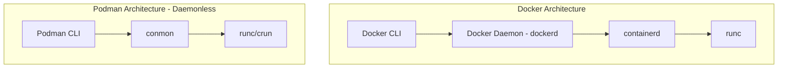

**Key Differences:**

| Feature | Docker | Podman |
|---------|--------|--------|
| Daemon | Required | Daemonless |
| Root privilege | Required for daemon | Rootless mode |
| systemd integration | Limited | Native |
| Pods | Via compose | Native Kubernetes pods |
| Swarm | Built-in | External (Kubernetes) |

**Podman Usage:**

```bash
#!/bin/bash
# Podman examples

# Run rootless container
podman run -d --name nginx nginx:alpine

# Create pod (Kubernetes-style)
podman pod create --name webapp -p 8080:80

# Add containers to pod
podman run -d --pod webapp --name frontend nginx:alpine
podman run -d --pod webapp --name backend myapp:latest

# Generate Kubernetes YAML from pod
podman generate kube webapp > webapp-pod.yaml

# Run with systemd integration
podman run -d \
  --name myapp \
  --systemd=always \
  --restart=always \
  myapp:latest

# Generate systemd unit file
podman generate systemd --name myapp > /etc/systemd/system/container-myapp.service
systemctl enable container-myapp
systemctl start container-myapp

# Rootless with user namespace mapping
podman run -d \
  --userns=auto \
  --uidmap=0:100000:65536 \
  --gidmap=0:100000:65536 \
  myapp:latest
```

### 7.2 gVisor

gVisor provides additional isolation through a user-space kernel.

**gVisor Architecture:**

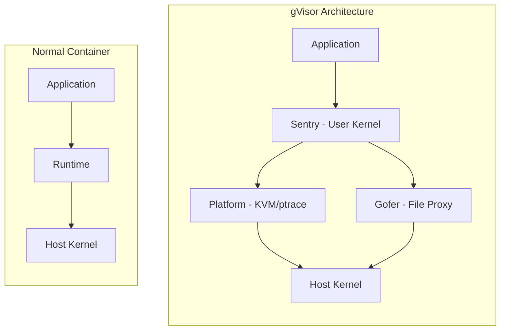

**Security Boundary:**

gVisor intercepts system calls in user space:
$$Syscall_{app} \rightarrow Sentry_{gvisor} \rightarrow Syscall_{limited} \rightarrow Kernel_{host}$$

This reduces the attack surface: only ~70 syscalls exposed vs ~300+ in normal containers.

**Usage with Docker:**

```bash
# Install runsc (gVisor runtime)
wget https://storage.googleapis.com/gvisor/releases/release/latest/x86_64/runsc
chmod +x runsc
sudo mv runsc /usr/local/bin/

# Configure Docker to use runsc
sudo tee /etc/docker/daemon.json <<EOF
{
  "runtimes": {
    "runsc": {
      "path": "/usr/local/bin/runsc"
    }
  }
}
EOF

sudo systemctl restart docker

# Run container with gVisor
docker run -d \
  --runtime=runsc \
  --name secure_app \
  myapp:latest

# Run with specific platform (KVM for better performance)
docker run -d \
  --runtime=runsc \
  --runtime-arg=platform=kvm \
  --name fast_secure_app \
  myapp:latest
```

**Performance Tradeoff:**

| Metric | Normal Container | gVisor |
|--------|------------------|--------|
| System call overhead | ~0.1 μs | ~1-5 μs |
| Throughput | 100% | 50-90% |
| Memory overhead | Minimal | 10-20 MB |
| Security | Process isolation | Additional kernel boundary |

### 7.3 Kata Containers

Kata Containers use lightweight VMs for stronger isolation.

**Kata Architecture:**

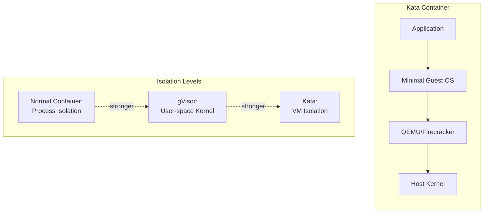

**Installation and Usage:**

```bash
# Install Kata Containers
sudo sh -c "echo 'deb http://download.opensuse.org/repositories/home:/katacontainers:/releases:/x86_64:/stable-2.0/xUbuntu_$(lsb_release -rs)/ /' > /etc/apt/sources.list.d/kata-containers.list"
curl -sL  http://download.opensuse.org/repositories/home:/katacontainers:/releases:/x86_64:/stable-2.0/xUbuntu_$(lsb_release -rs)/Release.key | sudo apt-key add -
sudo apt-get update
sudo apt-get install kata-runtime kata-proxy kata-shim

# Configure containerd for Kata
sudo mkdir -p /etc/containerd/
sudo tee /etc/containerd/config.toml <<EOF
[plugins]
  [plugins."io.containerd.grpc.v1.cri"]
    [plugins."io.containerd.grpc.v1.cri".containerd]
      default_runtime_name = "runc"
      [plugins."io.containerd.grpc.v1.cri".containerd.runtimes]
        [plugins."io.containerd.grpc.v1.cri".containerd.runtimes.kata]
          runtime_type = "io.containerd.kata.v2"
EOF

sudo systemctl restart containerd

# Run with Kata
ctr run --runtime io.containerd.kata.v2 docker.io/library/nginx:alpine kata-nginx

# Or with Docker
sudo tee -a /etc/docker/daemon.json <<EOF
{
  "runtimes": {
    "kata-runtime": {
      "path": "/usr/bin/kata-runtime"
    }
  }
}
EOF

sudo systemctl restart docker

docker run -d \
  --runtime=kata-runtime \
  --name vm_isolated_app \
  myapp:latest
```

## 8. Container Orchestration Foundations

### 8.1 Single-Host Orchestration with systemd

```bash
#!/bin/bash
# systemd-based container management

# Generate systemd unit from Podman
podman create \
  --name myapp \
  --publish 8080:8080 \
  --env-file /etc/myapp/env \
  --volume myapp-data:/data \
  myapp:latest

podman generate systemd --new --name myapp > /etc/systemd/system/myapp.service

# Edit service for dependencies
cat > /etc/systemd/system/myapp.service <<'EOF'
[Unit]
Description=My Application Container
Wants=network-online.target
After=network-online.target
Requires=myapp-db.service
After=myapp-db.service

[Service]
Environment=PODMAN_SYSTEMD_UNIT=%n
Restart=always
RestartSec=10
TimeoutStartSec=120
TimeoutStopSec=70
ExecStartPre=/usr/bin/podman pull myapp:latest
ExecStart=/usr/bin/podman run \
  --cidfile=%t/%n.ctr-id \
  --cgroups=no-conmon \
  --rm \
  --sdnotify=conmon \
  --replace \
  --name myapp \
  --publish 8080:8080 \
  --env-file /etc/myapp/env \
  --volume myapp-data:/data \
  myapp:latest
ExecStop=/usr/bin/podman stop --ignore --cidfile=%t/%n.ctr-id
ExecStopPost=/usr/bin/podman rm -f --ignore --cidfile=%t/%n.ctr-id

Type=notify
NotifyAccess=all

[Install]
WantedBy=multi-user.target
EOF

# Enable and start
systemctl daemon-reload
systemctl enable myapp.service
systemctl start myapp.service

# Monitor
systemctl status myapp.service
journalctl -u myapp.service -f
```

### 8.2 Docker Swarm

```bash
#!/bin/bash
# Docker Swarm orchestration

# Initialize swarm
docker swarm init --advertise-addr 192.168.1.100

# Join workers
# (Run on worker nodes)
docker swarm join --token SWMTKN-1-xxx 192.168.1.100:2377

# Deploy stack
cat > stack.yml <<'EOF'
version: '3.9'

services:
  web:
    image: nginx:alpine
    deploy:
      replicas: 3
      update_config:
        parallelism: 1
        delay: 10s
        failure_action: rollback
      rollback_config:
        parallelism: 1
        delay: 5s
      restart_policy:
        condition: on-failure
        delay: 5s
        max_attempts: 3
      placement:
        constraints:
          - node.role == worker
          - node.labels.tier == frontend
      resources:
        limits:
          cpus: '0.5'
          memory: 256M
        reservations:
          cpus: '0.25'
          memory: 128M
    networks:
      - frontend
    ports:
      - "80:80"
    healthcheck:
      test: ["CMD", "wget", "-q", "-O", "-", "http://localhost/health"]
      interval: 30s
      timeout: 10s
      retries: 3
      start_period: 40s

  api:
    image: myapp:latest
    deploy:
      replicas: 5
      update_config:
        parallelism: 2
        delay: 10s
      placement:
        constraints:
          - node.role == worker
    networks:
      - frontend
      - backend
    environment:
      - DATABASE_URL=postgresql://db:5432/myapp
    secrets:
      - db_password
    configs:
      - source: api_config
        target: /etc/myapp/config.yaml

  db:
    image: postgres:15
    deploy:
      replicas: 1
      placement:
        constraints:
          - node.labels.type == database
    networks:
      - backend
    environment:
      - POSTGRES_PASSWORD_FILE=/run/secrets/db_password
    secrets:
      - db_password
    volumes:
      - db_data:/var/lib/postgresql/data

networks:
  frontend:
    driver: overlay
    attachable: true
  backend:
    driver: overlay
    internal: true

volumes:
  db_data:
    driver: local

secrets:
  db_password:
    external: true

configs:
  api_config:
    external: true
EOF

# Create secrets
echo "super_secret_password" | docker secret create db_password -

# Create configs
docker config create api_config ./config.yaml

# Deploy stack
docker stack deploy -c stack.yml myapp

# Monitor
docker stack ps myapp
docker service ls
docker service logs myapp_web
docker service scale myapp_api=10

# Update service
docker service update --image myapp:v2 myapp_api

# Rollback
docker service rollback myapp_api

# Remove stack
docker stack rm myapp
```

### 8.3 Service Mesh Pattern (Envoy Sidecar)

```yaml
# Service mesh sidecar pattern
version: '3.9'

services:
  # Application container
  app:
    image: myapp:latest
    networks:
      - app_net
    environment:
      - UPSTREAM_HOST=localhost
      - UPSTREAM_PORT=8080

  # Envoy sidecar proxy
  envoy:
    image: envoyproxy/envoy:v1.28-latest
    networks:
      - app_net
      - mesh_net
    ports:
      - "80:10000"
    volumes:
      - ./envoy-config.yaml:/etc/envoy/envoy.yaml:ro
    command: ["-c", "/etc/envoy/envoy.yaml"]
    depends_on:
      - app

networks:
  app_net:
    internal: true
  mesh_net:
    driver: overlay
```

```yaml
# envoy-config.yaml
static_resources:
  listeners:
  - name: listener_0
    address:
      socket_address:
        address: 0.0.0.0
        port_value: 10000
    filter_chains:
    - filters:
      - name: envoy.filters.network.http_connection_manager
        typed_config:
          "@type": type.googleapis.com/envoy.extensions.filters.network.http_connection_manager.v3.HttpConnectionManager
          stat_prefix: ingress_http
          access_log:
          - name: envoy.access_loggers.stdout
            typed_config:
              "@type": type.googleapis.com/envoy.extensions.access_loggers.stream.v3.StdoutAccessLog
          http_filters:
          - name: envoy.filters.http.router
            typed_config:
              "@type": type.googleapis.com/envoy.extensions.filters.http.router.v3.Router
          route_config:
            name: local_route
            virtual_hosts:
            - name: local_service
              domains: ["*"]
              routes:
              - match:
                  prefix: "/"
                route:
                  cluster: local_app
                  timeout: 30s
                  retry_policy:
                    retry_on: "5xx"
                    num_retries: 3
                    per_try_timeout: 10s

  clusters:
  - name: local_app
    connect_timeout: 5s
    type: STRICT_DNS
    lb_policy: ROUND_ROBIN
    load_assignment:
      cluster_name: local_app
      endpoints:
      - lb_endpoints:
        - endpoint:
            address:
              socket_address:
                address: app
                port_value: 8080
    health_checks:
    - timeout: 5s
      interval: 10s
      unhealthy_threshold: 2
      healthy_threshold: 2
      http_health_check:
        path: "/health"

admin:
  address:
    socket_address:
      address: 0.0.0.0
      port_value: 9901
```

## 9. Debugging and Troubleshooting

### 9.1 Debugging Tools

```bash
#!/bin/bash
# Container debugging toolkit

# Inspect container details
docker inspect myapp

# View logs
docker logs -f --tail 100 myapp
docker logs --since 30m myapp
docker logs --until 2024-01-15T10:00:00 myapp

# Execute commands in running container
docker exec -it myapp /bin/sh
docker exec myapp ps aux
docker exec myapp netstat -tulpn

# Attach to container (see stdout/stderr)
docker attach myapp

# View resource usage
docker stats myapp
docker stats --no-stream --format "table {{.Container}}\t{{.CPUPerc}}\t{{.MemUsage}}"

# View events
docker events --filter container=myapp
docker events --filter event=die --since 1h

# Copy files
docker cp myapp:/app/logs/error.log ./error.log
docker cp ./config.json myapp:/app/config.json

# Export filesystem
docker export myapp > myapp.tar
docker commit myapp myapp:debug

# Network debugging
docker network inspect bridge
docker exec myapp nslookup database
docker exec myapp traceroute database
docker exec myapp tcpdump -i eth0 -w /tmp/capture.pcap

# Process debugging
docker top myapp
docker exec myapp strace -p 1
docker exec myapp lsof -p 1
```

### 9.2 Debug Container Pattern

```bash
#!/bin/bash
# Launch debug container in same namespaces as target

TARGET_CONTAINER="myapp"

# Get container PID
PID=$(docker inspect -f '{{.State.Pid}}' ${TARGET_CONTAINER})

# Run debug container with nsenter
docker run -it --rm \
  --privileged \
  --pid=host \
  alpine:latest \
  nsenter -t ${PID} -n -m -u -i -p /bin/sh

# Alternative: use docker debug (Docker Desktop)
docker debug ${TARGET_CONTAINER}

# Or use ephemeral container (Kubernetes-style)
docker run -it --rm \
  --network container:${TARGET_CONTAINER} \
  --pid container:${TARGET_CONTAINER} \
  nicolaka/netshoot
```

### 9.3 Performance Profiling

```bash
#!/bin/bash
# Container performance profiling

CONTAINER="myapp"

# CPU profiling with perf
docker run -it --rm \
  --privileged \
  --pid=container:${CONTAINER} \
  alpine:latest \
  sh -c "apk add perf && perf record -F 99 -p 1 -g -- sleep 30 && perf report"

# Memory profiling
docker stats ${CONTAINER} --no-stream
docker exec ${CONTAINER} cat /sys/fs/cgroup/memory/memory.stat
docker exec ${CONTAINER} ps aux --sort=-rss

# I/O profiling
docker exec ${CONTAINER} iotop -oa
docker exec ${CONTAINER} pidstat -d 1

# Network profiling
docker exec ${CONTAINER} iftop
docker exec ${CONTAINER} nethogs

# Flame graph generation
docker exec ${CONTAINER} perf record -F 99 -a -g -- sleep 60
docker cp ${CONTAINER}:/root/perf.data ./
stackcollapse-perf.pl perf.data | flamegraph.pl > flamegraph.svg
```

### 9.4 Common Issues and Solutions

```bash
#!/bin/bash
# Common troubleshooting scenarios

# Issue: Container won't start
# Check logs for errors
docker logs myapp
# Check events
docker events --filter container=myapp
# Inspect exit code
docker inspect myapp --format='{{.State.ExitCode}}'
# Try running interactively
docker run -it --entrypoint /bin/sh myapp:latest

# Issue: Out of disk space
# Check Docker disk usage
docker system df -v
# Clean up
docker system prune -a --volumes
# Check image layers
docker history myapp:latest

# Issue: DNS resolution failing
# Check DNS config
docker exec myapp cat /etc/resolv.conf
# Test resolution
docker exec myapp nslookup google.com
# Check network
docker network inspect bridge

# Issue: Permission denied
# Check user
docker exec myapp whoami
docker exec myapp id
# Check file permissions
docker exec myapp ls -la /path/to/file
# Run with specific user
docker run --user 1000:1000 myapp:latest

# Issue: Port already in use
# Find process using port
sudo lsof -i :8080
sudo netstat -tulpn | grep 8080
# Kill container using port
docker ps --filter publish=8080
docker stop $(docker ps -q --filter publish=8080)

# Issue: High memory usage
# Check memory stats
docker stats myapp --no-stream
# Check container limits
docker inspect myapp --format='{{.HostConfig.Memory}}'
# Check for memory leaks
docker exec myapp ps aux --sort=-rss
# Restart with lower memory
docker update --memory 512m myapp

# Issue: Networking between containers fails
# Check network connectivity
docker network inspect my_network
# Test connection
docker exec container_a ping container_b
docker exec container_a telnet container_b 8080
# Check iptables rules
sudo iptables -L -n
sudo iptables -t nat -L -n

# Issue: Volume mount not working
# Check mount
docker inspect myapp --format='{{json .Mounts}}'
# Verify host path exists
ls -la /host/path
# Check SELinux labels
ls -Z /host/path
# Add :z or :Z flag for SELinux
docker run -v /host/path:/container/path:z myapp:latest
```

## 10. Production Deployment Checklist

### 10.1 Image Hardening Checklist

```dockerfile
# Production-grade hardened image template

# Use specific version tags, never :latest
FROM alpine:3.19.0

# Install security updates
RUN apk update && \
    apk upgrade && \
    apk add --no-cache \
        ca-certificates \
        tzdata && \
    rm -rf /var/cache/apk/*

# Create non-root user with specific UID/GID
RUN addgroup -g 10001 -S appgroup && \
    adduser -u 10001 -S -G appgroup -h /home/appuser appuser

# Set working directory
WORKDIR /app

# Copy application with correct ownership
COPY --chown=appuser:appgroup . .

# Remove unnecessary setuid binaries
RUN find / -perm /6000 -type f -exec chmod a-s {} \; || true

# Switch to non-root user
USER appuser

# Document exposed ports
EXPOSE 8080

# Add health check
HEALTHCHECK --interval=30s --timeout=3s --start-period=5s --retries=3 \
    CMD ["/app/healthcheck"]

# Add labels
LABEL org.opencontainers.image.vendor="My Company" \
      org.opencontainers.image.title="My Application" \
      org.opencontainers.image.version="1.0.0" \
      org.opencontainers.image.created="2024-01-15" \
      org.opencontainers.image.description="Production container" \
      org.opencontainers.image.source="https://github.com/myorg/myapp"

# Use exec form for ENTRYPOINT
ENTRYPOINT ["/app/server"]
CMD ["--config", "/app/config.yaml"]
```

### 10.2 Runtime Security Configuration

```bash
#!/bin/bash
# Production runtime security configuration

docker run -d \
  --name production_app \
  \
  # Resource limits
  --cpus="2.0" \
  --memory="2g" \
  --memory-reservation="1g" \
  --memory-swap="4g" \
  --pids-limit=200 \
  \
  # Security options
  --security-opt=no-new-privileges:true \
  --security-opt=seccomp=/etc/docker/seccomp/default.json \
  --cap-drop=ALL \
  --cap-add=NET_BIND_SERVICE \
  --read-only \
  \
  # User namespace remapping
  --userns-remap=default \
  \
  # Writable directories (tmpfs)
  --tmpfs /tmp:rw,noexec,nosuid,size=100m \
  --tmpfs /var/run:rw,noexec,nosuid,size=10m \
  \
  # Networking
  --network=production_net \
  --publish 8080:8080 \
  \
  # Logging
  --log-driver=json-file \
  --log-opt max-size=10m \
  --log-opt max-file=3 \
  --log-opt labels=environment,application \
  \
  # Health check
  --health-cmd="curl -f http://localhost:8080/health || exit 1" \
  --health-interval=30s \
  --health-timeout=10s \
  --health-retries=3 \
  --health-start-period=40s \
  \
  # Restart policy
  --restart=unless-stopped \
  \
  # Labels
  --label environment=production \
  --label application=myapp \
  --label version=1.0.0 \
  \
  myapp:1.0.0
```

### 10.3 Monitoring and Observability

```yaml
# Prometheus monitoring stack
version: '3.9'

services:
  # cAdvisor for container metrics
  cadvisor:
    image: gcr.io/cadvisor/cadvisor:v0.47.0
    container_name: cadvisor
    privileged: true
    devices:
      - /dev/kmsg
    volumes:
      - /:/rootfs:ro
      - /var/run:/var/run:ro
      - /sys:/sys:ro
      - /var/lib/docker/:/var/lib/docker:ro
      - /dev/disk/:/dev/disk:ro
    ports:
      - "8080:8080"
    networks:
      - monitoring

  # Prometheus
  prometheus:
    image: prom/prometheus:v2.48.0
    container_name: prometheus
    volumes:
      - ./prometheus.yml:/etc/prometheus/prometheus.yml:ro
      - prometheus_data:/prometheus
    command:
      - '--config.file=/etc/prometheus/prometheus.yml'
      - '--storage.tsdb.path=/prometheus'
      - '--storage.tsdb.retention.time=30d'
      - '--web.console.libraries=/etc/prometheus/console_libraries'
      - '--web.console.templates=/etc/prometheus/consoles'
    ports:
      - "9090:9090"
    networks:
      - monitoring
    depends_on:
      - cadvisor

  # Grafana
  grafana:
    image: grafana/grafana:10.2.0
    container_name: grafana
    volumes:
      - grafana_data:/var/lib/grafana
      - ./grafana/provisioning:/etc/grafana/provisioning:ro
    environment:
      - GF_SECURITY_ADMIN_USER=admin
      - GF_SECURITY_ADMIN_PASSWORD=secure_password
      - GF_USERS_ALLOW_SIGN_UP=false
    ports:
      - "3000:3000"
    networks:
      - monitoring
    depends_on:
      - prometheus

  # Node exporter for host metrics
  node_exporter:
    image: prom/node-exporter:v1.7.0
    container_name: node_exporter
    command:
      - '--path.procfs=/host/proc'
      - '--path.sysfs=/host/sys'
      - '--path.rootfs=/rootfs'
      - '--collector.filesystem.mount-points-exclude=^/(sys|proc|dev|host|etc)($$|/)'
    volumes:
      - /proc:/host/proc:ro
      - /sys:/host/sys:ro
      - /:/rootfs:ro
    ports:
      - "9100:9100"
    networks:
      - monitoring

networks:
  monitoring:
    driver: bridge

volumes:
  prometheus_data:
  grafana_data:
```

```yaml
# prometheus.yml
global:
  scrape_interval: 15s
  evaluation_interval: 15s
  external_labels:
    cluster: 'docker-prod'

scrape_configs:
  # Prometheus itself
  - job_name: 'prometheus'
    static_configs:
      - targets: ['localhost:9090']

  # cAdvisor for container metrics
  - job_name: 'cadvisor'
    static_configs:
      - targets: ['cadvisor:8080']

  # Node exporter for host metrics
  - job_name: 'node'
    static_configs:
      - targets: ['node_exporter:9100']

  # Docker daemon metrics (if enabled)
  - job_name: 'docker'
    static_configs:
      - targets: ['172.17.0.1:9323']

  # Application metrics
  - job_name: 'application'
    static_configs:
      - targets: ['app:8080']
    metrics_path: '/metrics'
```

## Summary

Containerization represents a fundamental abstraction in cloud-native computing, providing process isolation, resource control, and portability through kernel-level virtualization. This lesson covered:

1. **Theoretical foundations**: Namespaces, cgroups, and union filesystems that enable containerization
2. **Docker architecture**: Component model, image layers, and runtime lifecycle
3. **Networking**: Bridge, host, and overlay networks with DNS-based service discovery
4. **Storage**: Volume types, drivers, and production patterns
5. **Security**: Capabilities, seccomp, AppArmor, and defense-in-depth strategies
6. **Resource management**: CPU, memory, I/O, and PID limits with precise control
7. **Alternatives**: Podman, gVisor, and Kata Containers with different isolation models
8. **Orchestration**: systemd integration, Docker Swarm, and service mesh patterns
9. **Operations**: Debugging techniques, performance profiling, and troubleshooting
10. **Production**: Hardening checklists, security configurations, and monitoring

Mastery of container technologies provides the foundation for cloud-native architectures, enabling scalable, resilient, and efficient deployment of modern applications.

## Summary

Containerization represents a fundamental abstraction in cloud-native computing, providing process isolation, resource control, and portability through kernel-level virtualization. This lesson covered:

1. **Theoretical foundations**: Namespaces, cgroups, and union filesystems that enable containerization
2. **Docker architecture**: Component model, image layers, and runtime lifecycle
3. **Networking**: Bridge, host, and overlay networks with DNS-based service discovery
4. **Storage**: Volume types, drivers, and production patterns
5. **Security**: Capabilities, seccomp, AppArmor, and defense-in-depth strategies
6. **Resource management**: CPU, memory, I/O, and PID limits with precise control
7. **Alternatives**: Podman, gVisor, and Kata Containers with different isolation models
8. **Orchestration**: systemd integration, Docker Swarm, and service mesh patterns
9. **Operations**: Debugging techniques, performance profiling, and troubleshooting
10. **Production**: Hardening checklists, security configurations, and monitoring

The layered architecture of containerization—from kernel primitives through runtime abstractions to orchestration frameworks—enables precise control over application deployment while maintaining operational flexibility. Production containerization demands rigorous attention to security boundaries, resource allocation, and observability. The proliferation of alternative runtimes reflects evolving requirements: Podman addresses daemon-less workflows and rootless operation, gVisor provides defense against kernel exploits through user-space kernel emulation, and Kata Containers delivers VM-level isolation with container-like ergonomics. Each approach trades performance, isolation strength, and operational complexity differently, requiring architectural decisions aligned with specific threat models and performance requirements.

Mastery of container technologies provides the foundation for cloud-native architectures, enabling scalable, resilient, and efficient deployment of modern applications. The principles explored—immutable infrastructure, declarative configuration, resource isolation, and observable systems—extend beyond individual container runtimes into orchestration platforms like Kubernetes. Effective container adoption requires disciplined image construction (minimal base images, explicit dependencies, reproducible builds), defensive runtime configuration (read-only filesystems, dropped capabilities, resource limits), and comprehensive monitoring (resource utilization, application metrics, security events). Organizations that treat containerization as an engineering discipline rather than merely an operational tool achieve superior reliability, security posture, and operational velocity. The next lesson advances these foundations into orchestration at scale, where container primitives become building blocks for distributed systems management.
