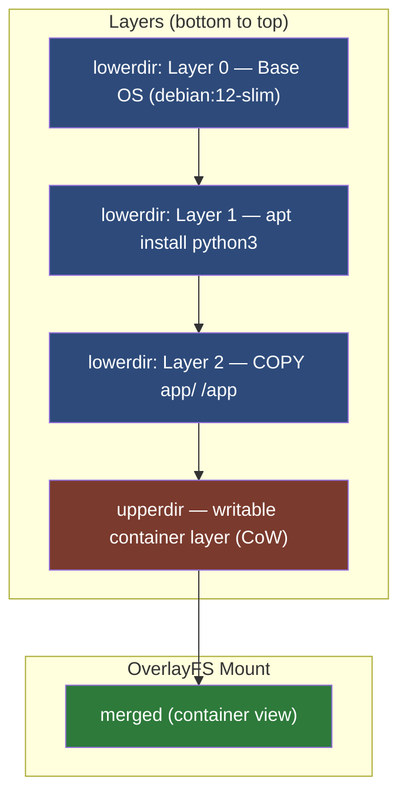
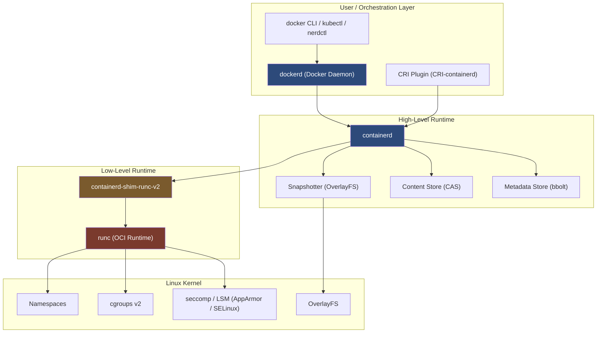

```markdown
# Lesson 2: Containerization Technologies

## 1. First-Principles Intuition & Invariants

### The Fundamental Problem: Environment Drift

Before containers, the canonical deployment unit was an application binary or archive coupled loosely to an environment configured by convention, documentation, and institutional memory. This produced the "works on my machine" class of failures: a library version mismatch, a subtly different glibc, a missing kernel module, or a divergent timezone configuration was enough to break production. Configuration management tools (Chef, Puppet, Ansible) attacked this problem at the infrastructure layer but remained inherently stateful and mutable: a node's configuration drifted over time as hotfixes, operator interventions, and partial upgrades accumulated.

Containerization reframes the problem. Instead of configuring a host to match an application's requirements, you ship the application's entire filesystem — userspace libraries, language runtime, configuration, and application code — as an immutable artifact. The host kernel is shared, but every other filesystem and process-visibility concern is isolated. The result is a deployment unit that is *hermetic with respect to userspace*: the same image produces identical runtime behavior on a developer laptop, a CI runner, and a production hypervisor, as long as the host kernel version satisfies the application's syscall surface requirements.

### Linux Kernel Primitives: Namespaces

Linux namespaces are the mechanism that makes this isolation real. They were not introduced as a single feature; rather, they accumulated across kernel versions:

- **Mount namespace** (`CLONE_NEWNS`): Linux 2.4.19 (2002). Each process can have its own filesystem topology. This is what allows a container to see `/lib` from its image rather than from the host.
- **UTS namespace** (`CLONE_NEWUTS`): Linux 2.6.19 (2006). Isolates `hostname` and `domainname` syscalls.
- **IPC namespace** (`CLONE_NEWIPC`): Linux 2.6.19 (2006). Isolates System V IPC objects and POSIX message queues.
- **PID namespace** (`CLONE_NEWPID`): Linux 2.6.24 (2008). The first process in the namespace is PID 1 from that namespace's perspective; it cannot see host PIDs. Critically, if PID 1 exits, the kernel sends `SIGKILL` to every other process in that namespace, making lifecycle management deterministic.
- **Network namespace** (`CLONE_NEWNET`): Linux 2.6.24 (2008). Provides an isolated network stack: its own interfaces, routing table, iptables rules, and sockets. `veth` pairs connect namespaces; a bridge on the host provides connectivity between containers.
- **User namespace** (`CLONE_NEWUSER`): Linux 3.8 (2013). Maps UID/GID ranges between host and container. This enables *rootless containers*: a process with UID 1000 on the host can appear as UID 0 inside a container without possessing host root privileges, dramatically reducing attack surface.
- **Cgroup namespace** (`CLONE_NEWCGROUP`): Linux 4.6 (2016). Presents a container-rooted view of the cgroup hierarchy; the container cannot observe its own cgroup path on the host.
- **Time namespace** (`CLONE_NEWTIME`): Linux 5.6 (2020). Allows per-container offsets for `CLOCK_MONOTONIC` and `CLOCK_BOOTTIME`.

A container is not a kernel concept. It is a *user-space convention* for a process tree launched via `clone(2)` or `unshare(2)` with a combination of these namespace flags, running inside a chroot or pivot_root that provides the container filesystem.

### Linux Kernel Primitives: Control Groups (cgroups)

Namespaces handle visibility. Control groups (cgroups) handle resource governance. The two are orthogonal mechanisms that the container runtime combines.

cgroups v1 was merged in Linux 2.6.24 (2008) and organized resources into separate hierarchies (one per controller: `cpu`, `memory`, `blkio`, `cpuset`, etc.), which created inconsistencies because a process could belong to different groups in different hierarchies.

cgroups v2 (Linux 4.5, 2016; widely adopted in distributions from ~2019) unified all controllers under a single hierarchy. The key guarantees it provides:

- **CPU**: `cpu.weight` (proportional sharing via CFS), `cpu.max` (hard quota in the form `$MAX $PERIOD`, e.g., `50000 100000` = 50% of one CPU).
- **Memory**: `memory.max` (hard limit triggering OOM kill), `memory.high` (soft limit triggering reclaim and throttling before OOM), `memory.swap.max`.
- **Block I/O**: `io.max` (bytes/sec and IOPS limits per device).
- **PIDs**: `pids.max` limits the number of tasks in the cgroup, preventing fork bombs from exhausting the host's PID space.

The kernel enforces these limits in-band: when a container process exceeds `memory.max`, the kernel's OOM killer terminates a process within that cgroup, never on the host. This is the invariant that prevents one tenant's runaway process from killing another's.

### The Union Filesystem: Copy-on-Write Layering

Container images achieve storage efficiency through *union filesystems*, which present a merged view of multiple read-only layers topped by a single writable layer. OverlayFS (merged Linux 3.18, 2014) is the dominant implementation used by Docker, containerd, and Podman.

The OverlayFS mount uses four directories:
- **lowerdir**: One or more read-only layers (image layers, stacked bottom to top).
- **upperdir**: The writable container layer. All writes go here.
- **workdir**: An OverlayFS-internal scratch directory (must be on the same filesystem as `upperdir`).
- **merged**: The unified view presented to the container process.

The copy-on-write (CoW) semantics: when a container writes to a file that exists in a lower layer, OverlayFS copies the full file into `upperdir` first, then applies the write. This means the first write to a large file incurs a full copy penalty. For write-heavy workloads on large files (e.g., databases), this is why containers should use volumes (direct mount bypassing OverlayFS) rather than the container writable layer.



Each image layer is content-addressed by a SHA-256 digest of its tar archive. This means identical layers (e.g., the same `debian:12-slim` base) are stored once on a host regardless of how many images reference them, and the registry transfer protocol skips layers the host already has.

### The OCI Specifications

A critical historical fact: prior to 2015, Docker's image format and runtime were proprietary. The Open Container Initiative (OCI), founded June 2015 under the Linux Foundation by Docker, CoreOS, and others, standardized two specifications:

- **OCI Image Spec** (v1.0 finalized 2017): Defines the image manifest (a JSON document listing layers and configuration), the layer format (gzip-compressed tar archives), and the content-addressable distribution model.
- **OCI Runtime Spec** (v1.0 finalized 2017): Defines the `config.json` bundle format that a compliant runtime (runc, crun, kata-containers) must interpret to create a container. It specifies how to map image configuration to `clone(2)` flags, mount operations, and process execution.

These specifications are the reason you can build an image with Docker, push it to a registry, and run it with containerd or Podman without any translation layer. The OCI specs are the interoperability contract of the entire ecosystem.

---

## 2. Core Architecture & Mechanics

### The Container Runtime Stack

What most practitioners call "Docker" is actually a layered stack of components with distinct responsibilities. Understanding these layers is essential for diagnosing production issues and for making informed choices about which components to use.



**dockerd** is a user-facing API server (REST over a Unix socket, default `/var/run/docker.sock`). It handles image building, volume management, the Docker network model, and the Swarm orchestration layer. It delegates all container lifecycle operations to containerd via a gRPC connection.

**containerd** (a CNCF graduated project) is the high-level runtime. Its responsibilities include: image pull and push (implementing the OCI Distribution Spec), layer unpacking into snapshots, container metadata management (stored in a bbolt embedded database at `/var/lib/containerd/`), and task execution. It exposes a gRPC API and is designed to be embedded by orchestrators. Kubernetes uses containerd directly via the CRI plugin, bypassing dockerd entirely.

**containerd-shim-runc-v2** is a critical architectural component that is often overlooked. When containerd starts a container, it forks a shim process that becomes the parent of the container's PID 1. The shim does several things: it invokes `runc` to create and start the container, then `runc` exits (it is not a daemon). The shim stays resident, holds open the container's stdio FIFOs, reports container exit status back to containerd, and allows containerd itself to be restarted without killing running containers. This is the mechanism that enables zero-downtime containerd upgrades.

**runc** (OCI reference implementation, written in Go) is the low-level runtime. It reads an OCI bundle (a directory containing `config.json` and a `rootfs/`) and uses `clone(2)` / `unshare(2)`, `pivot_root(2)`, `mount(2)`, and `execve(2)` to create the isolated container process. After the container process starts, `runc` exits. It has no daemon process; it is a one-shot tool. The alternative `crun` (written in C) achieves the same OCI spec compliance with ~10x lower memory overhead and faster startup, making it preferable for high-density or serverless workloads.

### Image Build: Dockerfile Layer Mechanics

Understanding how `docker build` constructs an image is critical for optimizing both build time and final image size.

Each `RUN`, `COPY`, and `ADD` instruction in a Dockerfile produces a new image layer (a tar archive of the filesystem diff). The build cache key for a layer is a hash of: the parent layer's digest, the instruction text, and (for `COPY`/`ADD`) the content hash of the source files. A cache miss at layer N invalidates the cache for all subsequent layers.

**Production-grade multi-stage Dockerfile** for a Go service, demonstrating correct layer ordering and security hygiene:

```dockerfile
# syntax=docker/dockerfile:1.6
# ============================================================
# Stage 1: Dependency cache (rarely invalidated)
# ============================================================
FROM golang:1.22-bookworm AS deps
WORKDIR /build
# Copy dependency manifests first so this layer is cached
# independently of source code changes.
COPY go.mod go.sum ./
RUN --mount=type=cache,target=/root/.cache/go-build \
    --mount=type=cache,target=/go/pkg/mod \
    go mod download -x

# ============================================================
# Stage 2: Build
# ============================================================
FROM deps AS builder
COPY . .
# CGO_ENABLED=0 produces a statically linked binary.
# -trimpath removes local build paths from the binary.
# -ldflags="-s -w" strips debug symbols, reducing binary size ~30%.
RUN --mount=type=cache,target=/root/.cache/go-build \
    --mount=type=cache,target=/go/pkg/mod \
    CGO_ENABLED=0 GOOS=linux GOARCH=amd64 \
    go build \
      -trimpath \
      -ldflags="-s -w -X main.Version=$(git describe --tags --always)" \
      -o /bin/server \
      ./cmd/server

# ============================================================
# Stage 3: Minimal runtime image
# ============================================================
# distroless/static contains only ca-certificates and tzdata.
# No shell, no package manager, no /tmp by default.
# Attack surface is orders of magnitude smaller than debian-slim.
FROM gcr.io/distroless/static-debian12:nonroot AS runtime

# OCI image annotations (standardized by OCI Image Spec)
LABEL org.opencontainers.image.source="https://github.com/example/server"
LABEL org.opencontainers.image.revision="${GIT_SHA}"

# Copy only the compiled binary from the builder stage.
# The entire Go toolchain, source tree, and module cache are
# discarded; they never appear in the final image.
COPY --from=builder /bin/server /server

# Run as non-root UID 65532 (the "nonroot" user in distroless).
# This is enforced by the base image's USER directive.
USER nonroot:nonroot

EXPOSE 8080
ENTRYPOINT ["/server"]
```

The `--mount=type=cache` BuildKit directives persist the Go module cache and build cache across builds without baking them into image layers. This reduces a cold build from minutes to seconds for iterative development.

**Layer size analysis** using `docker history`:

```bash
docker build --tag server:latest --no-cache .
docker history server:latest

# IMAGE         CREATED BY                                      SIZE
# a3f1c2d4e5b6  ENTRYPOINT ["/server"]                         0B
# <missing>     USER nonroot:nonroot                            0B
# <missing>     COPY /bin/server /server                        8.2MB
# <missing>     LABEL ...                                       0B
# <base>        distroless/static-debian12:nonroot              2.5MB
# Total compressed: ~10.7MB vs ~1.1GB for a naive golang:1.22 image
```

### Container Networking: The veth/bridge Model

When a container runtime creates a container with a network namespace (`CLONE_NEWNET`), the container has a fully isolated network stack with no external connectivity. The standard solution is a **virtual ethernet pair (veth)**: a kernel-created pair of network interfaces where packets sent into one end emerge from the other, like a pipe for network traffic.

```mermaid
graph LR
    subgraph "Host Network Namespace"
        BR["docker0 bridge\n172.17.0.1/16"]
        VETH_H1["veth0a4f2b (host end)"]
        VETH_H2["veth1c3d8e (host end)"]
        NAT["iptables MASQUERADE\n(SNAT for egress)"]
        PH
