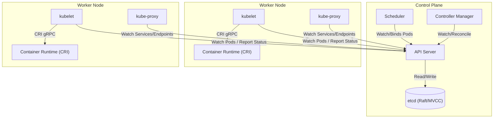
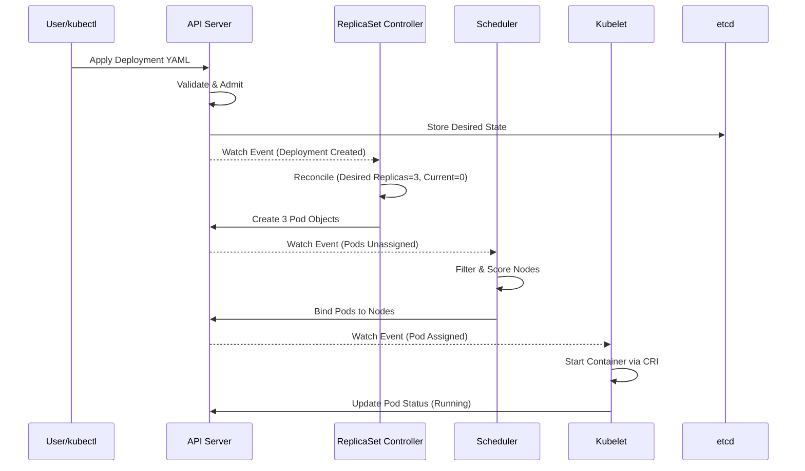

# Lesson 3: Orchestration Platforms

## 1. First-Principles Intuition & Invariants

Orchestration platforms represent a paradigm shift from imperative scripting to declarative convergence. Instead of defining the execution steps to reach a state, the user defines the desired state, and the system continuously reconciles the actual state to match it. This model is governed by several mechanical invariants rooted in distributed systems theory.

The primary invariant is **level-triggered reconciliation**. Unlike edge-triggered systems that react only to discrete changes, Kubernetes controllers operate on level-triggered logic. They continuously evaluate the current state against the desired state snapshot stored in the cluster store. If a pod crashes, the system does not require a new "create" event to trigger a replacement; the controller observes that the current count of running pods is less than the desired count and acts to rectify the divergence. This loop is the heartbeat of the system, ensuring that transient failures or network blips do not result in permanent drift.

The second invariant is **resource bounding via kernel primitives**. Orchestration is fundamentally about multiplexing finite hardware. Kubernetes leverages Linux kernel namespaces (PID, network, mount, UTS, IPC, user) for logical isolation and cgroups (v2 unified hierarchy) for resource constraints. A container is not a virtual machine; it is a constrained set of processes sharing the host kernel. The scheduler relies on these cgroup limits to make bin-packing decisions, ensuring that workload density does not compromise resource predictability.

The third invariant is **interface-driven extensibility**. The platform is intentionally decoupled from its dependencies. It does not know how to run a container, attach a network, or mount a volume natively. Instead, it defines three critical interfaces: the Container Runtime Interface (CRI) for container lifecycle, the Container Network Interface (CNI) for pod networking, and the Container Storage Interface (CSI) for persistent volumes. This architecture allows for swappable backends, enabling innovation at the infrastructure layer without modifying the core control plane.

## 2. Core Architecture & Mechanics

The Kubernetes architecture is divided into a control plane, which makes global decisions, and a data plane, which executes workloads. The control plane maintains a strict separation between the API and the persistence layer.

### Control Plane Components

The **API Server** is the sole component that communicates directly with the backing store. It exposes a RESTful API and implements a sophisticated watch mechanism. Instead of polling, clients use long-polling HTTP connections to receive streaming updates. The API Server handles authentication, authorization (RBAC), and admission control (mutating and validating webhooks).

The backing store is **etcd**, a distributed, strongly consistent key-value store. It utilizes the Raft consensus algorithm to ensure that a majority of nodes agree on state changes before committing them. Etcd stores the serialized protobuf representations of all cluster objects. It relies on Multi-Version Concurrency Control (MVCC) to provide consistent reads without locking, allowing the API Server to serve cached reads efficiently while maintaining a global revision history.

The **Scheduler** is a sophisticated binding engine. It operates in two phases:
1.  **Filtering (Predicates):** The scheduler excludes nodes that cannot host the pod. This includes checks for resource starvation, node taints, and volume binding constraints.
2.  **Scoring (Priorities):** The scheduler ranks the remaining feasible nodes. Scoring algorithms evaluate factors like resource balancing (least requested), pod affinity/anti-affinity, and topology spread constraints to optimize high availability and performance.

The **Controller Manager** runs reconciliation loops for built-in resources. It utilizes **Informers**, a client-side caching mechanism that watches the API Server for changes and maintains a local cache of cluster state. This reduces load on the API Server. The **ReplicaSet** controller (the modern replacement for the ReplicationController) ensures the desired number of pod replicas are running. The **Deployment** controller manages rolling updates and rollbacks by orchestrating ReplicaSets.



### Data Plane and Networking

The **kubelet** is the primary node agent. It registers the node with the API Server and periodically reports node status and resource usage. When a pod is assigned to a node, the kubelet fetches the pod spec and invokes the CRI to pull images and start containers. It also implements static pods—manifests stored locally on the node that are always run, typically used for control plane components in self-hosted clusters.

The **kube-proxy** implements the Service abstraction, providing a stable virtual IP (VIP) for a dynamic set of pods. It operates in three modes:
*   **iptables:** The default mode. It uses kernel iptables rules for DNAT (Destination Network Address Translation). It offers low latency but updates are O(n) complexity, which degrades in clusters with thousands of services.
*   **IPVS:** Utilizes the Linux IP Virtual Server. It relies on hash tables for lookups, providing O(1) complexity and significantly better performance for large-scale service routing.
*   **eBPF:** Replaces kube-proxy entirely (e.g., Cilium). Network policies and service routing are handled in the kernel using eBPF programs, bypassing iptables overhead and enabling deep observability.

The CNI plugin is responsible for assigning each pod a unique IP address and configuring the network interface. The Kubernetes networking model mandates a flat network where pods can communicate with all other pods without NAT. This is typically implemented via overlay networks (VXLAN, Geneve) or native Layer 3 routing (BGP).

### Security and Storage

Kubernetes security relies on **RBAC** for API access and **Pod Security Admission (PSA)** for pod-level constraints. PSA replaces the deprecated PodSecurityPolicies. It uses namespace labels to enforce predefined security profiles (`privileged`, `baseline`, `restricted`), blocking pods that violate the profile at admission time.

Storage is abstracted via **PersistentVolumes (PV)** and **PersistentVolumeClaims (PVC)**. The PV represents physical storage, while the PVC represents a user's request for storage. The **StorageClass** defines the provisioner (CSI driver) and parameters for dynamic provisioning, allowing volumes to be created on-demand from cloud provider backends.

The following deployment manifest illustrates production-grade configuration, incorporating security contexts, resource boundaries, health probes, and topology spread constraints.

```yaml
apiVersion: apps/v1
kind: Deployment
metadata:
  name: api-gateway
  labels:
    app: api-gateway
spec:
  replicas: 3
  selector:
    matchLabels:
      app: api-gateway
  strategy:
    type: RollingUpdate
    rollingUpdate:
      maxSurge: 1
      maxUnavailable: 0
  template:
    metadata:
      labels:
        app: api-gateway
    spec:
      securityContext:
        runAsNonRoot: true
        runAsUser: 10001
        fsGroup: 10001
      containers:
      - name: gateway
        image: registry.internal/api-gateway:1.4.2
        ports:
        - containerPort: 8080
          name: http
        securityContext:
          allowPrivilegeEscalation: false
          readOnlyRootFilesystem: true
          capabilities:
            drop: ["ALL"]
        resources:
          requests:
            cpu: "500m"
            memory: "256Mi"
          limits:
            cpu: "1000m"
            memory: "512Mi"
        livenessProbe:
          httpGet:
            path: /healthz
            port: http
          initialDelaySeconds: 10
          periodSeconds: 10
        readinessProbe:
          httpGet:
            path: /ready
            port: http
          initialDelaySeconds: 5
          periodSeconds: 5
        volumeMounts:
        - name: tmp
          mountPath: /tmp
      volumes:
      - name: tmp
        emptyDir: {}
      topologySpreadConstraints:
      - maxSkew: 1
        topologyKey: kubernetes.io/hostname
        whenUnsatisfiable: DoNotSchedule
        labelSelector:
          matchLabels:
            app: api-gateway
```

## 3. High-Performance Optimization & Failure Modes

High performance in orchestration requires meticulous resource management and an understanding of how the kernel interacts with containerized workloads.

### Resource Efficiency and QoS

Kubernetes uses **Quality of Service (QoS) classes** to prioritize pod eviction during resource pressure. The scheduler relies on resource requests for bin-packing, but the kernel uses limits for hard throttling.

*   **Guaranteed:** Requests equal limits for all resources. These pods have the highest priority and are only evicted if the system is out of memory and there are no lower-tier pods to kill. They are pinned to specific CPU cores if the CPU Manager static policy is enabled.
*   **Burstable:** Requests are less than limits. These pods can burst but are throttled at their limit. They may be evicted if they exceed their requests and the node is under pressure.
*   **BestEffort:** No requests or limits. These are the first pods evicted during resource pressure.

For latency-sensitive workloads, the **CPU Manager** static policy ensures that a Guaranteed pod's CPUs are exclusively allocated using `cpuset`, preventing context switching with other workloads. The **Topology Manager** further aligns these allocations with NUMA nodes, minimizing memory access latency for high-performance computing.

### Control Plane Reliability

The API Server is the bottleneck for cluster operations. Under heavy load, the API Server can become a failure mode. **API Priority and Fairness (APF)** mitigates this by dividing requests into priority levels and flows, ensuring that a flood of low-priority requests (like controller status updates) cannot starve critical requests (like leader election or user interaction).

Etcd is the most critical single point of failure. A loss of etcd quorum (majority of members) results in a read-only cluster, preventing new pods from being scheduled or rescheduled. Operationally, etcd requires regular compaction and defragmentation to prevent the key space from growing indefinitely, which degrades watch performance.



### Failure Modes

**Resource Contention** occurs when multiple workloads compete for the same physical resources. If a node is overcommitted, the kernel Out-Of-Memory (OOM) killer intervenes. It scores processes based on their memory usage and QoS tier, killing the most memory-hungry, lowest-priority process to protect the node.

**Node Failure** is detected via heartbeats. If a kubelet stops reporting, the node is marked `NotReady` after a grace period (default 40s). After `pod-eviction-timeout` (default 5m), the controller manager force-deletes the pods, allowing the scheduler to recreate them on healthy nodes.

**Network Partitioning** (split-brain) is a risk for stateful workloads. If a node loses connection to the control plane but keeps running pods, it may become a partitioned island. The control plane will reschedule the pods to other nodes, leading to split-brain if the storage layer does not support fencing. StatefulSets mitigate this by enforcing strict ordering and using stable identities, but the underlying storage must use read-only fencing (e.g., via CSI snapshots or volume multipathing) to prevent data corruption.
