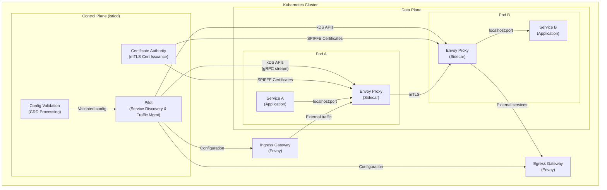
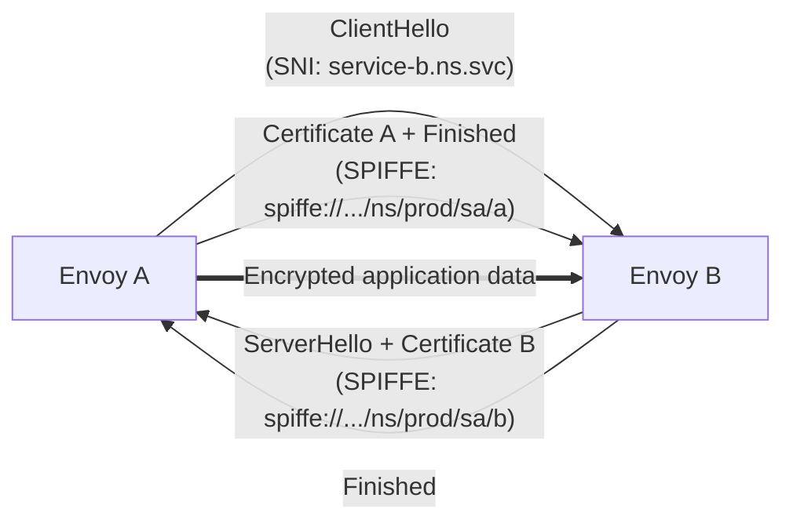
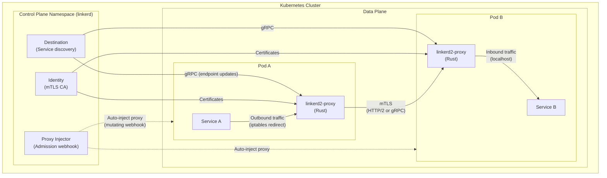
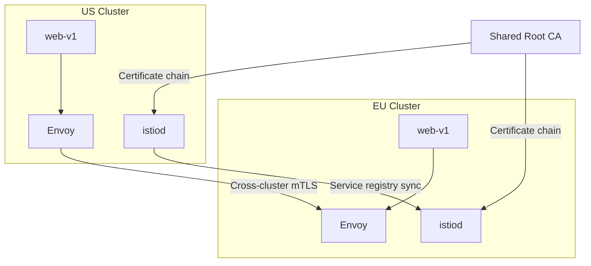

# Lesson 4: Service Meshes

## 1. First-Principles Intuition & Invariants

### The Fundamental Problem: Distributed Systems Complexity

When monolithic applications decompose into microservices, network communication shifts from in-process function calls (nanosecond latency, guaranteed delivery) to inter-process RPC over unreliable networks (millisecond latency, failures inevitable). This introduces the Eight Fallacies of Distributed Computing:

1. The network is reliable
2. Latency is zero
3. Bandwidth is infinite
4. The network is secure
5. Topology doesn't change
6. There is one administrator
7. Transport cost is zero
8. The network is homogeneous

Each microservice must now handle: service discovery, load balancing, retries with exponential backoff, circuit breaking, mutual TLS authentication, authorization, observability (metrics/logs/traces), and traffic management. Embedding this logic in application code creates several problems:

- **Polyglot inconsistency**: Each language runtime requires its own implementation (Java Hystrix, Go go-kit, Python tenacity)
- **Operational drift**: Teams implement patterns differently, leading to fragmented observability
- **Upgrade friction**: Updating retry logic or TLS certificates requires redeploying every service
- **Business logic pollution**: Network resilience code obscures domain logic

### The Service Mesh Invariant: Transparent Network Abstraction

A service mesh extracts all network concerns into a dedicated infrastructure layer, providing these invariants:

1. **Transparency**: Applications remain unaware of the mesh; they make standard HTTP/gRPC calls to `localhost`
2. **Uniformity**: All services get identical networking capabilities regardless of implementation language
3. **Centralized control**: Operators configure behavior through declarative APIs, not code changes
4. **Zero-trust security**: Every connection is mutually authenticated and encrypted by default

The mesh achieves this through the **sidecar proxy pattern**: each service pod runs an additional container (the proxy) that intercepts all inbound and outbound traffic. The service communicates with `localhost:port`, unaware that the proxy handles the actual network I/O.

### Theoretical Foundation: Control Plane vs. Data Plane Separation

Service meshes follow the software-defined networking (SDN) principle of separating control logic from data forwarding:

- **Data plane**: Lightweight proxies (typically C++ for performance) that forward packets and enforce policies in real-time. These run on the hot path of every request.
- **Control plane**: Centralized services that compute routing tables, distribute TLS certificates, aggregate telemetry, and push configuration to data plane proxies. These operate asynchronously from request processing.

This separation enables the control plane to use high-level languages (Go, Rust) for expressiveness while the data plane uses highly optimized C++ for maximum throughput and minimal latency overhead.

## 2. Core Architecture & Mechanics

### Istio Architecture: Deep Dive

Istio uses Envoy Proxy as its data plane and a modular control plane built on Kubernetes CRDs (Custom Resource Definitions). As of Istio 1.5+, the control plane components (Pilot, Citadel, Galley) were consolidated into a single binary called `istiod` for operational simplicity.



#### Data Plane: Envoy Proxy Mechanics

Envoy is a high-performance C++ L7 proxy developed by Lyft. Key architectural properties:

**Thread Model**: Envoy uses a single-process, multi-threaded architecture with one main thread and N worker threads (typically one per CPU core). Each worker thread runs a non-blocking event loop built on libevent, handling thousands of concurrent connections without context-switching overhead.

**Listener → Filter Chain → Cluster**:
1. **Listener**: Binds to IP:port, accepts connections
2. **Network Filter Chain**: Processes L4 data (TLS termination, TCP proxying)
3. **HTTP Filter Chain**: Processes L7 data (routing, retries, rate limiting)
4. **Cluster**: Upstream service endpoints with load balancing policy

**Connection Flow Example**:
```
[Client] → [Listener :15006] → [TLS termination] → [HTTP Connection Manager]
         → [Router filter] → [Load balancer] → [Cluster: service-b] → [Upstream connection pool]
         → [Service B via mTLS]
```

**Configuration via xDS APIs**: Envoy receives dynamic configuration through gRPC-based "xDS" APIs:
- **LDS** (Listener Discovery): Which ports to listen on
- **RDS** (Route Discovery): HTTP routing rules (match paths, rewrite headers)
- **CDS** (Cluster Discovery): Upstream services and health check configs
- **EDS** (Endpoint Discovery): Actual service instance IPs and ports
- **SDS** (Secret Discovery): TLS certificates and private keys

Pilot watches Kubernetes Service/Endpoint objects and converts them into xDS configuration, streaming updates to Envoy proxies via long-lived gRPC connections.

#### Control Plane: Pilot's Service Discovery

Pilot maintains an abstract service registry by syncing with platform-specific adapters:

```go
// Simplified Pilot service discovery flow
type ServiceRegistry interface {
    Services() []*Service          // All services
    Instances(service) []*Instance // All endpoints for a service
}

// Pilot converts platform state → xDS config
func (p *Pilot) generateEnvoyConfig(proxy *Proxy) *EnvoyConfig {
    services := p.registry.Services()
    config := &EnvoyConfig{}
    
    // Generate listeners (LDS)
    for _, svc := range services {
        listener := createListener(svc.Port)
        config.Listeners = append(config.Listeners, listener)
    }
    
    // Generate clusters (CDS)
    for _, svc := range services {
        cluster := createCluster(svc.Name)
        config.Clusters = append(config.Clusters, cluster)
    }
    
    // Generate endpoints (EDS)
    for _, svc := range services {
        instances := p.registry.Instances(svc)
        endpoints := convertInstancesToEndpoints(instances)
        config.Endpoints[svc.Name] = endpoints
    }
    
    return config
}
```

When a new pod starts, Kubernetes notifies Pilot via watch API, Pilot computes updated EDS configuration, and streams it to all Envoy proxies. Envoys update their connection pools without dropping existing connections.

#### Security: SPIFFE and Mutual TLS

Istio implements zero-trust networking using SPIFFE (Secure Production Identity Framework for Everyone):

1. **Identity issuance**: When a pod starts, Envoy requests a certificate from the Istio CA (Citadel)
2. **SPIFFE ID format**: `spiffe://cluster.local/ns/namespace/sa/serviceaccount`
3. **Automatic rotation**: Certificates have short TTL (default 24h) and auto-renew via SDS API

**Mutual TLS handshake**:


Envoy B validates that Certificate A's SPIFFE ID matches authorization policies (e.g., "only service-a can call POST /admin").

### Linkerd Architecture: Rust-Based Ultra-Lightweight Proxy

Linkerd2 (rewritten from Scala-based Linkerd1) takes a minimalist approach, prioritizing operational simplicity and resource efficiency.



#### Linkerd's Rust Proxy: Design Philosophy

Unlike Envoy (C++, ~50MB memory baseline), `linkerd2-proxy` is written in Rust for memory safety without garbage collection overhead. Key differences:

- **Memory footprint**: ~10-20MB per proxy (vs. Envoy's ~50-70MB)
- **Startup time**: < 1 second cold start
- **Protocol focus**: HTTP/1.1, HTTP/2, gRPC only (no TCP proxying, no Kafka/MySQL protocol parsing)
- **Configuration**: Proxies query the control plane on-demand rather than receiving full xDS snapshots

**Request flow in linkerd2-proxy**:
```rust
// Simplified proxy request handling
async fn handle_request(req: Request) -> Response {
    // 1. Resolve destination service
    let dst_svc = destination_client.get(&req.uri()).await?;
    
    // 2. Load balance across endpoints
    let endpoint = load_balancer.select(&dst_svc.endpoints);
    
    // 3. Establish mTLS connection (or reuse from pool)
    let conn = connection_pool
        .get_or_create(endpoint, || establish_mtls(endpoint))
        .await?;
    
    // 4. Forward request with retries
    let resp = retry_policy.execute(|| conn.send(req.clone())).await?;
    
    // 5. Record metrics
    metrics.record_request(dst_svc, resp.status(), latency);
    
    Ok(resp)
}
```

#### Traffic Splitting and Canary Deployments

Linkerd supports per-route traffic splitting through `TrafficSplit` CRD:

```yaml
apiVersion: split.smi-spec.io/v1alpha1
kind: TrafficSplit
metadata:
  name: web-traffic
spec:
  service: web-svc  # Logical service
  backends:
    - service: web-v1
      weight: 90      # 90% to stable version
    - service: web-v2
      weight: 10      # 10% to canary
```

The `destination` controller resolves `web-svc` to a weighted set of endpoints from both `web-v1` and `web-v2`, and linkerd2-proxy implements weighted round-robin load balancing. This enables progressive canary rollouts where you gradually shift traffic from v1 to v2 based on error rate and latency metrics.

## 3. High-Performance Optimization & Failure Modes

### Performance Optimization Techniques

#### Connection Pooling and Multiplexing

Envoy maintains per-upstream connection pools with configurable limits:

```yaml
# Istio DestinationRule: circuit breaker settings
apiVersion: networking.istio.io/v1beta1
kind: DestinationRule
metadata:
  name: reviews-cb
spec:
  host: reviews.prod.svc.cluster.local
  trafficPolicy:
    connectionPool:
      tcp:
        maxConnections: 100          # Max TCP connections
      http:
        http1MaxPendingRequests: 50  # Max queued requests (HTTP/1.1)
        http2MaxRequests: 100        # Max concurrent streams (HTTP/2)
        maxRequestsPerConnection: 10 # Connection reuse limit
```

**HTTP/2 multiplexing** reduces connection overhead: instead of opening N TCP connections, Envoy opens one HTTP/2 connection and multiplexes M concurrent requests as streams. This dramatically reduces TLS handshake overhead (no per-request handshake).

**TCP Fast Open (TFO)**: Envoy supports TFO to reduce connection establishment latency from 1.5 RTT (SYN, SYN-ACK, ACK) to 1 RTT by sending data in the initial SYN packet.

#### Locality-Aware Load Balancing

Istio and Linkerd prioritize routing traffic to endpoints in the same availability zone to reduce cross-AZ bandwidth costs and latency:

```yaml
apiVersion: networking.istio.io/v1beta1
kind: DestinationRule
metadata:
  name: reviews-locality
spec:
  host: reviews.prod.svc.cluster.local
  trafficPolicy:
    loadBalancer:
      localityLbSetting:
        enabled: true
        distribute:
          - from: us-west-2a
            to:
              "us-west-2a": 80  # 80% to same AZ
              "us-west-2b": 15  # 15% to nearby AZ
              "us-west-2c": 5   # 5% to distant AZ
```

When all local endpoints are unhealthy, traffic automatically spills over to the next priority (e.g., from 2a → 2b → 2c).

#### Request Hedging

For latency-sensitive requests, Envoy can issue duplicate requests to multiple backends and return the first successful response:

```yaml
apiVersion: networking.istio.io/v1alpha3
kind: VirtualService
metadata:
  name: search-hedging
spec:
  hosts:
    - search.prod.svc.cluster.local
  http:
    - route:
        - destination:
            host: search.prod.svc.cluster.local
      retries:
        attempts: 1
        perTryTimeout: 50ms
      timeout: 100ms
    # Hedging: after 50ms, send duplicate request
```

This trades increased backend load for reduced P99 latency. Use hedging only for idempotent, high-value requests (search, recommendations).

### Failure Modes and Resilience Patterns

#### Circuit Breaking

Circuit breakers prevent cascading failures by failing fast when an upstream service is degraded:

**States**:
1. **Closed**: Requests pass through normally
2. **Open**: All requests fail immediately without calling upstream (for `sleep_window` duration)
3. **Half-Open**: Test request sent to check if service recovered

**Envoy outlier detection** (automatic circuit breaking):

```yaml
apiVersion: networking.istio.io/v1beta1
kind: DestinationRule
metadata:
  name: reviews-outlier
spec:
  host: reviews.prod.svc.cluster.local
  trafficPolicy:
    outlierDetection:
      consecutiveErrors: 5         # Open circuit after 5 errors
      interval: 30s                # Evaluation window
      baseEjectionTime: 30s        # How long to eject endpoint
      maxEjectionPercent: 50       # Never eject >50% of endpoints
      minHealthPercent: 40         # Panic threshold
```

**Implementation**: Envoy tracks error rates per endpoint. When an endpoint exceeds the threshold (e.g., 5 consecutive 5xx responses), Envoy removes it from the load balancing pool for `baseEjectionTime`. This prevents a failing instance from serving traffic while allowing it to recover.

#### Retry Budgets and Backpressure

Naive retries can worsen outages: if a service is at 100% CPU and starts returning errors, retries double the load. Istio/Linkerd implement **retry budgets** to cap retry rate:

```yaml
apiVersion: networking.istio.io/v1alpha3
kind: VirtualService
metadata:
  name: reviews-retries
spec:
  hosts:
    - reviews.prod.svc.cluster.local
  http:
    - route:
        - destination:
            host: reviews.prod.svc.cluster.local
      retries:
        attempts: 3
        perTryTimeout: 2s
        retryOn: "5xx,reset,connect-failure,refused-stream"
      timeout: 10s
```

**Linkerd retry budget**: Only retry if `(retries / total_requests) < budget_percent` (default 20%). This ensures retries don't exceed 20% of baseline traffic.

**Exponential backoff with jitter**: Linkerd uses `min(base_delay * 2^attempt + jitter, max_delay)` to spread retries over time, preventing thundering herd.

#### Fault Injection for Chaos Engineering

Service meshes enable controlled failure injection to validate resilience:

```yaml
apiVersion: networking.istio.io/v1alpha3
kind: VirtualService
metadata:
  name: ratings-fault
spec:
  hosts:
    - ratings.prod.svc.cluster.local
  http:
    - match:
        - headers:
            end-user:
              exact: "tester"
      fault:
        delay:
          percentage:
            value: 100
          fixedDelay: 7s        # Inject 7s latency
        abort:
          percentage:
            value: 10           # 10% error rate
          httpStatus: 503
      route:
        - destination:
            host: ratings.prod.svc.cluster.local
```

This allows testing: "Does my service handle 7s latency gracefully? Do timeouts propagate correctly?"

### Resource Overhead and Scaling Limits

**Typical overhead per request**:
- **Latency**: P50 +0.5ms, P99 +2-5ms (mostly TLS handshake and Envoy processing)
- **CPU**: ~0.5 vCPU per proxy at 1000 RPS
- **Memory**: 50-100MB per Envoy proxy, 10-20MB per linkerd2-proxy

**Control plane scaling**:
- Istiod: Handles ~5000 proxies per replica (limited by xDS snapshot computation)
- Linkerd destination: Handles ~10,000 proxies (more efficient due to on-demand queries)

**Pathological failure mode: xDS update storm**: If Pilot crashes and restarts, all 5000 Envoy proxies reconnect simultaneously, requesting full configuration snapshots. This can overwhelm the control plane. Mitigation: stagger proxy reconnects using exponential backoff and connection jitter.

### Zero-Downtime Certificate Rotation

Istio and Linkerd use SDS (Secret Discovery Service) to rotate certificates without restarting proxies:

1. CA issues new certificate with 24h TTL
2. Envoy receives new cert+key via SDS API (gRPC stream)
3. Envoy updates TLS context for new connections
4. Old connections continue using old certificate until completion
5. After grace period, old certificate is discarded

This enables continuous security without service disruption. Combined with SPIFFE trust domain federation, organizations can implement cross-cluster mTLS with automatic certificate rotation.

## 4. Production Deployment Patterns

### Incremental Adoption with Sidecar Injection Control

Deploy mesh progressively by namespace or label:

```yaml
# Annotate namespace for auto-injection
apiVersion: v1
kind: Namespace
metadata:
  name: production
  labels:
    istio-injection: enabled  # Auto-inject Envoy sidecars

---
# Or per-pod override
apiVersion: v1
kind: Pod
metadata:
  annotations:
    sidecar.istio.io/inject: "false"  # Opt-out specific pods
spec:
  containers:
    - name: legacy-app
      image: legacy:v1
```

Start with non-critical services, validate metrics (latency, error rate), then expand to critical paths.

### Multi-Cluster Service Mesh

For organizations running multiple Kubernetes clusters (different regions, separate prod/staging), service meshes support multi-cluster topologies:

**Shared control plane**: One Istiod instance manages proxies across clusters via secure tunnels. Requires network connectivity between clusters.

**Replicated control plane**: Each cluster runs its own Istiod, but they share a common root CA and service registry. Services in cluster A can call services in cluster B using global DNS (e.g., `reviews.prod.global`).



Traffic flows: User in US → web-v1 (US) → reviews-v1 (EU, if US replicas unavailable). Locality-aware LB prefers same-cluster endpoints but fails over across regions.

### Observability: The Three Pillars

Service meshes generate rich telemetry without application code changes:

**Metrics**: Envoy exports per-request metrics (latency histograms, error rates, throughput) via Prometheus:
```
envoy_cluster_upstream_rq_total{cluster="reviews.prod.svc.cluster.local"} 1500
envoy_cluster_upstream_rq_time_bucket{cluster="reviews.prod.svc.cluster.local",le="10"} 1350
envoy_cluster_upstream_rq_time_bucket{cluster="reviews.prod.svc.cluster.local",le="50"} 1480
```

**Traces**: Envoy propagates distributed trace context (W3C Trace Context or B3 headers), enabling end-to-end request tracing in Jaeger/Zipkin. Trace spans show: service-a (20ms) → service-b (45ms) → database (30ms).

**Logs**: Envoy access logs record every request:
```json
{
  "start_time": "2024-01-15T10:30:00.123Z",
  "method": "GET",
  "path": "/api/reviews",
  "response_code": 200,
  "duration_ms": 23,
  "upstream_service": "reviews.prod.svc.cluster.local",
  "user_agent": "Mozilla/5.0"
}
```

Aggregate logs in Elasticsearch/Loki for debugging production incidents.

## 5. When NOT to Use a Service Mesh

Service meshes add complexity and operational overhead. Avoid them if:

1. **Monolith or few services**: < 5 services don't justify mesh complexity
2. **East-west traffic is minimal**: If services rarely call each other, use API gateway + language-specific libraries
3. **Team lacks Kubernetes expertise**: Mesh requires deep k8s knowledge (CRDs, admission controllers, networking)
4. **Ultra-low latency requirements**: P50 latency overhead (~0.5ms) may be unacceptable for HFT or real-time systems

Consider **alternative patterns**:
- **Library-based**: Netflix Hystrix, go-kit (tighter coupling but zero proxy overhead)
- **API Gateway**: Kong, Ambassador (centralized entry point, simpler than mesh)
- **eBPF-based**: Cilium Service Mesh (kernel-level packet processing, lower overhead than sidecars)

Service meshes shine in polyglot, dynamic environments with 10+ microservices where operational consistency outweighs performance overhead.
