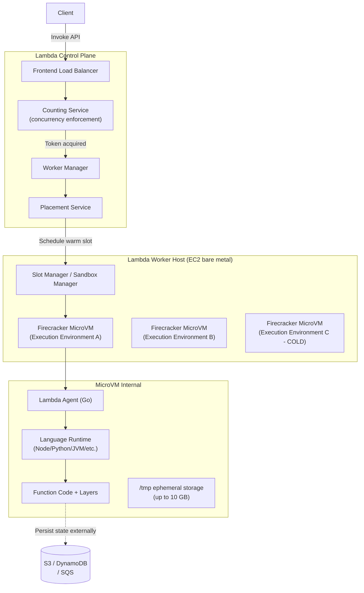
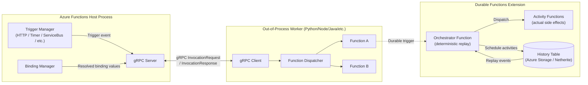
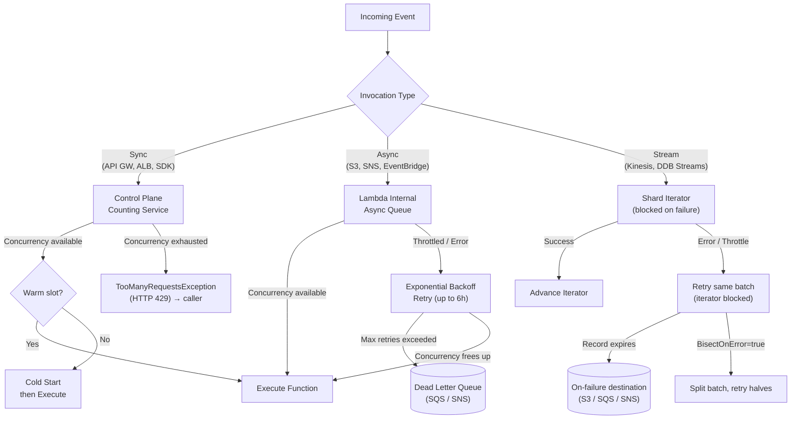
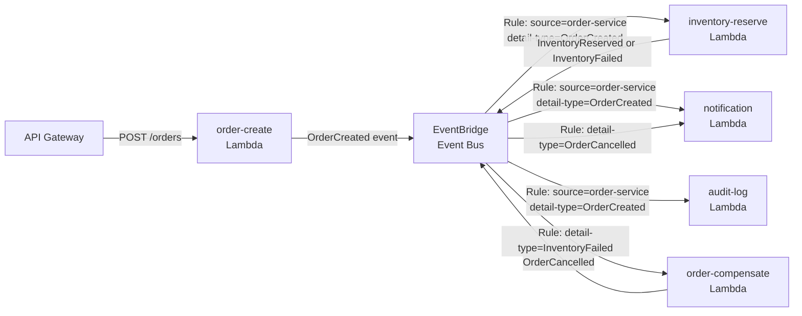
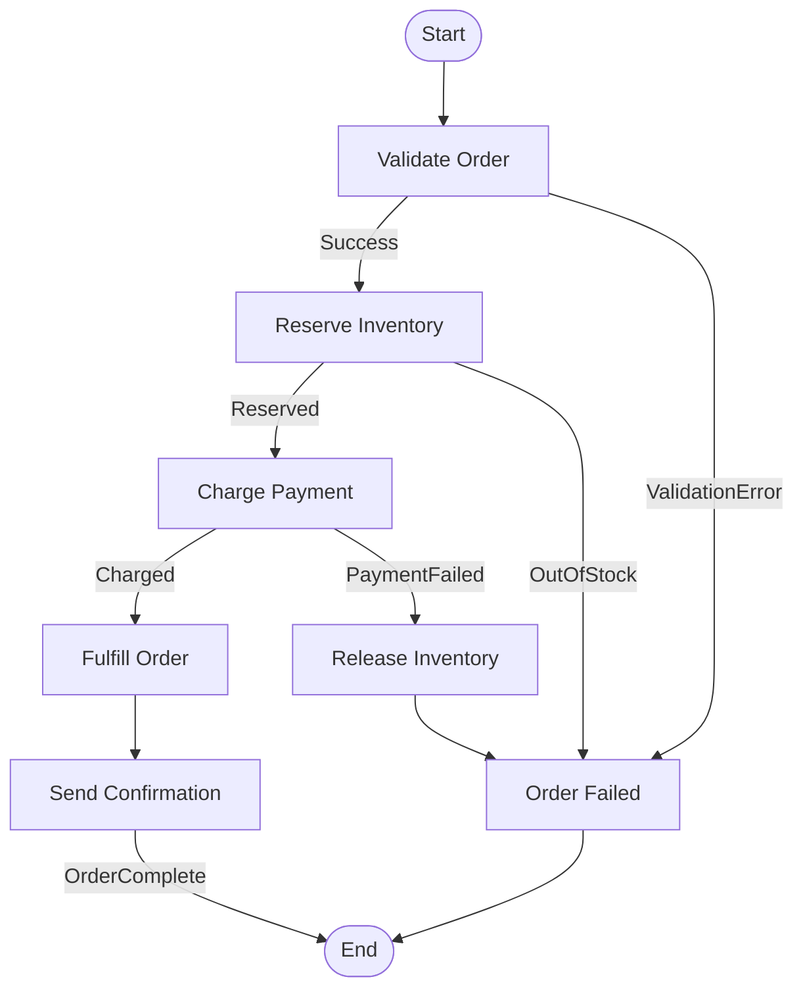
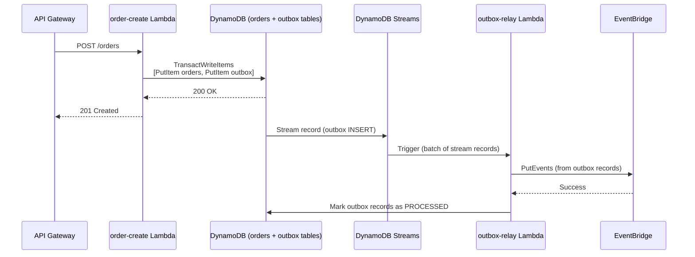

# Lesson 5: Serverless Architectures

## 1. First-Principles Intuition & Invariants

The word "serverless" is a deliberate misnomer. Servers exist; they always have. What serverless computing eliminates is the *operational surface area* of those servers as far as the application developer is concerned. This distinction is load-bearing: understanding it separates engineers who use serverless well from those who fight it constantly.

The model rests on a single architectural bet: that the marginal cost of abstracting server lifecycle management — provisioning, patching, capacity planning, OS hardening — is worth paying in exchange for per-invocation billing, automatic scaling, and the elimination of idle capacity. For workloads that are bursty, event-driven, or sparsely utilized, this bet is almost always correct. For workloads that are latency-sensitive, long-running, or require persistent in-process state, the tradeoffs become severe.

### The Three Invariants

**Statelessness as a hard constraint.** Each function invocation must treat its execution environment as ephemeral. The `/tmp` directory in AWS Lambda persists within a warm execution environment across invocations on the same underlying microVM, but this is an implementation detail that can vanish at any time — not a contract. Correct serverless functions externalize *all* durable state: to object storage, managed databases, caches (Elasticache/Redis), or message queues. Functions that violate this invariant introduce subtle bugs that only manifest under concurrent scale.

**Event as the unit of work.** Every function invocation is caused by a typed, structured event delivered by the control plane. The event carries the full semantic context required to process one discrete unit of work — an HTTP request record, an S3 object notification, a Kinesis shard record batch, a Pub/Sub message. The function is a pure transformation: `Event × Context → Effect`. This maps cleanly to the actor model and to stream processing semantics, which is not accidental.

**The provider as the distributed systems layer.** The FaaS runtime absorbs the complexity of scheduling, load balancing, retries, back-pressure, and horizontal scaling. The developer's contract with this layer is expressed entirely through configuration (memory allocation, timeout, concurrency limits, trigger bindings) and through proper handling of event delivery semantics (at-least-once vs. exactly-once). Attempting to re-implement any of this complexity inside the function defeats the purpose of the model.

### The Billing Model as an Architectural Force

Serverless billing is typically expressed as `GB-seconds × invocation_count`. On AWS Lambda, as of 2024, this is $0.0000166667 per GB-second and $0.20 per 1 million requests. This pricing structure has a direct architectural consequence: memory is a performance dial. Lambda allocates CPU proportionally to memory — a 1,769 MB function receives exactly one full vCPU. Doubling memory from 512 MB to 1024 MB may more than halve execution time, resulting in *lower* cost despite higher per-second price. Profiling memory allocation is therefore a first-class optimization task.

```text
Cost = (Memory_GB × Duration_s × $0.0000166667) + (Invocations × $0.0000002)
```

This is not a theoretical formula — it drives real architectural decisions about batching, chunking, and function decomposition.

---

## 2. Core Architecture & Mechanics

### AWS Lambda: The MicroVM Execution Model

AWS Lambda's architecture is publicly documented through the Firecracker open-source project. Each execution environment runs inside a **Firecracker microVM** — a KVM-based virtual machine monitor (VMM) that boots a stripped-down Linux kernel in under 125ms and achieves memory overhead under 5 MB per VM. This is the actual isolation boundary, not a container namespace. The design was published by Agache et al. in the 2020 NSDI paper *"Firecracker: Lightweight Virtualization for Serverless Applications"*.



The **cold start path** is the most consequential performance characteristic of Lambda. When no warm execution environment exists for a function:

1. The Worker Manager requests slot allocation from the Placement Service.
2. A new Firecracker microVM is booted on a worker host.
3. The Lambda Agent (written in Go) initializes inside the VM.
4. The function package (ZIP or container image) is downloaded and mounted.
5. The language runtime initializes (JVM class loading, Python import graph, Node module resolution).
6. The function's initialization code (`init()` block, global variable constructors, SDK client setup) executes.

Steps 1–4 are platform latency. Steps 5–6 are developer-controllable. For Python and Node.js runtimes with minimal dependencies, cold start is typically 100–400ms. For JVM runtimes with large dependency trees, cold start can exceed 10 seconds. This is why GraalVM native image compilation and AWS Lambda SnapStart (which snapshots the initialized JVM state using CRaC) exist.

**Warm invocation** reuses an existing microVM. The agent immediately dispatches the new event to the already-initialized runtime. Latency overhead is in the single-digit milliseconds.

#### Lambda Execution Environment Lifecycle (State Machine)

```mermaid
flowchart TD
    START((" ")) --> COLD_START["COLD START"]
    COLD_START -->|"MicroVM Boot + Runtime Init"| INIT["INIT"]
    INIT -->|"Handler Called"| INVOKE["INVOKE"]
    INVOKE -->|"Handler Returns"| IDLE["IDLE"]
    IDLE -->|"Warm Re-use<br/>(within ~15 min)"| INVOKE
    IDLE -->|"Idle Timeout /<br/>Scaling Down"| SHUTDOWN["SHUTDOWN"]
    INVOKE -->|"Unhandled Exception /<br/>Timeout"| ERROR["ERROR"]
    ERROR -->|"Runtime Poison"| SHUTDOWN
    SHUTDOWN --> END((" "))

    COLD_START -.->|"Platform: 50-500ms<br/>Developer: runtime + init code"| NOTE1[" "]
    IDLE -.->|"/tmp contents persist<br/>Global vars persist<br/>TCP connections reusable"| NOTE2[" "]
    
    style NOTE1 fill:none,stroke:none
    style NOTE2 fill:none,stroke:none
    style START fill:#000,stroke:#000
    style END fill:#000,stroke:#000
```



#### Concurrency Model

Lambda enforces concurrency at the account/region level and at the function level. The **reserved concurrency** setting is a hard ceiling — it both guarantees capacity and limits blast radius. **Provisioned concurrency** pre-warms a specified number of execution environments, eliminating cold starts at the cost of paying for idle time (at a reduced rate vs. regular compute).

The concurrency-scaling algorithm is a token-bucket style controller. Under burst conditions, Lambda can scale at **3,000 initial burst** concurrency (varies by region) followed by **500 additional concurrent instances per minute**. This rate limit surprises teams who assume infinitely instantaneous scaling. For sudden spikes (flash sales, viral events), SQS as a buffer absorbs the spike while Lambda drains it at its scaling capacity.

```python
# Production-grade Lambda handler pattern (Python 3.12)
# Demonstrates: connection reuse, structured logging, error classification,
# idempotency via conditional writes, and proper cold-start init separation.

import json
import logging
import os
import boto3
from botocore.exceptions import ClientError
from aws_lambda_powertools import Logger, Tracer, Metrics
from aws_lambda_powertools.metrics import MetricUnit
from aws_lambda_powertools.utilities.typing import LambdaContext
from aws_lambda_powertools.utilities.idempotency import (
    idempotent,
    DynamoDBPersistenceLayer,
    IdempotencyConfig,
)

# --- Cold-start initialization block ---
# Everything here executes ONCE per execution environment lifetime.
# SDK clients initialized here reuse TCP connections across warm invocations.

logger = Logger(service="order-processor")
tracer = Tracer(service="order-processor")
metrics = Metrics(namespace="OrderService", service="order-processor")

dynamodb = boto3.resource("dynamodb", region_name=os.environ["AWS_REGION"])
orders_table = dynamodb.Table(os.environ["ORDERS_TABLE"])
events_table = dynamodb.Table(os.environ["EVENTS_TABLE"])

idempotency_config = IdempotencyConfig(
    event_key_jmespath="body.order_id",
    raise_on_no_idempotency_key=True,
    expires_after_seconds=3600,
)
persistence_layer = DynamoDBPersistenceLayer(table_name=os.environ["IDEMPOTENCY_TABLE"])

# --- Handler ---

@logger.inject_lambda_context(log_event=True)
@tracer.capture_lambda_handler
@metrics.log_metrics(capture_cold_start_metric=True)
@idempotent(config=idempotency_config, persistence_store=persistence_layer)
def handler(event: dict, context: LambdaContext) -> dict:
    """
    Process an order creation event from API Gateway HTTP API (payload format 2.0).
    Idempotent: safe to invoke multiple times with the same order_id.
    """
    try:
        body = json.loads(event.get("body", "{}"))
        order_id = body["order_id"]
        user_id = body["user_id"]
        items = body["items"]

        if not items:
            return _response(400, {"error": "Order must contain at least one item"})

        total = sum(item["price"] * item["quantity"] for item in items)

        # Transactional write: order record + audit event as a single atomic unit
        orders_table.put_item(
            Item={
                "order_id": order_id,
                "user_id": user_id,
                "items": items,
                "total": str(total),  # DynamoDB Decimal workaround
                "status": "PENDING",
            },
            ConditionExpression="attribute_not_exists(order_id)",
        )

        metrics.add_metric(name="OrderCreated", unit=MetricUnit.Count, value=1)
        metrics.add_metadata(key="order_id", value=order_id)

        logger.info("Order created", extra={"order_id": order_id, "total": total})

        return _response(201, {"order_id": order_id, "status": "PENDING"})

    except KeyError as e:
        logger.warning("Missing required field", extra={"field": str(e)})
        return _response(400, {"error": f"Missing required field: {e}"})

    except ClientError as e:
        code = e.response["Error"]["Code"]
        if code == "ConditionalCheckFailedException":
            # Order already exists — idempotent response
            logger.info("Duplicate order_id", extra={"order_id": body.get("order_id")})
            return _response(200, {"order_id": order_id, "status": "ALREADY_EXISTS"})
        # Non-retriable DynamoDB errors — let Lambda retry via SQS visibility timeout
        logger.exception("DynamoDB error", extra={"error_code": code})
        raise  # Re-raise for Lambda retry/DLQ handling

def _response(status_code: int, body: dict) -> dict:
    return {
        "statusCode": status_code,
        "headers": {"Content-Type": "application/json"},
        "body": json.dumps(body),
    }
```

### Azure Functions: The Durable Extension and Worker Model

Azure Functions introduces a concept that neither Lambda nor Cloud Functions match in the base platform: **Durable Functions**, an extension that provides stateful orchestration primitives built on the **Event Sourcing** pattern atop Azure Storage (queues + tables + blobs) or Netherite (EventHubs + RocksDB).

The host runtime (`azure-functions-host`, written in C#) uses an **out-of-process worker model** for non-.NET languages. The host process manages bindings, trigger polling, and lifecycle. Function code runs in a separate worker process (the language-specific worker: `azure-functions-python-worker`, `azure-functions-node-worker`, etc.) that communicates with the host over gRPC using a protobuf-defined protocol (`FunctionRpc.proto`). This is architecturally significant: binding resolution (reading a Blob, writing to Service Bus) happens in the host, not the worker, which centralizes SDK complexity but introduces serialization overhead on every invocation.



**Durable Functions orchestrators** are a noteworthy architectural pattern. The orchestrator function is replayed from scratch on every scheduling decision, reconstructing its local state by re-executing the function code against the persisted event history. This means orchestrator code *must be deterministic* — no random number generation, no `DateTime.Now`, no direct I/O. These side effects must be delegated to Activity functions. The pattern is conceptually equivalent to virtual actor frameworks (Orleans) and workflow engines (Temporal), but expressed as ordinary async code.

```csharp
// Azure Durable Functions: Fan-out/Fan-in orchestration pattern
// Processes a batch of documents in parallel with error isolation.
[FunctionName("ProcessDocumentBatch")]
public static async Task<BatchResult> RunOrchestrator(
    [OrchestrationTrigger] IDurableOrchestrationContext context,
    ILogger log)
{
    var input = context.GetInput<BatchRequest>();
    
    // Fan-out: launch all document processing activities in parallel.
    // Each activity runs in its own isolated execution environment.
    var tasks = input.DocumentIds
        .Select(docId => context.CallActivityWithRetryAsync<DocumentResult>(
            "ProcessSingleDocument",
            new RetryOptions(firstRetryInterval: TimeSpan.FromSeconds(5), maxNumberOfAttempts: 3)
            {
                BackoffCoefficient = 2.0,
                MaxRetryInterval = TimeSpan.FromSeconds(30),
                Handle = ex => ex is TransientProcessingException,
            },
            docId))
        .ToList();

    // Fan-in: await all, with error isolation (no AggregateException short-circuit)
    var results = new List<DocumentResult>();
    var errors = new List<string>();
    
    foreach (var task in tasks)
    {
        try
        {
            results.Add(await task);
        }
        catch (FunctionFailedException ex)
        {
            log.LogError(ex, "Document processing failed after retries");
            errors.Add(ex.Message);
        }
    }

    return new BatchResult
    {
        Succeeded = results.Count,
        Failed = errors.Count,
        Errors = errors,
        CompletedAt = context.CurrentUtcDateTime, // Must use context time, not DateTime.UtcNow
    };
}
```

### Google Cloud Functions / Cloud Run Functions

Google Cloud Functions (rebranded as **Cloud Run Functions** in 2024, running on the Cloud Run infrastructure) uses a **per-request container scheduling model**. Functions are deployed as container images to Cloud Run, and Cloud Run's autoscaler manages the pool of container instances. The key architectural distinction from Lambda is that Cloud Run instances can handle **multiple concurrent requests** per container (configurable via `--concurrency`, up to 1000), whereas Lambda's execution environment handles exactly one request at a time. This eliminates one of Lambda's most significant scaling constraints for I/O-bound workloads.

Cloud Functions Gen 2 (the current generation) exposes this directly:

```go
// Cloud Run Function (Gen 2) in Go — demonstrates:
// 1. Framework-registered handler (not main() based)
// 2. Concurrent request handling within a single instance
// 3. Structured logging with Cloud Logging integration
// 4. Graceful shutdown via signal handling

package processor

import (
    "context"
    "encoding/json"
    "fmt"
    "log/slog"
    "net/http"
    "os"
    "os/signal"
    "syscall"
    "time"

    "github.com/GoogleCloudPlatform/functions-framework-go/funcframework"
    "cloud.google.com/go/pubsub"
    "go.opentelemetry.io/otel"
    "go.opentelemetry.io/otel/attribute"
    "go.opentelemetry.io/otel/codes"
)

// Global clients initialized once per container instance.
// Safe for concurrent use — the Go SDK clients are goroutine-safe.
var (
    pubsubClient *pubsub.Client
    tracer       = otel.Tracer("order-processor")
    logger       = slog.New(slog.NewJSONHandler(os.Stdout, &slog.HandlerOptions{
        Level: slog.LevelInfo,
    }))
)

func init() {
    ctx := context.Background()
    var err error
    pubsubClient, err = pubsub.NewClient(ctx, os.Getenv("GOOGLE_CLOUD_PROJECT"))
    if err != nil {
        // Fatal during init: container will fail to start, Cloud Run will not route traffic.
        logger.Error("failed to initialize Pub/Sub client", "error", err)
        os.Exit(1)
    }

    // Register the HTTP handler with the Functions Framework.
    // The framework wires this to the HTTP server it manages.
    funcframework.RegisterHTTPFunctionContext(ctx, "/", HandleOrderEvent)
}

// HandleOrderEvent processes incoming order webhook events.
// This function is called concurrently for multiple simultaneous requests.
func HandleOrderEvent(w http.ResponseWriter, r *http.Request) {
    ctx, span := tracer.Start(r.Context(), "HandleOrderEvent")
    defer span.End()

    if r.Method != http.MethodPost {
        http.Error(w, "method not allowed", http.StatusMethodNotAllowed)
        return
    }

    var order OrderEvent
    dec := json.NewDecoder(r.Body)
    dec.DisallowUnknownFields()
    if err := dec.Decode(&order); err != nil {
        span.SetStatus(codes.Error, "invalid request body")
        logger.WarnContext(ctx, "invalid request body", "error", err)
        http.Error(w, fmt.Sprintf("invalid body: %v", err), http.StatusBadRequest)
        return
    }

    span.SetAttributes(
        attribute.String("order.id", order.ID),
        attribute.String("order.user_id", order.UserID),
    )

    if err := publishToTopic(ctx, order); err != nil {
        span.RecordError(err)
        span.SetStatus(codes.Error, "publish failed")
        logger.ErrorContext(ctx, "failed to publish event", "order_id", order.ID, "error", err)
        http.Error(w, "internal error", http.StatusInternalServerError)
        return
    }

    logger.InfoContext(ctx, "order event processed", "order_id", order.ID)
    w.Header().Set("Content-Type", "application/json")
    w.WriteHeader(http.StatusAccepted)
    json.NewEncoder(w).Encode(map[string]string{"status": "accepted", "order_id": order.ID})
}

func publishToTopic(ctx context.Context, order OrderEvent) error {
    topic := pubsubClient.Topic(os.Getenv("PUBSUB_TOPIC"))
    defer topic.Stop()

    data, err := json.Marshal(order)
    if err != nil {
        return fmt.Errorf("marshal: %w", err)
    }

    result := topic.Publish(ctx, &pubsub.Message{
        Data: data,
        Attributes: map[string]string{
            "order_id": order.ID,
            "version":  "1",
        },
    })

    // Block until the publish is acknowledged by the Pub/Sub server.
    if _, err := result.Get(ctx); err != nil {
        return fmt.Errorf("pubsub publish: %w", err)
    }
    return nil
}

type OrderEvent struct {
    ID        string    `json:"order_id"`
    UserID    string    `json:"user_id"`
    Items     []Item    `json:"items"`
    CreatedAt time.Time `json:"created_at"`
}

type Item struct {
    SKU      string  `json:"sku"`
    Quantity int     `json:"quantity"`
    Price    float64 `json:"price"`
}
```

### Platform Comparison Matrix

| Dimension | AWS Lambda | Azure Functions | Google Cloud Run Functions (Gen 2) |
|---|---|---|---|
| Isolation unit | Firecracker microVM | Container (ACI / AKS) | gVisor container (runsc) |
| Concurrency per instance | 1 (hard) | 1 (default), configurable | Up to 1,000 concurrent requests |
| Max execution time | 15 minutes | 10 min (Consumption), unlimited (Premium/Dedicated) | 60 minutes |
| Cold start mitigation | Provisioned Concurrency, SnapStart (JVM) | Premium plan pre-warmed instances | Min instances, CPU always allocated |
| Max memory | 10,240 MB | 14 GB (EP3 Premium) | 32 GB |
| Stateful orchestration | Step Functions (external) | Durable Functions (native) | Workflows (external) |
| Deployment artifact | ZIP / container image | ZIP / container image | container image (Gen 2) |
| VPC integration | VPC Lambda (via ENI / Hyperplane) | VNet Integration | VPC connector / Direct VPC egress |

---

## 3. High-Performance Optimization & Failure Modes

### Cold Start Anatomy and Mitigations

Cold start latency decomposes into two independently addressable phases:

**Platform phase** (developer cannot control): microVM/container boot, agent initialization, network attachment, package download. Ranges from ~50ms (Lambda, pre-cached layer) to ~2s (large container image on first pull to a worker host).

**Init phase** (developer controls entirely): language runtime startup, dependency loading, initialization code execution. This is where most optimization effort is correctly applied.

```mermaid
gantt
    title Lambda Cold Start Decomposition (Node.js, 128MB, 50MB package)
    dateFormat  SSS
    axisFormat %Lms

    section Platform (opaque)
    MicroVM boot           :p1, 000, 80ms
    Agent init             :p2, after p1, 20ms
    Package download/mount :p3, after p2, 150ms

    section Init (developer-owned)
    Node.js V8 startup     :i1, after p3, 40ms
    require() resolution   :i2, after i1, 120ms
    SDK client init        :i3, after i2, 80ms
    DB connection pool     :i4, after i3, 90ms

    section Invocation
    Handler execution      :h1, after i4, 15ms
```



**Practical mitigations, ranked by impact:**

1. **Reduce package size.** Tree-shake dependencies. Use `esbuild` or `webpack` for Node.js. Use `--only-dependencies` for Python. Each MB added to a Lambda deployment package adds measurable download latency on cold starts to uncached worker hosts. The AWS Lambda team has stated that packages under ~5 MB are typically served from local cache on workers; beyond this threshold, S3 fetches become more probable.

2. **Lazy-load non-critical dependencies.** AWS SDK v3 for JavaScript uses modular imports (`@aws-sdk/client-s3` instead of the monolithic v2 `aws-sdk`) specifically to enable this. Import only what the first invocation path needs in the global scope; defer the rest.

3. **Use Provisioned Concurrency for latency-sensitive paths.** The cost arithmetic: Provisioned Concurrency for 10 instances of a 512 MB Lambda running 24/7 costs roughly $65/month on top of normal compute. For a user-facing API endpoint where P99 cold start would be 2 seconds, this is almost always the right call.

4. **JVM-specific: Lambda SnapStart.** SnapStart takes a snapshot of the initialized execution environment's memory using Amazon Linux's CRIU (Checkpoint/Restore In Userspace) integration, encrypted with the function's KMS key, and stores it in a tiered cache. Subsequent cold starts restore from this snapshot rather than re-executing init code. SnapStart reduces JVM cold starts from 8–12s to under 1s for typical Spring Boot applications. It is currently available for Java 11 and 21 managed runtimes only.

5. **Avoid VPC attachment when unnecessary.** Lambda functions attached to a VPC require an ENI (Elastic Network Interface) to route traffic into the VPC. Historically this added 10–30 seconds to cold starts. AWS resolved this in 2019–2020 with Hyperplane, a shared network interface technology that pre-allocates ENIs per VPC subnet/security-group combination. VPC attachment cold start penalty is now typically under 500ms, but ENI availability is still a scalability constraint — exhausting subnet IP space under burst conditions is a real production failure mode.

### Concurrency Control and Throttling

Lambda's concurrency model is a token-bucket rate limiter at the account-region level. When the reserved concurrency of a function is set to N, the control plane's Counting Service enforces that at most N microVMs execute the function simultaneously. Excess requests receive a **TooManyRequestsException** (HTTP 429) synchronously for RequestResponse invocations, or are **throttled** (not queued by Lambda itself) for Event invocations.

This distinction is critical for failure handling:

- **Synchronous invocations** (API Gateway → Lambda): throttles return 429 to the caller immediately. The caller (API Gateway) can be configured to return a 429 or 503 to the end user.
- **Asynchronous invocations** (S3 event, SNS): Lambda's internal event queue holds the event and retries with exponential backoff for up to 6 hours before sending to the DLQ. This can silently accumulate large queues during prolonged throttling.
- **Stream invocations** (Kinesis, DynamoDB Streams): the shard iterator blocks — the stream does not advance — until the function succeeds or the record expires from the stream. This provides natural back-pressure but can cause processing lag to grow unboundedly under sustained throttling.



### Memory Sizing as a Performance Variable

The relationship between Lambda memory, allocated CPU, and cost is non-linear and requires empirical measurement. The AWS Lambda Power Tuning open-source tool (by Alex Casalboni, available as a Step Functions state machine) automates this by invoking the same function at multiple memory configurations and comparing cost-performance tradeoffs.

The general pattern observed in practice:

- **CPU-bound functions** (image processing, compression, encryption): larger memory = more CPU = faster execution = lower cost per invocation due to shorter GB-seconds.
- **I/O-bound functions** (database queries, external HTTP calls): additional CPU beyond one vCPU provides negligible improvement. Memory should be sized to avoid OOM, not to increase CPU.
- **JVM/Python-startup-bound functions**: memory affects resident set size but not startup time (which is I/O and class-loading bound). Don't conflate the two.

### Failure Modes Taxonomy

| Failure Mode | Root Cause | Detection | Mitigation |
|---|---|---|---|
| Cold start cascade | Burst traffic on function with no provisioned concurrency | P99/P999 latency spike in CloudWatch | Provisioned Concurrency, SQS buffer for async, graceful degradation |
| Timeout under load | Downstream dependency slow; function CPU-starved at low memory | Timeout metric, Duration P99 | Increase memory (more CPU), set downstream timeouts shorter than Lambda timeout, circuit breaker |
| Silent partial failure | Exception swallowed inside handler; non-zero exit without raising | Missing error metrics; dead DLQ | Structured error handling, always re-raise unrecoverable errors, DLQ monitoring |
| Runaway concurrency | Recursive invocation bug (Lambda triggers itself) | Concurrency metric spike, bill shock | Reserved concurrency ceiling on the function, explicit recursion detection |
| ENI exhaustion | Subnet IP space consumed during burst | ENI creation errors in VPC Flow Logs | Use larger subnets (/24 or /20 for Lambda), use multiple subnets across AZs |
| DLQ silently full | DLQ not monitored; messages discarded | No visibility | CloudWatch alarm on `ApproximateNumberOfMessagesNotVisible` on DLQ |
| Idempotency violation | Duplicate event delivery (at-least-once semantics) + non-idempotent handler | Duplicate database records, inconsistent state | Conditional writes, idempotency keys, AWS Lambda Powertools idempotency decorator |
| Downstream connection exhaustion | New DB connection per warm invocation; connection pool not shared globally | DB connection count metrics, timeouts | Initialize connection pool in init code (global scope), use RDS Proxy |

### The Connection Pool Anti-Pattern

This deserves special emphasis because it is the most common production Lambda performance issue. Each Lambda execution environment is a separate process. If a handler opens a database connection inside the handler function (not in the global scope), every warm invocation opens a new connection. Under 500 concurrent executions, this creates 500 simultaneous connections to the database — far exceeding the connection limits of RDS Postgres (default max_connections is `LEAST({DBInstanceClassMemory/9531392}, 5000)`, which for a db.t3.micro is approximately 170).

**Wrong pattern:**
```python
def handler(event, context):
    # BAD: New connection on every invocation
    conn = psycopg2.connect(os.environ["DB_DSN"])
    cursor = conn.cursor()
    # ... work ...
    conn.close()
```

**Correct pattern:**
```python
import psycopg2
from psycopg2 import pool as pg_pool
import os

# GOOD: Connection pool initialized once per execution environment.
# Reused across all warm invocations in this environment.
# Max pool size of 5 means this environment contributes at most 5 connections,
# regardless of invocation rate within the environment.
_connection_pool: pg_pool.ThreadedConnectionPool | None = None

def _get_pool() -> pg_pool.ThreadedConnectionPool:
    global _connection_pool
    if _connection_pool is None or _connection_pool.closed:
        _connection_pool = pg_pool.ThreadedConnectionPool(
            minconn=1,
            maxconn=5,
            dsn=os.environ["DB_DSN"],
            connect_timeout=5,
        )
    return _connection_pool

def handler(event: dict, context) -> dict:
    pool = _get_pool()
    conn = pool.getconn()
    try:
        with conn.cursor() as cur:
            cur.execute(
                "INSERT INTO orders (id, user_id, total) VALUES (%s, %s, %s)",
                (event["order_id"], event["user_id"], event["total"]),
            )
        conn.commit()
        return {"statusCode": 201}
    except Exception:
        conn.rollback()
        raise
    finally:
        pool.putconn(conn)
```

For relational databases, **RDS Proxy** is the correct architectural solution. RDS Proxy maintains a persistent pool of connections to the database and multiplexes Lambda's ephemeral connections onto this pool, enabling thousands of concurrent Lambda executions to share tens of database connections via connection pinning and transaction multiplexing.

---

## 4. Event-Driven Composition Patterns

Serverless functions gain their real leverage through composition. A single Lambda function is not an architecture; it is a building block. The patterns below represent the dominant composition strategies observed in production systems.

### Pattern 1: Choreography via Event Bus

Functions react to events published on a shared bus (EventBridge, SNS, Kafka). No central orchestrator exists. Each service owns its reaction to events it cares about.



Choreography scales well and has no single point of failure, but it makes system-wide tracing and debugging harder. EventBridge supports event archiving and replay, which is essential for debugging production incidents in choreographed systems.

### Pattern 2: Orchestration via Step Functions

For workflows that require explicit state management, compensation logic (sagas), human approval steps, or branching based on intermediate results, AWS Step Functions (Standard or Express Workflows) provides a managed orchestrator.



Step Functions Standard Workflows provide exactly-once execution semantics for each state transition (via the history ledger persisted in the service's internal DynamoDB). Express Workflows provide at-least-once semantics at much higher throughput (100,000 state transitions/second) and lower cost, suitable for high-volume event processing.

### Pattern 3: The Outbox Pattern for Transactional Consistency

A common correctness trap: a Lambda writes to a database and then publishes an event. If the event publish fails after the DB write, the system is inconsistent. The outbox pattern solves this by writing the event into a database table (the "outbox") within the same transaction as the domain data, then having a separate process (a DynamoDB Streams-triggered Lambda, or a polling process) relay the outbox entries to the event bus.



---

## 5. Observability in Serverless Systems

Observability is harder in serverless than in traditional services for three reasons: the execution environment is ephemeral (you cannot SSH in), execution is distributed across many microVMs simultaneously, and the platform-managed components (triggers, event routers) are opaque.

**Structured logging** is non-negotiable. Every log line should be a JSON object with a consistent schema including `request_id` (from the Lambda context), `function_name`, `function_version`, `trace_id` (from X-Ray or OpenTelemetry), `level`, and `message`. CloudWatch Logs Insights queries are SQL-like and operate on JSON fields; unstructured logs cannot be efficiently queried.

**Distributed tracing** requires the trace context to be propagated through every event envelope. For HTTP-triggered functions, this means reading the `traceparent` header (W3C Trace Context standard) and injecting it into all downstream calls. For SQS/SNS-triggered functions, the trace context must be embedded as a message attribute, and the consuming function must extract and continue the trace. AWS X-Ray SDK and OpenTelemetry both support this propagation pattern.

**Key metrics per function** (must be alarmed on):
- `Errors` (count): non-zero sustained rate indicates a code defect or dependency failure.
- `Throttles` (count): indicates concurrency limit reached; either raise the limit or add buffering.
- `Duration` P99 and P999: rising tail latency often precedes timeout errors.
- `ConcurrentExecutions`: approaching the reserved or account limit.
- `IteratorAge` (Kinesis/DDB Streams triggers): growing age means the function is falling behind the stream — the most critical operational metric for stream processing.

```python
# CloudFormation / CDK alarm for IteratorAge — the most critical stream metric
# Rising IteratorAge means the stream consumer is falling behind real-time.
# At Lambda's default 15-minute timeout, an IteratorAge > 900000ms (15 min)
# means data is at risk of falling off the stream's retention window.

from aws_cdk import (
    aws_cloudwatch as cw,
    aws_cloudwatch_actions as cw_actions,
    aws_lambda as lambda_,
    aws_sns as sns,
    Duration,
)

def create_stream_processing_alarms(
    function: lambda_.Function,
    alert_topic: sns.Topic,
) -> list[cw.Alarm]:
    
    iterator_age_alarm = cw.Alarm(
        function,
        "IteratorAgeAlarm",
        metric=function.metric_iterator_age(
            period=Duration.minutes(1),
            statistic="Maximum",
        ),
        threshold=300_000,  # 5 minutes in milliseconds
        evaluation_periods=3,
        datapoints_to_alarm=2,
        comparison_operator=cw.ComparisonOperator.GREATER_THAN_THRESHOLD,
        alarm_description=(
            f"{function.function_name}: Stream iterator age exceeds 5 minutes. "
            "Consumer is falling behind. Check for errors, throttling, or slow processing."
        ),
        treat_missing_data=cw.TreatMissingData.NOT_BREACHING,
    )
    iterator_age_alarm.add_alarm_action(cw_actions.SnsAction(alert_topic))

    error_rate_alarm = cw.Alarm(
        function,
        "ErrorRateAlarm",
        metric=cw.MathExpression(
            expression="errors / invocations * 100",
            using_metrics={
                "errors": function.metric_errors(period=Duration.minutes(5)),
                "invocations": function.metric_invocations(period=Duration.minutes(5)),
            },
            period=Duration.minutes(5),
            label="Error Rate (%)",
        ),
        threshold=1.0,  # 1% error rate
        evaluation_periods=3,
        datapoints_to_alarm=2,
        comparison_operator=cw.ComparisonOperator.GREATER_THAN_THRESHOLD,
        alarm_description=f"{function.function_name}: Error rate exceeds 1%.",
        treat_missing_data=cw.TreatMissingData.NOT_BREACHING,
    )
    error_rate_alarm.add_alarm_action(cw_actions.SnsAction(alert_topic))

    return [iterator_age_alarm, error_rate_alarm]
```

---

## 6. Security Architecture

Serverless does not simplify security; it redistributes the security surface area. The provider owns OS/kernel security; the developer owns everything else.

**IAM least-privilege is paramount.** Each Lambda function should have its own IAM execution role with the minimum permissions required. The anti-pattern — a single role with `s3:*`, `dynamodb:*`, and `sqs:*` on `Resource: "*"` — is unfortunately common. The blast radius of a compromised function (via event injection, dependency confusion, or code vulnerability) is bounded entirely by its IAM role.

**Event injection attacks** are the serverless equivalent of injection attacks in traditional applications. If a function receives user-controlled input in an event and passes it unsanitized to a database query, shell command, or SSRF-vulnerable HTTP client, it is vulnerable. The fact that the function is ephemeral provides no protection — the attacker's goal is data exfiltration during execution, not persistence.

**Dependency supply-chain risk** is elevated in serverless because package download happens automatically during deployment. `npm audit`, `pip-audit`, and software composition analysis (SCA) tooling must be integrated into the CI pipeline. Lambda function packages should be built deterministically from pinned lockfiles and published to a controlled artifact store before deployment, not built from `npm install` during deployment.

**Secrets management**: environment variables in Lambda are encrypted at rest by the KMS CMK associated with the function (or the default Lambda service key). However, they are decrypted before injection into the execution environment and are therefore accessible to any code running in the function, including compromised dependencies. For highly sensitive secrets, the correct pattern is to fetch from AWS Secrets Manager or Parameter Store with caching inside the init code, controlling the fetch IAM permission tightly.

```python
# Secrets Manager cached fetch pattern for Lambda
# Uses the AWS Parameters and Secrets Lambda Extension (a sidecar process)
# to cache secrets locally without network calls on every warm invocation.
# The extension exposes secrets via a local HTTP server on port 2773.

import json
import os
import urllib.request
import urllib.error
from functools import lru_cache

EXTENSION_PORT = 2773
SECRETS_EXTENSION_HTTP_HEADER = "X-Aws-Parameters-Secrets-Token"
SESSION_TOKEN = os.environ.get("AWS_SESSION_TOKEN", "")

@lru_cache(maxsize=10)
def get_secret(secret_id: str) -> dict:
    """
    Fetch a secret from Secrets Manager via the Lambda extension cache.
    The lru_cache ensures this is called at most once per secret per
    execution environment lifetime. The extension handles TTL-based refresh.
    """
    url = (
        f"http://localhost:{EXTENSION_PORT}/secretsmanager/get?"
        f"secretId={urllib.parse.quote(secret_id, safe='')}"
    )
    req = urllib.request.Request(
        url,
        headers={SECRETS_EXTENSION_HTTP_HEADER: SESSION_TOKEN},
    )
    try:
        with urllib.request.urlopen(req, timeout=2) as response:
            payload = json.loads(response.read())
            return json.loads(payload["SecretString"])
    except urllib.error.URLError as e:
        raise RuntimeError(f"Failed to fetch secret {secret_id}: {e}") from e
```

---

## Summary

Serverless architectures trade operational control for operational simplicity. The tradeoff is favorable for a large class of workloads — event-driven pipelines, API backends with variable traffic, scheduled jobs, stream processors — and unfavorable for latency-sensitive real-time systems, long-running batch compute, and applications with high steady-state concurrency (where reserved instances are economically superior).

The mental model that produces correct serverless designs has three components: treat execution environments as ephemeral (externalize all state), treat the event as the complete unit of work (design for at-least-once delivery), and treat the IAM role as the security perimeter (scope it to the minimum). Engineers who internalize these three invariants build systems that are correct, scalable, and maintainable. Those who fight them — by leaking state into local disk, assuming exactly-once delivery, or using overly permissive IAM — create systems that fail in subtle and expensive ways at scale.
