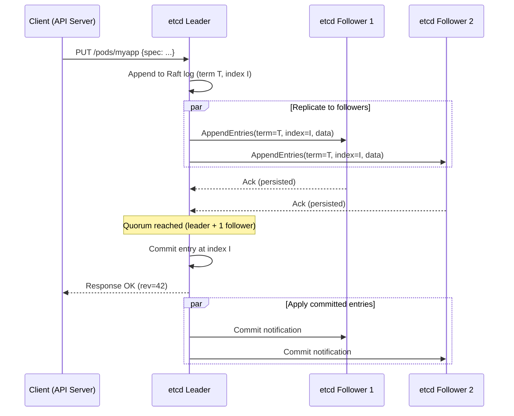

# Lesson 6: Advanced Cloud Native Practices

## 1. First-Principles Intuition & Invariants

Cloud native architecture is not merely about running applications in containers on cloud infrastructure. It represents a fundamental reorientation of how distributed systems are designed, deployed, and operated. The transition from monolithic architectures to microservices is driven by the need for independent deployability, fault isolation, and elastic scaling. This shift rests on three foundational invariants: declarative state management with continuous reconciliation, consensus-based state replication, and kernel-level resource isolation through containerization.

### Declarative State Machines and Continuous Reconciliation

Cloud native systems invert the traditional imperative model of system administration. Instead of issuing commands that mutate state step by step, operators declare the desired end state, and the system continuously works to converge actual state toward that declaration. This is the level-triggered reconciliation pattern, distinct from edge-triggered event handling. An edge-triggered system reacts only to state transitions; a level-triggered system reacts to the current state itself, re-evaluating and correcting regardless of how the discrepancy arose.

Kubernetes embodies this pattern through its controller architecture. The desired state of the cluster is expressed in YAML manifests that define resources such as Pods, Services, and Deployments. These manifests are submitted to the API server, validated by admission controllers, persisted in etcd, and then acted upon by a set of dedicated controllers running in the controller manager. Each controller implements a reconciliation loop:

```mermaid
flowchart TD
    A["Operator / kubectl"] -->| "Submit YAML manifest" | B["API Server"]
    B -->| "Validate via Admission Webhooks" | C["etcd (Raft consensus)"]
    B -->| "Watch event stream" | D["Controller Manager"]
    D --> E["Deployment Controller"]
    D --> F["ReplicaSet Controller"]
    D --> G["Node Controller"]
    E -->| "Create ReplicaSets" | F
    F -->| "Create Pods (desired count)" | B
    B -->| "Schedule pods" | H["Scheduler"]
    H -->| "Bind pod to node" | B
    B -->| "Sync pod spec" | I["Kubelet (on target node)"]
    I -->| "CRI gRPC call" | J["Container Runtime\n(containerd / CRI-O)"]
    J --> K["Pause container\n(holds network namespace)"]
    J --> L["Application containers\n(join pause namespace)"]
```

The reconciliation loop follows a strict sequence: observe current state, compare against desired state, compute the delta, and apply corrective actions. The controller does not issue a single command and then stop; it watches for changes via a watch API (built on long-poll HTTP or gRPC streaming) and re-evaluates on every event. This means the system is self-correcting: if a pod crashes, the ReplicaSet controller detects the discrepancy between desired replica count (3) and actual count (2) and creates a new pod. If a node dies, the node controller marks the node as NotReady, and after a configurable grace period (`--pod-eviction-timeout`, default 5 minutes), the pods bound to that node are deleted and rescheduled.

The critical invariant here is idempotency. Applying the same desired state multiple times must produce the same result. Controllers achieve this by never mutating state directly based on a single observation; they always re-read, compute a diff, and act on the diff. This is why Kubernetes controllers can be safely restarted at any time without risk of duplicate operations.

### Consensus and Multi-Version Concurrency Control (MVCC)

The reliability of the entire Kubernetes control plane depends on etcd, a distributed key-value store that serves as the single source of truth for cluster state. Etcd implements the Raft consensus algorithm to replicate state across a cluster of nodes, ensuring consistency and fault tolerance even when nodes fail or network partitions occur.

Raft operates with a leader-follower model. One node is elected leader through a randomized timeout-based election process. The leader handles all write requests, appends them to its log, and replicates them to followers. A write is committed only after a quorum of nodes acknowledge it. The quorum requirement is:

$$Q = \lfloor N/2 \rfloor + 1$$

For a 3-node etcd cluster, $Q = 2$, meaning the cluster tolerates 1 node failure. For a 5-node cluster, $Q = 3$, tolerating 2 failures. This is why production etcd clusters are typically deployed with 3 or 5 (odd numbers, to maximize fault tolerance without wasting a node).



Etcd implements Multi-Version Concurrency Control (MVCC) to provide consistent reads without blocking writes. Every modification to a key creates a new revision. The revision is a globally monotonic counter that increments with every transaction across the entire keyspace, not per-key. A client can read at a specific revision, enabling snapshot isolation: a read started at revision 42 will see the state of the store as it existed at that point, even as concurrent writes create revisions 43, 44, and beyond. This is implemented using a B-tree index in the `bbolt` database (etcd's persistent storage backend), where each key maps to a list of (revision, value) pairs.

The practical implication is that Kubernetes API server watch operations are reliable and consistent. A client watching a resource receives a stream of events ordered by revision number. If the watch connection drops, the client can reconnect and resume from the last received revision, ensuring no events are lost. This is the mechanism that makes controller reconciliation loops robust.

### Container Runtimes and Kernel-Level Isolation

Containerization provides lightweight isolation by leveraging Linux kernel primitives rather than full hardware virtualization. Kubernetes interacts with container runtimes through the Container Runtime Interface (CRI), a gRPC API specification. The two dominant CRI implementations are containerd (donated by Docker to CNCF) and CRI-O (developed by the Kubernetes community, jointly with Red Hat, Intel, and SUSE).

Container isolation relies on two kernel mechanisms:

**Control Groups (cgroups)** enforce resource limits. A cgroup is a kernel data structure that tracks and limits the resource usage of a group of processes. Kubernetes maps each container's resource requests and limits to cgroup configuration:

- **CPU limits** are translated into cgroup CPU shares (for relative weighting) and the `cpu.cfs_quota_us` / `cfs_period_us` pair (for hard caps). A limit of `500m` (0.5 CPU) sets `cpu.cfs_quota_us = 50000` and `cfs_period_us = 100000`, meaning the container can use at most 50ms of CPU per 100ms period.
- **Memory limits** set `memory.limit_in_bytes`. When a container exceeds this limit, the OOM killer terminates the process with the highest OOM score within that cgroup.
- CPU requests (not limits) determine scheduling priority via `cpu.shares`. A pod requesting 500m gets `cpu.shares = 512`, while a pod requesting 1000m gets `cpu.shares = 1024`. The CFS scheduler uses these shares to proportionally distribute CPU time when there is contention.

**Namespaces** provide visibility isolation. Each container gets its own set of namespaces that restrict what it can see:

| Namespace | Isolates |
|-----------|----------|
| `mnt` | Mount points (filesystem view) |
| `pid` | Process IDs |
| `net` | Network stack (interfaces, routes, ports) |
| `ipc` | System V IPC, POSIX message queues |
| `uts` | Hostname, domain name |
| `user` | UID/GID mapping (unprivileged containers) |
| `cgroup` | Cgroup view (cgroup namespace, added in kernel 4.6) |

The pause container (image `registry.k8s.io/pause`) is the architectural linchpin of the Kubernetes Pod model. When a Pod is created, the kubelet instructs the container runtime to first start the pause container. This container does nothing except sleep indefinitely, but it holds the Pod's shared namespaces: network, IPC, and UTS. All subsequent application containers in the Pod are configured to join these namespaces from the pause container via the `--containerd-share` or `--pod-infra-container-id` mechanism. This design ensures that containers within a Pod share a single network namespace (communicating via `localhost`) and that the Pod's network identity persists even if an application container crashes and restarts. The pause container's PID namespace is not shared by default; each container gets its own PID namespace unless `shareProcessNamespace: true` is set in the Pod spec.

```mermaid
flowchart TB
    subgraph sub_kubelet ["Kubelet"]
        A["Pod spec received"] --> B["CRI gRPC: RunPodSandbox"]
    end
    B --> C["Container Runtime (containerd)"]
    C --> D["Create pause container"]
    D --> E["pause holds:\nnet ns, ipc ns, uts ns"]
    C --> F["Create app container 1"]
    C --> G["Create app container 2"]
    F --> H["Join pause's net/ipc/uts ns\nNew pid ns, new mnt ns"]
    G --> I["Join pause's net/ipc/uts ns\nNew pid ns, new mnt ns"]
    E -.->| "Shared namespace" | H
    E -.->| "Shared namespace" | I
    H <-->| "localhost communication" | I
```

## 2. Core Architecture & Mechanics

The Kubernetes architecture separates concerns into a control plane (API server, scheduler, controller manager, etcd) and a data plane (kubelet, kube-proxy, container runtime on each node). This separation enables horizontal scaling of worker nodes without touching the control plane, and it allows the control plane to be highly available through leader election.

### API Server: The Gatekeeper

The API server is the sole component that reads from and writes to etcd. All other components (scheduler, controllers, kubelets) interact with the API server over a RESTful/gRPC API. This single-chokepoint design ensures that all mutations pass through a consistent validation and admission pipeline:

1. **Authentication** — Verifies the caller's identity (client certificates, bearer tokens, OIDC tokens).
2. **Authorization** — Checks permissions using RBAC (Role-Based Access Control) or ABAC. Authorization is evaluated per-request against the verb (get, list, create, update, delete) and the resource type.
3. **Admission (mutating)** — Mutating admission webhooks can modify or reject the request. Examples: `MutatingAdmissionWebhook` injects sidecars (Istio, Linkerd), `DefaultIngressClass` sets defaults.
4. **Schema validation** — The API server validates the object against its OpenAPI schema.
5. **Admission (validating)** — Validating admission webhooks enforce policies that cannot be expressed declaratively. Examples: OPA Gatekeeper policies enforcing label requirements, Kyverno rules.
6. **Persistence** — The validated object is serialized (protobuf by default for internal efficiency, JSON for external clients) and written to etcd.

```go
// Simplified reconciliation loop pattern (Go) — the architectural
// pattern used by every Kubernetes controller. This is not the
// actual Kubernetes source but illustrates the core mechanism.

package main

import (
    "context"
    "fmt"
    "time"
)

// Reconciler is the interface every controller implements.
// Reconcile is called for every event that affects the resources
// the controller watches. It must be idempotent.
type Reconciler interface {
    Reconcile(ctx context.Context, key string) error
}

// Controller drives the reconciliation loop. It watches for events,
// enqueues keys, and processes them through the Reconciler.
type Controller struct {
    queue      workQueue
    reconciler Reconciler
}

// Run starts the controller workers. Multiple workers can process
// the queue concurrently, but a given key is only processed by one
// worker at a time (deduplication is handled by the work queue).
func (c *Controller) Run(ctx context.Context, workers int) {
    for i := 0; i < workers; i++ {
        go c.worker(ctx)
    }
}

func (c *Controller) worker(ctx context.Context) {
    for {
        select {
        case <-ctx.Done():
            return
        default:
            key, ok := c.queue.Get()
            if !ok {
                return
            }
            // Process the key. If Reconcile returns an error,
            // requeue with exponential backoff.
            if err := c.reconciler.Reconcile(ctx, key); err != nil {
                c.queue.AddAfter(key, exponentialBackoff(key))
            }
            c.queue.Done(key)
        }
    }
}

// DeploymentReconciler implements Reconciler for Deployment resources.
// Its job: ensure that the actual ReplicaSet count matches the desired
// replica count specified in the Deployment spec.
type DeploymentReconciler struct {
    client      Client
    lister      DeploymentLister
    rsLister    ReplicaSetLister
    podLister   PodLister
}

func (r *DeploymentReconciler) Reconcile(ctx context.Context, key string) error {
    namespace, name, err := cache.SplitMetaNamespaceKey(key)
    if err != nil {
        return err
    }

    // Step 1: Observe current state
    deployment, err := r.lister.Deployments(namespace).Get(name)
    if err != nil {
        if isNotFound(err) {
            // Deployment was deleted; clean up owned ReplicaSets
            return r.cleanupReplicaSets(ctx, namespace, name)
        }
        return err
    }

    // Step 2: Compute desired vs actual
    desiredReplicas := *deployment.Spec.Replicas
    rsList, err := r.rsLister.ReplicaSets(namespace).List(labels.Everything())
    if err != nil {
        return err
    }

    ownedRSs := filterOwnedReplicaSets(rsList, deployment)
    newRS, oldRSs := findNewAndOldReplicaSets(ownedRSs, deployment)
    actualReplicas := sumActualReplicas(ownedRSs)

    // Step 3: Apply corrective actions
    if actualReplicas != desiredReplicas {
        if newRS == nil {
            // Create a new ReplicaSet for the current Deployment spec
            newRS, err = r.createNewReplicaSet(ctx, deployment)
            if err != nil {
                return err
            }
        }
        // Scale the new ReplicaSet up and old ones down (rolling update)
        if err := r.scaleReplicaSet(ctx, newRS, desiredReplicas); err != nil {
            return err
        }
        for _, oldRS := range oldRSs {
            if *oldRS.Spec.Replicas > 0 {
                if err := r.scaleReplicaSet(ctx, oldRS, 0); err != nil {
                    return err
                }
            }
        }
    }

    // Step 4: Update status (separate from spec — status is the
    // controller's report of observed state)
    return r.updateDeploymentStatus(ctx, deployment, ownedRSs)
}

func exponentialBackoff(key string) time.Duration {
    // Real implementation tracks retry count per key
    // and caps at a maximum (default 1000s in Kubernetes)
    return 5 * time.Second
}
```

### The Scheduler: Bin Packing and Affinity

The Kubernetes scheduler is a policy-rich component that assigns Pods to nodes. It operates in two phases: filtering and scoring.

**Filtering** determines which nodes are feasible for a Pod. Predicates include:
- `PodFitsResources` — Node has sufficient CPU, memory, and ephemeral storage for the Pod's requests.
- `PodFitsHostPorts` — Requested host ports are available.
- `MatchNodeSelector` / `MatchNodeSelector` — Node labels match the Pod's `nodeSelector` or `nodeAffinity`.
- `TaintToleration` — Pod tolerates the node's taints (e.g., `NoSchedule` on a dedicated GPU node).

**Scoring** ranks feasible nodes. Priorities include:
- `LeastRequestedPriority` — Prefers nodes with fewer requested resources (spreads load).
- `BalancedResourceAllocation` — Prefers nodes where CPU and memory utilization are balanced.
- `NodeAffinityPriority` — Weighted preference for specific node labels.
- `InterPodAffinityPriority` — Co-locates or spreads Pods based on topology keys (e.g., `kubernetes.io/hostname`).

```mermaid
flowchart LR
    A["New Pod\n(unscheduled)"] --> B["Scheduler: Filter Phase"]
    B --> C{"Any feasible nodes?"}
    C -->| "No" | D["Pod stays Pending"]
    C -->| "Yes" | E["Scheduler: Score Phase"]
    E --> F["Rank nodes by priority scores"]
    F --> G["Bind Pod to highest-scoring node"]
    G --> H["Kubelet on target node\ncreates containers"]
```

The scheduler's scoring is configurable through `KubeSchedulerConfiguration`. Custom scheduling plugins can be registered via the scheduling framework, which exposes extension points at every phase: `QueueSort`, `PreFilter`, `Filter`, `PostFilter`, `PreScore`, `Score`, `NormalizeScore`, `Reserve`, `Permit`, `PreBind`, `Bind`, `PostBind`.

### Linux CFS and Container Scheduling

The original material conflated Kubernetes' scheduling with the Linux kernel's Completely Fair Scheduler (CFS). These operate at different layers:

- **Kubernetes scheduler** decides *which node* runs a Pod. It is a software-level bin-packing algorithm.
- **Linux CFS** decides *which process* runs on a CPU core at any given moment. It is a kernel-level CPU scheduler.

CFS maintains a red-black tree of runnable tasks, keyed by `vruntime` (virtual runtime, a normalized measure of CPU time consumed weighted by priority). The leftmost node in the tree has the smallest `vruntime` and is selected next. When a container has a CPU request of 500m, its cgroup's `cpu.shares` is set to 512. CFS uses these shares to compute a time slice: if two containers on the same node request 500m and 1500m respectively, the first gets 25% of CPU time and the second gets 75% under contention. When there is no contention, either container can burst to use all available CPU (up to its `cpu.cfs_quota_us` limit, if set).

## 3. High-Performance Optimization & Failure Modes

### Horizontal Pod Autoscaler: Metrics-Driven Scaling

The Horizontal Pod Autoscaler (HPA) is itself a controller that implements a reconciliation loop. It runs as a dedicated process (the `kube-controller-manager` includes the HPA controller) and operates as follows:

1. Polls the metrics API at a configurable interval (default 15 seconds, set by `--horizontal-pod-autoscaler-sync-period`).
2. For each HPA target, fetches resource metrics (CPU, memory) from the Metrics Server and custom/external metrics from the custom metrics API.
3. Computes the desired replica count using the formula:

$$\text{desiredReplicas} = \lceil \text{currentReplicas} \times \frac{\text{currentMetricValue}}{\text{targetMetricValue}} \rceil$$

4. Applies stabilization and scaling policies to prevent flapping.
5. Updates the target Deployment/ReplicaSet replica count via the API server.

The Metrics Server aggregates resource usage from each node's kubelet, which in turn reads from the cAdvisor (or cgroups directly in newer versions). The metrics pipeline is:

```mermaid
flowchart TD
    A["cAdvisor / cgroups on node"] -->| "raw cgroup stats" | B["Kubelet Summary API\n(/stats/summary)"]
    B -->| "scrape (15s interval)" | C["Metrics Server"]
    C -->| "aggregated metrics" | D["Metrics API\n(metrics.k8s.io)"]
    D -->| "query" | E["HPA Controller"]
    E -->| "compute desired replicas" | F["API Server"]
    F --> G["Deployment Controller"]
    G --> H["New ReplicaSet → New Pods"]
```

HPA supports multiple metric sources and can combine them by taking the maximum computed replica count across all metrics. A production-grade HPA configuration using both resource metrics and custom metrics:

```yaml
apiVersion: autoscaling/v2
kind: HorizontalPodAutoscaler
metadata:
  name: api-server-hpa
  namespace: production
spec:
  scaleTargetRef:
    apiVersion: apps/v1
    kind: Deployment
    name: api-server
  minReplicas: 3
  maxReplicas: 50
  behavior:
    scaleUp:
      stabilizationWindowSeconds: 0          # Scale up immediately
      policies:
        - type: Percent
          value: 100                          # Can double replicas per cycle
          periodSeconds: 30
        - type: Pods
          value: 4                             # Or add up to 4 pods per cycle
          periodSeconds: 30
      selectPolicy: Max                        # Use whichever allows more scaling
    scaleDown:
      stabilizationWindowSeconds: 300         # Wait 5 min before scaling down
      policies:
        - type: Percent
          value: 10                            # Remove at most 10% per cycle
          periodSeconds: 60
      selectPolicy: Min                        # Use the most conservative policy
  metrics:
    - type: Resource
      resource:
        name: cpu
        target:
          type: Utilization
          averageUtilization: 70              # Scale when avg CPU > 70%
    - type: Resource
      resource:
        name: memory
        target:
          type: Utilization
          averageUtilization: 80
    - type: Pods
      pods:
        metric:
          name: http_requests_per_second       # Custom metric from Prometheus adapter
        target:
          type: AverageValue
          averageValue: "1000"                 # 1000 req/s per pod target
```

The `behavior` field (added in autoscaling/v2beta2, stable in autoscaling/v2) is critical for production. Without stabilization on scale-down, HPA will aggressively remove replicas during momentary traffic dips, causing cascading overload when traffic returns. The `stabilizationWindowSeconds: 300` setting ensures HPA only scales down if the lower replica count has been consistently warranted for 5 minutes.

### Probes: Decoupling Health from Readiness

Kubernetes distinguishes three probe types, each serving a distinct purpose in the control plane's decision-making:

| Probe | Failure Consequence | Scope |
|-------|---------------------|-------|
| **Startup** | Disables liveness/readiness checks until success | Slow-initializing apps |
| **Liveness** | Container is killed and restarted | Crash recovery |
| **Readiness** | Pod removed from Service endpoints | Traffic gating |

The distinction matters operationally. A liveness probe failure triggers a container restart, which for a stateful application can cause data corruption if the application was in the middle of a write. A readiness probe failure merely removes the Pod from the Service's endpoint list, allowing it to recover without disruption. A common production anti-pattern is using a liveness probe to check dependencies (e.g., database connectivity); when the database has a brief network blip, every Pod fails its liveness check and restarts simultaneously, creating a thundering herd.

A robust probe configuration for an HTTP service:

```yaml
apiVersion: apps/v1
kind: Deployment
metadata:
  name: payment-service
spec:
  replicas: 3
  selector:
    matchLabels:
      app: payment-service
  template:
    metadata:
      labels:
        app: payment-service
    spec:
      terminationGracePeriodSeconds: 60    # Allow in-flight requests to drain
      containers:
        - name: payment-service
          image: registry.example.com/payment:2.1.0
          ports:
            - containerPort: 8080
              name: http
          # Requests are mandatory for HPA and scheduling.
          # Limits trigger cgroup enforcement.
          resources:
            requests:
              cpu: "250m"
              memory: "256Mi"
              ephemeral-storage: "512Mi"
            limits:
              cpu: "1000m"          # Allow bursting to 1 core
              memory: "512Mi"      # Hard OOM kill above this
              ephemeral-storage: "1Gi"
          # Startup probe: give the app up to 5 minutes to initialize
          # (e.g., JIT compilation, cache warmup, schema migration)
          startupProbe:
            httpGet:
              path: /healthz/startup
              port: http
            failureThreshold: 30
            periodSeconds: 10       # 30 × 10s = 5 min max
          # Liveness: only check after startup succeeds.
          # Use a short timeout to detect deadlocks quickly.
          livenessProbe:
            httpGet:
              path: /healthz/live
              port: http
            initialDelaySeconds: 0  # Already gated by startup probe
            periodSeconds: 10
            timeoutSeconds: 3
            failureThreshold: 3     # 30s of failures before restart
          # Readiness: check if the app can serve traffic.
          # This should verify internal state (e.g., DB connection pool
          # is warm, downstream deps reachable).
          readinessProbe:
            httpGet:
              path: /healthz/ready
              port: http
            periodSeconds: 5
            timeoutSeconds: 2
            failureThreshold: 2     # 10s of failures before removal
            successThreshold: 1     # 1 success to re-add to endpoints
          # Pre-stop hook: signal the app to drain connections
          # gracefully before SIGTERM. This is essential for zero-downtime
          # deploys because kube-proxy updates iptables rules
          # asynchronously with the container kill signal.
          lifecycle:
            preStop:
              exec:
                command:
                  - /bin/sh
                  - -c
                  - "sleep 15 && /app drain-connections"
```

### Failure Modes and Self-Healing

Kubernetes provides multiple layers of failure detection and recovery, each operating at a different timescale and scope:

```mermaid
flowchart TD
    subgraph sub_container_level ["Container Level"]
        A["Liveness probe fails"] --> B["kubelet restarts container"]
        B --> C["Back-off delay increases\n(10s, 20s, 40s, ... capped at 5m)"]
    end
    subgraph sub_pod_level ["Pod Level"]
        D["Pod eviction (disk pressure, etc.)"] --> E["Pod rescheduled to healthy node"]
    end
    subgraph sub_node_level ["Node Level"]
        F["Node becomes NotReady"] --> G["Node controller marks pods for deletion\nafter grace period (default 5m)"]
        G --> H["Scheduler places pods on available nodes"]
    end
    subgraph sub_control_plane_level ["Control Plane Level"]
        I["etcd quorum loss"] --> J["API server becomes read-only"]
        J --> K["No new resources can be created\nExisting pods continue running"]
    end
```



**Container-level failure** is handled by the kubelet. When a liveness probe fails `failureThreshold` consecutive times, the kubelet kills the container and the container runtime restarts it. Restart back-off is exponential: 10s, 20s, 40s, 80s, 160s, capped at 300s (5 minutes, configurable via `--crash-loop-back-off-max`). After 10 minutes without a crash, the back-off resets.

**Node-level failure** is detected by the node controller. The kubelet on each node sends a heartbeat to the API server every 10 seconds (via the `--node-status-update-frequency` flag, default 10s). The node controller considers a node unhealthy after `--node-monitor-grace-period` (default 40s) without a heartbeat. At that point, the node is marked `NotReady` and a `NoExecute` taint is added. Pods with `tolerationSeconds` set in their tolerations get an eviction grace period. After `--pod-eviction-timeout` (default 5 minutes), the node controller force-deletes the pods, and the scheduler reschedules them.

**Control-plane failure** is the most critical scenario. If etcd loses quorum (e.g., 2 of 3 nodes down), the API server becomes read-only: no new resources can be created, no updates accepted. However, running Pods continue to operate because the kubelet and kube-proxy are decoupled from the control plane. The kubelet continues restarting containers based on its last-known Pod spec cached locally. This is why the data plane is considered more resilient than the control plane: worker nodes can operate independently for extended periods.

### Pod Disruption Budgets: Voluntary vs. Involuntary Disruption

Kubernetes distinguishes voluntary disruptions (node drains for maintenance, cluster autoscaler scaling down) from involuntary disruptions (hardware failure, kernel panic). Pod Disruption Budgets (PDBs) protect against voluntary disruptions only:

```yaml
apiVersion: policy/v1
kind: PodDisruptionBudget
metadata:
  name: payment-service-pdb
  namespace: production
spec:
  minAvailable: 2           # Always keep at least 2 pods running
  # OR:
  # maxUnavailable: 1       # Allow at most 1 pod to be disrupted
  selector:
    matchLabels:
      app: payment-service
```

When an operator drains a node (`kubectl drain`), the eviction API checks all PDBs. If evicting a Pod would violate the PDB (e.g., only 2 replicas running and `minAvailable: 2`), the eviction request is denied. The drain command will wait or report the disruption as unavailable.

PDBs do not protect against involuntary disruptions. If a node crashes, all pods on that node are lost regardless of PDB configuration. The defense against involuntary disruption is replica spreading — the `podAntiAffinity` rule ensures the scheduler places replicas on different nodes or zones:

```yaml
spec:
  template:
    spec:
      affinity:
        podAntiAffinity:
          preferredDuringSchedulingIgnoredDuringExecution:
            - weight: 100
              podAffinityTerm:
                labelSelector:
                  matchLabels:
                    app: payment-service
                topologyKey: kubernetes.io/hostname
          requiredDuringSchedulingIgnoredDuringExecution:
            - labelSelector:
                matchLabels:
                  app: payment-service
                topologyKey: topology.kubernetes.io/zone   # Spread across AZs
```

The `requiredDuringScheduling` rule hard-fails scheduling if it cannot spread across zones, while `preferredDuringScheduling` is a best-effort hint. The `topologyKey` determines the failure domain boundary: `kubernetes.io/hostname` spreads across nodes, `topology.kubernetes.io/zone` spreads across availability zones, `topology.kubernetes.io/region` spreads across regions.

### Network Model and Service Routing

Kubernetes imposes a flat network model: every Pod can communicate with every other Pod without NAT, and every Pod sees the same IP it is addressed by. This is enforced by the Container Network Interface (CNI) plugin (Calico, Cilium, Flannel, etc.).

The CNI plugin is responsible for assigning Pod IPs, configuring routing tables, and enforcing network policies. When a Pod starts, the kubelet invokes the CNI plugin to configure the Pod's network namespace. The plugin allocates an IP from the Pod CIDR range assigned to the node, creates a virtual ethernet pair (veth) connecting the Pod's namespace to the node's root namespace, and configures routes so traffic destined for the Pod's IP is forwarded to the correct interface. This design decouples the network fabric from Kubernetes itself—operators choose the CNI plugin that matches their infrastructure (overlay networks for cloud environments, BGP-based routing for bare metal, eBPF-accelerated dataplanes for high-throughput workloads). Service routing sits above the Pod network. A Service object provides a stable virtual IP (ClusterIP) and DNS name that abstracts a set of Pods selected by labels. When traffic hits the ClusterIP, kube-proxy (or a CNI-integrated load balancer like Cilium) rewrites the destination to a backend Pod IP using iptables rules, IPVS load balancing, or eBPF programs. The Service object itself does not route packets—it programs the node's network stack to perform destination NAT. For external access, LoadBalancer Services provision cloud provider load balancers that forward traffic to NodePort endpoints, while Ingress controllers terminate HTTP(S) and route requests to backend Services based on host/path rules. The separation of concerns—CNI for Pod connectivity, kube-proxy for Service load balancing, Ingress for L7 routing—allows each layer to be independently scaled and secured.

## Summary & Verification Matrix

| Invariant / Mechanism | Core Principle | Diagnostic Criteria | Failure Mode |
|----------------------|----------------|---------------------|--------------|
| **Pod Scheduling** | Scheduler uses resource requests to bin-pack Pods; limits enforce runtime caps via cgroup. Node allocatable = capacity − system-reserved − eviction-threshold. | `kubectl describe node` shows allocatable vs. requested; Pod status `Pending` with `Insufficient cpu` event. | Under-requested Pods cause node overcommit and OOM kills; over-requested Pods fail to schedule despite free capacity. |
| **Horizontal Pod Autoscaling** | HPA polls metrics API every 15s (default), computes `desiredReplicas = ceil(currentReplicas × (currentMetric / targetMetric))`, respects `--horizontal-pod-autoscaler-sync-period` and scale velocity limits. | `kubectl get hpa` shows current vs. target metric; `kubectl describe hpa` reveals scale-up/down events and rate-limit delays. | Metric lag or incorrect resource requests cause oscillation; missing metrics API or wrong target reference blocks scaling entirely. |
| **PodDisruptionBudget (PDB)** | PDB gates voluntary disruptions (drain, eviction) by enforcing `minAvailable` or `maxUnavailable` replicas. Does not protect against involuntary failures (node crash). | `kubectl get pdb` shows allowed disruptions; drain blocked with "Cannot evict pod as it would violate the pod's disruption budget." | PDB set to `minAvailable: N` with only N replicas prevents all voluntary disruptions; missing anti-affinity rules allow zone failures to violate availability. |
| **CNI & Pod Networking** | CNI plugin assigns Pod IPs from node CIDR, configures veth pairs and routes. Flat network model: every Pod reaches every other Pod without NAT; Pod sees its own IP as others see it. | `kubectl exec <pod> -- ip addr` shows Pod IP; `kubectl get pods -o wide` shows Pod IPs and nodes. Route tables on node show Pod CIDR forwarding. | Missing CNI plugin leaves Pods without IPs (`ContainerCreating` state); misconfigured CIDR ranges cause IP conflicts or unreachable Pods across nodes. |
| **Service Routing** | Service provides stable ClusterIP and DNS; kube-proxy or CNI programs iptables/IPVS/eBPF rules to DNAT ClusterIP → backend Pod IP. Service does not route—it programs node network stack. | `kubectl get svc` shows ClusterIP and endpoints; `kubectl get endpoints <svc>` lists backend Pod IPs. `iptables-save` or `ipvsadm -Ln` shows NAT rules. | Service with no matching Pods yields empty endpoints and connection timeouts; kube-proxy crash leaves stale rules and breaks service connectivity. |
| **Affinity & Topology Spread** | `podAntiAffinity` with `requiredDuringScheduling` hard-fails if spread constraint violated; `preferredDuringScheduling` is best-effort. `topologyKey` defines failure domain (node, zone, region). | Pod events show "FailedScheduling: didn't match pod anti-affinity rules"; `kubectl get pods -o wide` reveals Pod distribution across nodes/zones. | Required anti-affinity on small clusters blocks scheduling; preferred anti-affinity ignored under resource pressure, allowing zone concentration and correlated failures. |
