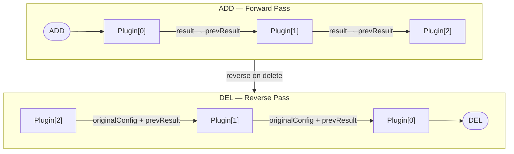

# Lesson 1: CNI Specification Fundamentals

## 1. First-Principles Intuition & Invariants

Every running container is, at the moment of its creation, a networking island. The Linux kernel has handed it a private network namespace — a complete, isolated copy of the network stack with its own interfaces, routing tables, iptables chains, and socket tables — and that namespace contains nothing but a loopback interface that talks only to itself. The container can compute, allocate memory, and write to disk, but it cannot reach another pod, a service endpoint, or the external internet until something bridges that island to the rest of the world. That bridging responsibility belongs to the Container Network Interface.

Understanding why CNI exists as a *specification* rather than a library or a daemon requires understanding the historical pressure it resolved. Before CNI, each container runtime — Docker, rkt, Mesos containerizer — implemented its own networking model internally. Docker shipped `libnetwork` with its own plugin API. rkt had its own network configuration format. The result was a Cambrian explosion of incompatible network plugins: a Flannel build for Docker could not be reused for rkt, and a Calico integration for one runtime had to be reimplemented entirely for another. Kubernetes, entering this landscape in 2014 and facing the need to run on every major cloud and bare-metal environment simultaneously, could not afford to bet on any single runtime's proprietary network model.

The CNI specification, originally developed at CoreOS for rkt and later adopted as the standard by the Cloud Native Computing Foundation, solved this by defining the thinnest possible contract between a container runtime and a network plugin. The contract is intentionally narrow: a plugin is an executable file, invoked by the runtime over a fork-exec boundary, communicating through environment variables and standard input/output using JSON. There is no long-lived daemon to manage, no RPC protocol to version, no shared memory region to coordinate. This simplicity is not an accident or a limitation — it is a deliberate architectural invariant that makes plugins trivially portable across runtimes, testable with nothing more than a shell, and debuggable by reading a plain text log.

The specification encodes three fundamental operations: ADD, DEL, and CHECK. Each maps to a phase in the container lifecycle with precise, well-defined semantics that every compliant plugin must honor.

**ADD** is the operation invoked when a container is being wired into a network. The runtime is asserting: "A network namespace exists at this path. Assign it an identity on this network, install whatever routes and interfaces are necessary, and return the allocated network configuration to me." The plugin must be idempotent with respect to repeated ADD calls for the same container ID and network: if an interface already exists in the namespace with the correct configuration, the plugin should return success without double-allocating. This idempotency invariant is not merely advisory — it is load-bearing. Kubernetes reconciliation loops can and do retry failed ADD operations, and a plugin that double-allocates IP addresses on retry will silently corrupt cluster networking state.

**DEL** is the teardown counterpart. The runtime asserts: "Release all resources you allocated for this container on this network." The critical invariant here is that DEL must succeed even when the network namespace no longer exists. This is a subtle but essential guarantee. In a pod eviction or a node crash-recovery scenario, the container's namespace may be destroyed by the kernel before the runtime has a chance to invoke DEL. A plugin that fails DEL because it cannot open `/proc/<pid>/ns/net` will leak IP addresses and routing table entries permanently. The specification requires plugins to tolerate a missing namespace and clean up all persistent state — IPAM records, routing rules, ARP entries — based solely on the container ID and network configuration, without touching the namespace itself if it is gone.

**CHECK** was introduced in CNI specification version 0.4.0 to close a critical operational gap. ADD and DEL handle the lifecycle transitions, but neither tells the runtime whether a container's network configuration is still *correct* at an arbitrary point in time. A route might have been garbage-collected, an interface might have been renamed by another process, or an IPAM reservation might have drifted from the actual interface assignment. CHECK allows the runtime to periodically validate that the network state matches what ADD established. The plugin returns success if everything is consistent, and an error — with a structured JSON error object — if any invariant has been violated. Kubernetes's container runtime interface uses CHECK as the basis for network health assertions during liveness evaluation.

The fourth operation, VERSION, is often overlooked but architecturally important. Because CNI plugins are standalone executables distributed independently of the runtime, version skew between runtime expectations and plugin capabilities is inevitable in production. VERSION allows the runtime to discover which specification versions a plugin supports before invoking any operational command, enabling the runtime to select an appropriate protocol dialect.

## 2. Core Architecture & Mechanics

### The Fork-Exec Interaction Model

The runtime-to-plugin communication channel is worth examining at the systems level because its design choices have concrete implications for plugin authoring, debugging, and performance.

When a Kubernetes node's container runtime (containerd, using its CNI library) needs to network a new pod, it does not open a socket or send a message to a running daemon. It constructs an execution environment and calls `exec()`. The plugin receives its operational context through two channels: environment variables carry the control plane parameters (operation type, container ID, namespace path, interface name, network name, CNI version, and plugin search path), while the full network configuration JSON is delivered on the plugin's standard input stream. The plugin performs its work — allocating an IP, configuring the interface, installing routes — and writes its result as a JSON object to standard output. Any diagnostic output goes to stderr and is captured by the runtime for logging. The plugin's exit code is the success signal: zero means success, nonzero means failure, and the stderr content is the error payload.

```
Runtime Process
│
│  fork()
│    └─► Plugin Process
│         ├── stdin  ◄── Network Config JSON
│         ├── env    ◄── CNI_COMMAND, CNI_CONTAINERID,
│         │               CNI_NETNS, CNI_IFNAME,
│         │               CNI_ARGS, CNI_PATH
│         ├── stdout ──► Result JSON (ADD/CHECK)
│         └── stderr ──► Error / Diagnostic Text
│
│  waitpid()
│    ├── exit(0)  → parse stdout as Result
│    └── exit(≠0) → parse stderr as ErrorInfo JSON
```

This fork-exec model carries meaningful performance implications. Each ADD or DEL operation spawns at least one new process — and in a chained plugin configuration, one process per plugin in the chain. For a cluster doing rapid pod scheduling under load, this process creation overhead is measurable. The Linux kernel's `clone()` and `execve()` path for a small binary on a warm page cache completes in roughly one to two milliseconds on modern hardware, which is acceptable for pod startup latency budgets in the range of hundreds of milliseconds. It becomes a concern only at extremely high pod churn rates, which is why high-throughput environments sometimes batch CNI calls or use optimized plugin implementations that minimize the work done per exec.

### Network Configuration JSON Structure

The network configuration passed to a plugin on stdin has a precisely defined schema. A minimal but complete configuration object for a bridge-based plugin looks like this:

```json
{
  "cniVersion": "1.0.0",
  "name": "my-pod-network",
  "type": "bridge",
  "bridge": "cni0",
  "isGateway": true,
  "ipMasq": true,
  "ipam": {
    "type": "host-local",
    "subnet": "10.244.0.0/24",
    "rangeStart": "10.244.0.2",
    "rangeEnd": "10.244.0.254",
    "gateway": "10.244.0.1",
    "routes": [
      { "dst": "0.0.0.0/0" }
    ]
  },
  "dns": {
    "nameservers": ["10.96.0.10"],
    "search": ["cluster.local", "svc.cluster.local"]
  }
}
```

The `cniVersion` field governs which result schema the runtime expects in return and which operations are valid. The `name` field is a cluster-wide logical identifier for this network attachment — it is used as a key in IPAM storage and for disambiguating DEL calls. The `type` field names the plugin executable the runtime must locate in the directory paths specified by `CNI_PATH`. Everything else is plugin-specific configuration that the CNI specification treats as opaque: the specification defines the envelope, not the contents.

The `ipam` stanza deserves particular attention because it represents a layered delegation model. The bridge plugin does not manage IP address allocation directly; it delegates that responsibility to a separate IPAM plugin, which the bridge plugin itself fork-execs as a subprocess. This separation of concerns is explicit in the specification: network topology plugins (bridge, macvlan, ipvlan, ptp) are responsible for interface creation and routing, while IPAM plugins (host-local, dhcp, whereabouts) are responsible for IP assignment and release. This decomposition allows the IPAM policy to vary independently of the data plane technology. You can pair a macvlan interface plugin with a DHCP-based IPAM on a bare-metal network, or pair a VXLAN overlay plugin with a distributed IPAM like Whereabouts that coordinates across nodes using Kubernetes lease objects.

### Result Encoding and IP Allocation Semantics

When an ADD operation completes successfully, the plugin writes a Result object to stdout. In CNI specification version 1.0.0, the result schema is:

```json
{
  "cniVersion": "1.0.0",
  "interfaces": [
    {
      "name": "eth0",
      "mac": "0a:58:0a:f4:00:06",
      "sandbox": "/proc/12345/ns/net"
    },
    {
      "name": "cni0",
      "mac": "2e:62:0a:f4:00:01"
    }
  ],
  "ips": [
    {
      "interface": 0,
      "address": "10.244.0.6/24",
      "gateway": "10.244.0.1"
    }
  ],
  "routes": [
    {
      "dst": "0.0.0.0/0",
      "gw": "10.244.0.1"
    }
  ],
  "dns": {
    "nameservers": ["10.96.0.10"],
    "search": ["cluster.local"]
  }
}
```

The `interfaces` array lists every network interface touched by the plugin, both inside the container namespace and on the host. The `sandbox` field — present only for in-namespace interfaces — records the network namespace path, allowing the runtime to correlate result data with the specific container. The `ips` array's `interface` field is an index into the `interfaces` array, binding each allocated address to a specific interface unambiguously. This matters in multi-homed containers where multiple interfaces receive separate allocations.

The IP address in the `address` field is expressed in CIDR notation, not as a bare address. This is not stylistic: the prefix length is semantically essential because it determines the directly connected subnet, which in turn determines whether a given destination is on-link (reachable without routing) or off-link (must be forwarded to the gateway). A plugin that returns `10.244.0.6` without the `/24` prefix is delivering incomplete information — the runtime cannot correctly populate the routing table, and the resulting routes may either flood the directly-connected subnet or fail to reach the gateway.

### Plugin Chaining and the Conflist Format

For production networks, a single plugin is rarely sufficient. A realistic pod networking setup might need a bridge plugin to create the veth pair and attach it to a bridge, a firewall plugin to install iptables rules implementing NetworkPolicy, a bandwidth plugin to attach tc-based traffic shaping, and a portmap plugin to implement host-port forwarding. The CNI specification accommodates this through plugin chaining, expressed in a configuration list file (conventionally named with a `.conflist` extension):

```json
{
  "cniVersion": "1.0.0",
  "name": "k8s-pod-network",
  "plugins": [
    {
      "type": "calico",
      "datastore_type": "kubernetes",
      "mtu": 0,
      "nodename_file_optional": false,
      "log_level": "info",
      "ipam": {
        "type": "calico-ipam"
      },
      "policy": {
        "type": "k8s"
      },
      "kubernetes": {
        "kubeconfig": "/etc/cni/net.d/calico-kubeconfig"
      }
    },
    {
      "type": "bandwidth",
      "ingressRate": 104857600,
      "ingressBurst": 209715200,
      "egressRate": 104857600,
      "egressBurst": 209715200
    },
    {
      "type": "portmap",
      "capabilities": {
        "portMappings": true
      }
    }
  ]
}
```

The runtime processes the `plugins` array in order for ADD and in reverse order for DEL. Each plugin in the chain receives the previous plugin's Result object injected into its configuration JSON under the key `prevResult`. This threading of results through the chain is how a firewall plugin knows which IP address was just allocated by its predecessor: it reads `prevResult.ips[0].address` and installs rules against that address. A plugin that modifies the network state must also update and re-emit the Result, preserving any fields added by earlier plugins and augmenting with its own additions.



This directional, stateless chaining model has an important property: no central coordinator is needed. The runtime itself is the orchestrator, and it carries the state between plugins as a simple JSON value. If a plugin crashes midway through a chain, the runtime knows exactly which plugins completed (those before the failure) and which did not (the failed plugin and everything after it), because it tracks position in the array and the return value from each exec call.

### IPAM Internal Mechanics: host-local as a Reference Implementation

The `host-local` IPAM plugin ships with the reference CNI implementation and is worth dissecting because its internal mechanics illustrate the broader contract any IPAM plugin must fulfill.

When host-local receives an ADD call, it needs to allocate an IP address from the configured subnet that is not already in use. It implements this using a lock-based filesystem store located at `/var/lib/cni/networks/<network-name>/`. Each allocated address is represented by a file whose name is the IP address in dotted-decimal notation. The file's contents are the container ID that owns the allocation. Before allocating, host-local acquires an advisory lock on a lock file in the same directory using `flock(2)`, iterates through the available range to find an address without a corresponding file, writes the new reservation file, and releases the lock.

This implementation is correct for single-node allocation but fundamentally cannot work across nodes: the filesystem state is local, and two nodes allocating from overlapping subnets would collide without coordination. This is why production Kubernetes deployments use per-node subnet allocation at the cluster level — Kubernetes's node IPAM controller assigns each node a non-overlapping `/24` (or configurable prefix) from the cluster CIDR, and host-local operates only within that node-local range. The cluster-level coordination happens outside the CNI layer entirely, in the Kubernetes control plane's node controller, while host-local handles the within-node bookkeeping.

## 3. High-Performance Optimization & Failure Modes

### Diagnosing ADD Failures at the Node Level

When pod networking fails in a production cluster, the failure manifests as a pod stuck in `ContainerCreating` with the event message "failed to set up pod network." The correct debugging methodology starts with the kubelet log on the affected node, since kubelet invokes the runtime which invokes CNI:

```bash
journalctl -u kubelet --since "5 minutes ago" | grep -i cni
```

If the kubelet log shows a CNI error but lacks detail, the next step is to reproduce the plugin invocation manually. Because CNI plugins are plain executables with a simple environment-variable-and-stdin interface, you can invoke them directly from the shell on the node. First, identify the failing pod's network namespace:

```bash
crictl pods --name <pod-name> --namespace <k8s-namespace>
# Note the POD_ID
crictl inspectp <POD_ID> | jq '.info.runtimeSpec.linux.namespaces[] | select(.type=="network")'
```

Then construct a minimal CNI invocation against that namespace path, using the actual configuration file from `/etc/cni/net.d/`:

```bash
export CNI_COMMAND=ADD
export CNI_CONTAINERID="debug-test-$(date +%s)"
export CNI_NETNS="/proc/$(crictl inspectp <POD_ID> | jq -r '.info.pid')/ns/net"
export CNI_IFNAME=eth0
export CNI_PATH=/opt/cni/bin
export CNI_ARGS="K8S_POD_NAME=debug;K8S_POD_NAMESPACE=default;K8S_POD_INFRA_CONTAINER_ID=${CNI_CONTAINERID}"

cat /etc/cni/net.d/10-calico.conflist | /opt/cni/bin/calico 2>&1
```

This surfaces the exact error the plugin is emitting, which the runtime may have swallowed or truncated. Common failures include IPAM exhaustion (the subnet's allocation files are all populated), a missing or inaccessible kubeconfig for Kubernetes-integrated plugins, an MTU mismatch that causes the plugin to fail to configure the interface, and permission errors on the network namespace path.

### IPAM Exhaustion and Leak Detection

IP address leaks are among the most damaging and hardest-to-detect failure modes in CNI deployments. They arise when DEL is not called — or is called but fails silently — leaving IPAM reservation files on disk for containers that no longer exist. Over time, the available address pool shrinks until new pods cannot be scheduled on the affected node.

For host-local, the detection procedure is straightforward: compare the set of active container IDs against the set of reservation files.

```bash
# List all IPAM reservations for the pod network
ls /var/lib/cni/networks/k8s-pod-network/

# List all running container IDs from the runtime
crictl ps -q

# Find reservation files whose container IDs are not in the running set
for f in /var/lib/cni/networks/k8s-pod-network/10.*; do
  cid=$(cat "$f")
  if ! crictl inspect "$cid" &>/dev/null; then
    echo "LEAKED: IP=$(basename $f) ContainerID=$cid"
  fi
done
```

Remediating a confirmed leak requires manually removing the stale reservation file and verifying the corresponding interface is absent from the node's network namespace. Automated remediation should be approached cautiously: a reservation that appears stale because `crictl inspect` fails transiently — due to a containerd socket timeout, for instance — could belong to a running container. Deleting an active reservation causes that IP to be double-allocated on the next ADD, which produces a routing conflict that manifests as intermittent packet loss between pods sharing the address.

### Plugin Chaining Failure Atomicity

The chaining model creates a partial-failure problem that is worth reasoning through carefully. If a three-plugin chain completes Plugin[0] and Plugin[1] successfully but Plugin[2] fails, the runtime has two choices: propagate the error to the caller (which will cause the pod creation to fail) or attempt to roll back. The CNI specification requires the runtime to attempt rollback by calling DEL on all plugins that completed successfully, in reverse order, before surfacing the error.

This rollback is best-effort. If the DEL rollback also fails — say, Plugin[1]'s DEL call fails because the interface it created was already cleaned up by Plugin[2]'s partial execution — the runtime is in an indeterminate state. The specification explicitly acknowledges this and places the burden on plugin authors to make both ADD and DEL individually idempotent. A plugin that fails DEL because the interface it expects to delete is already gone should return success, not an error. The absence of the resource it intended to remove is consistent with the goal of DEL, even if the resource was removed by another means.

### MTU Misconfiguration and Its Cascading Effects

MTU misconfiguration is a category of failure that is correct at the CNI level — ADD succeeds, the interface is configured, an IP is allocated — but causes application-level failures that manifest far from their root cause. When the CNI plugin sets an interface MTU that is too large for the underlying network path (a common problem with VXLAN overlays, where the encapsulation header consumes 50 bytes of the physical MTU), TCP connections carrying large payloads will hang silently. The TCP handshake succeeds, small messages transit normally, but any transfer that requires a full-size segment gets dropped by an intermediate device that respects the physical MTU, and the ICMP "fragmentation needed" response that would normally trigger path MTU discovery is blocked by security groups or iptables rules.

The correct MTU for a VXLAN-based overlay on a 1500-byte Ethernet fabric is 1450 bytes: 1500 (physical) minus 50 (VXLAN + UDP + IP outer header). For a Geneve overlay, the overhead is slightly larger at 60 bytes, giving 1440. These values must be configured in the CNI plugin's network configuration JSON and must match the MTU set on the host-side veth endpoint and the bridge device.

Verifying the effective MTU for a running pod requires entering its network namespace:

```bash
POD_PID=$(crictl inspectp <POD_ID> | jq -r '.info.pid')
nsenter --net=/proc/${POD_PID}/ns/net ip link show eth0
```

The `mtu` field in the output is the value the kernel enforces for all outgoing frames on that interface. If it does not match the expected value from the CNI configuration, either the plugin did not apply its configuration, or something subsequently modified the interface (a node network configuration agent, a manual `ip link set` on the host, or a kernel default override). Cross-referencing with the host-side veth — identifiable by running `ip link show` on the host and finding the peer index reported by `ip link show eth0` inside the namespace — confirms whether the host and container sides are symmetrically configured.

### Configuration Versioning and Upgrade Safety

Upgrading a CNI plugin across a live cluster requires understanding which fields in the network configuration are load-bearing for in-flight traffic versus only affecting new allocations. The `name` field in a conflist is the most dangerous to change: host-local uses it as the directory name for IPAM reservations. Renaming the network while pods are running does not affect those pods' networking (their interfaces remain configured), but it makes their IPAM reservations invisible to the new configuration's DEL calls. When those pods are eventually terminated, the DEL operation will look in `/var/lib/cni/networks/<new-name>/` for the reservation, find nothing, succeed silently, and leave the reservation in `/var/lib/cni/networks/<old-name>/` as a permanent leak.

The safe upgrade procedure for a configuration name change is to drain each node before updating its CNI configuration, allowing all pods to terminate and release their IPAM reservations under the old name before the new configuration is written. For large clusters, this means a rolling drain and configuration update, treating the CNI conflist as a node-level piece of infrastructure state that must be migrated with the same care as a kernel upgrade or a filesystem format change — because, at the level of the network namespace and routing table, that is precisely what it is.
