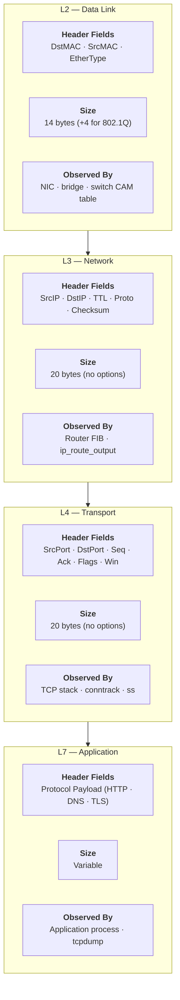

# Lesson 1: OSI Model Fundamentals

## 1. First-Principles Intuition & Invariants

Every networked system in production today, from a Kubernetes node's `kube-proxy` forwarding traffic via iptables NAT rules to a bare-metal server's NIC DMA-ing packet descriptors into a ring buffer, operates within a layered abstraction model whose architectural invariants were codified in ISO/IEC 7498-1:1994. The OSI model is not a protocol implementation; it is a formal specification of seven hierarchical service layers, each defining a strict contract with the layer above and the layer below. This stratification is the single most consequential design decision in the history of distributed computing, because it enables a web server speaking HTTP/2 over TLS on a Linux machine to communicate transparently with a client running on a Windows laptop connected via Wi-Fi, through a path that traverses fiber, copper, MPLS labels, BGP route flaps, and stateful firewall inspections, none of which needs to understand the semantics of the application payload.

The fundamental invariant of the model is that each layer provides a service to the layer immediately above it while remaining entirely ignorant of the implementation details of the layers below. Layer 4 (Transport) does not know whether the physical medium is twisted-pair copper at 10GbE, single-mode fiber at 100GbE, or a virtual `veth` pair bridging two network namespaces in a container runtime. It only knows that it can hand a segment with a destination port to Layer 3 (Network), and that Layer 3 will deliver it. This information hiding is enforced mechanically through encapsulation: when an application at Layer 7 hands data to Layer 4, Layer 4 prepends its own header (TCP source port, destination port, sequence number, flags), then hands the resulting segment to Layer 3, which prepends its own header (source IP, destination IP, TTL, protocol field), and so on down to Layer 1, where bits are encoded as voltage transitions on copper or modulated light pulses on fiber. Each layer's header is opaque to every other layer; the receiving side's peer layer strips and interprets only its own header, a process called decapsulation.

The critical engineering insight is that these layers are not merely pedagogical constructs. They are realized as concrete software and hardware components in a running system. On Linux, Layer 2 processing happens in the NIC hardware and the kernel's `netif_receive_skb` path; Layer 3 routing decisions are made in `ip_route_output` against the FIB (Forwarding Information Base) stored in `struct fib_table`; Layer 4 connection state is tracked in `struct sock` objects managed by the TCP stack and exposed to userspace via `ss` and `/proc/net/tcp`. When you run `tcpdump -i eth0`, you are observing the raw bytes that have been encapsulated through all seven layers, and you can see each layer's header fields stripped apart by the capture's dissector. Understanding the OSI model at a practitioner level means being able to trace a single packet's lifecycle from the moment a process calls `send()` to the moment the PHY transceiver on the far end detects a carrier, and knowing exactly which layer's invariants, state machines, and failure modes govern each stage of that path.

The separation of concerns the model enforces has a direct architectural corollary in systems design: you debug each layer within its own domain. A packet loss problem manifests differently at each layer. At Layer 1, you see CRC errors and link flaps in `ethtool -S eth0`. At Layer 2, you see ARP resolution failures and CAM table exhaustion on the switch. At Layer 3, you see ICMP destination unreachable responses or silent drops at a routing boundary. At Layer 4, you see retransmissions and RST packets in `ss -ti`. Attempting to diagnose a Layer 3 routing problem by examining TCP retransmission counters wastes time, because the TCP layer has no visibility into why packets disappeared; it only knows they did not arrive. This discipline of localized diagnosis, respecting layer boundaries, is what separates a production engineer who resolves an incident in minutes from one who chases symptoms across the stack for hours.

It is essential to state plainly that the seven-layer OSI model and the four-layer TCP/IP model (Link, Internet, Transport, Application) coexist in practice. The TCP/IP model collapses OSI Layers 5, 6, and 7 into a single Application layer and merges Layers 1 and 2 into a single Link layer. The Internet Protocol Suite is what actually runs on production systems, and the OSI model is the reference framework used to reason about it. When a network engineer says "Layer 3 problem," they mean an IP routing issue; when they say "Layer 7 problem," they mean an HTTP or DNS issue. This vocabulary is universal across infrastructure teams, and mastering it is prerequisite to any productive debugging conversation.

## 2. Core Architecture & Mechanics

The mechanical reality of layered networking is best understood by tracing a single TCP segment from a process's `write()` system call to the wire, then from the wire back up to a receiving process's `read()`. Consider a process that opens a TCP connection to `93.184.216.34:80` and sends the string `GET / HTTP/1.1\r\n\r\n`. What follows is the complete lifecycle of that payload through every layer, with the real Linux kernel data structures and userspace commands that observe each stage.

### Layer 1: Physical

At the bottom of the stack, Layer 1 defines the electrical, optical, or radio signaling that carries raw bits across a medium. For 1000BASE-T Gigabit Ethernet over Cat 5e copper, this means four differential pairs carrying PAM-5 (5-level Pulse Amplitude Modulation) signals at 125 Mbaud per pair, achieving 1000 Mbps full-duplex through a hybrid echo-cancellation circuit that allows simultaneous transmit and receive on the same wire pair. The NIC's PHY (Physical Layer) chip performs the encoding and decoding, and the MAC (Media Access Control) chip interfaces with the system bus via PCIe. On the receive path, the NIC DMA engine writes packet data directly into pre-allocated ring buffers in system memory, then raises an interrupt (MSI-X) to signal the CPU that frames are available. You can inspect the physical layer state and its error counters with `ethtool`:

```bash
# Show link state, speed, duplex, autonegotiation
ethtool eth0

# Show hardware error counters (Layer 1 diagnostics)
ethtool -S eth0 | grep -E 'rx_crc|rx_align|rx_fragments|rx_jabbers|rx_missed'

# Show offload capabilities (TSO, GSO, LRO, checksum offload)
ethtool -k eth0
```

A `rx_crc_errors` counter that increments continuously indicates a physical-layer problem: degraded cabling, a faulty transceiver, electromagnetic interference, or a port speed/duplex mismatch caused by failed autonegotiation. These errors never appear in Layer 3 or Layer 4 diagnostics, because the frames are discarded before they reach the IP stack. The kernel's `softirq` handler for `NET_RX` never sees them.

### Layer 2: Data Link

Layer 2 is where bits become frames. Ethernet II framing wraps the payload in a 14-byte header (6-byte destination MAC, 6-byte source MAC, 2-byte EtherType) and appends a 4-byte FCS (Frame Check Sequence, CRC-32). The EtherType field identifies the Layer 3 protocol: `0x0800` for IPv4, `0x86DD` for IPv6, `0x0806` for ARP. When 802.1Q VLAN tagging is in use, a 4-byte tag is inserted between the source MAC and the EtherType, containing a 12-bit VLAN ID (0–4094), a 3-bit priority field (PCP), and a 1-bit Drop Eligible Indicator. This is the mechanism by which a single physical link multiplexes multiple isolated broadcast domains, and it is the foundation of every overlay network in cloud infrastructure, from VMware NSX VLAN segments to Kubernetes CNI plugins that use `veth` pairs bridged into VLAN-tagged trunk ports.

The critical Layer 2 service provided to Layer 3 is local delivery: getting a frame to the next-hop MAC address on the same broadcast domain. When the kernel's routing table says "send this packet to next-hop 10.0.0.1 via interface eth0," the IP layer must resolve `10.0.0.1` to a MAC address before it can construct the Ethernet frame. This resolution is performed by the Address Resolution Protocol (ARP), which broadcasts a request (`who has 10.0.0.1? Tell 10.0.0.5`) and waits for a unicast reply. The result is cached in the kernel's neighbor table, visible via:

```bash
# Show the ARP/neighbor cache (Layer 2 address resolution)
ip neigh show

# Show per-interface neighbor entries with state
ip -s neigh show dev eth0

# Manually resolve a Layer 3 address to Layer 2
arping -I eth0 -c 3 10.0.0.1

# Show the MAC address and link-layer statistics
ip -s link show eth0
```

ARP cache entries have states: `REACHABLE` (confirmed within the last `gc_stale_time` seconds, default 30), `STALE` (entry expired, will be refreshed on next use), `DELAY` (waiting for confirmation), `FAILED` (resolution failed). A common production failure is a stale ARP entry pointing to a decommissioned host's MAC address after a failover, causing intermittent packet loss because the switch's CAM table forwards frames to a port that no longer carries that MAC. Flushing the neighbor cache with `ip neigh flush dev eth0` forces re-resolution.

### Layer 3: Network

The Network layer provides global, topology-independent delivery through logical addressing and routing. An IPv4 address is a 32-bit integer, typically expressed in dotted-decimal notation, partitioned into a network prefix and a host identifier by a subnet mask (or CIDR prefix length). An IPv6 address is a 128-bit integer, expressed as eight groups of four hexadecimal digits separated by colons, with a similar prefix/host partition. The kernel maintains a FIB (Forwarding Information Base) that maps destination prefixes to next-hop gateways and output interfaces. When a process calls `send()`, the kernel's `ip_route_output()` function performs a longest-prefix-match lookup against this table:

```bash
# Show the full routing table (FIB)
ip route show

# Show the route that would be taken to a specific destination
ip route get 93.184.216.34

# Show the local address table
ip addr show

# Show routing cache statistics and FIB hash table sizes
cat /proc/net/route | head -5
```

The output of `ip route get` reveals the complete forwarding decision: the destination IP, the selected next-hop gateway, the output interface, the source IP that will be used, and the MSS (Maximum Segment Size) derived from the path MTU. The IP header itself is 20 bytes minimum (without options), containing the source address, destination address, protocol field (`6` for TCP, `17` for UDP), TTL (Time To Live, typically set to 64 by the originating host and decremented by each router), and a header checksum. When a router decrements the TTL to zero, it drops the packet and sends an ICMP Time Exceeded message back to the source, which is the mechanism that `traceroute` exploits to discover the path.

The IP layer also performs fragmentation when a packet exceeds the MTU of the outgoing interface. The standard Ethernet MTU is 1500 bytes, but tunneling protocols (GRE, IPSec, VXLAN) consume overhead and reduce the effective MTU. If a 1472-byte IP payload is sent through a VXLAN tunnel (50 bytes of overhead), the IP layer must fragment it or, if the DF (Don't Fragment) flag is set, drop it and send an ICMP Fragmentation Needed message. Path MTU Discovery (PMTUD) relies on this ICMP feedback, but it is broken by firewalls that silently drop ICMP, leading to TCP connections that establish (SYN/SYN-ACK/ACK succeed because those are small) but stall on the first data segment (which is full-sized and exceeds the path MTU). This is one of the most common and insidious network failures in cloud environments.

```bash
# Discover path MTU to a destination
tracepath -n 93.184.216.34

# Show per-interface MTU
ip link show eth0 | grep mtu

# Show IP-level statistics (fragments, drops, discards)
nstat -az | grep -E 'IpIn|IpOut|IpFrag'
```

### Layer 4: Transport

The Transport layer provides end-to-end communication between processes, multiplexed through port numbers. TCP (Transmission Control Protocol) is a connection-oriented, reliable, ordered byte-stream protocol with flow control and congestion control. UDP (User Datagram Protocol) is a connectionless, unreliable, unordered message protocol with no flow control. The TCP header is 20 bytes minimum (without options) and carries source port, destination port, sequence number (identifying the first byte of data in this segment), acknowledgment number (the next byte the sender expects to receive), data offset, flags (SYN, ACK, FIN, RST, PSH, URG), window size (flow control advertisement), and a checksum. UDP's header is a minimal 8 bytes: source port, destination port, length, checksum.

TCP operates as a state machine on both endpoints. The connection progresses through a defined sequence of states, and the kernel tracks each connection as a `struct sock` object. You can observe every active socket and its state:

```bash
# Show all TCP sockets with state, receive/send queues, process
ss -tanp

# Show TCP statistics (retransmits, resets, SYN drops)
nstat -az | grep -E 'TcpRetrans|TcpInErrs|TcpExtTCPTimeouts'

# Show the TCP state machine counts
cat /proc/net/tcp | awk '{print $4}' | sort | uniq -c | sort -rn

# Show detailed TCP internal metrics for a specific socket
ss -ti dst 93.184.216.34
```

The `ss -ti` output reveals the TCP layer's internal state: `rtt` (round-trip time estimate), `rto` (retransmission timeout), `snd_mss` (maximum segment size being sent), `cwnd` (congestion window), `ssthresh` (slow-start threshold), `bytes_retrans` (bytes retransmitted), and `bytes_acked` (bytes acknowledged). These are the congestion control algorithm's live state variables, and they tell you exactly whether a connection is healthy (low rtt, zero retransmits, cwnd growing) or degraded (high rtt, frequent retransmits, cwnd collapsed). The congestion control algorithm itself is configurable per-connection or system-wide:

```bash
# Show available congestion control algorithms
sysctl net.ipv4.tcp_available_congestion_control

# Show current algorithm
sysctl net.ipv4.tcp_congestion_control

# Set the algorithm (BBR is a common production choice)
sysctl -w net.ipv4.tcp_congestion_control=bbr
```

### Layers 5, 6, and 7: Session, Presentation, Application

The upper three layers are collapsed in practice but worth distinguishing for diagnostic precision. Layer 5 (Session) manages dialog control: the TLS handshake negotiation that establishes session keys, the HTTP/2 multiplexing of multiple logical streams over a single TCP connection, the WebSocket upgrade that converts a request-response exchange into a persistent bidirectional session. Layer 6 (Presentation) handles data format translation and encryption: TLS record-layer encryption and decryption, character encoding negotiation (UTF-8 vs. ISO-8859-1), MIME type negotiation. Layer 7 (Application) is the protocol semantics: HTTP request methods and status codes, DNS query/response format, gRPC protobuf serialization.

The service boundary between Layer 4 and Layer 7 is the Berkeley sockets API. When a process calls `socket(AF_INET, SOCK_STREAM, 0)`, it is requesting a Layer 4 transport endpoint. When it calls `connect()` or `bind()` + `listen()`, it is establishing the Layer 4 connection. When it calls `send()` and `recv()`, it is reading and writing the Layer 7 payload through the Layer 4 byte stream. The kernel's TCP stack handles segmentation, retransmission, and ordering; the application handles HTTP framing, TLS record construction, and protocol semantics. This boundary is where the system call interface enforces the OSI layer separation in software.

```bash
# Observe the DNS resolution (Layer 7 protocol over UDP Layer 4)
dig +trace example.com

# Capture the full TCP handshake + TLS handshake + HTTP request
tcpdump -nn -i eth0 -A -s 0 'host 93.184.216.34 and port 80'

# Capture with timestamp precision for latency analysis
tcpdump -nn -i eth0 -tttt -s 0 'host 93.184.216.34 and port 443'
```

### Encapsulation: The Complete Packet Walk

To see all layers simultaneously, capture a packet and dissect it. The following command captures the first TCP segment containing an HTTP GET request and displays each layer's header in hex and ASCII:

```bash
# Capture one packet and display it with full layer dissection
tcpdump -nn -i eth0 -X -s 0 -c 1 'host 93.184.216.34 and tcp port 80'
```

The output reveals the encapsulation hierarchy as a single linear byte stream. The first 14 bytes are the Ethernet header (Layer 2): destination MAC `52:54:00:de:ad:be`, source MAC `52:54:00:ca:fe:01`, EtherType `0x0800` (IPv4). The next 20 bytes are the IP header (Layer 3): version `4`, header length `5` (20 bytes), TTL `64`, protocol `6` (TCP), source `10.0.0.5`, destination `93.184.216.34`. The next 20 bytes are the TCP header (Layer 4): source port `54321`, destination port `80`, sequence number, flags `PSH ACK`, window `64240`. The remaining bytes are the Layer 7 payload: `GET / HTTP/1.1\r\nHost: example.com\r\n\r\n`.



On the transmit path, the kernel constructs this stack inside-out. The application writes the Layer 7 payload into the socket's send buffer. The TCP layer segments it, prepends TCP headers, and passes segments to the IP layer. The IP layer prepends IP headers, performs the route lookup, resolves the next-hop MAC via ARP, and hands the frame to the NIC driver's `ndo_start_xmit` function. The NIC DMA engine reads the frame from memory and transmits it. On the receive path, the reverse occurs: the NIC DMA engine writes the frame to the ring buffer, raises an MSI-X interrupt, the kernel's NAPI poll loop processes the frame, strips the Ethernet header, passes the IP packet to `ip_rcv`, which strips the IP header and passes the TCP segment to `tcp_v4_rcv`, which strips the TCP header and delivers the payload to the socket's receive buffer, where the application's `recv()` call picks it up.

The conntrack module sits between Layers 3 and 4 and maintains state for every connection, enabling stateful firewall rules and NAT:

```bash
# Show the conntrack table (connection state at L3/L4 boundary)
conntrack -L

# Show conntrack statistics and table capacity
conntrack -C
cat /proc/sys/net/netfilter/nf_conntrack_count
cat /proc/sys/net/netfilter/nf_conntrack_max

# Dump a specific connection's full state
conntrack -L -s 10.0.0.5 -d 93.184.216.34 -p tcp
```

Each conntrack entry records the tuple (source IP, source port, destination IP, destination port, protocol), the connection state (`NEW`, `ESTABLISHED`, `RELATED`, `INVALID`), the TCP state (`SYN_SENT`, `SYN_RECV`, `ESTABLISHED`, `FIN_WAIT`, `TIME_WAIT`, `CLOSE`), the flow's byte and packet counters, and the timeout remaining before the entry is garbage-collected. This is the data structure that `iptables -m state --state ESTABLISHED` and `nftables ct state established` query.

## 3. High-Performance Optimization & Failure Modes

The layered model's strict separation creates performance boundaries where optimizations and failures propagate predictably. Understanding these boundaries is what allows an infrastructure engineer to push a network path from mediocre to optimal, or to diagnose a degradation that spans multiple layers.

### TCP Offload and the Layer 2/4 Boundary

Modern NICs implement several offload mechanisms that blur the clean layer boundary but dramatically improve throughput. TCP Segmentation Offload (TSO) allows the kernel to hand the NIC a single 64KB sk_buff (far larger than the 1460-byte MSS dictated by the 1500-byte MTU) and let the NIC's hardware split it into properly-sized TCP segments with correct sequence numbers. Generic Segmentation Offload (GSO) is the software fallback for this when the NIC lacks TSO support. Large Receive Offload (LRO) performs the inverse on the receive path: the NIC coalesces multiple received TCP segments into a single large sk_buff before handing them to the kernel, reducing interrupt frequency and per-packet processing overhead. Checksum offload offloads the IP header checksum and TCP/UDP checksum computation to the NIC hardware.

```bash
# Inspect offload status
ethtool -k eth0

# Enable/disable specific offloads
ethtool -K eth0 tso on
ethtool -K eth0 gso on
ethtool -K eth0 lro on
ethtool -K eth0 gro on

# Verify the kernel sees large frames when LRO/GRO is active
# (frames larger than MTU appear in tcpdump with misleading sizes)
tcpdump -nn -i eth0 -c 5 'tcp port 80'
```

A critical subtlety: when GRO (Generic Receive Offload) is enabled, `tcpdump` on the host's interface will show frames with sizes exceeding the MTU, because the coalescing happens before the packet reaches the capture point. This is not a bug; it is the offload working as designed. But it can confuse an engineer who expects every captured frame to be 1518 bytes or less. If you need to see the true on-the-wire frame sizes, disable GRO temporarily with `ethtool -K eth0 gro off`, capture, then re-enable.

### Receive Side Scaling and IRQ Affinity

At high packet rates (millions of packets per second), a single CPU core cannot process the softirq `NET_RX` workload fast enough. Receive Side Scaling (RSS) solves this by distributing incoming packets across multiple hardware receive queues, each with its own MSI-X interrupt vector mapped to a specific CPU core. The NIC hashes packet header fields (source/dest IP, source/dest port) using a configurable hash function (Toeplitz or XLEN) and assigns the packet to a queue based on the hash. This ensures that all packets for a single flow land on the same queue and thus the same CPU, preserving per-flow ordering while parallelizing across flows.

```bash
# Show RSS configuration and RX queue count
ethtool -l eth0
ethtool -x eth0

# Show interrupt coalescing settings (reduce interrupt rate at cost of latency)
ethtool -c eth0

# Map NIC MSI-X interrupts to specific CPU cores
grep eth0 /proc/interrupts

# Set IRQ affinity (pin queue 0 to CPU 0, queue 1 to CPU 1, etc.)
for i in $(grep eth0 /proc/interrupts | awk -F: '{print $1}'); do
    echo $((1 << (i % $(nproc)))) > /proc/irq/$i/smp_affinity
done

# Show per-CPU softirq processing statistics
cat /proc/net/softnet_stat
```

The `/proc/net/softnet_stat` output has six columns per CPU core. The first column is the total number of packets processed. The second is the number of times the softirq budget was exhausted (dropped packets due to processing backpressure). The third is the number of times NAPI had to be scheduled. If the second column is non-zero and growing, the receive path is saturated and you need more RSS queues, better IRQ affinity, or a faster CPU.

### Connection Tracking Table Exhaustion

The conntrack table has a finite maximum size, defaulting to 65536 on many distributions but configurable via `nf_conntrack_max`. When the table fills, every new connection attempt is silently dropped, and the `nf_conntrack_count` counter hits `nf_conntrack_max`. This manifests as TCP SYN packets that never receive a SYN-ACK, despite the destination service being healthy. The failure is at Layer 3/4, not Layer 7, and the application logs show nothing because the connection never establishes.

```bash
# Monitor conntrack table fill in real-time
watch -n 1 'cat /proc/sys/net/netfilter/nf_conntrack_count'

# Show the ratio of used to maximum
echo "$(cat /proc/sys/net/netfilter/nf_conntrack_count) / $(cat /proc/sys/net/netfilter/nf_conntrack_max)"

# Increase the conntrack table maximum (requires root, takes effect immediately)
sysctl -w net.netfilter.nf_conntrack_max=1048576

# Show conntrack drop counters (entries dropped because table is full)
conntrack -C | grep -i drop
nstat -az | grep -i conntrack
```

The conntrack entry timeout also matters. ESTABLISHED connections time out after 432000 seconds (5 days) by default, but TIME_WAIT entries time out after 120 seconds. A server handling thousands of short-lived HTTP connections accumulates TIME_WAIT entries rapidly, and while each entry is small (approximately 300 bytes), the aggregate can fill the table. Reducing `nf_conntrack_tcp_timeout_time_wait` to 30 seconds is a common production tuning for high-throughput web servers:

```bash
# Show current conntrack timeouts
sysctl net.netfilter.nf_conntrack_tcp_timeout_time_wait
sysctl net.netfilter.nf_conntrack_tcp_timeout_established

# Reduce TIME_WAIT timeout for high-throughput servers
sysctl -w net.netfilter.nf_conntrack_tcp_timeout_time_wait=30
```

### MTU Mismatches and Black-Hole Connections

Path MTU mismatches are among the most difficult network failures to diagnose because they produce no error at Layers 1–4; they simply cause data to stop flowing. The mechanism is precise: a TCP connection establishes successfully (SYN, SYN-ACK, and ACK are all small packets that fit within any reasonable MTU). The client sends a request (often small enough to fit). The server responds with a large payload (a full-sized TCP segment of 1460 bytes). This segment exceeds the path MTU at some intermediate hop (a GRE tunnel, an IPSec tunnel, a VXLAN overlay reducing the effective MTU to 1450). If the DF flag is set (which it always is for TCP, because IP fragmentation of TCP segments causes severe performance degradation), the intermediate router drops the packet and sends an ICMP Type 3 Code 4 (Fragmentation Needed) message back to the source. If a firewall between the router and the source drops that ICMP message (a common misconfiguration, because operators broadly block ICMP as a "security measure"), the source never learns the correct path MTU. The TCP stack retransmits the full-sized segment, it is dropped again, the retransmission timer fires, the congestion window collapses, and the connection stalls permanently or degrades to a trickle. The client sees the connection as "hanging" after the request is sent.

```bash
# Discover the path MTU (sends probes with DF set, decreasing size)
tracepath -n 93.184.216.34

# Check if PMTUD is working by sending ICMP with increasing sizes
ping -M do -s 1472 93.184.216.34
ping -M do -s 1452 93.184.216.34

# Enable TCP MTU probing as a workaround for ICMP black holes
sysctl -w net.ipv4.tcp_mtu_probing=1
```

The `tcp_mtu_probing` sysctl (values: 0=disabled, 1=enabled when black hole detected, 2=always enabled) instructs the TCP stack to probe the path MTU by sending progressively smaller segments when it detects retransmission timeouts on full-sized segments. This is a workaround, not a fix; the correct solution is to ensure ICMP Type 3 Code 4 messages are not filtered along the path and to configure the correct MTU on tunnel interfaces:

```bash
# Set MTU on a VXLAN interface (1500 - 50 bytes VXLAN overhead = 1450)
ip link set vxlan0 mtu 1450

# Verify the effective MSS advertised in SYN packets
tcpdump -nn -i eth0 'tcp[tcpflags] & tcp-syn != 0' -c 1 -v
```

### Diagnostic Workflow: Layer-by-Layer Isolation

When a connectivity failure occurs, the disciplined approach is to test each layer independently, from the bottom up, because a failure at a lower layer will mask all higher-layer behavior. The following sequence is a complete production diagnostic workflow:

```bash
# Layer 1: Is the link up?
ip link show eth0 | grep -E 'state|link'
ethtool eth0 | grep -E 'Speed|Duplex|Link'

# Layer 1: Are there physical errors accumulating?
ethtool -S eth0 | grep -E 'rx_crc|rx_align|rx_fragments|tx_errors|rx_errors'

# Layer 2: Can we reach the default gateway at the MAC level?
ip neigh show | grep "$(ip route show default | awk '{print $3}')"

# Layer 2: Is ARP resolving correctly?
arping -I eth0 -c 3 "$(ip route show default | awk '{print $3}')"

# Layer 3: Does the kernel have a route to the destination?
ip route get 93.184.216.34

# Layer 3: Can we reach the destination at the IP level?
ping -c 3 -W 2 93.184.216.34

# Layer 3: What is the path, and where does it break?
traceroute -n -w 2 -q 1 93.184.216.34

# Layer 4: Is the TCP port open?
# Using /dev/tcp (bash built-in, no external tool needed)
timeout 3 bash -c 'echo > /dev/tcp/93.184.216.34/80' && echo "open" || echo "closed"

# Layer 4: Is there a TCP connection in the kernel state table?
ss -tanp 'dst 93.184.216.34'

# Layer 4: Are there retransmissions or resets?
nstat -az | grep -E 'TcpRetransSegs|TcpOutRsts|TcpExtTCPTimeouts'

# Layer 7: Does the application protocol respond?
curl -v --connect-timeout 5 http://93.184.216.34/

# Layer 7: Does DNS resolve correctly?
dig +time=5 example.com A
dig +time=5 example.com AAAA
```

Each command isolates a single layer's functionality. If Layer 1 shows link down, no further testing is meaningful. If Layer 1 is clean but ARP fails, the problem is Layer 2 (ARP cache, switch CAM table, VLAN misconfiguration). If ARP succeeds but `ping` fails, the problem is Layer 3 (routing, firewall, ICMP filtering). If `ping` succeeds but TCP connection fails, the problem is Layer 4 (port closed, connection limit reached, SYN flood protection). If TCP connects but `curl` fails, the problem is Layer 7 (HTTP error, TLS failure, application crash). This bottom-up isolation is the single most efficient debugging methodology available, and it is a direct consequence of the OSI model's layered architecture: each layer depends only on the layer directly beneath it, so a failure at layer N is invisible to and unfixable by layers N+1 through 7.

The OSI model's enduring power is not its seven-layer count but its enforcement of bounded context. Each layer owns a specific responsibility (signaling, framing, routing, transport, session, encoding, semantics), exposes a specific interface to its neighbor, and hides its implementation from every other layer. This is the same principle that governs microservice API boundaries, kernel-userspace syscall boundaries, and database transaction isolation levels. Mastering the OSI model at the level of kernel data structures and production diagnostic commands transfers directly to every other domain of systems engineering where abstraction layers mediate between complexity and usability.
