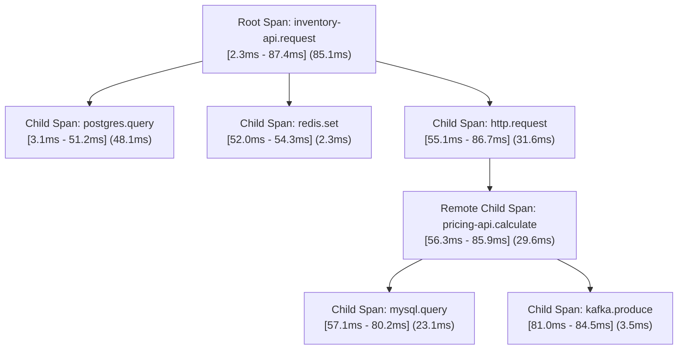
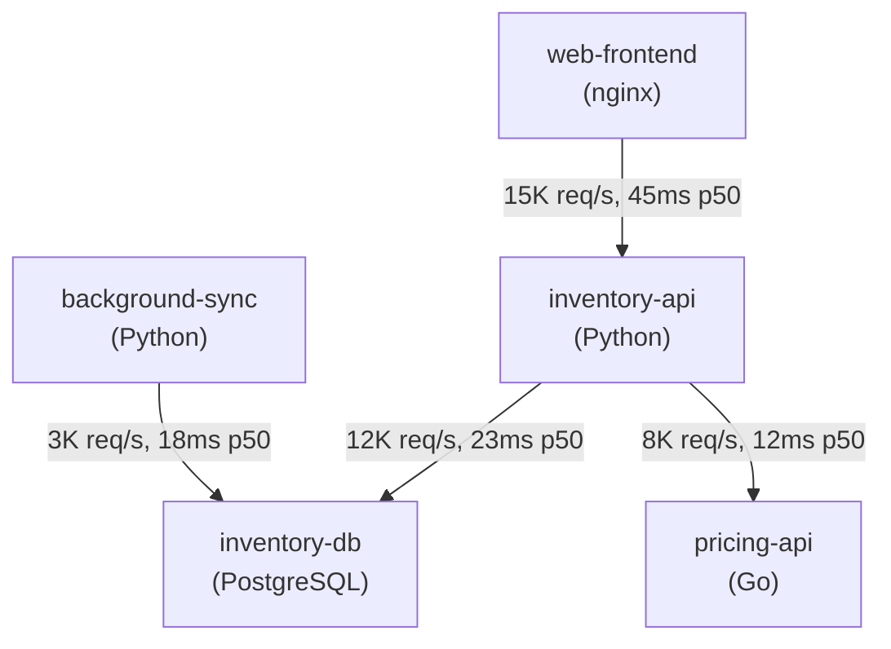

# Lesson 3: Distributed Tracing with APM Mechanics

## 1. First-Principles Intuition & Invariants

Modern distributed systems have evolved from monolithic executables running on single servers into meshes of ephemeral microservices spanning dozens of failure domains, each communicating through layered protocols across unreliable networks. When a user action triggers a cascade of remote procedure calls flowing through authentication gateways, inventory databases, payment processors, and notification queues, understanding the end-to-end latency profile becomes an exercise in reconstructing causality across process boundaries, network hops, and temporal skew. Traditional logging captures isolated events within individual service boundaries, while metrics aggregate temporal windows into dimensionality-reduced summary statistics, but neither primitive captures the causal graph structure of a request as it flows through the distributed system topology.

Distributed tracing emerged as a solution to this observability gap, formalizing the concept of a trace as a directed acyclic graph of causally-related work units called spans. Each span represents a discrete operation within a service—a database query, an HTTP handler invocation, a message queue publish—and carries timing information, resource attributes, and crucially, identifiers that encode parent-child relationships. When instrumented services propagate these identifiers across network boundaries as baggage in protocol headers, backend aggregation systems can reconstruct the full dependency graph of a distributed transaction, revealing bottlenecks, cascading failures, and subtle concurrency pathologies that emerge only under production traffic patterns.

The theoretical foundation rests on Lamport's happened-before relation and vector clock semantics adapted for practical systems engineering. A trace identifier uniquely identifies the entire distributed transaction, while each span within that trace carries both a span identifier and a reference to its parent span, forming a tree structure rooted at the originating service. This parent-child encoding allows backend systems to reassemble the causal chain even when spans arrive out of order due to network reordering, clock skew, or asynchronous processing paths. The invariant that must hold is the preservation of causality: if span A causally precedes span B in the execution flow, the reconstructed trace graph must reflect this ordering through the parent pointer chain.

Datadog's Application Performance Monitoring system implements this distributed tracing model through a combination of language-specific instrumentation libraries, in-process agents, and backend ingestion pipelines designed to handle the massive cardinality explosion that occurs when every request through a production system generates hundreds of spans. The core challenge lies in balancing observability coverage against the resource costs of instrumentation overhead, network bandwidth consumption, and backend storage requirements. A naive implementation that captures every span from every request in a high-throughput service would generate terabytes of trace data per hour, overwhelming network links and storage systems while drowning operators in noise.

The fundamental tension in distributed tracing architecture manifests in three dimensions: completeness versus sampling overhead, real-time latency versus batch efficiency, and schema flexibility versus query performance. Complete trace capture provides deterministic reproducibility for debugging rare edge cases but imposes unacceptable CPU and memory overhead on hot paths. Aggressive sampling reduces resource consumption but introduces statistical bias that obscures infrequent failure modes. Real-time span forwarding enables live tail debugging but fragments batching efficiency and amplifies network amplification factors. Rigid trace schemas enable columnar compression and indexed search but fracture when services evolve schemas independently across deployment boundaries.

Datadog's APM architecture resolves these tensions through a layered sampling strategy that combines head-based probabilistic sampling with tail-based intelligent filtering, a columnar trace storage engine optimized for temporal range queries, and a span context propagation model that balances W3C Trace Context interoperability with Datadog-specific enrichment metadata. The system's design reflects the reality that most traces are uninteresting—they represent successful requests that completed within expected latency bounds—while the traces that matter most for operational understanding are statistical outliers exhibiting error conditions, latency anomalies, or unusual resource consumption patterns.

## 2. Core Architecture & Mechanics

The lifecycle of a distributed trace begins when an instrumented service receives an inbound request without existing trace context, triggering the generation of a 128-bit trace identifier and a 64-bit root span identifier. The Datadog tracer library, injected into the application process either through explicit SDK integration or dynamic instrumentation techniques like bytecode weaving or LD_PRELOAD symbol interposition, intercepts framework entry points and wraps them in span creation logic. For a Python Flask application, the tracer hooks into Werkzeug's request dispatch mechanism, extracting incoming trace context from HTTP headers, or bootstrapping a new trace if no upstream context exists.

```python
# Production-grade Python OpenTelemetry-compatible Datadog tracer initialization
from ddtrace import tracer, patch_all
from ddtrace.contrib.flask import TraceMiddleware
from flask import Flask, request, jsonify
import time
import random

# Enable automatic instrumentation for common libraries
patch_all()

# Configure tracer with sampling and resource tagging
tracer.configure(
    hostname='10.0.1.45',
    port=8126,  # Local Datadog agent endpoint
    priority_sampling=True,  # Enable intelligent sampling decisions
    partial_flush_enabled=True,  # Stream spans before trace completion
    partial_flush_min_spans=100,  # Flush threshold for long-lived traces
)

app = Flask(__name__)
app.config['DATADOG_SERVICE'] = 'inventory-api'
app.config['DATADOG_ENV'] = 'production'
app.config['DATADOG_VERSION'] = '2.7.3'

TraceMiddleware(app, tracer, service='inventory-api', distributed_tracing=True)

@app.route('/api/inventory/<item_id>', methods=['GET'])
def get_inventory(item_id):
    # Current span automatically created by TraceMiddleware
    current_span = tracer.current_span()
    current_span.set_tag('item.id', item_id)
    current_span.set_tag('item.category', 'electronics')
    
    # Manual child span for database operation
    with tracer.trace('postgres.query', service='inventory-db') as db_span:
        db_span.set_tag('db.statement', f'SELECT * FROM inventory WHERE id = {item_id}')
        db_span.set_tag('db.system', 'postgresql')
        db_span.set_tag('db.name', 'inventory_prod')
        
        # Simulate database latency
        query_duration = random.uniform(0.005, 0.050)
        time.sleep(query_duration)
        
        inventory_data = {
            'item_id': item_id,
            'stock': random.randint(0, 100),
            'price': round(random.uniform(10.0, 500.0), 2)
        }
    
    # Manual child span for cache write
    with tracer.trace('redis.set', service='inventory-cache') as cache_span:
        cache_span.set_tag('redis.command', 'SETEX')
        cache_span.set_tag('cache.key', f'inventory:{item_id}')
        cache_span.set_tag('cache.ttl', 300)
        time.sleep(0.002)
    
    # Propagate trace context to downstream service
    downstream_headers = {}
    tracer.inject(current_span.context, downstream_headers)
    
    # Simulate downstream HTTP call with propagated context
    with tracer.trace('http.request', service='pricing-api') as http_span:
        http_span.set_tag('http.method', 'POST')
        http_span.set_tag('http.url', 'http://pricing-api:8080/calculate')
        http_span.set_tag('span.kind', 'client')
        
        # In production, this would use requests library with injected headers:
        # requests.post('http://pricing-api:8080/calculate', 
        #               headers=downstream_headers, json=inventory_data)
        time.sleep(random.uniform(0.010, 0.030))
        http_span.set_tag('http.status_code', 200)
    
    current_span.set_metric('inventory.stock_level', inventory_data['stock'])
    return jsonify(inventory_data)

@app.route('/api/health', methods=['GET'])
def health():
    # Health checks typically bypass tracing to reduce noise
    return jsonify({'status': 'healthy'}), 200

if __name__ == '__main__':
    app.run(host='0.0.0.0', port=8080, debug=False)
```

The span context propagation mechanism adheres to the W3C Trace Context specification while extending it with Datadog-specific metadata for origin detection and distributed sampling decisions. When the inventory service invokes the downstream pricing API, the tracer injects trace context into HTTP headers following this wire protocol:

```text
traceparent: 00-4bf92f3577b34da6a3ce929d0e0e4736-00f067aa0ba902b7-01
tracestate: dd=s:2;o:rum;t.dm:-4;t.usr.id:baz64
x-datadog-trace-id: 5476001284438097686
x-datadog-parent-id: 67667974448284343
x-datadog-sampling-priority: 2
x-datadog-origin: rum
x-datadog-tags: _dd.p.dm=-4,_dd.p.usr.id=baz64
```

The traceparent header encodes the trace identifier, parent span identifier, and sampling decision in a compact binary format, while the tracestate header carries vendor-specific baggage that survives intermediary proxies and load balancers. The x-datadog headers provide backward compatibility with legacy Datadog-specific propagation while enabling richer sampling priority signals and origin tagging that drives downstream sampling decisions.

When the pricing API receives this request, its instrumented HTTP server framework extracts the trace context, creates a child span with the received parent identifier, and continues the causal chain. This parent-child linkage forms the trace tree structure that backend aggregation reconstructs:



The timestamps represent wall-clock time offsets from the trace root, reconstructed by correlating local span timestamps with Network Time Protocol synchronized clocks across the distributed fleet. Clock skew remains a fundamental challenge in distributed tracing—if the pricing service's system clock leads the inventory service by 500 milliseconds, the reconstructed timeline may show child spans starting before their parents, violating causality. Datadog's backend trace processor applies heuristic clock skew correction by analyzing parent-child timestamp relationships and adjusting for consistent offsets, though pathological clock drift can still produce nonsensical timelines.

The in-process tracer library batches completed spans into trace chunks and forwards them to the local Datadog agent process over a Unix domain socket or localhost TCP connection on port 8126. This agent, running as a privileged daemon on each compute node, serves multiple critical functions beyond simple span forwarding. It implements the first stage of sampling logic, applying configured rate limits to prevent trace storms from overwhelming the network during traffic spikes. It enriches spans with infrastructure metadata—container identifiers, Kubernetes pod names, EC2 instance tags—that application code cannot efficiently access. It buffers spans across short-lived application process crashes, preventing trace loss during rolling deployments.

The agent's sampling strategy operates in two phases: priority sampling at trace initiation and rate limiting at agent egress. Priority sampling assigns each trace a numerical priority based on factors including error presence, latency percentiles, and manual keep decisions propagated through trace context. Traces marked with priority 2 (user keep) bypass sampling entirely and always reach the backend, enabling operators to force-capture specific debug scenarios. Traces with priority 1 (auto keep) receive preferential treatment but remain subject to rate limits. Priority 0 (auto reject) traces are sampled statistically based on configured rates. Priority -1 (user reject) traces are discarded immediately, useful for filtering health check noise.

```yaml
# Datadog agent trace sampling configuration
# /etc/datadog-agent/datadog.yaml
apm_config:
  enabled: true
  receiver_port: 8126
  receiver_socket: /var/run/datadog/apm.socket
  max_events_per_second: 200
  max_traces_per_second: 50
  
  # Priority sampling rate by service
  priority_sampling:
    default_rate: 0.1
    rate_by_service:
      inventory-api: 0.5
      payment-processor: 1.0
      background-worker: 0.01
  
  # Analyzed span rate limiting
  analyzed_rate_by_service:
    inventory-api|GET /api/inventory: 1.0
    inventory-api|POST /api/orders: 1.0
    inventory-api|*: 0.1
  
  # Tag-based sampling rules
  trace_sample_rules:
    - service: "payment-processor"
      sample_rate: 1.0
    - resource: "*health*"
      sample_rate: 0.0
    - tags:
        error: "true"
      sample_rate: 1.0
    - tags:
        http.status_code: "5*"
      sample_rate: 1.0
  
  # Resource-based filtering
  ignore_resources:
    - "GET /health"
    - "GET /metrics"
    - "GET /readiness"
  
  # Maximum span tag cardinality limits
  trace_writer:
    max_payload_size: 10485760  # 10MB
    flush_period: 5s
```

The agent forwards sampled traces to Datadog's backend ingestion pipeline over an encrypted HTTPS connection, compressing trace payloads with gzip to reduce bandwidth consumption. The backend trace intake service runs as a globally distributed fleet of stateless ingestion nodes fronted by latency-based anycast routing, ensuring that traces from a Tokyo data center reach an APAC ingestion point rather than traversing transoceanic links. Each trace payload carries service metadata, infrastructure tags, and sampling decisions that drive downstream processing stages.

Upon ingestion, the trace pipeline splits into two parallel paths: the hot path for real-time alerting and live tail visualization, and the cold path for long-term indexed storage. The hot path buffers incoming spans in a distributed stream processing system built on Kafka-like primitives, grouping spans by trace identifier and waiting for trace completion signals or timeout thresholds. When all spans for a trace arrive or the timeout expires, the aggregator reconstructs the full trace tree, calculates end-to-end latency, identifies critical path segments, and emits trace-level metrics that feed real-time dashboards and anomaly detection algorithms.

The cold path indexes traces into a columnar storage system optimized for temporal range queries and high-cardinality tag filtering. Each span is decomposed into a set of indexed dimensions—service name, operation name, resource identifier, HTTP status code, error flag—and stored in sorted string table structures that enable efficient bloom filter lookups and inverted index scans. Datadog's trace search query language allows operators to construct complex predicates combining temporal bounds, service topology filters, and tag-based constraints:

```text
service:inventory-api AND resource_name:"GET /api/inventory/*" 
AND @http.status_code:[500 TO 599] 
AND @duration:[1s TO *]
AND env:production
```

This query translates into a distributed scan across the trace index, filtering for inventory API traces with 5xx status codes and duration exceeding one second within the production environment. The query engine leverages temporal partitioning and bloom filters to skip irrelevant time ranges and service shards, reducing the scan space from billions of spans to thousands of candidate traces.

The service dependency graph emerges as a byproduct of trace aggregation, constructed by analyzing the parent-child relationships and network boundaries crossed within each trace. When a span's service differs from its parent's service and carries span.kind=client on the parent and span.kind=server on the child, the backend infers a network hop and increments the edge weight in the directed graph between those two services. Over time, this aggregation builds a weighted dependency graph where edge weights represent request volumes and average latencies:



This graph visualization reveals not only the direct dependencies between services but also the request volume distribution and latency contribution of each edge, enabling operators to identify bottleneck services and optimize critical paths. When the inventory database p99 latency spikes to 500ms, the dependency graph immediately shows the blast radius—which upstream services are affected and by what request volume multiplier.

Flame graphs provide a complementary view of trace structure, transforming the tree of spans into a horizontal stacked visualization where the x-axis represents cumulative time and the y-axis represents call stack depth. Each span appears as a colored rectangle whose width is proportional to its duration, nested under its parent span. This layout makes the critical path immediately visible—the sequence of spans that contribute to the overall trace duration—and highlights parallelization opportunities where sibling spans execute concurrently.

```text
┌────────────────────────────────────────────────────────────────────┐
│ inventory-api.request [85.1ms]                                     │
├────────────────────────────────────────────────────────────────────┤
│ postgres.query [48.1ms]         │redis│ http.request [31.6ms]     │
├─────────────────────────────────┴─────┴────────────────────────────┤
│                                         pricing-api.calculate [29.6ms]│
│                                         ├───────────────────┬──────┤
│                                         │mysql.query [23.1ms]│kafka│
└─────────────────────────────────────────┴───────────────────┴──────┘
```

The flame graph reveals that the PostgreSQL query dominates the critical path at 48ms, while the Redis cache write executes quickly in 2ms. The downstream pricing API call overlaps temporally with the Redis operation, but since they execute serially in this trace, the pricing call extends the critical path by an additional 31ms. Within the pricing service, the MySQL query accounts for 23ms of the 29ms total, suggesting that database optimization would yield the highest return on effort.

Advanced instrumentation patterns leverage baggage propagation to carry request-scoped metadata across service boundaries without requiring explicit parameter passing through every API layer. Baggage items are key-value pairs attached to span context and automatically propagated downstream, enabling cross-cutting concerns like correlation identifiers, feature flags, and user session attributes to flow through the entire distributed transaction.

```python
# Baggage propagation for request correlation and feature flagging
from ddtrace import tracer
from ddtrace.propagation.http import HTTPPropagator
import requests

@app.route('/api/checkout', methods=['POST'])
def checkout():
    current_span = tracer.current_span()
    
    # Extract user context from authentication token
    user_id = request.headers.get('X-User-ID', 'anonymous')
    session_id = request.headers.get('X-Session-ID', 'none')
    feature_flags = request.headers.get('X-Feature-Flags', '')
    
    # Attach baggage to span context for downstream propagation
    current_span.set_tag('usr.id', user_id)
    current_span.set_tag('usr.session', session_id)
    current_span.set_tag('feature.flags', feature_flags)
    
    # Propagate context to payment service
    headers = {
        'Content-Type': 'application/json',
        'X-User-ID': user_id,
        'X-Session-ID': session_id,
        'X-Feature-Flags': feature_flags
    }
    
    # Datadog tracer automatically injects trace context
    HTTPPropagator.inject(current_span.context, headers)
    
    with tracer.trace('http.payment_request', service='checkout-service') as pay_span:
        pay_span.set_tag('http.method', 'POST')
        pay_span.set_tag('http.url', 'http://payment-processor:8080/charge')
        
        response = requests.post(
            'http://payment-processor:8080/charge',
            headers=headers,
            json={'user_id': user_id, 'amount': 49.99},
            timeout=5.0
        )
        
        pay_span.set_tag('http.status_code', response.status_code)
        
        if response.status_code >= 500:
            pay_span.set_tag('error', True)
            pay_span.set_tag('error.type', 'HTTPError')
            pay_span.set_tag('error.message', f'Payment service returned {response.status_code}')
    
    return jsonify({'status': 'completed'}), 200
```

The payment processor service receives the propagated baggage and can make control flow decisions based on feature flags or enrich its own spans with user context, all without requiring explicit parameter threading through the business logic layer. This pattern proves especially valuable in debugging production incidents, where correlating traces by user session or request identifier across dozens of microservices would otherwise require stitching together disparate logs through brittle regex parsing.

## 3. High-Performance Optimization & Failure Modes

The performance overhead of distributed tracing emerges from three primary sources: instrumentation CPU overhead, memory allocation pressure, and network bandwidth consumption. Instrumentation hooks inserted into hot code paths—database query wrappers, HTTP middleware, message queue producers—execute on every request and must complete in single-digit microseconds to avoid perturbing application latency distributions. Poorly designed instrumentation that performs allocations, acquires locks, or executes blocking I/O on the request hot path can degrade throughput by double-digit percentage points, rendering the observability gains worthless.

The Datadog tracer achieves low overhead through several optimization techniques. Span objects are preallocated from thread-local object pools to eliminate allocation churn on the hot path. Span tags use copy-on-write string buffers to defer serialization until trace completion. The tracer batches completed spans and forwards them to the agent asynchronously on a background thread, decoupling span collection from network I/O latency. In languages with garbage collectors like Python and Java, the tracer uses weak references to avoid extending object lifetimes and triggering premature tenuring of short-lived span objects into old generation heaps.

Benchmarking the instrumentation overhead requires isolating the tracer's contribution from natural application performance variance. A controlled experiment involves running identical load tests against instrumented and uninstrumented application instances, measuring p50, p99, and p999 latency distributions along with CPU and memory utilization. For a typical Python web service handling 1000 requests per second with an average of 15 spans per trace, the Datadog tracer typically adds 2-4% CPU overhead and less than 1ms to p99 latency, falling within acceptable bounds for production deployments.

```python
# Performance benchmarking harness for tracer overhead measurement
import time
import statistics
from ddtrace import tracer

def benchmark_span_creation(iterations=100000):
    """Measure raw span creation and completion overhead."""
    timings = []
    
    for _ in range(iterations):
        start = time.perf_counter_ns()
        
        with tracer.trace('benchmark.operation') as span:
            span.set_tag('iteration', 'test')
            span.set_metric('value', 42.0)
            # Simulate minimal work
            pass
        
        end = time.perf_counter_ns()
        timings.append(end - start)
    
    return {
        'p50': statistics.median(timings) / 1000,  # Convert to microseconds
        'p95': statistics.quantiles(timings, n=20)[18] / 1000,
        'p99': statistics.quantiles(timings, n=100)[98] / 1000,
        'mean': statistics.mean(timings) / 1000,
    }

def benchmark_baggage_propagation(iterations=10000):
    """Measure context injection and extraction overhead."""
    injection_timings = []
    extraction_timings = []
    
    for _ in range(iterations):
        with tracer.trace('parent') as parent_span:
            parent_span.set_tag('user.id', 'usr_12345')
            parent_span.set_tag('session.id', 'sess_67890')
            
            headers = {}
            
            # Measure injection overhead
            start = time.perf_counter_ns()
            tracer.inject(parent_span.context, headers)
            injection_timings.append(time.perf_counter_ns() - start)
            
            # Measure extraction overhead
            start = time.perf_counter_ns()
            extracted_context = tracer.extract(headers)
            extraction_timings.append(time.perf_counter_ns() - start)
    
    return {
        'injection_p99': statistics.quantiles(injection_timings, n=100)[98] / 1000,
        'extraction_p99': statistics.quantiles(extraction_timings, n=100)[98] / 1000,
    }

if __name__ == '__main__':
    print("Span Creation Overhead:")
    print(benchmark_span_creation())
    print("\nBaggage Propagation Overhead:")
    print(benchmark_baggage_propagation())
```

Memory consumption scales with the product of concurrent trace count and average spans per trace. A service handling 10,000 concurrent requests with 20 spans per trace and 500 bytes per span object requires roughly 100MB of memory for in-flight trace data. The tracer's background flush thread periodically drains completed traces to the agent, bounding memory growth, but pathological scenarios like long-lived background jobs that never signal trace completion can cause memory leaks. The partial flush mechanism mitigates this by streaming spans to the agent after a configured threshold, enabling trace visualization even for traces that span hours or days.

Network bandwidth consumption depends on trace sampling rates and average span sizes. A service generating 1000 traces per second at 20 spans per trace with 1KB per span produces 20MB/s of trace data before sampling. With a 10% sampling rate, this drops to 2MB/s, still significant for bandwidth-constrained environments. The agent's gzip compression typically achieves 5:1 compression ratios on trace payloads, reducing effective bandwidth to 400KB/s per service instance. In large deployments with thousands of service instances, aggregate trace bandwidth can saturate network links, requiring careful capacity planning.

Sampling strategy tuning requires balancing coverage against cost. Uniform random sampling provides unbiased statistical estimates of latency distributions but may miss rare edge cases that occur in fewer than 1 in 10,000 requests. Priority sampling improves coverage of interesting traces by boosting retention rates for errors and outliers, but requires careful threshold tuning to avoid biasing latency distributions upward. Tail-based sampling defers the sampling decision until after trace completion, enabling intelligent filtering based on trace-level properties, but requires buffering all spans until the decision point, increasing memory pressure.

```yaml
# Advanced tail-based sampling configuration
# Requires Datadog agent 7.40+ with tail-based sampling enabled
apm_config:
  tail_sampling:
    enabled: true
    buffer_size: 50000
    timeout: 5s
    
    # Tail sampling rules evaluated in order
    rules:
      # Always keep errors
      - name: "errors"
        sample_rate: 1.0
        condition:
          tags:
            error: "true"
      
      # Keep high-latency traces
      - name: "slow_traces"
        sample_rate: 1.0
        condition:
          trace_duration_ms: 1000
      
      # Keep rare status codes
      - name: "4xx_5xx"
        sample_rate: 0.5
        condition:
          tags:
            http.status_code: ["4*", "5*"]
      
      # Statistical sampling for normal traces
      - name: "default"
        sample_rate: 0.1
```

The trace search index presents a classic storage-query tradeoff. Indexing every span tag enables arbitrary query flexibility but explodes storage costs, while indexing only predefined fields constrains query expressiveness. Datadog's approach indexes a curated set of high-cardinality tags by default—service name, resource name, HTTP status codes, error flags—while allowing operators to configure custom indexed tags for application-specific dimensions. Indexed tags incur storage costs proportional to cardinality times retention period, creating economic pressure to limit indexed dimensions.

Cardinality explosions occur when unbounded identifiers leak into indexed tags. Indexing a customer_id tag that takes millions of unique values creates a sparse index with poor compression characteristics and slow query performance. The recommended pattern restricts indexed tags to dimensions with bounded cardinality—environment names, deployment regions, service versions, HTTP methods—while storing high-cardinality identifiers as non-indexed metadata accessible only through full trace retrieval.

Query performance degrades when temporal ranges expand beyond indexed partitions or when tag predicates have low selectivity. A query spanning 30 days of traces across all services without restrictive tag filters may scan terabytes of index data, triggering query timeouts. Effective trace queries combine tight temporal bounds with high-selectivity service and resource filters, reducing the candidate set to millions rather than billions of spans. Query result pagination and incremental rendering prevent UI timeouts when result sets exceed thousands of traces.

Service map accuracy depends on trace sampling rates and traffic distribution. If a rare dependency between services occurs in only 0.1% of requests and the trace sampling rate is 1%, the expected number of sampled traces capturing that dependency is one in 100,000, potentially taking hours or days to observe. This temporal aliasing creates phantom dependencies where recently deployed services appear disconnected until sufficient sampled traces accumulate. Operators must account for this statistical lag when interpreting service maps during incident response or deployment validation.

Clock skew correction algorithms face fundamental limits when distributed clocks drift by seconds rather than milliseconds. If the pricing service's clock leads by 5 seconds, child spans appear to start before their parents by 5 seconds, violating causality. The Datadog backend detects these anomalies by analyzing parent-child timestamp deltas and applies heuristic corrections, but cannot distinguish true clock skew from legitimate asynchronous processing patterns where a parent span remains open while a child executes on a delayed background thread. Ambiguous cases default to preserving the original timestamps while flagging potential clock skew in the UI.

Trace context propagation across asynchronous boundaries—message queues, task schedulers, event streams—requires explicit span link encoding since the standard parent-child model assumes synchronous request-response flows. When a web request enqueues a background job and immediately returns, the job's execution trace is causally related but temporally disconnected. Datadog supports span links that connect traces across asynchronous boundaries, encoding the originating trace and span identifiers as metadata in the queued message. The background worker extracts these identifiers and creates a linked span rather than a child span, preserving the causal relationship while accurately representing the asynchronous execution model.

```python
# Trace context propagation across async boundaries via message queues
from ddtrace import tracer
import json
import redis

redis_client = redis.Redis(host='localhost', port=6379, decode_responses=True)

@app.route('/api/orders', methods=['POST'])
def create_order():
    """Handle order creation and enqueue background processing."""
    current_span = tracer.current_span()
    current_span.set_tag('order.type', 'ecommerce')
    
    order_data = request.get_json()
    order_id = generate_order_id()
    
    # Extract trace context for async propagation
    trace_context = {
        'trace_id': current_span.trace_id,
        'span_id': current_span.span_id,
        'sampling_priority': current_span.context.sampling_priority,
    }
    
    # Enqueue background job with embedded trace context
    job_payload = {
        'order_id': order_id,
        'order_data': order_data,
        'trace_context': trace_context,
    }
    
    with tracer.trace('redis.lpush', service='order-queue') as queue_span:
        queue_span.set_tag('queue.name', 'order_processing')
        redis_client.lpush('order_processing', json.dumps(job_payload))
    
    current_span.set_tag('order.id', order_id)
    return jsonify({'order_id': order_id, 'status': 'queued'}), 202

# Background worker process
def process_orders():
    """Background worker that processes queued orders."""
    while True:
        # Block until job available
        _, job_json = redis_client.brpop('order_processing', timeout=5)
        
        if job_json:
            job = json.loads(job_json)
            trace_context = job.get('trace_context', {})
            
            # Create linked span connected to originating request
            with tracer.trace('order.process', service='order-worker') as worker_span:
                # Attach link to originating trace
                worker_span.set_tag('_dd.parent_id', trace_context.get('span_id'))
                worker_span.set_tag('_dd.trace_id', trace_context.get('trace_id'))
                worker_span.context.sampling_priority = trace_context.get('sampling_priority', 0)
                
                order_id = job['order_id']
                worker_span.set_tag('order.id', order_id)
                
                # Simulate order processing
                with tracer.trace('payment.charge', service='payment-processor') as pay_span:
                    time.sleep(0.05)
                    pay_span.set_tag('payment.status', 'success')
                
                with tracer.trace('inventory.reserve', service='inventory-api') as inv_span:
                    time.sleep(0.03)
                    inv_span.set_tag('inventory.reserved', True)
                
                with tracer.trace('notification.send', service='email-service') as notif_span:
                    time.sleep(0.02)
                    notif_span.set_tag('notification.channel', 'email')
```

The resulting trace structure shows two separate traces—the synchronous API request trace and the asynchronous worker trace—connected by span links that preserve the causal relationship. The UI renders these as separate timelines with a visual link indicating the enqueue-dequeue boundary, accurately representing the execution model while maintaining trace integrity.

Instrumentation injection strategies vary across language ecosystems and deployment patterns. Dynamic languages like Python and Ruby support monkey-patching, where the tracer replaces library functions with instrumented wrappers at import time. The patch_all function intercepts imports of popular frameworks and injects tracing logic transparently, requiring zero code changes. Statically compiled languages like Go require explicit instrumentation through middleware patterns or code generation, increasing integration effort but providing compile-time guarantees. Java bytecode instrumentation via agents enables automatic tracing without code changes, using the java.lang.instrument API to rewrite class bytecode at load time.

Container environments introduce instrumentation distribution challenges. The traditional model of installing the tracer library into each application image couples instrumentation versions to application deployments, creating skew when new tracer features require coordinated rollouts. Datadog's Admission Controller for Kubernetes intercepts pod creation requests and injects the tracer library and agent sidecar at runtime, decoupling instrumentation from application images. The injected init container downloads the tracer library from a central repository and mounts it into the application container's file system, while environment variables configure the tracer to connect to the local agent sidecar.

```yaml
# Kubernetes Deployment with automatic Datadog instrumentation injection
apiVersion: apps/v1
kind: Deployment
metadata:
  name: inventory-api
  namespace: production
  labels:
    app: inventory-api
    version: v2.7.3
    tags.datadoghq.com/service: inventory-api
    tags.datadoghq.com/env: production
    tags.datadoghq.com/version: v2.7.3
spec:
  replicas: 10
  selector:
    matchLabels:
      app: inventory-api
  template:
    metadata:
      labels:
        app: inventory-api
        version: v2.7.3
        tags.datadoghq.com/service: inventory-api
        tags.datadoghq.com/env: production
        tags.datadoghq.com/version: v2.7.3
      annotations:
        # Enable automatic instrumentation injection
        admission.datadoghq.com/python-lib.version: "latest"
        # Configure trace sampling
        admission.datadoghq.com/config.sample-rate: "0.5"
        # Enable profiling alongside tracing
        admission.datadoghq.com/python-lib.config.v1: |
          {
            "DD_PROFILING_ENABLED": "true",
            "DD_LOGS_INJECTION": "true",
            "DD_TRACE_SAMPLE_RATE": "0.5",
            "DD_TRACE_ANALYTICS_ENABLED": "true"
          }
    spec:
      containers:
      - name: inventory-api
        image: registry.example.com/inventory-api:v2.7.3
        ports:
        - containerPort: 8080
          protocol: TCP
        env:
        - name: DD_SERVICE
          valueFrom:
            fieldRef:
              fieldPath: metadata.labels['tags.datadoghq.com/service']
        - name: DD_ENV
          valueFrom:
            fieldRef:
              fieldPath: metadata.labels['tags.datadoghq.com/env']
        - name: DD_VERSION
          valueFrom:
            fieldRef:
              fieldPath: metadata.labels['tags.datadoghq.com/version']
        - name: DD_AGENT_HOST
          valueFrom:
            fieldRef:
              fieldPath: status.hostIP
        - name: DD_TRACE_AGENT_PORT
          value: "8126"
        resources:
          requests:
            cpu: "500m"
            memory: "512Mi"
          limits:
            cpu: "2000m"
            memory: "2Gi"
        livenessProbe:
          httpGet:
            path: /health
            port: 8080
          initialDelaySeconds: 30
          periodSeconds: 10
        readinessProbe:
          httpGet:
            path: /health
            port: 8080
          initialDelaySeconds: 5
          periodSeconds: 5
---
# DaemonSet for Datadog agent on each node
apiVersion: apps/v1
kind: DaemonSet
metadata:
  name: datadog-agent
  namespace: datadog
spec:
  selector:
    matchLabels:
      app: datadog-agent
  template:
    metadata:
      labels:
        app: datadog-agent
    spec:
      serviceAccountName: datadog-agent
      containers:
      - name: agent
        image: gcr.io/datadoghq/agent:7.48.0
        ports:
        - containerPort: 8125
          name: dogstatsdport
          protocol: UDP
        - containerPort: 8126
          name: traceport
          protocol: TCP
        env:
        - name: DD_API_KEY
          valueFrom:
            secretKeyRef:
              name: datadog-secret
              key: api-key
        - name: DD_SITE
          value: "datadoghq.com"
        - name: DD_APM_ENABLED
          value: "true"
        - name: DD_APM_NON_LOCAL_TRAFFIC
          value: "true"
        - name: DD_DOGSTATSD_NON_LOCAL_TRAFFIC
          value: "true"
        - name: DD_LOGS_ENABLED
          value: "true"
        - name: DD_LOGS_CONFIG_CONTAINER_COLLECT_ALL
          value: "true"
        - name: DD_KUBERNETES_KUBELET_HOST
          valueFrom:
            fieldRef:
              fieldPath: status.hostIP
        - name: DD_PROCESS_AGENT_ENABLED
          value: "true"
        resources:
          requests:
            memory: "256Mi"
            cpu: "200m"
          limits:
            memory: "512Mi"
            cpu: "500m"
        volumeMounts:
        - name: dockersocket
          mountPath: /var/run/docker.sock
          readOnly: true
        - name: procdir
          mountPath: /host/proc
          readOnly: true
        - name: cgroups
          mountPath: /host/sys/fs/cgroup
          readOnly: true
        - name: pointerdir
          mountPath: /opt/datadog-agent/run
      volumes:
      - name: dockersocket
        hostPath:
          path: /var/run/docker.sock
      - name: procdir
        hostPath:
          path: /proc
      - name: cgroups
        hostPath:
          path: /sys/fs/cgroup
      - name: pointerdir
        hostPath:
          path: /opt/datadog-agent/run
```

This architecture enables centralized instrumentation upgrades—updating the admission controller's configured library version immediately affects new pod deployments without requiring application image rebuilds. However, it introduces runtime dependencies on the injection infrastructure; if the init container fails to download the tracer library due to network failures or registry unavailability, pods fail to start, creating a single point of failure.

Trace sampling bias manifests subtly in latency percentile calculations. When sampling favors high-latency traces through priority sampling, the observed latency distribution skews upward relative to the true distribution. A service with a true p99 latency of 100ms may show a sampled p99 of 150ms if error traces with 500ms latency receive preferential retention. Datadog addresses this through analyzed span selection, which applies uniform random sampling to a subset of traces specifically for latency analysis, ensuring unbiased percentile calculations while still capturing error traces through priority sampling.

Distributed tracing excels at answering questions about request flows and latency attribution but struggles with resource attribution problems. A trace reveals that a database query took 50ms but cannot explain why—was it CPU bound, I/O bound, waiting for locks, or suffering from cache misses? Correlating traces with continuous profiling data bridges this gap, linking individual spans to CPU flame graphs and memory allocation profiles that reveal the underlying resource bottlenecks. When a span's duration exceeds expected thresholds, operators can pivot from the trace timeline to the profiler's call stacks, identifying the specific function calls and system calls responsible for the latency.

The economic model of distributed tracing centers on the cost per indexed span versus the value of incident resolution time reduction. A deployment generating 10 billion spans per day at $0.10 per million indexed spans incurs $1000 daily in tracing costs, or $365,000 annually. If this observability enables reducing mean time to resolution from 2 hours to 30 minutes, the value depends on the frequency and business impact of incidents. For a high-traffic e-commerce platform where each hour of degraded performance costs $100,000 in lost revenue, reducing MTTR by 90 minutes per incident justifies the tracing investment after just three incidents per year. The calculus shifts for lower-traffic services where incident costs are measured in engineering time rather than direct revenue impact.

Trace retention policies balance investigation window against storage costs. Datadog's default 15-day retention enables debugging recent incidents and analyzing week-over-week trends but loses historical context for long-tail investigations. Extended retention through archive features preserves sampled traces for compliance and post-mortem analysis, trading live query capabilities for compressed cold storage at reduced cost. Organizations establish retention tiers: high-frequency sampling and full indexing for 7 days, reduced sampling and limited indexing for 30 days, and archive storage for 1 year.

The ultimate failure mode occurs when distributed tracing becomes a crutch that obscures deeper architectural problems. When operators routinely troubleshoot latency issues by drilling into 20-level-deep trace trees across 15 microservices, the observability system has enabled architectural complexity that should have been avoided through better service boundaries and simpler request flows. Effective distributed tracing provides the visibility to recognize these pathological patterns and motivate architectural simplification, rather than indefinitely sustaining unmaintainable systems through ever-more-sophisticated observability tooling.
