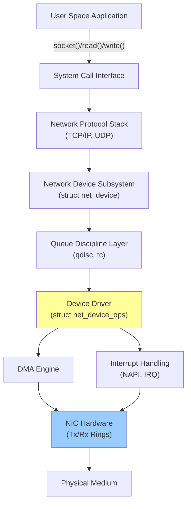
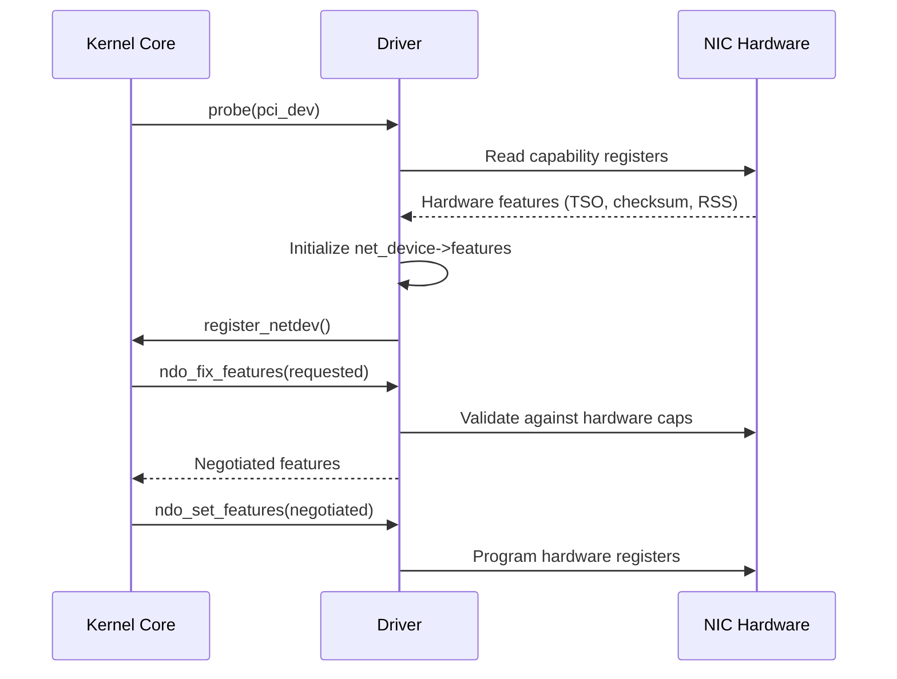
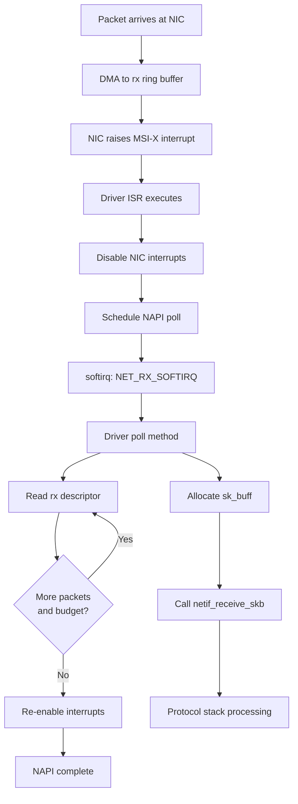
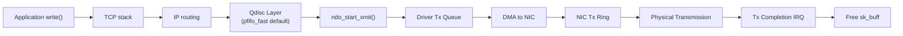
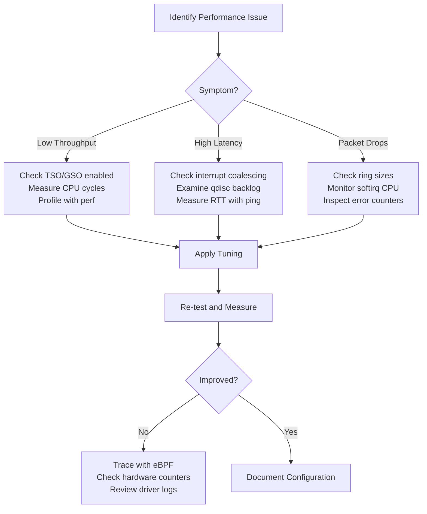

# Operational Verification Labs: Device Drivers

## Introduction

Device drivers form the critical interface between hardware and the operating system kernel. Understanding their behavior under operational conditions requires rigorous inspection of kernel subsystems, network stack internals, and hardware-software interaction patterns. This lab provides a systematic methodology for verifying device driver functionality, diagnosing performance anomalies, and analyzing fault recovery mechanisms.

These exercises target network interface card (NIC) drivers as a representative case study. The principles apply broadly to block devices, character devices, and other driver classes. We focus on Linux kernel 5.4+ with support for modern hardware offloads and eBPF introspection.

### Prerequisites

**Required System Configuration:**
- Linux kernel 5.4 or later with CONFIG_DEBUG_INFO and CONFIG_KPROBES enabled
- Root or CAP_NET_ADMIN, CAP_SYS_ADMIN, CAP_BPF capabilities
- Physical or virtual machine with at least one network interface (prefer hardware NICs over virtio for realistic latency characteristics)

**Essential Tooling:**

```bash
# Debian/Ubuntu
apt-get install iproute2 ethtool tcpdump linux-tools-generic bpfcc-tools \
                strace net-tools pciutils kmod

# RHEL/Fedora
dnf install iproute ethtool tcpdump perf bpftool strace pciutils kmod
```

**Tool Inventory:**
- `ethtool`: NIC register access, feature flags, hardware statistics, driver parameter tuning
- `ss`: Socket state inspection with kernel memory tracking
- `tcpdump`/`tshark`: Packet-level capture and protocol dissection
- `perf`: Hardware performance counters, CPU profiling, event tracing
- `bpftool`: eBPF program and map inspection
- `strace`: System call tracing with latency breakdown
- `lspci`: PCI device enumeration and configuration space inspection
- `dmesg`: Kernel ring buffer for driver messages and error conditions

### Architectural Context

Modern device drivers operate within a layered subsystem architecture:



**Critical Driver Interfaces:**

The `net_device_ops` structure defines the driver's contract with the kernel:
- `ndo_open`: Allocate DMA rings, request IRQs, enable hardware
- `ndo_stop`: Quiesce hardware, free resources
- `ndo_start_xmit`: Transmit packet enqueue (returns NETDEV_TX_OK/BUSY)
- `ndo_get_stats64`: Retrieve hardware counters
- `ndo_set_rx_mode`: Configure multicast/promiscuous modes
- `ndo_do_ioctl`: Legacy device-specific control plane
- `ndo_change_mtu`: Validate and apply MTU changes
- `ndo_fix_features`: Negotiate hardware offload capabilities

**Interrupt Handling Models:**

Linux NIC drivers typically use NAPI (New API) for receive-side scaling:
1. Hardware raises interrupt for incoming packets
2. Driver disables NIC interrupts, schedules `napi_struct` for softirq processing
3. `poll()` method harvests packets from rx ring (budget-limited)
4. Re-enables interrupts when queue drains below threshold

This hybrid interrupt/polling approach prevents receive livelock under high packet rates.

---

## Exercise 1: Driver Initialization and Hardware Feature Negotiation

### Objective

Understand driver probe sequences, PCI enumeration, feature negotiation, and the relationship between hardware capabilities and kernel feature flags.

### Theoretical Foundation

Device drivers bind to hardware through bus-specific matching mechanisms. For PCI devices:
1. Kernel enumerates PCI bus, reading vendor/device IDs from configuration space
2. Driver's `pci_device_id` table declares supported hardware
3. On match, kernel invokes driver's `probe()` function
4. Driver maps MMIO regions, allocates DMA buffers, registers netdev

**Feature Negotiation Flow:**



### Step 1: Identify Network Interface and Driver Binding

Enumerate available network interfaces and determine driver associations:

```bash
# List all network devices with driver and PCI address
ip -br link show

# For a specific interface (replace eth0 with your interface)
IFACE=eth0

# Identify the driver module
ethtool -i $IFACE | grep driver

# Locate the device in sysfs
SYSPATH=$(find /sys/class/net/$IFACE -type l -printf "%l\n")
echo "Sysfs path: $SYSPATH"

# Display PCI vendor/device ID
PCIADDR=$(basename $(readlink /sys/class/net/$IFACE/device))
lspci -vvv -s $PCIADDR | head -20

# Show driver parameters and current values
ls /sys/class/net/$IFACE/device/driver/module/parameters/
for param in /sys/class/net/$IFACE/device/driver/module/parameters/*; do
    echo "$(basename $param): $(cat $param 2>/dev/null)"
done
```

**Expected Output Analysis:**
- Driver name (e.g., `igb`, `e1000e`, `ixgbe`, `mlx5_core`)
- PCI location (e.g., `0000:03:00.0`)
- Vendor ID (e.g., Intel: 8086, Broadcom: 14e4, Mellanox: 15b3)
- Driver module parameters (buffer sizes, interrupt coalescing, offload defaults)

### Step 2: Inspect Hardware Capabilities and Negotiated Features

Query hardware capabilities and compare with active kernel features:

```bash
# Display all hardware offload features and their current state
ethtool -k $IFACE

# Show raw hardware capabilities from PCI config space
# (requires root)
lspci -vvv -s $PCIADDR | grep -A 50 "Capabilities:"

# Display detailed NIC statistics (hardware counters)
ethtool -S $IFACE

# Show ring buffer parameters
ethtool -g $IFACE

# Show interrupt coalescing parameters
ethtool -c $IFACE

# Display PCIe link speed and width
lspci -vvv -s $PCIADDR | grep "LnkSta:"
```

**Feature Flag Interpretation:**

| Feature | Offload Type | Impact |
|---------|-------------|--------|
| `tx-checksumming` | Transmit checksum calculation in hardware | Reduces CPU for TCP/UDP/IP checksum computation |
| `rx-checksumming` | Receive checksum validation in hardware | Avoids software verification overhead |
| `scatter-gather` | Support for non-contiguous memory buffers | Eliminates buffer copying for fragmented packets |
| `tcp-segmentation-offload` (TSO) | Hardware splits large packets into MTU-sized segments | Amortizes per-packet overhead for bulk transfers |
| `generic-receive-offload` (GRO) | Aggregates received packets in software before stack | Reduces protocol processing overhead |
| `receive-side-scaling` (RSS) | Hardware distributes flows across CPU cores | Parallelizes receive processing |
| `large-receive-offload` (LRO) | Hardware aggregates packets (protocol-aware) | Higher throughput but breaks forwarding semantics |

### Step 3: Trace Driver Initialization with Kernel Messages

Examine kernel messages from driver load:

```bash
# Show recent driver-related kernel messages
dmesg | grep -i "$(ethtool -i $IFACE | awk '/driver:/ {print $2}')" | tail -30

# Filter for probe sequence
dmesg | grep -E "$IFACE|probe|register_netdev" | tail -20

# Check for hardware errors or warnings
dmesg | grep -iE "error|warn|fail" | grep $IFACE
```

**Common Initialization Messages:**
- Firmware version detection
- MSI/MSI-X vector allocation
- DMA mask negotiation (32-bit vs 64-bit addressing)
- MAC address assignment
- Link state initialization

### Step 4: Runtime Feature Modification and Validation

Modify offload features and observe kernel/driver interaction:

```bash
# Disable TSO and observe the effect
ethtool -K $IFACE tso off

# Verify change
ethtool -k $IFACE | grep tcp-segmentation-offload

# Re-enable and measure impact with iperf3 (if available)
ethtool -K $IFACE tso on

# Attempt to set unsupported feature (observe error handling)
ethtool -K $IFACE tx-nocache-copy on 2>&1

# Reset to defaults
ethtool -K $IFACE rx on tx on sg on tso on gro on
```

### Step 5: Inspect Driver Source and Match to Runtime Behavior

For open-source drivers, correlate runtime behavior with source code:

```bash
# Locate driver source in kernel tree (example for Intel igb)
DRIVER=$(ethtool -i $IFACE | awk '/driver:/ {print $2}')
find /usr/src/linux-headers-$(uname -r) -name "${DRIVER}.c" 2>/dev/null

# Show driver's feature initialization (example pattern)
# This demonstrates conceptual lookup; actual paths vary
echo "Look for NETIF_F_* flags in driver source:"
echo "  - NETIF_F_SG (scatter-gather)"
echo "  - NETIF_F_TSO (tcp-segmentation-offload)"
echo "  - NETIF_F_RXCSUM (rx-checksumming)"
```

**Reference Code Pattern (Typical Driver Initialization):**

```c
/* Example from a typical Linux NIC driver probe function */
static int driver_probe(struct pci_dev *pdev, const struct pci_device_id *ent)
{
    struct net_device *netdev;
    struct driver_adapter *adapter;
    int err;

    /* Allocate netdev structure */
    netdev = alloc_etherdev_mq(sizeof(struct driver_adapter), num_queues);
    if (!netdev)
        return -ENOMEM;

    SET_NETDEV_DEV(netdev, &pdev->dev);
    adapter = netdev_priv(netdev);
    adapter->netdev = netdev;
    adapter->pdev = pdev;

    /* Enable PCI device */
    err = pci_enable_device_mem(pdev);
    if (err)
        goto err_free_netdev;

    /* Request MMIO regions */
    err = pci_request_mem_regions(pdev, driver_name);
    if (err)
        goto err_disable_device;

    /* Set DMA mask */
    err = dma_set_mask_and_coherent(&pdev->dev, DMA_BIT_MASK(64));
    if (err)
        err = dma_set_mask_and_coherent(&pdev->dev, DMA_BIT_MASK(32));

    /* Map hardware registers */
    adapter->hw_addr = pci_ioremap_bar(pdev, 0);
    if (!adapter->hw_addr) {
        err = -EIO;
        goto err_release_regions;
    }

    /* Read hardware capabilities from device */
    u32 hw_caps = readl(adapter->hw_addr + HW_CAP_REG);

    /* Set supported features based on hardware */
    netdev->features = NETIF_F_SG |
                       NETIF_F_IP_CSUM |
                       NETIF_F_IPV6_CSUM |
                       NETIF_F_RXCSUM;

    if (hw_caps & HW_CAP_TSO)
        netdev->features |= NETIF_F_TSO | NETIF_F_TSO6;

    if (hw_caps & HW_CAP_RSS)
        netdev->features |= NETIF_F_RXHASH;

    /* Features that can be toggled by ethtool */
    netdev->hw_features = netdev->features;

    /* Register net_device_ops */
    netdev->netdev_ops = &driver_netdev_ops;
    netdev->ethtool_ops = &driver_ethtool_ops;

    /* Register device with kernel */
    err = register_netdev(netdev);
    if (err)
        goto err_unmap;

    pci_set_drvdata(pdev, netdev);
    return 0;

err_unmap:
    iounmap(adapter->hw_addr);
err_release_regions:
    pci_release_mem_regions(pdev);
err_disable_device:
    pci_disable_device(pdev);
err_free_netdev:
    free_netdev(netdev);
    return err;
}
```

### Verification Checklist

- [ ] Driver module identified and version confirmed via `ethtool -i`
- [ ] PCI device enumeration shows correct vendor/device ID and link speed
- [ ] Hardware feature flags match driver capabilities (`ethtool -k`)
- [ ] Ring buffer sizes are within hardware limits (`ethtool -g`)
- [ ] Kernel messages show successful probe without errors (`dmesg`)
- [ ] Feature modifications via `ethtool -K` succeed or fail with appropriate errors
- [ ] Driver parameters in sysfs reflect expected defaults

---

## Exercise 2: Receive Path Analysis and Interrupt Coalescing

### Objective

Analyze packet receive flow from hardware interrupt to protocol stack delivery. Measure interrupt rates, NAPI polling efficiency, and the impact of interrupt coalescing on latency and throughput.

### Theoretical Foundation

**NAPI Receive Flow:**



**Interrupt Coalescing Parameters:**
- `rx-usecs`: Delay after first packet before interrupt (adaptive latency)
- `rx-frames`: Number of packets to accumulate before interrupt (adaptive throughput)
- Adaptive algorithms adjust these dynamically based on traffic pattern

**Trade-offs:**
- High coalescing: Fewer interrupts, higher throughput, increased latency
- Low coalescing: Lower latency, more interrupts, reduced throughput at scale

### Step 1: Baseline Interrupt Rate Measurement

Measure interrupt distribution across CPUs:

```bash
# Show interrupt counts per CPU for the NIC
cat /proc/interrupts | grep -E "CPU|$IFACE"

# Monitor interrupt rate in real-time (1-second intervals)
watch -n 1 "cat /proc/interrupts | grep $IFACE"

# Alternative: Use mpstat for IRQ time percentage
mpstat -I ALL 1 5

# Check interrupt affinity (which CPUs handle NIC interrupts)
for irq in $(grep $IFACE /proc/interrupts | cut -d: -f1); do
    echo "IRQ $irq: $(cat /proc/irq/$irq/smp_affinity_list 2>/dev/null)"
done
```

### Step 2: Inspect Current Coalescing Configuration

```bash
# Display all coalescing parameters
ethtool -c $IFACE

# Typical output interpretation:
# rx-usecs: microseconds to wait after rx packet
# rx-frames: packets to accumulate before interrupt
# tx-usecs/tx-frames: transmit-side equivalents
# Adaptive RX/TX: dynamic adjustment based on traffic

# Show per-queue statistics if supported
ethtool -S $IFACE | grep -E "queue.*packets|queue.*bytes"
```

### Step 3: Modify Coalescing and Measure Impact

```bash
# Record baseline
echo "=== Baseline Configuration ===" > /tmp/coalesce_test.log
ethtool -c $IFACE >> /tmp/coalesce_test.log
cat /proc/interrupts | grep $IFACE >> /tmp/coalesce_test.log

# Generate test traffic (requires iperf3 server on another host)
# SERVER_IP=192.168.1.100
# iperf3 -c $SERVER_IP -t 30 -P 4 &
# TEST_PID=$!

# Reduce coalescing (lower latency, more interrupts)
ethtool -C $IFACE rx-usecs 1 rx-frames 1 adaptive-rx off

sleep 2
echo "=== Low Coalescing ===" >> /tmp/coalesce_test.log
cat /proc/interrupts | grep $IFACE >> /tmp/coalesce_test.log

# Increase coalescing (higher latency, fewer interrupts)
ethtool -C $IFACE rx-usecs 100 rx-frames 64

sleep 2
echo "=== High Coalescing ===" >> /tmp/coalesce_test.log
cat /proc/interrupts | grep $IFACE >> /tmp/coalesce_test.log

# Restore adaptive mode
ethtool -C $IFACE adaptive-rx on

# wait $TEST_PID
cat /tmp/coalesce_test.log
```

### Step 4: Trace Receive Path with eBPF

Use BCC tools to trace packet receive at kernel level:

```bash
# Trace network device receive (requires bpfcc-tools)
# WARNING: High-frequency tracing can impact performance
timeout 10 /usr/share/bcc/tools/tcplife -i $IFACE

# Trace sk_buff allocation and delivery
timeout 5 /usr/share/bcc/tools/trace 'netif_receive_skb(struct sk_buff *skb) "dev=%s len=%d", skb->dev->name, skb->len'

# If bpftrace is available, trace interrupt and NAPI interaction
cat > /tmp/napi_trace.bt <<'EOF'
kprobe:napi_schedule
{
    @napi_schedules = count();
}

kprobe:napi_poll
{
    @napi_polls = count();
}

interval:s:1
{
    print(@napi_schedules);
    print(@napi_polls);
    clear(@napi_schedules);
    clear(@napi_polls);
}
EOF

timeout 10 bpftrace /tmp/napi_trace.bt
```

### Step 5: Analyze NAPI Budget and Polling Efficiency

```bash
# Check NAPI weight (polling budget per softirq cycle)
# This is driver-specific; typical values: 64-256 packets
ethtool -S $IFACE | grep -i napi

# Check for rx_dropped (ring overflow - NAPI can't keep up)
ethtool -S $IFACE | grep -E "rx_dropped|rx_fifo_errors|rx_missed_errors"

# If drops occur, examine softirq CPU usage
mpstat -I SCPU 1 5 | grep -E "CPU|NET_RX"

# Check if RPS/RFS is enabled (receive packet steering)
cat /sys/class/net/$IFACE/queues/rx-*/rps_cpus

# Examine CPU affinity for softirq processing
ps aux | grep ksoftirqd
```

**Interpretation:**
- `rx_missed_errors` > 0: Hardware ring overflow (increase ring size with `ethtool -G`)
- `NET_RX softirq` consuming >50% CPU: Consider RPS or hardware RSS
- Low NAPI budget utilization: Over-coalesced or low traffic

### Step 6: Packet Capture at Driver Level

```bash
# Capture packets at the interface (includes driver processing time)
timeout 10 tcpdump -i $IFACE -c 1000 -w /tmp/capture.pcap -nn

# Analyze capture timing
tcpdump -r /tmp/capture.pcap -tt -nn | head -20

# Use tshark for inter-packet timing analysis
tshark -r /tmp/capture.pcap -T fields -e frame.time_relative -e frame.len | head -20

# Check for out-of-order packets (driver or NIC issue)
tshark -r /tmp/capture.pcap -z expert
```

### Verification Checklist

- [ ] Baseline interrupt rate measured under idle and load conditions
- [ ] Coalescing parameters modified and interrupt rate changed accordingly
- [ ] No `rx_missed_errors` or `rx_fifo_errors` under load
- [ ] NAPI poll cycles and packet counts correlated
- [ ] Per-queue statistics show balanced load (if multi-queue NIC)
- [ ] Packet capture shows expected frame arrival pattern

---

## Exercise 3: Transmit Path Optimization and Queue Discipline

### Objective

Understand transmit flow control, queue discipline (qdisc), transmit ring management, and the impact of TSO/GSO on throughput.

### Theoretical Foundation

**Transmit Data Flow:**



**Transmit Segmentation Offload (TSO):**
- Application sends large buffer (e.g., 64 KB)
- TCP stack creates a single large sk_buff (up to 64 KB)
- NIC hardware segments into MTU-sized frames (1500 bytes)
- Amortizes per-packet CPU overhead by 40x+

**Queue Discipline:**
- `pfifo_fast`: Default 3-band FIFO based on TOS
- `fq_codel`: Flow queuing with controlled delay, prevents bufferbloat
- `htb`: Hierarchical token bucket, rate limiting
- `mq`: Multi-queue discipline, one qdisc per hardware tx queue

### Step 1: Inspect Transmit Queue Configuration

```bash
# Show qdisc configuration
tc qdisc show dev $IFACE

# Display transmit ring size
ethtool -g $IFACE

# Show current transmit queue length
ip link show $IFACE | grep qlen

# Check number of transmit queues
ls -d /sys/class/net/$IFACE/queues/tx-* | wc -l

# Show transmit statistics
ethtool -S $IFACE | grep -E "tx_packets|tx_bytes|tx_dropped|tx_errors"
```

### Step 2: Monitor Transmit Completion and Backpressure

```bash
# Watch for transmit queue stalls (tx_timeout events)
dmesg | grep -i "tx_timeout\|transmit timeout"

# Monitor qdisc drops (backlog overflow)
tc -s qdisc show dev $IFACE

# Real-time qdisc statistics
watch -n 1 "tc -s qdisc show dev $IFACE"

# Check for carrier errors (physical layer issues)
ethtool -S $IFACE | grep -E "carrier_errors|tx_carrier_errors"
```

### Step 3: Test TSO Impact on Throughput

```bash
# Measure baseline throughput with TSO enabled
# (Requires iperf3 server: iperf3 -s)
# SERVER_IP=192.168.1.100

echo "=== TSO Enabled ===" > /tmp/tso_test.log
ethtool -k $IFACE | grep tcp-segmentation-offload >> /tmp/tso_test.log
# iperf3 -c $SERVER_IP -t 10 -P 1 >> /tmp/tso_test.log

# Disable TSO and retest
ethtool -K $IFACE tso off
echo "=== TSO Disabled ===" >> /tmp/tso_test.log
ethtool -k $IFACE | grep tcp-segmentation-offload >> /tmp/tso_test.log
# iperf3 -c $SERVER_IP -t 10 -P 1 >> /tmp/tso_test.log

# Check CPU usage difference
echo "Observe CPU usage in htop or mpstat during tests"

# Re-enable TSO
ethtool -K $IFACE tso on

cat /tmp/tso_test.log
```

**Expected Results:**
- TSO enabled: 30-50% higher throughput, lower CPU usage
- TSO disabled: More CPU time in softirq, more interrupts

### Step 4: Qdisc Replacement and Bufferbloat Testing

```bash
# Replace default qdisc with fq_codel
tc qdisc replace dev $IFACE root fq_codel

# Verify
tc qdisc show dev $IFACE

# Test under load with latency monitoring
# (Requires netperf or iperf3)
# Terminal 1: Generate bulk traffic
# iperf3 -c $SERVER_IP -t 60 &

# Terminal 2: Measure latency during bulk transfer
# ping -i 0.2 $SERVER_IP > /tmp/latency_fq_codel.log

# Compare with default qdisc
tc qdisc replace dev $IFACE root pfifo_fast
# Repeat test

# Restore fq_codel (recommended for general use)
tc qdisc replace dev $IFACE root fq_codel
```

### Step 5: Transmit Ring Tuning

```bash
# Show current ring parameters
ethtool -g $IFACE

# Increase transmit ring size (if hardware supports larger)
# WARNING: Larger rings consume more memory
CURRENT_TX=$(ethtool -g $IFACE | awk '/TX:/ && /Current/ {getline; print $2}')
MAX_TX=$(ethtool -g $IFACE | awk '/TX:/ && NR==3 {print $2}')

echo "Current TX ring: $CURRENT_TX, Max: $MAX_TX"

# Set to maximum (or increase moderately)
# ethtool -G $IFACE tx 4096

# Monitor for improvements in tx_dropped
ethtool -S $IFACE | grep tx_dropped
```

### Step 6: Trace Transmit Path with perf

```bash
# Profile transmit path CPU usage
perf record -e cycles -C 0-3 -g -- sleep 10

# Analyze recorded profile
perf report --stdio | head -50

# Specific transmit function tracing
perf trace -e 'net:net_dev_xmit' -a -- sleep 5

# Check for transmit stalls or backpressure
perf trace -e 'net:net_dev_queue' -a -- sleep 5
```

### Verification Checklist

- [ ] Transmit queue discipline identified (pfifo_fast or fq_codel recommended)
- [ ] Transmit ring size verified and tuned if necessary
- [ ] TSO offload enabled and throughput improvement measured
- [ ] No `tx_dropped` errors under moderate load
- [ ] Qdisc backlog remains bounded (not growing indefinitely)
- [ ] Transmit completion interrupts are timely (no tx_timeout events)

---

## Exercise 4: Driver Performance Profiling Under Saturation

### Objective

Profile driver behavior under high packet rate stress. Identify CPU bottlenecks, DMA efficiency, and hardware counter anomalies. Use `perf` for kernel profiling and hardware performance counters.

### Theoretical Foundation

**Performance Metrics:**
- **PPS (Packets Per Second)**: Raw packet rate capability
- **Throughput (Gbps)**: Effective data transfer rate
- **CPU cycles per packet**: Efficiency metric for softirq processing
- **Cache miss rate**: Memory access efficiency
- **DMA latency**: Time between packet arrival and memory availability

**Saturation Testing Goals:**
- Determine maximum sustainable packet rate
- Identify CPU or memory bandwidth bottlenecks
- Measure interrupt overhead vs. NAPI polling efficiency

### Step 1: Baseline System Resource Usage

```bash
# Capture baseline CPU, memory, and I/O
mpstat 1 5 > /tmp/baseline_cpu.log
vmstat 1 5 > /tmp/baseline_vm.log
iostat -x 1 5 > /tmp/baseline_io.log

# Baseline network statistics
ip -s link show $IFACE > /tmp/baseline_netdev.log
ethtool -S $IFACE > /tmp/baseline_ethtool.log
```

### Step 2: Generate High Packet Rate Load

**Option A: Using packet generator (pktgen):**

```bash
# Load pktgen module
modprobe pktgen

# Configure pktgen (requires root)
cat > /tmp/pktgen_setup.sh <<'EOF'
#!/bin/bash
IFACE=$1
PGDEV=/proc/net/pktgen/kpktgend_0
echo "rem_device_all" > $PGDEV
echo "add_device $IFACE" > $PGDEV

PGDEV=/proc/net/pktgen/$IFACE
echo "count 10000000" > $PGDEV
echo "pkt_size 64" > $PGDEV
echo "dst 192.168.1.100" > $PGDEV
echo "dst_mac 00:11:22:33:44:55" > $PGDEV

PGCTRL=/proc/net/pktgen/pgctrl
echo "start" > $PGCTRL
EOF

# bash /tmp/pktgen_setup.sh $IFACE
```

**Option B: External traffic generator:**
Use iperf3, netperf, or hardware traffic generator.

### Step 3: Real-time Performance Monitoring

```bash
# Monitor CPU distribution across cores
mpstat -P ALL 1 10 > /tmp/saturation_cpu.log &

# Monitor interrupt rate
watch -n 1 "cat /proc/interrupts | grep $IFACE"

# Monitor network device statistics
watch -n 1 "ethtool -S $IFACE | grep -E 'rx_packets|rx_dropped|rx_errors'"

# Monitor softirq load
watch -n 1 "grep NET /proc/softirqs"
```

### Step 4: CPU Profiling with perf

```bash
# Record CPU profile during load (60 seconds)
perf record -F 99 -a -g -- sleep 60

# Generate flamegraph-friendly report
perf script > /tmp/perf_script.log

# Top functions by CPU time
perf report --stdio --sort comm,dsl | head -50 > /tmp/perf_report.log

# Focus on network driver functions
perf report --stdio | grep -E "driver_name|napi|net_rx" | head -30
```

**Interpreting perf output:**
- High CPU in `__napi_poll`: Driver's poll method is bottleneck
- High CPU in `net_rx_action`: Protocol stack is bottleneck
- High CPU in driver's `clean_rx_irq` function: Descriptor processing overhead

### Step 5: Hardware Performance Counters

```bash
# Count cache misses, cycles, and instructions
perf stat -e cycles,instructions,cache-misses,cache-references -a sleep 10

# Calculate IPC (instructions per cycle) - higher is better
# IPC < 1.0: Memory-bound or stall-heavy
# IPC > 2.0: Well-optimized, instruction-level parallelism

# Count branch mispredictions (indicates unpredictable code paths)
perf stat -e branch-misses,branches -a sleep 10

# Monitor LLC (Last Level Cache) activity
perf stat -e LLC-loads,LLC-load-misses -a sleep 10
```

### Step 6: Analyze Dropped Packets and Backpressure

```bash
# Check for ring buffer overflows
ethtool -S $IFACE | grep -E "rx_dropped|rx_missed|rx_fifo_errors|rx_no_buffer_count"

# Check qdisc drops
tc -s qdisc show dev $IFACE

# Kernel network stack drops
netstat -s | grep -E "dropped|overflow"

# Check for memory allocation failures
grep -i "allocation failure" /var/log/kern.log | tail -20
```

**Root Cause Analysis:**
- `rx_missed_errors`: Increase ring size (`ethtool -G`)
- High softirq CPU: Enable RPS/RFS or use multi-queue NIC
- High LLC misses: Driver data structures poorly aligned or too large
- `rx_no_buffer_count`: Increase rx ring buffer allocation

### Step 7: Visualize Driver Receive Path (Optional Advanced)

```bash
# Use bpftrace to measure time spent in driver functions
cat > /tmp/driver_latency.bt <<'EOF'
kprobe:igb_poll
{
    @start[tid] = nsecs;
}

kretprobe:igb_poll
/@start[tid]/
{
    @latency_ns = hist(nsecs - @start[tid]);
    delete(@start[tid]);
}

interval:s:5
{
    print(@latency_ns);
    clear(@latency_ns);
}
EOF

# Run trace (replace igb_poll with your driver's poll function)
# timeout 30 bpftrace /tmp/driver_latency.bt
```

### Verification Checklist

- [ ] Baseline and saturation CPU usage captured with mpstat
- [ ] Packet drop counters examined (ethtool -S, tc -s, netstat -s)
- [ ] perf profile identifies top CPU consumers in driver and stack
- [ ] Hardware counters show cache efficiency and IPC
- [ ] Interrupt rate and NAPI poll frequency measured
- [ ] System sustained target packet rate without drops or errors

---

## Exercise 5: Fault Injection and Driver Recovery Testing

### Objective

Simulate hardware faults, driver errors, and resource exhaustion scenarios. Verify driver's error handling, recovery mechanisms, and logging behavior.

### Theoretical Foundation

**Driver Resilience Requirements:**
- Detect and recover from DMA errors
- Handle interrupt storms gracefully
- Survive firmware crashes (for NICs with embedded firmware)
- Properly clean up resources on unload
- Log actionable diagnostics on failure

**Linux Fault Injection Framework:**
The kernel provides `CONFIG_FAULT_INJECTION` for testing error paths:
- `fail_page_alloc`: Force memory allocation failures
- `fail_make_request`: Force block I/O failures
- `fail_futex`: Force futex failures
- Custom driver fault injection via debugfs or module parameters

### Step 1: Prepare Fault Injection Environment

```bash
# Verify fault injection support in kernel
grep CONFIG_FAULT_INJECTION /boot/config-$(uname -r)

# Check available fault injection types
ls /sys/kernel/debug/fail*

# Enable page allocation failure injection (be cautious)
echo 1 > /sys/kernel/debug/fail_page_alloc/task-filter
echo 10 > /sys/kernel/debug/fail_page_alloc/probability
echo 100 > /sys/kernel/debug/fail_page_alloc/interval

# Limit to specific process (safer)
# echo $$ > /sys/kernel/debug/fail_page_alloc/task-filter
```

### Step 2: Trigger Driver Reload Under Stress

```bash
# Capture pre-reload state
ip link show $IFACE > /tmp/pre_reload.log
ethtool -S $IFACE >> /tmp/pre_reload.log

# Unload driver module (this will drop connections!)
DRIVER=$(ethtool -i $IFACE | awk '/driver:/ {print $2}')
modprobe -r $DRIVER

# Check for errors in kernel log
dmesg | tail -30

# Reload driver
modprobe $DRIVER

# Verify recovery
ip link show $IFACE > /tmp/post_reload.log
ethtool -S $IFACE >> /tmp/post_reload.log

# Compare states
diff /tmp/pre_reload.log /tmp/post_reload.log
```

### Step 3: Simulate Link Flapping

```bash
# Rapidly toggle link state
for i in {1..10}; do
    ip link set $IFACE down
    sleep 0.5
    ip link set $IFACE up
    sleep 0.5
done

# Check for errors
dmesg | grep -E "$IFACE|$DRIVER" | tail -30

# Verify final state
ethtool $IFACE | grep "Link detected"
```

### Step 4: Exhaust Receive Buffer Pool

```bash
# Reduce receive ring size to minimum
ethtool -G $IFACE rx 64

# Generate high packet rate to overflow ring
# (Use pktgen or external generator)

# Monitor for drops
watch -n 1 "ethtool -S $IFACE | grep -E 'rx_dropped|rx_missed_errors|rx_no_buffer'"

# Check kernel messages for allocation failures
dmesg | grep -iE "alloc|oom|failed" | tail -20

# Restore ring size
ethtool -G $IFACE rx 1024
```

### Step 5: Test Error Counter Accuracy

```bash
# Introduce deliberate errors using tc
# Add random packet corruption
tc qdisc add dev $IFACE root netem corrupt 5%

# Generate test traffic
# ping -c 100 -i 0.1 192.168.1.100

# Check error counters
ethtool -S $IFACE | grep -E "error|crc|fcs"

# Remove corruption
tc qdisc del dev $IFACE root

# Verify counters increment appropriately
```

### Step 6: Firmware and EEProm Access Testing (If Supported)

```bash
# Dump firmware version
ethtool -i $IFACE | grep firmware

# Some drivers support firmware flashing via ethtool
# WARNING: This can brick the NIC if interrupted
# ethtool -f $IFACE firmware.bin (DO NOT RUN without backup hardware)

# Read EEPROM contents (driver-specific)
ethtool -e $IFACE > /tmp/eeprom_dump.bin

# Check EEPROM validity
hexdump -C /tmp/eeprom_dump.bin | head -20
```

### Step 7: Trace Error Handling with strace and ftrace

```bash
# Trace driver interaction during forced error
# Trigger an error condition (e.g., set invalid MTU)
strace -e ioctl -o /tmp/strace_error.log ethtool -s $IFACE mtu 9000 2>&1

# Examine syscall trace
grep -E "ioctl|error|EINVAL" /tmp/strace_error.log

# Use ftrace to trace kernel error paths
echo 1 > /sys/kernel/debug/tracing/events/net/enable
echo 1 > /sys/kernel/debug/tracing/tracing_on

# Trigger error
ethtool -s $IFACE speed 10000 duplex full 2>&1

# Capture trace
cat /sys/kernel/debug/tracing/trace > /tmp/ftrace_error.log
echo 0 > /sys/kernel/debug/tracing/tracing_on

# Analyze
grep -E "error|fail|invalid" /tmp/ftrace_error.log | head -30
```

### Step 8: Verify Driver Cleanup on Unload

```bash
# Check reference counts before unload
lsmod | grep $DRIVER

# Attempt unload
modprobe -r $DRIVER

# Verify complete cleanup
lsmod | grep $DRIVER

# Check for lingering resources
ls /sys/class/net/ | grep $IFACE

# Check kernel log for cleanup warnings
dmesg | grep -E "$DRIVER|$IFACE" | tail -30

# Reload and verify
modprobe $DRIVER
ip link show $IFACE
```

### Verification Checklist

- [ ] Driver survives module reload without kernel warnings
- [ ] Link flapping does not cause kernel panics or hangs
- [ ] Error counters increment accurately under fault conditions
- [ ] Driver logs actionable messages on resource exhaustion
- [ ] Module unload completes cleanly with no leaked resources
- [ ] Firmware version read successfully via ethtool
- [ ] Invalid parameters rejected with appropriate error codes

---

## Diagnostic Cheat Sheet

### Quick Inspection Commands

| Goal | Command | Output Interpretation |
|------|---------|----------------------|
| Driver name and version | `ethtool -i eth0` | Check driver module name, version, firmware version |
| Hardware offload features | `ethtool -k eth0` | Verify TSO, checksum offload, GRO, RSS are enabled |
| Ring buffer sizes | `ethtool -g eth0` | Check current vs. max ring sizes; increase if drops occur |
| Hardware statistics | `ethtool -S eth0` | Examine `rx_dropped`, `tx_errors`, `rx_missed_errors` |
| Interrupt coalescing | `ethtool -c eth0` | Check `rx-usecs` and `rx-frames` settings |
| PCI device info | `lspci -vvv -s <addr>` | Verify link speed (Gen 3/4), width (x8/x16), vendor/device ID |
| Interrupt distribution | `cat /proc/interrupts \| grep eth0` | Ensure interrupts spread across CPUs (for multi-queue NICs) |
| Queue discipline | `tc qdisc show dev eth0` | Verify fq_codel or appropriate qdisc; check for drops |
| Socket statistics | `ss -tiepm` | Show socket memory, congestion control, RTT |
| Kernel messages | `dmesg \| grep eth0` | Check for errors, firmware issues, or initialization problems |
| Network namespace | `ip netns list` | If using containers, ensure interface in correct namespace |

### Performance Profiling Workflow



### Common Error Patterns and Resolutions

| Symptom | Likely Cause | Diagnostic Command | Resolution |
|---------|--------------|-------------------|------------|
| `rx_missed_errors` increasing | Ring buffer overflow | `ethtool -S eth0` | Increase ring size: `ethtool -G eth0 rx 4096` |
| `tx_timeout` events | DMA stall or hardware hang | `dmesg \| grep tx_timeout` | Check cable, switch port, or reload driver |
| High softirq CPU usage | NAPI not keeping up | `mpstat -I SCPU` | Enable RPS/RFS or add more rx queues |
| Low throughput with TSO on | MTU mismatch or fragmentation | `ip link show \| grep mtu` | Verify MTU consistency end-to-end |
| Packet corruption | Cable, transceiver, or NIC issue | `ethtool -S eth0 \| grep crc` | Replace cable, check NIC firmware |
| Driver load fails | Missing firmware or hardware unsupported | `dmesg \| grep -i firmware` | Install firmware package or check hardware compatibility |
| Random disconnects | Power management suspending NIC | `ethtool eth0 \| grep Wake-on` | Disable NIC power management in BIOS |

### Advanced Introspection: BPF and Tracing

**Trace packet journey through stack:**

```bash
# Requires bpftrace
cat > /tmp/packet_flow.bt <<'EOF'
kprobe:__netif_receive_skb_core
{
    @receive_time[tid] = nsecs;
}

kprobe:ip_rcv
/@receive_time[tid]/
{
    @ip_latency = hist(nsecs - @receive_time[tid]);
}

kprobe:tcp_v4_rcv
/@receive_time[tid]/
{
    @tcp_latency = hist(nsecs - @receive_time[tid]);
    delete(@receive_time[tid]);
}
EOF

# bpftrace /tmp/packet_flow.bt
```

**Monitor per-queue statistics:**

```bash
# If driver supports per-queue ethtool stats
for queue in /sys/class/net/eth0/queues/rx-*; do
    qnum=$(basename $queue | cut -d- -f2)
    echo "Queue $qnum:"
    ethtool -S eth0 | grep "queue_${qnum}_"
done
```

### Resource Limits and Kernel Tuning

```bash
# Increase system-wide network buffer limits
sysctl -w net.core.rmem_max=268435456
sysctl -w net.core.wmem_max=268435456
sysctl -w net.core.rmem_default=16777216
sysctl -w net.core.wmem_default=16777216

# Increase netdev backlog for high PPS
sysctl -w net.core.netdev_max_backlog=300000

# Tune TCP buffer sizes
sysctl -w net.ipv4.tcp_rmem="4096 87380 134217728"
sysctl -w net.ipv4.tcp_wmem="4096 65536 134217728"

# Enable RFS (Receive Flow Steering)
sysctl -w net.core.rps_sock_flow_entries=32768
for queue in /sys/class/net/eth0/queues/rx-*; do
    echo 4096 > $queue/rps_flow_cnt
done
```

---

## Conclusion

Device driver verification demands deep understanding of kernel subsystems, hardware interfaces, and performance profiling. These exercises provide a structured approach to:

1. **Architectural comprehension**: Tracing packet flow from hardware DMA to application socket
2. **Operational validation**: Confirming driver initialization, feature negotiation, and resource allocation
3. **Performance characterization**: Measuring throughput, latency, and CPU efficiency under load
4. **Fault resilience**: Testing error paths, recovery mechanisms, and resource cleanup

Mastery of these techniques enables:
- **Production troubleshooting**: Diagnosing network performance degradation or hardware failures
- **Capacity planning**: Understanding driver limitations and scaling characteristics
- **Driver development**: Validating custom or out-of-tree drivers before deployment

The diagnostic patterns and tooling covered here extend beyond NICs to block devices, character devices, and other kernel subsystems. The fundamental principles—interrupt handling, DMA management, resource lifecycle—remain consistent across driver classes.

For further study, examine the Linux kernel documentation in `Documentation/networking/` and driver source code in `drivers/net/ethernet/`. The kernel's tracing infrastructure (`ftrace`, `perf`, `eBPF`) provides unlimited introspection depth for those willing to read the source.
