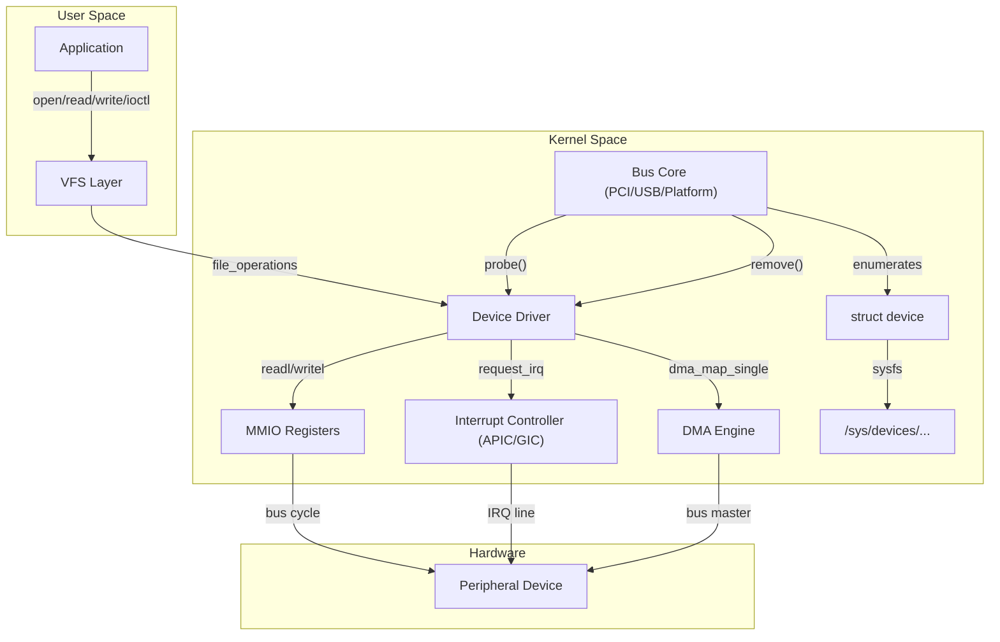
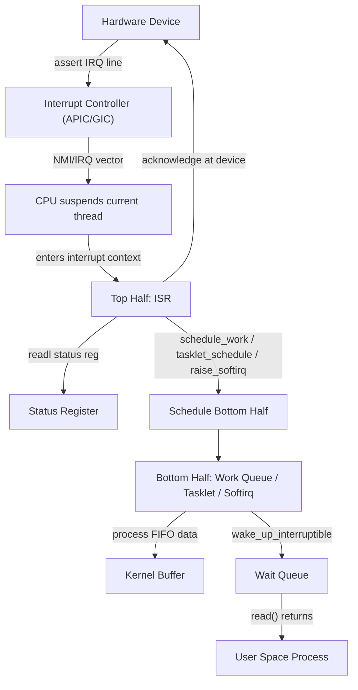
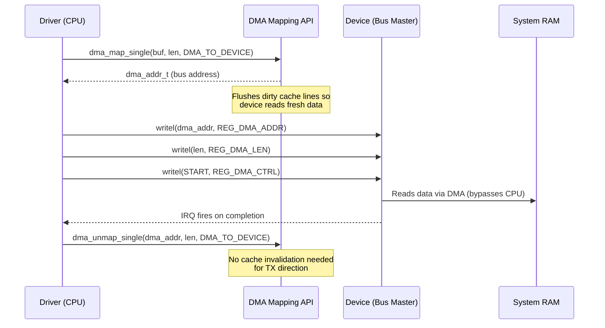
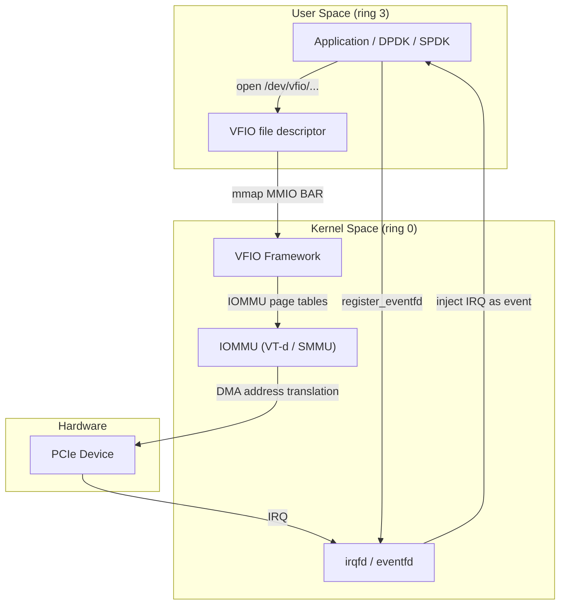

# Lesson 1: Device Driver Fundamentals

## 1. First-Principles Intuition & Invariants

A device driver is kernel code that translates a hardware-neutral, OS-level abstraction (e.g., "write these bytes to the disk," "send this packet on the wire") into the sequence of register writes, memory transfers, and interrupt acknowledgements that a specific piece of hardware requires. It is the only component in the system that knows the physical interface to a particular device; everything above it speaks in generalized I/O primitives.

### Privilege Rings and the Kernel-User Boundary

On x86-64 and ARM, the CPU enforces privilege rings (x86: ring 0 through ring 3; ARM: EL0 through EL3). The kernel and its drivers execute at ring 0 / EL1 with unrestricted access to I/O ports (via `IN`/`OUT` instructions on x86), memory-mapped I/O regions (via normal load/store instructions to physical address ranges), and the MMU page tables. User-space applications at ring 3 / EL0 cannot issue privileged I/O instructions or access device memory directly; they must trap into the kernel through system calls or shared-memory mappings established by the kernel.

Kernel-mode drivers embed directly in the kernel's address space, execute in the kernel's execution context (process context for system-call-driven operations, interrupt context for ISRs), and have unrestricted access to hardware. A single null-pointer dereference, use-after-free, or unbounded loop in a kernel-mode driver can hang or crash the entire system. User-mode drivers (Windows UMDF, Linux VFIO userspace drivers, DPDK, SPDK) run as ordinary processes. A crash terminates the process rather than the kernel, but every hardware access must traverse a kernel-mediated channel (shared memory, eventfd notifications, ioctl), adding latency and context-switch overhead.

### The Fundamental Invariants of Driver Design

Three invariants constrain every driver:

1. **Context awareness**: Code running in interrupt context (an ISR, softirq, or tasklet) must never sleep, allocate memory with `GFP_KERNEL`, or hold a mutex. It can only use spinlocks and atomic operations. Code running in process context (a `read`/`write`/`ioctl` handler invoked via a system call) may sleep, allocate memory, and hold mutexes.

2. **Hardware asynchronicity**: The CPU and the device operate independently and at different clock domains. The CPU cannot assume a register write has reached the device without a memory barrier, nor can it assume the device has finished a DMA transfer without checking an interrupt status register or polling a completion bit.

3. **Reentrancy**: Multiple processes can issue I/O to the same device concurrently. The driver must serialize access to shared device state using locks while allowing concurrent independent operations where the hardware supports them.

### Memory-Mapped I/O vs. Port I/O

Devices expose registers to the CPU through two mechanisms:

**Port I/O** (x86-specific): A dedicated I/O address space accessed via `IN`/`OUT` instructions. The CPU asserts an I/O cycle signal on the bus, distinguishing I/O space from memory space. On Linux, port I/O is accessed via `inb()`, `outb()`, `inw()`, `outw()`, `inl()`, `outl()` after requesting the region with `request_region()`.

**Memory-Mapped I/O (MMIO)**: Device registers are mapped into the physical address space. The CPU accesses them using ordinary load/store instructions, but the MMU is configured so that these accesses are uncacheable and uncached (strongly-ordered on ARM). The driver calls `ioremap()` (or `devm_ioremap_resource()`) to obtain a virtual address for the physical register region, then accesses it via `readl()`, `writel()`, `readb()`, `writeb()`, `readw()`, `writew()`. Direct pointer dereference must not be used because compiler optimizations, CPU reordering, and cache effects can corrupt the ordering of register accesses.

MMIO is the dominant interface on ARM, RISC-V, and most modern x86 peripherals. Port I/O persists on legacy x86 hardware (e.g., the 16550 UART at `0x3F8`, ATA PIO mode registers).

### The Linux Device Model

The Linux kernel maintains a hierarchical representation of every device in the system through the device model, rooted in `struct device` and `struct device_driver`. The key relationships are:

- **Bus** (`struct bus_type`): A communication pathway (PCI, USB, platform, I2C, SPI). The bus core enumerates devices and matches them to drivers.
- **Device** (`struct device`): Represents a specific hardware instance. Contains a pointer to its parent device, its bus, its driver, and a `kobject` that exposes it in sysfs.
- **Driver** (`struct device_driver`): Contains `probe` and `remove` callbacks. The bus core calls `probe` when a matching device is detected, initializing the hardware and registering it with the appropriate subsystem (character, block, network).
- **Class** (`struct class`): A functional grouping (e.g., `netdev`, `block`, `input`) that is orthogonal to the bus hierarchy. udev uses class membership to assign device nodes like `/dev/video0`.

When a driver registers with a bus, the bus core iterates over all known devices on that bus and calls the driver's `probe` function for each device whose hardware IDs match the driver's ID table. On `remove`, the driver must undo every step of `probe` in reverse order: free IRQs, unmap I/O memory, unregister the device, and free buffers.



## 2. Core Architecture & Mechanics

### Character Device Driver Structure

A character device is the most fundamental Linux device type. It presents a byte-stream interface accessible through `/dev` nodes using `open`, `read`, `write`, `ioctl`, and `close`. The driver registers a set of file operations with the VFS, and the VFS dispatches user-space system calls into these callbacks.

The registration path is:

1. Allocate a major/minor device number via `alloc_chrdev_region()`.
2. Initialize a `struct cdev` with `cdev_init()`, associating it with a `file_operations` struct.
3. Add the cdev to the system with `cdev_add()`, making it live.
4. Create a device node in sysfs via `device_create()`, which triggers udev to create the `/dev` node.

On cleanup, reverse the order: `device_destroy()`, `cdev_del()`, `unregister_chrdev_region()`.

The following is a complete, compilable Linux character driver module that exposes a single hardware register bank, handles interrupts with a top-half/bottom-half split, and uses a wait queue to block `read()` until data is available:

```c
// SPDX-License-Identifier: GPL-2.0
#include <linux/module.h>
#include <linux/kernel.h>
#include <linux/init.h>
#include <linux/fs.h>
#include <linux/cdev.h>
#include <linux/device.h>
#include <linux/uaccess.h>
#include <linux/io.h>
#include <linux/interrupt.h>
#include <linux/slab.h>
#include <linux/platform_device.h>
#include <linux/of.h>
#include <linux/of_device.h>
#include <linux/wait.h>
#include <linux/spinlock.h>
#include <linux/pm.h>

#define DRIVER_NAME "demo-chardev"
#define BUF_SIZE    256

/* Device-specific registers (offsets from base) */
#define REG_STATUS     0x00
#define REG_CONTROL    0x04
#define REG_DATA       0x08
#define REG_IRQ_MASK   0x0C

/* Status register bits */
#define STATUS_RX_READY  BIT(0)
#define STATUS_TX_EMPTY  BIT(1)
#define STATUS_ERROR     BIT(7)

/* Control register bits */
#define CONTROL_ENABLE   BIT(0)
#define CONTROL_IRQ_EN    BIT(1)
#define CONTROL_RESET     BIT(31)

struct demo_dev {
    struct cdev cdev;
    struct device *dev;
    void __iomem *base;          /* MMIO virtual address */
    int irq;                     /* IRQ number */
    spinlock_t lock;             /* protects rx_buf and rx_len */
    struct mutex ioctl_mutex;     /* serializes ioctl from process context */
    wait_queue_head_t rx_wait;    /* blocks read() until data arrives */
    struct work_struct rx_work;   /* bottom-half work queue item */
    unsigned char rx_buf[BUF_SIZE];
    size_t rx_len;                /* bytes available in rx_buf */
    atomic_t open_count;
};

static dev_t devt;
static struct class *demo_class;

/*
 * Top-half interrupt handler.
 * Runs in interrupt context: must not sleep, allocate memory, or hold a mutex.
 * Acknowledge the IRQ at the device, schedule bottom-half processing, return.
 */
static irqreturn_t demo_irq_handler(int irq, void *dev_id)
{
    struct demo_dev *priv = dev_id;
    u32 status;

    status = readl(priv->base + REG_STATUS);
    if (!(status & STATUS_RX_READY))
        return IRQ_NONE;   /* not our interrupt */

    /* Acknowledge the interrupt by clearing the status bit at the device */
    writel(STATUS_RX_READY, priv->base + REG_STATUS);

    /* Schedule bottom-half processing in process context */
    schedule_work(&priv->rx_work);

    return IRQ_HANDLED;
}

/*
 * Bottom-half work queue handler.
 * Runs in process context (kernel worker thread): may sleep, allocate memory.
 * Drain the device FIFO into the driver buffer and wake up blocked readers.
 */
static void demo_rx_work(struct work_struct *work)
{
    struct demo_dev *priv =
        container_of(work, struct demo_dev, rx_work);
    u32 data;
    size_t count = 0;

    spin_lock(&priv->lock);

    while (readl(priv->base + REG_STATUS) & STATUS_RX_READY) {
        if (count >= BUF_SIZE)
            break;
        data = readl(priv->base + REG_DATA);
        priv->rx_buf[count++] = (unsigned char)(data & 0xFF);
    }
    priv->rx_len = count;

    spin_unlock(&priv->lock);

    /* Wake up any process blocked in read() */
    if (count > 0)
        wake_up_interruptible(&priv->rx_wait);
}

static int demo_open(struct inode *inode, struct file *file)
{
    struct demo_dev *priv = container_of(inode->i_cdev, struct demo_dev, cdev);

    /* Use atomic increment to detect if this is the first open */
    if (atomic_inc_return(&priv->open_count) == 1) {
        /* Enable the device and interrupts */
        writel(CONTROL_ENABLE | CONTROL_IRQ_EN, priv->base + REG_CONTROL);
        writel(STATUS_RX_READY, priv->base + REG_IRQ_MASK);
    }

    file->private_data = priv;
    return 0;
}

static int demo_release(struct inode *inode, struct file *file)
{
    struct demo_dev *priv = file->private_data;

    if (atomic_dec_return(&priv->open_count) == 0) {
        /* Disable interrupts and the device */
        writel(0, priv->base + REG_IRQ_MASK);
        writel(0, priv->base + REG_CONTROL);
    }

    return 0;
}

/*
 * read(): blocks until the device delivers data (interrupt-driven), then
 * copies data to user space. Returns the number of bytes read.
 */
static ssize_t demo_read(struct file *file, char __user *ubuf,
                         size_t count, loff_t *ppos)
{
    struct demo_dev *priv = file->private_data;
    size_t to_copy;
    ssize_t ret;

    /* Block until data is available or a signal arrives */
    ret = wait_event_interruptible(priv->rx_wait,
                                    priv->rx_len > 0);
    if (ret)
        return -ERESTARTSYS;   /* signal received */

    spin_lock(&priv->lock);

    to_copy = min(count, priv->rx_len);
    if (copy_to_user(ubuf, priv->rx_buf, to_copy)) {
        spin_unlock(&priv->lock);
        return -EFAULT;
    }

    /* Shift remaining data to the front of the buffer */
    memmove(priv->rx_buf, priv->rx_buf + to_copy, priv->rx_len - to_copy);
    priv->rx_len -= to_copy;

    spin_unlock(&priv->lock);
    return to_copy;
}

static ssize_t demo_write(struct file *file, const char __user *ubuf,
                          size_t count, loff_t *ppos)
{
    struct demo_dev *priv = file->private_data;
    unsigned char *kbuf;
    size_t i;

    if (count == 0)
        return 0;

    kbuf = memdup_user(ubuf, count);
    if (IS_ERR(kbuf))
        return PTR_ERR(kbuf);

    /* Write one byte at a time, waiting for TX readiness */
    for (i = 0; i < count; i++) {
        unsigned long timeout = jiffies + msecs_to_jiffies(100);

        while (!(readl(priv->base + REG_STATUS) & STATUS_TX_EMPTY)) {
            if (time_after(jiffies, timeout)) {
                count = i;
                goto out;
            }
            cpu_relax();
        }
        writel(kbuf[i], priv->base + REG_DATA);
    }

out:
    kfree(kbuf);
    return count;
}

static long demo_ioctl(struct file *file, unsigned int cmd, unsigned long arg)
{
    struct demo_dev *priv = file->private_data;
    int ret = 0;

    /* Serialize ioctl calls from multiple processes */
    mutex_lock(&priv->ioctl_mutex);

    switch (cmd) {
    case 0x01: {  /* DEMO_IOCTL_RESET */
        writel(CONTROL_RESET, priv->base + REG_CONTROL);
        writel(CONTROL_ENABLE, priv->base + REG_CONTROL);
        break;
    }
    case 0x02: {  /* DEMO_IOCTL_GET_STATUS */
        u32 status = readl(priv->base + REG_STATUS);
        if (copy_to_user((void __user *)arg, &status, sizeof(status)))
            ret = -EFAULT;
        break;
    }
    default:
        ret = -ENOTTY;
        break;
    }

    mutex_unlock(&priv->ioctl_mutex);
    return ret;
}

static const struct file_operations demo_fops = {
    .owner          = THIS_MODULE,
    .open           = demo_open,
    .release        = demo_release,
    .read           = demo_read,
    .write          = demo_write,
    .unlocked_ioctl = demo_ioctl,
};

/*
 * Platform driver probe: called by the bus core when a matching device
 * is found (via Device Tree compatible string or platform data).
 */
static int demo_probe(struct platform_device *pdev)
{
    struct demo_dev *priv;
    struct resource *res;
    int ret;

    priv = devm_kzalloc(&pdev->dev, sizeof(*priv), GFP_KERNEL);
    if (!priv)
        return -ENOMEM;

    platform_set_drvdata(pdev, priv);
    priv->dev = &pdev->dev;
    spin_lock_init(&priv->lock);
    mutex_init(&priv->ioctl_mutex);
    init_waitqueue_head(&priv->rx_wait);
    INIT_WORK(&priv->rx_work, demo_rx_work);
    atomic_set(&priv->open_count, 0);

    /* Map I/O memory region */
    res = platform_get_resource(pdev, IORESOURCE_MEM, 0);
    priv->base = devm_ioremap_resource(&pdev->dev, res);
    if (IS_ERR(priv->base))
        return PTR_ERR(priv->base);

    /* Request IRQ */
    priv->irq = platform_get_irq(pdev, 0);
    if (priv->irq < 0)
        return priv->irq;

    ret = devm_request_irq(&pdev->dev, priv->irq, demo_irq_handler,
                           IRQF_TRIGGER_RISING, DRIVER_NAME, priv);
    if (ret) {
        dev_err(&pdev->dev, "failed to request IRQ %d: %d\n", priv->irq, ret);
        return ret;
    }

    /* Allocate character device region and add cdev */
    ret = alloc_chrdev_region(&devt, 0, 1, DRIVER_NAME);
    if (ret) {
        dev_err(&pdev->dev, "failed to alloc chrdev region: %d\n", ret);
        return ret;
    }

    cdev_init(&priv->cdev, &demo_fops);
    priv->cdev.owner = THIS_MODULE;
    ret = cdev_add(&priv->cdev, devt, 1);
    if (ret) {
        dev_err(&pdev->dev, "failed to add cdev: %d\n", ret);
        goto err_unreg;
    }

    /* Create /dev node via sysfs + udev */
    priv->dev = device_create(demo_class, &pdev->dev, devt, NULL, "demo%d",
                              MINOR(devt));
    if (IS_ERR(priv->dev)) {
        ret = PTR_ERR(priv->dev);
        goto err_cdev;
    }

    dev_info(&pdev->dev, "probed successfully (major=%d minor=%d irq=%d)\n",
             MAJOR(devt), MINOR(devt), priv->irq);
    return 0;

err_cdev:
    cdev_del(&priv->cdev);
err_unreg:
    unregister_chrdev_region(devt, 1);
    return ret;
}

static int demo_remove(struct platform_device *pdev)
{
    struct demo_dev *priv = platform_get_drvdata(pdev);

    /* Cancel any pending bottom-half work */
    cancel_work_sync(&priv->rx_work);

    /* Disable device interrupts */
    writel(0, priv->base + REG_CONTROL);

    device_destroy(demo_class, devt);
    cdev_del(&priv->cdev);
    unregister_chrdev_region(devt, 1);

    dev_info(&pdev->dev, "removed\n");
    return 0;
}

#ifdef CONFIG_PM
static int demo_suspend(struct device *dev)
{
    struct demo_dev *priv = dev_get_drvdata(dev);
    /* Disable interrupts but preserve state */
    writel(0, priv->base + REG_IRQ_MASK);
    return 0;
}

static int demo_resume(struct device *dev)
{
    struct demo_dev *priv = dev_get_drvdata(dev);
    writel(STATUS_RX_READY, priv->base + REG_IRQ_MASK);
    return 0;
}
static SIMPLE_DEV_PM_OPS(demo_pm_ops, demo_suspend, demo_resume);
#define DEMO_PM_OPS (&demo_pm_ops)
#else
#define DEMO_PM_OPS NULL
#endif

static const struct of_device_id demo_of_match[] = {
    { .compatible = "vendor,demo-uart", },
    { },
};
MODULE_DEVICE_TABLE(of, demo_of_match);

static struct platform_driver demo_platform_driver = {
    .probe  = demo_probe,
    .remove = demo_remove,
    .driver = {
        .name           = DRIVER_NAME,
        .of_match_table = of_match_ptr(demo_of_match),
        .pm             = DEMO_PM_OPS,
    },
};

static int __init demo_init(void)
{
    int ret;

    demo_class = class_create(THIS_MODULE, DRIVER_NAME);
    if (IS_ERR(demo_class))
        return PTR_ERR(demo_class);

    ret = platform_driver_register(&demo_platform_driver);
    if (ret) {
        class_destroy(demo_class);
        return ret;
    }

    pr_info(DRIVER_NAME ": module loaded\n");
    return 0;
}

static void __exit demo_exit(void)
{
    platform_driver_unregister(&demo_platform_driver);
    class_destroy(demo_class);
    pr_info(DRIVER_NAME ": module unloaded\n");
}

module_init(demo_init);
module_exit(demo_exit);

MODULE_AUTHOR("Example");
MODULE_DESCRIPTION("Demo character device driver with interrupt handling");
MODULE_LICENSE("GPL v2");
```

### Interrupt Handling: Top Half and Bottom Half

The CPU delivers device interrupts asynchronously to whatever code is currently executing. The kernel pauses the current thread, switches to interrupt context, and invokes the registered ISR. Because interrupt context cannot sleep and because a long ISR blocks all lower-priority interrupts on the same CPU, the Linux kernel splits interrupt processing into two phases:

**Top half (ISR)**: Runs in interrupt context immediately after the IRQ fires. Its sole job is to acknowledge the interrupt at the device (to prevent it from re-firing), determine whether the interrupt belongs to this driver, and schedule a bottom half. It must not allocate memory, acquire mutexes, copy data to user space, or perform any blocking operation. It returns `IRQ_HANDLED` or `IRQ_NONE`.

**Bottom half**: Runs later in process context (kernel worker thread or softirq context) where sleeping is permitted. It performs the bulk of the work: draining FIFOs, processing buffers, waking up user-space readers, updating statistics.

Linux provides three bottom-half mechanisms, each with different context constraints:

| Mechanism | Context | Can Sleep? | Scheduling Latency | Use Case |
|-----------|---------|------------|---------------------|----------|
| Softirq   | Softirq (atomic) | No | Lowest, runs on the CPU that raised it | High-frequency, time-sensitive (network RX/TX) |
| Tasklet | Softirq (atomic) | No | Low | Most driver deferred work |
| Work queue | Process (kernel thread) | Yes | Variable | When sleeping, memory allocation, or large delays are needed |



### Memory Barriers and Register Access Ordering

The compiler and the CPU both reorder instructions for performance. On an out-of-order superscalar processor, a store to a device register might be reordered relative to a subsequent load from a different register, corrupting the device protocol. The `writel()` and `readl()` functions in Linux include the appropriate memory barriers on architectures that require them (a trailing `wmb()` on ARM before MMIO writes, a leading `rmb()` after MMIO reads). However, when a driver writes to a register and then polls a status bit in the same register bank, it may need an explicit barrier:

```c
/* Start a transfer by writing to the control register */
writel(CTRL_START, base + REG_CONTROL);

/* Ensure the write completes before polling status.
 * readl() includes a barrier on most architectures, but
 * for port I/O or custom accessors, add an explicit one:
 */
wmb();  /* write memory barrier */

/* Poll for completion */
while (!(readl(base + REG_STATUS) & STATUS_DONE))
    cpu_relax();
```

On ARM and ARM64, the MMU marks device memory regions as "Device-nGnRnE" (non-gathering, non-reordering, no early write acknowledgment), which enforces ordering at the hardware level. On x86, MMIO writes are strongly ordered by default due to the TSO memory model, but DMA-coherent memory requires explicit barriers for the CPU to observe writes performed by the device.

### DMA Transfers

For high-throughput devices (network adapters, storage controllers, frame grabbers), the CPU cannot keep up with per-byte register reads. Direct Memory Access (DMA) allows the device to read from or write to system memory directly, bypassing the CPU entirely. The driver is responsible for:

1. **Allocating a DMA-capable buffer**: Memory must be physically contiguous (for simple DMA) or described by a scatter-gather list (for SG-capable devices). On modern kernels, `dma_alloc_coherent()` returns a buffer that is both physically and virtually mapped, with cache coherency handled by the hardware.

2. **Mapping the buffer**: For streaming DMA (one-shot transfers), the driver maps a buffer with `dma_map_single()` (single contiguous region) or `dma_map_sg()` (scatter-gather list). This function returns a `dma_addr_t` (a bus address) that the driver writes into the device's DMA descriptor registers. It also ensures cache coherency by flushing dirty cache lines before a TX transfer or invalidating cache lines before an RX transfer.

3. **Initiating the transfer**: The driver writes the DMA address and length to the device's descriptor registers and sets a "start DMA" bit.

4. **Completion**: The device raises an interrupt when the transfer finishes. The driver calls `dma_unmap_single()` or `dma_sync_single_for_cpu()` to make the buffer CPU-accessible again (re-establishing cache coherency).



### Concurrency Primitives in Drivers

Drivers face concurrent access from multiple processes and from interrupt context. The choice of synchronization primitive depends on which execution contexts can run simultaneously:

| Primitive | Context | Can Sleep? | Protects Against |
|-----------|---------|------------|-------------------|
| `spinlock_t` | Any | No | Multiple CPUs in process context |
| `spin_lock_irqsave` | Process + IRQ | No | Process context + ISR on same CPU |
| `struct mutex` | Process only | Yes | Multiple processes (not IRQ-safe) |
| `atomic_t` / `atomic_long_t` | Any | No | Single counter updates |
| `rwlock_t` | Any | No | Many readers, few writers |
| `seqlock_t` | Any (writers) | No | Frequent writes, rare reads |

The critical rule: if a lock can be acquired in interrupt context, use `spin_lock_irqsave()` which disables interrupts on the local CPU before taking the spinlock. A plain `spin_lock()` in an ISR will deadlock if the same CPU already holds the lock from process context with interrupts enabled. A `mutex` in an ISR will attempt to sleep, which is a kernel panic.

## 3. High-Performance Optimization & Failure Modes

### Performance Optimization Strategies

**Interrupt coalescing**: High-speed devices can generate thousands of interrupts per second (e.g., a 10 GbE NIC at minimum frame size generates ~14.8 million packets/second). Without coalescing, the CPU spends all its time in interrupt context. Modern NICs and storage controllers support interrupt moderation: the device waits for N packets or T microseconds before raising a single interrupt. The driver configures these thresholds through device-specific registers. The trade-off is latency vs. throughput.

**NAPI (New API) for network drivers**: Linux NAPI replaces per-packet interrupts with polling. After the first interrupt, the driver switches the NIC to polling mode and drains the RX ring in a softirq handler. This eliminates interrupt overhead under load while preserving low-latency wake-up for the first packet when the queue is idle.

**Zero-copy and scatter-gather**: Instead of copying data between kernel buffers and user buffers, the driver can pin user-space pages (via `get_user_pages()`) and hand their DMA addresses directly to the device. The device writes directly into user space, eliminating a memory copy. This is how DPDK and SPDK achieve millions of IOPS in user space.

**Cache-line alignment and DMA pools**: DMA descriptors should be cache-line aligned to prevent false sharing between the CPU and the device. The `dma_pool_alloc()` API creates a pool of pre-mapped, consistently-sized DMA buffers, avoiding the overhead of mapping and unmapping on every transfer.

**Threaded interrupts**: For drivers whose bottom-half work is CPU-intensive or may need to sleep, `request_threaded_irq()` runs the ISR in a dedicated kernel thread with real-time scheduling. The top-half handler returns `IRQ_WAKE_THREAD`, and the kernel wakes the thread, which executes the full handler. This avoids blocking the softirq daemon and gives the driver's interrupt processing its own scheduling priority.

### Failure Modes and Their Root Causes

**Null pointer dereference in kernel**: The most common driver crash. Usually caused by accessing a device structure before `probe` has initialized it, or after `remove` has freed it. Using `devm_*` managed resources prevents use-after-free on `remove` because the kernel automatically frees them in the correct order.

**Interrupt storm**: If the driver fails to acknowledge the interrupt at the device, the interrupt line stays asserted, and the ISR fires repeatedly, consuming 100% CPU. The system becomes unresponsive. Detect by checking `/proc/interrupts` for a rapidly incrementing count with no corresponding throughput. Fix by ensuring the ISR writes the device's interrupt-acknowledge register before returning.

**Deadlock from lock ordering**: If two locks are acquired in different orders on different code paths (e.g., `lock A` then `lock B` in `read()`, but `lock B` then `lock A` in the ISR), a deadlock occurs. Lockdep (enabled with `CONFIG_PROVE_LOCKING`) detects these at runtime and prints a warning. Always document and enforce a consistent lock ordering.

**DMA cache coherency bugs**: On non-cache-coherent architectures (some ARM, MIPS), failing to call `dma_sync_single_for_cpu()` before reading a DMA buffer leaves stale data in the cache. The symptom is that the driver reads zeros or old data from a buffer that the device has already written. This is invisible on x86 because the hardware snoops the bus and maintains coherency automatically.

**Memory leak on error path**: If `probe()` allocates resources in sequence and fails partway through, all previously allocated resources must be freed. The `goto`-based cleanup pattern (shown in the code above) is the Linux convention. Using `devm_*` functions eliminates this class of bug by attaching resource lifetimes to the `struct device`.

**Sleeping in atomic context**: Calling `mutex_lock()`, `kmalloc(GFP_KERNEL)`, or `copy_to_user()` from an ISR or while holding a spinlock triggers a "scheduling while atomic" bug, which may produce a stack trace or panic. Always verify the current context with `in_interrupt()` or `in_atomic()` in debug builds.

### Userspace Drivers: VFIO and Frameworks

Not all drivers belong in the kernel. VFIO (Virtual Function I/O) is a kernel framework that safely exposes PCI device memory and interrupts to user-space processes. The user-space driver maps the device's MMIO regions via `mmap()` on a VFIO file descriptor and registers for interrupts via `eventfd`. The kernel's IOMMU (IOMMU/VT-d on x86, SMMU on ARM) ensures the user-space driver can only DMA to memory it has been granted.

This is the foundation of:
- **DPDK** (Data Plane Development Kit): Userspace network drivers that poll NIC RX rings directly, bypassing the kernel network stack entirely. Used by telecom and high-frequency trading systems for sub-microsecond packet processing.
- **SPDK** (Storage Performance Development Kit): Userspace NVMe drivers that submit I/O commands directly to the NVMe controller's submission queue, achieving millions of IOPS without kernel involvement.
- **GPU drivers**: The open-source Mesa stack maps GPU command buffers via VFIO or DRM, with the kernel only handling memory management and mode-setting.



### Rust Kernel Modules

Starting with Linux 6.1, the kernel supports Rust as a second implementation language for drivers. Rust's ownership model and `Send`/`Sync` traits provide compile-time guarantees that prevent data races and use-after-free, which are the two most common kernel driver bugs. The Rust abstraction layer wraps C kernel APIs in safe Rust types:

```rust
// SPDX-License-Identifier: GPL-2.0
//! Example Rust character device driver skeleton.
//! Requires CONFIG_RUST=y and kernel >= 6.1

use kernel::prelude::*;
use kernel::{
    bindings, c_str, file, ioctls,
    miscdev,
    sync::{smutex::Mutex, Ref},
};
use core::cell::UnsafeCell;

module! {
    type: RustCharDev,
    name: c_str!("rust_chardev"),
    author: c_str!("Example"),
    description: c_str!("Rust character device driver"),
    license: c_str!("GPL v2"),
}

struct Device {
    buffer: Mutex<Vec<u8>>,
}

// file::Operations trait provides the same callbacks as C file_operations
#[vtable]
impl file::Operations for Device {
    type Data = Ref<Device>;
    type OpenData = Ref<Device>;

    fn open(context: &Ref<Device>, _file: &file::File) -> Result<Ref<Device>> {
        // Return a per-file private data reference
        Ok(context.clone())
    }

    fn read(
        data: &Ref<Device>,
        _file: &file::File,
        writer: &mut impl file::IoBufferWriter,
        offset: u64,
    ) -> Result<usize> {
        let buffer = data.buffer.lock();
        let start = (offset as usize).min(buffer.len());
        let remaining = &buffer[start..];
        let len = writer.write_slice(remaining)?;
        Ok(len)
    }

    fn write(
        data: &Ref<Device>,
        _file: &file::File,
        reader: &mut impl file::IoBufferReader,
        _offset: u64,
    ) -> Result<usize> {
        let len = reader.len();
        let mut new_buf = Vec::try_with_capacity(len)?;
        reader.read_slice(&mut new_buf)?;

        let mut buffer = data.buffer.lock();
        buffer.clear();
        buffer.try_extend_from_slice(&new_buf)?;
        Ok(len)
    }
}

struct RustCharDev {
    _dev: Pin<Box<miscdev::Registration<Device>>>,
}

impl kernel::Module for RustCharDev {
    fn init(_name: &CStr, _module: &'static ThisModule) -> Result<Self> {
        let device = Ref::try_new(Device {
            buffer: Mutex::new(Vec::new()),
        })?;

        let registration = miscdev::Registration::new(
            c_str!("rust_chardev"),
            device,
        )?;

        Ok(RustCharDev {
            _dev: Pin::from(Box::try_new(registration)?),
        })
    }
}
```

The Rust binding enforces at compile time that a `Mutex` can only be locked from a context where sleeping is permitted (it implements `Send` but not `Sync` in atomic context), eliminating the "sleeping in atomic context" class of bugs entirely. The `Ref` (kernel's `Arc` equivalent) prevents use-after-free through reference counting with safe aliasing rules.

### Key Takeaways

Device drivers translate OS abstractions into hardware-specific register sequences, memory transfers, and interrupt acknowledgements. The kernel-user boundary enforces privilege separation but forces every I/O operation through a system call or shared-memory mechanism. Within the kernel, the distinction between process context (can sleep) and interrupt context (cannot sleep) dictates every synchronization and allocation decision. Memory barriers, DMA coherency, and cache-line alignment are not optional concerns; they are correctness requirements that manifest as intermittent data corruption bugs when ignored. Modern systems increasingly move drivers to user space via VFIO for fault isolation and performance, while the kernel itself is adopting Rust to enforce memory safety at compile time.
