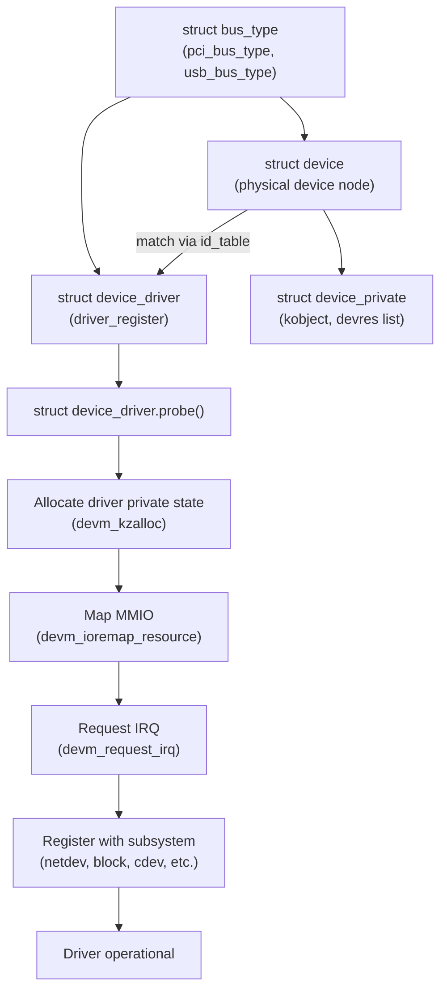
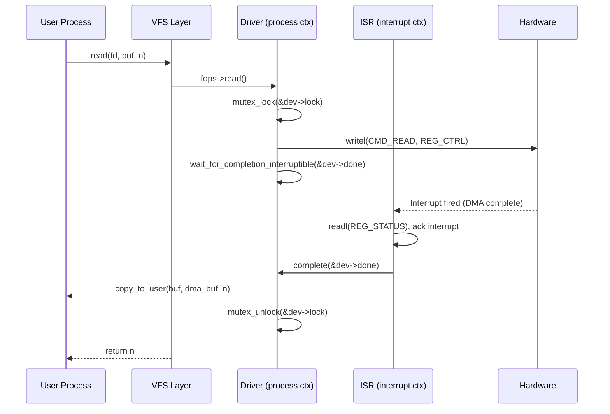
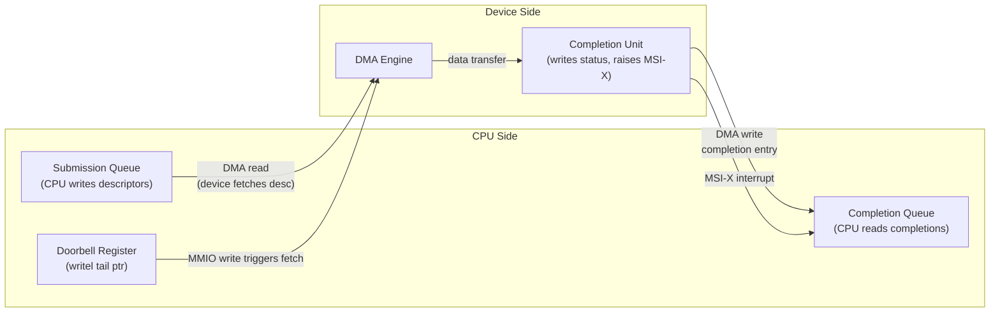
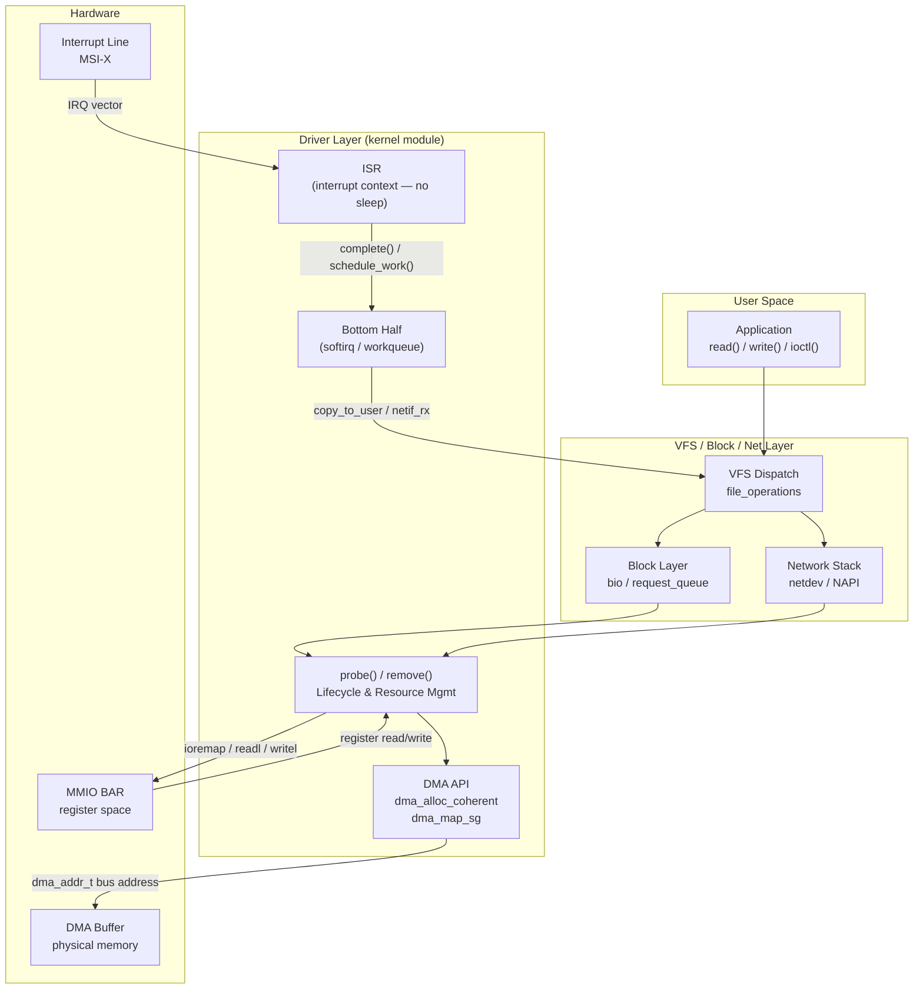

# Lesson 2: Driver Modeling

## First-Principles Intuition & Invariants

A device driver is a kernel-resident software module that presents two interfaces simultaneously: a **downward interface** to hardware (register maps, DMA channels, interrupt lines) and an **upward interface** to the kernel's device model, file system, and user-space API layer. Neither interface is optional. A driver that exposes a clean upward interface but mishandles register sequencing causes data corruption; one that sequences hardware perfectly but violates kernel locking disciplines causes deadlocks or memory corruption under load.

The necessity of this dual interface arises from a fundamental asymmetry: hardware speaks in physical addresses, edge-triggered signals, and timed command sequences, while the kernel speaks in virtual addresses, process contexts, and synchronization primitives. The driver is the translator between these two worlds.

### The Hardware/Software Contract

Modern hardware exposes its programming interface through one or more of the following mechanisms:

- **Memory-Mapped I/O (MMIO):** Device registers appear in the CPU's physical address space. The kernel maps these physical pages into a kernel virtual address (via `ioremap()` on Linux) and accesses them with `readl()`/`writel()` barrier-enforcing accessors — not raw pointer dereferences, because the compiler's store-reorder rules do not apply to device memory.
- **Port I/O (PIO):** On x86, a separate 64 KB I/O port address space exists, accessed via `inb()`/`outb()` instructions. Modern peripheral devices rarely use PIO; legacy devices (e.g., 8250 UARTs, PS/2 controllers) still require it.
- **DMA:** The device is granted a bus-master role; it transfers data directly between its internal FIFO and a physically contiguous (or IOMMU-mapped scatter-gather) system memory buffer without CPU involvement per word. The CPU's role is to program a descriptor ring and handle the completion interrupt.
- **Interrupts:** Hardware asserts a signal (line-based IRQ, MSI, or MSI-X) to notify the CPU of an asynchronous event. The CPU suspends its current context, runs the driver's Interrupt Service Routine (ISR) in a non-sleepable atomic context, and resumes.

### Canonical Invariants

**Invariant 1 — Device Independence.** The kernel's bus subsystem (PCI, USB, I2C, SPI, platform) enumerates devices and matches them to drivers via a `match()` callback that compares vendor/product IDs or device-tree compatible strings. The driver never hardcodes a physical address; it receives resources through `platform_get_resource()`, `pci_resource_start()`, or equivalent. This decoupling is what allows one `e1000e` driver binary to manage dozens of distinct Intel NIC SKUs.

**Invariant 2 — Atomic ISR, Deferred Work.** An ISR executes in interrupt context: it cannot sleep, cannot take non-spinlock locks, and must complete in microseconds. All heavy lifting (buffer processing, protocol parsing, work queue submission) must be deferred to a softirq, tasklet, or kernel work queue that runs in process context. Violating this invariant by sleeping in an ISR produces an immediate kernel panic (`BUG: sleeping function called from invalid context`).

**Invariant 3 — Ownership Discipline.** Every resource acquired — MMIO region, IRQ, DMA buffer, kernel memory — must be released in the error path of `probe()` and in `remove()`, in reverse acquisition order. The devres (device resource management) framework in Linux (`devm_*` APIs) automates this via a cleanup stack attached to `struct device`, making it substantially harder to introduce resource leaks during driver teardown.

**Invariant 4 — Memory Barrier Correctness.** CPUs and compilers reorder memory operations. Device registers are side-effectful: writing register A before register B is not the same as writing B before A. Linux's `writel()` includes an implicit write memory barrier (`wmb()`). When the ordering requirement spans both sides (CPU writes then reads back for confirmation), `mb()` or `mmiowb()` is required. Omitting barriers on weakly-ordered architectures (ARM64, POWER) produces intermittent, topology-dependent failures that are notoriously difficult to reproduce.

**Invariant 5 — Power Domain Awareness.** Modern SoC drivers must account for clock gating and power domain management. A register access to a powered-down peripheral produces a bus error or returns garbage. The `runtime_pm` framework enforces the discipline: the driver calls `pm_runtime_get_sync()` before any register access and `pm_runtime_put()` when idle. This is not optional on mobile-class SoCs.

---

## Core Architecture & Mechanics

The Linux kernel's driver model, rooted in `drivers/base/`, provides a layered architecture where every driver, device, and bus is represented by a kobject in a unified hierarchy exported through sysfs. Understanding this hierarchy is prerequisite to writing drivers that integrate correctly with hotplug, power management, and the device tree.

### The Kernel Driver Model Hierarchy



### The probe/remove Lifecycle

`probe()` is the driver's constructor. It is called by the bus core after a successful `match()`. Its contract is strict: either it succeeds and the device is fully operational, or it returns a negative errno and the device is left in an unregistered state with all resources freed. There is no partially-initialized middle ground.

The following is a production-grade skeleton for a minimal PCI driver demonstrating correct resource acquisition ordering, error unwinding, and MSI interrupt setup:

```c
// SPDX-License-Identifier: GPL-2.0
// pci_skeleton.c - Minimal PCI driver skeleton demonstrating correct
//                  probe/remove lifecycle and devres usage.

#include <linux/module.h>
#include <linux/pci.h>
#include <linux/interrupt.h>
#include <linux/slab.h>

#define DRV_NAME        "pci_skeleton"
#define BAR_REGS        0           /* BAR 0 contains MMIO register space */

/* Device-private state. Allocated once per bound device. */
struct skl_dev {
    struct pci_dev  *pdev;
    void __iomem    *regs;          /* kernel VA of MMIO BAR */
    int              irq;
    spinlock_t       lock;          /* protects hw register access */
    /* subsystem-specific fields follow */
};

/* Register offsets within BAR 0 */
#define REG_CTRL        0x00
#define REG_STATUS      0x04
#define REG_DATA        0x08
#define CTRL_RESET      BIT(0)
#define CTRL_IRQ_EN     BIT(1)

static irqreturn_t skl_isr(int irq, void *data)
{
    struct skl_dev *dev = data;
    u32 status;

    status = readl(dev->regs + REG_STATUS);
    if (!(status & 0xFF))
        return IRQ_NONE;            /* shared IRQ; not ours */

    /* Acknowledge interrupt by writing back status bits */
    writel(status, dev->regs + REG_STATUS);

    /* Defer all processing to a bottom half. Never sleep here. */
    /* schedule_work(&dev->work); */

    return IRQ_HANDLED;
}

static int skl_hw_init(struct skl_dev *dev)
{
    u32 ctrl;

    /* Issue soft reset and wait for device ready */
    writel(CTRL_RESET, dev->regs + REG_CTRL);
    /*
     * wmb() ensures the reset write reaches the device before we poll
     * status. On x86 writel() includes the barrier; on ARM64 it does not
     * by default without the explicit wmb().
     */
    wmb();

    /* Poll status — real code uses readl_poll_timeout() */
    ctrl = readl(dev->regs + REG_CTRL);
    if (ctrl & CTRL_RESET) {
        dev_err(&dev->pdev->dev, "hardware reset did not clear\n");
        return -EIO;
    }

    /* Enable interrupt generation */
    writel(CTRL_IRQ_EN, dev->regs + REG_CTRL);
    return 0;
}

static int skl_probe(struct pci_dev *pdev, const struct pci_device_id *id)
{
    struct skl_dev *priv;
    int ret;

    /* Enable the PCI device and verify BAR layout */
    ret = pcim_enable_device(pdev);  /* pcim_* = devres-managed PCI */
    if (ret)
        return ret;

    if (!(pci_resource_flags(pdev, BAR_REGS) & IORESOURCE_MEM)) {
        dev_err(&pdev->dev, "BAR %d is not MMIO\n", BAR_REGS);
        return -ENODEV;
    }

    ret = pcim_iomap_regions(pdev, BIT(BAR_REGS), DRV_NAME);
    if (ret)
        return ret;

    /* Allocate driver-private state; freed automatically on device remove */
    priv = devm_kzalloc(&pdev->dev, sizeof(*priv), GFP_KERNEL);
    if (!priv)
        return -ENOMEM;

    priv->pdev = pdev;
    priv->regs = pcim_iomap_table(pdev)[BAR_REGS];
    spin_lock_init(&priv->lock);
    pci_set_drvdata(pdev, priv);

    /* Enable bus mastering for DMA */
    pci_set_master(pdev);

    /* Request MSI interrupts, falling back to INTx */
    ret = pci_alloc_irq_vectors(pdev, 1, 1, PCI_IRQ_MSI | PCI_IRQ_INTX);
    if (ret < 0) {
        dev_err(&pdev->dev, "failed to allocate IRQ vectors: %d\n", ret);
        return ret;
    }

    priv->irq = pci_irq_vector(pdev, 0);
    ret = devm_request_irq(&pdev->dev, priv->irq, skl_isr, 0, DRV_NAME, priv);
    if (ret) {
        dev_err(&pdev->dev, "failed to request IRQ %d: %d\n", priv->irq, ret);
        goto err_free_irq_vectors;
    }

    ret = skl_hw_init(priv);
    if (ret)
        goto err_free_irq_vectors;

    dev_info(&pdev->dev, "device initialized, IRQ %d, MMIO @ %pR\n",
             priv->irq, &pdev->resource[BAR_REGS]);
    return 0;

err_free_irq_vectors:
    pci_free_irq_vectors(pdev);
    return ret;
}

static void skl_remove(struct pci_dev *pdev)
{
    struct skl_dev *priv = pci_get_drvdata(pdev);

    /*
     * Quiesce hardware before IRQ teardown to prevent a final interrupt
     * firing after devm_free_irq but before MMIO is unmapped.
     */
    writel(0, priv->regs + REG_CTRL);   /* disable interrupt generation */
    mb();                                /* ensure write completes */

    pci_free_irq_vectors(pdev);
    /* devm resources (IRQ, MMIO, kzalloc) released automatically */
}

static const struct pci_device_id skl_id_table[] = {
    { PCI_DEVICE(0x1AB8, 0x1000) },     /* example vendor:device */
    { }
};
MODULE_DEVICE_TABLE(pci, skl_id_table);

static struct pci_driver skl_driver = {
    .name     = DRV_NAME,
    .id_table = skl_id_table,
    .probe    = skl_probe,
    .remove   = skl_remove,
};

module_pci_driver(skl_driver);

MODULE_LICENSE("GPL");
MODULE_AUTHOR("Example Author");
MODULE_DESCRIPTION("PCI driver skeleton with correct lifecycle management");
```

### The I/O Dispatch Path

When user space calls `read()` on a character device, the VFS resolves the inode to a `struct cdev`, locates the registered `file_operations`, and dispatches to `fops->read()`. This call runs in process context under the calling thread's scheduling domain. The driver's read handler typically:

1. Acquires a mutex protecting the device state.
2. Checks whether a DMA buffer has completed data via a completion variable (`wait_for_completion_interruptible()`).
3. Copies data from the kernel DMA buffer to user space via `copy_to_user()`, which handles page faults and the kernel/user address space boundary.
4. Releases the mutex and returns the byte count.

The interrupt path runs orthogonally: the ISR fires, acknowledges the hardware, and calls `complete()` on the completion object, unblocking the sleeping `read()` handler. The critical point is that `complete()` is safe to call from interrupt context, while `mutex_lock()` is not.



### DMA Buffer Management

DMA introduces a cache coherency problem: the CPU's L1/L2 caches may hold stale copies of memory that the device has just updated, or may have written-back data that the device has not yet seen. The kernel's DMA API resolves this through two mechanisms:

- **Coherent (consistent) DMA:** `dma_alloc_coherent()` allocates memory that is marked as uncacheable (or for which hardware enforces cache coherency via a cache-coherent interconnect). The CPU pays a performance penalty on every access but sees a consistent view. Used for descriptor rings and control structures accessed by both CPU and device at high frequency.
- **Streaming DMA:** `dma_map_single()` / `dma_map_sg()` maps existing kernel buffers for a single DMA transfer. The driver must call `dma_sync_single_for_device()` before initiating DMA and `dma_sync_single_for_cpu()` after completion. These calls issue the architecture-specific cache maintenance operations (clean, invalidate) required for correctness.

The IOMMU (Intel VT-d, ARM SMMU) interposes between the device's bus-address space and physical memory, providing address translation and access control. `dma_alloc_coherent()` returns both a CPU virtual address and a device-visible DMA address (`dma_addr_t`); these are distinct values when an IOMMU is present, and the driver must use the `dma_addr_t` when programming the device's DMA engine.

---

## High-Performance Optimization & Failure Modes

### Interrupt Coalescing and NAPI

An unoptimized network driver that raises one interrupt per received packet is catastrophically inefficient at 10+ Gbps line rates: at 64-byte minimum frames on 10GbE, the interrupt rate approaches 14.8 million per second, completely saturating CPU interrupt-handling overhead. The NAPI (New API) model eliminates this:

1. The first packet arrival raises an interrupt. The ISR disables further interrupts for that device queue and schedules a NAPI poll callback.
2. The NAPI poll runs in softirq context, draining up to `budget` (typically 64) packets from the receive ring in a tight loop.
3. If the ring empties before the budget is exhausted, the driver re-enables interrupts and exits poll mode. If budget is exhausted, control returns to the softirq scheduler, which re-invokes the poll later — preventing any single device from monopolizing the CPU.

This transitions the driver from interrupt-driven to poll-driven under load, capping interrupt overhead regardless of line rate.

### Descriptor Ring Architecture

High-throughput drivers (NVMe, RDMA, 10GbE) organize I/O through **descriptor rings** (also called completion queues in NVMe, work queues in RDMA). A ring is a fixed-size array of hardware-defined descriptor structures in coherent DMA memory. The CPU writes descriptors (command, buffer address, length) and advances a producer index (doorbell register write). The device processes descriptors and advances a consumer index, optionally writing a completion status back into a separate completion ring and raising an MSI-X interrupt.



The head and tail pointers must wrap modulo ring size with correct memory barrier placement. A missing `wmb()` before the doorbell write means the device may fetch a descriptor before the CPU has fully written it — a race that manifests as corrupted I/O or silent data loss.

### Lock Granularity and Lock-Free Techniques

A naive driver serializes all operations with a single spinlock. Under multi-queue workloads, this creates a hot lock that serializes all CPU cores. The correct approach is **per-queue locking**: each submission/completion queue pair has its own lock, and queues are pinned to CPU cores via `cpu_online_mask` affinity. This is how NVMe and virtio achieve near-linear scaling with CPU count.

For the completion path, many drivers can eliminate locking entirely using a lock-free single-producer/single-consumer ring. The kernel provides `kfifo` for this pattern. The correctness condition is strict: exactly one producer and one consumer, with appropriate `smp_store_release()` / `smp_load_acquire()` pairs replacing explicit locks.

### Failure Modes and Recovery

**Hardware hang detection.** A device that stops responding to commands will cause the driver's I/O operations to stall indefinitely. All asynchronous I/O must be submitted with a timer (`mod_timer()`) that fires if no completion arrives within a timeout window. The timer callback must check whether I/O is still outstanding and, if so, initiate a device reset sequence:

1. Stop issuing new I/O.
2. Flush or drain in-flight descriptors.
3. Issue a hardware reset (write to a reset register or trigger a PCI FLR via `pcie_flr()`).
4. Wait for the device to report readiness.
5. Re-initialize the descriptor rings and re-queue failed I/O with an error or retry.

**Error injection and fault simulation.** Production drivers should be tested with `dm-flakey` (block layer fault injection), the kernel's fault injection framework (`CONFIG_FAULT_INJECTION`), and hardware-level error injection where available (PCIe AER error injection via `aer-inject`). Testing only the happy path is insufficient for a device driver.

**Kernel Oops vs. panic.** A null pointer dereference in a driver's ISR will immediately `BUG()` the kernel; there is no process-level `SIGSEGV` safety net. Defensive programming — validating `pci_get_drvdata()` return values, range-checking register indices before array access, using `WARN_ON_ONCE()` for unexpected-but-recoverable conditions — directly determines whether a driver bug is recoverable or fatal.

### Rust for Driver Development

The Linux kernel's Rust-for-Linux initiative (merged in kernel 6.1) addresses a class of driver bugs that C cannot prevent at compile time: use-after-free, data races, and null pointer dereferences. The kernel's Rust abstractions enforce that MMIO access goes through a typed `IoMem<T>` wrapper, that IRQ handlers can only access `Send`-safe state, and that `Ref<T>` reference counting replaces manual `kref` management.

The following illustrates a Rust driver skeleton using the in-tree `kernel` crate abstractions:

```rust
// rust/drivers/char/rust_skeleton.rs
// Requires Linux 6.1+ with CONFIG_RUST=y

use kernel::prelude::*;
use kernel::{
    device,
    io_mem::IoMem,
    module_platform_driver, of,
    platform,
    sync::Mutex,
};

module_platform_driver! {
    type: RustSkeleton,
    name: "rust_skeleton",
    license: "GPL",
}

struct DeviceData {
    // IoMem<SIZE> provides typed, bounds-checked MMIO access.
    // The SIZE const ensures compile-time prevention of out-of-bounds
    // register reads/writes.
    regs: IoMem<0x100>,
}

struct RustSkeleton;

impl kernel::Module for RustSkeleton {
    fn init(_module: &'static ThisModule) -> Result<Self> {
        pr_info!("RustSkeleton: module loaded\n");
        Ok(RustSkeleton)
    }
}

#[vtable]
impl platform::Driver for RustSkeleton {
    type DrvData = Mutex<DeviceData>;

    fn probe(dev: &mut platform::Device, _id: Option<&Self::IdInfo>) -> Result<Self::DrvData> {
        // ioremap with bounds: returns Err if region < 0x100 bytes
        let regs = dev.ioremap_resource(0)?;

        pr_info!("RustSkeleton: probed device at {:?}\n", dev.name());

        // All fields must be initialized; the compiler enforces this.
        // No uninitialized memory, no forgotten fields.
        Ok(Mutex::new(DeviceData { regs }))
    }

    fn remove(dev: &mut platform::Device, data: &Self::DrvData) -> Result {
        let _d = data.lock();
        // IoMem is unmapped via Drop — no explicit iounmap() required.
        // The Mutex ensures no concurrent access during teardown.
        pr_info!("RustSkeleton: removed device {:?}\n", dev.name());
        Ok(())
    }
}
```

The key safety guarantees the type system enforces here:

- `IoMem<SIZE>` prevents register access outside the mapped region at compile time.
- `Mutex<DeviceData>` prevents simultaneous access from multiple contexts without acquiring the lock — the `DeviceData` fields are inaccessible without the guard.
- Ownership of `IoMem` by `DeviceData` means the MMIO region is unmapped exactly when `DeviceData` is dropped — the `devm_iounmap` equivalent is implicit and un-forgettable.

### Observability: tracing and ftrace Integration

A driver that cannot be observed cannot be debugged in production. The kernel's `tracepoint` infrastructure allows drivers to emit structured events into the `ftrace` ring buffer with zero overhead when disabled (the trace site reduces to a single branch-not-taken check):

```c
#include <trace/events/block.h>  /* example: use the block trace subsystem */

/* Define a custom tracepoint in include/trace/events/skl.h */
TRACE_EVENT(skl_io_submit,
    TP_PROTO(struct skl_dev *dev, u64 lba, u32 len),
    TP_ARGS(dev, lba, len),
    TP_STRUCT__entry(
        __field(int,  devid)
        __field(u64,  lba)
        __field(u32,  len)
    ),
    TP_fast_assign(
        __entry->devid = dev->pdev->devfn;
        __entry->lba   = lba;
        __entry->len   = len;
    ),
    TP_printk("devfn=%d lba=%llu len=%u", __entry->devid, __entry->lba, __entry->len)
);
```

This tracepoint is then activated at runtime via:

```bash
echo 1 > /sys/kernel/debug/tracing/events/skl/skl_io_submit/enable
cat /sys/kernel/debug/tracing/trace_pipe
```

No recompilation, no printk spam, nanosecond-resolution timestamps, and readable with `trace-cmd` or `perf script`. This is the production-grade observability approach; `printk()` is for development only.

---

## Architectural Summary



The architecture reflects three invariants simultaneously: the upward interface must conform to the kernel subsystem contract (block, net, char) so that existing userspace requires no modification; the downward interface must respect hardware timing, ordering, and coherency constraints; and the internal implementation must be correct under concurrent access from process context, softirq, and ISR — three execution contexts with different scheduler rules and locking restrictions.

Understanding *why* each layer exists — the cache coherency problem that necessitates the DMA API, the scheduling constraints that mandate deferred work, the bus enumeration model that enables device independence — is what separates a driver that works in a lab from one that ships in production systems.
