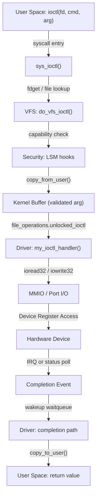
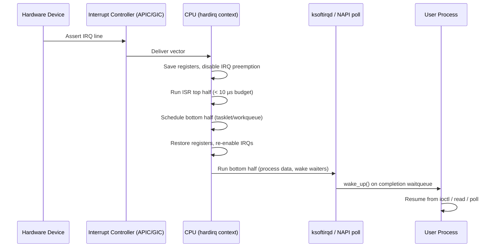
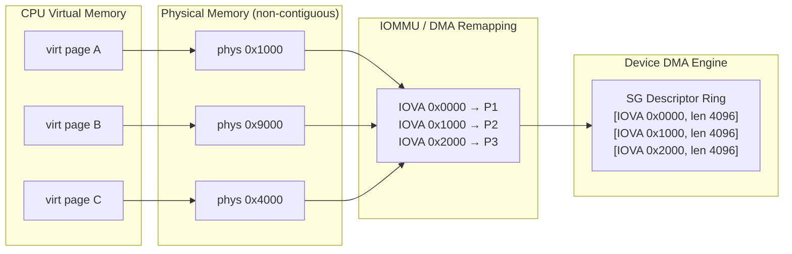
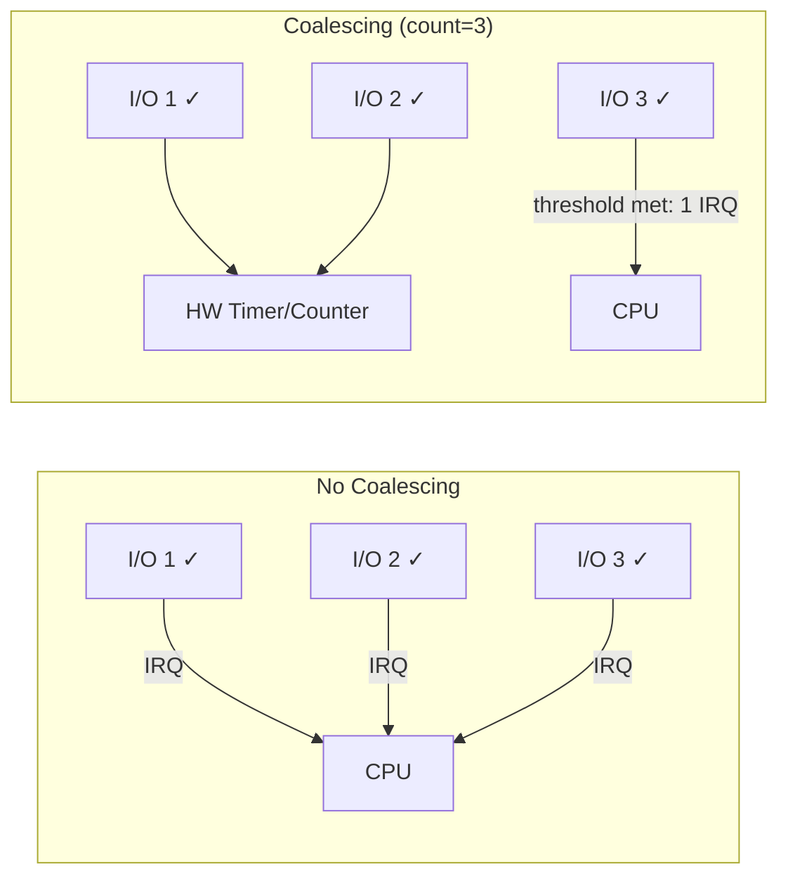
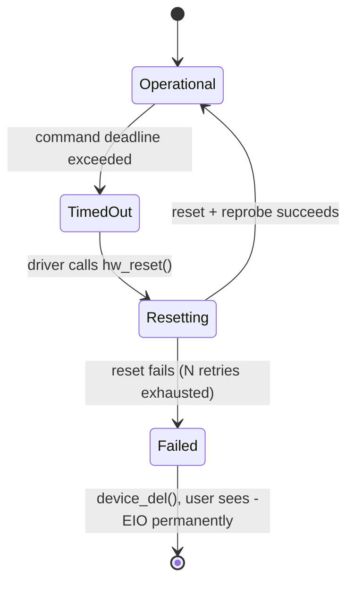
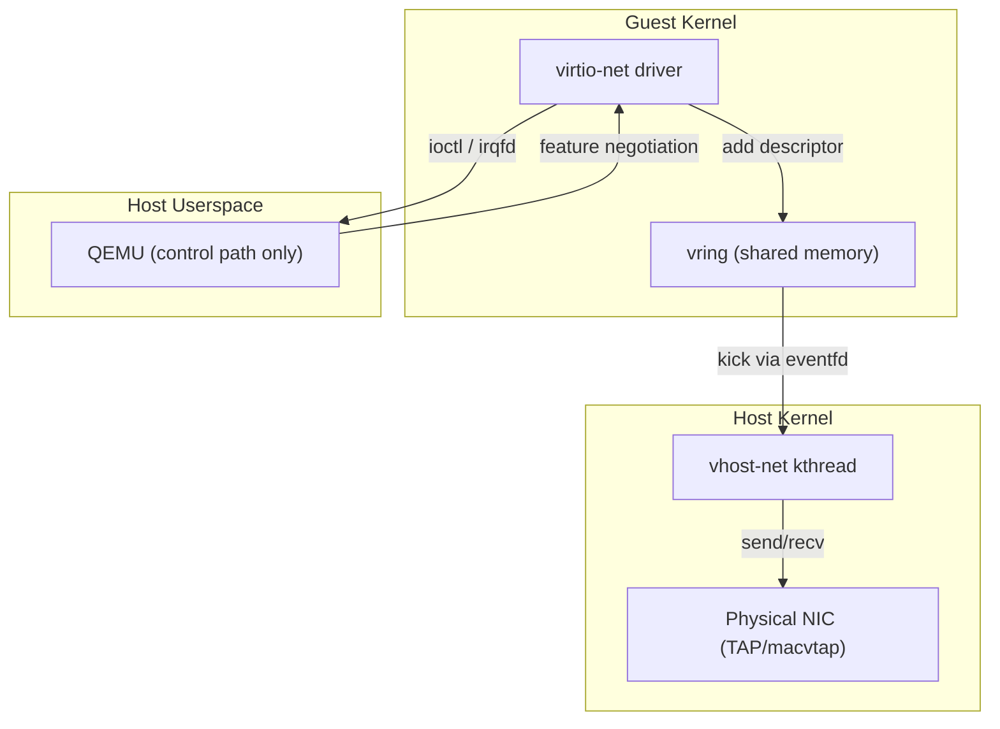

# Lesson 4: Driver Protocols

## 1. First-Principles Intuition & Invariants

A device driver protocol is a contract — a precisely specified set of rules governing how the kernel, hardware, and firmware exchange state, data, and control signals. Understanding these protocols from first principles requires understanding *why* the abstraction layers exist and what invariants each layer must preserve across all execution contexts.

### The Fundamental Problem: Two Asynchronous State Machines

At the lowest level, a CPU and a peripheral device are two independent state machines operating at different clocks, with different memory hierarchies, and no shared notion of time. The driver protocol is the bridge that makes their interaction deterministic. Without a disciplined protocol, you get race conditions, lost interrupts, and silent data corruption — the bugs that are hardest to reproduce and most expensive to find in production systems.

The kernel enforces two non-negotiable invariants across all driver protocols:

**Invariant 1 — Serialized ownership of shared resources.** At any point in time, either the CPU owns a DMA buffer (and may read/write it freely) or the device owns it (and the CPU must not touch it). This ownership must be explicitly transferred via bus-mastering commands, `dma_map_single()` / `dma_unmap_single()` calls, or descriptor ring state transitions. Violating this invariant causes cache-coherency corruption that is not reliably reproducible.

**Invariant 2 — Command-completion atomicity.** Every command issued to a device corresponds to exactly one completion event — a status register poll, a completion interrupt, or a descriptor writeback. The kernel must track this pairing. Orphaned commands (commands with no corresponding completion path) lead to leaked memory, hung processes, and eventual kernel panic when completion handlers try to access freed memory.

### The ioctl Protocol: A Layered Contract

When a user-space process calls `ioctl(fd, SOME_CMD, arg)`, the following contract is enforced by the kernel before the driver's handler is ever invoked:

1. The VFS layer validates that the file descriptor is open and resolves the `file_operations` structure associated with it.
2. The kernel performs capability checks (e.g., `CAP_NET_ADMIN` for network device commands) if the driver registered them.
3. The command number encodes direction (`_IOC_READ`, `_IOC_WRITE`) and size in the upper bits via the `_IOC`, `_IOR`, `_IOW`, `_IOWR` macros defined in `<linux/ioctl.h>`. The kernel uses this metadata to `copy_from_user()` / `copy_to_user()` the argument structure before or after the handler runs.
4. The driver's `.unlocked_ioctl` handler receives a fully validated, kernel-space copy of the argument.

This layering means the driver never dereferences a raw user-space pointer — a critical security invariant that eliminates an entire class of privilege-escalation vulnerabilities.

### The Device Model Abstraction

The Linux device model (`drivers/base/`) provides the scaffolding that makes the protocol machinery composable. Every device is a `struct device` node in a tree rooted at a virtual bus. Every driver is a `struct device_driver` registered against a bus type. The bus's `match()` callback binds the two. This topology enables:

- **Power management**: `dev_pm_ops` callbacks (`suspend`, `resume`, `runtime_suspend`) are dispatched through the device tree in topological order, ensuring parents power down after children.
- **Probe/remove lifecycle**: `driver_probe_device()` orchestrates resource allocation, IRQ registration, and DMA setup in a defined sequence, with automatic cleanup via `devm_*` APIs if any step fails.
- **Sysfs visibility**: Every `kobject` embedded in `struct device` is automatically exposed as a sysfs directory, giving operators introspection without requiring custom kernel interfaces.

---

## 2. Core Architecture & Mechanics

### The Complete ioctl Data Path

The following diagram traces the full path of an `ioctl` request, from the system call entry point through the driver and back, including the memory boundaries that must be respected at each stage.



The critical boundaries in this diagram are the two `copy_*user()` calls. All data crossing the user/kernel boundary must pass through these functions, which validate that the user-space pointer is accessible and not aliased to kernel memory. Direct pointer arithmetic across this boundary is a category of vulnerability, not merely a style issue.

### Interrupt Handling: The Three-Phase Model

The Linux interrupt model uses a split architecture — the **hardirq** top half and the **softirq / tasklet / workqueue** bottom half — to minimize interrupt-disabled time and prevent priority inversion.



**Top half constraints**: The ISR executes with local IRQs disabled (or with the interrupt line masked on modern APIC). It must complete in microseconds. Allowed operations: read status registers, acknowledge the interrupt, enqueue a descriptor to a lock-free ring, schedule a bottom half. Forbidden operations: `kmalloc(GFP_KERNEL)`, sleeping, acquiring non-spinlocks.

**Bottom half selection**:
- `tasklet`: single-CPU execution guarantee, runs in softirq context. Good for lightweight packet processing.
- `workqueue` / `work_struct`: runs in process context (a kthread), can sleep, can call blocking APIs. Required for anything touching the filesystem, network stack sleeping paths, or USB.
- `threaded IRQ` (`IRQF_THREAD`): the entire handler runs in a dedicated kthread. Preferred in modern drivers for latency predictability and RT-kernel compatibility.

### A Production-Grade Character Driver: Interrupt-Driven I/O

The following example implements a minimal but correct character device with interrupt-driven read, proper `devm_*` resource management, and correct locking discipline.

```c
// SPDX-License-Identifier: GPL-2.0-only
/*
 * mydev.c — Minimal interrupt-driven character device driver.
 * Demonstrates: devm lifecycle, waitqueue, threaded IRQ, ioctl.
 */

#include <linux/module.h>
#include <linux/kernel.h>
#include <linux/fs.h>
#include <linux/cdev.h>
#include <linux/device.h>
#include <linux/interrupt.h>
#include <linux/io.h>
#include <linux/uaccess.h>
#include <linux/wait.h>
#include <linux/spinlock.h>
#include <linux/platform_device.h>
#include <linux/of.h>

#define DRIVER_NAME      "mydev"
#define MYDEV_IOCTL_GET  _IOR('M', 1, uint32_t)
#define MYDEV_IOCTL_TRIG _IO('M',  2)

/* Hardware register offsets (device-specific, from datasheet) */
#define REG_STATUS  0x00
#define REG_DATA    0x04
#define REG_CTRL    0x08
#define STATUS_DONE BIT(0)
#define CTRL_START  BIT(0)
#define CTRL_IRQ_EN BIT(1)

struct mydev_priv {
    void __iomem        *base;       /* MMIO base, mapped with devm_ioremap_resource */
    int                  irq;
    struct cdev          cdev;
    struct device       *dev;
    dev_t                devno;

    /* Completion state, protected by lock */
    spinlock_t           lock;
    bool                 data_ready;
    uint32_t             last_data;
    wait_queue_head_t    wq;
};

/* --- Interrupt handler (threaded, runs in process context) --- */

static irqreturn_t mydev_irq_handler(int irq, void *dev_id)
{
    struct mydev_priv *priv = dev_id;
    uint32_t status;
    unsigned long flags;

    status = ioread32(priv->base + REG_STATUS);
    if (!(status & STATUS_DONE))
        return IRQ_NONE;   /* Shared IRQ line: not ours */

    spin_lock_irqsave(&priv->lock, flags);
    priv->last_data  = ioread32(priv->base + REG_DATA);
    priv->data_ready = true;
    spin_unlock_irqrestore(&priv->lock, flags);

    /* Acknowledge interrupt by writing back the status bit */
    iowrite32(STATUS_DONE, priv->base + REG_STATUS);

    wake_up_interruptible(&priv->wq);
    return IRQ_HANDLED;
}

/* --- File operations --- */

static int mydev_open(struct inode *inode, struct file *file)
{
    struct mydev_priv *priv =
        container_of(inode->i_cdev, struct mydev_priv, cdev);
    file->private_data = priv;
    return 0;
}

static ssize_t mydev_read(struct file *file, char __user *buf,
                           size_t count, loff_t *ppos)
{
    struct mydev_priv *priv = file->private_data;
    uint32_t data;
    unsigned long flags;
    int ret;

    if (count < sizeof(uint32_t))
        return -EINVAL;

    /* Block until data is available, respecting O_NONBLOCK */
    if (file->f_flags & O_NONBLOCK) {
        if (!priv->data_ready)
            return -EAGAIN;
    } else {
        ret = wait_event_interruptible(priv->wq, priv->data_ready);
        if (ret)
            return -ERESTARTSYS;
    }

    spin_lock_irqsave(&priv->lock, flags);
    data             = priv->last_data;
    priv->data_ready = false;   /* Consume the event */
    spin_unlock_irqrestore(&priv->lock, flags);

    if (copy_to_user(buf, &data, sizeof(data)))
        return -EFAULT;

    return sizeof(data);
}

static long mydev_ioctl(struct file *file, unsigned int cmd, unsigned long arg)
{
    struct mydev_priv *priv = file->private_data;
    uint32_t val;

    switch (cmd) {
    case MYDEV_IOCTL_GET:
        /* Read last captured data, even if not "fresh" */
        val = ioread32(priv->base + REG_DATA);
        if (copy_to_user((void __user *)arg, &val, sizeof(val)))
            return -EFAULT;
        return 0;

    case MYDEV_IOCTL_TRIG:
        /* Trigger a device operation: set START + IRQ_ENABLE */
        iowrite32(CTRL_START | CTRL_IRQ_EN, priv->base + REG_CTRL);
        return 0;

    default:
        return -ENOTTY;   /* Correct errno for unknown ioctl */
    }
}

static const struct file_operations mydev_fops = {
    .owner          = THIS_MODULE,
    .open           = mydev_open,
    .read           = mydev_read,
    .unlocked_ioctl = mydev_ioctl,
};

/* --- Platform driver probe / remove --- */

static int mydev_probe(struct platform_device *pdev)
{
    struct mydev_priv *priv;
    struct resource   *res;
    int ret;

    /*
     * devm_kzalloc: memory is freed automatically on driver detach
     * or probe failure. No manual kfree needed.
     */
    priv = devm_kzalloc(&pdev->dev, sizeof(*priv), GFP_KERNEL);
    if (!priv)
        return -ENOMEM;

    priv->dev = &pdev->dev;
    spin_lock_init(&priv->lock);
    init_waitqueue_head(&priv->wq);

    /* Map MMIO region described in device tree / ACPI */
    res = platform_get_resource(pdev, IORESOURCE_MEM, 0);
    priv->base = devm_ioremap_resource(&pdev->dev, res);
    if (IS_ERR(priv->base))
        return PTR_ERR(priv->base);

    /* Register threaded IRQ: top-half returns IRQ_WAKE_THREAD */
    priv->irq = platform_get_irq(pdev, 0);
    if (priv->irq < 0)
        return priv->irq;

    ret = devm_request_threaded_irq(&pdev->dev, priv->irq,
                                    NULL,                /* no hardirq top half */
                                    mydev_irq_handler,
                                    IRQF_ONESHOT,        /* required when no top half */
                                    DRIVER_NAME, priv);
    if (ret)
        return ret;

    /* Register character device */
    ret = alloc_chrdev_region(&priv->devno, 0, 1, DRIVER_NAME);
    if (ret)
        return ret;

    cdev_init(&priv->cdev, &mydev_fops);
    ret = cdev_add(&priv->cdev, priv->devno, 1);
    if (ret) {
        unregister_chrdev_region(priv->devno, 1);
        return ret;
    }

    platform_set_drvdata(pdev, priv);
    dev_info(&pdev->dev, "mydev probed at %pa, IRQ %d\n",
             &res->start, priv->irq);
    return 0;
}

static int mydev_remove(struct platform_device *pdev)
{
    struct mydev_priv *priv = platform_get_drvdata(pdev);

    cdev_del(&priv->cdev);
    unregister_chrdev_region(priv->devno, 1);
    /* devm resources (ioremap, IRQ, kzalloc) are freed automatically */
    return 0;
}

static const struct of_device_id mydev_of_match[] = {
    { .compatible = "example,mydev-1.0" },
    {}
};
MODULE_DEVICE_TABLE(of, mydev_of_match);

static struct platform_driver mydev_driver = {
    .probe  = mydev_probe,
    .remove = mydev_remove,
    .driver = {
        .name           = DRIVER_NAME,
        .of_match_table = mydev_of_match,
    },
};
module_platform_driver(mydev_driver);

MODULE_LICENSE("GPL v2");
MODULE_AUTHOR("Example Author");
MODULE_DESCRIPTION("Interrupt-driven character device driver");
```

Several design choices in this code deserve explicit justification:

`devm_request_threaded_irq` with `IRQF_ONESHOT` and no top-half handler: when no synchronous top half is provided, `IRQF_ONESHOT` instructs the IRQ core to keep the interrupt line masked until the threaded handler completes. This prevents the interrupt from re-firing before the driver has finished processing the previous event — the correct default for most peripheral drivers.

`wait_event_interruptible` rather than `wait_event`: signals can interrupt the sleep, and the caller returns `-ERESTARTSYS`, which the kernel interprets as a cue to restart the syscall after signal delivery. Using the non-interruptible variant makes processes unkillable while waiting, a correctness bug in production drivers.

`container_of(inode->i_cdev, struct mydev_priv, cdev)`: this is the canonical technique for recovering the driver's private state from a generic kernel structure. It computes the address of the outer struct by subtracting the offset of the embedded `cdev` field from the pointer the kernel provides — zero allocation, zero overhead.

---

## 3. DMA Architecture and the Coherency Model

Direct Memory Access is the dominant data path for all high-bandwidth peripherals. Understanding DMA correctly requires understanding the CPU cache coherency model, because incorrect DMA usage causes data corruption that is silent, non-deterministic, and architecture-specific.

### The Cache Coherency Problem

On a cache-coherent architecture (x86, most ARM Cortex-A with hardware coherency extensions), the hardware maintains cache coherency between CPU caches and the DMA engine automatically. On non-coherent architectures (many embedded ARM, MIPS, RISC-V designs), software must explicitly flush or invalidate cache lines before or after DMA transfers:

- **CPU → Device (write)**: `dma_map_single(..., DMA_TO_DEVICE)` flushes the CPU cache for the buffer range so the device's DMA engine reads coherent data from memory.
- **Device → CPU (read)**: `dma_map_single(..., DMA_FROM_DEVICE)` invalidates the CPU cache for the buffer range so subsequent CPU reads fetch fresh data written by the device, not stale cached values.

The Linux DMA API (`<linux/dma-mapping.h>`) encapsulates this platform-specific logic. Drivers must never manually `clflush` or call architecture-specific cache operations — the DMA API is the correct abstraction.

### Scatter-Gather DMA

Production drivers rarely transfer a single physically-contiguous buffer. The kernel's virtual memory system fragments large allocations, and high-level I/O stacks (block layer, network stack) build `struct bio` / `struct sk_buff` from non-contiguous pages. Scatter-gather DMA maps these fragments into a single device-visible list:



The IOMMU projects the physically discontiguous pages into a contiguous device-visible I/O virtual address space (IOVA). This provides two security guarantees absent in pre-IOMMU systems: (1) a compromised or buggy device cannot DMA into arbitrary physical memory, and (2) DMA buffer overruns are caught by the IOMMU as a fault rather than corrupting unrelated kernel memory.

### A Scatter-Gather DMA Example in C

```c
#include <linux/dma-mapping.h>
#include <linux/scatterlist.h>

#define SG_MAX_ENTRIES  16

static int mydev_dma_transfer(struct mydev_priv *priv,
                               struct page **pages, unsigned int nr_pages)
{
    struct scatterlist sg[SG_MAX_ENTRIES];
    unsigned int i, nents;
    dma_addr_t dma_addr;
    int ret = 0;

    if (nr_pages > SG_MAX_ENTRIES)
        return -EINVAL;

    sg_init_table(sg, nr_pages);
    for (i = 0; i < nr_pages; i++)
        sg_set_page(&sg[i], pages[i], PAGE_SIZE, 0);

    /*
     * Map the SG list for device-to-CPU direction.
     * Returns the number of DMA-mapped entries, which may be fewer
     * than nr_pages if the IOMMU coalesces adjacent pages.
     */
    nents = dma_map_sg(priv->dev, sg, nr_pages, DMA_FROM_DEVICE);
    if (!nents)
        return -EIO;

    /*
     * Program the device's descriptor ring from the mapped SG entries.
     * sg_dma_address() / sg_dma_len() return IOVA and byte count.
     */
    for_each_sg(sg, sg + nents, nents, i) {
        struct scatterlist *s = sg + i;
        mydev_hw_add_descriptor(priv,
                                 sg_dma_address(s),
                                 sg_dma_len(s));
    }

    mydev_hw_start_transfer(priv);

    /* Wait for completion (IRQ → waitqueue, see §2) */
    ret = wait_event_interruptible_timeout(priv->wq,
                                           priv->data_ready,
                                           msecs_to_jiffies(1000));
    if (ret == 0)
        ret = -ETIMEDOUT;
    else if (ret < 0)
        ret = -ERESTARTSYS;
    else
        ret = 0;

    dma_unmap_sg(priv->dev, sg, nr_pages, DMA_FROM_DEVICE);
    return ret;
}
```

The mandatory symmetry of `dma_map_sg` / `dma_unmap_sg` is not optional hygiene — it is a correctness requirement. Unmapping performs the cache invalidation and releases IOMMU mappings. Leaking DMA mappings exhausts the IOVA space and stalls all future DMA on the device.

---

## 4. High-Performance Optimization and Failure Modes

### Interrupt Coalescing

Interrupt coalescing reduces interrupt rate by delaying the interrupt signal until either a time threshold (interrupt delay timer, IDT) or a count threshold (interrupt moderation count, IMC) is reached. Network interface cards have employed this since the early 2000s via NAPI (New API) in Linux, and NVMe SSDs expose coalescing parameters through `nvme set-feature --feature-id 0x08`.

The tradeoff is deterministic: coalescing increases throughput at the cost of latency. A storage driver processing 1 million 512-byte reads per second generates 1 million interrupts per second without coalescing — roughly 10–15% CPU overhead on a modern server. With coalescing set to 32 completions or 50 µs, the interrupt rate drops to ~31,000/s, but individual I/O latency increases by up to 50 µs.



### Polling vs. Interrupt: Choosing the Right Completion Model

For ultra-low-latency devices (NVMe, RDMA NICs at < 10 µs latency targets), interrupt-driven completion introduces unacceptable jitter from IRQ affinity, context switching, and interrupt controller latency. Linux `io_uring` and DPDK use busy-polling: a dedicated CPU core spins on a completion queue head pointer in a tight loop, achieving sub-microsecond response times at the cost of one full CPU core per queue.

The correct model depends on target latency and system load:

| Completion Model | Latency | CPU Efficiency | Use Case |
|---|---|---|---|
| Interrupt (default) | 5–50 µs | High | General-purpose I/O |
| Threaded IRQ + NAPI | 50–200 µs | Very High | High-throughput networking |
| Interrupt coalescing | 10–500 µs | Very High | Storage, throughput-first |
| Busy-poll (`io_uring`) | 1–5 µs | Low (wastes CPU) | Latency-critical databases |
| Hybrid (adaptive) | 2–50 µs | Medium | NVMe, modern NICs |

### Failure Modes and Mitigations

**Device timeout and recovery.** When a device fails to generate a completion within a deadline, the driver must reset the device and resubmit in-flight commands. The recovery sequence must be atomic from the application's perspective: in-flight I/Os must return `-EIO`, the device must be re-initialized to a known state, and new I/Os must be queued rather than rejected until recovery completes. Linux's block layer `blk-mq` timeout infrastructure handles this via `blk_mq_ops.timeout`.



**Interrupt storms.** An interrupt storm occurs when a device repeatedly asserts its interrupt line faster than the ISR can service it. The classic cause is a driver that forgets to acknowledge the interrupt in the ISR — the hardware sees the line still asserted and re-delivers immediately after the IRQ handler returns. Linux's IRQ core detects storms via `irq_work_queue`: if an interrupt fires more than a configurable threshold per second (default: 100,000), it is auto-disabled with a `IRQD_IRQ_DISABLED` flag and a kernel warning is emitted. The driver's interrupt acknowledge sequence must be verified against the device datasheet and must include a readback of the status register to ensure the write has committed (a "posted write" flush).

```c
/* Correct: acknowledge before returning IRQ_HANDLED */
static irqreturn_t correct_isr(int irq, void *dev_id)
{
    struct mydev_priv *priv = dev_id;
    uint32_t status;

    status = ioread32(priv->base + REG_STATUS);
    if (!(status & STATUS_DONE))
        return IRQ_NONE;

    /* Process data */
    priv->last_data = ioread32(priv->base + REG_DATA);

    /* Acknowledge: W1C (write-1-to-clear) semantics */
    iowrite32(status, priv->base + REG_STATUS);

    /*
     * Posted-write flush: read back any register to ensure the
     * PCI write has committed before returning IRQ_HANDLED.
     * Without this, the interrupt may re-fire on some PCIe implementations.
     */
    (void)ioread32(priv->base + REG_STATUS);

    wake_up_interruptible(&priv->wq);
    return IRQ_HANDLED;
}
```

**Buffer overflow and ring buffer management.** Descriptor ring overflows are silent in hardware — the device wraps around and corrupts already-submitted descriptors. The driver must maintain explicit producer/consumer indices and enforce the invariant `(producer - consumer) < ring_size` before submitting new descriptors. The canonical implementation uses a power-of-two ring size to replace the modulo operation with a bitmask:

```c
#define RING_SIZE   256   /* Must be power of 2 */
#define RING_MASK   (RING_SIZE - 1)

struct desc_ring {
    struct my_descriptor descs[RING_SIZE];
    uint32_t head;   /* Next slot to fill (producer, CPU-owned) */
    uint32_t tail;   /* Next slot to drain (consumer, device-written) */
};

static inline bool ring_full(const struct desc_ring *r)
{
    return ((r->head - r->tail) & ~RING_MASK) != 0 ||
           (r->head - r->tail) == RING_SIZE;
}

static inline bool ring_empty(const struct desc_ring *r)
{
    return r->head == r->tail;
}

static int ring_submit(struct desc_ring *r, dma_addr_t addr, uint32_t len)
{
    if (ring_full(r))
        return -ENOSPC;

    r->descs[r->head & RING_MASK].addr = addr;
    r->descs[r->head & RING_MASK].len  = len;

    /*
     * Ensure descriptor fields are written before advancing head.
     * wmb() = write memory barrier: prevents the compiler and CPU
     * from reordering the descriptor writes after the head increment.
     */
    wmb();
    r->head++;
    return 0;
}
```

The `wmb()` call is not defensive programming — it is architecturally required. On weakly-ordered architectures (ARM, POWER), the CPU can commit memory writes out of order. Without the barrier, the device may observe the advanced head pointer before the descriptor fields are committed, and attempt to DMA from an uninitialized descriptor.

---

## 5. The `/proc` and `debugfs` Interfaces for Driver Introspection

Production drivers expose internal state through `debugfs` (mounted at `/sys/kernel/debug/`) rather than inventing ad-hoc character device ioctls for diagnostics. `debugfs` provides a standard VFS interface at zero overhead when disabled (all `debugfs_create_*` calls compile to no-ops when `CONFIG_DEBUG_FS=n`).

```c
#include <linux/debugfs.h>

static struct dentry *mydev_dbg_dir;

static int irq_count_show(struct seq_file *s, void *unused)
{
    struct mydev_priv *priv = s->private;
    seq_printf(s, "irq_count: %llu\n", (unsigned long long)priv->irq_count);
    seq_printf(s, "data_ready: %d\n", priv->data_ready);
    return 0;
}
DEFINE_SHOW_ATTRIBUTE(irq_count);

static void mydev_debugfs_init(struct mydev_priv *priv)
{
    mydev_dbg_dir = debugfs_create_dir(DRIVER_NAME, NULL);
    debugfs_create_file("stats", 0444, mydev_dbg_dir, priv, &irq_count_fops);
    debugfs_create_u32("last_data", 0444, mydev_dbg_dir, &priv->last_data);
}

static void mydev_debugfs_remove(void)
{
    debugfs_remove_recursive(mydev_dbg_dir);
}
```

---

## 6. Testing Driver Protocols in Userspace with UIO and vhost

Kernel driver development has a high iteration cost: a bug causes a kernel panic, requiring a reboot. Two mechanisms allow driver protocol logic to be developed and tested in userspace:

**UIO (Userspace I/O, `CONFIG_UIO`)**: The kernel maps MMIO regions and IRQs into a userspace process's address space via `/dev/uioN`. The process can `mmap()` the MMIO region and `read()` to block on the next interrupt. The hardware access logic — register sequences, protocol state machines — runs entirely in userspace and can be tested with standard tooling (gdb, valgrind, sanitizers). Once validated, the logic is translated to kernel driver code.

**vhost and virtio**: For paravirtualized devices in QEMU/KVM, the vhost kernel module allows the driver's data plane to run in a kthread inside the host kernel, bypassing the QEMU userspace entirely for performance. This architecture is used by `vhost-net`, `vhost-scsi`, and `vhost-vsock`. The control plane (device initialization, feature negotiation) uses the standard virtio PCI or MMIO transport, while the data plane uses `vring` descriptor rings shared between guest kernel and host vhost kthread.



The `vring` shared memory descriptor ring is the protocol substrate for all virtio devices. Its layout is defined by the virtio specification (maintained by OASIS) and must not be confused with any vendor-proprietary ring format. The guest driver and host backend can run on entirely different operating systems as long as both implement the virtio spec correctly.

---

## Summary

Driver protocols are not arbitrary conventions — they are precise contracts enforced by hardware memory ordering guarantees, kernel locking primitives, and DMA coherency models. The correctness of a driver protocol depends on:

1. Maintaining strict ownership transfer semantics for DMA buffers at every `dma_map` / `dma_unmap` boundary.
2. Correctly splitting interrupt handling between a minimal hardirq top half and a fully capable process-context bottom half.
3. Acknowledging interrupts with a posted-write flush to prevent re-delivery.
4. Using memory barriers (`wmb()`, `rmb()`, `mb()`) at every point where CPU or compiler reordering of memory accesses would create a race with the device.
5. Applying the `devm_*` resource management APIs to guarantee cleanup correctness regardless of the probe failure path taken.

Every deviation from these invariants is a latent bug that will manifest under production load, on a different CPU architecture, or in a virtualized environment — often all three simultaneously.
