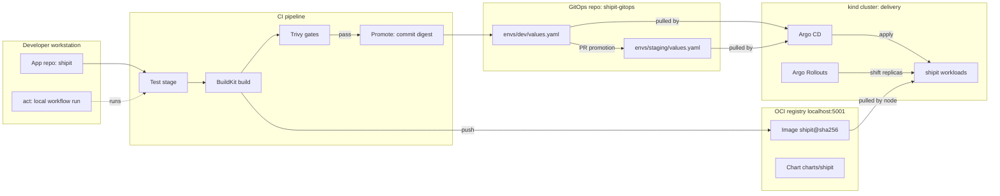
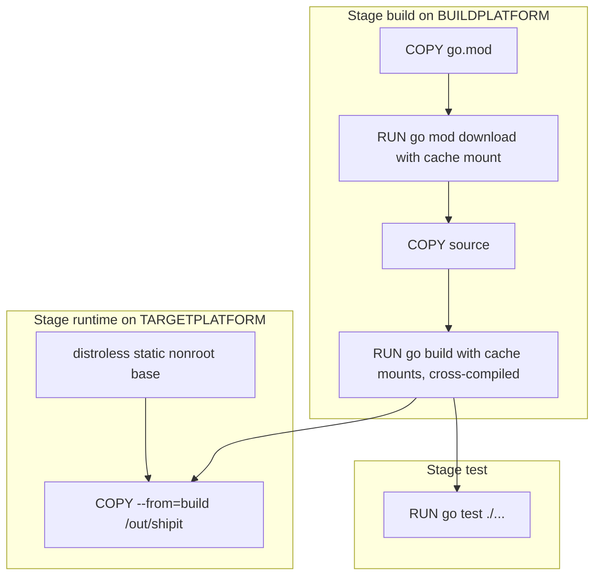

# Operational Verification Labs: DevOps Engineering & Continuous Delivery Pipelines

These labs build one delivery system from source to production-style rollout and verify each part of it. You write a small Go service. You package it with BuildKit and gate it with Trivy. A GitHub Actions workflow runs it, and you execute that workflow locally with `act` and remotely with `gh`. You then publish a Helm chart, reconcile it with Argo CD from a Git repository, and release it with blue-green and canary strategies.

Each lab ends with checks that print a concrete result: an exit code, a digest, an HTTP status distribution, or a controller status field. If a check does not print the expected result, treat the lab as failed. A command that only ran without error does not count.

## How the labs fit together



| Lab | Topic | Main proof |
|---|---|---|
| 0 | Cluster and local registry | A pod pulls an image pushed to `localhost:5001` |
| 1 | BuildKit multi-stage builds | Image size, cache hits, multi-arch manifest, byte-identical rebuild |
| 2 | Trivy gates | Gate exits 1 on known-bad input and 0 on hardened input |
| 3 | CI with GitHub Actions, `act`, `gh` | Same workflow passes locally and remotely; a bad PR is blocked |
| 4 | Helm chart packaging | Schema rejects bad values; failed upgrade rolls back with no downtime |
| 5 | GitOps with Argo CD | Live drift is reverted; Git revert restores the previous state |
| 6 | Blue-green cutover | Zero non-200 responses across switch and rollback |
| 7 | Canary with automated analysis | A faulty canary aborts on its own; error window is bounded |
| 8 | Capstone | Commit to running digest, with promotion and failure drill through Git |

## Conventions

- Commands assume a Linux host with Bash. Labs 1, 3 and 8 rely on `network=host` for containers to reach `localhost:5001`. On macOS with Docker Desktop, enable host networking or replace `localhost:5001` with `host.docker.internal:5001` in builder and `act` configuration.
- `$LAB_ROOT` holds both repositories. Run this once per shell:

  ```bash
  export LAB_ROOT="$HOME/labs"
  mkdir -p "$LAB_ROOT"
  ```

- Every `kubectl` and `helm` command targets the `kind-delivery` context. Before any lab that changes cluster state, run the guard below. It stops you from applying lab manifests to a real cluster.

  ```bash
  require_ctx() {
    local ctx; ctx="$(kubectl config current-context)"
    [ "$ctx" = "kind-delivery" ] || { echo "Refusing: current context is '$ctx', expected kind-delivery" >&2; return 1; }
  }
  require_ctx
  ```

- Version pins for third-party charts and tools are given as variables. Choose a current release, record it, and keep it fixed for the whole lab. Unpinned versions make results irreproducible.

## Prerequisites

| Tool | Minimum version | Why this minimum |
|---|---|---|
| Docker Engine + buildx | 24.0 / buildx 0.13 | `--buildkitd-config`, `rewrite-timestamp` output option |
| kind | 0.23 | containerd `config_path` registry configuration |
| kubectl | 1.29 | EndpointSlice output, server-side dry run |
| helm | 3.13 | `--plain-http` for OCI registries |
| trivy | 0.50 | `--image-src`, `.trivyignore` expiry syntax |
| act | 0.2.60 | `--var` support for repository variables |
| gh | 2.40 | `gh pr checks --watch`, `gh variable set` |
| git | 2.40 | |
| jq | 1.6 | Parsing Trivy and API JSON output |

A GitHub account is required for Labs 3, 5 and 8. Go is not needed on the host because all compilation happens inside BuildKit.

---

## Lab 0: Lab platform

### Objective

Create a three-node kind cluster that pulls images from a local registry, so every later lab can push and deploy without leaving the machine.

### First principles

A kind node is a container running containerd. When a pod asks for `localhost:5001/shipit:1.0.0`, containerd inside the node resolves `localhost` to the node container, not to your host, so the pull fails by default. The fix is a containerd registry host file inside each node. It maps the name `localhost:5001` to `http://kind-registry:5000`, which the node can reach once the registry container joins the `kind` Docker network. The image reference stays the same everywhere: you push to `localhost:5001` from the host and the nodes pull `localhost:5001` through the mapping. That matters later, because the image string in Git must work for both CI and the cluster.

### Steps

File: `$LAB_ROOT/kind-with-registry.sh`

```bash
#!/usr/bin/env bash
# Creates kind cluster "delivery" wired to a local registry at localhost:5001.
set -euo pipefail

CLUSTER=delivery
REG_NAME=kind-registry
REG_PORT=5001

if [ "$(docker inspect -f '{{.State.Running}}' "$REG_NAME" 2>/dev/null || true)" != "true" ]; then
  docker run -d --restart=always \
    -p "127.0.0.1:${REG_PORT}:5000" \
    --network bridge \
    --name "$REG_NAME" \
    registry:2.8.3
fi

if ! kind get clusters | grep -qx "$CLUSTER"; then
  cat <<EOF | kind create cluster --name "$CLUSTER" --config=-
kind: Cluster
apiVersion: kind.x-k8s.io/v1alpha4
containerdConfigPatches:
  - |-
    [plugins."io.containerd.grpc.v1.cri".registry]
      config_path = "/etc/containerd/certs.d"
nodes:
  - role: control-plane
  - role: worker
  - role: worker
EOF
fi

REGISTRY_DIR="/etc/containerd/certs.d/localhost:${REG_PORT}"
for node in $(kind get nodes --name "$CLUSTER"); do
  docker exec "$node" mkdir -p "$REGISTRY_DIR"
  printf '[host."http://%s:5000"]\n' "$REG_NAME" \
    | docker exec -i "$node" cp /dev/stdin "${REGISTRY_DIR}/hosts.toml"
done

if [ "$(docker inspect -f '{{json .NetworkSettings.Networks.kind}}' "$REG_NAME")" = "null" ]; then
  docker network connect kind "$REG_NAME"
fi

cat <<EOF | kubectl --context "kind-${CLUSTER}" apply -f -
apiVersion: v1
kind: ConfigMap
metadata:
  name: local-registry-hosting
  namespace: kube-public
data:
  localRegistryHosting.v1: |
    host: "localhost:${REG_PORT}"
    help: "https://kind.sigs.k8s.io/docs/user/local-registry/"
EOF
```

```bash
cd "$LAB_ROOT"
chmod +x kind-with-registry.sh
./kind-with-registry.sh
kubectl config use-context kind-delivery
require_ctx
```

### Verification

```bash
# 1. Toolchain versions (record these in your lab notes)
docker version --format 'docker {{.Server.Version}}'
docker buildx version
kind version
kubectl version --client
helm version --short
trivy --version | head -1
act --version
gh --version | head -1

# 2. Three Ready nodes
kubectl get nodes -o custom-columns=NAME:.metadata.name,READY:.status.conditions[-1].status

# 3. End-to-end registry path: host push, node pull
docker pull busybox:1.36
docker tag busybox:1.36 localhost:5001/busybox:1.36
docker push localhost:5001/busybox:1.36
kubectl run regtest --image=localhost:5001/busybox:1.36 --restart=Never --command -- sh -c 'echo registry-ok'
kubectl wait --for=jsonpath='{.status.phase}'=Succeeded pod/regtest --timeout=60s
kubectl logs regtest
kubectl delete pod regtest
```

Expected: three nodes with `True`, and the log line `registry-ok`. If the pod shows `ImagePullBackOff`, inspect `docker exec delivery-worker cat /etc/containerd/certs.d/localhost:5001/hosts.toml`.

---

## Lab 1: BuildKit multi-stage optimization

### Objective

Produce a small, non-root, multi-architecture image whose rebuilds reuse cache, whose bytes are reproducible, and which carries SBOM and provenance attestations.

### First principles

BuildKit turns a Dockerfile into a dependency graph and executes only the vertices needed for the requested `--target`. A stage that the target does not depend on is never built. Each instruction's cache key derives from its inputs: the parent layer, the instruction text, and for `COPY` the content checksum of the copied files. Ordering therefore controls cache reuse. Copy `go.mod` and download modules before copying source, and a source edit leaves the download layer valid.

`RUN --mount=type=cache` attaches a persistent directory that is not part of any layer. The Go module and build caches survive across builds without bloating the image, and a source change recompiles only changed packages.

`FROM --platform=$BUILDPLATFORM` runs the compiler natively and cross-compiles with `GOOS`/`GOARCH`. The final stage only copies a static binary, so building `linux/arm64` on an amd64 host needs no emulation.

Reproducibility depends on three inputs staying fixed: base images pinned by digest, file timestamps clamped to `SOURCE_DATE_EPOCH`, and a compiler that embeds no host paths (`-trimpath`). Excluding `.git` in `.dockerignore` also keeps Go from stamping VCS metadata and stops every commit from invalidating the `COPY . .` layer.



### Steps

Create the application repository.

```bash
mkdir -p "$LAB_ROOT/shipit" && cd "$LAB_ROOT/shipit"
git init -b main
```

File: `go.mod`

```go
module example.com/shipit

go 1.22
```

File: `main.go`

```go
package main

import (
	"context"
	"errors"
	"fmt"
	"log/slog"
	"net/http"
	"os"
	"os/signal"
	"syscall"
	"time"
)

// version is set at build time with -ldflags "-X main.version=...".
var version = "dev"

// drainDelay keeps the server accepting requests after SIGTERM while the
// endpoint removal propagates to every node's service proxy.
const drainDelay = 5 * time.Second

func newMux(version, color string, fail bool) *http.ServeMux {
	mux := http.NewServeMux()
	// Health stays 200 even when fault injection is on: liveness must not
	// restart a pod for an application-level error. Canary analysis catches it.
	mux.HandleFunc("GET /healthz", func(w http.ResponseWriter, _ *http.Request) {
		w.WriteHeader(http.StatusOK)
		_, _ = fmt.Fprintln(w, "ok")
	})
	mux.HandleFunc("GET /", func(w http.ResponseWriter, _ *http.Request) {
		if fail {
			http.Error(w, "injected failure", http.StatusInternalServerError)
			return
		}
		_, _ = fmt.Fprintf(w, "version=%s color=%s\n", version, color)
	})
	return mux
}

func main() {
	logger := slog.New(slog.NewJSONHandler(os.Stdout, nil))
	color := os.Getenv("COLOR")
	if color == "" {
		color = "none"
	}
	fail := os.Getenv("FAIL") == "true"

	srv := &http.Server{
		Addr:              ":8080",
		Handler:           newMux(version, color, fail),
		ReadHeaderTimeout: 5 * time.Second,
	}

	ctx, stop := signal.NotifyContext(context.Background(), syscall.SIGTERM, os.Interrupt)
	defer stop()

	go func() {
		logger.Info("listening", "addr", srv.Addr, "version", version, "color", color, "fail", fail)
		if err := srv.ListenAndServe(); err != nil && !errors.Is(err, http.ErrServerClosed) {
			logger.Error("server failed", "err", err)
			os.Exit(1)
		}
	}()

	<-ctx.Done()
	logger.Info("termination signal received; delaying shutdown", "delay", drainDelay.String())
	time.Sleep(drainDelay)

	shutdownCtx, cancel := context.WithTimeout(context.Background(), 20*time.Second)
	defer cancel()
	if err := srv.Shutdown(shutdownCtx); err != nil {
		logger.Error("graceful shutdown failed", "err", err)
		os.Exit(1)
	}
	logger.Info("drained")
}
```

The drain delay exists because a terminating pod is removed from EndpointSlices asynchronously. Each node's kube-proxy then reprograms its rules. A server that closes its listener on the first signal refuses requests that are still being routed to it. Distroless has no `sleep` binary for a `preStop` hook, so the delay lives in the application.

File: `main_test.go`

```go
package main

import (
	"net/http"
	"net/http/httptest"
	"strings"
	"testing"
)

func TestRoot(t *testing.T) {
	cases := []struct {
		name     string
		fail     bool
		wantCode int
		wantBody string
	}{
		{"healthy", false, http.StatusOK, "version=test color=blue"},
		{"injected failure", true, http.StatusInternalServerError, "injected failure"},
	}
	for _, tc := range cases {
		t.Run(tc.name, func(t *testing.T) {
			rec := httptest.NewRecorder()
			newMux("test", "blue", tc.fail).ServeHTTP(rec, httptest.NewRequest(http.MethodGet, "/", nil))
			if rec.Code != tc.wantCode {
				t.Fatalf("status = %d, want %d", rec.Code, tc.wantCode)
			}
			if !strings.Contains(rec.Body.String(), tc.wantBody) {
				t.Fatalf("body = %q, want substring %q", rec.Body.String(), tc.wantBody)
			}
		})
	}
}

func TestHealthzIgnoresFaultFlag(t *testing.T) {
	rec := httptest.NewRecorder()
	newMux("test", "blue", true).ServeHTTP(rec, httptest.NewRequest(http.MethodGet, "/healthz", nil))
	if rec.Code != http.StatusOK {
		t.Fatalf("healthz status = %d, want 200", rec.Code)
	}
}
```

File: `Dockerfile`

```dockerfile
# syntax=docker/dockerfile:1.7
ARG GO_IMAGE=golang:1.24-bookworm
ARG RUNTIME_IMAGE=gcr.io/distroless/static-debian12:nonroot

FROM --platform=$BUILDPLATFORM ${GO_IMAGE} AS build
WORKDIR /src
COPY go.mod ./
RUN --mount=type=cache,target=/go/pkg/mod \
    go mod download
COPY . .
ARG TARGETOS TARGETARCH
ARG VERSION=dev
RUN --mount=type=cache,target=/go/pkg/mod \
    --mount=type=cache,target=/root/.cache/go-build \
    CGO_ENABLED=0 GOOS=$TARGETOS GOARCH=$TARGETARCH \
    go build -trimpath -ldflags="-s -w -X main.version=${VERSION}" -o /out/shipit .

FROM build AS test
RUN --mount=type=cache,target=/go/pkg/mod \
    --mount=type=cache,target=/root/.cache/go-build \
    go test ./...

FROM ${RUNTIME_IMAGE} AS runtime
COPY --from=build /out/shipit /shipit
USER 65532:65532
EXPOSE 8080
ENTRYPOINT ["/shipit"]
```

The explicit `USER` duplicates what the `nonroot` tag already sets. It is there because policy scanners read the Dockerfile, not the base image metadata, and flag a missing `USER` instruction.

File: `Dockerfile.naive` (a deliberate counter-example)

```dockerfile
FROM golang:1.24
WORKDIR /src
COPY . .
RUN go build -o /shipit .
EXPOSE 8080
CMD ["/shipit"]
```

File: `.dockerignore`

```
.git
.github
.secrets
charts
dist
k8s
*.md
sbom*.json
Dockerfile.naive
```

File: `.gitignore`

```
dist/
.secrets
sbom*.json
```

```bash
git add . && git commit -m "shipit service, multi-stage Dockerfile"
```

Create a BuildKit builder that can push to the plain-HTTP local registry.

```bash
cat > "$LAB_ROOT/buildkitd.toml" <<'EOF'
[registry."localhost:5001"]
  http = true
EOF

docker buildx create --name delivery \
  --driver docker-container \
  --driver-opt network=host \
  --buildkitd-config "$LAB_ROOT/buildkitd.toml" \
  --bootstrap --use
```

The `docker-container` driver runs BuildKit in its own container. It supports multi-platform output, cache export, and attestations, which the default `docker` driver lacks. `network=host` lets that container reach `localhost:5001`.

### Verification 1.1: size and attack surface

```bash
cd "$LAB_ROOT/shipit"
docker buildx build -f Dockerfile.naive -t shipit:naive --load .
docker buildx build --target runtime --build-arg VERSION=local -t shipit:optimized --load .
docker image ls --format '{{.Repository}}:{{.Tag}}\t{{.Size}}' | grep '^shipit:'
docker history shipit:optimized --format '{{.Size}}\t{{.CreatedBy}}' | head -5
docker run --rm -d -p 18080:8080 --name shipit-local shipit:optimized
curl -s localhost:18080/ && docker stop shipit-local
docker inspect shipit:optimized --format 'user={{.Config.User}}'
```

Expected: the naive image is several hundred megabytes and the optimized image is roughly 10 MB or less. The response reads `version=local color=none`, and the user reads `65532:65532`. Note that `Dockerfile.naive` runs as root and ships a full compiler toolchain.

### Verification 1.2: cache behavior

```bash
# Unit tests run in the test stage; failure here fails the build.
docker buildx build --target test --progress=plain . 2>&1 | tail -3

# Source edit: module download stays cached, compile reruns.
echo "// cache probe $(date +%s)" >> main.go
docker buildx build --target runtime --progress=plain -t shipit:optimized --load . 2>&1 \
  | grep -E 'go mod download|go build' | grep -E 'CACHED|DONE'
git checkout main.go

# Edit outside the build context: everything stays cached.
mkdir -p charts && echo "# probe" > charts/PROBE.md
docker buildx build --target runtime --progress=plain -t shipit:optimized --load . 2>&1 | grep -c CACHED
rm -rf charts
```

Expected: after the source edit, the `go mod download` step shows `CACHED` and `go build` reruns. After the `charts/` edit, every step is cached, because `.dockerignore` excludes that directory from the context checksum.

### Verification 1.3: multi-architecture without emulation

```bash
docker buildx build --target runtime \
  --platform linux/amd64,linux/arm64 \
  --build-arg VERSION=multiarch \
  -t localhost:5001/shipit:multiarch --push .
docker buildx imagetools inspect localhost:5001/shipit:multiarch | grep -E 'Platform:'
```

Expected: `linux/amd64` and `linux/arm64` both appear. The build log shows the compiler running only on your native platform.

### Verification 1.4: reproducible bytes

```bash
GO_DIGEST=$(docker buildx imagetools inspect golang:1.24-bookworm | awk '/^Digest:/{print $2}')
RT_DIGEST=$(docker buildx imagetools inspect gcr.io/distroless/static-debian12:nonroot | awk '/^Digest:/{print $2}')
EPOCH=$(git log -1 --format=%ct)

for name in repro-a repro-b; do
  docker buildx build --no-cache --target runtime --platform linux/amd64 \
    --provenance=false --sbom=false \
    --build-arg GO_IMAGE="golang:1.24-bookworm@${GO_DIGEST}" \
    --build-arg RUNTIME_IMAGE="gcr.io/distroless/static-debian12:nonroot@${RT_DIGEST}" \
    --build-arg SOURCE_DATE_EPOCH="$EPOCH" \
    --build-arg VERSION=1.0.0 \
    --output "type=image,name=localhost:5001/shipit:${name},push=true,rewrite-timestamp=true" .
done

for name in repro-a repro-b; do
  docker buildx imagetools inspect --raw "localhost:5001/shipit:${name}" | sha256sum
done
```

Expected: both lines print the same hash. Attestations are disabled in this check because provenance records build start and end times, which differ on every run. If the hashes differ, look for an unpinned base, a missing `SOURCE_DATE_EPOCH`, or a file whose content changes between builds.

### Verification 1.5: release images with attestations

The later labs deploy versions `1.0.0` and `1.1.0`.

```bash
EPOCH=$(git log -1 --format=%ct)
for v in 1.0.0 1.1.0; do
  docker buildx build --target runtime \
    --platform linux/amd64,linux/arm64 \
    --build-arg VERSION="$v" \
    --build-arg SOURCE_DATE_EPOCH="$EPOCH" \
    --sbom=true --provenance=mode=max \
    -t "localhost:5001/shipit:${v}" --push .
done

docker buildx imagetools inspect localhost:5001/shipit:1.1.0 --format '{{ json .SBOM }}' | jq 'keys'
docker buildx imagetools inspect localhost:5001/shipit:1.1.0 --format '{{ json .Provenance }}' | jq 'keys'
```

Expected: both commands print per-platform keys. The SBOM lists packages in the image. The provenance records the source, build arguments and builder that produced it. A verifier can check these later without trusting the CI logs.

---

## Lab 2: Container vulnerability and misconfiguration gates with Trivy

### Objective

Build Trivy gates whose exit codes block bad artifacts, and prove each gate by feeding it input that must fail.

### First principles

Trivy identifies software in an image from package manager databases (`dpkg`, `apk`) and from metadata embedded in language binaries. Go binaries carry their module list and the Go version, so Trivy reports Go standard library CVEs for your own executable. A distroless base removes OS packages but does not protect you from a stale compiler. Findings come from matching those package versions against a vulnerability database that changes daily. The same image can pass today and fail tomorrow, which is why you rescan at promotion time.

A gate is a policy expressed as flags. `--severity` limits which findings count. `--ignore-unfixed` drops findings that have no upstream fix, because you cannot act on them. `--exit-code 1` turns any remaining finding into a non-zero exit. Each suppression in `.trivyignore` carries an `exp:` date, so an exception expires instead of staying hidden forever.

```mermaid
flowchart TB
  subgraph sub_inputs ["Inputs"]
    img["Image layers and Go binary metadata"]
    db["Trivy vulnerability database"]
    ign[".trivyignore with expiry dates"]
  end
  subgraph sub_eval ["Evaluation"]
    detect["Match package versions to advisories"]
    filt["Filter by severity, fix availability, ignore file"]
  end
  subgraph sub_out ["Outcome"]
    pass["exit 0: artifact may be promoted"]
    fail["exit 1: pipeline stops"]
  end
  img --> detect
  db --> detect
  detect --> filt
  ign --> filt
  filt -->|no findings left| pass
  filt -->|findings left| f
