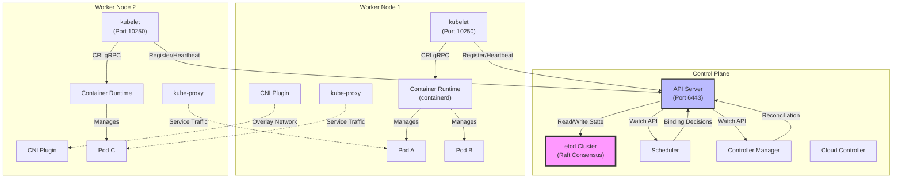
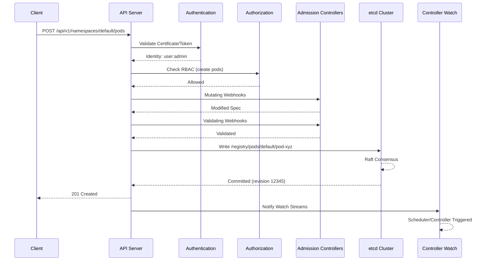
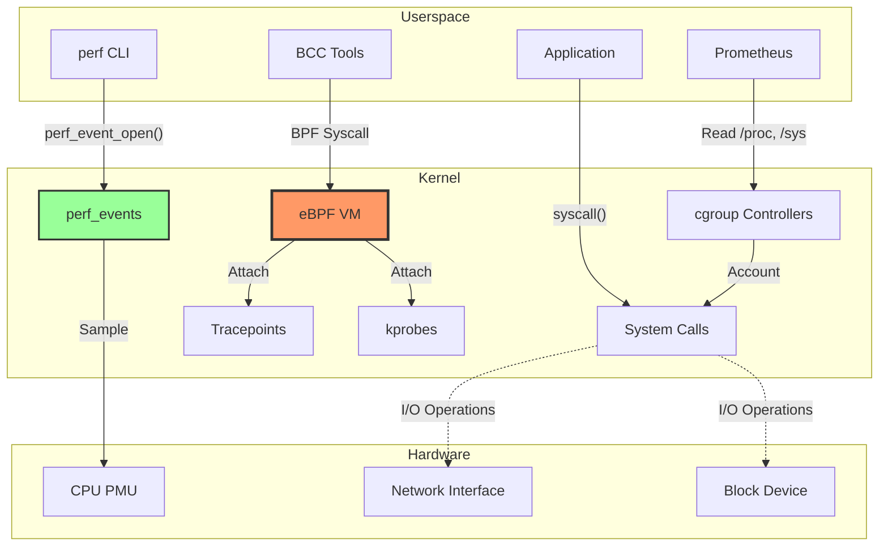
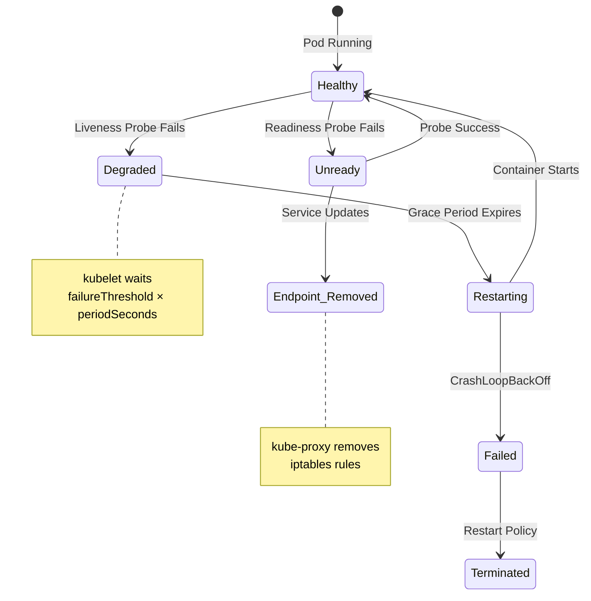
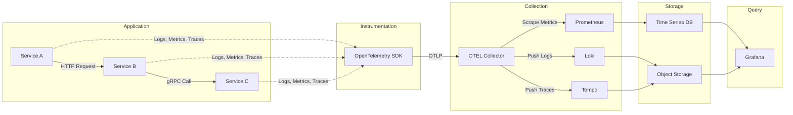
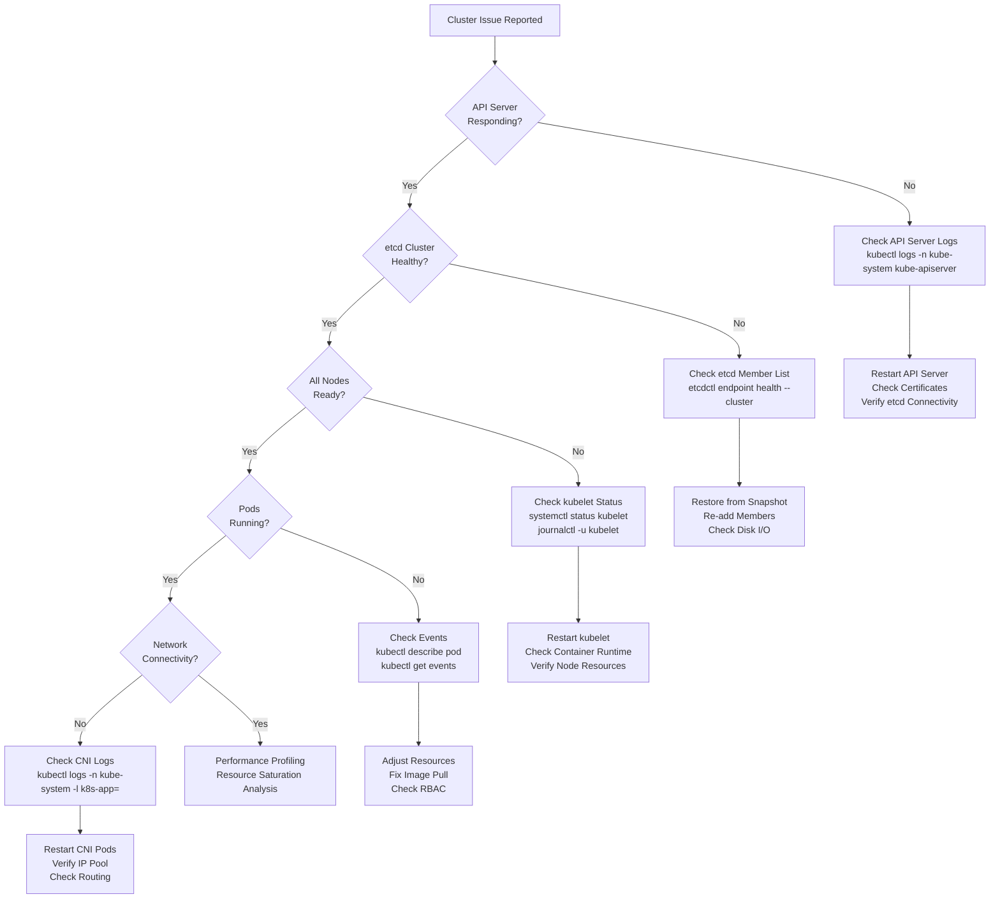

# Operational Verification Labs: DevOps Infrastructure

## Introduction and System Architecture

Modern DevOps platforms operate as distributed control planes orchestrating compute, network, and storage resources across heterogeneous infrastructure. Understanding operational verification requires examining the underlying consensus mechanisms, network topologies, container runtime interfaces, and observability primitives that govern production systems.

This lab focuses on Kubernetes as the reference platform, but the principles—distributed consensus via Raft, CNI plugin architectures, CRI runtime abstractions, control plane HA patterns—apply broadly to any container orchestration system. The exercises progress from static inspection to dynamic profiling, culminating in controlled chaos experiments that expose fault tolerance boundaries.

### Core Infrastructure Components

A production Kubernetes cluster comprises several distributed subsystems:

**Control Plane Layer:**
- API Server: RESTful gateway implementing admission control, authentication, and authorization
- etcd: Distributed key-value store providing linearizable reads via Raft consensus
- Scheduler: Workload placement engine using constraint satisfaction and bin-packing algorithms
- Controller Manager: Reconciliation loops maintaining desired state (ReplicaSets, Deployments, Services)

**Data Plane Layer:**
- kubelet: Node agent managing pod lifecycle, volume mounts, and container health
- Container Runtime (containerd/CRI-O): OCI-compliant runtime handling image pulls, container creation, and namespace isolation
- kube-proxy: Network proxy implementing Service abstraction via iptables/IPVS/eBPF

**Network Layer:**
- CNI Plugin (Calico/Cilium/Flannel): Pod networking implementing overlay or underlay topologies
- CoreDNS: Service discovery via DNS



### Environment Prerequisites

**System Requirements:**
- Linux kernel ≥ 5.8 (for eBPF support, cgroup v2)
- 4+ CPU cores, 8GB+ RAM
- Root or sudo access for privileged operations
- Kubernetes cluster (v1.27+) with at least 2 worker nodes

**Tool Installation:**

```bash
#!/bin/bash
set -euo pipefail

# Package manager detection
if command -v apt-get &> /dev/null; then
    PKG_MGR="apt-get"
    UPDATE_CMD="apt-get update"
    INSTALL_CMD="apt-get install -y"
elif command -v yum &> /dev/null; then
    PKG_MGR="yum"
    UPDATE_CMD="yum check-update || true"
    INSTALL_CMD="yum install -y"
else
    echo "Unsupported package manager"
    exit 1
fi

# Update package database
sudo ${UPDATE_CMD}

# Core networking utilities
sudo ${INSTALL_CMD} iproute2 ethtool tcpdump net-tools dnsutils iputils-ping

# Performance analysis tools
sudo ${INSTALL_CMD} linux-tools-common linux-tools-generic strace sysstat

# BPF tooling (if available)
sudo ${INSTALL_CMD} bpftool bpfcc-tools || echo "BPF tools unavailable on this distribution"

# kubectl installation
KUBECTL_VERSION=$(curl -L -s https://dl.k8s.io/release/stable.txt)
curl -LO "https://dl.k8s.io/release/${KUBECTL_VERSION}/bin/linux/amd64/kubectl"
curl -LO "https://dl.k8s.io/release/${KUBECTL_VERSION}/bin/linux/amd64/kubectl.sha256"
echo "$(cat kubectl.sha256)  kubectl" | sha256sum --check
sudo install -o root -g root -m 0755 kubectl /usr/local/bin/kubectl
rm kubectl kubectl.sha256

# etcdctl (matches etcd version in cluster)
ETCD_VERSION="v3.5.10"
curl -L https://github.com/etcd-io/etcd/releases/download/${ETCD_VERSION}/etcd-${ETCD_VERSION}-linux-amd64.tar.gz -o etcd.tar.gz
tar xzvf etcd.tar.gz
sudo install -o root -g root -m 0755 etcd-${ETCD_VERSION}-linux-amd64/etcdctl /usr/local/bin/etcdctl
rm -rf etcd.tar.gz etcd-${ETCD_VERSION}-linux-amd64

# crictl (CRI CLI)
CRICTL_VERSION="v1.28.0"
curl -L https://github.com/kubernetes-sigs/cri-tools/releases/download/${CRICTL_VERSION}/crictl-${CRICTL_VERSION}-linux-amd64.tar.gz -o crictl.tar.gz
sudo tar zxvf crictl.tar.gz -C /usr/local/bin
rm crictl.tar.gz

# Configure crictl to use containerd socket
sudo tee /etc/crictl.yaml > /dev/null <<EOF
runtime-endpoint: unix:///run/containerd/containerd.sock
image-endpoint: unix:///run/containerd/containerd.sock
timeout: 10
debug: false
EOF

# Helm installation
curl https://raw.githubusercontent.com/helm/helm/main/scripts/get-helm-3 | bash

echo "Installation complete. Verify with: kubectl version --client && etcdctl version && crictl version"
```

---

## Exercise 1: Control Plane State Inspection and API Server Audit

### Objective

Inspect the distributed state machine underlying Kubernetes. Understand how API Server requests propagate through authentication, admission control, and etcd persistence. Map the relationship between CRDs, controllers, and stored objects.

### Theory: Kubernetes API Machinery

The API Server is a stateless gateway. Every API request follows this pipeline:

1. **Authentication**: Validates client identity (certificates, tokens, webhooks)
2. **Authorization**: RBAC evaluation against policy rules
3. **Admission Control**: Mutating and validating webhooks (e.g., PodSecurityPolicy, ResourceQuota)
4. **Validation**: OpenAPI schema validation
5. **Persistence**: Serialization to etcd as protobuf
6. **Watch Notifications**: Informers notified of state changes

etcd stores all cluster state as key-value pairs under `/registry/<resource>/<namespace>/<name>`. The Raft consensus protocol ensures linearizable writes across the etcd cluster, tolerating up to (N-1)/2 failures in an N-member cluster.



### Step 1: Control Plane Component Health

Verify that all control plane components are operational. The API Server exposes health endpoints and metrics.

```bash
# Check component status
kubectl get componentstatuses
kubectl get --raw='/readyz?verbose'
kubectl get --raw='/livez?verbose'

# Inspect API Server metrics (requires authentication)
kubectl get --raw /metrics | grep apiserver_request_duration_seconds

# Detailed node conditions
kubectl get nodes -o jsonpath='{range .items[*]}{.metadata.name}{"\t"}{.status.conditions[?(@.type=="Ready")].status}{"\t"}{.status.conditions[?(@.type=="MemoryPressure")].status}{"\n"}{end}'

# Control plane pod status (for kubeadm clusters)
kubectl get pods -n kube-system -l tier=control-plane -o wide
```

**Expected Output Analysis:**
- `ComponentStatus` is deprecated (v1.19+). Use pod health instead.
- `/readyz` aggregates checks: etcd, API Server internal state
- Node `Ready` condition indicates kubelet heartbeat within last 40s (default `node-monitor-grace-period`)

### Step 2: etcd Cluster State and Raft Health

etcd is the source of truth. All Kubernetes state resides here. Inspect cluster health, leadership, and data size.

```bash
# Endpoint discovery (kubeadm clusters)
ETCD_ENDPOINTS=$(kubectl get pod -n kube-system -l component=etcd -o jsonpath='{.items[0].spec.containers[0].command}' | grep -oP 'https://[^:]+:2379' | head -1)

# Alternatively, exec into etcd pod
kubectl exec -n kube-system etcd-<node-name> -- sh -c "
  ETCDCTL_API=3 etcdctl \
    --endpoints=https://127.0.0.1:2379 \
    --cacert=/etc/kubernetes/pki/etcd/ca.crt \
    --cert=/etc/kubernetes/pki/etcd/server.crt \
    --key=/etc/kubernetes/pki/etcd/server.key \
    endpoint health --cluster
"

# Member list and Raft role
kubectl exec -n kube-system etcd-<node-name> -- sh -c "
  ETCDCTL_API=3 etcdctl \
    --endpoints=https://127.0.0.1:2379 \
    --cacert=/etc/kubernetes/pki/etcd/ca.crt \
    --cert=/etc/kubernetes/pki/etcd/server.crt \
    --key=/etc/kubernetes/pki/etcd/server.key \
    member list -w table
"

# Raft status (leader, term, applied index)
kubectl exec -n kube-system etcd-<node-name> -- sh -c "
  ETCDCTL_API=3 etcdctl \
    --endpoints=https://127.0.0.1:2379 \
    --cacert=/etc/kubernetes/pki/etcd/ca.crt \
    --cert=/etc/kubernetes/pki/etcd/server.crt \
    --key=/etc/kubernetes/pki/etcd/server.key \
    endpoint status -w table
"

# Database size (watch for compaction needs)
kubectl exec -n kube-system etcd-<node-name> -- sh -c "
  ETCDCTL_API=3 etcdctl \
    --endpoints=https://127.0.0.1:2379 \
    --cacert=/etc/kubernetes/pki/etcd/ca.crt \
    --cert=/etc/kubernetes/pki/etcd/server.crt \
    --key=/etc/kubernetes/pki/etcd/server.key \
    endpoint status -w json | jq -r '.[] | \"Size: \(.Status.dbSize / 1024 / 1024)MB, InUse: \(.Status.dbSizeInUse / 1024 / 1024)MB\"'
"

# List all keys (CAUTION: large output)
kubectl exec -n kube-system etcd-<node-name> -- sh -c "
  ETCDCTL_API=3 etcdctl \
    --endpoints=https://127.0.0.1:2379 \
    --cacert=/etc/kubernetes/pki/etcd/ca.crt \
    --cert=/etc/kubernetes/pki/etcd/server.crt \
    --key=/etc/kubernetes/pki/etcd/server.key \
    get / --prefix --keys-only | head -50
"
```

**Critical Metrics:**
- **Raft Term**: Increments on leader election. Frequent changes indicate instability.
- **Applied Index**: Log entry count. Should be consistent across members.
- **DB Size**: Default quota is 2GB. Exceeding triggers `NOSPACE` alarms.
- **Leader Election**: Latency-sensitive. Network partitions trigger re-elections.

### Step 3: Container Runtime Inspection via CRI

The Container Runtime Interface (CRI) is a gRPC API. kubelet communicates with containerd/CRI-O via this interface. Inspect running containers, images, and pod sandboxes.

```bash
# List running containers
sudo crictl ps

# Detailed container info (JSON output)
CONTAINER_ID=$(sudo crictl ps --name nginx -q | head -1)
sudo crictl inspect ${CONTAINER_ID} | jq '.info.runtimeSpec.linux'

# List pod sandboxes (pause containers)
sudo crictl pods

# Pod network namespace inspection
POD_ID=$(sudo crictl pods --name nginx -q | head -1)
sudo crictl inspectp ${POD_ID} | jq '.info.runtimeSpec.linux.namespaces'

# Container logs via CRI
sudo crictl logs ${CONTAINER_ID}

# Execute command inside container
sudo crictl exec -it ${CONTAINER_ID} /bin/sh

# Image list and layer information
sudo crictl images
sudo crictl inspecti <image-id> | jq '.info.imageSpec.config'

# Runtime statistics (CPU, memory, block I/O)
sudo crictl stats

# Runtime version and socket path
sudo crictl info | jq '{runtimeType: .config.containerd.runtimes.runc.runtime_type, socketPath: .config.containerd.runtimes.runc.options.BinaryName}'
```

**CRI Architecture:**
- **Pod Sandbox**: Shared namespaces (network, IPC, UTS) for container group
- **Pause Container**: Holds namespaces. Lifecycle tied to pod.
- **OCI Runtime (runc)**: Low-level executor spawning containers via `clone()` syscalls and cgroup setup

### Step 4: Network Topology and CNI Plugin Verification

CNI plugins configure pod networking. Inspect interfaces, routes, and overlay tunnels.

```bash
# Host network interfaces
ip -s link show
ip -c addr show

# Bridge interfaces (for bridge-mode CNI)
sudo bridge link show
sudo bridge fdb show

# VXLAN tunnels (for overlay networks like Flannel)
ip -d link show type vxlan

# Routing table
ip route show
ip route show table all  # Include all routing tables

# Neighbor table (ARP/NDP cache)
ip neigh show

# CNI plugin configuration (on worker nodes)
sudo cat /etc/cni/net.d/*.conf | jq

# Pod network namespace inspection
POD=$(kubectl get pod -o name | head -1)
POD_UID=$(kubectl get ${POD} -o jsonpath='{.metadata.uid}')
POD_NS_PATH="/var/run/netns/cni-$(sudo crictl pods --id ${POD_UID} -q)"

# If nsenter doesn't work, find the pause container PID
SANDBOX_ID=$(sudo crictl pods --id ${POD_UID} -q)
PAUSE_PID=$(sudo crictl inspect ${SANDBOX_ID} | jq -r '.info.pid')

# Enter pod network namespace
sudo nsenter -t ${PAUSE_PID} -n ip addr show
sudo nsenter -t ${PAUSE_PID} -n ip route show
sudo nsenter -t ${PAUSE_PID} -n iptables -L -t nat -n

# Network policy enforcement (e.g., Calico uses Felix agent)
kubectl get networkpolicies -A
kubectl logs -n kube-system -l k8s-app=calico-node --tail=50

# Service mesh sidecar injection (Istio/Linkerd)
kubectl get pods -o jsonpath='{range .items[*]}{.metadata.name}{"\t"}{.spec.containers[*].name}{"\n"}{end}' | grep -E 'istio-proxy|linkerd-proxy'
```

**Key Observations:**
- **veth Pairs**: One end in host namespace, other in pod namespace
- **VXLAN/IPIP Tunnels**: Overlay encapsulation for cross-node pod traffic
- **iptables/IPVS Rules**: kube-proxy programs Service VIP translation
- **MTU Considerations**: Overlay adds ~50 bytes overhead. Pod MTU = host MTU - encap overhead.

### Step 5: API Server Audit Log Analysis

Audit logs record all API requests. Enable audit logging to track mutations, authorization failures, and suspicious access patterns.

```bash
# Check if audit logging is enabled
kubectl cluster-info dump | grep audit-log

# On control plane node, inspect audit log
sudo tail -f /var/log/kubernetes/kube-apiserver-audit.log | jq 'select(.verb != "get" and .verb != "list" and .verb != "watch")'

# Filter unauthorized requests
sudo jq 'select(.responseStatus.code >= 400)' /var/log/kubernetes/kube-apiserver-audit.log

# Track specific user actions
sudo jq 'select(.user.username == "system:serviceaccount:default:myapp")' /var/log/kubernetes/kube-apiserver-audit.log

# Extract resource creation events
sudo jq 'select(.verb == "create" and .objectRef.resource == "pods")' /var/log/kubernetes/kube-apiserver-audit.log | head
```

**Audit Policy Configuration** (requires API Server restart):

```yaml
# /etc/kubernetes/audit-policy.yaml
apiVersion: audit.k8s.io/v1
kind: Policy
rules:
  # Log all requests at RequestResponse level
  - level: RequestResponse
    verbs: ["create", "update", "patch", "delete"]
  # Log metadata for read operations
  - level: Metadata
    verbs: ["get", "list", "watch"]
```

API Server flags:
```
--audit-policy-file=/etc/kubernetes/audit-policy.yaml
--audit-log-path=/var/log/kubernetes/kube-apiserver-audit.log
--audit-log-maxage=7
--audit-log-maxbackup=10
--audit-log-maxsize=100
```

---

## Exercise 2: Performance Profiling and Resource Saturation Analysis

### Objective

Quantify system resource utilization, identify bottlenecks, and understand saturation behavior under load. Profile CPU, memory, network, and I/O subsystems using kernel-level instrumentation.

### Theory: Linux Performance Observability Stack

Modern observability leverages multiple instrumentation layers:

1. **Kernel Tracepoints**: Static instrumentation in kernel code
2. **kprobes/uprobes**: Dynamic instrumentation of kernel/userspace functions
3. **eBPF**: Sandboxed programs executing in kernel context
4. **perf_events**: Hardware performance counters (cache misses, branch mispredictions)
5. **cgroups**: Resource accounting and limits



### Step 1: Cluster Resource Utilization Baseline

Capture baseline metrics under normal operation. Identify resource pressure before load testing.

```bash
# Node resource capacity and allocation
kubectl top nodes
kubectl describe nodes | grep -A 5 "Allocated resources"

# Pod resource usage (requires metrics-server)
kubectl top pods -A --sort-by=memory
kubectl top pods -A --sort-by=cpu

# Identify resource-intensive pods
kubectl get pods -A -o jsonpath='{range .items[*]}{.metadata.namespace}{"\t"}{.metadata.name}{"\t"}{.spec.containers[*].resources.requests.cpu}{"\t"}{.spec.containers[*].resources.requests.memory}{"\n"}{end}' | column -t

# Evicted pods (OOMKilled, exceeding limits)
kubectl get pods -A --field-selector=status.phase=Failed

# Detailed pod resource status
kubectl get pods -A -o json | jq -r '.items[] | select(.status.containerStatuses != null) | select(.status.containerStatuses[].state.terminated.reason == "OOMKilled") | "\(.metadata.namespace)/\(.metadata.name) - OOMKilled"'
```

**Metrics Server Installation** (if missing):

```bash
kubectl apply -f https://github.com/kubernetes-sigs/metrics-server/releases/latest/download/components.yaml

# If using self-signed certs, patch deployment
kubectl patch deployment metrics-server -n kube-system --type=json -p='[{"op": "add", "path": "/spec/template/spec/containers/0/args/-", "value": "--kubelet-insecure-tls"}]'
```

### Step 2: CPU and Memory Profiling with perf

`perf` provides low-overhead sampling of CPU cycles, cache behavior, and memory access patterns.

```bash
# Identify high-CPU processes
perf top -p $(pgrep kubelet)

# Record CPU profile of kubectl operation (captures syscalls, function calls)
perf record -g -F 99 -- kubectl get pods -A
perf report --stdio | head -50

# Annotate source code with CPU hotspots (requires debuginfo)
perf annotate --stdio

# CPU cache misses (L1, L2, LLC)
perf stat -e cache-references,cache-misses,cycles,instructions kubectl get pods -A

# Branch prediction efficiency
perf stat -e branches,branch-misses kubectl get pods -A

# Context switches and scheduling latency
perf stat -e sched:sched_switch,sched:sched_wakeup kubectl get pods -A

# Memory bandwidth usage
perf stat -e uncore_imc/data_reads/,uncore_imc/data_writes/ -a sleep 10

# TLB (Translation Lookaside Buffer) misses
perf stat -e dTLB-loads,dTLB-load-misses,iTLB-loads,iTLB-load-misses kubectl get pods -A

# CPU flamegraph generation (requires FlameGraph tools)
perf record -F 99 -a -g -- sleep 30
perf script | ~/FlameGraph/stackcollapse-perf.pl | ~/FlameGraph/flamegraph.pl > flamegraph.svg
```

**Interpretation:**
- **High cache-miss ratio**: Poor data locality, excessive memory access
- **High branch-miss ratio**: Unpredictable control flow
- **Context switches**: Scheduler overhead, lock contention

### Step 3: Network Throughput and Latency Measurement

Measure network performance between pods, nodes, and external endpoints.

```bash
# Deploy iperf3 DaemonSet for inter-node bandwidth testing
kubectl apply -f - <<EOF
apiVersion: apps/v1
kind: DaemonSet
metadata:
  name: iperf3-server
  namespace: default
spec:
  selector:
    matchLabels:
      app: iperf3-server
  template:
    metadata:
      labels:
        app: iperf3-server
    spec:
      hostNetwork: true
      containers:
      - name: iperf3
        image: networkstatic/iperf3
        command: ["iperf3", "-s"]
        ports:
        - containerPort: 5201
          protocol: TCP
EOF

# Get server pod IP
SERVER_POD=$(kubectl get pods -l app=iperf3-server -o jsonpath='{.items[0].metadata.name}')
SERVER_IP=$(kubectl get pod ${SERVER_POD} -o jsonpath='{.status.podIP}')

# Run client in another pod
kubectl run iperf3-client --rm -it --image=networkstatic/iperf3 -- -c ${SERVER_IP} -t 30 -P 4

# TCP throughput with various parameters
kubectl run iperf3-client --rm -it --image=networkstatic/iperf3 -- -c ${SERVER_IP} -t 10 -w 256K

# UDP bandwidth and jitter testing
kubectl run iperf3-client --rm -it --image=networkstatic/iperf3 -- -c ${SERVER_IP} -u -b 1G -t 10

# Latency measurement with ping
kubectl run ping --rm -it --image=busybox -- ping -c 100 ${SERVER_IP}

# TCP connection latency with hping3
kubectl run hping3 --rm -it --image=sflow/hping3 -- hping3 -S -p 5201 -c 100 ${SERVER_IP}

# Socket statistics on node
ss -s  # Summary
ss -tpn | grep :10250  # kubelet API connections
ss -i  # Detailed socket info (retransmits, RTT)

# Network interface packet drops
ip -s link | grep -E '(RX|TX|drop|error)'

# Detailed interface errors
ethtool -S eth0 | grep -E '(error|drop|overrun)'

# Network socket buffer tuning verification
sysctl net.ipv4.tcp_rmem
sysctl net.ipv4.tcp_wmem
sysctl net.core.rmem_max
sysctl net.core.wmem_max
```

**Critical Network Metrics:**
- **Throughput**: Bandwidth utilization (iperf3 measures TCP/UDP)
- **RTT**: Round-trip time (ping, TCP handshake latency)
- **Packet Loss**: Indicates buffer overflows or link congestion
- **Retransmits**: TCP reliability overhead (`ss -ti` shows retrans count)
- **Interface Drops**: RX drops (slow receiver), TX drops (congestion)

### Step 4: System Call Tracing and I/O Profiling

Trace system calls to understand application-kernel interaction and I/O patterns.

```bash
# Attach strace to running kubelet process
sudo strace -c -p $(pgrep kubelet)  # Summary statistics (Ctrl+C to stop)

# Detailed syscall tracing (filtering for I/O)
sudo strace -p $(pgrep kubelet) -e trace=open,openat,read,write,close,stat -f

# Trace pod's container process
CONTAINER_PID=$(sudo crictl inspect <container-id> | jq -r '.info.pid')
sudo strace -p ${CONTAINER_PID} -e trace=network,desc -s 128

# I/O latency histogram with eBPF (requires bcc-tools)
sudo /usr/share/bcc/tools/biolatency -D 10  # Block I/O latency histogram

# File system I/O by process
sudo /usr/share/bcc/tools/filetop -C

# Disk I/O statistics
iostat -xz 1 10

# Detailed block device stats
cat /proc/diskstats

# Filesystem cache hit/miss ratio
sudo /usr/share/bcc/tools/cachestat 1 10

# Trace TCP connection establishment
sudo /usr/share/bcc/tools/tcpconnect -t

# TCP retransmit tracking
sudo /usr/share/bcc/tools/tcpretrans -l

# Block I/O tracing (requires kernel debugfs)
echo 1 | sudo tee /sys/kernel/debug/tracing/events/block/block_rq_issue/enable
sudo cat /sys/kernel/debug/tracing/trace_pipe
echo 0 | sudo tee /sys/kernel/debug/tracing/events/block/block_rq_issue/enable
```

**I/O Bottleneck Indicators:**
- **High iowait**: CPU waiting for disk I/O completion (`iostat %iowait`)
- **Queue depth**: Outstanding I/O requests (`iostat avgqu-sz`)
- **Service time**: Disk latency per operation (`iostat svctm`)
- **Page cache thrashing**: Excessive cache eviction (`cachestat`)

### Step 5: eBPF-Based Continuous Profiling

Deploy eBPF programs for production-safe, always-on profiling.

```bash
# CPU profiling across all processes
sudo /usr/share/bcc/tools/profile -F 49 -af 10 > cpu_profile.txt

# Off-CPU analysis (waiting on locks, I/O)
sudo /usr/share/bcc/tools/offcputime -df 10 > offcpu.txt

# Memory leak detection (tracks allocations without frees)
sudo /usr/share/bcc/tools/memleak -p $(pgrep kubelet) 10

# Function call latency histogram
sudo /usr/share/bcc/tools/funclatency do_sys_open

# Kernel function call graph
sudo /usr/share/bcc/tools/trace 'do_nanosleep "%d", arg2'

# Network packet filtering and inspection
sudo /usr/share/bcc/tools/tcptop -C  # TCP throughput by process

# SSL/TLS session key extraction (for decryption)
sudo /usr/share/bcc/tools/sslsniff -p $(pgrep kubelet)

# Container-aware tracing (filter by cgroup)
sudo /usr/share/bcc/tools/execsnoop -c <container-id>
```

**eBPF Advantages:**
- **Low Overhead**: <1% CPU overhead for sampling probes
- **Production-Safe**: Verifier ensures programs cannot crash kernel
- **Dynamic**: Attach/detach without restarts or recompilation

---

## Exercise 3: Controlled Chaos Engineering and Fault Injection

### Objective

Deliberately inject faults to validate system resilience, measure recovery time, and expose failure modes. Test hypothesis about blast radius, cascading failures, and self-healing mechanisms.

### Theory: Fault Tolerance Mechanisms

Kubernetes implements several resilience patterns:

1. **Reconciliation Loops**: Controllers continuously drive actual state toward desired state
2. **Health Checks**: Liveness probes (restart), readiness probes (traffic routing)
3. **Replication**: StatefulSets, ReplicaSets ensure redundancy
4. **PodDisruptionBudgets**: Limit voluntary disruptions during maintenance
5. **Scheduler Constraints**: Affinity/anti-affinity rules for failure domain distribution



### Step 1: Pod Termination and Rescheduling

Delete pods to observe controller reconciliation and scheduler behavior.

```bash
# Deploy a test application with replicas
kubectl create deployment nginx --image=nginx:1.25 --replicas=3
kubectl expose deployment nginx --port=80 --type=ClusterIP

# Observe pod placement
kubectl get pods -l app=nginx -o wide

# Delete a single pod
POD_NAME=$(kubectl get pods -l app=nginx -o jsonpath='{.items[0].metadata.name}')
kubectl delete pod ${POD_NAME} --grace-period=0 --force=false

# Watch automatic recreation
kubectl get pods -l app=nginx -w

# Delete all pods simultaneously
kubectl delete pods -l app=nginx

# Observe scheduling decisions (pending state, node affinity)
kubectl get events --sort-by='.lastTimestamp' | grep Scheduled

# Deployment rollout status
kubectl rollout status deployment/nginx

# Describe pod for scheduling failures
kubectl describe pod -l app=nginx | grep -A 10 Events
```

**Expected Behavior:**
- **Reconciliation Time**: ReplicaSet controller recreates pods within ~5s
- **Scheduler Latency**: Pod moves from Pending to Running in <10s under normal load
- **Resource Contention**: Pods may remain Pending if node resources exhausted

### Step 2: Node Drain and Workload Migration

Safely evict pods from a node, simulating maintenance or node failure.

```bash
# Identify node with pods
NODE_NAME=$(kubectl get pods -o wide | grep nginx | head -1 | awk '{print $7}')

# Cordon node (prevent new scheduling)
kubectl cordon ${NODE_NAME}

# Verify node status
kubectl get node ${NODE_NAME} -o jsonpath='{.spec.unschedulable}'

# Drain node (respects PodDisruptionBudgets)
kubectl drain ${NODE_NAME} --ignore-daemonsets --delete-emptydir-data --timeout=300s

# Observe pod migration
kubectl get pods -l app=nginx -o wide -w

# Pod distribution after drain
kubectl get pods -l app=nginx -o wide

# Uncordon node
kubectl uncordon ${NODE_NAME}

# Create PodDisruptionBudget for controlled disruption
kubectl apply -f - <<EOF
apiVersion: policy/v1
kind: PodDisruptionBudget
metadata:
  name: nginx-pdb
spec:
  minAvailable: 2
  selector:
    matchLabels:
      app: nginx
EOF

# Attempt drain with PDB enforcement
kubectl drain ${NODE_NAME} --ignore-daemonsets --delete-emptydir-data
```

**PodDisruptionBudget Semantics:**
- **minAvailable**: Minimum healthy pods during voluntary disruption
- **maxUnavailable**: Maximum pods that can be unavailable
- **Voluntary vs Involuntary**: PDBs only block voluntary evictions (drain, upgrade), not hardware failures

### Step 3: Network Partition Simulation with iptables

Simulate network split-brain scenarios to test consensus protocol resilience.

```bash
# Block etcd inter-node traffic (simulates network partition)
ETCD_PORT=2380
PEER_IP=<etcd-peer-ip>

sudo iptables -A OUTPUT -p tcp --dport ${ETCD_PORT} -d ${PEER_IP} -j DROP
sudo iptables -A INPUT -p tcp --sport ${ETCD_PORT} -s ${PEER_IP} -j DROP

# Observe etcd cluster state
kubectl exec -n kube-system etcd-<node-name> -- sh -c "
  ETCDCTL_API=3 etcdctl \
    --endpoints=https://127.0.0.1:2379 \
    --cacert=/etc/kubernetes/pki/etcd/ca.crt \
    --cert=/etc/kubernetes/pki/etcd/server.crt \
    --key=/etc/kubernetes/pki/etcd/server.key \
    endpoint status -w table
"

# Watch for leader re-election
kubectl logs -n kube-system -l component=etcd --tail=100 | grep -i election

# Restore connectivity
sudo iptables -D OUTPUT -p tcp --dport ${ETCD_PORT} -d ${PEER_IP} -j DROP
sudo iptables -D INPUT -p tcp --sport ${ETCD_PORT} -s ${PEER_IP} -j DROP

# Block pod-to-pod traffic (simulates CNI failure)
POD_IP=<target-pod-ip>
sudo iptables -A FORWARD -d ${POD_IP} -j DROP

# Test connectivity from another pod
kubectl run busybox --rm -it --image=busybox -- wget -T 5 http://${POD_IP}

# Restore pod connectivity
sudo iptables -D FORWARD -d ${POD_IP} -j DROP

# Simulate packet loss with tc (traffic control)
sudo tc qdisc add dev eth0 root netem loss 20%

# Verify degraded performance
kubectl run ping --rm -it --image=busybox -- ping -c 100 ${POD_IP}

# Remove traffic control rule
sudo tc qdisc del dev eth0 root
```

**Network Fault Impact:**
- **etcd Partition**: Minority partition enters read-only mode
- **Pod Isolation**: Service endpoints removed after readiness probe failures
- **Packet Loss**: TCP retransmissions increase latency

### Step 4: Resource Exhaustion and OOMKill Behavior

Trigger memory pressure and CPU throttling to observe cgroup enforcement.

```bash
# Deploy pod with memory limit
kubectl apply -f - <<EOF
apiVersion: v1
kind: Pod
metadata:
  name: stress-memory
spec:
  containers:
  - name: stress
    image: polinux/stress
    resources:
      requests:
        memory: "128Mi"
        cpu: "500m"
      limits:
        memory: "256Mi"
        cpu: "1000m"
    command: ["stress"]
    args: ["--vm", "1", "--vm-bytes", "300M", "--vm-hang", "0"]
EOF

# Observe OOMKill event
kubectl get pod stress-memory -w
kubectl describe pod stress-memory | grep -A 5 "Last State"

# Check kernel OOM logs on node
sudo dmesg | grep -i "out of memory"

# cgroup memory statistics
CONTAINER_ID=$(sudo crictl ps --name stress -q)
CGROUP_PATH=$(sudo crictl inspect ${CONTAINER_ID} | jq -r '.info.runtimeSpec.linux.cgroupsPath')
sudo cat /sys/fs/cgroup/memory/${CGROUP_PATH}/memory.oom_control
sudo cat /sys/fs/cgroup/memory/${CGROUP_PATH}/memory.stat | grep -E '(rss|cache|swap)'

# CPU throttling test
kubectl apply -f - <<EOF
apiVersion: v1
kind: Pod
metadata:
  name: stress-cpu
spec:
  containers:
  - name: stress
    image: polinux/stress
    resources:
      limits:
        cpu: "500m"
    command: ["stress"]
    args: ["--cpu", "2"]
EOF

# Monitor CPU throttling in cgroup
CONTAINER_ID=$(sudo crictl ps --name stress-cpu -q)
CGROUP_PATH=$(sudo crictl inspect ${CONTAINER_ID} | jq -r '.info.runtimeSpec.linux.cgroupsPath')

# Observe throttled time
while true; do
  sudo cat /sys/fs/cgroup/cpu,cpuacct/${CGROUP_PATH}/cpu.stat | grep throttled
  sleep 2
done

# Cleanup
kubectl delete pod stress-memory stress-cpu
```

**cgroup Enforcement:**
- **Memory Limit**: Hard limit. Exceeding triggers OOMKiller.
- **CPU Limit**: Soft limit. Processes throttled via CFS (Completely Fair Scheduler).
- **Throttled Time**: Periods where runnable tasks exceeded CPU quota.

### Step 5: Chaos Mesh Framework Deployment

Use Chaos Mesh for reproducible, declarative chaos experiments.

```bash
# Install Chaos Mesh via Helm
helm repo add chaos-mesh https://charts.chaos-mesh.org
helm repo update
kubectl create ns chaos-mesh
helm install chaos-mesh chaos-mesh/chaos-mesh -n chaos-mesh --set dashboard.create=true

# Port-forward dashboard
kubectl port-forward -n chaos-mesh svc/chaos-dashboard 2333:2333

# Pod failure injection
kubectl apply -f - <<EOF
apiVersion: chaos-mesh.org/v1alpha1
kind: PodChaos
metadata:
  name: pod-failure-nginx
  namespace: default
spec:
  action: pod-failure
  mode: one
  duration: "30s"
  selector:
    namespaces:
      - default
    labelSelectors:
      app: nginx
EOF

# Network delay injection
kubectl apply -f - <<EOF
apiVersion: chaos-mesh.org/v1alpha1
kind: NetworkChaos
metadata:
  name: network-delay
  namespace: default
spec:
  action: delay
  mode: all
  selector:
    namespaces:
      - default
    labelSelectors:
      app: nginx
  delay:
    latency: "200ms"
    correlation: "25"
    jitter: "50ms"
  duration: "2m"
EOF

# Kernel stress (I/O thrashing)
kubectl apply -f - <<EOF
apiVersion: chaos-mesh.org/v1alpha1
kind: StressChaos
metadata:
  name: stress-io
  namespace: default
spec:
  mode: one
  selector:
    namespaces:
      - default
    labelSelectors:
      app: nginx
  stressors:
    io:
      workers: 4
  duration: "1m"
EOF

# View chaos experiment status
kubectl get podchaos,networkchaos,stresschaos -A

# Cleanup experiments
kubectl delete podchaos pod-failure-nginx
kubectl delete networkchaos network-delay
kubectl delete stresschaos stress-io
```

**Chaos Engineering Principles:**
1. **Hypothesis**: Define expected behavior under fault
2. **Blast Radius**: Limit experiment scope (single pod, one namespace)
3. **Steady State**: Baseline metrics before/after injection
4. **Automated Rollback**: Experiments automatically terminate

---

## Exercise 4: Distributed Tracing and Observability Pipeline

### Objective

Implement end-to-end observability with structured logging, metrics aggregation, and distributed tracing. Correlate signals across multiple system layers.

### Theory: The Three Pillars of Observability

**Logs**: Discrete event records (structured JSON preferred)
**Metrics**: Time-series aggregates (counters, gauges, histograms)
**Traces**: Causal chains of requests across services



### Step 1: Deploy Observability Stack (Prometheus, Loki, Tempo, Grafana)

```bash
# Add Helm repositories
helm repo add prometheus-community https://prometheus-community.github.io/helm-charts
helm repo add grafana https://grafana.github.io/helm-charts
helm repo update

# Install kube-prometheus-stack (Prometheus, Alertmanager, Grafana, exporters)
kubectl create namespace monitoring
helm install kube-prometheus prometheus-community/kube-prometheus-stack -n monitoring \
  --set prometheus.prometheusSpec.retention=7d \
  --set prometheus.prometheusSpec.storageSpec.volumeClaimTemplate.spec.resources.requests.storage=50Gi

# Install Loki for log aggregation
helm install loki grafana/loki-stack -n monitoring \
  --set promtail.enabled=true \
  --set loki.persistence.enabled=true \
  --set loki.persistence.size=20Gi

# Install Tempo for distributed tracing
helm install tempo grafana/tempo -n monitoring \
  --set tempo.persistence.enabled=true \
  --set tempo.persistence.size=10Gi

# Port-forward Grafana dashboard
kubectl port-forward -n monitoring svc/kube-prometheus-grafana 3000:80

# Default credentials: admin / prom-operator
```

### Step 2: Instrument Application with OpenTelemetry

Deploy a microservice instrumented with OpenTelemetry for tracing.

```python
# example_service.py - Python Flask app with OTEL
from flask import Flask, request
from opentelemetry import trace
from opentelemetry.exporter.otlp.proto.grpc.trace_exporter import OTLPSpanExporter
from opentelemetry.sdk.trace import TracerProvider
from opentelemetry.sdk.trace.export import BatchSpanProcessor
from opentelemetry.instrumentation.flask import FlaskInstrumentor
from opentelemetry.sdk.resources import Resource
import requests
import logging

# Configure structured logging
logging.basicConfig(level=logging.INFO, format='{"time":"%(asctime)s","level":"%(levelname)s","msg":"%(message)s"}')
logger = logging.getLogger(__name__)

# Initialize OTEL tracer
resource = Resource(attributes={"service.name": "example-service"})
provider = TracerProvider(resource=resource)
processor = BatchSpanProcessor(OTLPSpanExporter(endpoint="tempo.monitoring.svc.cluster.local:4317", insecure=True))
provider.add_span_processor(processor)
trace.set_tracer_provider(provider)
tracer = trace.get_tracer(__name__)

app = Flask(__name__)
FlaskInstrumentor().instrument_app(app)

@app.route('/api/data')
def get_data():
    span = trace.get_current_span()
    span.set_attribute("http.route", "/api/data")
    
    logger.info("Fetching data from downstream service")
    
    # Simulate downstream call
    try:
        response = requests.get("http://downstream-service:8080/data", timeout=2)
        span.set_attribute("downstream.status", response.status_code)
        return {"data": response.json(), "status": "success"}
    except Exception as e:
        span.record_exception(e)
        logger.error(f"Downstream call failed: {e}")
        return {"error": str(e), "status": "failure"}, 500

if __name__ == '__main__':
    app.run(host='0.0.0.0', port=5000)
```

**Dockerfile:**

```dockerfile
FROM python:3.11-slim
WORKDIR /app
COPY requirements.txt .
RUN pip install --no-cache-dir -r requirements.txt
COPY example_service.py .
CMD ["python", "example_service.py"]
```

**requirements.txt:**

```
flask==3.0.0
opentelemetry-api==1.21.0
opentelemetry-sdk==1.21.0
opentelemetry-instrumentation-flask==0.42b0
opentelemetry-exporter-otlp-proto-grpc==1.21.0
requests==2.31.0
```

Deploy to Kubernetes:

```bash
kubectl apply -f - <<EOF
apiVersion: apps/v1
kind: Deployment
metadata:
  name: example-service
spec:
  replicas: 2
  selector:
    matchLabels:
      app: example-service
  template:
    metadata:
      labels:
        app: example-service
    spec:
      containers:
      - name: app
        image: example-service:latest
        ports:
        - containerPort: 5000
        env:
        - name: OTEL_EXPORTER_OTLP_ENDPOINT
          value: "tempo.monitoring.svc.cluster.local:4317"
---
apiVersion: v1
kind: Service
metadata:
  name: example-service
spec:
  selector:
    app: example-service
  ports:
  - port: 80
    targetPort: 5000
EOF
```

### Step 3: Query Metrics, Logs, and Traces in Grafana

Access Grafana and configure data sources:

1. **Prometheus**: `http://kube-prometheus-prometheus.monitoring.svc.cluster.local:9090`
2. **Loki**: `http://loki.monitoring.svc.cluster.local:3100`
3. **Tempo**: `http://tempo.monitoring.svc.cluster.local:3100`

**PromQL Queries**:

```promql
# Pod CPU usage
sum(rate(container_cpu_usage_seconds_total{namespace="default"}[5m])) by (pod)

# Pod memory usage
sum(container_memory_working_set_bytes{namespace="default"}) by (pod) / 1024 / 1024

# HTTP request rate
sum(rate(http_requests_total[5m])) by (handler, status)

# P95 latency
histogram_quantile(0.95, sum(rate(http_request_duration_seconds_bucket[5m])) by (le, handler))

# Error rate
sum(rate(http_requests_total{status=~"5.."}[5m])) / sum(rate(http_requests_total[5m]))
```

**LogQL Queries**:

```logql
# Filter by namespace and pod
{namespace="default", pod=~"example-service.*"} |= "error"

# JSON parsing and filtering
{namespace="default"} | json | level="ERROR" | line_format "{{.msg}}"

# Rate of log lines
sum(rate({namespace="default"}[5m])) by (pod)

# Error rate over time
sum(rate({namespace="default"} |= "error" [5m]))
```

**TraceQL Queries** (in Tempo):

```traceql
# Traces with errors
{ status = error }

# Traces for specific service
{ resource.service.name = "example-service" }

# Slow traces (>1s duration)
{ duration > 1s }

# Traces with specific attribute
{ span.http.status_code = 500 }
```

---

## Diagnostic Reference and Troubleshooting Playbook

### Cluster Health Decision Tree



### Command Reference Matrix

| **Subsystem** | **Inspection Command** | **Key Metrics** | **Healthy Threshold** |
|---------------|------------------------|-----------------|----------------------|
| **API Server** | `kubectl get --raw='/readyz?verbose'` | Readiness checks | All checks passing |
| **etcd** | `etcdctl endpoint health --cluster` | Raft term, applied index | Members healthy, <2GB DB size |
| **Scheduler** | `kubectl logs -n kube-system kube-scheduler` | Scheduling latency | <100ms P95 |
| **Controller Manager** | `kubectl logs -n kube-system kube-controller-manager` | Reconciliation rate | No error logs |
| **kubelet** | `systemctl status kubelet && journalctl -u kubelet` | Node Ready condition | Ready, no resource pressure |
| **Container Runtime** | `sudo crictl info && sudo crictl ps` | Running containers | All pods in Running state |
| **CNI** | `kubectl logs -n kube-system -l app=<cni>` | IP allocation, routing | No IP exhaustion |
| **kube-proxy** | `kubectl logs -n kube-system -l k8s-app=kube-proxy` | iptables rule count | <5000 rules per chain |
| **CoreDNS** | `kubectl logs -n kube-system -l k8s-app=kube-dns` | Query latency | <50ms P95 |
| **Node Resources** | `kubectl top nodes && kubectl describe node` | CPU, memory, disk | <80% utilization |
| **Network** | `ss -s && ip -s link && tcpdump` | Throughput, packet loss | <0.1% drops |
| **Disk I/O** | `iostat -xz 1 10 && iotop` | %util, await | <80% util, <10ms await |

### Common Failure Modes and Remediation

| **Symptom** | **Root Cause** | **Diagnostic** | **Remediation** |
|-------------|----------------|----------------|-----------------|
| Pods stuck Pending | Resource exhaustion, taints | `kubectl describe pod` → Events | Adjust requests/limits, add nodes |
| CrashLoopBackOff | Application error, liveness probe fail | `kubectl logs --previous` | Fix app code, adjust probe config |
| ImagePullBackOff | Registry auth, image missing | `crictl pull <image>` | Fix imagePullSecrets, check registry |
| Node NotReady | kubelet stopped, resource pressure | `systemctl status kubelet` | Restart kubelet, clear disk space |
| Service unreachable | Endpoint not ready, iptables stale | `kubectl get endpoints` | Check pod readiness, restart kube-proxy |
| etcd NOSPACE alarm | DB size >2GB (default quota) | `etcdctl alarm list` | Compact: `etcdctl compact`, defrag |
| DNS resolution fails | CoreDNS pod down, network policy | `nslookup kubernetes.default` | Restart CoreDNS, check NetworkPolicy |
| High API latency | etcd slow disk, admission webhook timeout | `etcdctl endpoint status`, audit logs | Use SSD, disable slow webhooks |
| OOMKilled pods | Memory limit too low | `kubectl describe pod` → Last State | Increase memory limits |
| CPU throttling | CPU limit < usage | `cat cpu.stat` → throttled_time | Increase CPU limits or remove limit |

### Advanced Debugging Techniques

**Enable Debug Logging:**

```bash
# Increase kubelet verbosity
sudo sed -i 's/--v=2/--v=4/' /var/lib/kubelet/kubeadm-flags.env
sudo systemctl restart kubelet

# API Server audit logging (edit static pod manifest)
sudo vi /etc/kubernetes/manifests/kube-apiserver.yaml
# Add: --audit-log-path=/var/log/kube-apiserver-audit.log
```

**Kernel Debug Tracing:**

```bash
# Function graph tracer for network stack
echo function_graph > /sys/kernel/debug/tracing/current_tracer
echo tcp_v4_connect > /sys/kernel/debug/tracing/set_graph_function
cat /sys/kernel/debug/tracing/trace_pipe

# Trace scheduler decisions
echo 1 > /sys/kernel/debug/tracing/events/sched/sched_switch/enable
cat /sys/kernel/debug/tracing/trace
```

**Live Debugging with Ephemeral Containers** (Kubernetes v1.25+):

```bash
# Attach debug container to running pod
kubectl debug -it <pod-name> --image=nicolaka/netshoot --target=<container-name>

# Inside debug container, full networking toolkit available
# tcpdump, curl, dig, iperf3, etc.
```

---

## Verification Checklist

- [ ] Control plane pods healthy (`kube-system` namespace)
- [ ] All nodes in `Ready` state (no `MemoryPressure`, `DiskPressure`)
- [ ] etcd cluster has odd number of members (3 or 5)
- [ ] etcd Raft leader elected, all members have same `appliedIndex`
- [ ] etcd database size <2GB (80% quota threshold)
- [ ] API Server readiness probes passing (`/readyz`)
- [ ] Container runtime socket accessible (`crictl info`)
- [ ] CNI plugin pods running (check `kube-system` namespace)
- [ ] Pod IP allocation within CNI pool CIDR
- [ ] Service ClusterIP reachable from pods
- [ ] CoreDNS resolving `kubernetes.default` service
- [ ] kube-proxy mode confirmed (`iptables` or `ipvs`)
- [ ] Node disk usage <85% (`df -h`)
- [ ] Node inode usage <85% (`df -i`)
- [ ] No excessive packet drops (`ip -s link`)
- [ ] No TCP retransmits spike (`ss -ti`)
- [ ] CPU throttling <5% of runtime (`cpu.stat`)
- [ ] No OOMKilled events in last hour (`kubectl get events`)
- [ ] Pod resource requests ≤ 80% node capacity
- [ ] PodDisruptionBudgets configured for critical workloads
- [ ] Metrics server deployed and functional (`kubectl top nodes`)
- [ ] Prometheus scraping targets successfully
- [ ] Log aggregation pipeline ingesting logs (Loki/Fluentd)
- [ ] Distributed tracing collecting spans (Tempo/Jaeger)

---

## Recommended Reading and Tooling

**Books:**
- *Systems Performance* by Brendan Gregg (performance analysis methodology)
- *BPF Performance Tools* by Brendan Gregg (eBPF profiling)
- *Kubernetes in Action* by Marko Lukša (architecture deep dive)
- *Production Kubernetes* by Josh Rosso et al. (operational best practices)

**Documentation:**
- [Kubernetes Components](https://kubernetes.io/docs/concepts/overview/components/)
- [etcd Operations Guide](https://etcd.io/docs/v3.5/op-guide/)
- [Linux Performance Analysis Tools](https://www.brendangregg.com/linuxperf.html)
- [Container Network Interface (CNI) Specification](https://www.cni.dev/docs/)

**Essential Tools:**
- `kubectl`: Kubernetes CLI (official client)
- `crictl`: CRI-compatible CLI for container runtime
- `etcdctl`: etcd administration CLI
- `perf`: Linux performance profiling
- `bcc/bpftrace`: eBPF-based tracing frameworks
- `ss`: Socket statistics (modern replacement for `netstat`)
- `ip`: iproute2 networking utilities
- `tcpdump`: Packet capture
- `iperf3`: Network bandwidth testing
- `helm`: Kubernetes package manager
- `k9s`: Terminal UI for Kubernetes clusters

**Observability Stacks:**
- **Metrics**: Prometheus, Thanos, VictoriaMetrics
- **Logs**: Loki, Elasticsearch, Fluentd
- **Traces**: Tempo, Jaeger, Zipkin
- **Dashboards**: Grafana, Kibana
- **Chaos Engineering**: Chaos Mesh, Litmus, Gremlin

This lab provides a comprehensive foundation for operational verification of production Kubernetes environments. Mastery requires iterative practice, experimentation, and exposure to real-world incident response scenarios.
