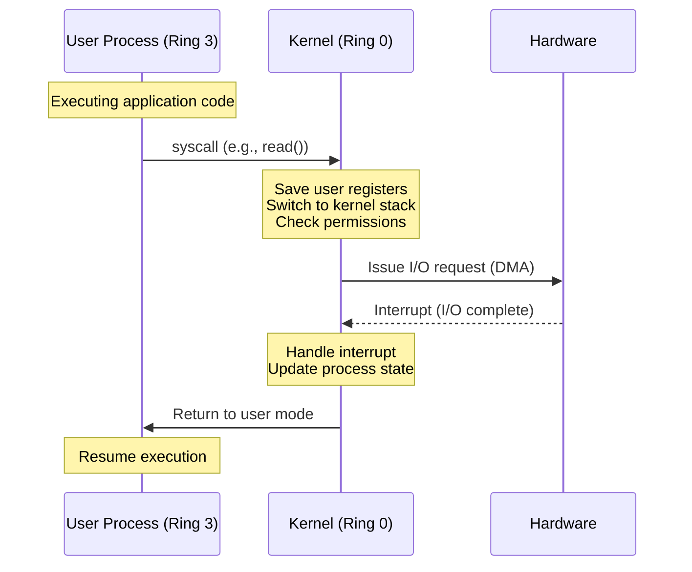
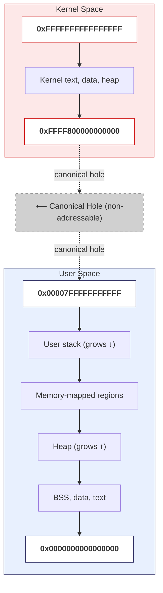
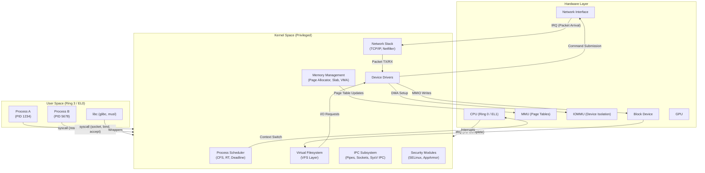

# Lesson 1: Foundations & Kernel/System Invariants

## Curriculum Roadmap

This lesson establishes the theoretical and architectural foundation for understanding modern operating systems from first principles. We examine the kernel as the hardware-software interface that enforces isolation, manages resources, and provides invariant guarantees that all higher-level systems depend upon. Subsequent lessons build on these primitives to explore distributed systems, infrastructure orchestration, and system security.

## 1. First-Principles Problem Space & Execution Boundaries

### The Fundamental Problem: Shared Hardware, Isolated Abstractions

Modern computing hardware is a shared resource: a single CPU executes instructions from multiple programs, a single memory bus serves multiple address spaces, and a single disk stores data for multiple users. The kernel exists to solve the central problem of **safe, efficient multiplexing** of these shared physical resources while maintaining the illusion that each program owns the machine.

Without a kernel, programs would:
- Directly manipulate hardware registers, leading to conflicts when multiple programs attempt concurrent I/O
- Access arbitrary physical memory addresses, allowing trivial data exfiltration and corruption
- Monopolize CPU time, starving other processes
- Interfere with each other's device state, causing unpredictable behavior

The kernel solves this through **privilege separation** and **virtualization**. It establishes a trusted computing base that mediates all access to hardware, providing each program with a virtualized view of the machine that appears exclusive but is actually time-sliced and isolated.

### Hardware-Enforced Privilege Levels

Modern processors implement multiple privilege rings (x86/x86-64) or exception levels (ARM):

**x86/x86-64 Architecture:**
- **Ring 0 (Supervisor Mode)**: Kernel execution. Full access to all CPU instructions, control registers (CR0, CR3, CR4), and I/O ports. Can manipulate page tables, interrupt descriptor tables (IDT), and global descriptor tables (GDT).
- **Ring 1-2**: Historically for device drivers; largely unused in modern systems.
- **Ring 3 (User Mode)**: Application execution. Restricted instruction set. Cannot execute privileged instructions like `HLT`, `LGDT`, `LIDT`, `MOV CR3`, or access I/O ports directly.

**ARM Architecture:**
- **EL0 (Exception Level 0)**: User mode
- **EL1**: Kernel mode
- **EL2**: Hypervisor mode (for virtualization)
- **EL3**: Secure monitor mode (TrustZone)

**RISC-V Architecture:**
- **U-mode**: User mode
- **S-mode**: Supervisor (kernel) mode
- **M-mode**: Machine mode (firmware, lowest-level trap handling)

When a user-mode program attempts a privileged operation (e.g., accessing a kernel memory address or executing `OUT` to write to an I/O port), the CPU raises a **General Protection Fault** (x86) or **Exception** (ARM/RISC-V), trapping into the kernel's exception handler. The kernel can then terminate the offending process or deliver a signal (e.g., `SIGSEGV`, `SIGILL`).

### Transition Mechanisms: Crossing the Kernel Boundary

User programs cannot directly call kernel functions. Instead, they cross the privilege boundary through controlled entry points:

**System Calls (syscalls):**
- x86: `int 0x80` (legacy), `sysenter` (Intel), `syscall` (AMD)
- x86-64: `syscall` instruction
- ARM: `svc` (supervisor call)
- RISC-V: `ecall` instruction

The syscall mechanism saves the user-mode register state, switches to kernel mode, consults the system call table (indexed by a syscall number in a register like `%rax` on x86-64), and dispatches to the appropriate kernel function.

**Hardware Interrupts:**
External devices signal the CPU via interrupt lines (e.g., IRQ 14 for IDE disk, IRQ 1 for keyboard). The CPU looks up the handler in the Interrupt Descriptor Table (IDT) and transfers control to the kernel's interrupt service routine (ISR).

**Exceptions:**
CPU-detected faults (page faults, divide-by-zero, invalid opcode) trap into kernel exception handlers. Page faults are particularly critical: they allow the kernel to implement demand paging, copy-on-write, and memory-mapped I/O.



### Address Space Isolation via Virtual Memory

The kernel enforces isolation through virtual memory, implemented via the Memory Management Unit (MMU) and page tables:

- Each process has a unique **page table** (pointed to by CR3 on x86, TTBR on ARM)
- Virtual addresses are translated to physical addresses by the MMU
- Page table entries (PTEs) contain permission bits: User/Supervisor, Read/Write, Execute/No-Execute (NX bit)
- Kernel memory is typically mapped at high addresses (e.g., `0xFFFF800000000000` on Linux x86-64) with supervisor-only permissions
- User memory occupies lower addresses (e.g., `0x0000000000000000` - `0x00007FFFFFFFFFFF`)

When a user process attempts to access a kernel address, the MMU checks the U/S bit in the PTE. If the CPU is in Ring 3 and the bit indicates supervisor-only, the MMU triggers a page fault, trapping into the kernel.

**Example: Linux x86-64 Address Space Layout:**


## 2. Fundamental System Guarantees & Non-Negotiable Invariants

The kernel must maintain invariants that higher-level abstractions depend on. Violating these invariants leads to undefined behavior, security vulnerabilities, and system instability.

### Memory Safety

**Invariant:** No process can read, write, or execute memory outside its designated address space without explicit kernel permission.

**Enforcement Mechanisms:**
1. **MMU and Page Tables:** Every memory access is checked by the MMU. PTEs define accessible regions and permissions (R/W/X).
2. **SMEP/SMAP (x86):** Supervisor Mode Execution Prevention (SMEP) prevents the kernel from executing user-space code. Supervisor Mode Access Prevention (SMAP) prevents the kernel from accessing user-space data without explicit `STAC` instruction, mitigating kernel exploits that trick the kernel into dereferencing user-controlled pointers.
3. **KASLR (Kernel Address Space Layout Randomization):** Randomizes kernel base address to thwart exploits relying on fixed kernel addresses.

**Violation Consequences:**
- Reads from inaccessible memory: Page fault → `SIGSEGV`
- Writes to read-only memory: Page fault → `SIGSEGV`
- Execution of non-executable memory: Page fault → `SIGSEGV` (requires NX bit support)

**Example: C Program Triggering Segmentation Fault**
```c
#include <stdio.h>
#include <signal.h>
#include <stdlib.h>

void segfault_handler(int sig) {
    printf("Caught SIGSEGV (signal %d)\n", sig);
    exit(1);
}

int main() {
    signal(SIGSEGV, segfault_handler);
    
    // Attempt to write to kernel memory (high address)
    volatile int *kernel_addr = (int *)0xFFFF800000000000UL;
    *kernel_addr = 42;  // Triggers page fault
    
    return 0;
}
```

Kernel guarantees this write never succeeds; the MMU traps before the physical write occurs.

### Process Isolation

**Invariant:** Processes cannot observe or manipulate each other's memory, file descriptors, or CPU state without explicit inter-process communication (IPC) primitives.

**Enforcement Mechanisms:**
1. **Address Space Separation:** Each process has a unique CR3/TTBR register value pointing to its page table. Context switches update this register, atomically changing the accessible memory.
2. **File Descriptor Tables:** Each process has a private file descriptor table. `fd=3` in process A refers to a different file or socket than `fd=3` in process B.
3. **CPU Register State:** On context switch, the kernel saves all general-purpose registers, floating-point state, and CPU flags to the process's kernel stack or task struct. The next scheduled process's state is restored.

**Controlled Violation:**
- **Shared Memory:** Processes can explicitly map the same physical pages via `mmap()` with `MAP_SHARED` or `shm_open()`.
- **ptrace():** A debugger can attach to a process, read/write its memory, and manipulate registers (requires `CAP_SYS_PTRACE` or parent-child relationship).

### I/O Ordering and Consistency

**Invariant:** I/O operations appear to execute in program order with respect to memory operations, and the effects of I/O are visible to all observers (processes, devices) in a consistent order.

This is subtle. Modern CPUs and I/O subsystems reorder operations for performance. The kernel must enforce ordering where it matters.

**Challenges:**
1. **Store Buffer and Write Combining:** CPUs buffer writes and may coalesce or reorder them.
2. **DMA Coherency:** Direct Memory Access (DMA) allows devices to read/write memory without CPU involvement. Cache incoherence can cause stale reads.
3. **Out-of-Order Execution:** Superscalar CPUs execute instructions out of order.

**Enforcement Mechanisms:**
1. **Memory Barriers:**
   - `mfence` (x86): Full memory fence, serializes all loads and stores
   - `sfence` (x86): Store fence, serializes stores
   - `lfence` (x86): Load fence, serializes loads
   - `dmb`/`dsb` (ARM): Data memory barrier / data synchronization barrier
   - `fence` (RISC-V)

   Kernel I/O routines insert barriers to ensure:
   - MMIO writes (e.g., to device registers) complete before signaling the device
   - DMA buffer writes are visible before the device is notified

2. **Cache Coherency Protocols (MESI, MOESI):** Hardware ensures caches across cores see consistent views of memory.

3. **I/O Memory Barriers:** Special versions of `writel()`, `readl()` in the Linux kernel include implicit barriers to order MMIO accesses.

**Example: Linux DMA Buffer Preparation**
```c
// Allocate coherent DMA buffer (uncached, no stale data)
void *buffer = dma_alloc_coherent(dev, size, &dma_handle, GFP_KERNEL);

// Write data to buffer
memcpy(buffer, data, size);

// Ensure all writes are visible to the device before signaling
wmb();  // Write memory barrier

// Write to device's DMA descriptor register to start transfer
writel(dma_handle, device_mmio_base + DMA_ADDR_REG);
```

Without `wmb()`, the device might DMA from the buffer before `memcpy()` completes, reading stale data.

### Kernel Invariants Under Concurrency

**Invariant:** The kernel must maintain consistency despite concurrent execution (multi-core, interrupts, preemption).

**Key Mechanisms:**
1. **Spinlocks:** Busy-wait locks for short critical sections in contexts where sleeping is forbidden (interrupt handlers). Disable preemption while held.
   ```c
   spinlock_t lock;
   spin_lock(&lock);
   /* critical section */
   spin_unlock(&lock);
   ```

2. **Mutexes:** Sleeping locks for longer critical sections in contexts where sleeping is allowed (process context).
   ```c
   mutex_lock(&my_mutex);
   /* critical section - may sleep */
   mutex_unlock(&my_mutex);
   ```

3. **Read-Copy-Update (RCU):** Lock-free synchronization primitive for read-mostly data structures. Readers access data without locks; writers create new versions and defer freeing old versions until all readers finish.

4. **Per-CPU Variables:** Data structures replicated per CPU to avoid cache-line contention. Each CPU accesses its local copy without locking.

5. **Interrupt Masking:** Critical sections can disable interrupts (`cli` on x86) to prevent interrupt handlers from observing inconsistent state.

**Liveness Invariants:**
- Deadlock freedom: Lock ordering disciplines prevent cyclic dependencies.
- Interrupt latency bounds: Critical sections are short, ensuring timely interrupt handling.
- Real-time guarantees (in PREEMPT_RT patches): Bounded scheduling latency.

## 3. High-Level Process & Subsystem Architecture

The kernel is structured into subsystems, each responsible for a class of resources. These subsystems interact through well-defined interfaces.



### Process Scheduler: Time-Slicing the CPU

The scheduler decides which process runs next. Linux uses the **Completely Fair Scheduler (CFS)** for normal processes and **Real-Time schedulers** (SCHED_FIFO, SCHED_RR) for time-critical tasks.

**CFS Design Principles:**
- Each process accumulates **virtual runtime** (`vruntime`) proportional to CPU time consumed divided by its priority (nice value).
- The scheduler selects the process with the smallest `vruntime` from a red-black tree, ensuring fairness over time.
- Preemption occurs on timer interrupts (typically 1ms tick), or when a higher-priority process wakes up.

**Scheduler Decision Points:**
1. **Timer Interrupt:** Periodic check (HZ=1000 means 1ms intervals on most systems).
2. **Voluntary Yield:** Process calls `sched_yield()` or blocks on I/O.
3. **Wake-up Events:** Process becomes runnable (e.g., data arrives on a socket).

**Example: Context Switch Sequence (x86-64)**
```c
// Simplified pseudocode
void context_switch(struct task_struct *prev, struct task_struct *next) {
    // 1. Save current process state
    save_fpu_state(prev);
    prev->thread.rsp = current_stack_pointer;
    
    // 2. Load next process's page table
    write_cr3(next->mm->pgd_phys);
    
    // 3. Switch kernel stack
    switch_to_stack(next->thread.rsp);
    
    // 4. Restore next process's registers (done in assembly)
    __switch_to_asm(prev, next);
}
```

The actual implementation is in assembly (`arch/x86/entry/entry_64.S`) and saves/restores all callee-saved registers, floating-point state (if used), and updates per-CPU variables.

### Memory Management: Virtualization and Allocation

The Memory Management (MM) subsystem manages physical memory, page tables, and the page cache.

**Key Data Structures:**
- **Physical Page Frames:** Tracked in `struct page` array (`mem_map`), one entry per 4KB page.
- **Virtual Memory Areas (VMAs):** Per-process regions, tracked in `struct vm_area_struct`. Each VMA describes a contiguous virtual address range with uniform permissions (e.g., text segment is R-X, heap is R-W).
- **Page Tables:** Multi-level radix tree (4 levels on x86-64: PGD → PUD → PMD → PTE). Each entry maps a virtual address range to physical frames.

**Page Allocation:**
- **Buddy Allocator:** Manages physical pages in power-of-2 blocks (1, 2, 4, 8 pages). Fast allocation and coalescing of contiguous regions.
- **Slab Allocator:** Caches frequently allocated kernel objects (e.g., `task_struct`, `inode`) to avoid repeated setup/teardown overhead.

**Demand Paging:**
When a process accesses a virtual address not yet mapped:
1. MMU triggers a page fault.
2. Kernel's page fault handler (`do_page_fault()`) checks if the address is valid (within a VMA).
3. If valid, allocate a physical page, update the page table, and resume execution.
4. If invalid, send `SIGSEGV`.

**Copy-on-Write (COW):**
After `fork()`, parent and child share physical pages, marked read-only. On the first write:
1. Page fault (write to read-only page).
2. Kernel allocates a new page, copies the content, and updates the faulting process's page table.
3. Both processes now have independent copies.

**Example: Observing COW in Action**
```c
#include <stdio.h>
#include <stdlib.h>
#include <unistd.h>
#include <sys/wait.h>
#include <string.h>

int main() {
    char *data = malloc(4096);
    strcpy(data, "Shared before fork");
    
    printf("Parent address: %p, PID: %d\n", data, getpid());
    
    pid_t pid = fork();
    if (pid == 0) {
        // Child process
        printf("Child before write: %s, PID: %d\n", data, getpid());
        strcpy(data, "Modified by child");
        printf("Child after write: %s, PID: %d\n", data, getpid());
    } else {
        // Parent process
        wait(NULL);
        printf("Parent after child exit: %s, PID: %d\n", data, getpid());
    }
    
    free(data);
    return 0;
}
```

Output shows the child's modification doesn't affect the parent, demonstrating COW.

### Virtual Filesystem (VFS): Uniform I/O Abstraction

The VFS layer provides a unified interface over heterogeneous filesystems (ext4, XFS, Btrfs, NFS, procfs, sysfs).

**Key Abstractions:**
- **Superblock:** Represents a mounted filesystem, containing metadata like block size, root inode.
- **Inode:** Represents a file or directory, containing metadata (permissions, timestamps, size) and pointers to data blocks.
- **Dentry:** Directory entry, mapping a name to an inode. Cached in the dentry cache for fast path resolution.
- **File:** Open file instance, containing the current offset, access mode, and pointer to the inode.

**VFS Operation Flow:**
```c
// User calls: fd = open("/etc/passwd", O_RDONLY);
// 1. Path resolution: Traverse dentry cache from root ("/") to "etc" to "passwd"
// 2. Inode lookup: Fetch inode for /etc/passwd
// 3. Permission check: Verify process has read access (check inode mode, UID, GID, ACLs)
// 4. Allocate file descriptor: Create struct file, insert into process's fd table
// 5. Return fd to user space

// User calls: read(fd, buffer, count);
// 1. Resolve fd to struct file
// 2. Call file->f_op->read() (filesystem-specific implementation)
// 3. Filesystem reads from disk via block layer, populates buffer
// 4. Copy data to user space buffer
// 5. Update file offset
```

**Filesystem Independence:**
The VFS defines function pointer tables (`super_operations`, `inode_operations`, `file_operations`). Each filesystem implements these tables with its own logic. User space sees a uniform interface via syscalls like `open()`, `read()`, `write()`.

**Example: VFS Read Path**
```c
// Simplified kernel code
ssize_t vfs_read(struct file *file, char __user *buf, size_t count, loff_t *pos) {
    // Security checks
    if (!(file->f_mode & FMODE_READ))
        return -EBADF;
    
    // Call filesystem-specific read
    return file->f_op->read(file, buf, count, pos);
}
```

### Network Stack: Layered Protocol Processing

The network stack implements the OSI model's transport, network, and data link layers.

**Layers:**
1. **Data Link (L2):** Ethernet frames, MAC addresses. Handled by NIC drivers.
2. **Network (L3):** IP routing, fragmentation, reassembly.
3. **Transport (L4):** TCP (reliable, ordered streams), UDP (unreliable datagrams).
4. **Socket API:** User-space interface via `socket()`, `bind()`, `listen()`, `accept()`, `connect()`, `send()`, `recv()`.

**Packet Flow (RX):**
1. NIC writes packet to DMA ring buffer, raises interrupt.
2. Interrupt handler schedules softirq (`NET_RX_SOFTIRQ`).
3. Softirq handler (`net_rx_action()`) dequeues packets from NIC's ring buffer.
4. Packets traverse the network stack:
   - L2: Parse Ethernet header, extract protocol (IPv4/IPv6).
   - L3: IP routing decision (local delivery vs. forwarding).
   - L4: Demultiplex to socket based on (src_ip, src_port, dst_ip, dst_port).
   - Socket: Append to socket's receive queue, wake up blocked process.

**Netfilter Hooks:**
At each layer, **Netfilter** hooks allow custom packet processing (iptables, nftables rules):
- `NF_INET_PRE_ROUTING`: Before routing decision.
- `NF_INET_LOCAL_IN`: Packets destined for local processes.
- `NF_INET_FORWARD`: Packets to be forwarded.
- `NF_INET_LOCAL_OUT`: Locally generated packets.
- `NF_INET_POST_ROUTING`: After routing decision.

**Example: TCP Connection Establishment (Kernel Perspective)**
```c
// Server calls listen(), kernel creates listening socket
// Client calls connect(), kernel sends SYN packet

// Server side:
// 1. SYN arrives, netfilter hooks process it
// 2. TCP layer creates a request_sock (half-open connection)
// 3. Send SYN-ACK
// 4. ACK arrives, create full struct sock, move to accept queue
// 5. Application calls accept(), returns new socket fd
```

### IPC Mechanisms: Controlled Communication

**Pipes and FIFOs:**
- Unidirectional byte streams.
- Anonymous pipes (`pipe()`) for parent-child communication.
- Named pipes (FIFOs, `mkfifo()`) for unrelated processes.

**Unix Domain Sockets:**
- Bidirectional, connection-oriented or datagram.
- Addressed by filesystem paths (e.g., `/var/run/docker.sock`).
- Efficient (no network stack overhead) and support credential passing (`SCM_CREDENTIALS`).

**System V IPC:**
- Message queues (`msgget()`, `msgsnd()`, `msgrcv()`): Typed message passing.
- Semaphores (`semget()`, `semop()`): Inter-process synchronization.
- Shared memory (`shmget()`, `shmat()`): Fastest IPC, but requires explicit synchronization.

**Modern Alternatives:**
- **D-Bus:** Message-passing IPC for desktop environments (e.g., GNOME, KDE).
- **io_uring:** High-performance async I/O interface (Linux 5.1+), also supports inter-ring communication.

### Security and Access Control

**Discretionary Access Control (DAC):**
- UNIX permissions (user/group/other, rwx bits).
- Extended ACLs (`setfacl()`, `getfacl()`): Finer-grained permissions.

**Mandatory Access Control (MAC):**
- **SELinux:** Label-based access control. Every process and object has a security context (type, role, user). Policies define allowed transitions.
- **AppArmor:** Path-based access control. Profiles restrict processes to specific filesystem paths and capabilities.

**Capabilities:**
- Traditional model: root (UID 0) has all privileges.
- Capability model: Fine-grained privileges (e.g., `CAP_NET_BIND_SERVICE` allows binding to ports < 1024, `CAP_SYS_ADMIN` allows mount operations).
- Processes can drop capabilities to limit privilege escalation risk.

**Namespaces and Control Groups (cgroups):**
- **Namespaces:** Isolate process views of system resources (PID, network, mount, UTS, IPC, user namespaces). Foundation of containerization.
- **cgroups:** Hierarchical resource accounting and limits (CPU, memory, I/O). Prevent processes from monopolizing resources.

**Example: Container Isolation via Namespaces**
```c
#define _GNU_SOURCE
#include <sched.h>
#include <stdio.h>
#include <stdlib.h>
#include <unistd.h>
#include <sys/wait.h>

int child_func(void *arg) {
    printf("Child PID (inside namespace): %d\n", getpid());
    // Inside the new PID namespace, this process appears as PID 1
    sleep(5);
    return 0;
}

int main() {
    char stack[4096];
    
    // Create child with new PID namespace
    pid_t pid = clone(child_func, stack + sizeof(stack),
                      CLONE_NEWPID | SIGCHLD, NULL);
    
    printf("Parent sees child PID: %d\n", pid);
    waitpid(pid, NULL, 0);
    
    return 0;
}
```

The child sees itself as PID 1, but the parent sees the true PID. This is how Docker containers achieve process isolation.

## 4. System Call Interface: The Contract Between User and Kernel

System calls are the primary mechanism for user-space programs to request kernel services. Each syscall has a defined ABI (application binary interface): register conventions, argument types, return values.

**Linux x86-64 Syscall Conventions:**
- Syscall number: `%rax`
- Arguments: `%rdi`, `%rsi`, `%rdx`, `%r10`, `%r8`, `%r9` (up to 6 arguments)
- Return value: `%rax` (0 or positive for success, -errno for error)
- Instruction: `syscall` (enters ring 0, jumps to `entry_SYSCALL_64`)

**Example: Invoking `write()` Syscall Directly in Assembly**
```asm
section .data
    msg db "Hello from raw syscall", 10
    len equ $ - msg

section .text
    global _start

_start:
    ; write(1, msg, len)
    mov rax, 1          ; syscall number for write
    mov rdi, 1          ; fd = stdout
    mov rsi, msg        ; buffer
    mov rdx, len        ; count
    syscall             ; invoke kernel

    ; exit(0)
    mov rax, 60         ; syscall number for exit
    xor rdi, rdi        ; exit code = 0
    syscall
```

Assemble and link:
```bash
nasm -f elf64 hello.asm -o hello.o
ld hello.o -o hello
./hello
```

**Syscall Dispatch in Kernel:**
1. `syscall` instruction saves user registers, switches to kernel stack.
2. Kernel's `entry_SYSCALL_64` handler (in `arch/x86/entry/entry_64.S`) checks syscall number against `__NR_syscall_max`.
3. Dispatches to handler via `sys_call_table[%rax]`.
4. Handler executes, returns result in `%rax`.
5. Kernel restores user registers, executes `sysretq` to return to ring 3.

**Syscall Tracing:**
- `strace`: Intercepts and logs syscalls via `ptrace()`.
- `perf trace`: Low-overhead syscall tracing using kernel tracepoints.

**Example: Tracing Syscalls**
```bash
strace -e trace=open,read,write cat /etc/hostname
```

Output shows every `open()`, `read()`, and `write()` call, revealing how `cat` interacts with the kernel.

## 5. Kernel Debugging and Introspection

Understanding kernel behavior requires introspection tools.

**Kernel Debug Infrastructure:**
- **/proc:** Process information (`/proc/[pid]/maps`, `/proc/[pid]/status`, `/proc/meminfo`).
- **/sys:** Kernel and device attributes (`/sys/class/net/eth0/statistics/`).
- **debugfs:** Kernel debugging filesystem (mount with `mount -t debugfs none /sys/kernel/debug`).
- **ftrace:** Function tracing, latency tracing (`/sys/kernel/debug/tracing/`).

**Example: Function Graph Tracing with ftrace**
```bash
# Enable function graph tracer
echo function_graph > /sys/kernel/debug/tracing/current_tracer

# Trace a specific function (e.g., sys_read)
echo sys_read > /sys/kernel/debug/tracing/set_graph_function

# Start tracing
echo 1 > /sys/kernel/debug/tracing/tracing_on

# Run a command
cat /etc/hostname

# Stop tracing
echo 0 > /sys/kernel/debug/tracing/tracing_on

# View trace
cat /sys/kernel/debug/tracing/trace
```

Output shows the call graph of `sys_read()`, including all functions it calls, with timestamps and durations.

**Kernel Crash Dumps:**
- **kdump:** Captures kernel memory on crash via kexec (boots a secondary kernel to dump the crashed kernel's memory).
- **crash tool:** Analyzes vmcore dumps, inspecting kernel data structures post-mortem.

**BPF (Berkeley Packet Filter) and eBPF:**
Modern introspection uses eBPF: safe, sandboxed programs that run in the kernel, triggered by events (syscalls, tracepoints, kprobes).

**Example: Counting Syscalls with bpftrace**
```bash
bpftrace -e 'tracepoint:raw_syscalls:sys_enter { @[comm] = count(); }'
```

This counts syscalls per process, updating in real-time.

## 6. Performance and Scalability Considerations

**Lock Contention:**
- Excessive locking (especially global locks) limits scalability on multi-core systems.
- Solutions: Read-copy-update (RCU), per-CPU data structures, lock-free algorithms.

**Cache Coherency Overhead:**
- False sharing: Multiple CPUs modify different variables in the same cache line, causing cache-line ping-ponging.
- Solution: Align critical data structures to cache-line boundaries (`__cacheline_aligned_in_smp`).

**Interrupt Coalescing:**
- High interrupt rates (e.g., 10GbE NICs at line rate) cause CPU overhead.
- Solution: NAPI (New API) polls for packets instead of interrupt-per-packet. Adaptive interrupt coalescing adjusts thresholds dynamically.

**NUMA (Non-Uniform Memory Access):**
- Multi-socket systems: Each CPU socket has local memory, but can access remote sockets' memory with higher latency.
- Kernel NUMA awareness: Allocate memory from the local node, schedule processes on CPUs near their memory.

**Example: Checking NUMA Topology**
```bash
numactl --hardware
```

Output shows node distances (latency matrix) and CPU-to-node mappings.

## 7. Boot Process and Initialization

Understanding how the kernel initializes clarifies the dependencies between subsystems.

**x86-64 Boot Sequence:**
1. **BIOS/UEFI:** Loads bootloader from disk.
2. **Bootloader (GRUB):** Loads kernel image and initramfs into memory, jumps to kernel entry point.
3. **Kernel Entry (`startup_64`):** Sets up initial page tables, enables paging, decompresses kernel if compressed.
4. **`start_kernel()`:** Main initialization function. Initializes subsystems in dependency order:
   - Trap handlers (IDT setup)
   - Memory allocator (buddy, slab)
   - Scheduler
   - Timers and interrupt infrastructure
   - Device enumeration (PCI bus scan)
   - Filesystem (mount rootfs)
5. **`init` Process:** Kernel spawns PID 1 (`/sbin/init` or `/lib/systemd/systemd`), which starts user-space services.

**Initramfs:**
Early user space, loaded before the real root filesystem. Contains essential drivers (disk, filesystem) needed to mount the real root.

## Conclusion: The Kernel as a Trusted Foundation

The kernel enforces invariants that all user-space and distributed systems depend upon: memory isolation, deterministic scheduling, consistent I/O, and secure resource management. Understanding these primitives—and the hardware mechanisms that enable them—is essential for building reliable, secure, and performant systems at any scale.

In subsequent lessons, we extend these principles to distributed systems, where failures become common, networks are unreliable, and consistency is a negotiable property. The kernel's guarantees provide a stable foundation, but distributed systems must reimplement many of these invariants (isolation, ordering, consensus) across network boundaries using protocols like Raft, Paxos, and replication strategies.
