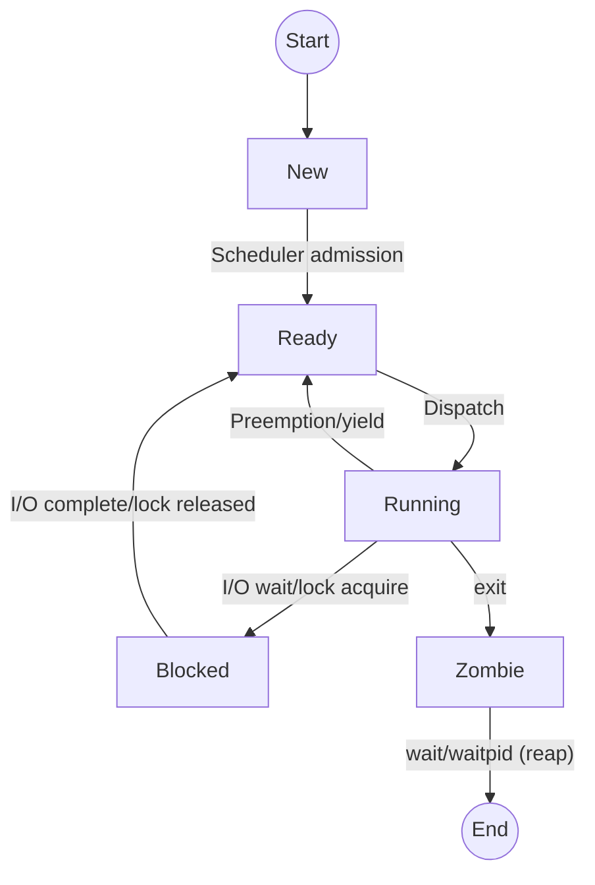
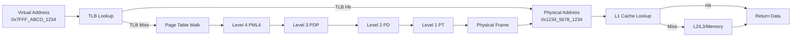
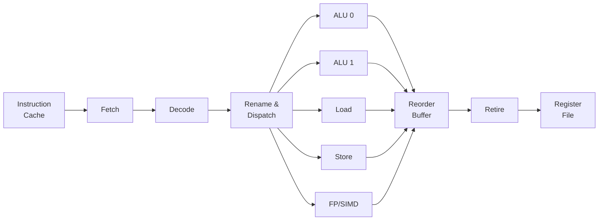
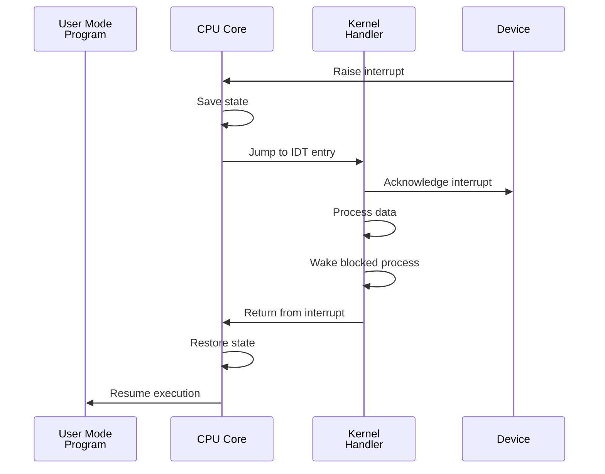

# Lesson 2: Core Architecture & Memory/Execution Models

## 1. Process, Threading & Execution Lifecycles

### Process Model Fundamentals

A process represents an isolated instance of a running program with its own virtual address space, file descriptor table, and kernel-managed resource context. The operating system kernel maintains a process control block (PCB) for each process, containing the process state (running, ready, blocked), program counter, CPU registers, memory management information, accounting data, and I/O status.

Process creation on UNIX-like systems follows a fork-exec pattern. The `fork()` system call creates a new process by duplicating the calling process's address space using copy-on-write (COW) semantics. Initially, both parent and child share the same physical memory pages, marked read-only. When either process writes to a page, the kernel traps the write, copies the page, and updates the page table to point to the new physical frame. This defers expensive memory copying until necessary.

The `fork()` return value distinguishes parent from child: the parent receives the child's process ID, while the child receives 0. Both processes continue executing from the same instruction pointer, but with different return values:

```c
#include <stdio.h>
#include <stdlib.h>
#include <unistd.h>
#include <sys/wait.h>

int main(void) {
    pid_t pid = fork();
    
    if (pid < 0) {
        perror("fork failed");
        exit(EXIT_FAILURE);
    }
    
    if (pid == 0) {
        // Child process: replace address space with new program
        // exec family calls overlay current process image
        char *args[] = {"ls", "-la", "/tmp", NULL};
        execv("/bin/ls", args);
        
        // execv only returns on error
        perror("execv failed");
        exit(EXIT_FAILURE);
    }
    
    // Parent process: wait for child termination
    int status;
    pid_t waited = waitpid(pid, &status, 0);
    
    if (WIFEXITED(status)) {
        printf("Child %d exited with status %d\n", 
               waited, WEXITSTATUS(status));
    } else if (WIFSIGNALED(status)) {
        printf("Child %d killed by signal %d\n", 
               waited, WTERMSIG(status));
    }
    
    return EXIT_SUCCESS;
}
```

The `exec` family of system calls (`execl`, `execv`, `execve`, etc.) replaces the current process's text, data, and stack segments with a new program loaded from an executable file. The kernel parses the ELF (Executable and Linkable Format) header, maps program segments into the address space, sets up the initial stack with arguments and environment variables, and transfers control to the program entry point (typically `_start`, which calls `main`).

### Thread Model and Concurrency

Threads are lightweight execution contexts within a single process, sharing the process's address space, file descriptors, signal handlers, and most kernel resources. Each thread maintains its own stack, thread-local storage (TLS), and CPU register state (including the program counter and stack pointer).

POSIX threads (pthreads) provide a standard API for thread management. Thread creation allocates a new stack (typically 2-8 MB by default, configurable via `pthread_attr_setstacksize`) and registers the thread with the kernel scheduler:

```c
#include <pthread.h>
#include <stdio.h>
#include <stdlib.h>
#include <unistd.h>

typedef struct {
    int thread_id;
    int iterations;
} thread_args_t;

void *worker_thread(void *arg) {
    thread_args_t *args = (thread_args_t *)arg;
    
    for (int i = 0; i < args->iterations; i++) {
        printf("Thread %d: iteration %d\n", args->thread_id, i);
        usleep(100000); // 100ms
    }
    
    int *result = malloc(sizeof(int));
    *result = args->thread_id * 1000;
    return result;
}

int main(void) {
    const int NUM_THREADS = 4;
    pthread_t threads[NUM_THREADS];
    thread_args_t args[NUM_THREADS];
    
    // Create threads
    for (int i = 0; i < NUM_THREADS; i++) {
        args[i].thread_id = i;
        args[i].iterations = 5;
        
        int rc = pthread_create(&threads[i], NULL, worker_thread, &args[i]);
        if (rc != 0) {
            fprintf(stderr, "pthread_create failed: %d\n", rc);
            exit(EXIT_FAILURE);
        }
    }
    
    // Join threads and collect results
    for (int i = 0; i < NUM_THREADS; i++) {
        void *retval;
        pthread_join(threads[i], &retval);
        
        if (retval != NULL) {
            printf("Thread %d returned: %d\n", i, *(int *)retval);
            free(retval);
        }
    }
    
    return EXIT_SUCCESS;
}
```

### Execution State Transitions

A process or thread transitions through multiple states during its lifetime. The kernel scheduler manages these transitions based on events (I/O completion, timer expiration, synchronization primitives) and scheduling policies (CFS, real-time priorities).



The kernel maintains separate run queues per CPU core (in multiprocessor systems) to minimize cache coherency traffic. The Completely Fair Scheduler (CFS) in Linux uses a red-black tree keyed by virtual runtime to ensure fairness, while real-time schedulers (SCHED_FIFO, SCHED_RR) use strict priority queues.

Context switching between threads incurs overhead from saving and restoring CPU register state, flushing TLBs (if switching address spaces), and polluting CPU caches. Threads within the same process avoid address space switches, reducing context switch cost to roughly 1-10 microseconds compared to 10-100 microseconds for process context switches.

### Process vs. Thread Trade-offs

**Processes provide:**
- Strong isolation: address space separation prevents memory corruption between processes
- Independent failure domains: a crashed process doesn't affect others
- Simplified resource management: kernel cleans up all resources on process termination
- Better security boundaries: system calls mediate all inter-process communication

**Threads provide:**
- Lower creation overhead: 10-100x faster than fork on modern systems
- Efficient shared memory: no IPC overhead for data exchange
- Lower memory footprint: shared code and data segments
- Faster context switching: no TLB flush required

Modern applications often use a hybrid model: multiple processes for isolation, with thread pools within each process for concurrency. Web servers (nginx, Apache) and databases (PostgreSQL, MySQL) employ this architecture.

## 2. Memory Subsystems & Buffer Management

### Physical and Virtual Memory Architecture

Modern processors implement a multi-level memory hierarchy to bridge the speed gap between CPU registers (sub-nanosecond access) and main memory (50-100 nanosecond access). Each level trades capacity for latency:

| Level | Typical Size | Latency | Bandwidth |
|-------|-------------|---------|-----------|
| L1d Cache | 32-64 KB | 4 cycles (~1 ns) | 200+ GB/s |
| L2 Cache | 256 KB-1 MB | 12 cycles (~3 ns) | 100-150 GB/s |
| L3 Cache (shared) | 8-64 MB | 40-75 cycles (~10-20 ns) | 50-100 GB/s |
| Main Memory (DDR4) | 8-256 GB | 200-300 cycles (~60-100 ns) | 20-50 GB/s |
| NVMe SSD | 256 GB-4 TB | ~100,000 ns | 3-7 GB/s |

Virtual memory decouples logical addresses (used by programs) from physical addresses (actual RAM locations). The Memory Management Unit (MMU) translates virtual addresses to physical addresses using multi-level page tables. On x86-64 with 4KB pages, a 48-bit virtual address decomposes into five fields:

```text
| PML4 index (9 bits) | PDP index (9 bits) | PD index (9 bits) | PT index (9 bits) | Offset (12 bits) |
```

Each level indexes into a table to locate the next level, eventually yielding the physical frame number. The Translation Lookaside Buffer (TLB) caches recent virtual-to-physical translations to avoid expensive page table walks (4-5 memory accesses per translation).



### Page Faults and Demand Paging

When a program accesses an unmapped virtual address or a page marked not-present, the MMU triggers a page fault exception. The kernel's page fault handler determines the fault type:

1. **Minor fault**: Page is in physical memory but not mapped (e.g., COW, lazy allocation)
2. **Major fault**: Page must be loaded from disk (swap, memory-mapped file)
3. **Segmentation fault**: Invalid access (unmapped region, permission violation)

Demand paging defers loading program segments until first access. When `exec` loads a binary, the kernel maps virtual pages to the executable file without reading data. The first instruction fetch triggers a page fault; the kernel reads the page from disk, populates the page table entry (PTE), and resumes execution.

### Buffer Cache and Page Cache

The operating system maintains a unified page cache for file I/O and memory-mapped files. When a program reads from a file, the kernel first checks the page cache. On a cache miss, it allocates a physical page, issues I/O to the storage device, and returns the data. Subsequent reads hit the cache, avoiding disk I/O.

Write operations follow write-back policy by default: data is written to the page cache and marked dirty. The kernel's writeback threads periodically flush dirty pages to disk (every 30 seconds on Linux, configurable via `/proc/sys/vm/dirty_writeback_centisecs`). Applications can force synchronization with `fsync()` or `msync()`.

```c
#include <stdio.h>
#include <stdlib.h>
#include <string.h>
#include <fcntl.h>
#include <unistd.h>
#include <sys/mman.h>
#include <sys/stat.h>

void demonstrate_mmap(const char *filename) {
    int fd = open(filename, O_RDWR | O_CREAT, 0644);
    if (fd < 0) {
        perror("open failed");
        return;
    }
    
    // Extend file to 4KB
    if (ftruncate(fd, 4096) < 0) {
        perror("ftruncate failed");
        close(fd);
        return;
    }
    
    // Map file into address space
    void *addr = mmap(NULL, 4096, PROT_READ | PROT_WRITE,
                      MAP_SHARED, fd, 0);
    if (addr == MAP_FAILED) {
        perror("mmap failed");
        close(fd);
        return;
    }
    
    // Write directly to mapped memory
    const char *message = "Memory-mapped file content";
    memcpy(addr, message, strlen(message));
    
    // Ensure data reaches disk
    if (msync(addr, 4096, MS_SYNC) < 0) {
        perror("msync failed");
    }
    
    munmap(addr, 4096);
    close(fd);
}

void demonstrate_buffer_allocation(void) {
    // Allocate aligned memory for DMA or SIMD operations
    size_t alignment = 4096; // Page-aligned
    size_t size = 1024 * 1024; // 1 MB
    
    void *buffer;
    if (posix_memalign(&buffer, alignment, size) != 0) {
        fprintf(stderr, "posix_memalign failed\n");
        return;
    }
    
    // Use buffer
    memset(buffer, 0, size);
    
    // Free aligned allocation
    free(buffer);
}

int main(void) {
    demonstrate_mmap("/tmp/mmap_test.dat");
    demonstrate_buffer_allocation();
    return EXIT_SUCCESS;
}
```

### Cache-Conscious Programming

CPU caches operate on cache lines (typically 64 bytes). Accessing memory addresses within the same cache line is essentially free after the first access loads the line. Spatial locality (accessing nearby addresses) and temporal locality (reusing recently accessed data) are critical for performance.

False sharing occurs when multiple CPU cores modify different variables that reside on the same cache line. Each modification invalidates the line in other cores' caches, causing excessive coherency traffic:

```c
#include <pthread.h>
#include <stdint.h>

// BAD: False sharing - counters share cache line
struct bad_counters {
    uint64_t counter1;
    uint64_t counter2;
};

// GOOD: Each counter on separate cache line
struct good_counters {
    uint64_t counter1;
    uint8_t padding1[64 - sizeof(uint64_t)];
    uint64_t counter2;
    uint8_t padding2[64 - sizeof(uint64_t)];
} __attribute__((aligned(64)));
```

## 3. Data Structures & On-Disk/In-Kernel Binary Layouts

### In-Memory Data Structure Trade-offs

Data structure selection profoundly impacts cache performance and memory bandwidth. Contiguous layouts (arrays, dynamic arrays) maximize spatial locality and enable prefetching, while pointer-based structures (linked lists, trees) incur cache misses and pointer-chasing overhead.

**Arrays** provide O(1) random access and excellent cache locality, but require contiguous allocation and expensive resizing (O(n) copy). **Dynamic arrays** (C++ `std::vector`, Rust `Vec`) amortize growth cost by doubling capacity, yielding O(1) amortized append.

**Linked lists** support O(1) insertion/deletion but suffer O(n) search and poor cache behavior. Each node dereference may miss cache. **Skip lists** provide O(log n) search with simpler implementation than balanced trees, used in Redis (sorted sets) and LevelDB (memtable).

**Hash tables** deliver O(1) average-case operations but degrade to O(n) under collisions. Open addressing (linear probing, quadratic probing, double hashing) stores entries directly in the table array, improving cache locality compared to separate chaining. Robin Hood hashing bounds probe sequence length for better worst-case performance.

**B-trees** minimize disk I/O by packing many keys per node (typically sized to match disk block size, 4-16 KB). Each node read fetches many keys, reducing tree height and I/O operations. Databases (PostgreSQL B-tree indexes, MySQL InnoDB) and filesystems (ext4, XFS, Btrfs) employ B-trees for efficient range queries.

```c
#include <stdio.h>
#include <stdlib.h>
#include <string.h>

// Cache-friendly array-based stack
typedef struct {
    int *data;
    size_t capacity;
    size_t size;
} Stack;

Stack* stack_create(size_t initial_capacity) {
    Stack *s = malloc(sizeof(Stack));
    s->capacity = initial_capacity;
    s->size = 0;
    s->data = malloc(initial_capacity * sizeof(int));
    return s;
}

void stack_push(Stack *s, int value) {
    if (s->size >= s->capacity) {
        // Double capacity
        s->capacity *= 2;
        s->data = realloc(s->data, s->capacity * sizeof(int));
    }
    s->data[s->size++] = value;
}

int stack_pop(Stack *s) {
    if (s->size == 0) {
        fprintf(stderr, "Stack underflow\n");
        exit(EXIT_FAILURE);
    }
    return s->data[--s->size];
}

void stack_destroy(Stack *s) {
    free(s->data);
    free(s);
}

// Compare with pointer-based linked list (poor cache locality)
typedef struct ListNode {
    int data;
    struct ListNode *next;
} ListNode;

typedef struct {
    ListNode *head;
} LinkedList;

void list_push(LinkedList *list, int value) {
    ListNode *node = malloc(sizeof(ListNode));
    node->data = value;
    node->next = list->head;
    list->head = node;
}
```

### ELF Binary Format and Program Loading

Executable and Linkable Format (ELF) is the standard binary format on Linux and other UNIX systems. An ELF file contains multiple segments with different purposes:

- **`.text`**: Executable code (read-only, executable)
- **`.rodata`**: Read-only data (string literals, const data)
- **`.data`**: Initialized global/static variables
- **`.bss`**: Uninitialized global/static variables (zero-initialized)
- **`.symtab`**: Symbol table for debugging and linking
- **`.dynamic`**: Dynamic linking information

The ELF header specifies entry point, program header table (segments for loading), and section header table (sections for linking/debugging). The kernel's `exec` implementation parses program headers and maps segments into memory with appropriate permissions:

```c
#include <stdio.h>
#include <elf.h>
#include <fcntl.h>
#include <unistd.h>
#include <sys/mman.h>
#include <sys/stat.h>

void examine_elf(const char *filename) {
    int fd = open(filename, O_RDONLY);
    if (fd < 0) {
        perror("open failed");
        return;
    }
    
    struct stat st;
    if (fstat(fd, &st) < 0) {
        perror("fstat failed");
        close(fd);
        return;
    }
    
    void *map = mmap(NULL, st.st_size, PROT_READ, MAP_PRIVATE, fd, 0);
    if (map == MAP_FAILED) {
        perror("mmap failed");
        close(fd);
        return;
    }
    
    Elf64_Ehdr *ehdr = (Elf64_Ehdr *)map;
    
    // Verify ELF magic number
    if (memcmp(ehdr->e_ident, ELFMAG, SELFMAG) != 0) {
        fprintf(stderr, "Not an ELF file\n");
        goto cleanup;
    }
    
    printf("ELF Entry Point: 0x%lx\n", ehdr->e_entry);
    printf("Program Headers: %d at offset 0x%lx\n", 
           ehdr->e_phnum, ehdr->e_phoff);
    
    // Iterate program headers
    Elf64_Phdr *phdr = (Elf64_Phdr *)((char *)map + ehdr->e_phoff);
    for (int i = 0; i < ehdr->e_phnum; i++) {
        if (phdr[i].p_type == PT_LOAD) {
            printf("LOAD segment: vaddr=0x%lx memsz=%lu flags=0x%x\n",
                   phdr[i].p_vaddr, phdr[i].p_memsz, phdr[i].p_flags);
        }
    }
    
cleanup:
    munmap(map, st.st_size);
    close(fd);
}
```

### Kernel Data Structures

The Linux kernel extensively uses intrusive data structures where list/tree links are embedded directly in the containing structure. This avoids separate allocation for links and enables type-safe container access via `container_of` macro:

```c
#include <stddef.h>

struct list_head {
    struct list_head *next, *prev;
};

// Doubly-linked circular list operations
static inline void list_add(struct list_head *new, struct list_head *head) {
    new->next = head->next;
    new->prev = head;
    head->next->prev = new;
    head->next = new;
}

// Container access: convert list_head pointer to containing structure
#define container_of(ptr, type, member) \
    ((type *)((char *)(ptr) - offsetof(type, member)))

// Example usage
struct process {
    int pid;
    struct list_head tasks; // Embedded list node
    char name[16];
};

void iterate_processes(struct list_head *head) {
    struct list_head *pos;
    for (pos = head->next; pos != head; pos = pos->next) {
        struct process *p = container_of(pos, struct process, tasks);
        printf("Process: pid=%d name=%s\n", p->pid, p->name);
    }
}
```

Kernel red-black trees (used for virtual memory areas, timers, and scheduling) maintain balance with O(log n) insertion and deletion. Unlike user-space implementations, kernel rb-trees store color bits in the low bits of parent pointers, exploiting pointer alignment to save memory.

## 4. The Critical Execution Lifecycle

### Instruction Pipeline and Superscalar Execution

Modern CPUs implement deep pipelines (12-20+ stages) to increase throughput by overlapping execution of multiple instructions. A simple five-stage pipeline consists of:

1. **Fetch (IF)**: Read instruction from instruction cache
2. **Decode (ID)**: Decode opcode and read register operands
3. **Execute (EX)**: Perform ALU operation
4. **Memory (MEM)**: Access data cache if needed
5. **Write-back (WB)**: Write result to register file

Superscalar processors issue multiple instructions per cycle by duplicating execution units. A typical x86-64 core can dispatch 4-6 micro-operations per cycle to various execution ports (ALU, load, store, branch, floating-point).



### Out-of-Order Execution and Register Renaming

Out-of-order (OOO) execution allows later instructions to execute before earlier instructions when dependencies permit. The processor tracks data dependencies through register renaming, which maps architectural registers (rax, rbx, etc.) to a larger pool of physical registers, eliminating false dependencies (WAW, WAR hazards).

The Reorder Buffer (ROB) tracks in-flight instructions in program order. Instructions execute out-of-order but retire (commit) in-order to maintain precise exceptions. When an exception occurs, the processor can precisely identify the faulting instruction and discard speculative work.

Branch prediction is critical for performance: mispredicted branches flush the pipeline, wasting 15-20 cycles. Modern predictors combine multiple algorithms:
- **Local history**: Per-branch history of taken/not-taken
- **Global history**: Recent branch outcomes across all branches
- **Branch target buffer (BTB)**: Caches target addresses for predicted taken branches
- **Return stack buffer**: Predicts function return addresses

### Data Hazards and Memory Ordering

Data hazards occur when instructions have dependencies:
- **RAW (Read After Write)**: True dependency; later instruction reads value written by earlier instruction
- **WAW (Write After Write)**: Output dependency; eliminated by register renaming
- **WAR (Write After Read)**: Anti-dependency; eliminated by register renaming

The memory subsystem introduces additional complexity. Store-to-load forwarding allows a load to receive data from a preceding store before the store commits to cache. Store buffer coalescing merges multiple stores to the same cache line.

Modern processors implement relaxed memory models, allowing reordering of memory operations for performance. x86-64 provides total store order (TSO), which preserves store order and load order but allows stores to be reordered after loads. ARM and RISC-V provide weaker guarantees, requiring explicit fence instructions for synchronization.

```c
#include <stdatomic.h>
#include <pthread.h>
#include <stdio.h>

// Demonstration of memory ordering issues
atomic_int data = 0;
atomic_int flag = 0;

void *writer(void *arg) {
    atomic_store_explicit(&data, 42, memory_order_relaxed);
    atomic_store_explicit(&flag, 1, memory_order_release); // Release fence
    return NULL;
}

void *reader(void *arg) {
    while (atomic_load_explicit(&flag, memory_order_acquire) == 0) {
        // Acquire fence: ensures data load sees writer's store
    }
    int value = atomic_load_explicit(&data, memory_order_relaxed);
    printf("Read value: %d\n", value); // Guaranteed to see 42
    return NULL;
}

int main(void) {
    pthread_t t1, t2;
    pthread_create(&t1, NULL, writer, NULL);
    pthread_create(&t2, NULL, reader, NULL);
    pthread_join(t1, NULL);
    pthread_join(t2, NULL);
    return 0;
}
```

### CPU Interrupts and Exception Handling

Interrupts allow external devices to asynchronously notify the CPU of events (timer tick, I/O completion, network packet arrival). The interrupt controller (APIC on x86) delivers interrupts to specific CPU cores based on affinity and load balancing.

When an interrupt arrives, the CPU:
1. Saves current execution state (registers, flags, return address) on the kernel stack
2. Disables interrupts (to prevent reentrant interrupt handling)
3. Looks up the interrupt handler in the Interrupt Descriptor Table (IDT)
4. Invokes the handler, which acknowledges the interrupt and performs minimal work
5. Schedules deferred work (softirq, tasklet, workqueue) for lengthy processing
6. Restores execution state and resumes interrupted code

Exception handling (divide by zero, page fault, invalid opcode) follows a similar path but synchronously transfers control to the kernel. The kernel examines the exception type and either handles it (page fault servicing), sends a signal to the process (SIGFPE, SIGSEGV), or panics (kernel bugs).



Modern systems use message-signaled interrupts (MSI/MSI-X) where the device writes to a memory address to trigger an interrupt, bypassing the legacy interrupt controller and reducing latency. High-performance NICs employ multiple queues with per-core interrupt affinity to minimize cross-core communication and cache bouncing.

### System Call Invocation and Context Switch

System calls transition from user mode to kernel mode via dedicated instructions (`syscall` on x86-64, `svc` on ARM64). The CPU switches to the kernel stack, saves user-mode registers, and dispatches to the requested system call handler based on the syscall number.

The kernel validates arguments, checks permissions, performs the requested operation, copies results to user space, and returns via `sysret`. vDSO (virtual dynamic shared object) provides fast-path implementations of frequently-called syscalls (`gettimeofday`, `clock_gettime`) entirely in user space, avoiding mode transitions.

```c
#include <unistd.h>
#include <sys/syscall.h>
#include <stdio.h>

// Direct syscall invocation
long raw_syscall_write(int fd, const void *buf, size_t count) {
    long ret;
    asm volatile (
        "syscall"
        : "=a" (ret)
        : "a" (SYS_write), "D" (fd), "S" (buf), "d" (count)
        : "rcx", "r11", "memory"
    );
    return ret;
}

int main(void) {
    const char *msg = "Hello from raw syscall\n";
    raw_syscall_write(STDOUT_FILENO, msg, 24);
    return 0;
}
```

Context switches occur during scheduling when the kernel selects a different thread to run. The scheduler saves the current thread's register state to its kernel stack, switches to the new thread's kernel stack, restores its register state, and returns to user mode. On multiprocessor systems, the scheduler may migrate threads between cores for load balancing, but affinity mechanisms prevent excessive migration to preserve cache warmth.
