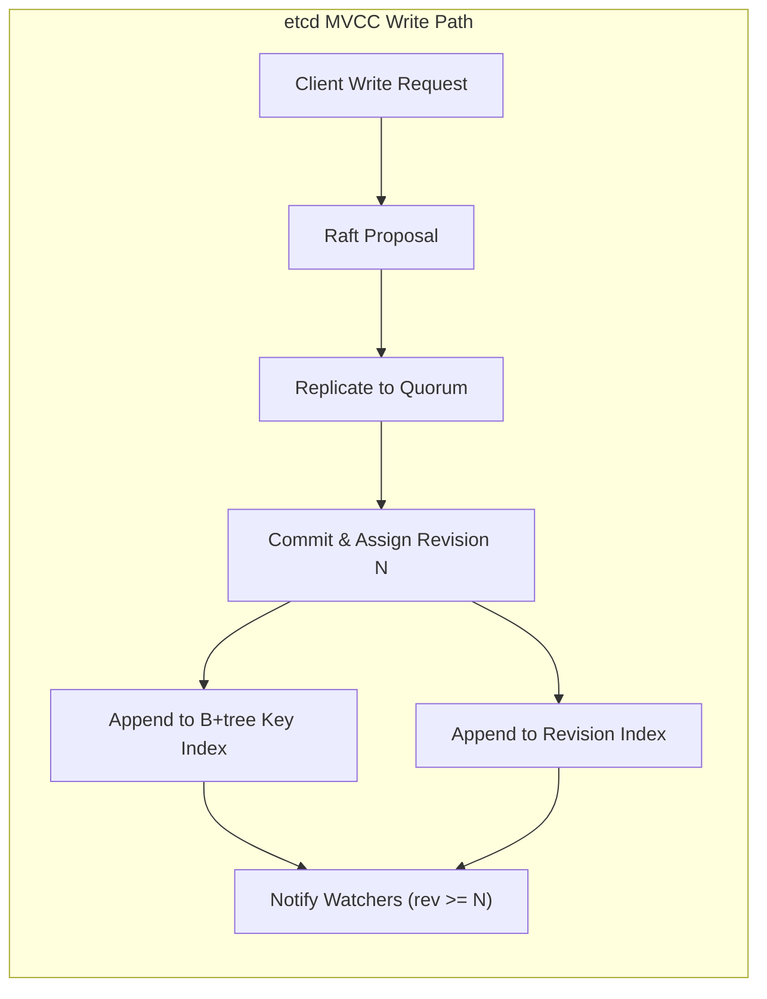
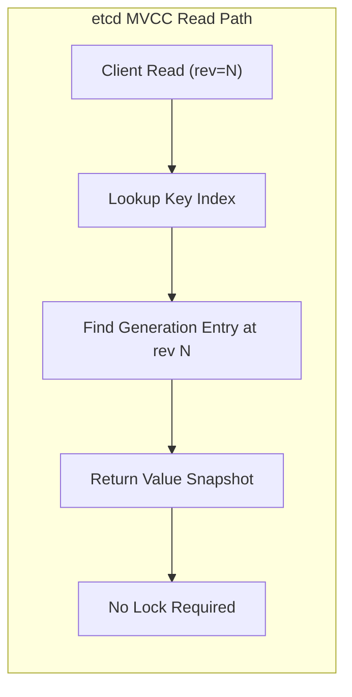
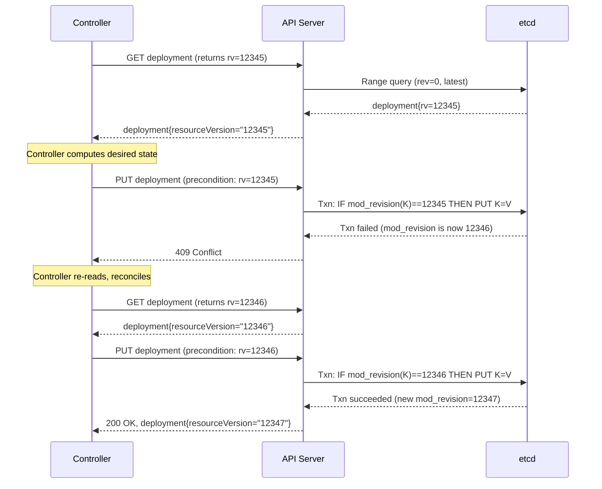
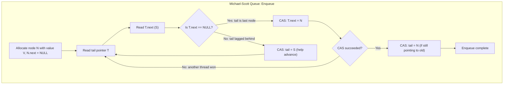
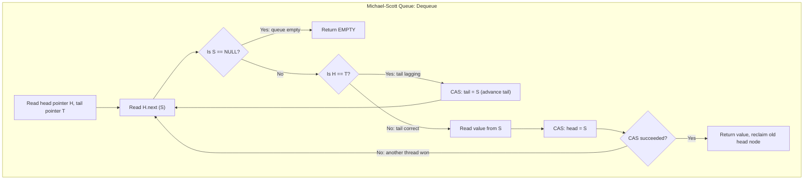
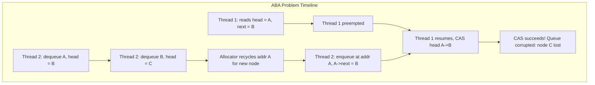
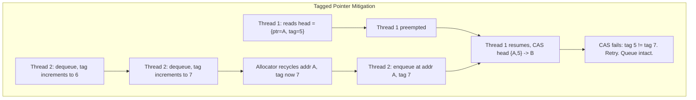
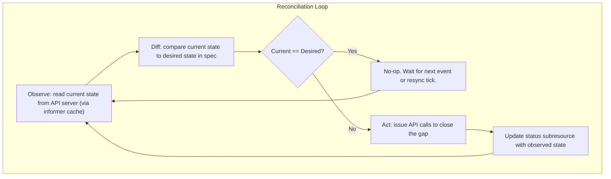
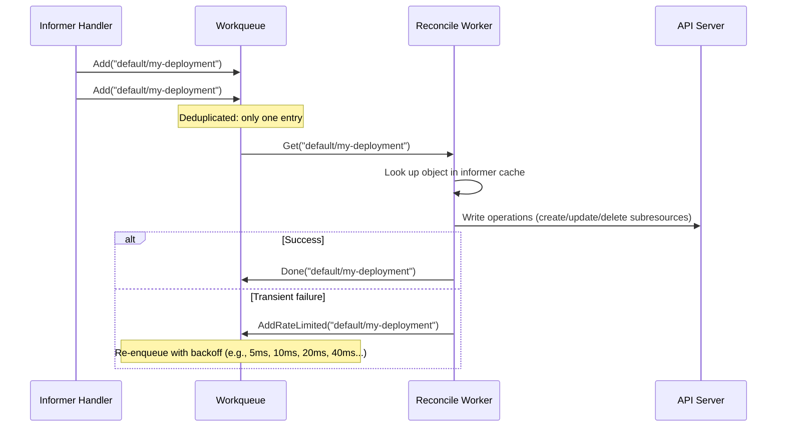
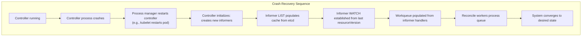

# Lesson 3: Advanced Internal Mechanics, Concurrency & Recovery

## 1. Concurrency Control, MVCC, and Optimistic Conflict Resolution

Distributed infrastructure platforms face a fundamental tension between concurrent throughput and state consistency. When controller processes, API request handlers, and background reconcilers all mutate shared cluster state simultaneously, naive mutex-based locking collapses under cache-line contention and context-switch overhead. Modern control-plane systems—etcd, Kubernetes, and the broader cloud-native ecosystem—resolve this through a layered strategy: Multi-Version Concurrency Control (MVCC) at the storage layer, optimistic Compare-And-Swap (CAS) at the API layer, and lock-free data structures at the in-process event-dispatch layer.

### 1.1 MVCC in etcd: Revision-Indexed Storage

etcd stores all Kubernetes state as key-value pairs in a backend backed by BoltDB (as of etcd v3, the default backend is a custom B+tree implementation called `bbolt`). Every mutation—put, delete, or transactional multi-key operation—is assigned a monotonically increasing 64-bit revision number by the Raft consensus layer before it is applied to the state machine. The key insight of MVCC is that readers and writers never block each other: a reader requesting data at revision *N* sees a consistent snapshot of the store as it existed immediately after revision *N* was committed, regardless of concurrent writes at revisions *N+1*, *N+2*, and beyond.

Internally, etcd maintains two B+tree indices:

- **Key index**: Maps each key to a list of generations, where each generation is a list of revisions. This allows point lookups and range scans to find the value for any key at any historical revision.
- **Revision index**: Maps revision numbers to the set of keys modified at that revision, enabling compaction to efficiently locate and prune obsolete entries.

A write operation follows this path: the proposed mutation enters the Raft log, is replicated to a quorum of peers, and upon commitment is applied to the B+tree. The application appends a new revision entry rather than overwriting the existing value. The old revision remains readable until compaction removes it.





Compaction is the mechanism that bounds memory and storage growth. When a client calls `Compact(rev)`, etcd removes all revisions strictly older than `rev` from both indices. Any subsequent read at a compacted revision receives a `mvcc: required revision has been compacted` error. This forces stale readers to re-sync to the latest revision. In practice, Kubernetes compacts etcd every 5 minutes (configurable via `--etcd-compaction-interval`), retaining enough history for controllers to catch up after transient disconnections.

A well-tuned three-node etcd cluster on modern hardware (NVMe SSDs, 10 Gbps networking) sustains approximately 10,000 to 30,000 writes per second and higher read throughput (especially with serialized read consistency, which bypasses Raft and serves from the local B+tree). The performance ceiling is governed by Raft's requirement that every write be durably replicated to a quorum before acknowledgment, not by the MVCC layer itself.

### 1.2 Kubernetes Optimistic Concurrency: resourceVersion as CAS

Kubernetes exposes etcd's revision semantics to clients through the `resourceVersion` field, present on every API object. This field is a string representation of the etcd revision at which the object was last modified. It serves as the basis for optimistic concurrency control across all API interactions.

The flow is straightforward:

1. A controller reads a resource (e.g., a `Deployment`) from the API server. The response includes `resourceVersion: "12345"`.
2. The controller computes a desired mutation and sends a `PUT` or `PATCH` request, including `resourceVersion: "12345"` in the request body or as a precondition.
3. The API server forwards the write to etcd. If using etcd's transactional API, the server issues a CAS: "update key K to value V only if the current mod_revision of K equals 12345."
4. If the current revision matches, etcd applies the write atomically, assigns a new revision, and returns success. If another client has modified the object in the interim (current revision is now 12346), the CAS fails and the API server returns HTTP 409 Conflict.
5. The controller re-reads the object, re-applies its reconciliation logic against the new state, and retries.



This design is efficient because conflicts are statistically rare in well-partitioned controller architectures. A Deployment controller and a Service controller operate on different object types and rarely contend. When contention does occur, the retry cost is a single additional read plus recomputation—orders of magnitude cheaper than holding a global lock that serializes all controllers.

The following Go code illustrates the idiomatic retry pattern used in Kubernetes controller implementations:

```go
package controller

import (
	"context"
	"fmt"

	appsv1 "k8s.io/api/apps/v1"
	"k8s.io/apimachinery/pkg/api/errors"
	metav1 "k8s.io/apimachinery/pkg/apis/meta/v1"
	"k8s.io/client-go/kubernetes"
)

// UpdateDeploymentWithRetry performs an optimistic-concurrency update
// with a bounded number of retries on conflict. This is the core
// reconciliation pattern used by Kubernetes controllers.
func UpdateDeploymentWithRetry(
	ctx context.Context,
	client kubernetes.Interface,
	namespace, name string,
	mutate func(deploy *appsv1.Deployment) error,
) (*appsv1.Deployment, error) {
	const maxRetries = 5

	for attempt := 0; attempt < maxRetries; attempt++ {
		// Step 1: Read the current state including resourceVersion.
		current, err := client.AppsV1().Deployments(namespace).Get(ctx, name, metav1.GetOptions{})
		if err != nil {
			return nil, fmt.Errorf("get deployment: %w", err)
		}

		// Step 2: Apply the desired mutation to the in-memory copy.
		// The mutate function computes the diff between current and desired state.
		if err := mutate(current); err != nil {
			return nil, fmt.Errorf("mutate deployment: %w", err)
		}

		// Step 3: Attempt the update. The API server will reject this with
		// a 409 Conflict if resourceVersion does not match etcd's current
		// mod_revision for this key.
		updated, err := client.AppsV1().Deployments(namespace).Update(ctx, current, metav1.UpdateOptions{})
		if err == nil {
			return updated, nil
		}

		// Step 4: On conflict, loop back and re-read the latest version.
		// On any other error, return immediately.
		if !errors.IsConflict(err) {
			return nil, fmt.Errorf("update deployment: %w", err)
		}

		// Conflict: another writer modified the object. Retry from step 1.
	}

	return nil, fmt.Errorf("update deployment: exceeded %d retries due to conflicts", maxRetries)
}
```

### 1.3 Lockless Data Structures: The Michael-Scott Queue

Within a single process—such as the Kubernetes API server or a controller manager—high-throughput event dispatch requires lock-free or low-contention data structures. The Michael-Scott lock-free queue, introduced in 1996 by Maged Michael and Michael Scott, is one of the most widely deployed lock-free MPMC (multi-producer, multi-consumer) FIFO queues. It is used in the Linux kernel, in DPDK (Data Plane Development Kit), and forms the basis for many custom workqueue implementations.

The queue is built on a singly linked list with atomic head and tail pointers. The algorithm uses CAS (compare-and-swap) instructions, which atomically compare a memory location to an expected value and, if they match, store a new value. CAS returns a boolean indicating whether the swap occurred. This is the fundamental hardware primitive underlying all lock-free algorithms on x86 (via `LOCK CMPXCHG`), ARM (via `LDXR`/`STXR` exclusive load-store pairs), and RISC-V (via `LR`/`SC`).





The following C implementation demonstrates the full algorithm with the ABA-problem mitigation (using a versioned counter packed into the top bits of the pointer, a technique called "tagged pointers"). This code targets x86-64 using C11 atomics:

```c
#include <stdatomic.h>
#include <stdint.h>
#include <stdlib.h>
#include <stdbool.h>
#include <string.h>

/*
 * Michael-Scott lock-free MPMC queue with ABA mitigation via
 * tagged (versioned) pointers. Targets x86-64 where pointers
 * use only the low 48 bits, leaving 16 bits for a version tag.
 *
 * Tag packing: we pack a 16-bit version counter into the upper
 * 16 bits of a 64-bit word, with the pointer in the lower 48 bits.
 * This ensures that every CAS observes both the pointer value
 * AND a monotonically increasing version, eliminating the ABA
 * problem where a pointer transitions A -> B -> A without the
 * observing thread detecting the change.
 */

#define PTR_MASK  0x0000FFFFFFFFFFFFULL
#define TAG_SHIFT 48

typedef struct ms_node {
    void *value;
    _Atomic(struct ms_node *) next;
} ms_node_t;

/*
 * Tagged pointer: combines a node pointer with a version tag
 * to detect ABA transitions. The tag increments on every
 * successful CAS, so even if the pointer returns to a
 * previously observed value, the tag will differ.
 */
typedef struct {
    uint64_t packed;  /* tag (16 bits) | ptr (48 bits) */
} tagged_ptr_t;

static inline tagged_ptr_t make_tagged(ms_node_t *ptr, uint16_t tag) {
    tagged_ptr_t tp;
    tp.packed = ((uint64_t)tag << TAG_SHIFT) | ((uint64_t)ptr & PTR_MASK);
    return tp;
}

static inline ms_node_t *get_ptr(tagged_ptr_t tp) {
    return (ms_node_t *)(tp.packed & PTR_MASK);
}

static inline uint16_t get_tag(tagged_ptr_t tp) {
    return (uint16_t)(tp.packed >> TAG_SHIFT);
}

typedef struct {
    _Atomic(tagged_ptr_t) head;
    _Atomic(tagged_ptr_t) tail;
} ms_queue_t;

/* Sentinel node: always present, simplifies empty-queue logic. */
static ms_node_t *ms_node_alloc(void *value) {
    ms_node_t *node = aligned_alloc(64, sizeof(ms_node_t));
    if (!node) return NULL;
    node->value = value;
    atomic_store_explicit(&node->next, NULL, memory_order_relaxed);
    return node;
}

void ms_queue_init(ms_queue_t *q) {
    ms_node_t *sentinel = ms_node_alloc(NULL);
    tagged_ptr_t tp = make_tagged(sentinel, 0);
    atomic_store_explicit(&q->head, tp, memory_order_relaxed);
    atomic_store_explicit(&q->tail, tp, memory_order_relaxed);
}

void ms_queue_enqueue(ms_queue_t *q, void *value) {
    ms_node_t *node = ms_node_alloc(value);
    tagged_ptr_t new_tail;

    for (;;) {
        tagged_ptr_t cur_tail = atomic_load_explicit(&q->tail, memory_order_acquire);
        ms_node_t *tail_node = get_ptr(cur_tail);
        ms_node_t *next_raw = atomic_load_explicit(&tail_node->next,
                                                    memory_order_acquire);

        /* Re-read tail to ensure it hasn't changed under us. */
        tagged_ptr_t tail_reread = atomic_load_explicit(&q->tail,
                                                        memory_order_acquire);
        if (cur_tail.packed != tail_reread.packed)
            continue;  /* Tail moved, restart. */

        if (next_raw == NULL) {
            /* Tail is the last node. Try to link our node. */
            if (atomic_compare_exchange_weak_explicit(
                    &tail_node->next, &(ms_node_t *){NULL}, node,
                    memory_order_release, memory_order_relaxed)) {
                /* Link succeeded. Now try to advance tail. If CAS fails,
                 * another thread already advanced it, which is fine. */
                uint16_t new_tag = get_tag(cur_tail) + 1;
                new_tail = make_tagged(node, new_tag);
                atomic_compare_exchange_strong_explicit(
                    &q->tail, &cur_tail, new_tail,
                    memory_order_release, memory_order_relaxed);
                return;
            }
            /* CAS failed: another producer linked its node first. Retry. */
        } else {
            /* Tail is lagging behind. Help advance it (cooperative). */
            uint16_t new_tag = get_tag(cur_tail) + 1;
            tagged_ptr_t adv = make_tagged(next_raw, new_tag);
            atomic_compare_exchange_strong_explicit(
                &q->tail, &cur_tail, adv,
                memory_order_release, memory_order_relaxed);
            /* Loop will retry the enqueue. */
        }
    }
}

bool ms_queue_dequeue(ms_queue_t *q, void **out_value) {
    for (;;) {
        tagged_ptr_t cur_head = atomic_load_explicit(&q->head,
                                                     memory_order_acquire);
        tagged_ptr_t cur_tail = atomic_load_explicit(&q->tail,
                                                     memory_order_acquire);
        ms_node_t *head_node = get_ptr(cur_head);
        ms_node_t *next_raw = atomic_load_explicit(&head_node->next,
                                                    memory_order_acquire);

        /* Validate that head hasn't changed. */
        tagged_ptr_t head_reread = atomic_load_explicit(&q->head,
                                                        memory_order_acquire);
        if (cur_head.packed != head_reread.packed)
            continue;

        if (next_raw == NULL) {
            /* Queue is empty (head == tail, head->next == NULL). */
            return false;
        }

        if (head_node == get_ptr(cur_tail)) {
            /* Tail is lagging. Help advance it. */
            uint16_t new_tag = get_tag(cur_tail) + 1;
            tagged_ptr_t adv = make_tagged(next_raw, new_tag);
            atomic_compare_exchange_strong_explicit(
                &q->tail, &cur_tail, adv,
                memory_order_release, memory_order_relaxed);
            continue;
        }

        /* Read value BEFORE the CAS, because after CAS succeeds,
         * the old head node may be reclaimed by another consumer. */
        void *value = next_raw->value;

        uint16_t new_tag = get_tag(cur_head) + 1;
        tagged_ptr_t new_head = make_tagged(next_raw, new_tag);

        if (atomic_compare_exchange_weak_explicit(
                &q->head, &cur_head, new_head,
                memory_order_release, memory_order_relaxed)) {
            /* Dequeue succeeded. Reclaim old head node.
             * NOTE: In production, safe memory reclamation (SMR)
             * or epoch-based reclamation is required here, because
             * other threads may still hold pointers to this node.
             * A simple free() is only safe under quiescent-point
             * reclamation or if the caller guarantees no concurrent
             * access to the reclaimed node. */
            free(head_node);
            *out_value = value;
            return true;
        }
        /* CAS failed: another consumer won. Retry. */
    }
}
```

### 1.4 The ABA Problem and Safe Memory Reclamation

The ABA problem is the most insidious hazard in lock-free programming. Consider a consumer thread that reads `head = A`, reads `A->next = B`, and prepares to CAS `head` from `A` to `B`. Before the CAS executes, the thread is preempted. During the preemption window, another consumer dequeues `A` (setting `head = B`), then `B` (setting `head = C`), and then a producer enqueues a node that happens to reuse the exact same memory address for a new node `A'` (if the allocator recycled the freed memory), and `A'->next = B`. When the original thread resumes, it executes CAS `head` from `A` to `B`. The CAS succeeds because the pointer value matches (`A == A'` in terms of address), even though the logical state of the queue has changed entirely. The consumer has now lost an element and corrupted the queue structure.

Three approaches mitigate this:

- **Tagged pointers**: Pack a monotonically increasing counter alongside the pointer, so that even if the address is recycled, the tag differs. The CAS compares both pointer and tag. This is the approach used in the code above. It costs 16 bits of address space on 64-bit platforms (limiting addressable memory to 48 bits), which is within the current x86-64 canonical address limit.

- **Hazard pointers**: Each thread publishes the addresses of nodes it is currently accessing into a per-thread slot. Before reclaiming a node, a reclaimer scans all hazard pointer slots. If any thread has marked the node as hazardous, reclamation is deferred. This adds O(P) overhead per reclamation (where P is the thread count) but avoids address-space limitations.

- **Epoch-based reclamation (EBR)**: Threads enter and exit epochs. Nodes freed during epoch *E* are not actually deallocated until all threads have left epoch *E*. This is the approach used in Crossbeam (Rust's lock-free data structure library). EBR has lower overhead than hazard pointers but introduces a grace-period latency before memory is reclaimed.





## 2. State Reconciliation, Level-Triggered Processing, and Recovery

### 2.1 The Declarative Reconciliation Model

The declarative paradigm that defines modern infrastructure rests on a single principle: the system continuously reconciles observed state against declared desired state. This is not an aesthetic preference but a mechanical requirement for self-healing behavior. In an imperative model, a script issues a sequence of commands ("create pod," "configure network," "start service") and exits. If the process crashes midway, the state is left partially applied with no record of intent. Recovery requires human inspection and manual remediation.

In a declarative model, the desired state is persisted in a source of truth (etcd), and a reconciliation loop continuously evaluates the gap between current and desired state, applying corrections. The loop is **level-triggered**: it evaluates the current state on every invocation, not the delta of the last event. This means that if a controller crashes, restarts, and begins reconciling from scratch, it will arrive at the same corrective actions it would have taken had it never crashed. The state lives in etcd, not in controller memory.



This loop is **idempotent**: applying the same desired state multiple times produces the same final state without side effects. If a Deployment controller creates a ReplicaSet, and the API server crashes before acknowledging the creation, the controller retries. The API server's etcd backend either already has the ReplicaSet (in which case the retry is a no-op) or does not (in which case the retry creates it). Either way, the system converges.

### 2.2 The Informer-Cache Architecture: Decoupling Reads from the API Server

A naive reconciliation loop that polls the API server on every iteration would overwhelm the control plane. Kubernetes solves this with the informer pattern, which combines a local cache with a watch stream.

Each controller runs one or more informers. An informer maintains an in-process store (a thread-safe map) that caches every object of a given type (e.g., all Deployments). On startup, the informer performs a `LIST` call to populate the cache, then establishes a `WATCH` on the same resource. The watch stream delivers incremental events (`ADDED`, `MODIFIED`, `DELETED`) that the informer applies to its local store. This means:

- Controllers read from local memory, never hitting the API server for reads.
- The API server only handles write operations and the initial LIST; steady-state reads are served from the informer cache.
- If the watch stream disconnects (network partition, API server restart), the informer re-lists and re-watches, using the `resourceVersion` from the last received event as the starting point. If that revision has been compacted, the informer performs a full re-list.

```mermaid
graph TD
    subgraph "Informer Architecture"
        I1["Controller"] --> I2["Informer (shared)"]
        I2 --> I3["Local Store (in-memory cache)"]
        I2 --> I4["Lister (read-only interface to store)"]
        I2 --> I5["Watch stream to API Server"]
        I5 -->| "ADDED/MODIFIED/DELETED events" | I3
        I6["Initial LIST (full snapshot)"] --> I3
    end
    subgraph "Event Distribution"
        I3 --> I7["Event Handlers (registered by controller)"]
        I7 --> I8["Workqueue (rate-limited, deduplicating)"]
        I8 --> I9["Reconcile worker goroutines"]
    end
```

### 2.3 Workqueues: Rate Limiting and Deduplication

Controllers do not process events directly from informer handlers. Instead, informer handlers extract a key (typically `namespace/name`) and enqueue it into a workqueue. The workqueue provides two critical properties:

- **Deduplication**: If the same key is enqueued multiple times before being processed, it is processed only once. This is essential because a controller might receive `MODIFIED` events for the same Deployment dozens of times per second during a rolling update.
- **Rate limiting**: The queue applies exponential backoff on processing failures. If a reconcile attempt fails (e.g., because a downstream API call returned a transient error), the key is re-enqueued with a delay that increases exponentially, preventing hot-loop thrashing.



The following Go code shows a production-grade reconciliation loop structure using the Kubernetes workqueue and informer patterns:

```go
package controller

import (
	"context"
	"fmt"
	"time"

	appsv1 "k8s.io/api/apps/v1"
	corev1 "k8s.io/api/core/v1"
	"k8s.io/apimachinery/pkg/labels"
	"k8s.io/apimachinery/pkg/util/runtime"
	"k8s.io/client-go/informers"
	"k8s.io/client-go/kubernetes"
	"k8s.io/client-go/tools/cache"
	"k8s.io/client-go/util/workqueue"
	"k8s.io/klog/v2"
)

const (
	maxRetries    = 15
	resyncPeriod  = 10 * time.Minute
)

// DeploymentController reconciles Deployment objects to ensure
// their desired replica count matches the observed ReplicaSet state.
type DeploymentController struct {
	kubeClient   kubernetes.Interface
	depInformer  cache.SharedIndexInformer
	rsInformer   cache.SharedIndexInformer
	podInformer  cache.SharedIndexInformer

	// workqueue deduplicates keys and applies rate-limited backoff
	// on processing failures. This is the central dispatch mechanism.
	workqueue    workqueue.RateLimitingInterface
}

func NewDeploymentController(
	client kubernetes.Interface,
	informerFactory informers.SharedInformerFactory,
) *DeploymentController {
	depInformer := informerFactory.Apps().V1().Deployments().Informer()
	rsInformer := informerFactory.Apps().V1().ReplicaSets().Informer()
	podInformer := informerFactory.Core().V1().Pods().Informer()

	c := &DeploymentController{
		kubeClient:  client,
		depInformer: depInformer,
		rsInformer:  rsInformer,
		podInformer: podInformer,
		// ExponentialBackoff with rate limiter: initial 5ms, max 1000s,
		// with a per-item rate limit. Prevents hot-looping on
		// persistently failing reconciliations.
		workqueue: workqueue.NewNamedRateLimitingQueue(
			workqueue.DefaultControllerRateLimiter(),
			"deployment",
		),
	}

	// Register event handlers. Each handler extracts the key and
	// enqueues it. The workqueue deduplicates, so if 50 MODIFIED
	// events arrive for the same Deployment within 100ms, the
	// controller processes it once.
	depInformer.AddEventHandler(cache.ResourceEventHandlerFuncs{
		AddFunc: func(obj interface{}) {
			c.enqueueDeployment(obj)
		},
		UpdateFunc: func(old, new interface{}) {
			c.enqueueDeployment(new)
		},
		DeleteFunc: func(obj interface{}) {
			c.enqueueDeployment(obj)
		},
	})

	// ReplicaSet and Pod changes may also trigger Deployment
	// reconciliation, since a Deployment owns ReplicaSets which
	// own Pods. We enqueue the owning Deployment when a child
	// changes.
	rsInformer.AddEventHandler(cache.ResourceEventHandlerFuncs{
		AddFunc: c.enqueueOwnerDeployment,
		UpdateFunc: func(_, new interface{}) {
			c.enqueueOwnerDeployment(new)
		},
		DeleteFunc: c.enqueueOwnerDeployment,
	})

	return c
}

func (c *DeploymentController) enqueueDeployment(obj interface{}) {
	key, err := cache.MetaNamespaceKeyFunc(obj)
	if err != nil {
		runtime.HandleError(err)
		return
	}
	c.workqueue.Add(key)
}

func (c *DeploymentController) enqueueOwnerDeployment(obj interface{}) {
	// Walk the ownerReferences to find the owning Deployment
	// and enqueue its key. This is how child-resource changes
	// trigger parent reconciliation.
	ownerRef := metav1.GetControllerOf(obj.(metav1.Object))
	if ownerRef == nil || ownerRef.Kind != "Deployment" {
		return
	}
	// ... lookup deployment by owner reference and enqueue
}

// Run starts the controller with the specified number of worker
// goroutines. Each worker pulls keys from the workqueue and
// invokes the reconcile function. The controller runs until
// the context is cancelled.
func (c *DeploymentController) Run(ctx context.Context, workers int) error {
	defer c.workqueue.ShutDown()

	klog.Info("Waiting for informer caches to sync")
	if !cache.WaitForCacheSync(ctx.Done(),
		c.depInformer.HasSynced,
		c.rsInformer.HasSynced,
		c.podInformer.HasSynced,
	) {
		return fmt.Errorf("cache sync failed")
	}

	klog.Info("Starting deployment controller workers")
	for i := 0; i < workers; i++ {
		go wait.UntilWithContext(ctx, c.worker, time.Second)
	}

	<-ctx.Done()
	return nil
}

// worker is a long-running goroutine that continuously pulls
// keys from the workqueue and invokes reconcile.
func (c *DeploymentController) worker(ctx context.Context) {
	for c.processNextWorkItem(ctx) {
	}
}

func (c *DeploymentController) processNextWorkItem(ctx context.Context) bool {
	key, quit := c.workqueue.Get()
	if quit {
		return false
	}
	defer c.workqueue.Done(key)

	if err := c.reconcile(ctx, key.(string)); err != nil {
		// On failure, re-enqueue with rate-limited backoff.
		// After maxRetries, the key is dropped and logged.
		if c.workqueue.NumRequeues(key) < maxRetries {
			c.workqueue.AddRateLimited(key)
			klog.Errorf("Reconcile failed for %s, retrying: %v", key, err)
			return true
		}
		klog.Errorf("Dropping %s after %d retries: %v", key, maxRetries, err)
		c.workqueue.Forget(key)
		return true
	}

	// Success: reset the backoff counter for this key.
	c.workqueue.Forget(key)
	return true
}

// reconcile is the core logic: read current state from informer cache,
// compare to desired state, and issue API calls to close the gap.
// This function MUST be idempotent: calling it with the same key
// multiple times must produce the same result.
func (c *DeploymentController) reconcile(ctx context.Context, key string) error {
	namespace, name, err := cache.SplitMetaNamespaceKey(key)
	if err != nil {
		return err
	}

	// Read from informer cache (local memory, no API server round-trip).
	deployment, exists, err := c.depInformer.GetIndexer().GetByKey(key)
	if err != nil {
		return fmt.Errorf("get deployment from cache: %w", err)
	}
	if !exists {
		// Deployment was deleted. Clean up owned ReplicaSets.
		// In practice, Kubernetes uses garbage collection with
		// ownerReferences, so this is often a no-op.
		return nil
	}

	dep := deployment.(*appsv1.Deployment)
	desiredReplicas := int(*dep.Spec.Replicas)

	// Find owned ReplicaSets from the informer cache.
	rsList, err := c.rsInformer.GetIndexer().ByIndex(
		cache.NamespaceIndex, namespace,
	)
	if err != nil {
		return fmt.Errorf("list replicaSets: %w", err)
	}

	var ownedRSs []*appsv1.ReplicaSet
	for _, item := range rsList {
		rs := item.(*appsv1.ReplicaSet)
		if metav1.IsControlledBy(rs, dep) {
			ownedRSs = append(ownedRSs, rs)
		}
	}

	// Count available pods across owned ReplicaSets.
	availableReplicas := 0
	for _, rs := range ownedRSs {
		availableReplicas += int(rs.Status.AvailableReplicas)
	}

	// Reconcile: if observed != desired, scale the newest ReplicaSet.
	if availableReplicas != desiredReplicas {
		klog.Infof("Reconciling %s: desired=%d, available=%d",
			key, desiredReplicas, availableReplicas)
		// ... issue scale subresource update
	}

	// Update the Deployment's status subresource to reflect
	// observed state. This uses optimistic concurrency: if the
	// resourceVersion has changed, the status update will
	// conflict and the workqueue will retry.
	// ... update status

	return nil
}
```

### 2.4 Pod Lifecycle: A Formal State Machine

The Pod lifecycle is not an arbitrary set of labels but a formal state machine enforced by the interaction of the API server, the kube-scheduler, the kubelet, and the container runtime interface (CRI). Each transition is deterministic given the inputs, and each state carries specific semantics for controller reconciliation logic.

```mermaid
graph TD
    subgraph "Pod Lifecycle State Machine"
        P["Pod Created<br/>(API server accepts, writes to etcd)"] --> PENDING["Pending<br/>(Awaiting scheduling or container startup)"]
        PENDING -->| "Scheduler assigns node" | PENDING
        PENDING -->| "Kubelet starts containers<br/>via CRI" | RUNNING["Running<br/>(All containers started)"]
        PENDING -->| "Image pull fails or<br/>admission rejected" | FAILED["Failed<br/>(At least one container<br/>terminated with error)"]
        RUNNING -->| "All containers exit 0" | SUCCEEDED["Succeeded<br/>(All containers<br/>completed successfully)"]
        RUNNING -->| "Container exits non-zero<br/>and restartPolicy != Always" | FAILED
        RUNNING -->| "Container exits non-zero<br/>and restartPolicy = Always/OnFailure" | RUNNING
        RUNNING -->| "Evicted (node pressure)" | EVICTED["Evicted / Unknown<br/>(Node lost or pressure)"]
        SUCCEEDED --> DELETED["Garbage Collected"]
        FAILED --> DELETED
        EVICTED --> DELETED
    end
```

The states and their triggers:

- **Pending**: The API server has accepted the Pod and written it to etcd, but the Pod has not yet been assigned to a node or the kubelet has not started its containers. Two sub-states exist within Pending: unscheduled (the kube-scheduler has not yet selected a node) and scheduled-but-not-running (the kubelet is pulling images or initializing). The `podCondition` field distinguishes these: `PodScheduled=True` indicates the scheduler has bound the pod to a node.

- **Running**: The kubelet has successfully started all containers in the Pod via the CRI. At least one container is still executing. If a container exits and `restartPolicy` is `Always` or `OnFailure`, the kubelet restarts it and the Pod remains Running.

- **Succeeded**: All containers in the Pod have exited with status 0 and `restartPolicy` is not `Always`. The Pod will not be restarted. This state is terminal for the Pod object until garbage collection removes it.

- **Failed**: At least one container has exited with a non-zero status and `restartPolicy` is `Never`, or all containers have terminated and at least one exited non-zero. The `containerStatuses` field in the Pod status contains the exit codes and termination reasons.

- **Unknown**: The API server cannot reach the kubelet (node partition). The Pod's actual state is indeterminate. Controllers treat Unknown conservatively, typically waiting for a grace period before taking corrective action.

The kubelet itself is a reconciliation loop. Every `--node-status-update-frequency` (default 10 seconds), it reports the node's condition and the status of its pods to the API server. If the API server does not receive a heartbeat from a kubelet within `--node-monitor-grace-period` (default 40 seconds), the node is marked `NotReady`, and the node controller begins the eviction process after `--pod-eviction-timeout` (default 5 minutes).

### 2.5 Recovery Semantics: Crash Consistency Through Idempotency

The recovery model of a declarative control plane is a direct consequence of three properties working in concert:

1. **Desired state is externalized**: The intent (the Deployment spec, the ConfigMap data, the Service selector) is stored in etcd, not in controller process memory. A controller crash does not lose intent.

2. **Reconciliation is idempotent**: The reconcile function computes corrective actions based on current observed state, not on a history of prior actions. Re-running reconciliation from scratch produces the same actions as continuing from where a crash occurred.

3. **Conflicts are retried, not fatal**: The optimistic concurrency model means that concurrent writes do not corrupt state. A conflict is a signal to re-read and recompute, not an error that halts the system.



This model scales horizontally. If the cluster grows from 100 nodes to 10,000 nodes, the number of controllers increases (each controller manages a subset of objects via label selectors or namespace scoping), but the recovery semantics do not change. Each controller independently reconciles its slice of the state space, and the optimistic concurrency model ensures that overlaps are resolved through retry rather than coordination.

The trade-off is latency. In the worst case, a controller that repeatedly conflicts on the same object will loop: read, compute, write, conflict, re-read, recompute, write. Each iteration costs one API server round-trip plus the computation time. In practice, well-designed controllers partition their work by ownership boundaries (a Deployment owns ReplicaSets, a ReplicaSet owns Pods), minimizing the probability of concurrent writes to the same object. The workqueue's rate limiting prevents unbounded retry loops: after 15 retries (the default `maxRetries`), the key is dropped and logged, breaking the loop.
