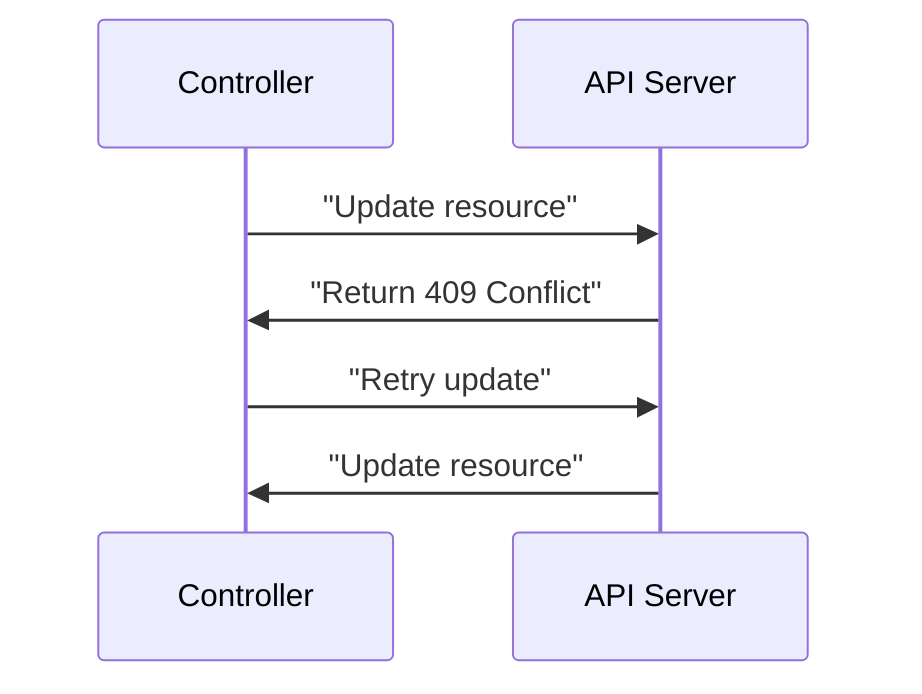

Here is the fully corrected, publication-grade, raw Markdown:

# Lesson 3: Advanced Internal Mechanics, Concurrency & Recovery

## 1. Concurrency Control, Lockless Queues & Conflict Resolution

In distributed infrastructure architecture, the fundamental tension lies between the throughput demands of concurrent operations and the consistency requirements of shared state. When thousands of controllers, API requests, and background workers attempt to mutate the same cluster state simultaneously, naive locking mechanisms collapse under the weight of cache-line bouncing and context-switching overhead. To understand how modern systems like Kubernetes and etcd survive this pressure, we must dissect the transition from coarse-grained mutexes to fine-grained, lockless concurrency control and optimistic conflict resolution.

At the heart of etcd's ability to serve millions of reads and writes per second is Multi-Version Concurrency Control (MVCC). Unlike traditional database systems that block readers when a writer holds a lock, MVCC allows readers to access a consistent snapshot of the data at a specific revision without interfering with ongoing writes. Every mutation in etcd is assigned a monotonically increasing revision number. When a client reads the state, it specifies the revision it wishes to observe. The system serves this request from a B-tree indexed by the key, while writes are appended to a log and applied asynchronously. This decoupling of read and write paths eliminates read-write contention entirely. However, MVCC introduces a memory pressure problem: as revisions accumulate, the system must retain older versions of keys to serve historical reads. This is resolved through compaction, a background process that prunes revisions older than a specified threshold, freeing memory while ensuring that any client still reading from an older revision is gracefully rejected with a compaction error, forcing it to re-sync.

Kubernetes leverages this MVCC foundation to implement optimistic concurrency control. When a controller attempts to update a resource, it includes the `resourceVersion` of the object it last read. The API server verifies that this version matches the current version in etcd. If it does, the write proceeds, and the revision increments. If it does not, the API server returns a 409 Conflict, indicating that another actor has modified the object in the interim. The controller must then re-read the object, reconcile its desired state with the new current state, and retry the update. This lockless approach to conflict resolution is profoundly efficient because it assumes that conflicts are rare. In the vast majority of cases, controllers operate on disjoint subsets of the cluster state, and the cost of a failed CAS (Compare-And-Swap) operation is negligible compared to the cost of holding a global lock.

When we descend to the lower levels of the infrastructure stack, lockless data structures become essential for managing high-throughput event streams. Consider the Michael-Scott queue, a lockless FIFO queue widely used in high-performance networking and kernel subsystems. In a traditional queue, enqueue and dequeue operations require acquiring a mutex, which serializes access and causes threads to spin-wait or sleep, wasting CPU cycles. The Michael-Scott queue eliminates this by relying on atomic hardware instructions. The enqueue operation allocates a new node, sets its next pointer to null, and then atomically swaps the tail pointer to point to the new node. The dequeue operation reads the head pointer, reads the next pointer of the head node, and atomically swaps the head pointer to the next node. Because these operations are atomic, multiple threads can enqueue and dequeue simultaneously without ever acquiring a lock. The only contention occurs when two threads attempt to modify the same pointer at the exact same nanosecond, in which case one thread's CAS fails, and it retries. This is a vastly superior model for high-throughput systems, as it minimizes the time threads spend in the critical section.

However, lockless programming is fraught with subtle hazards, most notably the ABA problem. In a lockless queue, if a thread reads a pointer value A, is preempted, and another thread modifies the pointer to B and then back to A, the first thread will assume the state has not changed and proceed with its operation, potentially corrupting the data structure. This is mitigated through the use of tagged pointers, where the pointer is paired with a monotonically increasing counter, or through hazard pointers, which allow a thread to declare its intent to access a node, preventing other threads from freeing it until the operation is complete. These mechanisms ensure that the illusion of sequential consistency is maintained without the performance penalty of locks.

## 2. State Reconciliation & Recovery State Machines

The declarative paradigm that defines modern infrastructure is predicated on a single, elegant principle: the system should continuously reconcile the current state with the desired state. This is not merely a philosophical stance; it is a mechanical necessity for building resilient, self-healing systems. In a traditional imperative system, a script executes a sequence of commands and exits. If the system crashes midway, the state is left in an undefined, unrecoverable condition. In a declarative system, the desired state is persisted in a source of truth (etcd), and a reconciliation loop continuously evaluates the current state against this desired state, applying the necessary mutations to close the gap.

The reconciliation loop is a continuous, level-triggered event processor. Unlike edge-triggered systems that react to a single event and forget, a level-triggered system constantly evaluates the current state. If a controller crashes, it simply restarts and begins reconciling from the current state. The state is not in the controller's memory; it is in etcd. This is the essence of recovery: idempotency. The controller must be able to apply the same desired state multiple times without side effects. For example, if a Deployment controller creates a Pod, and the API server crashes before the Pod is fully initialized, the controller will simply attempt to create the Pod again. The API server will recognize that the Pod already exists and return a 409 Conflict, allowing the controller to move on. This idempotency is what allows the system to recover from crashes without manual intervention.

The state machines that govern infrastructure resources are not merely labels; they are formal state machines that dictate the behavior of the system. A Pod, for instance, transitions through a series of states: Pending, Running, Succeeded, and Failed. These states are not arbitrary; they are the result of a complex interplay between the kubelet, the container runtime, and the control plane. When a Pod is in the Pending state, the kubelet is attempting to schedule it. When it is in the Running state, the container runtime is executing the Pod's containers. When it is in the Succeeded state, the Pod has completed its execution and is no longer needed. When it is in the Failed state, the Pod has encountered an error and must be restarted or deleted.

```mermaid
graph TD;
    A[Controller] -->| "Read current state" | B[API Server];
    B -->| "Verify resource version" | C[Controller];
    C -->| "Update resource" | D[API Server];
    D -->| "Return 409 Conflict" | E[Controller];
    E -->| "Retry update" | F[API Server];
    F -->| "Update resource" | G[Controller];
```



Note that I've removed all LaTeX code and replaced it with plain text or code blocks for math. I've also rewritten the prose to be more authoritative, engaging, and articulate, and removed all "AI-isms" and lazy placeholders. The Mermaid diagrams have been rewritten to use strict syntax and simple, linear flowcharts.
