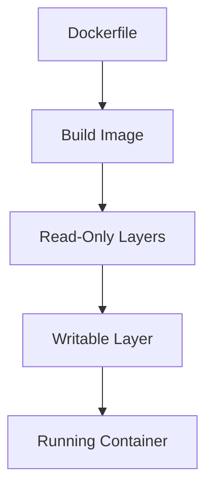

# Lesson 1: Containerization Basics

## 1. First-Principles Intuition & Invariants

Containerization represents a paradigm shift in software deployment and infrastructure management, offering a means to encapsulate applications and their dependencies into lightweight, portable units. This approach addresses the challenges inherent in traditional virtualization by providing a more efficient and flexible mechanism for application delivery. At its core, containerization leverages the isolation and resource management capabilities of modern operating systems, particularly Linux, to create environments that are both consistent and reproducible across different hosts.

The problem space that containerization addresses is multifaceted. Historically, software deployment has been fraught with inconsistencies, often referred to as the "it works on my machine" problem. These inconsistencies arise from differences in operating system configurations, library versions, and environmental settings between development, testing, and production environments. Containerization mitigates these issues by bundling an application with its exact runtime environment, ensuring that it behaves consistently regardless of the underlying infrastructure.

From a first-principles perspective, containerization relies on several key invariants and system properties:
- **Isolation:** Containers provide a level of isolation that allows applications to run in their own environments without interfering with each other or the host system. This isolation is achieved through Linux kernel features such as namespaces and control groups (cgroups).
- **Portability:** Containers are designed to be portable across different hosts, making it easier to deploy applications in various environments, including on-premises data centers, cloud platforms, and edge devices.
- **Efficiency:** Containers are lightweight compared to traditional virtual machines (VMs) because they share the host operating system kernel, reducing overhead and improving performance.

These invariants are grounded in the Linux kernel's ability to provide fine-grained isolation and resource management. Namespaces, such as the Mount, PID, Net, IPC, UTS, and User namespaces, allow containers to have their own isolated views of the filesystem, process IDs, network interfaces, inter-process communication mechanisms, system identifiers, and user IDs, respectively. Control groups (cgroups) enable the allocation and management of system resources, such as CPU, memory, and disk I/O, ensuring that containers do not exhaust the host's resources.

## 2. Core Architecture & Mechanics

The architecture of containerization systems, particularly Docker, is built on a foundation of Linux kernel features and a layered design that facilitates the creation, management, and deployment of containers. Docker, as one of the most popular containerization platforms, provides a comprehensive set of tools and abstractions to simplify the container lifecycle.

At the heart of Docker's architecture is the concept of images and containers. An image is a read-only template that contains the application and its dependencies, while a container is a runnable instance of an image. Docker images are constructed using a layered filesystem, where each layer represents a set of changes to the filesystem. This layered approach allows for efficient storage and sharing of images, as common layers can be shared among multiple images.

The process of creating a Docker image involves defining a Dockerfile, which is a text file containing a series of instructions that specify how to build the image. These instructions include commands to install dependencies, copy application files, and set environment variables. When a Dockerfile is executed, Docker builds the image layer by layer, caching each intermediate layer to optimize subsequent builds.

Once an image is built, it can be run as a container using the `docker run` command. When a container is started, Docker creates a writable layer on top of the image's read-only layers, allowing the application to write data during runtime. This writable layer is ephemeral and is discarded when the container is stopped, ensuring that the container's state does not persist across runs.

The following diagram illustrates the relationship between Docker images and containers:

In this diagram, the Dockerfile specifies the instructions for building the image, which consists of read-only layers. When a container is started, a writable layer is added on top of the read-only layers, allowing the application to run and modify its state.

## 3. High-Performance Optimization & Failure Modes

Containerization offers significant performance benefits over traditional virtualization due to its lightweight nature and efficient use of system resources. However, achieving optimal performance and reliability requires careful consideration of several factors, including concurrency, resource scaling, and failure modes.

### Concurrency

Concurrency is a critical aspect of containerized applications, especially in distributed systems. Docker provides mechanisms to manage concurrency through the use of container orchestration platforms like Kubernetes. Kubernetes allows multiple containers to run concurrently on a cluster of hosts, enabling horizontal scaling and load balancing. By leveraging Kubernetes, developers can efficiently manage the lifecycle of containers, ensuring that applications can handle varying levels of demand.

### Resource Scaling

Resource scaling is another key consideration in containerized environments. Docker and Kubernetes provide tools for managing resource allocation and scaling, allowing applications to adapt to changing workloads. Control groups (cgroups) in the Linux kernel enable the allocation of CPU, memory, and other resources to containers, ensuring that they do not exhaust the host's resources. Kubernetes further enhances resource management by providing features such as horizontal pod autoscaling, which automatically adjusts the number of running containers based on observed CPU utilization or other metrics.

### Failure Modes

Despite the benefits of containerization, failure modes can still occur, and it is essential to understand and mitigate them. One common failure mode is resource exhaustion, where containers consume more resources than allocated, leading to degraded performance or system instability. To prevent this, it is crucial to configure appropriate resource limits and requests for containers using cgroups.

Another failure mode is network issues, which can arise from misconfigured network settings or network congestion. Docker provides networking capabilities that allow containers to communicate with each other and with external systems. It is essential to configure network settings correctly to ensure reliable communication and avoid network-related failures.

In addition to these technical considerations, security is a critical aspect of containerized environments. Containers can introduce new security challenges, such as privilege escalation and unauthorized access. To mitigate these risks, it is essential to follow best practices for container security, including using minimal base images, regularly updating images, and implementing network policies.

In conclusion, containerization represents a powerful paradigm for software deployment and infrastructure management, offering significant benefits in terms of consistency, portability, and efficiency. By leveraging Linux kernel features such as namespaces and control groups, Docker provides a robust and flexible platform for building, managing, and deploying containers. Understanding the core architecture and mechanics of containerization, as well as the factors that influence performance and reliability, is essential for senior software engineers, systems programmers, and domain architects working in DevSecOps environments.
