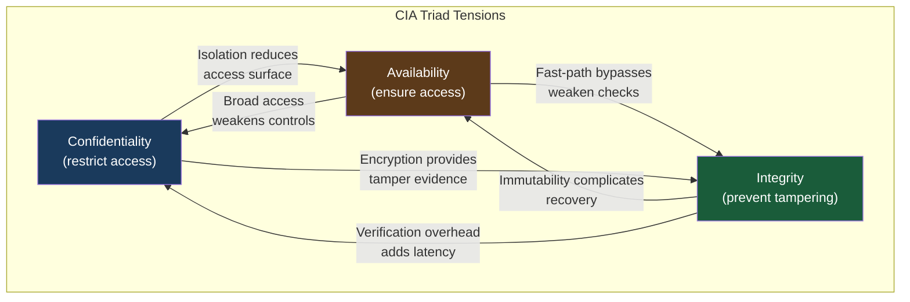
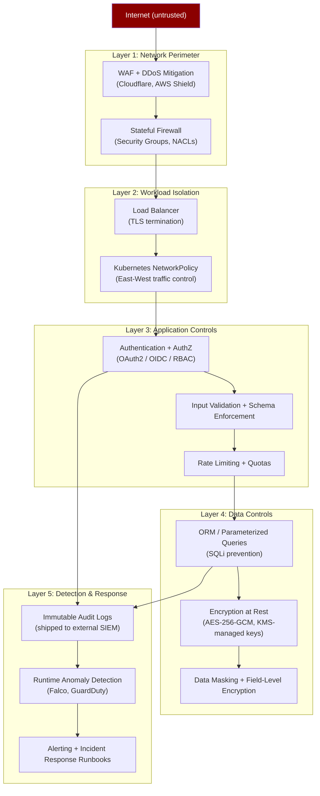
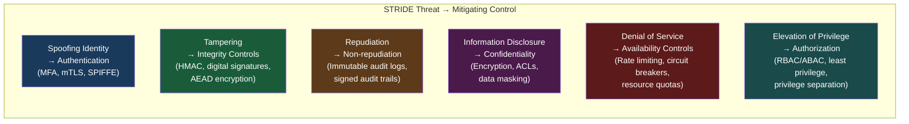
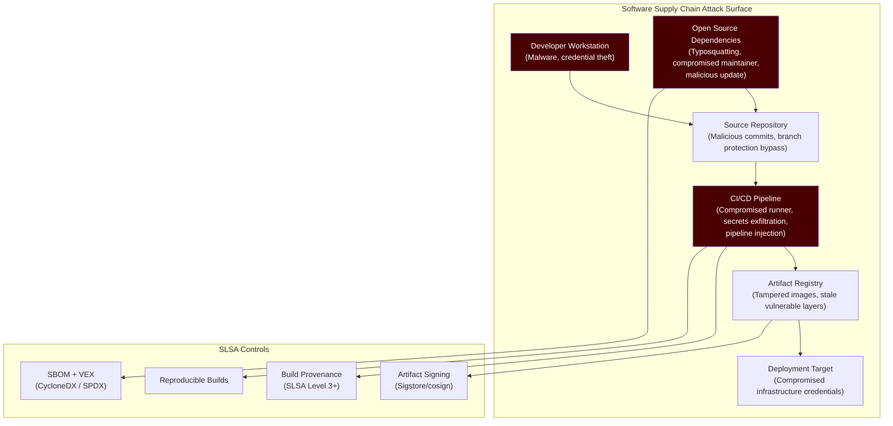

# Lesson 1: Security Foundations, Threat Modeling, and Shift-Left Principles

## 1. First-Principles Intuition & Invariants

Security in distributed systems emerges from a fundamental asymmetry: attackers need find only one vulnerability, while defenders must protect every surface. This imbalance is not merely strategic—it is rooted in computational universality. Any sufficiently expressive system (Turing-complete or otherwise) can be repurposed, subverted, or exploited by an adversary with enough time and capability. Shannon's maxim captures this precisely: the adversary knows the system. Security cannot depend on obscurity of mechanism; it must depend on the secrecy of keys and the correctness of access controls enforced at every boundary.

This realization demands abandoning the illusion of perfect closure. No system is immune. The practical goal is a probabilistic risk model: quantify exposure, reduce attack surface, construct concentric defensive rings, and ensure that the cost and complexity of exploitation exceeds the attacker's resources or expected return.

### 1.1 The CIA Triad: A Formal Reading

The classical CIA triad—Confidentiality, Integrity, Availability—provides the foundational grammar of security objectives. Mechanical interpretations of this triad produce checklists. Architectural interpretations produce systems.

**Confidentiality** transcends encryption. At its core, confidentiality is an *information flow* property: secret data must not flow to unauthorized observers, regardless of the channel. This encompasses transitive information flow—a database query result derived from sensitive rows can leak sensitive information even if the rows themselves are protected. The Bell-LaPadula model formalizes this as "no read up, no write down" across security labels, and while that lattice model is rarely deployed directly, its intuitions underpin modern mandatory access control (MAC) systems like SELinux and AppArmor. Confidentiality must hold across time (key material must not persist in logs), across privilege boundaries (a web worker should not read a payment service's secrets), and across administrative domains (multi-tenant isolation must prevent cross-tenant data access).

**Integrity** extends beyond checksums to encompass the stronger property that data remains unmodified by unauthorized principals *and* that cryptographic commitments remain verifiable under active adversaries. The Biba Integrity Model formalizes this as the dual of Bell-LaPadula: "no write up, no read down." In practice, integrity failures are often more damaging than confidentiality failures. An attacker who can modify a software artifact, a configuration file, or a database record may achieve arbitrary code execution or privilege escalation, turning an integrity violation into a full compromise. Integrity guarantees require both authenticity (data came from the claimed source) and freshness (data has not been replayed from a previous state), typically provided together by authenticated encryption with associated data (AEAD) schemes and monotonic sequence counters or timestamps.

**Availability** guarantees that legitimate principals can access resources within defined time bounds even under resource exhaustion, link saturation, or coordinated denial. Availability is frequently the most difficult objective to reason about formally because it involves real-time and liveness properties that are categorically harder to verify than safety properties. A system that is simply slow may be functionally unavailable even without complete outage. Availability threats include volumetric denial-of-service attacks, algorithmic complexity attacks (hash-flooding, ReDoS), resource exhaustion through malformed inputs, and dependency failures that propagate through the call graph.

These three objectives operate in fundamental tension, and the tension is not merely theoretical:

- Perfect confidentiality achieved through complete network isolation sacrifices availability for every legitimate remote user.
- Maximum availability through permissive access controls compromises both confidentiality and integrity.
- Strong integrity guarantees through append-only audit logs and immutable storage create operational challenges for availability during failure recovery.

Security architecture demands explicit tradeoff analysis within your domain's specific threat model. There is no universal correct balance; there is only the balance appropriate for your assets, your adversaries, and your operational context.



### 1.2 Adversary Models and Threat Classification

A threat model formally specifies adversary capabilities. Without a concrete adversary model, security analysis produces untargeted controls that defend against nothing in particular and consume resources that could address real risks.

Information security classifies adversaries along several axes:

**By network position:**
- *Passive network adversary*: Observes packets in transit without modification. Defeated by encryption alone (TLS, WireGuard). This is the weakest meaningful adversary.
- *Active network adversary* (Dolev-Yao model): Can intercept, modify, inject, replay, and drop packets on any network link. Defeated by authenticated encryption with replay protection (nonces, sequence numbers). TLS 1.3 and WireGuard assume this adversary model.
- *On-path adversary* (formerly "man-in-the-middle"): Controls a router or ISP link on the path between two endpoints. Certificate pinning, HSTS preloading, and DNSSEC/DoH partially address this.

**By system access:**
- *Remote code execution adversary*: Can execute arbitrary code in a sandboxed context (browser tab, container, restricted process). Defeated by privilege separation, namespaces, seccomp filtering, and capability dropping.
- *Local privilege escalation adversary*: Has unprivileged code execution on the target machine and seeks to reach root or kernel. Defeated by kernel hardening (SMEP, SMAP, KASLR, kernel lockdown), mandatory access control, and timely patching.
- *Privileged adversary*: Possesses root or kernel access. Defeating this adversary requires hardware roots of trust (TPM, secure enclave), remote attestation, and audit trails to external immutable sinks.

**By trust relationship:**
- *Supply-chain adversary*: Injects malicious code into upstream dependencies, build tools, or CI/CD infrastructure. SolarWinds (2020), XZ Utils backdoor (2024), and the event-stream npm compromise are canonical examples. Defeated by dependency pinning with cryptographic hashes, reproducible builds, Software Bill of Materials (SBOM) generation with attestation, and binary artifact signing (Sigstore/cosign).
- *Insider adversary*: Abuses legitimate credentials and system access. Defeated by least privilege, privileged access workstations (PAWs), just-in-time access, session recording, and anomaly detection on access patterns.

Each threat model demands different defensive strategies. A system designed exclusively to defeat a passive network adversary—encrypted at the transport layer but with no supply-chain controls—may prove entirely inadequate against a compromised dependency delivering a reverse shell with the first legitimate install. Security cost scales with the breadth of threats you must defend against, which is why threat modeling must precede control selection rather than follow it.

### 1.3 The Shift-Left Imperative: Economics and Architecture

Shift-left is not a philosophy of risk aversion—it is a discipline grounded in the economics of defect remediation. The IBM Systems Science Institute's data on defect cost multiplication (reproduced by NIST and refined by numerous studies) demonstrates that the cost of fixing a security vulnerability grows roughly one to two orders of magnitude for each lifecycle phase it traverses:

| Discovery Phase | Relative Cost | Remediation Window |
|---|---|---|
| Design / Architecture | 1× | Hours; change a diagram |
| Code Review / Static Analysis | 10× | Hours; change a few lines |
| Integration Testing | 100× | Days; change, test, re-integrate |
| Staging / QA | 500× | Days to weeks; regression risk |
| Production (post-incident) | 1,000×+ | Weeks; incident response, forensics, potential data breach notification |

These multipliers are not merely financial. A vulnerability discovered in code review costs one developer an hour. The same vulnerability discovered during a production incident involves incident commanders, security engineers, legal counsel, communications teams, potentially regulatory notification, and customer trust damage that does not appear on any line item.

Shift-left embeds security analysis, threat modeling, and automated detection into development's earliest phases:

```mermaid
flowchart LR
    subgraph "Traditional (Shift-Right)"
        T1[Code] --> T2[Build] --> T3[Test] --> T4[Deploy] --> T5[🔒 Security Gate]
        style T5 fill:#8B0000,color:#fff
    end

    subgraph "Shift-Left DevSecOps"
        S0[🔒 Threat Model] --> S1[Code + SAST]
        S1 --> S2[Build + SCA + Secrets Scan]
        S2 --> S3[Test + DAST + IaC Scan]
        S3 --> S4[Deploy + Policy Enforcement]
        S4 --> S5[Prod + Runtime Detection]
        style S0 fill:#003366,color:#fff
        style S1 fill:#004d00,color:#fff
        style S2 fill:#004d00,color:#fff
        style S3 --> S4
    end
```

The critical architectural insight is that shift-left requires security controls to be *machine-readable and automatable*. A security review that lives only in a human reviewer's memory cannot be enforced in a CI pipeline. Threat model artifacts must exist as version-controlled documents that evolve with the system. Policy must be expressed in code (Open Policy Agent, Cedar, Sentinel) so it can be tested and enforced programmatically. This is what distinguishes DevSecOps from "DevOps with a security person in the room."

### 1.4 Defense-in-Depth: The Multiplicative Security Model

Defense-in-depth recognizes that no single security control achieves perfection. Every control has failure modes: cryptographic keys can be compromised, authentication systems bypassed, firewalls misconfigured, logging pipelines disabled. Defense-in-depth architectures assume individual controls *will* fail and design overlapping, independent layers such that compromising the system requires compromising multiple layers simultaneously.

The mathematics are compelling. If we model each independent control layer as having probability *p* of being bypassed by a given attack:

- Single layer, *p* = 0.1: Attack success probability = 10%
- Two independent layers: *p²* = 1%  
- Three independent layers: *p³* = 0.1%
- Four independent layers: *p⁴* = 0.01%

The word "independent" is load-bearing. Defense-in-depth fails when controls share failure modes. Two firewall rules enforced by the same process provide no depth—a process compromise bypasses both. TLS termination and application-layer authorization implemented in the same service provide no depth against a vulnerability in that service. True independence requires different codebases, different trust roots, different administrative boundaries, and different failure modes.

A concrete defense-in-depth stack for a web application illustrates layered independence:



Each layer operates on different assumptions, is administered by different teams, and fails independently. An attacker who bypasses the WAF still faces network policies, then application authentication, then parameterized queries, then encrypted storage, and their lateral movement is detected by runtime anomaly detection before they can exfiltrate data.

### 1.5 Least Privilege: Mathematical Bounds on Blast Radius

Least privilege operationalizes defense-in-depth for access control. Every principal—user, service, process, or system—receives the minimum permissions necessary to perform its function and no more.

The formal guarantee is a bound on blast radius: if a principal is compromised, the damage is bounded by the capabilities in its permission set. A microservice with read-only access to a single database table cannot exfiltrate data from other tables, cannot modify records, and cannot pivot to other services it has no credentials for. A worker process running without ambient network access cannot establish command-and-control channels to external infrastructure. This transforms a potential full breach into a constrained, contained compromise.

Least privilege is frequently abandoned in practice because it imposes operational friction. This is not a cultural failure—it is a systems design failure. When the least-privilege path requires filing a ticket, waiting for approval, debugging opaque permission errors, and finding workarounds, engineers will choose the path of least resistance: broad permissions. The solution is to make least privilege the path of least resistance through tooling:

- **Just-in-Time (JIT) access**: Tools like HashiCorp Boundary, AWS IAM Identity Center, and Teleport provision short-lived, narrowly-scoped credentials on demand, with the request-to-credential latency measured in seconds rather than days.
- **Dynamic secrets**: HashiCorp Vault and AWS Secrets Manager with rotation generate database credentials with a TTL of hours or minutes. A leaked credential is self-expiring.
- **Capability-based security in containers**: Docker's `--cap-drop=ALL --cap-add=NET_BIND_SERVICE` pattern and Kubernetes' `securityContext.capabilities` drop all Linux capabilities by default and add only those required. This is preferable to `privileged: true`, which re-grants the full capability set.
- **IAM policy generation from access logs**: Tools like AWS IAM Access Analyzer, Cloudsplaining, and `kubectl-who-can` analyze actual access patterns and generate minimally-scoped policies automatically.

The following example demonstrates a production-grade AWS IAM policy applying least privilege for a service that must only read objects from a specific S3 prefix and publish to a specific SNS topic. Note the use of explicit deny conditions to prevent privilege escalation and constrain the scope further than the allow statements alone:

```json
{
  "Version": "2012-10-17",
  "Statement": [
    {
      "Sid": "AllowS3ReadFromSpecificPrefix",
      "Effect": "Allow",
      "Action": [
        "s3:GetObject",
        "s3:GetObjectAttributes"
      ],
      "Resource": "arn:aws:s3:::my-bucket/invoices/*",
      "Condition": {
        "StringEquals": {
          "s3:ExistingObjectTag/classification": "internal"
        }
      }
    },
    {
      "Sid": "AllowSNSPublishToSpecificTopic",
      "Effect": "Allow",
      "Action": "sns:Publish",
      "Resource": "arn:aws:sns:us-east-1:123456789012:invoice-events"
    },
    {
      "Sid": "DenyS3DeleteUnderAllConditions",
      "Effect": "Deny",
      "Action": [
        "s3:DeleteObject",
        "s3:DeleteObjectVersion"
      ],
      "Resource": "arn:aws:s3:::my-bucket/*"
    },
    {
      "Sid": "DenyPrivilegeEscalation",
      "Effect": "Deny",
      "Action": [
        "iam:CreatePolicyVersion",
        "iam:SetDefaultPolicyVersion",
        "iam:AttachUserPolicy",
        "iam:AttachRolePolicy",
        "iam:PutUserPolicy",
        "iam:PutRolePolicy",
        "sts:AssumeRole"
      ],
      "Resource": "*"
    }
  ]
}
```

The explicit deny on privilege escalation APIs is essential. Without it, a service with `iam:AttachRolePolicy` can grant itself `AdministratorAccess`, defeating least privilege entirely.

### 1.6 Security Boundaries and Trust Domains

Security boundaries define trust perimeters—lines separating assets you own and control from entities with different trust levels. These boundaries exist at every layer of the system stack, and each boundary requires its own controls.

```mermaid
graph TD
    subgraph "Trust Domain 0: Internet (Untrusted)"
        EXT["External Clients, APIs, Webhooks"]
    end

    subgraph "Trust Domain 1: DMZ / Edge"
        CDN["CDN / Load Balancer"]
        WAF2["WAF / API Gateway"]
    end

    subgraph "Trust Domain 2: Application Tier"
        SVC_A["Service A<br/>(User-facing)"]
        SVC_B["Service B<br/>(Internal)"]
    end

    subgraph "Trust Domain 3: Data Tier"
        DB["Database<br/>(Encrypted at rest)"]
        CACHE["Cache<br/>(Encryption optional)"]
        SECRETS["Secrets Store<br/>(Vault / KMS)"]
    end

    subgraph "Trust Domain 4: Management Plane"
        CI["CI/CD Pipeline"]
        ADMIN["Admin Bastion<br/>(MFA required)"]
        MON["Monitoring / SIEM"]
    end

    EXT -->|"TLS 1.3 only"| CDN
    CDN -->|"mTLS or JWT validation"| WAF2
    WAF2 -->|"Filtered, authenticated"| SVC_A
    SVC_A -->|"Service-to-service mTLS<br/>(SPIFFE/SPIRE)"| SVC_B
    SVC_B -->|"Parameterized queries,<br/>connection pooling"| DB
    SVC_A -->|"Token-scoped read"| SECRETS
    SVC_B -->|"Token-scoped read"| SECRETS
    CI -->|"Short-lived deploy credential"| SVC_A
    ADMIN -->|"JIT privilege,<br/>session recording"| DB

    style "Trust Domain 0: Internet (Untrusted)" fill:#4a0000
    style "Trust Domain 4: Management Plane" fill:#1a1a4a
```

The boundaries are not merely conceptual—each requires concrete enforcement mechanisms:

- **Network boundary**: Enforced by firewalls, security groups, Kubernetes NetworkPolicy, and service mesh policies. These are the coarsest controls and the first to be misconfigured.
- **API boundary**: Enforced by API gateways performing authentication, authorization, schema validation, and rate limiting before traffic reaches application code. This boundary separates untrusted external input from internal processing.
- **Process boundary**: Enforced by operating system process isolation, seccomp profiles, and Linux capabilities. A container is a process boundary, not a security boundary, without additional hardening—it shares the host kernel.
- **Privilege boundary**: Enforced by kernel access control mechanisms (DAC, MAC, capabilities). Transitions across this boundary (setuid, kernel syscalls) represent high-risk code paths requiring scrutiny.
- **Cryptographic boundary**: Enforced by encryption algorithms and key management. Data crossing this boundary is unreadable to adversaries without key material, even those with physical access to storage media.
- **Administrative boundary**: Enforced by identity and access management, requiring separate credentials and authentication flows for management-plane operations distinct from data-plane credentials.

A critical architectural principle: **trust boundaries must be enforced by the receiver, not asserted by the sender.** A service cannot declare itself trusted; trust must be verified at the boundary through cryptographic credentials (mTLS client certificates, signed JWTs, SPIFFE SVIDs) or hardware attestation. This principle prevents trust escalation attacks where a compromised service asserts elevated privileges to downstream systems.

### 1.7 Attack Surface Analysis: Systematic Enumeration

Attack surface analysis systematically enumerates all entry points through which adversaries could interact with your system. The surface includes obvious vectors—network endpoints, authentication flows, API interfaces—and critically important non-obvious ones:

**Input ingestion surfaces (high risk):**
- File upload handlers: attackers supply crafted files exploiting parser vulnerabilities (zip bombs, XML entity expansion, JPEG with embedded shellcode for image processors, crafted PDFs for document renderers)
- Webhook receivers: externally-driven server-side request forgery (SSRF) if the receiver fetches from attacker-controlled URLs
- Log ingestion pipelines: log injection attacks that corrupt SIEM queries or exploit log4shell-style remote code execution in log processors
- Configuration file parsers: YAML deserialization attacks (`!!python/object/apply:subprocess.call`), TOML injection

**Implicit surfaces (frequently overlooked):**
- Health check endpoints (`/healthz`, `/readyz`): may expose internal service topology or be used to trigger expensive operations
- Metrics exporters (`/metrics`): Prometheus exposition format endpoints often expose internal state, build versions, and configuration values
- Debug endpoints (`/debug/pprof`, `/debug/vars`): Go's default HTTP debug mux exposes goroutine dumps, heap profiles, and runtime variables; must be disabled in production or access-restricted
- Admin dashboards: Kubernetes Dashboard, Grafana, Jaeger UI exposed without authentication are routinely exploited
- Dependency management metadata: `package-lock.json`, `go.sum`, `Cargo.lock` reveal exact dependency versions that may have known CVEs

**Automated attack surface mapping** using tools like OWASP Amass, `nuclei`, or `ffuf` for HTTP surface enumeration should be part of the CI/CD pipeline or run on a scheduled cadence against staging environments. The output feeds into the threat model as the attack surface evolves.

### 1.8 Fail-Secure: Designing for Adversarial Failure Modes

The principle of fail-secure dictates that when systems encounter unexpected conditions or errors, they must default to the most secure state rather than the most permissive. This principle has non-obvious implications that expose frequent design errors.

**Permission checks under failure**: A permissions check that encounters a database timeout must deny access, not grant it. The fail-open alternative—treating "I don't know" as "yes"—creates a denial-of-service-to-authentication-escalation chain: an attacker who can knock out the authorization service gains access to everything it was protecting.

**Authentication fallback paths**: An authentication system that cannot reach its backing store (LDAP, OAuth IdP, database) must reject all authentications. It must not fall back to a local bypass account, to cached credentials without freshness validation, or to unauthenticated mode. Each fallback creates an exploitable path.

**Cryptographic agility and default algorithms**: A TLS stack that falls back from TLS 1.3 to TLS 1.0 when the client requests it (to "maximize compatibility") creates a downgrade attack surface. Fail-secure here means advertising only the minimum acceptable TLS version and cipher suites, rejecting clients that cannot meet the bar rather than degrading to an insecure channel.

**Parser error handling**: A firewall rule parser that encounters malformed configuration must block all traffic until the configuration is valid, not silently ignore the malformed rule and apply the rest. The malformed rule may be the most important one. A network ACL that cannot parse a DENY rule must not forward traffic, as the DENY was likely placed there for a reason.

The following Go snippet illustrates fail-secure permission checking with explicit handling of error states:

```go
// CheckPermission enforces a fail-secure pattern:
// any error—timeout, unavailability, unexpected response—
// is treated as a denial rather than an approval.
func CheckPermission(ctx context.Context, store AuthzStore, principal, resource, action string) (bool, error) {
    // Enforce a hard timeout to prevent slow-loris attacks on the authz path
    ctx, cancel := context.WithTimeout(ctx, 500*time.Millisecond)
    defer cancel()

    allowed, err := store.IsAllowed(ctx, principal, resource, action)
    if err != nil {
        // Log the specific error for observability, but do not expose
        // internal error details to the caller (information leakage).
        slog.ErrorContext(ctx, "authz check failed; denying by default",
            "principal", principal,
            "resource", resource,
            "action", action,
            "error", err,
        )
        // Return false (deny), not the error, so callers cannot
        // distinguish "denied" from "error" and cannot probe for
        // availability-based bypass.
        return false, nil
    }

    if !allowed {
        // Emit a structured audit event for every denial.
        emitAuditEvent(ctx, AuditDenial{
            Principal: principal,
            Resource:  resource,
            Action:    action,
            Timestamp: time.Now().UTC(),
        })
    }

    return allowed, nil
}
```

The design decision to return `(false, nil)` on error rather than `(false, err)` is deliberate. If callers branch on `err != nil` to bypass the permission check ("we got an error, let the user through so they don't have a bad experience"), the error handling becomes a bypass vector. Fail-secure requires that the error path and the denial path are indistinguishable to the caller.

### 1.9 Security Invariants: From Assertions to Formal Properties

Security invariants are properties that must hold true across all system states, regardless of the sequence of operations that led to those states. Invariants are the security engineer's equivalent of loop invariants in formal program verification—they define what must remain true before and after every state transition.

Expressing security requirements as invariants has concrete operational benefits:

1. **Automated enforcement**: Invariants expressed as assertions can be checked at runtime, in property-based tests, and through static analysis. If an invariant is violated, the violation is detected immediately.
2. **Regression prevention**: An invariant checked in CI means that a code change which inadvertently breaks a security property is caught before it reaches production.
3. **Threat model validation**: Invariants make implicit security assumptions explicit and machine-verifiable.

Examples of concrete, testable security invariants:

| Invariant | Verification Mechanism |
|---|---|
| No user can read another tenant's data | Property-based test: for all (user, resource) pairs where `user.tenant_id ≠ resource.tenant_id`, access is denied |
| All external data transmission is encrypted | Static analysis + network policy assertion: no HTTP (non-TLS) egress permitted |
| Every privileged operation appears in the audit log | Differential testing: compare operations against audit log entries in an integration test harness |
| No service can escalate its own IAM permissions | AWS Config rule + OPA policy: IAM policies are immutable from within the workload |
| Secrets never appear in environment variables in production | OPA/Gatekeeper policy: `env` fields in pod specs must not contain known secret patterns |
| Container images run as non-root | Kubernetes admission controller: `runAsNonRoot: true` enforced by policy |

The following Python example uses Hypothesis (a property-based testing library) to verify the multi-tenancy isolation invariant against a simplified access control function:

```python
from hypothesis import given, strategies as st, assume
import pytest

# Domain types
class User:
    def __init__(self, user_id: str, tenant_id: str, roles: list[str]):
        self.user_id = user_id
        self.tenant_id = tenant_id
        self.roles = roles

class Resource:
    def __init__(self, resource_id: str, tenant_id: str, owner_id: str):
        self.resource_id = resource_id
        self.tenant_id = tenant_id
        self.owner_id = owner_id

def can_access(user: User, resource: Resource, action: str) -> bool:
    """
    Access control function under test.
    Invariant: cross-tenant access must ALWAYS be denied,
    regardless of roles, action, or any other attribute.
    """
    # Cross-tenant isolation is an absolute boundary.
    # Checked first, before any role evaluation, to prevent
    # role-based bypass of tenant isolation.
    if user.tenant_id != resource.tenant_id:
        return False

    # Same-tenant logic: owners can do anything, admins can read/write,
    # viewers can only read.
    if user.user_id == resource.owner_id:
        return True
    if "admin" in user.roles and action in ("read", "write", "delete"):
        return True
    if "viewer" in user.roles and action == "read":
        return True

    return False


# Property-based test for the cross-tenant isolation invariant.
# Hypothesis will generate hundreds of (user, resource, action) combinations,
# including edge cases a human tester would not think to construct.
@given(
    user_tenant=st.text(min_size=1, max_size=20),
    resource_tenant=st.text(min_size=1, max_size=20),
    user_id=st.text(min_size=1, max_size=36),
    resource_id=st.text(min_size=1, max_size=36),
    roles=st.lists(st.sampled_from(["admin", "viewer", "owner", "superuser"]), max_size=5),
    action=st.sampled_from(["read", "write", "delete", "admin", "impersonate"]),
)
def test_cross_tenant_isolation_invariant(
    user_tenant, resource_tenant, user_id, resource_id, roles, action
):
    """
    INVARIANT: For all users and resources where tenant IDs differ,
    access MUST be denied regardless of any other attribute.
    This invariant must hold for all possible inputs.
    """
    # Precondition: tenants must differ for this invariant to apply.
    assume(user_tenant != resource_tenant)

    user = User(user_id=user_id, tenant_id=user_tenant, roles=roles)
    resource = Resource(resource_id=resource_id, tenant_id=resource_tenant, owner_id=user_id)

    # Even if the user is the resource's "owner" in some sense,
    # cross-tenant access must be denied.
    result = can_access(user, resource, action)

    assert result is False, (
        f"Cross-tenant isolation violated: user {user_id} in tenant "
        f"'{user_tenant}' accessed resource '{resource_id}' in tenant "
        f"'{resource_tenant}' via action '{action}' with roles {roles}"
    )
```

Property-based testing is significantly more powerful than example-based testing for security invariants because adversaries do not restrict themselves to the cases a developer explicitly thought to test. Hypothesis explores the full input space and finds the counterexample that breaks your invariant—before an attacker does.

### 1.10 Threat Modeling Methodology: STRIDE in Practice

Threat modeling operationalizes the adversary model into a structured analysis of system components and their failure modes. The STRIDE taxonomy (Spoofing, Tampering, Repudiation, Information Disclosure, Denial of Service, Elevation of Privilege), developed at Microsoft, provides a systematic lens for identifying threats against each element of a data flow diagram.



**Applying STRIDE to a data flow element** requires mapping each element type (external entity, process, data store, data flow) to the threats most relevant to it:

| Element Type | Relevant STRIDE Threats | Priority |
|---|---|---|
| External entity (browser, API client) | Spoofing, Repudiation | High |
| Process (microservice, function) | Tampering, DoS, EoP | High |
| Data store (database, cache, object store) | Tampering, Information Disclosure, DoS | Critical |
| Data flow (network connection, queue message) | Tampering, Information Disclosure, DoS | High |

A concrete STRIDE analysis of an order processing API endpoint (`POST /orders`) might produce:

- **Spoofing**: An attacker submits a request with a forged JWT claiming to be a different user. *Mitigation*: Validate JWT signature against the IdP's JWKS endpoint; never accept unsigned or HS256-signed tokens (symmetric signature is a shared secret; RS256/ES256 with asymmetric keys enables stateless verification).
- **Tampering**: An attacker intercepts the request and modifies the order total to $0.01 before it reaches the payment service. *Mitigation*: Recalculate the order total server-side from canonical product data; never trust client-supplied price fields. Apply HMAC to inter-service messages.
- **Repudiation**: A user disputes an order claiming they never placed it. *Mitigation*: Emit a signed, timestamped audit log entry at the moment of order creation, including the JWT claims, source IP, and request body hash.
- **Information Disclosure**: An error response leaks internal stack traces, database schema names, or query text. *Mitigation*: Return generic error codes to clients; log detailed errors to a separate, access-controlled sink.
- **Denial of Service**: An attacker submits thousands of large-payload POST requests, exhausting processing capacity. *Mitigation*: Request body size limits, per-user rate limiting with token bucket or sliding window algorithm, circuit breakers on downstream dependencies.
- **Elevation of Privilege**: A regular user crafts a request setting `admin: true` in the JSON body, exploiting mass assignment in an ORM. *Mitigation*: Use explicit DTO/schema classes with allowlists rather than automatic property binding; validate role assignments server-side from the token's claims, not from the request body.

### 1.11 Supply Chain Security: The Emerging Critical Surface

The supply chain represents the most rapidly evolving and underdefended attack surface in modern software systems. The XZ Utils backdoor (CVE-2024-3094), where a nation-state actor spent two years establishing trust in an open-source project before inserting a systemd-triggered SSH authentication bypass, demonstrates that the supply chain threat is not theoretical.



**Supply Chain Levels for Software Artifacts (SLSA)** provides a framework for incrementally improving supply chain integrity guarantees across four levels:

- **SLSA Level 1**: Build process is scripted/automated, producing basic provenance metadata.
- **SLSA Level 2**: Build runs on a hosted build service generating signed provenance.
- **SLSA Level 3**: The build platform is hardened; provenance includes the specific build instructions and input sources used; builds are isolated.
- **SLSA Level 4** (aspirational): Two-party review for all changes; hermetic, reproducible builds with bitwise-identical outputs across independent rebuild attempts.

The following Dockerfile demonstrates supply chain hardening practices for a production container image, applying SLSA-aligned controls:

```dockerfile
# syntax=docker/dockerfile:1.6

# =============================================================================
# Stage 1: Dependency verification
# Pin the exact digest of the base image, not just a tag.
# Tags are mutable; digests are content-addressed and immutable.
# =============================================================================
FROM golang:1.22.3@sha256:b1e05e2c918f52c59d39ce7d5844f73b2f4511f7734add8bb98c9ecdd4443365 AS builder

WORKDIR /app

# Copy dependency manifests first to leverage build cache.
# If go.mod/go.sum are unchanged, the dependency fetch layer is not rebuilt.
COPY go.mod go.sum ./

# Verify the module download graph against the checksum database (sum.golang.org).
# This prevents substitution attacks against the module proxy.
RUN go mod verify && \
    go mod download

COPY . .

# Build with hardening flags:
#   -trimpath: remove local path information from the binary (information disclosure)
#   -ldflags="-w -s": strip debug symbols (reduces binary size, removes debug info)
#   CGO_ENABLED=0: produce a statically-linked binary (no dynamic linker attack surface)
#   GOFLAGS=-mod=readonly: prevent go from modifying go.sum at build time
RUN CGO_ENABLED=0 GOFLAGS=-mod=readonly go build \
    -trimpath \
    -ldflags="-w -s -X main.version=$(git describe --tags --always)" \
    -o /bin/app \
    ./cmd/app

# =============================================================================
# Stage 2: SBOM generation
# Generate a CycloneDX SBOM from the verified module graph.
# =============================================================================
FROM golang:1.22.3@sha256:b1e05e2c918f52c59d39ce7d5844f73b2f4511f7734add8bb98c9ecdd4443365 AS sbom-generator

WORKDIR /app
COPY go.mod go.sum ./
RUN go install github.com/CycloneDX/cyclonedx-gomod/cmd/cyclonedx-gomod@v1.6.0 && \
    cyclonedx-gomod app -json -output /sbom.json

# =============================================================================
# Stage 3: Minimal production image
# Use a distroless base to minimize attack surface.
# distroless contains no shell, no package manager, no debug utilities.
# An attacker who achieves code execution cannot easily pivot.
# =============================================================================
FROM gcr.io/distroless/static-debian12:nonroot@sha256:c0f429e16a13a3f2c96fbe08b76ce1346622f7c419b8c9c4cd6c4e7f86ba3e73

# Copy only the binary and the SBOM; nothing else.
COPY --from=builder /bin/app /app
COPY --from=sbom-generator /sbom.json /sbom.json

# Document the port for tooling; does not publish the port.
EXPOSE 8080

# Run as nonroot (uid 65532 in distroless:nonroot).
# This is enforced by the base image selection; we don't need USER here.
ENTRYPOINT ["/app"]
```

Supply chain security also requires verifying that the artifacts you deploy are the artifacts your CI/CD pipeline produced—a property called *deployment integrity*. This is enforced by signing container images with `cosign` and verifying signatures at admission control time:

```bash
# Sign the image after CI builds it, using a keyless workflow
# (Sigstore's ephemeral key tied to the CI job's OIDC identity).
cosign sign \
  --yes \
  --oidc-issuer https://token.actions.githubusercontent.com \
  "gcr.io/my-project/my-app@${IMAGE_DIGEST}"

# In the Kubernetes admission controller (Kyverno or Sigstore Policy Controller),
# verify that all images in a namespace are signed by the expected CI workflow.
# This policy denies pods with unsigned or improperly signed images at admission time.
```

```yaml
# Kyverno ClusterPolicy: enforce image signing verification
apiVersion: kyverno.io/v1
kind: ClusterPolicy
metadata:
  name: verify-image-signatures
spec:
  validationFailureAction: Enforce
  background: false
  rules:
    - name: check-image-signature
      match:
        any:
          - resources:
              kinds: ["Pod"]
              namespaces: ["production"]
      verifyImages:
        - imageReferences:
            - "gcr.io/my-project/*"
          attestors:
            - count: 1
              entries:
                - keyless:
                    subject: "https://github.com/my-org/my-repo/.github/workflows/build.yml@refs/heads/main"
                    issuer: "https://token.actions.githubusercontent.com"
                    rekor:
                      url: "https://rekor.sigstore.dev"
```

### 1.12 Integrating Threat Modeling into the Development Lifecycle

Threat modeling is most valuable when it is a living document that evolves with the system architecture, not a one-time exercise conducted at project inception and filed away. The practical integration pattern is *threat modeling as code*:

1. **Architecture Decision Records (ADRs) with security annotations**: Each architectural change that introduces a new trust boundary, data flow, or component should include a threat model analysis section. The ADR documents what threats were considered, which were mitigated, and which were accepted as residual risk.

2. **Data flow diagrams as version-controlled artifacts**: Threat model diagrams should live in the repository alongside the code they describe, authored in a text format (Mermaid, draw.io XML, or the OWASP Threat Dragon JSON format) so they can be diffed and reviewed in pull requests.

3. **Security user stories in the backlog**: Translate threat model findings into concrete backlog items with acceptance criteria. "Implement rate limiting on the `/orders` endpoint to mitigate STRIDE:DoS threat TM-004" is actionable; "improve API security" is not.

4. **Automated threat model validation**: Tools like `threagile` (an open-source threat modeling engine that processes YAML architecture models and produces risk assessments) can run in CI to flag when the architecture model indicates unmitigated high-severity threats.

The following `threagile` YAML snippet illustrates encoding a threat model as a machine-readable artifact that can be version-controlled and validated in CI:

```yaml
# threagile.yaml — machine-readable threat model for order processing service
threagile_version: "1.0.0"

title: "Order Processing Service Threat Model"
date: "2024-01-15"
author:
  name: "Platform Security Team"

technical_assets:
  order-api:
    id: order-api
    type: process
    usage: business
    technologies:
      - go-webservice
    communication_links:
      to-database:
        target: order-db
        protocol: jdbc
        authentication: credentials
        authorization: technical-user
        encryption: transport
      to-payment-service:
        target: payment-svc
        protocol: https
        authentication: token
        authorization: technical-user
        encryption: transport

  order-db:
    id: order-db
    type: datastore
    usage: business
    technologies:
      - postgresql
    data_assets_stored:
      - order-records
      - customer-pii

data_assets:
  order-records:
    id: order-records
    usage: business
    quantity: many
    confidentiality: confidential
    integrity: critical
    availability: critical

  customer-pii:
    id: customer-pii
    usage: business
    quantity: many
    confidentiality: strictly-confidential
    integrity: critical
    availability: important
```

Running `threagile analyze` against this model produces a risk report identifying unmitigated threats based on the data sensitivity, communication protocols, and authentication mechanisms described—turning threat modeling from a manual workshop exercise into an automated, continuous process.

### Summary

The first principles of security—CIA properties and their tensions, formal adversary models, the economics of shift-left, the mathematics of defense-in-depth, the blast-radius bounding of least privilege, and the enforcement of security invariants—form a coherent framework for reasoning about system security at an architectural level. These are not independent best practices to be applied from a checklist; they compose into a unified discipline.

The following lessons build on this foundation to implement specific shift-left controls: static analysis pipelines (SAST), dependency vulnerability management (SCA), secrets detection, infrastructure-as-code security scanning (IaC analysis), and runtime security monitoring. Each of those controls derives its purpose and configuration from the threat model and invariants established here.

```mermaid
flowchart LR
    subgraph "Foundation (This Lesson)"
        TM["Threat Model<br/>(STRIDE + adversary model)"]
        INV["Security Invariants<br/>(Testable properties)"]
        BOUND["Trust Boundaries<br/>(Defense-in-depth)"]
    end

    subgraph "Shift-Left Controls (Subsequent Lessons)"
        SAST["SAST<br/>(Semgrep, CodeQL)"]
        SCA["SCA<br/>(Dependabot, OWASP DC)"]
        SECRETS["Secrets Scanning<br/>(Trufflehog, Gitleaks)"]
        IAC["IaC Scanning<br/>(Checkov, tfsec)"]
        DAST["DAST<br/>(OWASP ZAP, Nuclei)"]
        RUNTIME["Runtime Detection<br/>(Falco, GuardDuty)"]
    end

    TM --> SAST
    TM --> DAST
    INV --> SCA
    INV --> SECRETS
    BOUND --> IAC
    BOUND --> RUNTIME

    style "Foundation (This Lesson)" fill:#1a1a3a,color:#fff
    style "Shift-Left Controls (Subsequent Lessons)" fill:#1a3a1a,color:#fff
```
