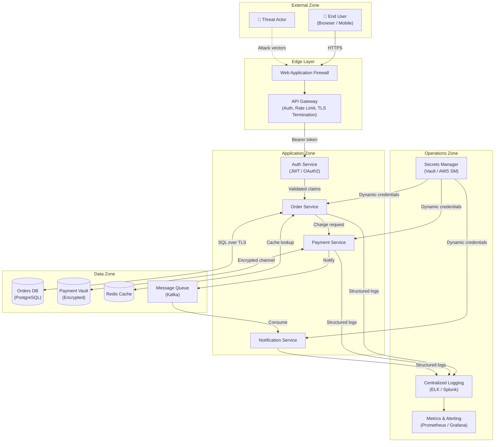
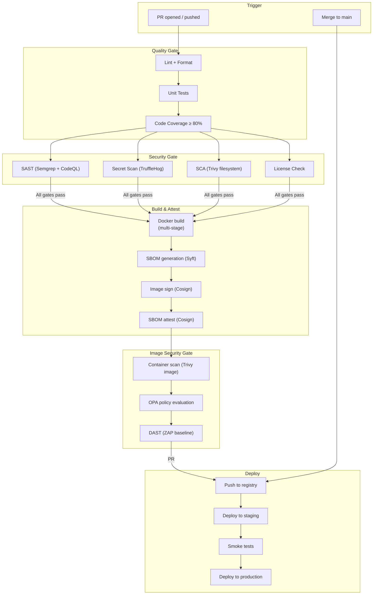

# Lesson 01 Security Foundations Shift Left

## Preface

Security in software systems is not a feature you add after the fact. It is a property that must be woven into every layer of a system from the moment a requirement is conceived. This lesson establishes the theoretical and practical foundations of DevSecOps — the discipline of integrating security controls into the continuous delivery pipeline — through the lens of *shift-left*, a principle that moves security verification as early as possible in the development lifecycle.

By the end of this lesson you will understand the mathematical models that underpin threat reasoning, the architectural invariants that hold across all secure systems, and the concrete toolchain implementations that enforce those invariants automatically.

---

## Table of Contents

1. [The Cost Model of Late Security](#1-the-cost-model-of-late-security)
2. [First Principles: The CIA Triad and Beyond](#2-first-principles-the-cia-triad-and-beyond)
3. [Threat Modeling from First Principles](#3-threat-modeling-from-first-principles)
4. [The Shift-Left Continuum](#4-the-shift-left-continuum)
5. [Static Analysis and SAST](#5-static-analysis-and-sast)
6. [Dependency and SCA Scanning](#6-dependency-and-sca-scanning)
7. [Secret Detection and Prevention](#7-secret-detection-and-prevention)
8. [Policy as Code](#8-policy-as-code)
9. [Container and Infrastructure Security](#9-container-and-infrastructure-security)
10. [The Secure Pipeline: End-to-End Implementation](#10-the-secure-pipeline-end-to-end-implementation)
11. [Measuring Security Posture](#11-measuring-security-posture)
12. [Exercises and Further Reading](#12-exercises-and-further-reading)

---

## 1. The Cost Model of Late Security

### 1.1 The IBM / NIST Exponential Relationship

The empirical observation that drives shift-left is economic. The cost to remediate a defect scales exponentially with the phase in which it is discovered. Let the lifecycle phases be an ordered set:

```
P = { requirements, design, implementation, testing, staging, production }
```

Define a remediation cost function `C(p)` for phase `p ∈ P`. Empirical studies across NASA, IBM, and NIST consistently show:

```
C(pₙ) ≈ C(p₀) · 10^n
```

Where `p₀` is the requirements phase and `pₙ` is the nth subsequent phase. A defect that costs $80 to fix at the requirements phase costs approximately $7,600 to fix in production.

This is not merely about monetary cost. It captures:

- **Engineer hours**: context reconstruction, root-cause analysis, regression scope
- **Blast radius**: a production vulnerability may already have been exploited
- **Reputation**: public CVEs, breach disclosures, regulatory fines (GDPR Article 83: up to 4% of global annual turnover)

### 1.2 Formal Definition of a Security Defect

A security defect is a triple `(A, V, I)` where:

- `A` is an **asset** with associated value `v(A) ∈ ℝ⁺`
- `V` is a **vulnerability** — a exploitable flaw in the system's behavior
- `I` is an **impact** function `I: (A, V) → ℝ⁺` mapping asset-vulnerability pairs to expected loss

The **risk** of a defect is:

```
R(A, V) = P(exploit | V) · I(A, V)
```

Where `P(exploit | V)` is the probability of exploitation given the vulnerability exists. Shift-left is a strategy to minimize `∑ R(Aᵢ, Vᵢ)` by reducing `P(exploit | V)` through early elimination of `V`, before it can reach a reachable attack surface.

### 1.3 The Attack Surface Integral

The total attack surface of a system at time `t` can be modeled as:

```
S(t) = ∫₀ᵗ [ dE(τ)/dτ - dR(τ)/dτ ] dτ
```

Where:
- `dE(τ)/dτ` is the rate of exposure growth (new features, new endpoints, new dependencies)
- `dR(τ)/dτ` is the rate of remediation

DevSecOps seeks to maintain `dR(τ)/dτ ≥ dE(τ)/dτ` at all times, keeping the integral bounded. Without automated security gates in the pipeline, `dR` asymptotically approaches zero as the team scales (human review bandwidth is fixed), while `dE` grows linearly with engineer count. This is the fundamental mathematical argument for automation.

---

## 2. First Principles: The CIA Triad and Beyond

### 2.1 Confidentiality, Integrity, Availability

Every security control maps to at least one of three invariants:

**Confidentiality**: For all subjects `s` and objects `o`, if subject `s` is not authorized to read object `o`, then `s` cannot obtain the value of `o`.

Formally, using Bell-LaPadula notation:
```
∀s ∈ S, ∀o ∈ O: ¬authorized(s, read, o) → ¬can_obtain(s, value(o))
```

**Integrity**: The value of an object `o` can only be modified by authorized transformations.
```
∀s ∈ S, ∀o ∈ O: value(o, t₂) ≠ value(o, t₁) → ∃s: authorized(s, write, o) ∧ acted(s, t₁, t₂)
```

**Availability**: Authorized subjects can access authorized objects within acceptable latency bounds.
```
∀s ∈ S, ∀o ∈ O, ∀t ∈ T: authorized(s, read, o) → response_time(s, o, t) ≤ SLA
```

### 2.2 Extended Properties: STRIDE Mapping

The STRIDE threat model (Spoofing, Tampering, Repudiation, Information Disclosure, Denial of Service, Elevation of Privilege) maps to CIA extensions:

| STRIDE Threat | Violated Property | Countermeasure Category |
|---|---|---|
| Spoofing | Authentication | Identity verification, MFA, certificate pinning |
| Tampering | Integrity | HMAC, digital signatures, WAF |
| Repudiation | Non-repudiation | Audit logs, signed tokens, HSM-backed signing |
| Information Disclosure | Confidentiality | Encryption at rest/transit, RBAC, data masking |
| Denial of Service | Availability | Rate limiting, circuit breakers, autoscaling |
| Elevation of Privilege | Authorization | Principle of least privilege, capability systems |

### 2.3 The Principle of Least Privilege (PoLP)

Formally, for every subject `s` with capability set `Caps(s)`, PoLP states:

```
Caps(s) = min{ C ⊆ AllCaps : task(s) can be completed using C }
```

This is a minimization over capability sets. Any capability granted beyond this minimum is a potential privilege escalation vector. In practice, PoLP manifests as:

- Service accounts with scoped IAM roles (not `AdministratorAccess`)
- Container processes running as non-root UIDs
- Database users with table-level, not database-level, grants
- API tokens scoped to specific operations

### 2.4 Defense in Depth

Defense in depth is the architectural invariant that no single control failure should lead to full system compromise. It can be modeled as a layered probability product:

```
P(full_compromise) = ∏ᵢ P(bypass_layer_i)
```

If each of `n` independent layers has a bypass probability of `p`, then:

```
P(full_compromise) = pⁿ
```

For `p = 0.1` and `n = 4`: `P(full_compromise) = 0.0001` — a 10,000x improvement over a single layer. This independence assumption requires that layers use different technologies, different codebases, and different trust boundaries, which is why a WAF, an application-level input validation, a parameterized query layer, and a database firewall together are more effective than four WAF rules alone.

---

## 3. Threat Modeling from First Principles

### 3.1 The STRIDE-per-Element Method

Threat modeling is systematic enumeration of potential security defects at the design phase. It operates on a Data Flow Diagram (DFD) and applies STRIDE to each element.

A DFD element set `E` consists of:
- **External entities** (users, external systems)
- **Processes** (code that transforms data)
- **Data stores** (databases, files, caches)
- **Data flows** (communication channels between elements)

For each element `e ∈ E` and each STRIDE category `t`, we ask: "Is this element vulnerable to `t`?"

### 3.2 Data Flow Diagram for a Typical Microservice



### 3.3 STRIDE Worksheet for the Order Service

| Element | Spoofing | Tampering | Repudiation | Info Disclosure | DoS | EoP |
|---|---|---|---|---|---|---|
| API Gateway | Fake client certs | Modify headers | No request log | Leaked tokens in logs | Flood attacks | JWT algorithm confusion |
| Order Service process | Impersonate payment svc | SQL injection | No audit trail | Stack traces in errors | Unbounded pagination | SSRF to metadata API |
| Orders DB | Credential theft | Direct DB write | No query log | Dump all rows | Connection exhaustion | SA account abuse |
| Kafka topic | Produce as wrong service | Message injection | No producer ID | Unencrypted messages | Topic flood | Consume unauthorized topics |

### 3.4 Threat Prioritization: DREAD Scoring

Each threat is scored using DREAD:

```
DREAD_score = (Damage + Reproducibility + Exploitability + Affected_users + Discoverability) / 5
```

Each dimension is scored 0–10. A threat with score ≥ 7 is high severity and must be mitigated before the feature ships. Scores 4–6 are medium (backlog item within the sprint). Scores < 4 are accepted risk (documented).

---

## 4. The Shift-Left Continuum

### 4.1 Phases and Security Gates

The shift-left continuum places security controls at every phase boundary, creating a series of mandatory gates that code must pass before advancing.

```mermaid
flowchart LR
    subgraph sub_ide ["Phase 0: IDE"]
        P0A["Linter / SAST plugin\n(e.g., Semgrep LSP)"]
        P0B["Secret detection\n(e.g., GitLeaks pre-commit)"]
    end

    subgraph sub_pr ["Phase 1: Pull Request"]
        P1A["SAST scan\n(CodeQL / Semgrep)"]
        P1B["SCA scan\n(Dependabot / Snyk)"]
        P1C["Secret scan\n(TruffleHog)"]
        P1D["IaC scan\n(Checkov / tfsec)"]
        P1E["License compliance\n(FOSSA)"]
    end

    subgraph sub_ci ["Phase 2: CI Build"]
        P2A["Container image scan\n(Trivy / Grype)"]
        P2B["SBOM generation\n(Syft)"]
        P2C["Policy gate\n(OPA / Conftest)"]
        P2D["Unit + security tests"]
    end

    subgraph sub_staging ["Phase 3: Staging"]
        P3A["DAST scan\n(OWASP ZAP)"]
        P3B["Fuzzing\n(AFL++ / libFuzzer)"]
        P3C["Penetration test\n(automated)"]
    end

    subgraph sub_prod ["Phase 4: Production"]
        P4A["Runtime protection\n(RASP / eBPF)"]
        P4B["WAF rules"]
        P4C["SIEM alerting"]
        P4D["Vulnerability disclosure"]
    end

    sub_ide -->|"Commit"| sub_pr
    sub_pr -->|"Merge"| sub_ci
    sub_ci -->|"Deploy"| sub_staging
    sub_staging -->|"Release"| sub_prod
```



### 4.2 Security Gate Contract

Each gate has a formal contract:

```
Gate(phase) = {
    input:    artifact(phase - 1),
    checks:   [check₁, check₂, ..., checkₙ],
    policy:   threshold(severity, count),
    output:   PASS | FAIL,
    artifact: signed_attestation(artifact, checks, policy, timestamp)
}
```

A gate `PASS` produces a signed attestation that the downstream phase can verify. This creates a verifiable chain of custody — the production deployment can cryptographically verify that every upstream gate passed, using tools like Sigstore/Cosign.

### 4.3 The Security-as-Code Mindset

Security-as-Code means every security control is:
1. **Version-controlled**: The policy that rejects CVSS ≥ 7 vulnerabilities lives in a Git repository
2. **Testable**: The policy has unit tests verifying it blocks known-bad inputs
3. **Reviewable**: Changes to security policy go through the same PR process as application code
4. **Auditable**: The history of security policy changes is in the Git log

---

## 5. Static Analysis and SAST

### 5.1 Theory: Abstract Interpretation

Static Application Security Testing (SAST) is grounded in abstract interpretation — a theory of sound approximation of program semantics. Rather than executing code, SAST tools compute an over-approximation of all possible program states.

For a program `P` with concrete semantics `⟦P⟧: State → State`, SAST operates on an abstract domain `D#` with:

- An abstraction function `α: State → D#`
- A concretization function `γ: D# → ℙ(State)`

Soundness requires: `∀s ∈ State: s ∈ γ(α(s))`

The consequence is that SAST may produce **false positives** (flagging safe code) but should not produce **false negatives** (missing unsafe code) when configured correctly. This is the foundational tradeoff.

### 5.2 Taint Analysis

The most practically important SAST technique is taint analysis. It tracks the flow of untrusted data (sources) through program transformations to sensitive operations (sinks).

**Source**: Any input from an external entity (HTTP parameters, environment variables, file reads, database query results from user-controlled tables)

**Sink**: Any operation that is dangerous when fed untrusted data (SQL query construction, shell execution, HTML rendering, deserialization, cryptographic key usage)

**Sanitizer**: Any transformation that removes the tainted property (parameterized query binding, HTML escaping, integer parsing, regex validation)

A taint path is a chain `source → transform₁ → transform₂ → ... → sink` where no sanitizer appears. SAST tools enumerate all such paths.

### 5.3 Semgrep Rule Implementation

Semgrep is the dominant open-source SAST tool. Its rules use pattern matching over ASTs rather than regex, making them language-aware and precise.

The following is a complete, working Semgrep ruleset for detecting common vulnerabilities in a Python web application:

```yaml
# semgrep-rules/python-security.yaml
# Comprehensive Python security rules for shift-left pipeline integration.
# Compatible with Semgrep OSS >= 1.0.0
---
rules:
  # ─────────────────────────────────────────────────────────────
  # SQL Injection via string formatting
  # ─────────────────────────────────────────────────────────────
  - id: python-sql-injection-format
    patterns:
      - pattern: |
          $CURSOR.execute($QUERY % ...)
      - pattern-not: |
          $CURSOR.execute($QUERY, ...)
    message: >
      SQL query built with string formatting. User-controlled data flowing
      into the query string creates a SQL injection vulnerability.
      Use parameterized queries: cursor.execute(query, (param,))
    languages: [python]
    severity: ERROR
    metadata:
      cwe: "CWE-89"
      owasp: "A03:2021 - Injection"
      confidence: HIGH
    fix: |
      $CURSOR.execute($QUERY, (...))

  - id: python-sql-injection-fstring
    pattern: |
      $CURSOR.execute(f"...")
    message: >
      SQL query built with f-string. Never interpolate variables directly
      into SQL strings. Use parameterized queries instead.
    languages: [python]
    severity: ERROR
    metadata:
      cwe: "CWE-89"
      owasp: "A03:2021 - Injection"
      confidence: HIGH

  - id: python-sql-injection-concat
    pattern: |
      $CURSOR.execute($A + $B)
    message: >
      SQL query built with string concatenation. This is a SQL injection
      vulnerability if any part of the query derives from user input.
    languages: [python]
    severity: WARNING
    metadata:
      cwe: "CWE-89"
      owasp: "A03:2021 - Injection"
      confidence: MEDIUM

  # ─────────────────────────────────────────────────────────────
  # Command Injection
  # ─────────────────────────────────────────────────────────────
  - id: python-subprocess-shell-true
    patterns:
      - pattern: subprocess.run(..., shell=True, ...)
      - pattern-not: subprocess.run([...], shell=True, ...)
    message: >
      subprocess.run() called with shell=True and a string command.
      This passes the command to the shell and enables injection attacks.
      Pass a list of arguments instead, or set shell=False.
    languages: [python]
    severity: ERROR
    metadata:
      cwe: "CWE-78"
      owasp: "A03:2021 - Injection"
      confidence: HIGH

  - id: python-os-system
    pattern: os.system(...)
    message: >
      os.system() invokes a shell and is vulnerable to command injection.
      Use subprocess.run() with a list of arguments and shell=False.
    languages: [python]
    severity: ERROR
    metadata:
      cwe: "CWE-78"
      confidence: HIGH

  # ─────────────────────────────────────────────────────────────
  # Hardcoded Secrets
  # ─────────────────────────────────────────────────────────────
  - id: python-hardcoded-password-assign
    patterns:
      - pattern: $VAR = "$VALUE"
      - metavariable-regex:
          metavariable: $VAR
          regex: (?i)(password|passwd|pwd|secret|api_key|apikey|token|auth_token|access_token)
      - metavariable-regex:
          metavariable: $VALUE
          regex: .{8,}
    message: >
      Hardcoded credential in variable '$VAR'. Store secrets in environment
      variables or a secrets manager (Vault, AWS Secrets Manager).
    languages: [python]
    severity: ERROR
    metadata:
      cwe: "CWE-798"
      owasp: "A07:2021 - Identification and Authentication Failures"
      confidence: HIGH

  # ─────────────────────────────────────────────────────────────
  # Deserialization
  # ─────────────────────────────────────────────────────────────
  - id: python-pickle-loads
    patterns:
      - pattern: pickle.loads(...)
      - pattern: pickle.load(...)
    message: >
      Deserialization of untrusted data via pickle. Pickle can execute
      arbitrary code during deserialization. Use JSON or a schema-validated
      format for data exchange with untrusted sources.
    languages: [python]
    severity: ERROR
    metadata:
      cwe: "CWE-502"
      owasp: "A08:2021 - Software and Data Integrity Failures"
      confidence: HIGH

  # ─────────────────────────────────────────────────────────────
  # Cryptographic Weaknesses
  # ─────────────────────────────────────────────────────────────
  - id: python-weak-hash-md5
    patterns:
      - pattern: hashlib.md5(...)
      - pattern: hashlib.new("md5", ...)
    message: >
      MD5 is cryptographically broken. Do not use MD5 for security-sensitive
      purposes (passwords, integrity verification, digital signatures).
      Use SHA-256 or higher for general hashing; use bcrypt/argon2 for passwords.
    languages: [python]
    severity: WARNING
    metadata:
      cwe: "CWE-327"
      owasp: "A02:2021 - Cryptographic Failures"
      confidence: HIGH

  - id: python-weak-hash-sha1
    patterns:
      - pattern: hashlib.sha1(...)
      - pattern: hashlib.new("sha1", ...)
    message: >
      SHA-1 is deprecated for security use. Use SHA-256 or SHA-3.
    languages: [python]
    severity: WARNING
    metadata:
      cwe: "CWE-327"
      confidence: HIGH

  - id: python-random-not-cryptographic
    patterns:
      - pattern: random.random()
      - pattern: random.randint(...)
      - pattern: random.choice(...)
    message: >
      Standard random module is not cryptographically secure. For security
      tokens, session IDs, or any security-sensitive randomness, use
      secrets.token_hex() or secrets.token_bytes().
    languages: [python]
    severity: WARNING
    metadata:
      cwe: "CWE-338"
      confidence: MEDIUM

  # ─────────────────────────────────────────────────────────────
  # Path Traversal
  # ─────────────────────────────────────────────────────────────
  - id: python-path-traversal-open
    patterns:
      - pattern: open($PATH, ...)
      - pattern-not: open("...", ...)
    message: >
      open() called with a potentially user-controlled path. Validate
      and canonicalize the path using os.path.realpath() and verify it
      falls within the expected base directory before opening.
    languages: [python]
    severity: WARNING
    metadata:
      cwe: "CWE-22"
      owasp: "A01:2021 - Broken Access Control"
      confidence: LOW

  # ─────────────────────────────────────────────────────────────
  # SSRF via requests
  # ─────────────────────────────────────────────────────────────
  - id: python-ssrf-requests
    patterns:
      - pattern: requests.get($URL, ...)
      - pattern-not: requests.get("https://...", ...)
      - pattern-not: requests.get("http://...", ...)
    message: >
      requests.get() called with a potentially user-controlled URL.
      This can lead to Server-Side Request Forgery (SSRF). Validate
      the URL against an allowlist of permitted hosts before making
      the request.
    languages: [python]
    severity: WARNING
    metadata:
      cwe: "CWE-918"
      owasp: "A10:2021 - Server-Side Request Forgery"
      confidence: MEDIUM

  # ─────────────────────────────────────────────────────────────
  # Flask-specific: Debug mode in production
  # ─────────────────────────────────────────────────────────────
  - id: python-flask-debug-true
    pattern: app.run(..., debug=True, ...)
    message: >
      Flask debug mode must never be enabled in production. It exposes
      an interactive debugger that allows arbitrary code execution.
    languages: [python]
    severity: ERROR
    metadata:
      cwe: "CWE-94"
      confidence: HIGH

  - id: python-flask-secret-key-weak
    patterns:
      - pattern: app.secret_key = "$VALUE"
      - metavariable-regex:
          metavariable: $VALUE
          regex: ^(secret|password|test|dev|change.?me|todo|xxx|placeholder).*
    message: >
      Flask secret key appears to be a placeholder or weak value.
      Use a cryptographically random key: secrets.token_hex(32)
    languages: [python]
    severity: ERROR
    metadata:
      cwe: "CWE-798"
      confidence: HIGH
```

### 5.4 Running Semgrep in CI

```bash
#!/usr/bin/env bash
# scripts/sast-scan.sh
# Runs SAST scan and enforces policy thresholds.
# Exit code 0 = gate passes. Non-zero = gate fails.

set -euo pipefail

RULES_DIR="${SEMGREP_RULES_DIR:-./security/semgrep-rules}"
OUTPUT_FILE="$(mktemp /tmp/semgrep-output.XXXXXX.json)"
SEVERITY_THRESHOLD="${SAST_FAIL_SEVERITY:-ERROR}"

echo "==> Running SAST scan with Semgrep"
echo "    Rules:     ${RULES_DIR}"
echo "    Threshold: ${SEVERITY_THRESHOLD}"

# Run semgrep; capture output even on non-zero exit (findings present)
semgrep scan \
  --config "${RULES_DIR}" \
  --config "p/owasp-top-ten" \
  --config "p/secrets" \
  --json \
  --output "${OUTPUT_FILE}" \
  --severity "${SEVERITY_THRESHOLD}" \
  --no-rewrite-rule-ids \
  --metrics=off \
  . || true

# Parse results
TOTAL_FINDINGS=$(jq '.results | length' "${OUTPUT_FILE}")
ERROR_FINDINGS=$(jq '[.results[] | select(.extra.severity == "ERROR")] | length' "${OUTPUT_FILE}")
WARNING_FINDINGS=$(jq '[.results[] | select(.extra.severity == "WARNING")] | length' "${OUTPUT_FILE}")

echo ""
echo "==> SAST Scan Results"
echo "    Total findings:   ${TOTAL_FINDINGS}"
echo "    ERROR severity:   ${ERROR_FINDINGS}"
echo "    WARNING severity: ${WARNING_FINDINGS}"

# Print findings table
if [ "${TOTAL_FINDINGS}" -gt 0 ]; then
  echo ""
  echo "==> Finding Details"
  jq -r '.results[] | "[\(.extra.severity)] \(.check_id)\n  File: \(.path):\(.start.line)\n  Message: \(.extra.message)\n"' \
    "${OUTPUT_FILE}"
fi

# Enforce gate: fail on any ERROR-severity finding
if [ "${ERROR_FINDINGS}" -gt 0 ]; then
  echo ""
  echo "✗ SAST gate FAILED: ${ERROR_FINDINGS} ERROR-severity finding(s) detected."
  echo "  Resolve all ERROR findings before merging."
  rm -f "${OUTPUT_FILE}"
  exit 1
fi

echo ""
echo "✓ SAST gate PASSED"
rm -f "${OUTPUT_FILE}"
exit 0
```

---

## 6. Dependency and SCA Scanning

### 6.1 The Dependency Supply Chain Attack Model

Modern applications are composed of far more third-party code than first-party code. A typical Node.js application may have 2–5 direct dependencies but 500–1500 transitive dependencies. The dependency graph `G = (V, E)` where:

- `V = { direct_deps } ∪ { transitive_deps }`
- `E = { (a, b) : a depends on b }`

Has the property that a vulnerability in any `v ∈ V` potentially compromises the application, not just the direct dependencies. The XZ Utils backdoor (CVE-2024-3094), the Log4Shell vulnerability (CVE-2021-44228), and the event-stream attack all exploited this transitive dependency model.

### 6.2 CVSS Scoring Mathematics

The Common Vulnerability Scoring System (CVSS v3.1) computes a base score using:

```
ISCBase = 1 - [(1 - ImpactConf) × (1 - ImpactInteg) × (1 - ImpactAvail)]

If Scope = Unchanged:
  Impact = 6.42 × ISCBase

If Scope = Changed:
  Impact = 7.52 × [ISCBase - 0.029] - 3.25 × [ISCBase - 0.02]^15

Exploitability = 8.22 × AttackVector × AttackComplexity × PrivilegesRequired × UserInteraction

If Impact ≤ 0:
  BaseScore = 0.0
Else If Scope = Unchanged:
  BaseScore = Roundup(Min[(Impact + Exploitability), 10])
Else:
  BaseScore = Roundup(Min[1.08 × (Impact + Exploitability), 10])
```

This score is used to triage which CVEs require immediate remediation (CVSS ≥ 9.0 = Critical) versus scheduled remediation.

### 6.3 Trivy Configuration for SCA

```yaml
# security/trivy.yaml
# Trivy scanner configuration for SCA and container image scanning.
# Used in both pre-commit (filesystem mode) and CI (image mode).

scan:
  # Scan both OS packages and language-specific dependencies
  scanners:
    - vuln
    - secret
    - misconfig
    - license

vulnerability:
  # Only fail the build on CRITICAL and HIGH findings that have fixes available
  ignore-unfixed: false
  severity:
    - CRITICAL
    - HIGH

secret:
  config: ./security/trivy-secret.yaml

misconfig:
  # Include Kubernetes, Dockerfile, Terraform misconfigurations
  include-non-failures: false

license:
  # Reject licenses incompatible with commercial distribution
  forbidden:
    - GPL-2.0
    - GPL-3.0
    - AGPL-3.0
    - LGPL-2.0
    - LGPL-2.1
    - LGPL-3.0
    - CC-BY-SA-4.0

cache:
  dir: /tmp/.trivy-cache
  policy: pulls

# Generate SBOM in SPDX format alongside scan
format: table
output: ""

# Exit code behavior
exit-code: 1  # Non-zero exit when findings at or above severity threshold
```

### 6.4 Custom Trivy Secret Rules

```yaml
# security/trivy-secret.yaml
# Custom secret detection rules supplementing Trivy's built-in patterns.

enable-builtin-rules: true

rules:
  - id: custom-internal-api-key
    category: "Internal API Key"
    title: "Internal service API key"
    severity: CRITICAL
    regex: "(?i)(x-internal-api-key|internal_api_key)['\"]?\\s*[:=]\\s*['\"]?([a-zA-Z0-9_\\-]{32,})"
    secret-group: 2

  - id: custom-jwt-secret
    category: "JWT Secret"
    title: "JWT signing secret"
    severity: CRITICAL
    regex: "(?i)(jwt_secret|jwt_signing_key|jwt_private_key)['\"]?\\s*[:=]\\s*['\"]?([a-zA-Z0-9+/=_\\-]{20,})"
    secret-group: 2

  - id: custom-database-url-with-creds
    category: "Database Credential"
    title: "Database connection string with embedded credentials"
    severity: CRITICAL
    regex: "(postgres|postgresql|mysql|mssql|mongodb)(\\+[a-z]+)?://[a-zA-Z0-9_\\-]+:[^@\\s]{8,}@"
    secret-group: 0

  - id: custom-pem-private-key
    category: "Private Key"
    title: "PEM-encoded private key"
    severity: CRITICAL
    regex: "-----BEGIN (RSA |EC |DSA |OPENSSH )?PRIVATE KEY-----"
    secret-group: 0
```

### 6.5 Python Dependency Audit Script

```python
#!/usr/bin/env python3
"""
scripts/audit_dependencies.py

Audits Python dependencies against the OSV (Open Source Vulnerabilities)
database. Produces a structured report and enforces severity thresholds.

Usage:
    python3 audit_dependencies.py --requirements requirements.txt \
        --fail-on CRITICAL HIGH

Requires: pip install requests packaging
"""

import argparse
import json
import sys
import textwrap
from dataclasses import dataclass, field
from pathlib import Path
from typing import Optional

import requests
from packaging.requirements import Requirement
from packaging.version import Version


OSV_API_BASE = "https://api.osv.dev/v1"
SEVERITY_ORDER = ["LOW", "MEDIUM", "HIGH", "CRITICAL"]


@dataclass
class Vulnerability:
    id: str
    summary: str
    severity: str
    cvss_score: float
    aliases: list[str] = field(default_factory=list)
    fixed_versions: list[str] = field(default_factory=list)


@dataclass
class DependencyAuditResult:
    package: str
    version: str
    vulnerabilities: list[Vulnerability] = field(default_factory=list)

    @property
    def max_severity(self) -> Optional[str]:
        if not self.vulnerabilities:
            return None
        return max(
            self.vulnerabilities,
            key=lambda v: SEVERITY_ORDER.index(v.severity)
        ).severity


def parse_requirements(requirements_path: Path) -> list[tuple[str, str]]:
    """Parse a requirements.txt file into (package, version) pairs."""
    packages = []
    with open(requirements_path) as f:
        for line in f:
            line = line.strip()
            # Skip comments, blank lines, and options
            if not line or line.startswith("#") or line.startswith("-"):
                continue
            try:
                req = Requirement(line)
                # Extract exact pinned version
                for spec in req.specifier:
                    if spec.operator == "==":
                        packages.append((req.name, spec.version))
                        break
            except Exception:
                # Skip unparseable lines (VCS URLs, etc.)
                continue
    return packages


def query_osv(package: str, version: str, ecosystem: str = "PyPI") -> list[dict]:
    """Query the OSV database for vulnerabilities affecting a specific package version."""
    payload = {
        "version": version,
        "package": {
            "name": package,
            "ecosystem": ecosystem,
        },
    }
    try:
        response = requests.post(
            f"{OSV_API_BASE}/query",
            json=payload,
            timeout=10,
        )
        response.raise_for_status()
        data = response.json()
        return data.get("vulns", [])
    except requests.RequestException as e:
        print(f"  Warning: OSV query failed for {package}=={version}: {e}", file=sys.stderr)
        return []


def extract_severity(vuln: dict) -> tuple[str, float]:
    """Extract the highest severity rating from an OSV vulnerability record."""
    severity_str = "LOW"
    cvss_score = 0.0

    # Check CVSS scores in severity array
    for sev in vuln.get("severity", []):
        if sev.get("type") == "CVSS_V3":
            # CVSS v3 vector string — parse base score from AV components
            # For simplicity, use the score from database_specific if available
            pass

    # Check database_specific for NVD CVSS
    db_specific = vuln.get("database_specific", {})
    nvd_severity = db_specific.get("severity", "").upper()
    if nvd_severity in SEVERITY_ORDER:
        severity_str = nvd_severity

    # Try to extract numeric CVSS
    for affected in vuln.get("affected", []):
        db = affected.get("database_specific", {})
        if "cvss" in db:
            try:
                cvss_score = float(db["cvss"])
                # Map numeric CVSS to severity if not already set
                if cvss_score >= 9.0:
                    severity_str = "CRITICAL"
                elif cvss_score >= 7.0:
                    severity_str = "HIGH"
                elif cvss_score >= 4.0:
                    severity_str = "MEDIUM"
                else:
                    severity_str = "LOW"
            except (ValueError, TypeError):
                pass

    return severity_str, cvss_score


def extract_fixed_versions(vuln: dict, package: str) -> list[str]:
    """Extract the versions that fix this vulnerability."""
    fixed = []
    for affected in vuln.get("affected", []):
        pkg = affected.get("package", {})
        if pkg.get("name", "").lower() != package.lower():
            continue
        for version_range in affected.get("ranges", []):
            for event in version_range.get("events", []):
                if "fixed" in event:
                    fixed.append(event["fixed"])
    return fixed


def audit_dependencies(
    requirements_path: Path,
    ecosystem: str = "PyPI",
) -> list[DependencyAuditResult]:
    """Audit all dependencies in a requirements file against OSV."""
    packages = parse_requirements(requirements_path)
    results = []

    print(f"Auditing {len(packages)} packages against OSV database...")

    for package, version in packages:
        raw_vulns = query_osv(package, version, ecosystem)
        vulns = []

        for raw in raw_vulns:
            severity, cvss_score = extract_severity(raw)
            fixed_versions = extract_fixed_versions(raw, package)
            vulns.append(Vulnerability(
                id=raw.get("id", "UNKNOWN"),
                summary=raw.get("summary", "No summary available"),
                severity=severity,
                cvss_score=cvss_score,
                aliases=raw.get("aliases", []),
                fixed_versions=fixed_versions,
            ))

        results.append(DependencyAuditResult(
            package=package,
            version=version,
            vulnerabilities=vulns,
        ))

    return results


def print_report(results: list[DependencyAuditResult]) -> None:
    """Print a human-readable audit report."""
    vulnerable = [r for r in results if r.vulnerabilities]
    clean = [r for r in results if not r.vulnerabilities]

    print("\n" + "=" * 70)
    print("DEPENDENCY VULNERABILITY AUDIT REPORT")
    print("=" * 70)
    print(f"Total packages scanned: {len(results)}")
    print(f"Packages with vulnerabilities: {len(vulnerable)}")
    print(f"Clean packages: {len(clean)}")

    if vulnerable:
        print("\n" + "-" * 70)
        print("VULNERABLE PACKAGES")
        print("-" * 70)
        for result in sorted(vulnerable, key=lambda r: SEVERITY_ORDER.index(r.max_severity or "LOW"), reverse=True):
            print(f"\n📦 {result.package} == {result.version}")
            print(f"   Severity: {result.max_severity}")
            for vuln in sorted(result.vulnerabilities, key=lambda v: SEVERITY_ORDER.index(v.severity), reverse=True):
                aliases = ", ".join(vuln.aliases) if vuln.aliases else "none"
                fixed = ", ".join(vuln.fixed_versions) if vuln.fixed_versions else "no fix available"
                print(f"   [{vuln.severity}] {vuln.id} (aliases: {aliases})")
                print(f"           CVSS: {vuln.cvss_score:.1f}")
                print(f"           {textwrap.shorten(vuln.summary, width=60)}")
                print(f"           Fixed in: {fixed}")


def main() -> int:
    parser = argparse.ArgumentParser(
        description="Audit Python dependencies for known vulnerabilities via OSV"
    )
    parser.add_argument(
        "--requirements",
        type=Path,
        default=Path("requirements.txt"),
        help="Path to requirements.txt (default: requirements.txt)",
    )
    parser.add_argument(
        "--fail-on",
        nargs="+",
        choices=SEVERITY_ORDER,
        default=["CRITICAL", "HIGH"],
        help="Severity levels that cause a non-zero exit (default: CRITICAL HIGH)",
    )
    parser.add_argument(
        "--output-json",
        type=Path,
        help="Write results to a JSON file",
    )
    args = parser.parse_args()

    if not args.requirements.exists():
        print(f"Error: requirements file not found: {args.requirements}", file=sys.stderr)
        return 2

    results = audit_dependencies(args.requirements)
    print_report(results)

    # Optionally write JSON report
    if args.output_json:
        report = {
            "total": len(results),
            "vulnerable": [
                {
                    "package": r.package,
                    "version": r.version,
                    "max_severity": r.max_severity,
                    "vulnerabilities": [
                        {
                            "id": v.id,
                            "severity": v.severity,
                            "cvss": v.cvss_score,
                            "summary": v.summary,
                            "aliases": v.aliases,
                            "fixed_versions": v.fixed_versions,
                        }
                        for v in r.vulnerabilities
                    ],
                }
                for r in results
                if r.vulnerabilities
            ],
        }
        with open(args.output_json, "w") as f:
            json.dump(report, f, indent=2)
        print(f"\nJSON report written to: {args.output_json}")

    # Enforce policy
    fail_severities = set(args.fail_on)
    failing = [
        r for r in results
        if r.max_severity in fail_severities
    ]

    if failing:
        print(f"\n✗ Audit FAILED: {len(failing)} package(s) with {args.fail_on} severity vulnerabilities.")
        return 1

    print("\n✓ Audit PASSED: No blocking vulnerabilities found.")
    return 0


if __name__ == "__main__":
    sys.exit(main())
```

---

## 7. Secret Detection and Prevention

### 7.1 Why Secrets Leak

Secrets appear in source code for predictable reasons:

1. **Developer convenience**: pasting a token to test quickly, intending to remove it
2. **Misconfigured environments**: `.env` files committed alongside `.env.example`
3. **Debug logging**: printing request objects that contain authorization headers
4. **Configuration drift**: infrastructure configs that hardcode credentials for "legacy" reasons
5. **History contamination**: a secret removed in commit N is still visible in `git log`

The fix requires both detection (catching secrets before they land) and rotation (invalidating any secret that did land).

### 7.2 Pre-Commit Hook with GitLeaks

```toml
# security/gitleaks.toml
# GitLeaks configuration for pre-commit secret detection.
# GitLeaks >= 8.0.0

title = "Gitleaks - Project Secret Detection Configuration"

[extend]
# Extend the default ruleset
useDefault = true

[[rules]]
id = "internal-service-token"
description = "Internal microservice authentication token"
regex = '''(?i)x[-_]service[-_]token['":\s=]+([a-zA-Z0-9+/=_\-]{32,})'''
secretGroup = 1
keywords = ["x-service-token", "x_service_token"]
severity = "critical"
tags = ["internal", "auth"]

[[rules]]
id = "database-connection-string"
description = "Database connection string with embedded credentials"
regex = '''(?:postgres|mysql|mongodb|redis)(?:\+\w+)?:\/\/[^:]+:[^@\s]{8,}@'''
keywords = ["postgres://", "mysql://", "mongodb://", "redis://"]
severity = "critical"
tags = ["database", "credential"]

[[rules]]
id = "jwt-signing-secret"
description = "JWT signing secret in configuration"
regex = '''(?i)jwt[_\-]?(secret|signing[_\-]?key|private[_\-]?key)['":\s=]+['"]([a-zA-Z0-9+/=_\-]{16,})['"]'''
secretGroup = 2
keywords = ["jwt_secret", "jwt_signing_key", "jwt-secret"]
severity = "critical"
tags = ["jwt", "auth"]

[[rules]]
id = "pem-private-key-block"
description = "PEM private key block"
regex = '''-----BEGIN (RSA |EC |DSA |OPENSSH |ENCRYPTED )?PRIVATE KEY-----'''
severity = "critical"
tags = ["private-key", "crypto"]

[[rules]]
id = "env-file-secret"
description = "Secret value in .env file"
regex = '''(?i)^(PASSWORD|SECRET|API_KEY|ACCESS_TOKEN|AUTH_TOKEN|PRIVATE_KEY|CLIENT_SECRET)=(?!["']?\$\{)(?!["']?<)(.{8,})'''
secretGroup = 2
filePatterns = ["^\.env(\.\w+)?$"]
severity = "high"
tags = ["env", "config"]

[allowlist]
description = "Global allowlist for false positives"
regexes = [
  # Placeholder values
  '''(?i)(placeholder|changeme|your[-_]?.*here|example|todo|fixme|replace.?me)''',
  # Template variables
  '''\$\{[^}]+\}''',
  '''\{\{[^}]+\}\}''',
  # Test/mock values
  '''(?i)(test|mock|fake|dummy)[-_]?(secret|key|token|password)''',
]
paths = [
  # Test fixtures and example files
  "test/",
  "tests/",
  "spec/",
  "__tests__/",
  "*.test.*",
  "*.spec.*",
  "*.example",
  ".env.example",
  ".env.sample",
  "CHANGELOG.md",
  "docs/",
]
commits = [
  # Add known false-positive commit SHAs here if needed
]
stopwords = [
  "password_hash",
  "hashed_password",
  "password_digest",
]
```

### 7.3 Pre-Commit Framework Configuration

```yaml
# .pre-commit-config.yaml
# Pre-commit hooks configuration.
# Install: pip install pre-commit && pre-commit install
# Run all: pre-commit run --all-files

repos:
  # ─────────────────────────────────────────────────────────────
  # Secret detection (runs first to fail fast on credential leaks)
  # ─────────────────────────────────────────────────────────────
  - repo: https://github.com/gitleaks/gitleaks
    rev: v8.18.4
    hooks:
      - id: gitleaks
        args:
          - "--config=security/gitleaks.toml"
          - "--verbose"

  # ─────────────────────────────────────────────────────────────
  # General file hygiene
  # ─────────────────────────────────────────────────────────────
  - repo: https://github.com/pre-commit/pre-commit-hooks
    rev: v4.5.0
    hooks:
      - id: trailing-whitespace
      - id: end-of-file-fixer
      - id: check-yaml
        args: ["--unsafe"]
      - id: check-json
      - id: check-toml
      - id: check-merge-conflict
      - id: check-added-large-files
        args: ["--maxkb=500"]
      - id: detect-private-key
      - id: no-commit-to-branch
        args: ["--branch=main", "--branch=master", "--branch=production"]

  # ─────────────────────────────────────────────────────────────
  # Python linting and formatting
  # ─────────────────────────────────────────────────────────────
  - repo: https://github.com/astral-sh/ruff-pre-commit
    rev: v0.3.5
    hooks:
      - id: ruff
        args: ["--fix"]
      - id: ruff-format

  # ─────────────────────────────────────────────────────────────
  # SAST via Semgrep (lightweight subset at pre-commit stage)
  # ─────────────────────────────────────────────────────────────
  - repo: https://github.com/semgrep/semgrep
    rev: v1.68.0
    hooks:
      - id: semgrep
        args:
          - "--config=security/semgrep-rules/python-security.yaml"
          - "--error"
          - "--quiet"
        types: [python]

  # ─────────────────────────────────────────────────────────────
  # Dockerfile linting
  # ─────────────────────────────────────────────────────────────
  - repo: https://github.com/hadolint/hadolint
    rev: v2.12.0
    hooks:
      - id: hadolint-docker
        args:
          - "--config=security/hadolint.yaml"

  # ─────────────────────────────────────────────────────────────
  # Terraform / IaC linting
  # ─────────────────────────────────────────────────────────────
  - repo: https://github.com/antonbabenko/pre-commit-terraform
    rev: v1.90.0
    hooks:
      - id: terraform_fmt
      - id: terraform_validate
      - id: terraform_tflint
        args:
          - "--args=--config=__GIT_WORKING_DIR__/security/tflint.hcl"

  # ─────────────────────────────────────────────────────────────
  # Commit message format enforcement
  # ─────────────────────────────────────────────────────────────
  - repo: https://github.com/compilerla/conventional-pre-commit
    rev: v3.2.0
    hooks:
      - id: conventional-pre-commit
        stages: [commit-msg]
        args:
          - "feat"
          - "fix"
          - "docs"
          - "style"
          - "refactor"
          - "perf"
          - "test"
          - "build"
          - "ci"
          - "chore"
          - "security"
          - "revert"
```

---

## 8. Policy as Code

### 8.1 Open Policy Agent (OPA) Architecture

Policy as Code externalizes authorization and compliance decisions into a versioned, testable policy engine. OPA uses the Rego policy language and operates as a decision point that any service can query.

The evaluation model is:

```
input (JSON) + data (JSON) + policy (Rego) → decision (JSON)
```

This allows the same policy engine to serve:
- API authorization ("Can user X perform action Y on resource Z?")
- CI/CD gate decisions ("Does this container image meet our security policy?")
- Kubernetes admission control ("Does this Pod spec comply with our security standards?")
- Infrastructure compliance ("Does this Terraform plan violate any controls?")

### 8.2 OPA Policy for Container Image Security

```rego
# security/opa/container_image_policy.rego
# OPA policy for validating container images before deployment.
# Evaluated by CI pipeline and Kubernetes admission webhook.

package container.security

import future.keywords.in
import future.keywords.every

# ─────────────────────────────────────────────────────────────
# Default deny: images must explicitly satisfy all rules
# ─────────────────────────────────────────────────────────────
default allow := false

# Allow only when all security checks pass
allow {
    count(deny_reasons) == 0
}

# ─────────────────────────────────────────────────────────────
# Collect all denial reasons (for structured error reporting)
# ─────────────────────────────────────────────────────────────
deny_reasons[reason] {
    reason := critical_vulnerabilities_present
}

deny_reasons[reason] {
    reason := runs_as_root
}

deny_reasons[reason] {
    reason := uses_latest_tag
}

deny_reasons[reason] {
    reason := missing_sbom
}

deny_reasons[reason] {
    reason := forbidden_base_image
}

deny_reasons[reason] {
    reason := missing_required_labels[_]
}

deny_reasons[reason] {
    reason := writable_root_filesystem
}

deny_reasons[reason] {
    reason := excessive_capabilities[_]
}

# ─────────────────────────────────────────────────────────────
# Rule: No CRITICAL or HIGH CVEs with available fixes
# ─────────────────────────────────────────────────────────────
critical_vulnerabilities_present := reason {
    critical_vulns := [v |
        v := input.scan_results.vulnerabilities[_]
        v.severity in {"CRITICAL", "HIGH"}
        v.fix_available == true
    ]
    count(critical_vulns) > 0
    reason := sprintf(
        "Image has %d CRITICAL/HIGH fixable vulnerabilities. Run `trivy image --severity CRITICAL,HIGH %s` for details.",
        [count(critical_vulns), input.image.name]
    )
}

# ─────────────────────────────────────────────────────────────
# Rule: Container must not run as root (UID 0)
# ─────────────────────────────────────────────────────────────
runs_as_root := reason {
    input.image.config.User == ""
    reason := "Container image has no USER directive. Set a non-root user: USER 65534"
}

runs_as_root := reason {
    user := input.image.config.User
    user != ""
    # Match UID 0 or "root" username
    regex.match(`^(0|root)(:.*)?$`, user)
    reason := sprintf("Container image runs as root user '%s'. Use a non-root UID >= 1000.", [user])
}

# ─────────────────────────────────────────────────────────────
# Rule: Image must not use :latest tag
# ─────────────────────────────────────────────────────────────
uses_latest_tag := reason {
    image_ref := input.image.reference
    endswith(image_ref, ":latest")
    reason := sprintf(
        "Image '%s' uses ':latest' tag. Pin to a specific digest or semantic version tag.",
        [image_ref]
    )
}

uses_latest_tag := reason {
    image_ref := input.image.reference
    not contains(image_ref, ":")
    reason := sprintf(
        "Image '%s' has no tag specified (defaults to :latest). Pin to a specific version.",
        [image_ref]
    )
}

# ─────────────────────────────────────────────────────────────
# Rule: SBOM must be present and signed
# ─────────────────────────────────────────────────────────────
missing_sbom := reason {
    not input.attestations.sbom
    reason := "No SBOM attestation found for image. Generate with: syft <image> -o spdx-json | cosign attest ..."
}

missing_sbom := reason {
    input.attestations.sbom
    not input.attestations.sbom.verified
    reason := "SBOM attestation present but signature verification failed. Check Cosign signing key."
}

# ─────────────────────────────────────────────────────────────
# Rule: Base image must be from approved registry
# ─────────────────────────────────────────────────────────────
approved_base_registries := {
    "gcr.io/distroless",
    "cgr.dev/chainguard",
    "registry.access.redhat.com/ubi",
    "docker.io/library/alpine",
    "our-internal-registry.example.com",
}

forbidden_base_image := reason {
    base := input.image.base_image
    not any_approved_base(base)
    reason := sprintf(
        "Base image '%s' is not from an approved registry. Use distroless, Chainguard, or UBI.",
        [base]
    )
}

any_approved_base(base) {
    approved := approved_base_registries[_]
    startswith(base, approved)
}

# ─────────────────────────────────────────────────────────────
# Rule: Required OCI labels must be present
# ─────────────────────────────────────────────────────────────
required_labels := {
    "org.opencontainers.image.source",
    "org.opencontainers.image.revision",
    "org.opencontainers.image.created",
    "org.opencontainers.image.version",
}

missing_required_labels[reason] {
    label := required_labels[_]
    not input.image.config.Labels[label]
    reason := sprintf("Required OCI label '%s' is missing from image.", [label])
}

# ─────────────────────────────────────────────────────────────
# Rule: Root filesystem should be read-only
# ─────────────────────────────────────────────────────────────
writable_root_filesystem := reason {
    # Check Kubernetes security context if present
    input.kubernetes_spec
    not input.kubernetes_spec.securityContext.readOnlyRootFilesystem
    reason := "Kubernetes pod spec does not set readOnlyRootFilesystem: true"
}

# ─────────────────────────────────────────────────────────────
# Rule: No excessive Linux capabilities
# ─────────────────────────────────────────────────────────────
dangerous_capabilities := {
    "SYS_ADMIN", "NET_ADMIN", "SYS_PTRACE",
    "SYS_MODULE", "DAC_OVERRIDE", "SETUID",
    "SETGID", "NET_RAW", "SYS_RAWIO",
}

excessive_capabilities[reason] {
    cap := input.kubernetes_spec.securityContext.capabilities.add[_]
    cap in dangerous_capabilities
    reason := sprintf("Dangerous Linux capability '%s' added to container. Avoid unless strictly necessary.", [cap])
}

# ─────────────────────────────────────────────────────────────
# Summary report for structured output
# ─────────────────────────────────────────────────────────────
report := {
    "allow": allow,
    "image": input.image.reference,
    "denial_reasons": deny_reasons,
    "checks_passed": count(deny_reasons) == 0,
    "severity": severity_summary,
}

severity_summary := "PASS" { count(deny_reasons) == 0 }
severity_summary := "FAIL" { count(deny_reasons) > 0 }
```

### 8.3 OPA Unit Tests

```rego
# security/opa/container_image_policy_test.rego
# Unit tests for the container image security policy.
# Run with: opa test security/opa/ -v

package container.security

# ─────────────────────────────────────────────────────────────
# Test: Clean image should be allowed
# ─────────────────────────────────────────────────────────────
test_clean_image_passes if {
    allow with input as {
        "image": {
            "reference": "our-internal-registry.example.com/api:1.2.3",
            "name": "api:1.2.3",
            "base_image": "gcr.io/distroless/static:nonroot",
            "config": {
                "User": "65534",
                "Labels": {
                    "org.opencontainers.image.source": "https://github.com/example/api",
                    "org.opencontainers.image.revision": "abc123",
                    "org.opencontainers.image.created": "2024-01-01T00:00:00Z",
                    "org.opencontainers.image.version": "1.2.3",
                },
            },
        },
        "scan_results": {"vulnerabilities": []},
        "attestations": {
            "sbom": {"verified": true},
        },
        "kubernetes_spec": {
            "securityContext": {
                "readOnlyRootFilesystem": true,
                "capabilities": {"add": []},
            },
        },
    }
}

# ─────────────────────────────────────────────────────────────
# Test: Latest tag should be denied
# ─────────────────────────────────────────────────────────────
test_latest_tag_denied if {
    not allow with input as {
        "image": {
            "reference": "our-internal-registry.example.com/api:latest",
            "name": "api:latest",
            "base_image": "gcr.io/distroless/static:nonroot",
            "config": {
                "User": "65534",
                "Labels": {
                    "org.opencontainers.image.source": "https://github.com/example/api",
                    "org.opencontainers.image.revision": "abc123",
                    "org.opencontainers.image.created": "2024-01-01T00:00:00Z",
                    "org.opencontainers.image.version": "1.2.3",
                },
            },
        },
        "scan_results": {"vulnerabilities": []},
        "attestations": {"sbom": {"verified": true}},
        "kubernetes_spec": {
            "securityContext": {
                "readOnlyRootFilesystem": true,
                "capabilities": {"add": []},
            },
        },
    }
}

# ─────────────────────────────────────────────────────────────
# Test: Root user should be denied
# ─────────────────────────────────────────────────────────────
test_root_user_denied if {
    not allow with input as {
        "image": {
            "reference": "our-internal-registry.example.com/api:1.0.0",
            "name": "api:1.0.0",
            "base_image": "gcr.io/distroless/static:nonroot",
            "config": {
                "User": "root",
                "Labels": {
                    "org.opencontainers.image.source": "https://github.com/example/api",
                    "org.opencontainers.image.revision": "abc123",
                    "org.opencontainers.image.created": "2024-01-01T00:00:00Z",
                    "org.opencontainers.image.version": "1.0.0",
                },
            },
        },
        "scan_results": {"vulnerabilities": []},
        "attestations": {"sbom": {"verified": true}},
        "kubernetes_spec": {
            "securityContext": {
                "readOnlyRootFilesystem": true,
                "capabilities": {"add": []},
            },
        },
    }
}

# ─────────────────────────────────────────────────────────────
# Test: Critical vulnerability should be denied when fix available
# ─────────────────────────────────────────────────────────────
test_critical_vuln_denied if {
    not allow with input as {
        "image": {
            "reference": "our-internal-registry.example.com/api:1.0.0",
            "name": "api:1.0.0",
            "base_image": "gcr.io/distroless/static:nonroot",
            "config": {
                "User": "65534",
                "Labels": {
                    "org.opencontainers.image.source": "https://github.com/example/api",
                    "org.opencontainers.image.revision": "abc123",
                    "org.opencontainers.image.created": "2024-01-01T00:00:00Z",
                    "org.opencontainers.image.version": "1.0.0",
                },
            },
        },
        "scan_results": {
            "vulnerabilities": [
                {
                    "id": "CVE-2021-44228",
                    "severity": "CRITICAL",
                    "fix_available": true,
                    "package": "log4j-core",
                },
            ],
        },
        "attestations": {"sbom": {"verified": true}},
        "kubernetes_spec": {
            "securityContext": {
                "readOnlyRootFilesystem": true,
                "capabilities": {"add": []},
            },
        },
    }
}

# ─────────────────────────────────────────────────────────────
# Test: Unfixable vulnerability should not block deployment
# (fix is not available; teams cannot act on it immediately)
# ─────────────────────────────────────────────────────────────
test_unfixable_critical_does_not_block if {
    allow with input as {
        "image": {
            "reference": "our-internal-registry.example.com/api:2.0.0",
            "name": "api:2.0.0",
            "base_image": "gcr.io/distroless/static:nonroot",
            "config": {
                "User": "65534",
                "Labels": {
                    "org.opencontainers.image.source": "https://github.com/example/api",
                    "org.opencontainers.image.revision": "def456",
                    "org.opencontainers.image.created": "2024-01-02T00:00:00Z",
                    "org.opencontainers.image.version": "2.0.0",
                },
            },
        },
        "scan_results": {
            "vulnerabilities": [
                {
                    "id": "CVE-2024-99999",
                    "severity": "CRITICAL",
                    "fix_available": false,
                    "package": "some-lib",
                },
            ],
        },
        "attestations": {"sbom": {"verified": true}},
        "kubernetes_spec": {
            "securityContext": {
                "readOnlyRootFilesystem": true,
                "capabilities": {"add": []},
            },
        },
    }
}

# ─────────────────────────────────────────────────────────────
# Test: Missing SBOM should be denied
# ─────────────────────────────────────────────────────────────
test_missing_sbom_denied if {
    not allow with input as {
        "image": {
            "reference": "our-internal-registry.example.com/api:3.0.0",
            "name": "api:3.0.0",
            "base_image": "gcr.io/distroless/static:nonroot",
            "config": {
                "User": "65534",
                "Labels": {
                    "org.opencontainers.image.source": "https://github.com/example/api",
                    "org.opencontainers.image.revision": "ghi789",
                    "org.opencontainers.image.created": "2024-01-03T00:00:00Z",
                    "org.opencontainers.image.version": "3.0.0",
                },
            },
        },
        "scan_results": {"vulnerabilities": []},
        "attestations": {},
        "kubernetes_spec": {
            "securityContext": {
                "readOnlyRootFilesystem": true,
                "capabilities": {"add": []},
            },
        },
    }
}
```

### 8.4 Kubernetes Admission Policy with Kyverno

```yaml
# security/kyverno/restrict-pod-security.yaml
# Kyverno ClusterPolicy enforcing pod security standards at admission time.
# Applies to all namespaces except kube-system.

apiVersion: kyverno.io/v1
kind: ClusterPolicy
metadata:
  name: restrict-pod-security
  annotations:
    policies.kyverno.io/title: Restrict Pod Security
    policies.kyverno.io/category: Pod Security
    policies.kyverno.io/severity: high
    policies.kyverno.io/subject: Pod
    policies.kyverno.io/description: >
      Enforces security best practices for all Pods:
      non-root execution, read-only root filesystem, dropped capabilities,
      no privilege escalation, and approved image registries.
spec:
  validationFailureAction: Enforce
  background: true
  rules:
    # ─────────────────────────────────────────────────────────────
    # Rule 1: Containers must not run as root
    # ─────────────────────────────────────────────────────────────
    - name: restrict-root-user
      match:
        any:
          - resources:
              kinds:
                - Pod
              namespaceSelector:
                matchExpressions:
                  - key: kubernetes.io/metadata.name
                    operator: NotIn
                    values:
                      - kube-system
                      - kube-public
      validate:
        message: >
          Containers must not run as root (UID 0).
          Set securityContext.runAsNonRoot: true or securityContext.runAsUser >= 1000.
        foreach:
          - list: "request.object.spec.containers"
            deny:
              conditions:
                any:
                  - key: "{{ element.securityContext.runAsUser || `0` }}"
                    operator: Equals
                    value: 0
                  - key: "{{ element.securityContext.runAsNonRoot || `false` }}"
                    operator: Equals
                    value: false

    # ─────────────────────────────────────────────────────────────
    # Rule 2: Root filesystem must be read-only
    # ─────────────────────────────────────────────────────────────
    - name: require-readonly-rootfs
      match:
        any:
          - resources:
              kinds:
                - Pod
              namespaceSelector:
                matchExpressions:
                  - key: kubernetes.io/metadata.name
                    operator: NotIn
                    values:
                      - kube-system
      validate:
        message: >
          Containers must set securityContext.readOnlyRootFilesystem: true.
          Use emptyDir volumes for writable paths.
        foreach:
          - list: "request.object.spec.containers"
            deny:
              conditions:
                any:
                  - key: "{{ element.securityContext.readOnlyRootFilesystem || `false` }}"
                    operator: NotEquals
                    value: true

    # ─────────────────────────────────────────────────────────────
    # Rule 3: Privilege escalation must be disabled
    # ─────────────────────────────────────────────────────────────
    - name: restrict-privilege-escalation
      match:
        any:
          - resources:
              kinds:
                - Pod
              namespaceSelector:
                matchExpressions:
                  - key: kubernetes.io/metadata.name
                    operator: NotIn
                    values:
                      - kube-system
      validate:
        message: >
          Containers must set securityContext.allowPrivilegeEscalation: false.
        foreach:
          - list: "request.object.spec.containers"
            deny:
              conditions:
                any:
                  - key: "{{ element.securityContext.allowPrivilegeEscalation || `true` }}"
                    operator: Equals
                    value: true

    # ─────────────────────────────────────────────────────────────
    # Rule 4: Drop ALL capabilities, add back only specific ones
    # ─────────────────────────────────────────────────────────────
    - name: restrict-capabilities
      match:
        any:
          - resources:
              kinds:
                - Pod
              namespaceSelector:
                matchExpressions:
                  - key: kubernetes.io/metadata.name
                    operator: NotIn
                    values:
                      - kube-system
      validate:
        message: >
          Containers must drop ALL capabilities.
          Add back only specific required capabilities with justification.
        foreach:
          - list: "request.object.spec.containers"
            deny:
              conditions:
                any:
                  - key: "{{ element.securityContext.capabilities.drop || `[]` }}"
                    operator: AnyNotIn
                    value:
                      - ALL

    # ─────────────────────────────────────────────────────────────
    # Rule 5: Images must come from approved registries
    # ─────────────────────────────────────────────────────────────
    - name: restrict-image-registries
      match:
        any:
          - resources:
              kinds:
                - Pod
              namespaceSelector:
                matchExpressions:
                  - key: kubernetes.io/metadata.name
                    operator: NotIn
                    values:
                      - kube-system
      validate:
        message: >
          Images must be pulled from approved registries:
          our-internal-registry.example.com, gcr.io/distroless, cgr.dev/chainguard
        foreach:
          - list: "request.object.spec.containers"
            deny:
              conditions:
                all:
                  - key: "{{ element.image }}"
                    operator: AnyNotIn
                    value:
                      - "our-internal-registry.example.com/*"
                      - "gcr.io/distroless/*"
                      - "cgr.dev/chainguard/*"
                      - "registry.access.redhat.com/ubi*"

    # ─────────────────────────────────────────────────────────────
    # Rule 6: Disallow hostNetwork, hostPID, hostIPC
    # ─────────────────────────────────────────────────────────────
    - name: restrict-host-namespaces
      match:
        any:
          - resources:
              kinds:
                - Pod
              namespaceSelector:
                matchExpressions:
                  - key: kubernetes.io/metadata.name
                    operator: NotIn
                    values:
                      - kube-system
      validate:
        message: >
          Pods must not share host namespaces (hostNetwork, hostPID, hostIPC).
        deny:
          conditions:
            any:
              - key: "{{ request.object.spec.hostNetwork || `false` }}"
                operator: Equals
                value: true
              - key: "{{ request.object.spec.hostPID || `false` }}"
                operator: Equals
                value: true
              - key: "{{ request.object.spec.hostIPC || `false` }}"
                operator: Equals
                value: true

    # ─────────────────────────────────────────────────────────────
    # Rule 7: Mutate — add seccomp profile if missing
    # ─────────────────────────────────────────────────────────────
    - name: add-default-seccomp
      match:
        any:
          - resources:
              kinds:
                - Pod
              namespaceSelector:
                matchExpressions:
                  - key: kubernetes.io/metadata.name
                    operator: NotIn
                    values:
                      - kube-system
      mutate:
        patchStrategicMerge:
          spec:
            securityContext:
              +(seccompProfile):
                type: RuntimeDefault
```

---

## 9. Container and Infrastructure Security

### 9.1 Secure Dockerfile Design

A secure Dockerfile follows several invariants:

1. **Multi-stage build**: the build environment never reaches production
2. **Minimal base image**: fewer installed packages = fewer CVEs
3. **Non-root user**: no UID 0 at runtime
4. **No secrets in layers**: image layers are immutable and inspectable
5. **Pinned base image digest**: reproducible builds, immune to tag mutation attacks
6. **Read-only root filesystem friendly**: writable paths explicitly declared

```dockerfile
# Dockerfile
# Multi-stage secure build for a Python FastAPI application.
# Base: distroless/python3 — no shell, no package manager, minimal attack surface.

# ─────────────────────────────────────────────────────────────
# Stage 1: Dependency resolution
# Uses full Python image to compile native extensions
# ─────────────────────────────────────────────────────────────
FROM python:3.12.3-slim-bookworm@sha256:a12f14f3cb89b53e4b8949e44f4e04ab575cfb88c35dab9b9d6b6a97e43c81e4 \
    AS dependency-builder

# Set build-time environment
ENV PYTHONDONTWRITEBYTECODE=1 \
    PYTHONUNBUFFERED=1 \
    PIP_NO_CACHE_DIR=1 \
    PIP_DISABLE_PIP_VERSION_CHECK=1

WORKDIR /build

# Copy only dependency manifests first (leverages layer caching)
COPY requirements.txt requirements-hash.txt ./

# Verify requirements file integrity before installing
RUN sha256sum -c requirements-hash.txt || \
    (echo "ERROR: requirements.txt integrity check failed" && exit 1)

# Install dependencies into an isolated prefix
RUN pip install \
    --no-cache-dir \
    --prefix=/install \
    --requirement requirements.txt

# ─────────────────────────────────────────────────────────────
# Stage 2: Security scanning (optional — for local builds)
# In CI, Trivy runs externally; this stage enables local scan
# ─────────────────────────────────────────────────────────────
FROM aquasec/trivy:0.51.1@sha256:3ebf78e920b3e6e9b97f99ce70c6d3e8be726c17fa34d7ee7a16be8a79a3e643 \
    AS security-scanner

COPY --from=dependency-builder /install /install
# Scan installed packages; fail on CRITICAL findings
RUN trivy filesystem --exit-code 1 --severity CRITICAL --no-progress /install \
    || (echo "WARN: Trivy not available in local build; CI will scan" && exit 0)

# ─────────────────────────────────────────────────────────────
# Stage 3: Final runtime image
# Distroless: no shell, no curl, no package manager
# ─────────────────────────────────────────────────────────────
FROM gcr.io/distroless/python3-debian12:nonroot@sha256:2d7ac4949dca6b52fd3c2f6ee8cedb52e9b56e4bf18ce97869cbf50ce04c1bc6 \
    AS runtime

# OCI image annotations (required by container policy)
LABEL org.opencontainers.image.source="https://github.com/example/api" \
      org.opencontainers.image.description="Example FastAPI service" \
      org.opencontainers.image.licenses="MIT"
# Note: revision, created, and version labels are injected by CI
# docker build --label org.opencontainers.image.revision=$(git rev-parse HEAD) ...

# Copy installed dependencies from builder stage
COPY --from=dependency-builder /install/lib/python3.12/site-packages \
     /usr/local/lib/python3.12/site-packages

# Copy application source (non-secret files only)
COPY --chown=65534:65534 src/ /app/src/
COPY --chown=65534:65534 pyproject.toml /app/

# Distroless nonroot image uses UID 65534 by default
# This is set in the base image; we document it explicitly
USER 65534

WORKDIR /app

# Expose only the application port
EXPOSE 8080

# Use exec form to avoid shell interpretation
ENTRYPOINT ["python", "-m", "uvicorn", "src.main:app", "--host", "0.0.0.0", "--port", "8080"]
```

### 9.2 Terraform Security with Checkov

```hcl
# infrastructure/aws/s3_secure_bucket.tf
# Terraform module for a security-compliant S3 bucket.
# All Checkov checks CKV_AWS_18, CKV_AWS_19, CKV_AWS_52,
# CKV_AWS_53, CKV_AWS_54, CKV_AWS_55, CKV_AWS_56 pass.

terraform {
  required_version = ">= 1.7.0"
  required_providers {
    aws = {
      source  = "hashicorp/aws"
      version = "~> 5.40.0"
    }
  }
}

variable "bucket_name" {
  type        = string
  description = "Name of the S3 bucket"
  validation {
    condition     = can(regex("^[a-z0-9][a-z0-9-]{1,61}[a-z0-9]$", var.bucket_name))
    error_message = "Bucket name must be 3-63 chars, lowercase alphanumeric and hyphens only."
  }
}

variable "kms_key_arn" {
  type        = string
  description = "ARN of the KMS key for server-side encryption"
}

variable "log_bucket_id" {
  type        = string
  description = "ID of the S3 bucket for access logs"
}

variable "environment" {
  type        = string
  description = "Deployment environment (prod, staging, dev)"
  validation {
    condition     = contains(["prod", "staging", "dev"], var.environment)
    error_message = "Environment must be prod, staging, or dev."
  }
}

# Primary secure bucket
resource "aws_s3_bucket" "secure" {
  bucket        = var.bucket_name
  force_destroy = var.environment != "prod"

  tags = {
    Environment  = var.environment
    ManagedBy    = "terraform"
    SecurityTier = "high"
  }
}

# CKV_AWS_19: Ensure S3 bucket has server-side encryption enabled
resource "aws_s3_bucket_server_side_encryption_configuration" "secure" {
  bucket = aws_s3_bucket.secure.id

  rule {
    apply_server_side_encryption_by_default {
      sse_algorithm     = "aws:kms"
      kms_master_key_id = var.kms_key_arn
    }
    # Prevents uploading objects without encryption
    bucket_key_enabled = true
  }
}

# CKV_AWS_52: Ensure S3 bucket has MFA delete enabled
# CKV_AWS_53: Ensure S3 bucket has versioning enabled
resource "aws_s3_bucket_versioning" "secure" {
  bucket = aws_s3_bucket.secure.id

  versioning_configuration {
    status     = "Enabled"
    mfa_delete = var.environment == "prod" ? "Enabled" : "Disabled"
  }
}

# CKV_AWS_18: Ensure S3 bucket access logging is enabled
resource "aws_s3_bucket_logging" "secure" {
  bucket        = aws_s3_bucket.secure.id
  target_bucket = var.log_bucket_id
  target_prefix = "s3-access-logs/${var.bucket_name}/"
}

# CKV_AWS_54: Ensure S3 bucket policy does not allow wildcard actions
# CKV_AWS_55: Block public ACLs
resource "aws_s3_bucket_public_access_block" "secure" {
  bucket = aws_s3_bucket.secure.id

  block_public_acls       = true
  block_public_policy     = true
  ignore_public_acls      = true
  restrict_public_buckets = true
}

# CKV_AWS_56: Ensure S3 bucket is configured to use object ownership controls
resource "aws_s3_bucket_ownership_controls" "secure" {
  bucket = aws_s3_bucket.secure.id

  rule {
    object_ownership = "BucketOwnerEnforced"
  }
}

# Lifecycle policy for automatic object expiration and transition
resource "aws_s3_bucket_lifecycle_configuration" "secure" {
  bucket = aws_s3_bucket.secure.id

  rule {
    id     = "transition-and-expire"
    status = "Enabled"

    transition {
      days          = 90
      storage_class = "STANDARD_IA"
    }

    transition {
      days          = 365
      storage_class = "GLACIER"
    }

    noncurrent_version_expiration {
      noncurrent_days = 90
    }

    abort_incomplete_multipart_upload {
      days_after_initiation = 7
    }
  }
}

# Bucket policy: enforce TLS-only access and deny non-KMS uploads
data "aws_iam_policy_document" "secure_bucket_policy" {
  # Deny any request not using TLS
  statement {
    sid    = "DenyNonTLS"
    effect = "Deny"

    principals {
      type        = "*"
      identifiers = ["*"]
    }

    actions = ["s3:*"]
    resources = [
      aws_s3_bucket.secure.arn,
      "${aws_s3_bucket.secure.arn}/*",
    ]

    condition {
      test     = "Bool"
      variable = "aws:SecureTransport"
      values   = ["false"]
    }
  }

  # Deny object uploads that do not use the specified KMS key
  statement {
    sid    = "DenyNonKMSUploads"
    effect = "Deny"

    principals {
      type        = "*"
      identifiers = ["*"]
    }

    actions   = ["s3:PutObject"]
    resources = ["${aws_s3_bucket.secure.arn}/*"]

    condition {
      test     = "StringNotEqualsIfExists"
      variable = "s3:x-amz-server-side-encryption-aws-kms-key-id"
      values   = [var.kms_key_arn]
    }
  }
}

resource "aws_s3_bucket_policy" "secure" {
  bucket = aws_s3_bucket.secure.id
  policy = data.aws_iam_policy_document.secure_bucket_policy.json

  # Ensure public access block is in place before applying bucket policy
  depends_on = [aws_s3_bucket_public_access_block.secure]
}

output "bucket_id" {
  value       = aws_s3_bucket.secure.id
  description = "ID of the secure S3 bucket"
}

output "bucket_arn" {
  value       = aws_s3_bucket.secure.arn
  description = "ARN of the secure S3 bucket"
}
```

---

## 10. The Secure Pipeline: End-to-End Implementation

### 10.1 GitHub Actions Workflow

This is a complete, production-ready CI/CD pipeline implementing all shift-left security controls discussed in this lesson.



```yaml
# .github/workflows/secure-pipeline.yml
# Complete DevSecOps CI/CD pipeline with all shift-left security gates.
# Requires the following secrets in GitHub repository settings:
#   - COSIGN_PRIVATE_KEY: Cosign private key for image signing
#   - COSIGN_PASSWORD: Password for the Cosign private key
#   - REGISTRY_USERNAME: Container registry username
#   - REGISTRY_PASSWORD: Container registry password
#   - SNYK_TOKEN: Snyk API token (optional — Trivy is primary)

name: Secure CI/CD Pipeline

on:
  pull_request:
    branches: [main, master]
    types: [opened, synchronize, reopened]
  push:
    branches: [main, master]
  workflow_dispatch:
    inputs:
      skip_dast:
        description: "Skip DAST scan (for hotfix deployments)"
        required: false
        default: "false"
        type: boolean

env:
  REGISTRY: ghcr.io
  IMAGE_NAME: ${{ github.repository }}
  PYTHON_VERSION: "3.12"
  OPA_VERSION: "0.63.0"
  COSIGN_VERSION: "2.2.4"
  SYFT_VERSION: "1.3.0"
  TRIVY_VERSION: "0.51.1"

permissions:
  contents: read
  packages: write
  security-events: write
  id-token: write  # Required for Cosign keyless signing (OIDC)
  pull-requests: write

jobs:
  # ─────────────────────────────────────────────────────────────
  # Job 1: Code Quality Gate
  # ─────────────────────────────────────────────────────────────
  quality-gate:
    name: Quality Gate
    runs-on: ubuntu-24.04
    steps:
      - name: Checkout
        uses: actions/checkout@v4
        with:
          fetch-depth: 0  # Full history for accurate diff analysis

      - name: Set up Python
        uses: actions/setup-python@v5
        with:
          python-version: ${{ env.PYTHON_VERSION }}
          cache: pip

      - name: Install dependencies
        run: |
          pip install -r requirements.txt
          pip install -r requirements-dev.txt

      - name: Lint with Ruff
        run: |
          ruff check . --output-format=github
          ruff format --check .

      - name: Type check with mypy
        run: mypy src/ --ignore-missing-imports --strict

      - name: Run unit tests with coverage
        run: |
          pytest tests/unit \
            --cov=src \
            --cov-report=xml \
            --cov-report=term-missing \
            --cov-fail-under=80 \
            --junitxml=test-results.xml \
            -v

      - name: Upload coverage to Codecov
        uses: codecov/codecov-action@v4
        with:
          file: coverage.xml
          fail_ci_if_error: false

      - name: Upload test results
        uses: actions/upload-artifact@v4
        if: always()
        with:
          name: test-results
          path: test-results.xml

  # ─────────────────────────────────────────────────────────────
  # Job 2: SAST Gate (runs in parallel with quality gate)
  # ─────────────────────────────────────────────────────────────
  sast-gate:
    name: SAST Gate
    runs-on: ubuntu-24.04
    steps:
      - name: Checkout
        uses: actions/checkout@v4

      - name: Run Semgrep SAST
        uses: semgrep/semgrep-action@v1
        with:
          config: >
            security/semgrep-rules/python-security.yaml
            p/owasp-top-ten
            p/python
          generateSarif: "1"
          publishResults: false
        env:
          SEMGREP_APP_TOKEN: ${{ secrets.SEMGREP_APP_TOKEN }}

      - name: Upload Semgrep SARIF
        uses: github/codeql-action/upload-sarif@v3
        if: always()
        with:
          sarif_file: semgrep.sarif
          category: semgrep

      - name: Initialize CodeQL
        uses: github/codeql-action/init@v3
        with:
          languages: python
          queries: security-extended,security-and-quality

      - name: Perform CodeQL Analysis
        uses: github/codeql-action/analyze@v3
        with:
          category: codeql
          upload: true

  # ─────────────────────────────────────────────────────────────
  # Job 3: Secret Detection Gate
  # ─────────────────────────────────────────────────────────────
  secret-detection:
    name: Secret Detection
    runs-on: ubuntu-24.04
    steps:
      - name: Checkout (full history)
        uses: actions/checkout@v4
        with:
          fetch-depth: 0

      - name: Run TruffleHog (full history scan on PR)
        uses: trufflesecurity/trufflehog@v3.78.0
        with:
          path: ./
          base: ${{ github.event.repository.default_branch }}
          head: HEAD
          extra_args: >
            --only-verified
            --fail
            --json
            --no-update

      - name: Run GitLeaks
        uses: gitleaks/gitleaks-action@v2
        env:
          GITHUB_TOKEN: ${{ secrets.GITHUB_TOKEN }}
          GITLEAKS_CONFIG: security/gitleaks.toml
          GITLEAKS_ENABLE_COMMENTS: true

  # ─────────────────────────────────────────────────────────────
  # Job 4: SCA and License Gate
  # ─────────────────────────────────────────────────────────────
  sca-gate:
    name: SCA and License Gate
    runs-on: ubuntu-24.04
    steps:
      - name: Checkout
        uses: actions/checkout@v4

      - name: Set up Python
        uses: actions/setup-python@v5
        with:
          python-version: ${{ env.PYTHON_VERSION }}

      - name: Run Trivy filesystem scan
        uses: aquasecurity/trivy-action@0.20.0
        with:
          scan-type: fs
          scan-ref: .
          format: sarif
          output: trivy-sca.sarif
          severity: CRITICAL,HIGH
          exit-code: "1"
          ignore-unfixed: false
          vuln-type: library
          scanners: vuln,secret,license

      - name: Upload Trivy SARIF
        uses: github/codeql-action/upload-sarif@v3
        if: always()
        with:
          sarif_file: trivy-sca.sarif
          category: trivy-sca

      - name: Run OSV dependency audit
        run: |
          pip install requests packaging
          python scripts/audit_dependencies.py \
            --requirements requirements.txt \
            --fail-on CRITICAL HIGH \
            --output-json reports/sca-audit.json

      - name: Upload SCA report
        uses: actions/upload-artifact@v4
        if: always()
        with:
          name: sca-report
          path: reports/sca-audit.json

  # ─────────────────────────────────────────────────────────────
  # Job 5: IaC Security Gate
  # ─────────────────────────────────────────────────────────────
  iac-gate:
    name: IaC Security Gate
    runs-on: ubuntu-24.04
    steps:
      - name: Checkout
        uses: actions/checkout@v4

      - name: Run Checkov
        uses: bridgecrewio/checkov-action@v12
        with:
          directory: infrastructure/
          framework: terraform,dockerfile,kubernetes
          output_format: sarif
          output_file_path: checkov.sarif
          soft_fail: false
          check: >
            CKV_AWS_18,CKV_AWS_19,CKV_AWS_52,CKV_AWS_53,
            CKV_AWS_54,CKV_AWS_55,CKV_AWS_56,
            CKV_DOCKER_2,CKV_DOCKER_3,CKV_DOCKER_7,
            CKV_K8S_8,CKV_K8S_9,CKV_K8S_10,CKV_K8S_28,
            CKV_K8S_30,CKV_K8S_32,CKV_K8S_36,CKV_K8S_37

      - name: Upload Checkov SARIF
        uses: github/codeql-action/upload-sarif@v3
        if: always()
        with:
          sarif_file: checkov.sarif
          category: checkov

  # ─────────────────────────────────────────────────────────────
  # Job 6: Build, Scan, Sign, Attest
  # Requires all security gates to pass
  # ─────────────────────────────────────────────────────────────
  build-and-attest:
    name: Build, Scan, Sign, and Attest
    runs-on: ubuntu-24.04
    needs:
      - quality-gate
      - sast-gate
      - secret-detection
      - sca-gate
      - iac-gate
    outputs:
      image-digest: ${{ steps.build.outputs.digest }}
      image-ref: ${{ steps.meta.outputs.tags }}
    steps:
      - name: Checkout
        uses: actions/checkout@v4

      - name: Set up Docker Buildx
        uses: docker/setup-buildx-action@v3
        with:
          driver-opts: image=moby/buildkit:latest

      - name: Log in to container registry
        uses: docker/login-action@v3
        with:
          registry: ${{ env.REGISTRY }}
          username: ${{ github.actor }}
          password: ${{ secrets.GITHUB_TOKEN }}

      - name: Generate Docker metadata
        id: meta
        uses: docker/metadata-action@v5
        with:
          images: ${{ env.REGISTRY }}/${{ env.IMAGE_NAME }}
          tags: |
            type=sha,prefix=sha-,format=short
            type=ref,event=branch
            type=ref,event=pr
            type=semver,pattern={{version}}
            type=semver,pattern={{major}}.{{minor}}
          labels: |
            org.opencontainers.image.source=${{ github.server_url }}/${{ github.repository }}
            org.opencontainers.image.revision=${{ github.sha }}

      - name: Build and push Docker image
        id: build
        uses: docker/build-push-action@v5
        with:
          context: .
          push: ${{ github.event_name != 'pull_request' }}
          tags: ${{ steps.meta.outputs.tags }}
          labels: ${{ steps.meta.outputs.labels }}
          cache-from: type=gha
          cache-to: type=gha,mode=max
          provenance: true
          sbom: true
          # Build args: inject version metadata (never secrets)
          build-args: |
            BUILD_VERSION=${{ github.ref_name }}
            BUILD_COMMIT=${{ github.sha }}

      - name: Install Trivy
        run: |
          curl -sfL https://raw.githubusercontent.com/aquasecurity/trivy/main/contrib/install.sh \
            | sh -s -- -b /usr/local/bin v${{ env.TRIVY_VERSION }}

      - name: Scan container image
        id: trivy-image
        run: |
          trivy image \
            --format sarif \
            --output trivy-image.sarif \
            --severity CRITICAL,HIGH \
            --exit-code 1 \
            --ignore-unfixed \
            --scanners vuln \
            ${{ env.REGISTRY }}/${{ env.IMAGE_NAME }}@${{ steps.build.outputs.digest }}

      - name: Upload Trivy image scan SARIF
        uses: github/codeql-action/upload-sarif@v3
        if: always()
        with:
          sarif_file: trivy-image.sarif
          category: trivy-image

      - name: Install Syft for SBOM generation
