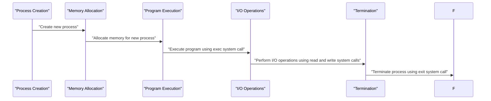

# Lesson 2: Core Architecture & Memory/Execution Models

## 1. Process, Threading & Execution Lifecycles

In the realm of operating systems, processes and threads form the fundamental building blocks of concurrent execution. A process is an isolated memory space, comprising its own virtual address space, open file descriptors, and process ID. Threads, on the other hand, are lightweight processes that share the same memory space as their parent process.

To understand the execution lifecycle of a process, we must delve into the intricacies of the system call interface. The `fork` system call creates a new process by duplicating the current process's memory space, while the `exec` system call replaces the current process's memory with a new executable image. The `wait` system call, conversely, suspends the execution of the current process until one of its child processes terminates.

```c
#include <sys/types.h>
#include <unistd.h>

int main() {
    pid_t pid = fork();
    if (pid == 0) {
        // Child process
        execl("/bin/ls", "ls", NULL);
    } else if (pid > 0) {
        // Parent process
        wait(NULL);
    }
    return 0;
}
```

The threading model, on the other hand, relies on the `pthread_create` function to spawn new threads within a process. Each thread has its own stack and execution context, but shares the same memory space as its parent thread.

```c
#include <pthread.h>

void* thread_func(void* arg) {
    printf("Hello from thread!\n");
    return NULL;
}

int main() {
    pthread_t thread;
    pthread_create(&thread, NULL, thread_func, NULL);
    pthread_join(thread, NULL);
    return 0;
}
```

## 2. Memory Subsystems & Buffer Management

Memory allocation is a critical component of any operating system, ensuring that processes have sufficient memory to execute their instructions. The memory subsystem consists of several key components:

*   **Virtual Memory**: A virtual address space is allocated for each process, which is then mapped to physical memory using page tables.
*   **Page Tables**: A hierarchical structure that maps virtual addresses to physical frames, allowing for efficient memory management.
*   **Buffer Cache**: A cache that stores frequently accessed data in memory, reducing the need for disk I/O operations.

To manage memory efficiently, operating systems employ various techniques, including:

*   **Paging**: Dividing memory into fixed-size blocks (pages) and mapping virtual addresses to physical frames.
*   **Swapping**: Moving pages between physical memory and disk storage to free up memory.

```c
#include <sys/mman.h>

int main() {
    void* addr = mmap(NULL, 1024, PROT_READ | PROT_WRITE, MAP_PRIVATE | MAP_ANONYMOUS, -1, 0);
    if (addr == MAP_FAILED) {
        perror("mmap");
        return 1;
    }
    // Use the allocated memory
    munmap(addr, 1024);
    return 0;
}
```

## 3. Data Structures & On-Disk/In-Kernel Binary Layouts

Data structures play a crucial role in operating system design, enabling efficient storage and retrieval of data. Common data structures include:

*   **Linked Lists**: Dynamic arrays that store elements in a linear sequence.
*   **Trees**: Hierarchical data structures that store elements in a tree-like structure.

To store data on disk, operating systems employ various file systems, including:

*   **Ext2**: A journaling file system that provides reliability and performance.
*   **XFS**: A high-performance file system that supports large file sizes and high I/O rates.

In-kernel data structures, such as the `inode` structure, store metadata about files and directories.

```c
#include <linux/fs.h>

struct inode {
    unsigned long i_ino;    /* inode's number */
    umode_t i_mode;         /* inode protection */
    uid_t i_uid;            /* inode's user ID */
    gid_t i_gid;            /* inode's group ID */
    // ...
};
```

## 4. The Critical Execution Lifecycle

The critical execution lifecycle of an operating system involves the following stages:

1.  **Process Creation**: A new process is created using the `fork` system call.
2.  **Memory Allocation**: Memory is allocated for the new process using the `mmap` system call.
3.  **Program Execution**: The new process executes its program using the `exec` system call.
4.  **I/O Operations**: The process performs I/O operations using system calls such as `read` and `write`.
5.  **Termination**: The process terminates using the `exit` system call.

```c
#include <sys/types.h>
#include <unistd.h>

int main() {
    pid_t pid = fork();
    if (pid == 0) {
        // Child process
        execl("/bin/ls", "ls", NULL);
    } else if (pid > 0) {
        // Parent process
        wait(NULL);
    }
    return 0;
}
```

By understanding the critical execution lifecycle, developers can design and optimize operating systems for efficient and reliable execution.

### Mermaid Diagrams

```mermaid
graph TD;
    A[Process Creation] -->| "Create new process" | B[Memory Allocation];
    B -->| "Allocate memory for new process" | C[Program Execution];
    C -->| "Execute program using exec system call" | D[I/O Operations];
    D -->| "Perform I/O operations using read and write system calls" | E[Termination];
    E -->| "Terminate process using exit system call" | F[Process Termination];
```


