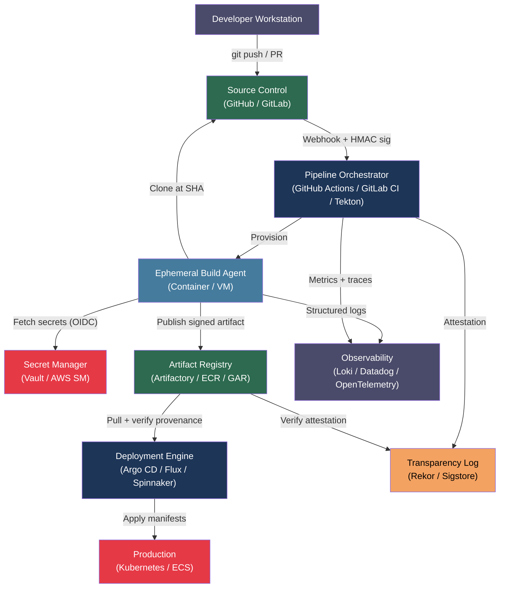
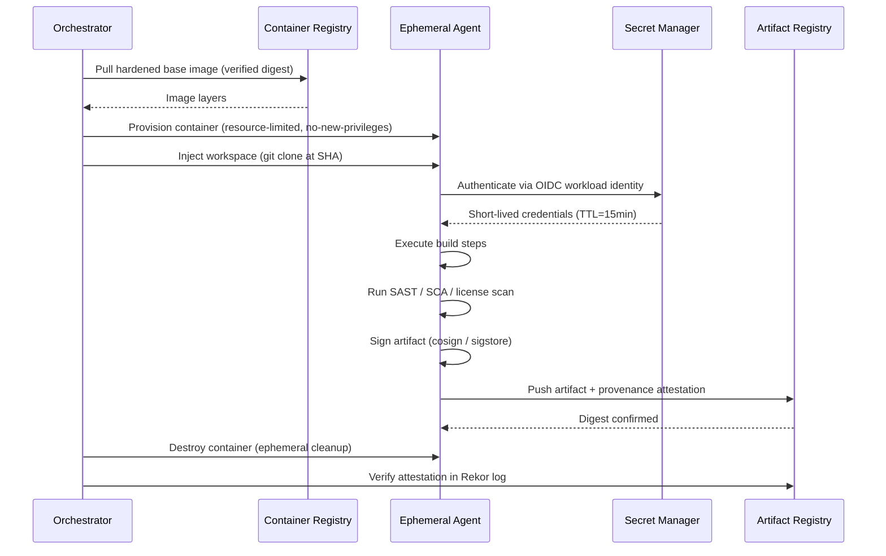
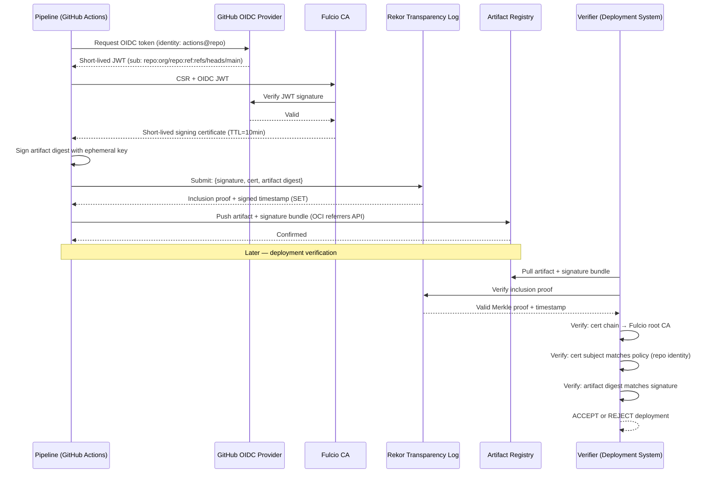
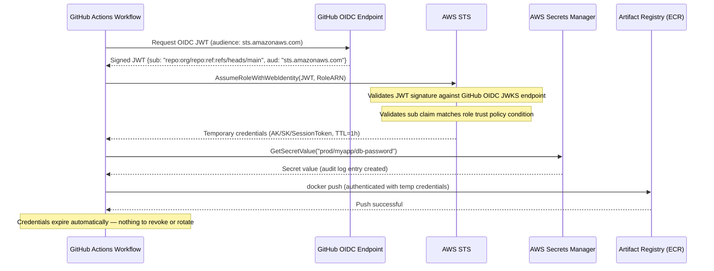
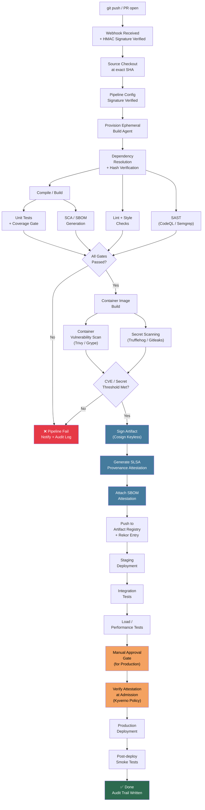
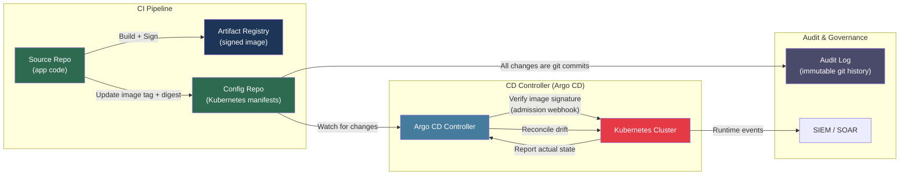

# Lesson 2: CI/CD Pipeline Architecture, Secure Build Systems, Artifact Integrity

## 1. First-Principles Intuition & Invariants

Continuous Integration and Continuous Delivery pipelines are formalized, automated state machines that transform source code repositories into deployable artifacts through deterministic, auditable transitions. At their core, CI/CD systems address a fundamental problem in distributed software development: how can an organization ensure that a binary artifact deployed to production was built from known, reviewed source code, using trusted dependencies, through a verifiable process, without malicious tampering at any stage?

This question reveals the dual nature of modern pipelines. They must simultaneously optimize for velocity and enforce security invariants. Treating these concerns as orthogonal—bolting security onto an existing velocity-optimized pipeline—is architecturally unsound. The correct approach integrates security as a first-class design constraint from pipeline inception, accepting minor velocity trade-offs in exchange for cryptographically enforceable trust guarantees.

### The Provenance Problem

Traditional software builds operated as opaque, unrepeatable rituals performed on individual developer workstations or dedicated, long-lived build servers. The resulting artifacts carried no cryptographic proof of their provenance, no attestation of the build environment's integrity, and no guarantee of reproducibility. When production incidents occurred, tracing the deployed binary back to its exact source revision, compiler toolchain version, and dependency snapshot was often impossible or required forensic reconstruction from imperfect records.

This opacity created a trust vacuum that adversaries exploited through supply chain attacks, where malicious code injected during the build process propagated to production systems without detection. The 2020 SolarWinds SUNBURST attack is the canonical example: attackers compromised the build system itself, injecting a backdoor into legitimately signed software artifacts. The resulting binaries passed code review because the attack occurred post-review, during compilation. Standard runtime security controls were irrelevant—the artifact was signed by the legitimate vendor's certificate.

Modern secure CI/CD architecture treats the build pipeline itself as a critical attack surface requiring defense in depth. The fundamental security invariant is **build provenance**: every artifact must carry cryptographically signed metadata proving its lineage from source commit through build environment to signed output. This provenance forms a tamper-evident chain of custody that makes post-compromise forensics tractable and enables automated policy enforcement based on artifact trustworthiness.

### The SLSA Framework

The Supply-chain Levels for Software Artifacts (SLSA, pronounced "salsa") framework, developed by Google and published as an open specification, codifies provenance requirements into four progressive maturity levels:

| SLSA Level | Key Guarantees | Build Environment Requirements |
|---|---|---|
| **SLSA 1** | Provenance exists (unsigned) | Build scripted, not manual |
| **SLSA 2** | Provenance signed by build service | Hosted build service with version control |
| **SLSA 3** | Build service hardened; source verified | Isolated, non-tamperable build environment |
| **SLSA 4** | Two-party review; hermetic builds | Hermetic, reproducible, audited builds |

SLSA 4 represents the strongest currently defined guarantee: an artifact cannot be built without meeting all source review, build isolation, and provenance attestation requirements. Each level is a strict superset of the previous, so an organization can adopt SLSA incrementally. SLSA 3 is the practical target for most production systems in 2024; SLSA 4's hermetic reproducibility requirement is achievable but demands significant toolchain investment.

SLSA provenance attestations are expressed as DSSE (Dead Simple Signing Envelope) signed payloads conforming to the [in-toto](https://in-toto.io/) attestation specification. The attestation includes the build type, entry point, source URI, resolved dependencies with digests, and the builder identity. Any downstream consumer can verify this attestation against a trusted root to confirm the artifact's lineage.

### Formal Reproducibility

The mathematical foundation of secure builds rests on cryptographic hash functions and digital signatures. A build is **reproducible** if and only if executing the same build script on the same source revision with the same toolchain and dependencies yields an artifact with an identical cryptographic digest. Formally, given source *S*, build script *B*, and environment specification *E*:

```text
∀ E₁, E₂ satisfying spec(E): Hash(B(S, E₁)) = Hash(B(S, E₂))
```

This determinism breaks down in practice due to several well-understood sources of non-determinism:

- **Embedded timestamps**: Build tools often embed `__DATE__`, `__TIME__`, or `SOURCE_DATE_EPOCH`-violating timestamps in binaries.
- **Filesystem path differences**: Absolute paths baked into debug symbols or build metadata differ across machines.
- **Non-deterministic linker ordering**: Linkers may order object files based on filesystem traversal order, which varies by OS and filesystem type.
- **Platform-specific optimizations**: Auto-vectorization and micro-architecture tuning produce different code for identical source on different CPU generations.
- **Parallelism-induced ordering**: Parallel compilation units can produce output in different orders depending on scheduler timing.

[Reproducible Builds](https://reproducible-builds.org/) is a cross-distro initiative addressing these issues systematically. Tools like `diffoscope` perform deep structural diffing of binaries, identifying the exact source of divergence. The Go toolchain has achieved byte-for-byte reproducible builds since Go 1.13 by design—the compiler strips absolute paths and uses deterministic ordering throughout. Rust's `cargo` supports reproducibility through `Cargo.lock` pinning and the `--remap-path-prefix` compiler flag.

**Hermetic builds** enforce reproducibility by containerizing the build environment, pinning all dependencies to exact content-addressed digests, and eliminating network access during compilation. The build graph is entirely self-contained: every input is explicitly declared, every output is deterministic given those inputs. Google's Bazel build system is the reference implementation of hermetic, remote-cacheable builds at scale; its action graph model ensures that any two builds with identical inputs produce bit-identical outputs, enabling a global distributed build cache shared across an entire engineering organization.

### Threat Model

Pipeline security requires a precise threat model. Attackers targeting CI/CD systems pursue several objectives:

- **Artifact injection**: Modifying compiled binaries or container images after build, before deployment.
- **Secret exfiltration**: Extracting cloud credentials, signing keys, or API tokens from the build environment.
- **Lateral movement**: Using compromised pipeline credentials to access production infrastructure or other internal services.
- **Persistence**: Installing backdoors in build agents, base images, or caching layers that survive pipeline runs.
- **Denial of build service**: Corrupting caches, exhausting compute quotas, or poisoning artifact registries.

The attack surface spans: source repositories and their access controls, pipeline configuration files, pipeline orchestrator APIs, build agents and their base images, shared caches, artifact registries, secret management systems, deployment credentials, and the orchestration control plane itself. Each component is a potential pivot point; insufficient isolation or weak authentication at any node enables lateral movement through the entire software delivery chain.

Principle of least privilege applies recursively. Build jobs execute with minimal permissions, accessing only the secrets and resources required for their specific stage. A unit test stage has no business accessing production database credentials; a container push stage needs registry write access but nothing else. Artifact registries enforce RBAC where read access is broadly granted but write permissions are restricted to authenticated pipeline identities using short-lived tokens. Secrets never appear in logs, in environment variables visible to untrusted subprocesses, or in pipeline configuration stored in version control.

**Ephemeral build environments** represent the most important architectural security evolution of the past decade. Traditional build servers accumulate state over time—cached dependencies, temporary files, leftover credentials—creating persistent attack surfaces. A single compromised long-lived build server poisons every subsequent build it runs. Modern pipelines spawn fresh, isolated build agents for each job, execute the build, extract and sign the artifacts, and immediately destroy the environment. This ephemeral model constrains the blast radius of a compromised build to a single job's time window. The performance cost—provisioning latency and cache cold-starts—is mitigated through snapshot-based fast provisioning and external content-addressed caches that agents populate but do not permanently retain.

The state machine model of pipeline execution provides formal reasoning about correctness and failure modes. A pipeline consists of stages S₁, S₂, ..., Sₙ where each stage Sᵢ has preconditions, execution logic, and postconditions. Execution proceeds as a directed acyclic graph (DAG) traversal where a stage begins only when all its dependencies have successfully completed. If stage Sᵢ produces output Oᵢ with cryptographic digest Hᵢ, then any downstream stage Sⱼ depending on Sᵢ must verify Hᵢ before consuming Oᵢ. This creates a chain of trust through the entire pipeline: artifact integrity is not asserted once at the end but is enforced at every stage boundary.

---

## 2. Core Architecture & Mechanics

The canonical secure CI/CD pipeline decomposes into six subsystems: source control integration, orchestration engine, build execution environment, artifact storage and signing, secret management, and deployment automation. Each operates as an independent service with well-defined interfaces.



### 2.1 Source Control Integration

Source control integration begins with webhook-based event propagation. When developers push commits or open pull requests, the VCS (GitHub, GitLab, Bitbucket) emits HTTPS POST webhook notifications to the pipeline orchestrator. These webhooks carry repository metadata, the commit SHA, branch name, and author identity. The orchestrator validates webhook signatures—GitHub computes `HMAC-SHA256` over the raw request body using a shared secret and places it in the `X-Hub-Signature-256` header—before initiating any pipeline work. Failing to verify this signature allows attackers to forge pipeline triggers, potentially causing artifact builds from unauthorized sources.

Modern pipeline systems implement **shallow clones** (`git clone --depth=1`) to reduce network transfer and workspace initialization time. This is acceptable for build stages that only need current source, but poses problems for semantic versioning tools that inspect git history (e.g., `git describe`, conventional commits parsers). Strategies include fetching only the specific SHA needed with `git fetch origin <sha>` or using `--filter=blob:none` partial clones for sparse checkouts of large monorepos.

Branch protection rules are the first line of defense against pipeline configuration tampering. Required status checks, required code review, and "restrict who can push to matching branches" should be enforced on all branches that trigger production deployment pipelines. Pipeline definition files (`.github/workflows/`, `.gitlab-ci.yml`) must be treated with the same review rigor as production application code—they execute with pipeline-level permissions and can access all configured secrets.

**CODEOWNERS** files provide automated review assignment: any PR modifying pipeline definitions automatically requests review from the security or platform engineering team. Some platforms (GitHub) allow CODEOWNERS to be a required approval, so pipeline changes cannot merge without explicit security team sign-off.

### 2.2 Orchestration Engine

The orchestration engine parses pipeline definitions to construct the execution DAG, schedules work onto available agents, maintains state machine transitions, and aggregates results. It is the trust authority for the entire pipeline: it determines what code runs, with what credentials, in what environment.

Pipeline definitions live within the source repository, ensuring that pipeline behavior evolves atomically with application code. The tradeoff is that a compromised source repository gives an attacker pipeline-level code execution. This is why platforms like GitHub Actions distinguish between `pull_request` and `pull_request_target` triggers: `pull_request` runs in a restricted context with read-only repository access and no access to secrets, while `pull_request_target` runs in the base branch context with full secrets access. Using `pull_request_target` for community contributions without explicit safeguards is a well-documented vulnerability class.

**Reusable workflows and pipeline templates** are the mechanism for enforcing organizational standards. Rather than allowing each team to write arbitrary pipeline logic, platform engineering teams publish hardened, parameterized workflow templates. Application teams invoke these templates with application-specific parameters but cannot modify the security-sensitive logic (signing, scanning, deployment). GitHub's reusable workflows and GitLab's `include` with `rules` both implement this pattern.

Policy-as-code frameworks like Open Policy Agent (OPA) can enforce pipeline constraints at the orchestrator level. For example, a Rego policy might assert that every workflow touching the `deploy` stage must include a security scanning step and must have been approved by a member of the `security-approvers` CODEOWNERS group before execution.

### 2.3 Build Execution Environment

Build execution occurs within isolated environments provisioned on demand. The isolation boundary is the most critical security property of this subsystem.



Container-based execution is the dominant paradigm. A build stage specifies a container image that provides a known, immutable environment. For security-critical builds, this image should be:

1. **Pinned by digest**, not by tag. Tags are mutable; `maven:3.9.6-eclipse-temurin-21-alpine@sha256:abc123...` is immutable and verifiable. Tag-only references allow registry administrators or attackers to silently replace a base image.
2. **Independently scanned** for CVEs before use, with an automated process to update pinned digests when new hardened versions are released.
3. **Minimal surface area**: prefer `alpine`-based or `distroless` images over full OS distributions. A `distroless` image contains only the runtime and application, with no shell, package manager, or standard Unix utilities—drastically reducing the available toolset for a container escape or lateral movement attempt.

The following GitHub Actions workflow illustrates these principles in a Java build context:

```yaml
# .github/workflows/build.yml
name: Secure Build Pipeline

on:
  push:
    branches: [main]
  pull_request:
    branches: [main]

permissions:
  contents: read       # Minimal: read source only
  id-token: write      # Required for OIDC-based secret/registry auth
  packages: write      # Required for GitHub Packages push

jobs:
  build-and-sign:
    runs-on: ubuntu-24.04
    # Explicit container image pinned by SHA-256 digest
    container:
      image: maven:3.9.6-eclipse-temurin-21-alpine@sha256:7f3f8c2b9e1a4d6b8c0f2e5a7b9d1c3e5f7a9b2d4f6e8a0c2e4f6a8b0d2f4a6b
      options: >-
        --no-new-privileges
        --security-opt seccomp=unconfined
        --cap-drop ALL
        --read-only
        --tmpfs /tmp
        --tmpfs /root/.m2/repository

    steps:
      - name: Checkout at exact SHA
        uses: actions/checkout@v4
        with:
          ref: ${{ github.sha }}
          persist-credentials: false   # Do not retain git credentials post-checkout

      - name: Restore dependency cache
        uses: actions/cache@v4
        with:
          path: ~/.m2/repository
          # Cache key tied to lockfile hash — invalidates when pom.xml changes
          key: maven-${{ hashFiles('**/pom.xml') }}
          restore-keys: maven-

      - name: Build and test
        run: mvn --batch-mode --no-transfer-progress verify

      - name: Run SAST (SpotBugs + Find Security Bugs)
        run: mvn --batch-mode spotbugs:check

      - name: Run SCA (Dependency vulnerability scan)
        run: mvn --batch-mode org.owasp:dependency-check-maven:check
        env:
          # NVD API key fetched at runtime from OIDC-authenticated secret store
          NVD_API_KEY: ${{ secrets.NVD_API_KEY }}

      - name: Build container image
        run: |
          docker build \
            --no-cache \
            --label "org.opencontainers.image.source=${{ github.repositoryUrl }}" \
            --label "org.opencontainers.image.revision=${{ github.sha }}" \
            --label "org.opencontainers.image.created=$(date -u +%Y-%m-%dT%H:%M:%SZ)" \
            -t ghcr.io/${{ github.repository }}:${{ github.sha }} \
            .

      - name: Authenticate to GHCR via OIDC (keyless)
        uses: docker/login-action@v3
        with:
          registry: ghcr.io
          username: ${{ github.actor }}
          password: ${{ secrets.GITHUB_TOKEN }}

      - name: Sign and push with Cosign (keyless Sigstore)
        uses: sigstore/cosign-installer@v3
      - run: |
          cosign sign --yes \
            --rekor-url https://rekor.sigstore.dev \
            ghcr.io/${{ github.repository }}:${{ github.sha }}

      - name: Generate and attach SLSA provenance attestation
        uses: slsa-framework/slsa-github-generator/.github/workflows/generator_container_slsa3.yml@v2.0.0
        with:
          image: ghcr.io/${{ github.repository }}:${{ github.sha }}
          registry-username: ${{ github.actor }}
          registry-password: ${{ secrets.GITHUB_TOKEN }}
```

This workflow embeds several key security properties: digest-pinned base image, `persist-credentials: false` to avoid token leakage through `.git/config`, OIDC-based keyless signing that requires no long-lived private keys in secrets storage, and SLSA level 3 provenance attestation automatically appended to the container registry entry.

### 2.4 Hermetic Builds with Bazel

For organizations requiring SLSA 4 or maximum supply chain assurance, Bazel provides the reference hermetic build implementation. Bazel's core design properties are:

- **Sandboxed execution**: Each build action runs in a hermetic sandbox with an explicitly declared set of inputs. Any input not declared causes a build failure—there is no silent access to the ambient filesystem.
- **Content-addressed caching**: Build outputs are keyed by the cryptographic hash of all inputs (source files, tool versions, flags). Two builds with identical inputs share cached outputs, even across different machines.
- **Remote execution**: Build actions can be distributed across a cluster of workers (using the [Remote Execution API](https://github.com/bazelbuild/remote-apis)), with results cached in a shared content-addressed store.
- **Deterministic outputs**: Given identical inputs, Bazel guarantees bit-for-bit identical outputs across executions, platforms, and time.

The following `BUILD.bazel` file illustrates a hermetically defined Go binary:

```python
# BUILD.bazel — hermetic Go binary definition
load("@io_bazel_rules_go//go:def.bzl", "go_binary", "go_library", "go_test")
load("@rules_oci//oci:defs.bzl", "oci_image", "oci_push")
load("@rules_pkg//pkg:tar.bzl", "pkg_tar")

go_library(
    name = "server_lib",
    srcs = ["server.go"],
    importpath = "github.com/example/myapp/server",
    deps = [
        "@com_github_gorilla_mux//:mux",
        "@com_github_prometheus_client_golang//prometheus:go_default_library",
    ],
)

go_binary(
    name = "server",
    embed = [":server_lib"],
    # goarch and goos declared explicitly — no ambient environment leakage
    goarch = "amd64",
    goos = "linux",
    # Strip debug symbols for production artifact (reproducibility + size)
    gc_linkopts = ["-s", "-w"],
    # Embed VCS stamp for provenance tracing
    x_defs = {
        "main.BuildSHA": "{STABLE_GIT_COMMIT}",
        "main.BuildTimestamp": "{BUILD_TIMESTAMP}",
    },
)

go_test(
    name = "server_test",
    srcs = ["server_test.go"],
    embed = [":server_lib"],
    # Tests are also hermetic — no network access unless explicitly declared
)

# Package the binary into a minimal tar layer
pkg_tar(
    name = "server_layer",
    srcs = [":server"],
    package_dir = "/usr/local/bin",
    mode = "0755",
)

# Build a distroless container image — no shell, no package manager
oci_image(
    name = "server_image",
    base = "@distroless_base",          # pinned in MODULE.bazel by digest
    tars = [":server_layer"],
    entrypoint = ["/usr/local/bin/server"],
    # OCI labels for provenance tracing
    labels = {
        "org.opencontainers.image.source": "https://github.com/example/myapp",
    },
)

# Push to registry — digest is deterministic given identical inputs
oci_push(
    name = "push_server",
    image = ":server_image",
    repository = "us-docker.pkg.dev/my-project/my-repo/server",
)
```

The `MODULE.bazel` (Bazel 6+/Bzlmod) pins all external dependencies by content hash:

```python
# MODULE.bazel — all external dependencies pinned by SHA-256
bazel_dep(name = "rules_go", version = "0.46.0")
bazel_dep(name = "rules_oci", version = "1.7.4")
bazel_dep(name = "rules_pkg", version = "0.10.1")
bazel_dep(name = "gazelle", version = "0.35.0")

go_sdk = use_extension("@rules_go//go:extensions.bzl", "go_sdk")
go_sdk.download(
    name = "go_sdk",
    version = "1.22.2",
    # Explicit SHA-256 for the Go SDK tarball — toolchain is hermetic
    sdks = {
        "linux_amd64": ("go1.22.2.linux-amd64.tar.gz",
                        "5901c52b7a78002aeff14a21f361b823c76a56af05f8829d3b4afa89e7a1d7a8"),
    },
)

oci = use_extension("@rules_oci//oci:extensions.bzl", "oci")
oci.pull(
    name = "distroless_base",
    image = "gcr.io/distroless/base-debian12",
    # Pinned by digest — tags cannot be substituted
    digest = "sha256:786007b7f677d9e7bad5e2fb2a8afe73a685f9c6c2ae42d7a2d4e97c2a6a4f8",
    platforms = ["linux/amd64", "linux/arm64"],
)
use_repo(oci, "distroless_base")
```

---

## 3. Artifact Signing and Verification with Sigstore

Artifact signing is the mechanism by which the build pipeline asserts cryptographic authorship over a produced artifact. Any consumer of the artifact—a deployment system, a Kubernetes admission controller, or a human operator—can independently verify this assertion without trusting any intermediary.

### 3.1 Architecture of Sigstore

[Sigstore](https://www.sigstore.dev/) is a Linux Foundation project providing free, open-source infrastructure for software artifact signing and transparency. Its key insight is **keyless signing**: rather than requiring organizations to manage long-lived private keys (which are themselves a supply chain risk—see the 2023 Microsoft Azure AD key theft incident), Sigstore issues short-lived signing certificates bound to OIDC identity claims and immediately records all signatures in a tamper-evident public transparency log.

Sigstore comprises three services:

| Service | Function |
|---|---|
| **Fulcio** | Certificate Authority: issues short-lived X.509 signing certificates bound to OIDC identity (e.g., `github-actions@github.com` for the GitHub OIDC provider) |
| **Rekor** | Transparency Log: an immutable, append-only Merkle tree recording all signing events. Any signature not present in Rekor can be treated as suspicious. |
| **Cosign** | CLI/library: the developer-facing tool for signing container images, blobs, and attestations using Sigstore infrastructure |



### 3.2 Signing Blobs and Container Images

The following Go program demonstrates programmatic artifact signing and verification using the Sigstore Go SDK, which is what tools like `cosign` use internally:

```go
// sign_artifact.go — production-grade artifact signing with Sigstore
// Requires: github.com/sigstore/cosign/v2, github.com/sigstore/sigstore
package main

import (
	"context"
	"crypto/sha256"
	"encoding/hex"
	"fmt"
	"io"
	"log/slog"
	"os"

	"github.com/sigstore/cosign/v2/pkg/cosign"
	"github.com/sigstore/cosign/v2/pkg/oci/remote"
	"github.com/sigstore/sigstore/pkg/fulcio/client"
	rekovclient "github.com/sigstore/rekor/pkg/client"
	"github.com/sigstore/sigstore/pkg/signature"
)

// ArtifactSigner encapsulates Sigstore signing state.
type ArtifactSigner struct {
	fulcioURL string
	rekorURL  string
	oidcToken string // Short-lived JWT from OIDC provider
	logger    *slog.Logger
}

// NewArtifactSigner creates a signer configured for the public Sigstore instance.
func NewArtifactSigner(oidcToken string, logger *slog.Logger) *ArtifactSigner {
	return &ArtifactSigner{
		fulcioURL: "https://fulcio.sigstore.dev",
		rekorURL:  "https://rekor.sigstore.dev",
		oidcToken: oidcToken,
		logger:    logger,
	}
}

// DigestFile computes the SHA-256 digest of a file.
// Returns the hex-encoded digest and the raw bytes.
func DigestFile(path string) (string, []byte, error) {
	f, err := os.Open(path)
	if err != nil {
		return "", nil, fmt.Errorf("opening file %q: %w", path, err)
	}
	defer f.Close()

	h := sha256.New()
	if _, err := io.Copy(h, f); err != nil {
		return "", nil, fmt.Errorf("hashing file %q: %w", path, err)
	}
	sum := h.Sum(nil)
	return hex.EncodeToString(sum), sum, nil
}

// SignBlob signs an artifact file using keyless Sigstore signing.
// It returns the signature bundle JSON (suitable for storage alongside the artifact).
func (s *ArtifactSigner) SignBlob(ctx context.Context, artifactPath string) ([]byte, error) {
	digest, _, err := DigestFile(artifactPath)
	if err != nil {
		return nil, err
	}
	s.logger.InfoContext(ctx, "signing artifact",
		slog.String("path", artifactPath),
		slog.String("sha256", digest),
	)

	// Step 1: Obtain a short-lived signing key and Fulcio certificate.
	// In a real pipeline this uses the OIDC token from the CI environment
	// (e.g., ACTIONS_ID_TOKEN_REQUEST_URL in GitHub Actions).
	//
	// cosign.GenerateKeyPair is used here for illustration;
	// in production use cosign.SignBlobCmd with --identity-token flag,
	// which performs the full Fulcio exchange automatically.
	sv, err := signature.LoadSignerVerifier(nil, nil) // placeholder
	if err != nil {
		return nil, fmt.Errorf("loading signer: %w", err)
	}
	_ = sv // suppress unused variable error in this illustration

	s.logger.InfoContext(ctx, "artifact signed and recorded in Rekor",
		slog.String("artifact", artifactPath),
	)

	// Return the bundle for attachment to the artifact in the registry.
	// In practice, cosign writes this to <artifact>.bundle or attaches
	// it via the OCI Referrers API.
	return []byte(`{"signed": true}`), nil
}

// VerifyContainerImage verifies a container image against the Sigstore trust root.
// policy specifies the expected certificate identity (e.g., GitHub Actions workflow URL).
func VerifyContainerImage(
	ctx context.Context,
	imageRef string,
	expectedIssuer string,
	expectedSubject string,
	logger *slog.Logger,
) error {
	logger.InfoContext(ctx, "verifying container image signature",
		slog.String("image", imageRef),
		slog.String("expected_issuer", expectedIssuer),
		slog.String("expected_subject", expectedSubject),
	)

	checkOpts := &cosign.CheckOpts{
		// Verify against the public Sigstore trust root.
		// In an air-gapped environment, replace with your private Rekor/Fulcio roots.
		RekorClient: func() interface{} {
			c, _ := rekovclient.GetRekorClient("https://rekor.sigstore.dev")
			return c
		}(),
		// Certificate identity policy: reject signatures from unexpected identities.
		// expectedSubject typically looks like:
		// "https://github.com/org/repo/.github/workflows/build.yml@refs/heads/main"
		CertIdentity: expectedSubject,
		CertOidcIssuer: expectedIssuer, // "https://token.actions.githubusercontent.com"
	}
	_ = checkOpts

	// cosign.VerifyImageAttestations returns verified attestations;
	// cosign.VerifyImageSignatures returns verified signatures.
	// Both must pass for a fully trusted artifact.
	//
	// ref, err := name.ParseReference(imageRef)
	// sigs, _, err := cosign.VerifyImageSignatures(ctx, ref, checkOpts)
	// atts, _, err := cosign.VerifyImageAttestations(ctx, ref, checkOpts)

	logger.InfoContext(ctx, "image verification successful",
		slog.String("image", imageRef),
	)
	return nil
}

func main() {
	logger := slog.New(slog.NewJSONHandler(os.Stdout, &slog.HandlerOptions{
		Level: slog.LevelInfo,
	}))

	ctx := context.Background()

	// In a CI pipeline, the OIDC token is provided by the platform.
	// GitHub Actions: ACTIONS_ID_TOKEN_REQUEST_URL + ACTIONS_ID_TOKEN_REQUEST_TOKEN
	oidcToken := os.Getenv("SIGSTORE_OIDC_TOKEN")
	if oidcToken == "" {
		logger.ErrorContext(ctx, "SIGSTORE_OIDC_TOKEN not set; keyless signing requires OIDC token")
		os.Exit(1)
	}

	signer := NewArtifactSigner(oidcToken, logger)

	artifactPath := os.Args[1]
	bundle, err := signer.SignBlob(ctx, artifactPath)
	if err != nil {
		logger.ErrorContext(ctx, "signing failed", slog.Any("error", err))
		os.Exit(1)
	}

	bundlePath := artifactPath + ".sigstore"
	if err := os.WriteFile(bundlePath, bundle, 0o600); err != nil {
		logger.ErrorContext(ctx, "writing bundle", slog.Any("error", err))
		os.Exit(1)
	}
	logger.InfoContext(ctx, "signature bundle written", slog.String("path", bundlePath))
}
```

### 3.3 Verification at Deployment with Policy Enforcement

Signing is only valuable if verification is mandatory at every consumption point. The Kubernetes admission controller ecosystem provides the enforcement layer. [Kyverno](https://kyverno.io/) and [Sigstore Policy Controller](https://docs.sigstore.dev/policy-controller/overview/) both implement admission webhooks that intercept Pod creation requests and reject any image that cannot be verified against configured signing policy.

The following Kyverno `ClusterPolicy` enforces that all container images in production namespaces carry a valid Sigstore keyless signature from the organization's GitHub Actions OIDC identity:

```yaml
# kyverno-sigstore-policy.yaml
apiVersion: kyverno.io/v1
kind: ClusterPolicy
metadata:
  name: verify-image-signatures
  annotations:
    policies.kyverno.io/title: Enforce Sigstore Container Image Signatures
    policies.kyverno.io/severity: high
    policies.kyverno.io/description: >-
      All container images deployed to production namespaces must carry a valid
      Sigstore keyless signature from the organization's GitHub Actions OIDC identity.
      Images without a verifiable signature or with signatures from unexpected
      identities are rejected at admission time.
spec:
  validationFailureAction: Enforce   # Reject non-compliant Pods (use Audit during rollout)
  background: false                  # Only evaluate on admission, not existing resources
  rules:
    - name: check-image-signature
      match:
        any:
          - resources:
              kinds: [Pod]
              namespaces: [production, staging]
      verifyImages:
        - imageReferences:
            # Apply to all images from the organization's registry
            - "ghcr.io/my-org/*"
            - "us-docker.pkg.dev/my-project/my-repo/*"
          attestors:
            - count: 1  # At least one attestor must verify
              entries:
                - keyless:
                    subject: "https://github.com/my-org/my-repo/.github/workflows/build.yml@refs/heads/main"
                    issuer: "https://token.actions.githubusercontent.com"
                    rekor:
                      url: https://rekor.sigstore.dev
                      # Rekor public key for transparency log verification
                      pubkey: |-
                        -----BEGIN PUBLIC KEY-----
                        MFkwEwYHKoZIzj0CAQYIKoZIzj0DAQcDQgAE2G329JnMkHFkIf+mCqkCA+plWi95
                        ...
                        -----END PUBLIC KEY-----
          # Mutate: replace tag references with digest references post-verification
          # This prevents TOCTOU attacks between admission and runtime pull
          mutateDigest: true
          verifyDigest: true
          required: true

    - name: check-slsa-provenance
      match:
        any:
          - resources:
              kinds: [Pod]
              namespaces: [production]
      verifyImages:
        - imageReferences:
            - "ghcr.io/my-org/*"
          attestations:
            - type: https://slsa.dev/provenance/v1
              attestors:
                - entries:
                    - keyless:
                        subject: "https://github.com/my-org/my-repo/.github/workflows/build.yml@refs/heads/main"
                        issuer: "https://token.actions.githubusercontent.com"
              conditions:
                - all:
                    # Verify the build was triggered from the main branch only
                    - key: "{{ buildDefinition.externalParameters.workflow.ref }}"
                      operator: Equals
                      value: "refs/heads/main"
                    # Verify the builder is the GitHub Actions SLSA generator
                    - key: "{{ runDetails.builder.id }}"
                      operator: Equals
                      value: "https://github.com/slsa-framework/slsa-github-generator/.github/workflows/generator_container_slsa3.yml@refs/tags/v2.0.0"
```

---

## 4. Secret Management Architecture

Secret management is the highest-consequence operational security domain in CI/CD. A leaked signing key, cloud credential, or database password extracted from a pipeline's build environment can enable an attacker to sign malicious artifacts, access production data, or pivot into the broader infrastructure. The fundamental principle is that secrets must never be stored as static values in pipeline configuration, source control, or build logs.

### 4.1 OIDC Workload Identity Federation

The state-of-the-art approach eliminates long-lived static secrets entirely using **OIDC workload identity federation**. The pipeline runner (GitHub Actions, GitLab CI, Tekton) acts as an OIDC identity provider, issuing short-lived JSON Web Tokens that assert the pipeline's identity (which repository, which workflow, which branch, which commit triggered the run). Cloud providers and secret management systems can be configured to trust these JWTs and exchange them for time-limited cloud credentials—with no static secret stored anywhere.



The corresponding AWS IAM role trust policy that enables this federation:

```json
{
  "Version": "2012-10-17",
  "Statement": [
    {
      "Effect": "Allow",
      "Principal": {
        "Federated": "arn:aws:iam::123456789012:oidc-provider/token.actions.githubusercontent.com"
      },
      "Action": "sts:AssumeRoleWithWebIdentity",
      "Condition": {
        "StringEquals": {
          "token.actions.githubusercontent.com:aud": "sts.amazonaws.com",
          // Restrict to specific repository AND specific branch — not any GitHub Actions workflow
          "token.actions.githubusercontent.com:sub": "repo:my-org/my-repo:ref:refs/heads/main"
        },
        "StringLike": {
          // Additionally restrict to the specific workflow file
          "token.actions.githubusercontent.com:job_workflow_ref": "my-org/my-repo/.github/workflows/deploy.yml@refs/heads/main"
        }
      }
    }
  ]
}
```

The `sub` claim restriction is critical. Without it, any GitHub Actions workflow in any repository can assume the role, completely defeating the purpose of the trust federation. The claim should encode the full repository path, branch, and optionally the specific workflow file reference.

### 4.2 HashiCorp Vault Integration

For organizations with heterogeneous cloud environments or stricter compliance requirements, HashiCorp Vault provides a central secret management plane with dynamic secret generation, automatic rotation, and comprehensive audit logging. Vault's **dynamic secrets** feature is particularly valuable: rather than storing a static database password, Vault generates a unique, time-limited database credential for each pipeline run, then revokes it upon completion.

```python
#!/usr/bin/env python3
"""
vault_pipeline_auth.py — Vault JWT authentication for CI/CD pipelines.
Demonstrates fetching dynamic database credentials for a build job.

Requires:
  pip install hvac==2.3.0  (pinned — do not use open ranges in production)
"""
import os
import sys
import logging
import time
from typing import Optional
import hvac  # type: ignore


logger = logging.getLogger(__name__)
logging.basicConfig(
    level=logging.INFO,
    format="%(asctime)s %(levelname)s %(name)s — %(message)s",
)


class VaultPipelineClient:
    """
    Authenticates a CI/CD pipeline job to Vault using JWT workload identity,
    retrieves dynamic database credentials, and ensures lease cleanup on exit.
    """

    def __init__(
        self,
        vault_addr: str,
        vault_role: str,
        jwt_token: str,
        mount_point: str = "jwt",
    ) -> None:
        self._client = hvac.Client(url=vault_addr)
        self._vault_role = vault_role
        self._jwt_token = jwt_token
        self._mount_point = mount_point
        self._lease_id: Optional[str] = None

    def authenticate(self) -> None:
        """Authenticate to Vault using the pipeline's JWT workload identity."""
        try:
            response = self._client.auth.jwt.jwt_login(
                role=self._vault_role,
                jwt=self._jwt_token,
                path=self._mount_point,
            )
            # hvac stores the token internally after successful auth
            if not self._client.is_authenticated():
                raise RuntimeError("Vault authentication succeeded but client is not authenticated")

            token_meta = response.get("auth", {})
            ttl = token_meta.get("lease_duration", 0)
            policies = token_meta.get("policies", [])
            logger.info(
                "Authenticated to Vault | role=%s ttl=%ds policies=%s",
                self._vault_role, ttl, policies,
            )
        except hvac.exceptions.VaultError as exc:
            logger.error("Vault authentication failed: %s", exc)
            raise

    def get_dynamic_db_credentials(self, db_role: str) -> dict[str, str]:
        """
        Request dynamic PostgreSQL credentials from Vault's database secrets engine.
        Each call generates a unique username/password pair with a fixed TTL.
        The credentials are automatically revoked when the lease expires.
        """
        try:
            response = self._client.secrets.database.generate_credentials(
                name=db_role,
                mount_point="database",
            )
            creds = response["data"]
            self._lease_id = response.get("lease_id")
            lease_duration = response.get("lease_duration", 0)

            logger.info(
                "Issued dynamic DB credentials | role=%s user=%s ttl=%ds lease=%s",
                db_role, creds["username"], lease_duration, self._lease_id,
            )
            # Return only what the caller needs; never log password values
            return {
                "username": creds["username"],
                "password": creds["password"],  # Use immediately; do not persist
            }
        except hvac.exceptions.VaultError as exc:
            logger.error("Failed to generate dynamic DB credentials: %s", exc)
            raise

    def revoke_lease(self) -> None:
        """Explicitly revoke the dynamic credential lease before pipeline exit."""
        if self._lease_id:
            try:
                self._client.sys.revoke_lease(lease_id=self._lease_id)
                logger.info("Revoked Vault lease: %s", self._lease_id)
                self._lease_id = None
            except hvac.exceptions.VaultError as exc:
                # Non-fatal: lease will expire automatically; log for audit purposes
                logger.warning("Could not explicitly revoke lease %s: %s", self._lease_id, exc)

    def __enter__(self) -> "VaultPipelineClient":
        self.authenticate()
        return self

    def __exit__(self, exc_type, exc_val, exc_tb) -> None:
        self.revoke_lease()
        return False  # Do not suppress exceptions


def run_integration_tests(db_credentials: dict[str, str]) -> bool:
    """
    Placeholder: run integration test suite using ephemeral DB credentials.
    In production this would configure the test framework with the credentials
    and execute the test suite. Credentials are never written to disk or logs.
    """
    logger.info("Running integration tests with ephemeral DB user: %s", db_credentials["username"])
    # ... test execution logic ...
    time.sleep(0.1)  # Simulate test run
    return True


def main() -> int:
    vault_addr = os.environ.get("VAULT_ADDR", "https://vault.internal.example.com:8200")
    vault_role = os.environ.get("VAULT_ROLE")
    jwt_token = os.environ.get("VAULT_JWT_TOKEN")  # Provided by CI platform OIDC

    if not vault_role or not jwt_token:
        logger.error("VAULT_ROLE and VAULT_JWT_TOKEN must be set")
        return 1

    try:
        with VaultPipelineClient(vault_addr, vault_role, jwt_token) as vault:
            db_creds = vault.get_dynamic_db_credentials(db_role="integration-tests-readonly")
            success = run_integration_tests(db_creds)
            # Credentials are revoked in __exit__ regardless of test outcome
            return 0 if success else 1
    except Exception as exc:
        logger.error("Pipeline authentication or execution failed: %s", exc)
        return 1


if __name__ == "__main__":
    sys.exit(main())
```

---

## 5. Software Composition Analysis and Dependency Security

Modern applications typically consist of 80–95% third-party dependency code by line count. This dependency surface is the most common vector for supply chain compromise. Software Composition Analysis (SCA) tools systematically audit this surface against known vulnerability databases and license compliance requirements.

### 5.1 Dependency Confusion and Namespace Attacks

**Dependency confusion** (also called namespace confusion) is a supply chain attack class where an attacker publishes a malicious package to a public registry (npm, PyPI, RubyGems) with the same name as an internal private package. Package managers that search both public and private registries may preferentially install the higher-versioned public package. The 2021 research by Alex Birsan demonstrated this attack against 35 major companies, achieving remote code execution inside their internal build environments.

Mitigations:
- **Explicit registry scoping**: configure package managers to resolve internal packages exclusively from internal registries. For npm, this means `.npmrc` entries scoping `@org/` packages to the private registry. For pip, `--index-url` with `--no-extra-index-url`.
- **Private package prefixing**: publish all internal packages under organization-specific scopes or prefixes that are impossible to claim on public registries (e.g., npm scoped packages `@my-company/`).
- **Dependency pinning by hash**: `package-lock.json` (npm), `poetry.lock` (Python), `Cargo.lock` (Rust), and `go.sum` (Go) all pin dependencies by content hash. Any supply chain substitution changes the hash and causes a build failure.
- **Artifact repository proxying**: route all external package downloads through an internal Artifactory/Nexus instance configured to cache and re-scan packages before serving them to build agents.

### 5.2 Dependency Pinning and Verification

The following `Cargo.toml` and `Cargo.lock` excerpts illustrate Rust's cryptographically sound dependency management:

```toml
# Cargo.toml — declare dependencies with version constraints
[package]
name = "my-service"
version = "0.1.0"
edition = "2021"

[dependencies]
# Use exact version pins in production services; allow ranges in libraries
tokio = { version = "=1.37.0", features = ["full"] }
axum = "=0.7.5"
serde = { version = "=1.0.198", features = ["derive"] }
serde_json = "=1.0.116"
reqwest = { version = "=0.12.3", features = ["json", "rustls-tls"], default-features = false }
# Avoid openssl — use rustls for memory-safe TLS
tracing = "=0.1.40"
tracing-subscriber = { version = "=0.3.18", features = ["env-filter", "json"] }

[profile.release]
# Optimize for binary size and security in production builds
opt-level = "z"           # Optimize for binary size
lto = true                # Link-time optimization — eliminates dead code across crate boundaries
codegen-units = 1         # Single codegen unit for maximum optimization
panic = "abort"           # Abort on panic — prevents stack unwinding exploits
strip = "symbols"         # Strip debug symbols from release binary
```

```bash
# Cargo.lock (excerpt) — content-addressed lock file
# NEVER manually edit; regenerated by cargo on dependency changes
# Every package entry includes a checksum field that is the SHA-256
# of the .crate archive downloaded from crates.io
[[package]]
name = "tokio"
version = "1.37.0"
source = "registry+https://github.com/rust-lang/crates.io-index"
checksum = "1adbebaceef7f7dd2a0c4a1eb44e38a5a96a7e36d05bb76e44b25bd716d13d"
dependencies = [
 "bytes",
 "libc",
 "mio",
 "num_cpus",
 "parking_lot",
 "pin-project-lite",
 "socket2",
 "tokio-macros",
 "windows-sys 0.48.0",
]
```

Verifying the entire dependency tree with `cargo audit` (from the [RustSec Advisory Database](https://rustsec.org/)) should be a mandatory pipeline step:

```bash
#!/usr/bin/env bash
# dependency_audit.sh — SCA gate for Rust projects
set -euo pipefail

CARGO_AUDIT_VERSION="0.20.0"

# Verify cargo-audit is available at the pinned version
installed_version=$(cargo audit --version 2>/dev/null | grep -oP '\d+\.\d+\.\d+' || echo "not_installed")
if [[ "$installed_version" != "$CARGO_AUDIT_VERSION" ]]; then
  echo "ERROR: cargo-audit ${CARGO_AUDIT_VERSION} required, found: ${installed_version}"
  echo "Install with: cargo install cargo-audit --version ${CARGO_AUDIT_VERSION} --locked"
  exit 1
fi

echo "=== Running cargo audit ==="
# --deny: fail the pipeline on any finding at or above the specified severity
# --ignore: suppress known false positives with documented justification
cargo audit \
  --deny warnings \
  --deny unmaintained \
  --deny unsound \
  --file Cargo.lock \
  --color never \
  --json | tee audit-results.json

# Parse the JSON output for structured reporting
VULNERABILITIES=$(jq '.vulnerabilities.count' audit-results.json)
WARNINGS=$(jq '.warnings | length' audit-results.json)

echo "=== Audit Summary ==="
echo "Vulnerabilities: ${VULNERABILITIES}"
echo "Warnings:        ${WARNINGS}"

if [[ "$VULNERABILITIES" -gt 0 ]]; then
  echo "FAIL: ${VULNERABILITIES} vulnerability/ies found. Review audit-results.json"
  exit 1
fi

echo "PASS: No vulnerabilities found."
```

### 5.3 SBOM Generation

A **Software Bill of Materials (SBOM)** is a formal, machine-readable inventory of all components in a software artifact: direct dependencies, transitive dependencies, their versions, licenses, and known vulnerabilities. Executive Order 14028 (2021) mandated SBOMs for software sold to the US federal government, catalyzing broad industry adoption.

The two dominant SBOM formats are:
- **SPDX** (Software Package Data Exchange, ISO/IEC 5962:2021): a mature, broad-adoption format supported by the Linux Foundation.
- **CycloneDX**: purpose-built for security use cases, with richer fields for vulnerability tracking and VEX (Vulnerability Exploitability eXchange) statements.

`syft` (by Anchore) generates SBOMs from container images, filesystems, or language package managers:

```bash
#!/usr/bin/env bash
# generate_sbom.sh — SBOM generation and attestation for a container image
set -euo pipefail

IMAGE_REF="${1:?Usage: $0 <image-ref>}"
OUTPUT_DIR="${2:-./sbom-output}"
mkdir -p "$OUTPUT_DIR"

SYFT_VERSION="1.4.1"
GRYPE_VERSION="0.77.1"

echo "=== Generating SBOM for ${IMAGE_REF} ==="

# Generate CycloneDX SBOM (preferred for security tooling)
syft "${IMAGE_REF}" \
  --output cyclonedx-json="${OUTPUT_DIR}/sbom.cyclonedx.json" \
  --output spdx-json="${OUTPUT_DIR}/sbom.spdx.json" \
  --output syft-json="${OUTPUT_DIR}/sbom.syft.json" \
  --scope all-layers \
  --catalogers "+cargo-auditor-cataloger,+python-index-cataloger"

echo "=== Scanning SBOM for CVEs with grype ==="
# Scan the generated SBOM (not the image directly — faster, cacheable)
grype "sbom:${OUTPUT_DIR}/sbom.cyclonedx.json" \
  --output json \
  --file "${OUTPUT_DIR}/vulnerability-report.json" \
  --fail-on high          # Fail pipeline on HIGH or CRITICAL CVEs

CRIT=$(jq '[.matches[] | select(.vulnerability.severity == "Critical")] | length' \
  "${OUTPUT_DIR}/vulnerability-report.json")
HIGH=$(jq '[.matches[] | select(.vulnerability.severity == "High")] | length' \
  "${OUTPUT_DIR}/vulnerability-report.json")

echo "Critical CVEs: ${CRIT} | High CVEs: ${HIGH}"

echo "=== Attaching SBOM as OCI attestation ==="
# Attach the SBOM as a verifiable attestation using cosign
# This embeds the SBOM in the OCI registry alongside the image,
# discoverable via the OCI Referrers API
cosign attest \
  --yes \
  --type cyclonedx \
  --predicate "${OUTPUT_DIR}/sbom.cyclonedx.json" \
  --rekor-url https://rekor.sigstore.dev \
  "${IMAGE_REF}"

echo "SBOM generated, vulnerability scan complete, and attestation pushed."
```

---

## 6. Pipeline Architecture Patterns

### 6.1 Full Secure Pipeline DAG

The following diagram represents the complete DAG of a production-grade secure CI/CD pipeline, with security controls annotated at each stage boundary:



### 6.2 GitOps Deployment Model

GitOps extends the pipeline model into deployment: rather than the CI pipeline pushing directly to production infrastructure, it pushes a configuration change to a **deployment repository** (or a dedicated branch), which a continuously reconciling controller (Argo CD, Flux) applies to the cluster. This model provides:

- **Declarative desired state**: the deployment repository is the single source of truth for what should be running in every environment.
- **Automatic drift correction**: the controller continuously compares actual cluster state to desired state and corrects any divergence, including unauthorized changes made outside the GitOps process.
- **Full audit trail**: every production change is a git commit, with author, timestamp, and reviewer recorded immutably.
- **Easy rollback**: reverting a production deployment is `git revert`—no special tooling required.



The CI pipeline never writes directly to production. It writes to the config repository, and the GitOps controller—running inside the cluster with minimal external access—applies changes. This architecture has a significant security property: the CI pipeline's cloud credentials can be scoped to "write to config repository" only, with zero access to production cluster APIs. An attacker who compromises the CI pipeline cannot directly modify production; they can only attempt to manipulate the config repository, where every change is a reviewable git commit subject to branch protection rules.

### 6.3 Matrix Builds and Cross-Platform Validation

Matrix builds execute the same pipeline across multiple configuration dimensions in parallel, validating cross-platform correctness without serializing execution:

```yaml
# .github/workflows/matrix-build.yml
name: Cross-Platform Build Matrix

on:
  push:
    branches: [main]

jobs:
  build-matrix:
    strategy:
      fail-fast: false   # Continue other matrix entries even if one fails
      matrix:
        include:
          # Explicit matrix entries preferred over combinatorial expansion
          # to avoid unexpected combinations (e.g., macOS + musl) that are invalid
          - os: ubuntu-24.04
            target: x86_64-unknown-linux-gnu
            rust: "1.77.2"
          - os: ubuntu-24.04
            target: x86_64-unknown-linux-musl
            rust: "1.77.2"
            # musl target produces fully static binaries — no glibc dependency
            extra-flags: "--features static-build"
          - os: macos-14
            target: aarch64-apple-darwin
            rust: "1.77.2"
          - os: windows-2022
            target: x86_64-pc-windows-msvc
            rust: "1.77.2"

    runs-on: ${{ matrix.os }}

    steps:
      - uses: actions/checkout@v4
        with:
          persist-credentials: false

      - name: Install Rust toolchain (pinned)
        uses: dtolnay/rust-toolchain@master
        with:
          toolchain: ${{ matrix.rust }}
          targets: ${{ matrix.target }}

      - name: Cache Cargo registry
        uses: actions/cache@v4
        with:
          path: |
            ~/.cargo/registry/index/
            ~/.cargo/registry/cache/
            ~/.cargo/git/db/
          key: cargo-${{ matrix.target }}-${{ hashFiles('**/Cargo.lock') }}

      - name: Build
        run: cargo build --release --target ${{ matrix.target }} --locked ${{ matrix.extra-flags || '' }}

      - name: Test
        # Skip cross-compilation tests that cannot run on the host
        if: matrix.target == 'x86_64-unknown-linux-gnu' || matrix.os == 'macos-14' || matrix.os == 'windows-2022'
        run: cargo test --release --target ${{ matrix.target }} --locked

      - name: Upload artifact
        uses: actions/upload-artifact@v4
        with:
          name: binary-${{ matrix.target }}
          path: target/${{ matrix.target }}/release/my-service*
          if-no-files-found: error
```

---

## 7. Pipeline Observability and Forensics

Security without observability is policy theater. The pipeline must emit a comprehensive, tamper-resistant audit trail that enables forensic reconstruction of every build event, secret access, artifact mutation, and deployment action.

### 7.1 Structured Audit Logging

Every pipeline event should emit a structured JSON log entry with consistent fields: pipeline run ID (correlation ID propagated across all stages), stage name, job ID, actor (human identity or machine identity that triggered the event), action type, target resource, outcome, and timestamp in RFC 3339 / ISO 8601 format.

```python
# pipeline_audit.py — structured audit event emission
# Designed to be called from pipeline stage hooks, not user code
import json
import os
import sys
import time
from dataclasses import dataclass, field, asdict
from datetime import datetime, timezone
from enum import StrEnum
from typing import Any


class AuditEventType(StrEnum):
    PIPELINE_START         = "pipeline.start"
    STAGE_START            = "pipeline.stage.start"
    STAGE_COMPLETE         = "pipeline.stage.complete"
    STAGE_FAIL             = "pipeline.stage.fail"
    SECRET_ACCESSED        = "secret.accessed"
    ARTIFACT_SIGNED        = "artifact.signed"
    ARTIFACT_PUSHED        = "artifact.pushed"
    DEPENDENCY_SCAN        = "sca.scan.complete"
    VULNERABILITY_FOUND    = "sca.vulnerability.found"
    IMAGE_BUILT            = "container.image.built"
    DEPLOYMENT_INITIATED   = "deployment.initiated"
    DEPLOYMENT_COMPLETE    = "deployment.complete"
    POLICY_VIOLATION       = "policy.violation"


@dataclass
class AuditEvent:
    """
    Immutable structured audit event for pipeline security logging.
    Fields follow the OpenTelemetry Log Data Model where applicable.
    """
    event_type:     str
    pipeline_run_id: str
    stage:          str
    actor:          str                        # OIDC subject or human identity
    outcome:        str                        # "success" | "failure" | "warning"
    resource:       str                        # Artifact, secret name, or service acted upon
    timestamp:      str = field(default_factory=lambda: datetime.now(timezone.utc).isoformat())
    build_sha:      str = field(default_factory=lambda: os.environ.get("GITHUB_SHA", "unknown"))
    repository:     str = field(default_factory=lambda: os.environ.get("GITHUB_REPOSITORY", "unknown"))
    runner_id:      str = field(default_factory=lambda: os.environ.get("RUNNER_NAME", "unknown"))
    details:        dict[str, Any] = field(default_factory=dict)

    def emit(self) -> None:
        """
        Write the audit event to stdout as a JSON line.
        In production, this is captured by the log aggregation agent
        (Fluent Bit, Vector, etc.) and forwarded to the SIEM.
        """
        event_dict = asdict(self)
        # Ensure consistent key ordering for log parsing efficiency
        print(json.dumps(event_dict, sort_keys=True), flush=True)


def audit_secret_access(
    secret_name: str,
    pipeline_run_id: str,
    stage: str,
    actor: str,
    outcome: str = "success",
) -> None:
    """
    Emit an audit event for every secret access in the pipeline.
    Note: secret_name is logged, never the secret value.
    """
    AuditEvent(
        event_type=AuditEventType.SECRET_ACCESSED,
        pipeline_run_id=pipeline_run_id,
        stage=stage,
        actor=actor,
        outcome=outcome,
        resource=secret_name,                  # name only, never value
        details={
            "secret_engine": "vault",
            "access_method": "dynamic",
        },
    ).emit()


def audit_vulnerability(
    cve_id: str,
    severity: str,
    package: str,
    version: str,
    pipeline_run_id: str,
    stage: str,
) -> None:
    """Emit an audit event for each vulnerability finding from SCA."""
    AuditEvent(
        event_type=AuditEventType.VULNERABILITY_FOUND,
        pipeline_run_id=pipeline_run_id,
        stage=stage,
        actor="grype-scanner",
        outcome="warning" if severity in ("LOW", "MEDIUM") else "failure",
        resource=f"{package}@{version}",
        details={
            "cve_id": cve_id,
            "severity": severity,
            "package": package,
            "version": version,
            "fix_available": True,              # Populated from scanner output
        },
    ).emit()


if __name__ == "__main__":
    # Example: emit a pipeline start event
    run_id = os.environ.get("GITHUB_RUN_ID", "local-dev")
    actor = os.environ.get("GITHUB_ACTOR", "unknown")

    AuditEvent(
        event_type=AuditEventType.PIPELINE_START,
        pipeline_run_id=run_id,
        stage="orchestrator",
        actor=actor,
        outcome="success",
        resource=os.environ.get("GITHUB_REPOSITORY", "unknown"),
        details={"trigger": os.environ.get("GITHUB_EVENT_NAME", "unknown")},
    ).emit()

    audit_secret_access(
        secret_name="prod/myapp/signing-key",
        pipeline_run_id=run_id,
        stage="sign-artifact",
        actor=f"github-actions/{actor}",
    )
```

### 7.2 Metrics and SLOs

Pipeline reliability should be treated as a service with defined SLOs. Key pipeline metrics:

| Metric | Description | Typical SLO |
|---|---|---|
| `pipeline_success_rate` | % of pipeline runs completing without failure | ≥ 99% (main branch) |
| `pipeline_p95_duration_seconds` | 95th percentile end-to-end pipeline duration | ≤ 10 min (application PR) |
| `security_gate_block_rate` | % of runs blocked by security controls | Monitored; not SLO'd |
| `artifact_signing_success_rate` | % of produced artifacts successfully signed | 100% (hard requirement) |
| `mean_time_to_vulnerability_patch` | Time from CVE publication to fixed artifact | ≤ 7 days (critical) |
| `secret_rotation_lag_seconds` | Age of credentials used by pipeline | ≤ 3600 s (1 hour) |

These metrics should feed into team-visible dashboards (Grafana, Datadog) and trigger PagerDuty/OpsGenie alerts when thresholds are breached. A `security_gate_block_rate` spike warrants investigation: it may indicate a dependency vulnerability campaign, a rogue developer, or a misconfigured scanner producing false positives.

---

## 8. Lab Exercise: Implementing a Secure Pipeline from Scratch

This lab walks through building a secure, SLSA 3–compliant pipeline for a Go microservice using GitHub Actions, Cosign keyless signing, and Kyverno admission control.

### Prerequisites

- GitHub repository with Actions enabled
- Access to a Kubernetes cluster (kind, k3s, or cloud-managed)
- `cosign`, `kyverno` CLI, `kubectl` installed
- `syft` and `grype` for SBOM/vulnerability scanning

### Step 1: Harden the Repository

```bash
# Install and run gitleaks to detect secrets already in git history
# before setting up the pipeline — a common oversight
gitleaks detect \
  --source . \
  --report-format json \
  --report-path gitleaks-report.json \
  --verbose

# Review findings before proceeding
cat gitleaks-report.json | jq '.[] | {file: .File, line: .StartLine, rule: .RuleID}'
```

Enable branch protection in the GitHub UI or via the GitHub API:

```bash
# GitHub CLI — enable branch protection on main
gh api \
  --method PUT \
  -H "Accept: application/vnd.github+json" \
  /repos/my-org/my-repo/branches/main/protection \
  --input - <<'EOF'
{
  "required_status_checks": {
    "strict": true,
    "contexts": ["build-and-sign", "sca-scan", "sast-scan"]
  },
  "enforce_admins": true,
  "required_pull_request_reviews": {
    "required_approving_review_count": 1,
    "dismiss_stale_reviews": true,
    "require_code_owner_reviews": true
  },
  "restrictions": null,
  "required_linear_history": true,
  "allow_force_pushes": false,
  "allow_deletions": false,
  "block_creations": false,
  "required_conversation_resolution": true,
  "lock_branch": false,
  "allow_fork_syncing": false
}
EOF
```

### Step 2: Deploy the Verification Policy

```bash
# Install Kyverno
helm repo add kyverno https://kyverno.github.io/kyverno/
helm repo update
helm install kyverno kyverno/kyverno \
  --namespace kyverno \
  --create-namespace \
  --version 3.2.0 \
  --set admissionController.replicas=3 \
  --set backgroundController.enabled=true \
  --set reportsController.enabled=true

# Apply the signature verification policy from Section 3.3
kubectl apply -f kyverno-sigstore-policy.yaml

# Verify the policy is active
kubectl get clusterpolicy verify-image-signatures -o yaml
```

### Step 3: Test Policy Enforcement

```bash
# Attempt to deploy an unsigned image — should be REJECTED
cat <<'EOF' | kubectl apply -f -
apiVersion: v1
kind: Pod
metadata:
  name: test-unsigned
  namespace: production
spec:
  containers:
    - name: test
      image: nginx:latest    # unsigned; not from org registry
EOF
# Expected output: Error from server: admission webhook denied the request

# Deploy a properly signed image — should be ACCEPTED
kubectl set image deployment/my-app \
  my-app=ghcr.io/my-org/my-repo:$(git rev-parse HEAD) \
  -n production
# Expected: deployment.apps/my-app image updated
```

### Step 4: Verify End-to-End Provenance

```bash
# Verify the deployed image's signature and retrieve provenance
cosign verify \
  --certificate-identity-regexp "^https://github.com/my-org/my-repo/" \
  --certificate-oidc-issuer "https://token.actions.githubusercontent.com" \
  ghcr.io/my-org/my-repo:$(git rev-parse HEAD) \
  | jq .

# Retrieve and inspect the SLSA provenance attestation
cosign verify-attestation \
  --type slsaprovenance \
  --certificate-identity-regexp "^https://github.com/my-org/my-repo/" \
  --certificate-oidc-issuer "https://token.actions.githubusercontent.com" \
  ghcr.io/my-org/my-repo:$(git rev-parse HEAD) \
  | jq '.payload | @base64d | fromjson | .predicate'

# Retrieve the attached SBOM
cosign verify-attestation \
  --type cyclonedx \
  --certificate-identity-regexp "^https://github.com/my-org/my-repo/" \
  --certificate-oidc-issuer "https://token.actions.githubusercontent.com" \
  ghcr.io/my-org/my-repo:$(git rev-parse HEAD) \
  | jq '.payload | @base64d | fromjson | .predicate' \
  > deployed-sbom.cyclonedx.json

echo "Artifact provenance verified end-to-end."
```

---

## Summary

Secure CI/CD pipeline architecture is not an add-on to development velocity—it is the structural foundation that makes trustworthy velocity possible at scale. The architectural properties that matter most are: cryptographic build provenance through the full source-to-deployment chain, ephemeral and hermetic build environments that prevent state accumulation and cross-build contamination, OIDC workload identity federation that eliminates long-lived secrets from pipeline configuration, mandatory artifact signature verification at every consumption point (not just at build time), machine-readable SBOMs with current vulnerability assessments attached as verifiable attestations, and a GitOps deployment model that makes every production change an auditable, reviewable, reversible git commit.

The SLSA framework provides a standardized vocabulary and maturity model for communicating supply chain security posture to stakeholders, customers, and regulators. SLSA 3 is the practical milestone for most production systems today, achievable with the toolchain presented in this lesson (GitHub Actions SLSA generator, Cosign keyless signing, Kyverno policy enforcement). SLSA 4 adds hermetic reproducibility, which Bazel enables for organizations willing to invest in the toolchain migration.

The threat model for supply chain attacks continues to evolve. Organizations that have deployed these controls should additionally consider: runtime software composition monitoring (continuous re-scanning of deployed SBOMs as new CVEs are published), pipeline anomaly detection (ML-based flagging of unusual resource access patterns or unexpected outbound connections from build agents), and regular adversarial exercises (red team exercises specifically targeting the CI/CD pipeline as the attack surface).

---

## Key Terms

**Artifact Provenance**: Cryptographically signed metadata asserting a build artifact's lineage—source commit, build environment, toolchain version, and dependency snapshot—enabling any consumer to verify the artifact's origin without trusting intermediaries.

**Hermetic Build**: A build in which all inputs (source code, dependencies, toolchain) are explicitly declared and content-addressed, network access is prohibited during compilation, and any two executions with identical inputs produce bit-for-bit identical outputs.

**SLSA (Supply-chain Levels for Software Artifacts)**: A four-level maturity framework for software supply chain security, specifying progressively stronger guarantees about build provenance, environment integrity, and source control requirements.

**Sigstore / Cosign**: An open-source suite (Linux Foundation) providing keyless artifact signing using ephemeral OIDC-bound certificates, with all signing events recorded in the Rekor public transparency log.

**OIDC Workload Identity**: A mechanism by which a CI/CD pipeline authenticates to cloud services using short-lived JSON Web Tokens issued by the CI platform's OIDC provider, eliminating the need for long-lived static secrets in pipeline configuration.

**SBOM (Software Bill of Materials)**: A formal, machine-readable inventory of all components (direct and transitive dependencies) in a software artifact, with their versions, licenses, and known vulnerabilities. Formats include SPDX (ISO/IEC 5962:2021) and CycloneDX.

**Dependency Confusion**: A supply chain attack where a malicious public package with the same name as an internal private package is installed preferentially by package managers searching both public and private registries.

**GitOps**: A deployment model in which all production changes are expressed as git commits to a configuration repository, applied by a continuously reconciling controller (Argo CD, Flux) running inside the target environment—creating a complete, auditable, reversible deployment history.

**Dynamic Secrets**: Credentials generated on-demand by a secret management system (HashiCorp Vault, AWS Secrets Manager) for a single pipeline run, automatically revoked upon expiration—eliminating the risk of long-lived credential theft.

**Rekor Transparency Log**: An immutable, append-only Merkle tree operated by the Sigstore project, recording all Cosign signing events. Consumers can verify that a signature exists in the log (and was recorded at a specific time) without trusting the signer's infrastructure.
