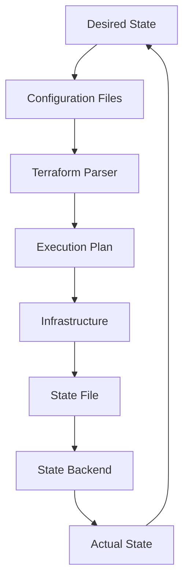
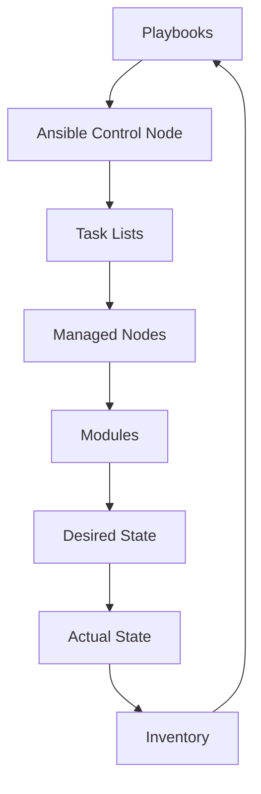

# Lesson 2: Infrastructure as Code

## 1. First-Principles Intuition & Invariants

Infrastructure as Code (IaC) represents a paradigm shift in how we manage and provision computing resources. It encapsulates the principles of treating infrastructure like software—version-controlled, automated, and repeatable. This approach is not merely a toolset but a fundamental shift in operational practices, enabling organizations to achieve greater agility, consistency, and security.

At its core, IaC leverages declarative configuration files to define the desired state of infrastructure. These files serve as blueprints that describe the resources, their configurations, and their relationships. The desired state is then reconciled with the actual state of the infrastructure through automated tools, ensuring that the infrastructure is always in the intended configuration. This reconciliation process is akin to a continuous level-triggered state machine, where the system continuously monitors and adjusts the infrastructure to match the declared state.

The mathematical and system invariants in IaC are rooted in the principles of idempotency and convergence. Idempotency ensures that applying the same configuration multiple times results in the same outcome, eliminating side effects and ensuring predictability. Convergence guarantees that the system will eventually reach the desired state, regardless of the initial state or any intermediate states encountered during the reconciliation process.

The problem space addressed by IaC is vast, encompassing everything from traditional on-premises data centers to cloud-native environments. In traditional data centers, IaC can automate the provisioning and configuration of servers, storage, and networking devices, reducing manual intervention and minimizing human error. In cloud-native environments, IaC can manage the deployment and scaling of containerized applications, enabling seamless integration with services like Kubernetes and AWS CloudFormation.

Security is a critical aspect of IaC, as it directly impacts the security posture of the infrastructure. By treating infrastructure as code, organizations can apply the same security practices used for software development, such as code reviews, automated testing, and continuous integration. This ensures that security is integrated into the infrastructure lifecycle from the outset, rather than being an afterthought.

## 2. Core Architecture & Mechanics

To understand the core architecture and mechanics of IaC, we will delve into two popular tools: Terraform and Ansible. Both tools have distinct architectures and execution models, but they share the common goal of automating infrastructure management.

### Terraform

Terraform is a declarative infrastructure as code tool that uses a domain-specific language (DSL) to define infrastructure resources. The core architecture of Terraform revolves around the concept of state, which is a representation of the current infrastructure. Terraform maintains a state file that tracks the resources it manages, allowing it to reconcile the desired state with the actual state.

The state file is a critical component of Terraform's architecture, as it serves as the source of truth for the infrastructure. Terraform uses a state backend to store and manage the state file, which can be a local file, a remote storage service like Amazon S3, or a version control system like Git. The state backend ensures that the state file is consistent and accessible across multiple Terraform runs.

Terraform's execution model is based on a reconciliation loop that continuously compares the desired state with the actual state. The desired state is defined in Terraform configuration files, which are written in the HashiCorp Configuration Language (HCL). These files describe the resources, their configurations, and their relationships. Terraform parses these files and generates an execution plan that outlines the actions required to reconcile the desired state with the actual state.

The execution plan is a critical component of Terraform's architecture, as it provides a preview of the changes that will be made to the infrastructure. Terraform allows users to review the execution plan before applying it, ensuring that the changes are as expected. Once the execution plan is approved, Terraform applies the changes to the infrastructure, updating the state file to reflect the new state.

Terraform's architecture can be visualized using the following Mermaid diagram:

### Ansible

Ansible is an imperative infrastructure as code tool that uses playbooks to define infrastructure tasks. The core architecture of Ansible revolves around the concept of playbooks, which are written in YAML and describe the tasks to be executed on managed nodes.

Ansible's execution model is based on a client-server architecture, where the Ansible control node executes playbooks on managed nodes over SSH. The control node is responsible for parsing the playbooks and generating task lists, which are then executed on the managed nodes. Ansible uses a modular architecture, with a wide range of modules available for different tasks, such as package management, file manipulation, and system configuration.

Ansible's architecture can be visualized using the following Mermaid diagram:

## 3. High-Performance Optimization & Failure Modes

High-performance optimization and failure modes are critical considerations in IaC, as they impact the efficiency and reliability of the infrastructure management process. In this section, we will explore some of the key optimization techniques and failure modes in Terraform and Ansible.

### Terraform Optimization

Terraform's performance can be optimized in several ways. One technique is to use remote state backends, which can improve the performance and scalability of the state management process. Remote state backends, such as Amazon S3, provide high availability and durability, ensuring that the state file is always accessible and consistent.

Another technique is to use state locking, which prevents concurrent modifications to the state file. State locking ensures that only one Terraform run can modify the state file at a time, preventing conflicts and ensuring consistency. Terraform provides built-in support for state locking, which can be enabled using remote state backends.

Terraform's performance can also be optimized by using state pruning, which reduces the size of the state file by removing unused resources. State pruning can improve the performance of the reconciliation process, as Terraform only needs to consider the resources that are actually in use.

### Ansible Optimization

Ansible's performance can be optimized in several ways. One technique is to use parallel execution, which allows Ansible to execute tasks on multiple managed nodes simultaneously. Parallel execution can significantly improve the performance of the infrastructure management process, especially in large-scale environments.

Another technique is to use caching, which can improve the performance of task execution. Ansible provides built-in support for caching, which can be enabled using the `cache` plugin. Caching can reduce the number of task executions, as Ansible can reuse the results of previous executions.

Ansible's performance can also be optimized by using conditional execution, which allows Ansible to execute tasks only when certain conditions are met. Conditional execution can improve the performance of the infrastructure management process, as Ansible only executes the tasks that are actually needed.

### Failure Modes

Infrastructure as Code is not immune to failure modes, and it is critical to understand the common failure modes and how to mitigate them. One common failure mode is configuration drift, which occurs when the actual state of the infrastructure diverges from the desired state. Configuration drift can be mitigated by using continuous reconciliation loops, which continuously compare the desired state with the actual state and apply the necessary changes.

Another common failure mode is state corruption, which occurs when the state file is corrupted or inconsistent. State corruption can be mitigated by using remote state backends, which provide high availability and durability, ensuring that the state file is always accessible and consistent.

A third common failure mode is task failure, which occurs when tasks fail to execute successfully. Task failure can be mitigated by using error handling, which allows Ansible to handle errors gracefully and continue executing tasks. Ansible provides built-in support for error handling, which can be enabled using the `rescue` and `always` blocks.

In conclusion, Infrastructure as Code is a powerful paradigm that enables organizations to manage and provision computing resources in a consistent, repeatable, and automated manner. By understanding the core architecture and mechanics of IaC tools like Terraform and Ansible, and by optimizing for high performance and mitigating failure modes, organizations can achieve greater agility, consistency, and security in their infrastructure management practices.
