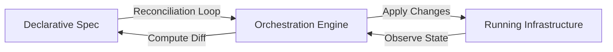
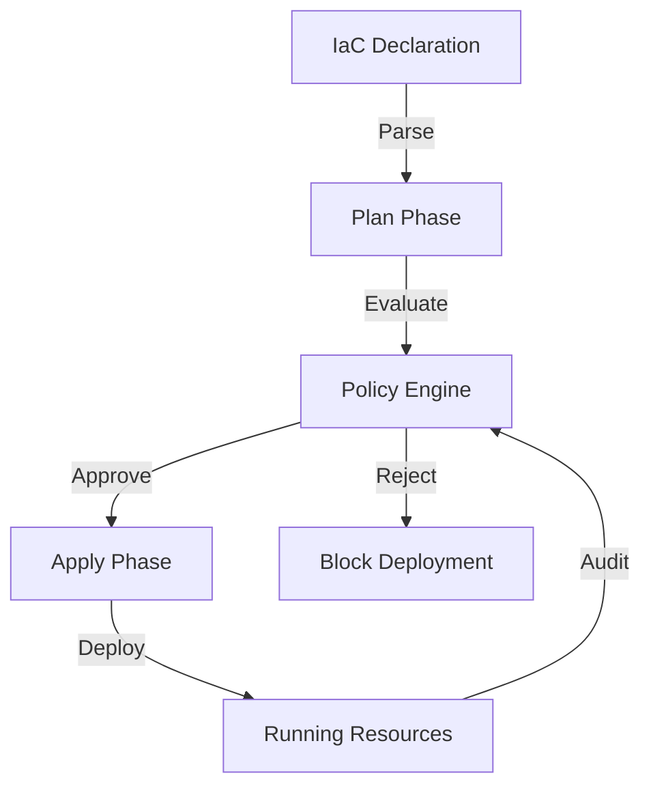
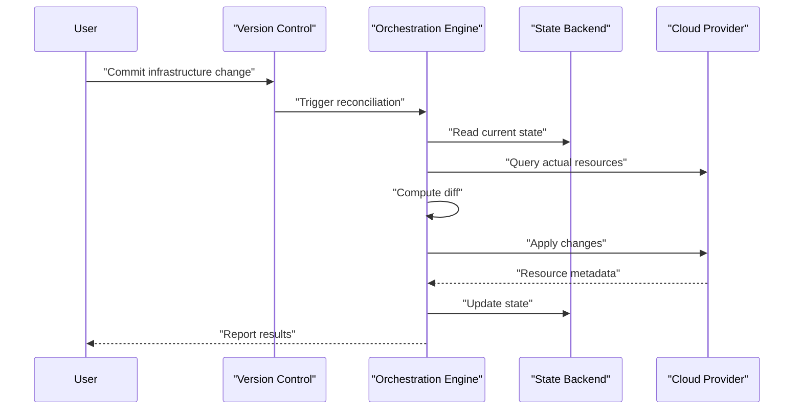

# Lesson 4: Infrastructure-as-Code, Configuration Management, Policy-as-Code

## 1. First-Principles Intuition & Invariants

Infrastructure-as-Code represents a fundamental inversion of operational epistemology. For decades, infrastructure existed as an artifact of imperative procedures: system administrators logged into servers, executed shell scripts, edited configuration files by hand, and the resulting state accumulated as a tangled record of manual interventions whose provenance vanished into institutional memory. This operational model proved inherently fragile because the ground truth of system state existed nowhere but in the running infrastructure itself. When disaster struck—a disk filled, a process crashed, a misconfigured firewall rule silently dropped packets—recovery required either expensive manual reconstruction or restoration from backups of uncertain freshness.

Infrastructure-as-Code inverts this relationship. Ground truth becomes a declarative specification committed to version control, and running infrastructure becomes a projection of that specification onto physical hardware. This projection is computed by orchestration engines that continuously reconcile observed state against desired state. The shift moves from "what commands did I run" to "what should the world look like," and from "tell me the current state" to "show me the difference between declaration and reality."



This declarative model rests on a mathematical foundation: idempotency and eventual consistency. An idempotent operation produces identical results whether executed once or multiple times. When you declare that a Kubernetes cluster should contain exactly three replicas of a service, running the reconciliation loop once or ten times yields the same outcome—three healthy pods. This idempotence is not accidental but designed into every respectable orchestration tool. Without it, transient network failures or retries would cascade into state corruption.

Eventual consistency means the orchestration system guarantees no instantaneous state at any moment, only that if left undisturbed, the system converges to desired state within a bounded time window. A crashed pod triggers replacement detection within seconds to minutes. An unresponsive node triggers workload evacuation. The system continuously drifts toward correctness rather than enforcing correctness instantaneously through locks or distributed transactions.

Configuration management layered atop IaC introduces another critical invariant: immutability. Traditional configuration management allowed operators to modify settings on running systems. A configuration change applied via `puppet apply` or `ansible-playbook` caused the running process to reload or restart. But this created a temporal window where on-disk configuration diverged from in-memory process state. The running process might crash and restart with configuration different from operator intent. Two servers that should be identical could diverge because one was patched at a different time, with a different tool, by a different operator.

Immutable infrastructure eliminates this window. Instead of mutating running servers, infrastructure changes produce new artifacts—container images, machine images, or freshly provisioned clusters—deployed atomically. The old artifact is decommissioned. This approach embraces the Unix principle that programs are simply data that happen to be executable. Just as we version control source code and rebuild applications rather than patching running processes, we version control infrastructure specifications and rebuild infrastructure artifacts rather than patching running machines.

Policy-as-Code represents the next abstraction layer. IaC describes what resources should exist; policy describes constraints on how those resources may be configured. A policy might state "all S3 buckets must have encryption enabled" or "all Kubernetes pods must have resource limits set" or "database backups must be retained for at least 30 days." Policies are themselves code—written in declarative languages like Rego (Open Policy Agent), HCL (Terraform Sentinel), or CEL (Common Expression Language)—and version controlled alongside infrastructure specifications. They are evaluated automatically during planning phases, blocking non-compliant changes before reaching production, and audited continuously against running resources to detect drift or violations.



The security implications are profound. In traditional operations, security was enforced through access control: only certain people could log into certain servers and run certain commands. But this model scales poorly and offers no protection against insiders or compromised credentials. In IaC-driven operations with Policy-as-Code, security is enforced through the declarative contract itself. A policy engine rejects any infrastructure change violating security constraints before instantiation. This achieves defense-in-depth through layered abstractions rather than layered access controls.

State management security emerges as a critical concern because IaC orchestration engines must maintain state about managed infrastructure. Terraform stores state files containing resource IDs, DNS names, database credentials, and other sensitive metadata. Kubernetes stores etcd state containing secrets, API credentials, and configuration. These state repositories become high-value attack targets. State compromise allows attackers to learn exact running system configuration, forge resource relationships, or inject malicious state causing orchestration engines to delete or misconfigure resources.

GitOps workflow security introduces the principle that all infrastructure changes flow through version control and CI/CD pipelines. No operator manually applies infrastructure changes; instead, changes are committed to Git, reviewed by peers, verified by automated tests and policy engines, and only then automatically deployed by a privileged operator running in a restricted environment. This creates an auditable chain of custody for every infrastructure change and enables declarative access control: authorization decisions are made based on Git history, file ownership, and organizational policy rather than UNIX file permissions or cloud IAM roles.

## 2. Core Architecture & Mechanics

The architecture of modern IaC systems rests on a feedback loop between three primary components: the declarative specification, the orchestration engine, and the observed state sensor. These components interact through a reconciliation cycle that operates as a closed control loop analogous to a thermostat regulating room temperature.

The declarative specification is the source of truth. Written in domain-specific languages like Terraform HCL, Kubernetes YAML manifests, Pulumi code, or AWS CloudFormation templates, this specification describes desired infrastructure state without prescribing the sequence of operations required to achieve it. A Terraform configuration might declare that an AWS VPC should exist with specific CIDR blocks, subnet configurations, and routing tables, but it does not specify whether to create the VPC first or the subnets first. The orchestration engine infers the dependency graph and determines the correct execution order.



The orchestration engine is the reconciliation workhorse. Terraform, Kubernetes controllers, Ansible, CloudFormation, and Pulumi all implement variations of the same pattern: read desired state from specification, query actual state from the target environment, compute the difference, and execute a plan to converge actual state toward desired state. The engine must handle dependencies between resources, manage transient failures, implement retry logic, and maintain consistency in the face of partial failures.

Orchestration engines typically operate in phases. Terraform's workflow separates `init`, `plan`, and `apply`. Kubernetes controllers run continuous reconciliation loops. The `plan` phase computes the set of changes required without executing them, allowing human review before applying potentially destructive operations. The `apply` phase executes the plan, but modern engines implement dry-run modes and what-if analysis to preview changes without committing them.

The observed state sensor continuously monitors running infrastructure. In Kubernetes, this is the API server backed by etcd, which maintains authoritative state for all cluster resources. Controllers watch for changes to resources and trigger reconciliation when observed state diverges from declared state. In Terraform, state is stored in backends like S3, GCS, Azure Blob Storage, or HashiCorp Terraform Cloud. The state file records resource identifiers, configuration attributes, and metadata required to map declarative specifications to actual cloud resources.

Dependency resolution is a core orchestration engine responsibility. Resources have implicit dependencies: a Kubernetes Deployment cannot be created until the Namespace exists; an AWS EC2 instance cannot launch until the VPC and security groups are provisioned; a database connection cannot be established until the database server is running. Orchestration engines build directed acyclic graphs representing these dependencies and execute operations in topologically sorted order. Terraform infers dependencies from resource attribute references; Kubernetes uses owner references and finalizers to encode relationships.

Error handling distinguishes production-grade orchestration from naive scripts. Transient failures—API rate limits, network timeouts, eventual consistency delays—must trigger retries with exponential backoff. Permanent failures—invalid credentials, quota exhaustion, resource conflicts—must halt reconciliation and report errors without corrupting state. Partial failures—where some operations succeed and others fail—require careful state management to ensure the next reconciliation attempt resumes correctly rather than reapplying successful operations.

Drift detection and remediation close the reconciliation loop. Drift occurs when running infrastructure diverges from declared specification due to manual changes, automated scaling, or external events. Cloud provider autoscaling might add instances beyond declared counts. An operator might manually resize a disk or modify a security group. Orchestration engines detect drift by periodically comparing observed state against desired state and can either alert operators to manual intervention or automatically remediate drift by reapplying the declared configuration.

State locking prevents concurrent modifications. When multiple operators or CI/CD pipelines attempt to modify infrastructure simultaneously, race conditions can corrupt state or cause conflicting operations. Terraform implements state locking using DynamoDB, GCS, or Azure Blob Storage leases. Kubernetes serializes modifications through the API server's optimistic concurrency control using resource versions. Without locking, two concurrent `terraform apply` operations might both attempt to create the same resource, resulting in one succeeding and the other failing with a conflict error, leaving state inconsistent.

Secrets management in IaC workflows presents a fundamental tension. Infrastructure specifications must reference credentials, API keys, database passwords, and TLS certificates, but these secrets cannot be committed to version control in plaintext. Solutions include encrypted secret stores like HashiCorp Vault or AWS Secrets Manager, environment variable injection from CI/CD systems, SOPS-encrypted files committed alongside configurations, and sealed secrets in Kubernetes encrypted at rest in etcd. The orchestration engine must fetch secrets at runtime, inject them into resources, and ensure they are not leaked into logs or state files.

## 3. Implementation Patterns & Trade-Offs

### Terraform: Declarative Infrastructure with Explicit State

Terraform pioneered the provider plugin architecture that enables a single declarative language to provision resources across AWS, Azure, GCP, Kubernetes, GitHub, Datadog, and hundreds of other platforms. Terraform configurations are written in HCL, a JSON-compatible language designed for human readability and machine parsing.

```hcl
resource "aws_instance" "web" {
  ami           = "ami-0c55b159cbfafe1f0"
  instance_type = "t3.micro"
  
  tags = {
    Name        = "web-server"
    Environment = "production"
  }
}

resource "aws_security_group" "web" {
  name        = "web-sg"
  description = "Allow HTTP and HTTPS"
  
  ingress {
    from_port   = 80
    to_port     = 80
    protocol    = "tcp"
    cidr_blocks = ["0.0.0.0/0"]
  }
  
  ingress {
    from_port   = 443
    to_port     = 443
    protocol    = "tcp"
    cidr_blocks = ["0.0.0.0/0"]
  }
}
```

Terraform's state file is both its greatest strength and its Achilles' heel. The state file maps logical resource names in HCL to physical resource identifiers in the cloud provider. This enables Terraform to track resources across invocations and compute diffs. But state becomes a shared mutable bottleneck. Corrupted state can cause Terraform to lose track of resources, leading to orphaned infrastructure or accidental deletions. State must be stored remotely in S3 or Terraform Cloud with locking enabled to prevent concurrent modifications.

Terraform modules enable composition and reuse. A module is a collection of Terraform files in a directory that can be invoked from other configurations. Modules accept input variables and produce output values, allowing infrastructure to be packaged into reusable components. A networking module might provision VPCs, subnets, and NAT gateways; an application module might provision load balancers, auto-scaling groups, and databases. Modules are versioned and published to registries, enabling teams to share infrastructure patterns.

```hcl
module "vpc" {
  source  = "terraform-aws-modules/vpc/aws"
  version = "5.1.0"
  
  name = "production-vpc"
  cidr = "10.0.0.0/16"
  
  azs             = ["us-east-1a", "us-east-1b", "us-east-1c"]
  private_subnets = ["10.0.1.0/24", "10.0.2.0/24", "10.0.3.0/24"]
  public_subnets  = ["10.0.101.0/24", "10.0.102.0/24", "10.0.103.0/24"]
  
  enable_nat_gateway = true
  enable_vpn_gateway = false
  
  tags = {
    Environment = "production"
    ManagedBy   = "terraform"
  }
}
```

Terraform workspaces provide environment isolation within a single configuration. A workspace creates a separate state file namespace, allowing the same Terraform configuration to be applied to development, staging, and production environments. Each workspace maintains independent state, preventing changes in one environment from affecting others. However, workspaces share the same configuration code, so differences between environments must be encoded using conditional logic or variable overrides.

Terraform's planning phase is deterministic and reproducible. Given identical state and configuration, `terraform plan` produces identical output. This determinism enables plan validation in CI pipelines: commit a configuration change, run `terraform plan`, store the plan output as an artifact, and review the plan before applying it. Terraform Enterprise and Terraform Cloud extend this pattern with sentinel policy checks that block plans violating organizational policies.

### Kubernetes: Continuous Reconciliation with Eventual Consistency

Kubernetes operators extend the control plane with custom controllers that reconcile application state. The operator pattern generalizes Kubernetes' built-in reconciliation model to arbitrary resources. An operator watches for changes to custom resources, compares observed state against desired state, and executes actions to converge them.

```go
func (r *DatabaseReconciler) Reconcile(ctx context.Context, req ctrl.Request) (ctrl.Result, error) {
    db := &v1alpha1.Database{}
    if err := r.Get(ctx, req.NamespacedName, db); err != nil {
        return ctrl.Result{}, client.IgnoreNotFound(err)
    }
    
    instance, err := r.CloudProvider.GetDatabaseInstance(ctx, db.Spec.InstanceID)
    if err != nil {
        return ctrl.Result{}, err
    }
    
    if instance == nil {
        instance, err = r.CloudProvider.CreateDatabaseInstance(ctx, db.Spec)
        if err != nil {
            return ctrl.Result{RequeueAfter: 30 * time.Second}, err
        }
    }
    
    if instance.Status != "available" {
        return ctrl.Result{RequeueAfter: 10 * time.Second}, nil
    }
    
    db.Status.Endpoint = instance.Endpoint
    db.Status.Status = "Ready"
    if err := r.Status().Update(ctx, db); err != nil {
        return ctrl.Result{}, err
    }
    
    return ctrl.Result{}, nil
}
```

This operator watches `Database` custom resources. When a new `Database` is created, the operator provisions a cloud database instance. If the instance does not exist, the operator creates it. If the instance exists but is not available, the operator requeues the reconciliation to check again later. When the instance becomes available, the operator updates the resource status with connection details.

Kubernetes' reconciliation model handles partial failures gracefully. If provisioning a database fails due to quota limits, the operator logs an error event and requeues the reconciliation. The resource remains in a pending state, visible to operators via `kubectl get` commands. Once quota is increased, the next reconciliation attempt succeeds without manual intervention.

Helm charts package Kubernetes manifests with templating and versioning. A Helm chart is a collection of YAML files describing Kubernetes resources, parameterized using Go templates. Charts can be versioned, published to repositories, and installed into clusters using the Helm CLI. Helm tracks release history, enabling rollbacks and upgrades.

```yaml
# values.yaml
replicaCount: 3

image:
  repository: nginx
  tag: "1.25"
  pullPolicy: IfNotPresent

service:
  type: LoadBalancer
  port: 80

resources:
  limits:
    cpu: 100m
    memory: 128Mi
  requests:
    cpu: 50m
    memory: 64Mi
```

```yaml
# templates/deployment.yaml
apiVersion: apps/v1
kind: Deployment
metadata:
  name: {{ include "mychart.fullname" . }}
spec:
  replicas: {{ .Values.replicaCount }}
  selector:
    matchLabels:
      app: {{ include "mychart.name" . }}
  template:
    metadata:
      labels:
        app: {{ include "mychart.name" . }}
    spec:
      containers:
      - name: nginx
        image: "{{ .Values.image.repository }}:{{ .Values.image.tag }}"
        ports:
        - containerPort: 80
        resources:
{{ toYaml .Values.resources | indent 10 }}
```

Helm releases are atomic: all resources in a chart are created or none are. If any resource fails validation or creation, Helm rolls back the entire release. This atomicity prevents partial deployments that leave applications in inconsistent states.

Kustomize provides an alternative composition model based on strategic merge patches. Instead of templates, Kustomize applies layers of overlays to base manifests. A base configuration defines common resources, and overlays apply environment-specific modifications. Kustomize is built into `kubectl` and does not require external tooling.

```yaml
# base/kustomization.yaml
resources:
  - deployment.yaml
  - service.yaml

# overlays/production/kustomization.yaml
bases:
  - ../../base

replicas:
  - name: web
    count: 10

images:
  - name: nginx
    newTag: 1.25-alpine
```

Kustomize preserves the original manifest structure, making it easier to understand what changes are applied. Unlike Helm templates that produce arbitrary YAML, Kustomize patches are constrained to modifying specific fields, reducing the risk of introducing invalid configurations.

### Policy-as-Code: Open Policy Agent and Sentinel

Open Policy Agent (OPA) provides a general-purpose policy engine that decouples policy decisions from application logic. OPA policies are written in Rego, a declarative query language designed for policy evaluation. OPA can enforce policies on Kubernetes admission requests, Terraform plans, API gateway requests, and application data.

```rego
package kubernetes.admission

deny[msg] {
    input.request.kind.kind == "Pod"
    container := input.request.object.spec.containers[_]
    not container.resources.limits.memory
    msg := sprintf("Container %v must have memory limits", [container.name])
}

deny[msg] {
    input.request.kind.kind == "Service"
    input.request.object.spec.type == "LoadBalancer"
    not input.request.object.metadata.annotations["service.beta.kubernetes.io/aws-load-balancer-internal"]
    msg := "LoadBalancer services must be internal"
}
```

This policy denies Kubernetes pods without memory limits and LoadBalancer services that are not marked as internal. OPA evaluates policies against admission requests and returns denial messages for violations. The Kubernetes API server blocks non-compliant resource creation, preventing policy violations from reaching the cluster.

Sentinel, used with Terraform Cloud and Terraform Enterprise, enforces policies during the plan phase. Sentinel policies can mandate naming conventions, restrict resource types, enforce tagging requirements, and validate configuration parameters.

```hcl
import "tfplan/v2" as tfplan

required_tags = ["Environment", "Owner", "CostCenter"]

deny_untagged_resources = rule {
    all tfplan.resource_changes as _, rc {
        rc.change.after.tags else {} contains all required_tags
    }
}

deny_expensive_instances = rule {
    all tfplan.resource_changes as _, rc {
        rc.type == "aws_instance" implies
            rc.change.after.instance_type not in ["m5.24xlarge", "c5.24xlarge"]
    }
}

main = rule {
    deny_untagged_resources and deny_expensive_instances
}
```

This Sentinel policy requires all resources to have specific tags and prevents provisioning of expensive instance types. Violations block Terraform applies, forcing operators to fix non-compliant configurations before proceeding.

Policy-as-Code creates a separation of concerns between infrastructure engineers who write IaC configurations and security teams who define policies. Engineers focus on functional requirements without memorizing security rules, while security teams codify policies that are automatically enforced across all infrastructure changes.

### GitOps: Flux and ArgoCD

GitOps extends IaC principles by making Git the single source of truth for both application code and infrastructure configuration. Every change flows through Git commits, pull requests, and CI/CD pipelines. GitOps controllers running in Kubernetes clusters continuously watch Git repositories and automatically apply changes to cluster resources.

Flux monitors Git repositories and Helm repositories, synchronizing changes to the cluster. When a commit is pushed to the repository, Flux detects the change and applies the new manifests. Flux supports multi-tenancy, allowing different teams to manage different namespaces with separate Git repositories.

```yaml
apiVersion: source.toolkit.fluxcd.io/v1
kind: GitRepository
metadata:
  name: webapp
  namespace: flux-system
spec:
  interval: 1m
  url: https://github.com/example/webapp
  ref:
    branch: main
---
apiVersion: kustomize.toolkit.fluxcd.io/v1
kind: Kustomization
metadata:
  name: webapp
  namespace: flux-system
spec:
  interval: 5m
  path: ./deploy/production
  prune: true
  sourceRef:
    kind: GitRepository
    name: webapp
  healthChecks:
    - apiVersion: apps/v1
      kind: Deployment
      name: webapp
      namespace: default
```

Flux reconciles this configuration by cloning the Git repository, applying Kustomize overlays from the specified path, and monitoring deployment health. If the deployment fails to reach a ready state, Flux marks the reconciliation as failed and alerts operators.

ArgoCD provides a web UI and CLI for visualizing application state and synchronization status. ArgoCD compares live cluster state against Git-declared state and highlights drift. Operators can manually sync applications or configure automatic synchronization with pruning of deleted resources.

```yaml
apiVersion: argoproj.io/v1alpha1
kind: Application
metadata:
  name: webapp
  namespace: argocd
spec:
  project: default
  source:
    repoURL: https://github.com/example/webapp
    targetRevision: main
    path: deploy/production
  destination:
    server: https://kubernetes.default.svc
    namespace: default
  syncPolicy:
    automated:
      prune: true
      selfHeal: true
    syncOptions:
      - CreateNamespace=true
```

ArgoCD's self-healing feature automatically reverts manual changes that cause drift from Git-declared state. If an operator manually scales a deployment using `kubectl scale`, ArgoCD detects the drift and restores the replica count declared in Git. This enforces GitOps discipline by making manual changes ephemeral.

GitOps workflows enable declarative access control. Authorization decisions are based on Git branch protections and pull request approvals rather than Kubernetes RBAC or cloud IAM roles. Production changes require approval from senior engineers or security teams before merging to the main branch. The GitOps controller applies changes using a service account with broad cluster permissions, but humans never directly access that account.

## 4. Threat Model & Attack Surface

IaC systems introduce new attack surfaces that did not exist in manual operations. State files, API credentials, Git repositories, and CI/CD pipelines become critical security boundaries.

State file compromise is catastrophic. Terraform state files contain resource identifiers, IAM role ARNs, database endpoints, and sometimes credentials. An attacker gaining read access to state can learn the complete topology of running infrastructure. Write access allows state manipulation attacks: deleting resource references causes Terraform to believe resources no longer exist, triggering destructive operations on the next apply. Injecting fake resource references causes Terraform to attempt operations on attacker-controlled resources.

State encryption at rest is mandatory. Terraform supports state encryption using AWS KMS, GCP KMS, or Azure Key Vault when using cloud backend storage. Kubernetes secrets should be encrypted at rest in etcd using encryption providers. State files should never be committed to Git repositories, even private ones, because Git history is immutable and leaked credentials remain accessible indefinitely.

API credential management in IaC workflows creates a chicken-and-egg problem. Orchestration engines need credentials to provision infrastructure, but those credentials must be stored somewhere. Short-lived credentials using OIDC federation with GitHub Actions or GitLab CI avoid storing long-lived credentials. The CI/CD pipeline authenticates to AWS STS, Azure AD, or GCP Workload Identity using an OIDC token, receiving temporary credentials valid for the pipeline run duration.

```yaml
# GitHub Actions workflow with AWS OIDC
name: Deploy Infrastructure
on:
  push:
    branches: [main]

permissions:
  id-token: write
  contents: read

jobs:
  deploy:
    runs-on: ubuntu-latest
    steps:
      - uses: actions/checkout@v3
      
      - uses: aws-actions/configure-aws-credentials@v2
        with:
          role-to-assume: arn:aws:iam::123456789012:role/GitHubActionsRole
          aws-region: us-east-1
      
      - name: Terraform Apply
        run: |
          terraform init
          terraform apply -auto-approve
```

This workflow never stores AWS credentials. GitHub Actions generates an OIDC token signed by GitHub's OIDC provider. AWS STS validates the token and issues temporary credentials to the pipeline. The credentials expire after the pipeline completes, limiting the window for credential theft.

Git repository security becomes infrastructure security. If an attacker gains write access to the Git repository containing IaC configurations, they can inject malicious infrastructure changes that are automatically deployed by GitOps controllers. Branch protection rules, required pull request reviews, and status checks provide defense-in-depth. Critical repositories should require signed commits to prevent commit forgery.

CI/CD pipeline compromise enables infrastructure takeover. An attacker who compromises a CI/CD runner or injects malicious code into pipeline definitions can execute arbitrary commands with the privileges of the orchestration engine. Pipeline isolation using ephemeral runners, least-privilege service accounts, and audit logging reduce this risk.

Supply chain attacks target IaC modules and Helm charts. Public registries like the Terraform Registry and Artifact Hub host community-contributed modules that may contain backdoors or vulnerabilities. Organizations should mirror trusted modules to private registries, scan dependencies for known vulnerabilities, and review module source code before adoption.

Policy bypass attacks attempt to circumvent Policy-as-Code enforcement. An attacker might discover that policies are only enforced during Terraform apply but not during manual changes via the AWS console. Or policies might be enforced for new resources but not updated for existing resources. Continuous compliance scanning using tools like AWS Config, Azure Policy, or CloudQuery detects drift and policy violations in running infrastructure.

Secrets leakage into logs, state files, or error messages is a persistent risk. Terraform and Kubernetes both attempt to redact sensitive values from outputs, but bugs or misconfigurations can cause credentials to appear in CI/CD logs, state file diffs, or API server audit logs. Secrets should be rotated regularly, and logs should be scrubbed for credential patterns before archival.

Denial-of-service attacks against orchestration engines can cause availability issues. An attacker might trigger thousands of reconciliation loops, exhausting API rate limits or overwhelming cloud provider quotas. Rate limiting, resource quotas, and admission controllers provide protection against runaway reconciliation or malicious resource creation.

## 5. Verification & Testing Strategies

Infrastructure testing traditionally lagged behind application testing because infrastructure changes were manual and irreversible. IaC enables automated infrastructure testing using the same patterns as application testing: unit tests, integration tests, end-to-end tests, and property-based tests.

Terraform unit tests use the `terraform test` command to execute small test cases against modules. Tests define input variables, apply the configuration, and assert that output values match expectations. Tests run in isolated state backends to avoid interference.

```hcl
# tests/main.tftest.hcl
run "verify_vpc_cidr" {
  command = plan
  
  assert {
    condition     = aws_vpc.main.cidr_block == "10.0.0.0/16"
    error_message = "VPC CIDR must be 10.0.0.0/16"
  }
}

run "verify_subnet_count" {
  command = plan
  
  assert {
    condition     = length(aws_subnet.private) == 3
    error_message = "Must have 3 private subnets"
  }
}
```

These tests run `terraform plan` and verify that the generated plan meets expectations without actually provisioning resources. Fast feedback from plan-only tests enables test-driven infrastructure development.

Integration tests provision real infrastructure in isolated test environments, execute application tests, and tear down infrastructure. Tools like Terratest provide Go libraries for writing infrastructure integration tests.

```go
func TestWebServerDeployment(t *testing.T) {
    opts := &terraform.Options{
        TerraformDir: "../modules/webserver",
        Vars: map[string]interface{}{
            "instance_type": "t3.micro",
            "environment":   "test",
        },
    }
    
    defer terraform.Destroy(t, opts)
    terraform.InitAndApply(t, opts)
    
    instanceID := terraform.Output(t, opts, "instance_id")
    publicIP := terraform.Output(t, opts, "public_ip")
    
    aws.WaitForInstanceReady(t, instanceID, 5*time.Minute)
    
    response, err := http.Get(fmt.Sprintf("http://%s", publicIP))
    require.NoError(t, err)
    assert.Equal(t, 200, response.StatusCode)
}
```

This test provisions an EC2 instance, waits for it to become ready, makes an HTTP request to verify the web server responds, and tears down the instance. Integration tests catch configuration errors, dependency issues, and cloud provider behavior that unit tests miss.

Contract testing verifies that infrastructure outputs match consumer expectations. An application expecting a PostgreSQL database connection string with specific format will fail if infrastructure outputs a MySQL connection string. Contract tests define expected output schemas and validate infrastructure against those schemas.

Kubernetes admission webhooks enable runtime validation. A validating webhook intercepts resource creation requests and rejects invalid configurations before they are persisted to etcd. Webhooks can enforce custom validation logic beyond what CRD schemas support.

```go
func (v *Validator) ValidatePod(ctx context.Context, pod *corev1.Pod) error {
    for _, container := range pod.Spec.Containers {
        if container.Resources.Limits.Memory().IsZero() {
            return fmt.Errorf("container %s missing memory limit", container.Name)
        }
        if container.SecurityContext == nil || !*container.SecurityContext.ReadOnlyRootFilesystem {
            return fmt.Errorf("container %s must have read-only root filesystem", container.Name)
        }
    }
    return nil
}
```

This webhook validates that all pods have memory limits and read-only root filesystems. Violations are rejected immediately, preventing non-compliant resources from entering the cluster.

Drift detection tests continuously compare running infrastructure against declared specifications. These tests run as scheduled jobs that execute `terraform plan` or query Kubernetes resources and alert when differences are detected. Drift indicates manual changes, configuration management failures, or security incidents.

Chaos engineering tests inject failures into infrastructure to verify resilience. Deliberately terminating pods, detaching volumes, or introducing network partitions reveals whether infrastructure correctly handles failures and recovers automatically. Tools like Chaos Mesh and Litmus enable declarative chaos experiments.

```yaml
apiVersion: chaos-mesh.org/v1alpha1
kind: PodChaos
metadata:
  name: pod-failure-test
spec:
  action: pod-kill
  mode: one
  selector:
    namespaces:
      - production
    labelSelectors:
      app: web
  scheduler:
    cron: "@every 1h"
```

This chaos experiment randomly kills one pod with label `app: web` every hour. If the application does not handle pod failures gracefully, the experiment exposes the failure mode before it occurs naturally in production.

Cost estimation tests validate that infrastructure changes do not exceed budget constraints. Tools like Infracost analyze Terraform plans and estimate cloud costs before applying changes. Cost tests can block pull requests that introduce resources exceeding cost thresholds.

## 6. Real-World Case Studies & Forensics

### Case Study: GitLab Terraform State Leak (2021)

GitLab inadvertently exposed Terraform state files in CI/CD job artifacts, making them accessible to unauthorized users. The state files contained AWS access keys, database credentials, and API tokens. The leak occurred because CI/CD pipelines uploaded all generated files as artifacts without filtering sensitive data.

The root cause was a misconfigured CI/CD job that ran `terraform plan` and uploaded the entire working directory as an artifact. Terraform stores sensitive values in state files even when they are marked as sensitive in variable definitions. Anyone with access to the CI/CD project could download the artifacts and extract credentials.

The fix involved multiple layers: redacting state files from artifacts, encrypting state at rest using cloud KMS services, rotating all exposed credentials, and implementing artifact retention policies that delete old artifacts after a short period. GitLab also added automated scanning for credentials in artifacts before upload.

This incident demonstrates that IaC security requires defense-in-depth. Terraform's sensitive value marking prevents credentials from appearing in plan output, but state files themselves remain sensitive and must be protected with encryption, access controls, and audit logging.

### Case Study: HashiCorp Terraform Cloud Outage (2023)

A cascading failure in Terraform Cloud's state locking system caused a multi-hour outage affecting thousands of customers. The incident began when a state lock held by a long-running apply operation was not released due to a network partition. Subsequent operations attempting to acquire the lock queued indefinitely, exhausting connection pools and causing the API servers to become unresponsive.

The failure propagated because Terraform Cloud's lock timeout was configured for infinite retries with exponential backoff. As more operations queued waiting for locks, memory usage grew until API servers crashed and restarted, further delaying lock releases. The incident was resolved by manually releasing stuck locks and deploying a fix that implemented lock timeouts with circuit breakers.

This outage illustrates the importance of timeouts and circuit breakers in distributed systems. Infinite retries can amplify failures rather than containing them. Terraform Cloud now implements lock timeouts, maximum retry limits, and graceful degradation when lock contention occurs.

### Case Study: Kubernetes Operator Reconciliation Loop DoS (2022)

A custom Kubernetes operator managing cloud database instances entered an infinite reconciliation loop when cloud provider API rate limits were exceeded. The operator attempted to provision database instances but received HTTP 429 rate limit errors. The operator's reconciliation logic treated rate limit errors as transient failures and immediately requeued reconciliation, causing thousands of retries per second and exhausting rate limits for all users of the cloud provider API.

The root cause was missing backoff logic in the operator's error handling. When rate limit errors occurred, the operator should have implemented exponential backoff with jitter to spread retries over time. Instead, the operator requeued immediately with zero delay, creating a thundering herd effect.

The fix involved implementing rate limiting and backoff in the operator using client-go's workqueue package, which provides built-in exponential backoff and jitter. The operator was also modified to emit Kubernetes events when rate limit errors occurred, making the problem visible to cluster operators.

This case demonstrates the importance of designing reconciliation loops with failure modes in mind. Operators must implement backoff, rate limiting, and circuit breakers to prevent runaway reconciliation from causing denial-of-service conditions.

### Case Study: Terraform Module Supply Chain Attack (2024)

A popular Terraform module published to the Terraform Registry was compromised when an attacker gained access to the maintainer's GitHub account. The attacker published a new version of the module containing malicious code that exfiltrated AWS credentials to an attacker-controlled server. The module was downloaded thousands of times before the compromise was detected.

The malicious code was obfuscated using Terraform's `external` data source to execute a base64-encoded shell script. The script read AWS credentials from environment variables and transmitted them via HTTP POST to the attacker's server. The module continued to function correctly, making the compromise difficult to detect.

Detection occurred when a security researcher performing routine module audits noticed the suspicious `external` data source and decoded the shell script. The Terraform Registry removed the malicious version, but organizations that had already downloaded it remained vulnerable until they updated to a clean version.

This attack highlights the importance of supply chain security in IaC workflows. Organizations should vendor critical modules into private repositories, review module source code before adoption, scan dependencies for known vulnerabilities, and monitor for unexpected network activity from infrastructure provisioning processes.
