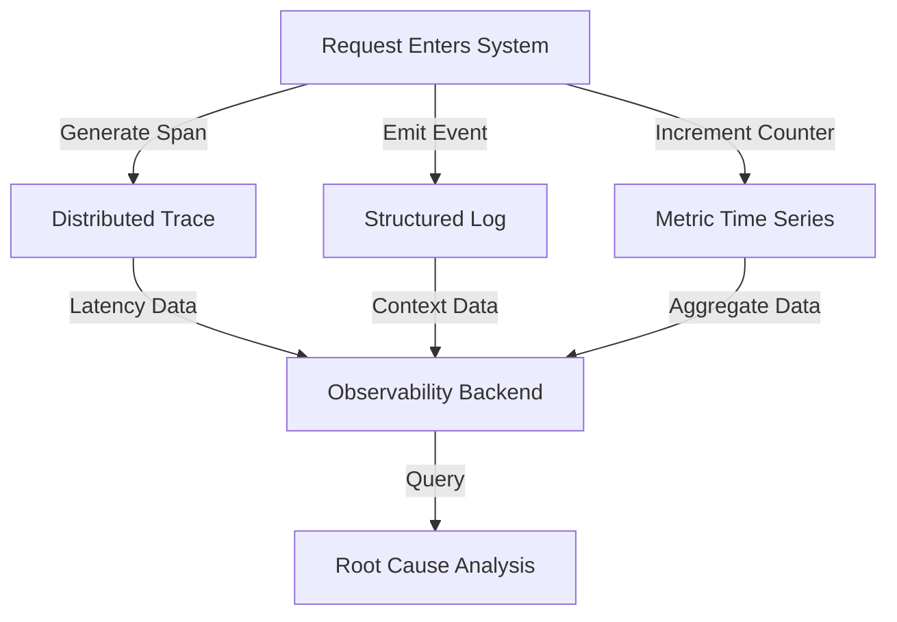
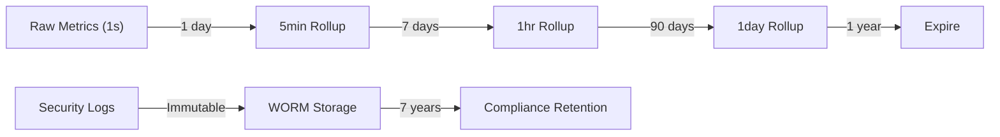

# Lesson 5: Observability, Security Monitoring, Logging, SIEM Integration

## 1. First-Principles Intuition & Invariants

Observability is the dual of controllability in control theory. A system is observable when its internal state can be inferred from external outputs over time. In distributed computing, this translates to a fundamental question: given only the externally visible behavior of a black-box service—its request latencies, error rates, resource consumption, and emitted log lines—can we reconstruct sufficient internal state to diagnose failures, predict capacity exhaustion, and detect security breaches before they cascade?

Classical monitoring systems operated under a closed-world assumption. Engineers pre-defined a finite set of failure modes, instrumented known-good metrics such as CPU utilization and disk IOPS, and configured static threshold alerts. This approach collapses in cloud-native architectures where the state space is unbounded. A microservice mesh with fifty services, each with ten replicas, generating ephemeral Kubernetes pods with dynamic IP addresses, produces a cardinality explosion. The number of unique metric time series grows combinatorially with the Cartesian product of all label dimensions: service name, pod ID, node hostname, availability zone, request path, HTTP status code, and user cohort. Naive implementations storing every permutation exhaust memory and render queries intractable.

The three pillars of observability—metrics, logs, and distributed traces—form an orthogonal basis for system state reconstruction. Metrics provide high-frequency numeric telemetry aggregated over time windows, enabling efficient anomaly detection through statistical process control. Logs capture discrete events with rich contextual payloads, allowing post-hoc forensic analysis of specific failure instances. Distributed traces stitch together causal chains of requests as they flow through service boundaries, exposing latency bottlenecks and error propagation paths hidden in aggregate metrics.

These three signal types are complementary and irreducible. Metrics alone cannot explain why a specific request failed. Logs without traces cannot reveal which upstream service caused cascading timeouts. Traces without metrics provide no baseline for distinguishing normal variance from genuine anomalies. Each pillar captures a different projection of system behavior, and reconstruction of the full state requires all three.

Security monitoring imposes additional constraints beyond general observability. The adversary is adaptive and adversarial, actively attempting to evade detection by blending into legitimate traffic patterns. A security information and event management system must correlate low-fidelity signals across heterogeneous data sources—application logs, kernel audit events, network flow records, authentication tokens, and cloud provider API calls—to detect multi-stage attacks unfolding over hours or days. The mathematical challenge is one of sequential hypothesis testing under non-stationary distributions. The attacker modifies their behavior in response to defensive signals, rendering static rule-based detection brittle. Effective anomaly detection requires adaptive baselines that model legitimate user behavior as a continuous probability distribution and flag deviations beyond statistically significant thresholds.

The invariants governing production observability systems are rooted in information theory and queuing theory. The Shannon-Hartley theorem bounds the maximum information rate extractable from a noisy channel. Instrumentation code injected into hot paths adds latency and memory overhead, creating a fundamental tradeoff between observability richness and application performance. The Nyquist-Shannon sampling theorem dictates that to reconstruct a signal, we must sample at twice its highest frequency component. For metrics with sub-second variance, one-minute aggregation windows obliterate critical transients. For logs, buffering introduces latency between event generation and centralized ingestion, creating blind spots during the critical first minutes of an incident.

Distributed tracing introduces coordination overhead. Each span records entry and exit timestamps at service boundaries, requiring synchronized clocks across distributed nodes. Clock skew accumulates, and without NTP discipline or hybrid logical clocks, trace reconstruction yields impossible causal orderings where effects precede their causes. Consider a request traversing three services with local clocks drifting by 100ms, 50ms, and -80ms respectively. The recorded timestamps will show service C responding before service B finished processing, violating causality. Hybrid logical clocks solve this by combining physical timestamps with logical counters that increment on each event, ensuring happened-before relationships are preserved even when physical clocks diverge.

The cardinality problem is the central scaling bottleneck. A metric name combined with label key-value pairs defines a unique time series. If a service emits a `request_duration_seconds` histogram with labels for `{method, path, status, pod, node, zone}`, and each dimension has moderate cardinality—ten methods, fifty paths, five status codes, one hundred pods, ten nodes, three zones—the combinatorial explosion yields 10 × 50 × 5 × 100 × 10 × 3 = 7,500,000 potential time series. Most combinations are sparse or never observed, but the storage backend must pessimistically allocate indexing structures.

Time-series databases use inverted indexes mapping label values to posting lists of series IDs, analogous to Lucene's document indexing. Query performance degrades linearly with label cardinality because every query performs set intersection over posting lists. The solution space involves three strategies: cardinality reduction through label normalization, replacing high-cardinality user IDs with cohort buckets; probabilistic data structures like HyperLogLog sketches for approximate distinct counts; and adaptive sampling, retaining full-fidelity traces only for rare error conditions while sampling normal traffic at lower rates.

Retention policies encode the economics of storage. Raw metrics at one-second granularity for one year consume terabytes per cluster. Logs with full payloads exhaust disk within weeks. The standard mitigation is hierarchical downsampling: retain raw data for recent time windows spanning hours to days, progressively aggregate into coarser granularities with five-minute, one-hour, and one-day rollups, and expire old data. The critical decision is determining the aggregation function. Mean latency is useless because it hides tail behavior where 99th percentile users experience degraded service. Histograms with exponential bucketing, such as Prometheus's native histogram type, preserve distribution shape and allow approximate quantile queries without storing every sample.

For security audit logs, regulatory compliance mandates immutable append-only storage with cryptographic tamper-evidence. Write-once-read-many storage on S3 Glacier with object-lock retention prevents even root administrators from deleting incriminating evidence during the preservation window. This is not merely a technical control but a legal requirement under frameworks like SOC 2, HIPAA, and GDPR, where the ability to demonstrate data integrity during audit windows can determine regulatory outcomes.

Alert design is a signal detection problem under adversarial noise. A poorly tuned alert generates false positives, training engineers to ignore pages until a real incident goes unnoticed. False negatives allow attackers to persist undetected. The receiver operating characteristic curve plots the true positive rate against the false positive rate for a binary classifier as its discrimination threshold varies. Optimal alerting maximizes the area under this curve by balancing sensitivity and specificity.

Static thresholds fail because system behavior is non-stationary. Request latency exhibits diurnal patterns, weekly seasonality, and step changes during deployments. A fixed threshold that captures anomalies during off-peak hours will fire constantly during peak load. The solution is dynamic baselining using exponentially weighted moving averages or seasonal decomposition of time series. These methods model expected behavior as a probabilistic envelope and trigger alerts only when observations fall outside multiple standard deviations from the predicted mean. The control parameter is the sensitivity multiplier: three standard deviations yields high specificity but may miss subtle attacks, while two standard deviations increases sensitivity at the cost of more false positives.
