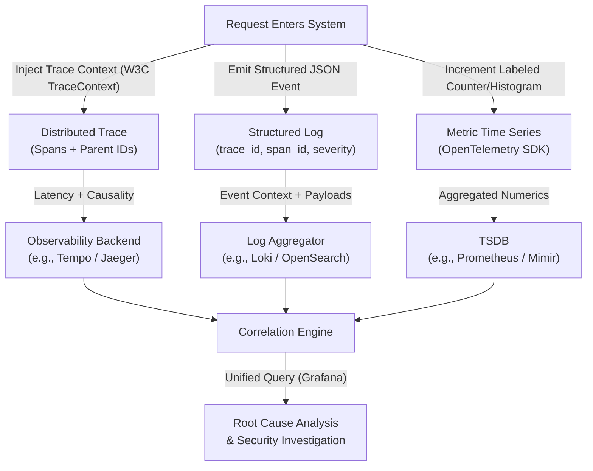
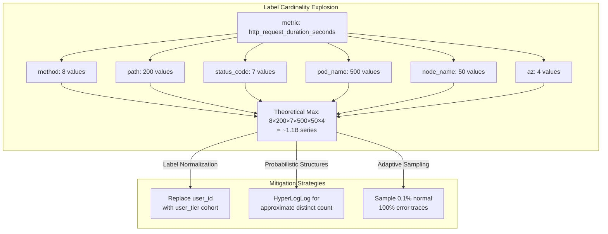
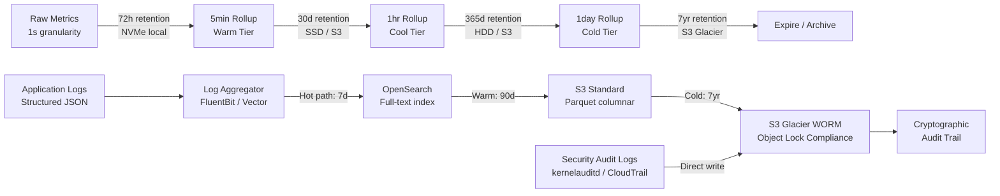
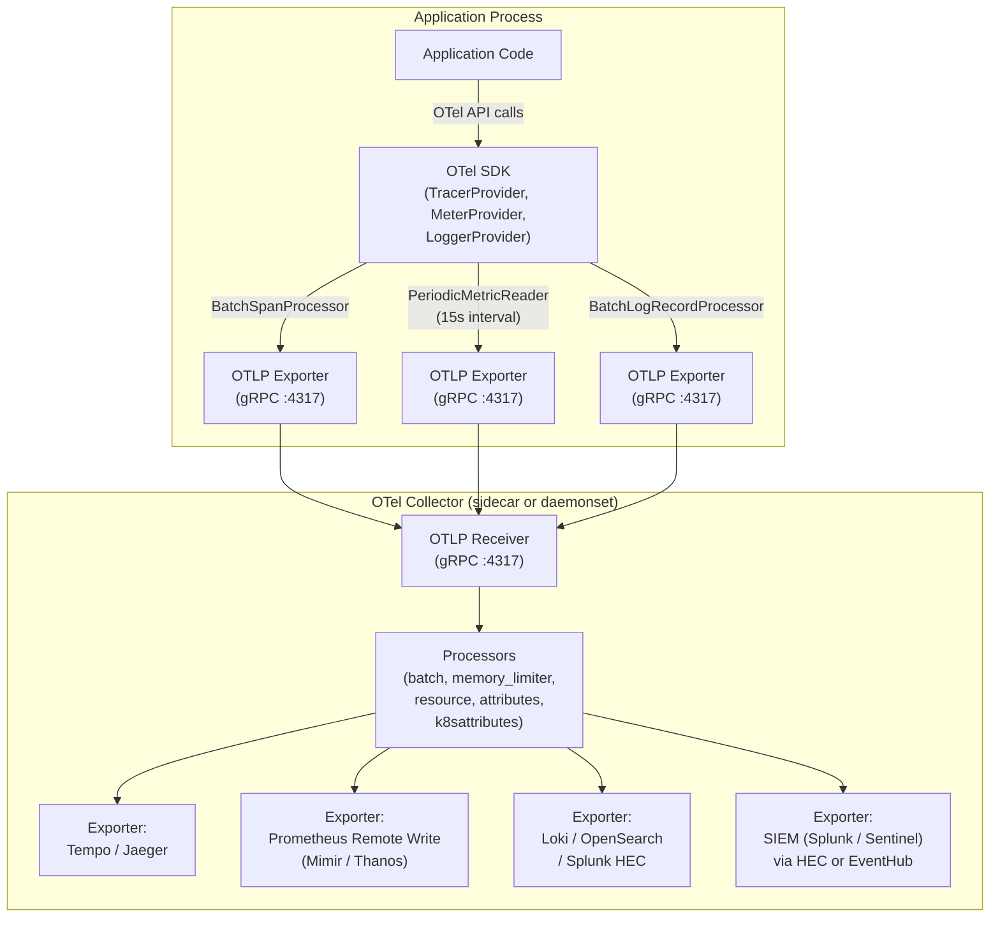
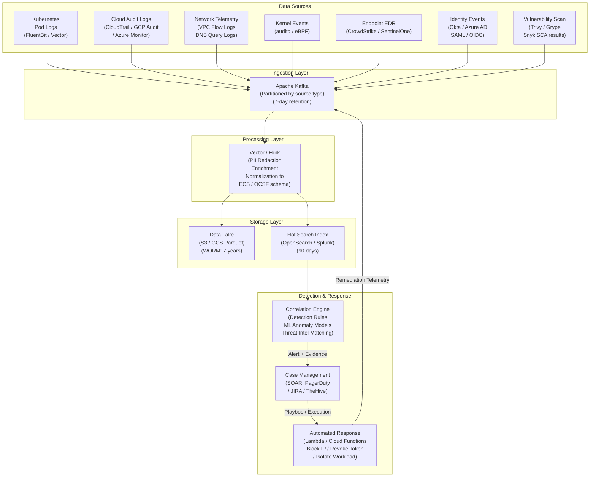
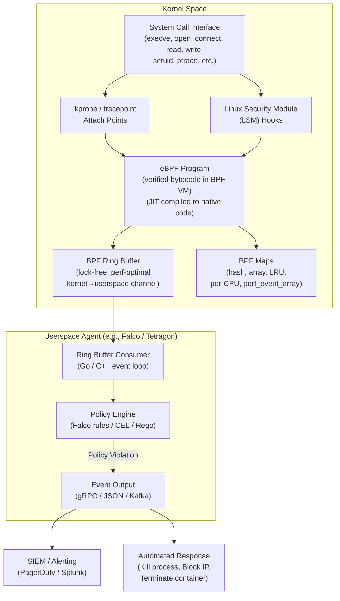
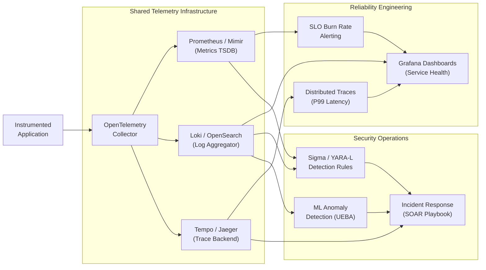

# Lesson 5: Observability, Security Monitoring, Logging, and SIEM Integration

## 1. First-Principles Intuition and Invariants

Observability is the dual of controllability in linear systems theory. Kalman's 1960 formalization defines a system as observable when its complete internal state vector can be uniquely reconstructed from a finite sequence of output measurements, given known inputs. Applied to distributed computing, this translates to a concrete engineering question: given only the externally visible behavior of a black-box service—its request latencies, error rates, resource consumption, and emitted log lines—can we reconstruct sufficient internal state to diagnose failures, predict capacity exhaustion, and detect security breaches before they cascade into service outages?

Classical monitoring systems operated under a closed-world assumption. Engineers pre-defined a finite set of failure modes, instrumented known-good metrics such as CPU utilization and disk IOPS, and configured static threshold alerts. This approach collapses in cloud-native architectures where the state space is effectively unbounded. A microservice mesh with fifty services, each running ten replicas, generating ephemeral Kubernetes pods with dynamic IP addresses, produces a cardinality explosion. The number of unique metric time series grows combinatorially with the Cartesian product of all label dimensions: service name, pod ID, node hostname, availability zone, request path, HTTP status code, and user cohort. Naive storage backends allocating one time series per unique label combination exhaust memory and render queries intractable.

The three pillars of observability—metrics, logs, and distributed traces—form an orthogonal basis for system state reconstruction. Metrics provide high-frequency numeric telemetry aggregated over time windows, enabling efficient anomaly detection via statistical process control. Logs capture discrete events with rich contextual payloads, allowing post-hoc forensic analysis of specific failure instances. Distributed traces stitch together causal chains of requests as they traverse service boundaries, exposing latency bottlenecks and error propagation paths that aggregate metrics conceal.

These three signal types are complementary and irreducible. Metrics alone cannot explain why a specific request failed. Logs without traces cannot reveal which upstream service caused cascading timeouts. Traces without metrics provide no baseline for distinguishing normal variance from genuine anomalies. Each pillar captures a different projection of system behavior, and reconstructing full internal state requires all three in combination.



Security monitoring imposes additional constraints beyond general observability. The adversary is adaptive: they actively attempt to evade detection by blending attack traffic into legitimate behavioral patterns, rotating infrastructure to avoid IP-reputation blacklists, and deliberately slowing exfiltration rates to stay below anomaly thresholds. A security information and event management (SIEM) system must correlate low-fidelity signals across heterogeneous data sources—application logs, kernel audit events, network flow records (NetFlow/IPFIX), authentication tokens, DNS query logs, and cloud provider API calls (AWS CloudTrail, GCP Audit Logs, Azure Monitor)—to detect multi-stage attacks that unfold over hours or days.

The mathematical challenge is sequential hypothesis testing under non-stationary distributions with an adversarial perturbation term. Formally, let the null hypothesis H₀ represent normal user behavior modeled as a probability distribution P₀(X). An attacker manipulates their behavior in response to observed defensive signals, shifting the distribution to P₁(X) in a time-varying manner. Static rule-based detection, which thresholds on fixed features like "more than N failed logins per minute," is brittle against this adversary because the attacker can trivially stay below any fixed threshold by distributing login attempts across time and source IPs. Effective anomaly detection requires adaptive baselines that continuously model legitimate behavior and flag deviations exceeding statistically significant thresholds under the current distribution.

### 1.1 Information-Theoretic Bounds on Instrumentation

The Shannon-Hartley theorem bounds the maximum information rate extractable from a noisy channel with bandwidth B and signal-to-noise ratio S/N as C = B log₂(1 + S/N). Instrumentation code injected into hot paths adds latency and memory overhead proportional to the richness of the telemetry signal, creating a fundamental Heisenberg-like tradeoff: observing system behavior perturbs it. This is not merely theoretical. A naive implementation that records a full structured log entry per HTTP request at 100,000 RPS, with each log entry serializing to 2KB of JSON, generates 200MB/s of raw log data before compression—enough to saturate a 1Gbps NIC, exhaust disk at 720GB/hour, and add measurable write latency to the application's critical path.

The Nyquist-Shannon sampling theorem dictates that to faithfully reconstruct a signal, the sampling rate must exceed twice the highest frequency component present. For metrics exhibiting sub-second variance—such as a cache miss storm lasting 200ms—a one-minute aggregation window obliterates the transient entirely. For security events like a brute-force burst that completes in 30 seconds, a 60-second log flush interval means the attacker's activity may never appear as a coherent pattern in the ingestion pipeline. These are not edge cases; they are common failure modes in production SIEM deployments.

### 1.2 Clock Synchronization and Causal Consistency

Distributed tracing introduces a coordination prerequisite: synchronized clocks across all participating nodes. Each span records wall-clock entry and exit timestamps at service boundaries. Clock skew accumulates continuously, and without NTP with sub-millisecond discipline or hybrid logical clocks (HLCs), trace reconstruction yields causally impossible orderings where effects precede their causes in the recorded timeline.

Consider a concrete example: a request traverses three services with local clocks drifting at +100ms, +50ms, and −80ms relative to true time respectively. Service A calls B, B calls C, and C returns. The recorded timestamps may show C responding at t=1000ms (true), B receiving C's response at t=1070ms (B's clock: 1070 − 50 = 1020ms true, +20ms propagation), and A recording B's response at t=1180ms (A's clock: 1180 − 100 = 1080ms true). With high drift this can manifest as C appearing to respond before B finished invoking it, a causal violation that breaks span ordering algorithms.

Hybrid logical clocks, formalized by Kulkarni, Demirbas, Madeppa, Avva, and Leone in 2014, solve this by combining physical wall-clock timestamps with logical Lamport counters. Each node maintains an HLC value `hlc = max(physical_time, hlc_local) + 1` on each send/receive event. This guarantees that if event A happened-before event B (in Lamport's sense), then `hlc(A) < hlc(B)`, while keeping clock values close to wall-clock time for human readability. Google Spanner uses a related approach (TrueTime) with GPS and atomic clocks providing bounded uncertainty intervals, allowing globally consistent snapshots across planetary-scale distributed transactions.

### 1.3 The Cardinality Problem

The cardinality problem is the central scaling bottleneck in production observability deployments. A metric name combined with its label key-value pairs defines a unique time series. If a service emits a `http_request_duration_seconds` histogram with labels for `{method, path, status_code, pod_name, node_name, availability_zone, service_version}`, and each dimension has moderate cardinality—8 HTTP methods, 200 distinct API paths, 7 status code classes, 500 pods, 50 nodes, 4 availability zones, 10 deployed versions—the combinatorial upper bound is 8 × 200 × 7 × 500 × 50 × 4 × 10 = 11,200,000,000 potential time series. Even with 99.9% sparsity (most label combinations never actually occurring), the active series count in a large cluster routinely reaches tens of millions.

Time-series databases use inverted indexes mapping label values to posting lists of series IDs, structurally analogous to Lucene's document indexing. Prometheus stores these in its memory-mapped head block using a hash map of `fingerprint → memSeries`. Query execution for `{method="POST", status_code="500"}` performs set intersection over two posting lists—all series matching `method="POST"` and all series matching `status_code="500"`—and the intersection cost grows with list length. At ten million active series, even a selective label filter may yield posting lists with hundreds of thousands of entries, rendering interactive queries slow without careful index design.

Mitigation strategies fall into three categories. First, cardinality reduction through label normalization: replace a high-cardinality `user_id` label with a cohort bucket (`user_tier=free|pro|enterprise`), replace exact URL paths with parameterized route templates (`/api/users/{id}` rather than `/api/users/12345`). Second, probabilistic data structures: HyperLogLog sketches allow approximate distinct-count queries over label values with O(log log N) memory rather than O(N), accepting a 2–3% error rate. Third, adaptive head-based sampling: retain full-fidelity traces only for requests meeting criteria of interest—error responses, latency above the 99th percentile, or matching specific security-relevant patterns—while sampling normal traffic at rates between 0.1% and 1%.



### 1.4 Retention Economics and Hierarchical Downsampling

Retention policies encode the economics of storage and the diminishing forensic value of aging data. Raw metrics at one-second granularity for one year on a mid-sized cluster (100,000 active time series) consume approximately 350GB in Prometheus's compressed TSDB format. Full structured logs at 50,000 events per second with 500-byte average payload generate 2.16TB per day before compression, which at a typical 5:1 compression ratio for structured JSON still yields 432GB per day. These numbers make unlimited raw retention economically nonviable at scale.

The standard mitigation is hierarchical downsampling with tiered storage backends:

| Tier | Granularity | Retention | Storage Backend |
|---|---|---|---|
| Hot | Raw (≤1s) | 24–72 hours | NVMe SSD (local) |
| Warm | 5-minute rollup | 7–30 days | SSD (object store index) |
| Cool | 1-hour rollup | 90–365 days | HDD / S3 Standard |
| Cold | 1-day rollup | 2–7 years | S3 Glacier / tape |

The critical decision in downsampling is selecting the aggregation function. The arithmetic mean of latency is insufficient because it conceals tail behavior—P99 users experiencing 10-second timeouts may represent a critical degradation that the mean latency of 200ms hides entirely. Histograms with exponential bucket boundaries, as implemented by Prometheus's native histogram type (introduced in Prometheus 2.40 as a breaking change to the existing classic histogram schema), preserve distribution shape across downsampling by storing bucket counts rather than raw samples. This allows approximate quantile computation at any granularity without storing individual observations.

Formally, given a histogram with exponentially spaced bucket boundaries b₀ < b₁ < … < bₙ where bᵢ = b₀ · rⁱ for some ratio r > 1, the quantile φ can be approximated by linear interpolation within the bucket [bₖ, bₖ₊₁] containing the φ·N-th observation. The error bound is at most a factor of r relative to the true quantile, so choosing r = 1.1 yields at most 10% relative error on any quantile estimate.

For security audit logs, regulatory compliance mandates immutable append-only storage with cryptographic tamper-evidence. WORM (write-once-read-many) object storage using Amazon S3 Object Lock in Governance or Compliance mode, or Azure Immutable Blob Storage, prevents modification or deletion by any principal including root administrators during the retention period. This satisfies the preservation requirements under multiple frameworks:

- **SOC 2 Type II**: CC6.1 requires audit logs demonstrating access control effectiveness over the audit period.
- **HIPAA 45 CFR §164.312(b)**: Requires audit controls recording activity in systems containing ePHI, with de facto retention of 6 years.
- **PCI DSS v4.0 Requirement 10.5.1**: Log storage must be protected from destruction and unauthorized modifications, with at least 12 months retention and 3 months immediately available.
- **GDPR Article 5(2)**: The accountability principle requires demonstrating compliance, implying durable evidence of processing activities.
- **NIS2 Directive (EU 2022/2555)**: Mandates incident logging and evidence preservation for significant incidents.



### 1.5 Alert Design as Signal Detection

Alert design is a signal detection problem under adversarial noise. A poorly calibrated alert fires constantly, training engineers through repeated exposure to treat pages as noise events until a genuine incident goes unnoticed—a Pavlovian alert fatigue failure mode documented extensively in post-incident reviews at Google, Netflix, and Amazon. False negatives allow attackers to persist undetected within dwell times that, according to CrowdStrike's 2024 Global Threat Report, average 62 minutes from initial access to lateral movement in eCrime intrusions, with sophisticated nation-state actors operating across days to weeks.

The receiver operating characteristic (ROC) curve plots the true positive rate (TPR = TP/(TP+FN)) against the false positive rate (FPR = FP/(FP+TN)) for a binary classifier as its discrimination threshold varies continuously. Optimal alerting maximizes the area under the ROC curve (AUC-ROC). An AUC of 1.0 represents perfect discrimination; AUC of 0.5 represents a random classifier. For security detection rules, an AUC below 0.9 is typically unacceptable in production because even a 5% FPR against millions of daily events produces tens of thousands of false alerts per day.

Static thresholds fail because system behavior is strongly non-stationary. HTTP request latency exhibits diurnal patterns (business hours vs. nights), weekly seasonality (weekdays vs. weekends), and abrupt step changes during deployments and traffic shifts. A fixed threshold capturing P99 latency anomalies during off-peak hours fires constantly during peak load. The solution is dynamic baselining using one of three approaches:

**Exponentially Weighted Moving Average (EWMA)**: The smoothed value Sₜ = α·Xₜ + (1−α)·Sₜ₋₁ where α ∈ (0,1) controls the decay rate. With α = 0.1, the baseline adapts slowly and is robust to transient spikes but lags behind genuine step changes. With α = 0.3, the baseline tracks changes quickly but is more susceptible to noise. The alert fires when |Xₜ − Sₜ| > k·σₜ where σₜ is the running standard deviation and k is the sensitivity multiplier.

**Seasonal Decomposition of Time Series (STL)**: The STL algorithm, originally described by Cleveland et al. (1990), decomposes an observed time series Yₜ into trend (Tₜ), seasonal (Sₜ), and residual (Rₜ) components: Yₜ = Tₜ + Sₜ + Rₜ. Anomaly detection operates on the residual component, which should approximate white noise under normal conditions. This approach handles diurnal and weekly patterns correctly but requires sufficient historical data (typically two to four full seasonal periods) to fit the decomposition.

**Prophet / Bayesian Structural Time Series**: Facebook's Prophet library (now maintained by the open-source community) models time series as a generalized additive model with trend, Fourier-series seasonality terms, and holiday effects. It produces prediction intervals that naturally widen during high-variance periods and narrow during stable ones, providing calibrated uncertainty estimates for anomaly scoring.

---

## 2. The OpenTelemetry Instrumentation Architecture

OpenTelemetry (OTel) is the CNCF-graduated project that provides a vendor-neutral, language-agnostic SDK and wire protocol for all three observability pillars. It supersedes OpenCensus and OpenTracing, which are now fully deprecated. Understanding its architecture at the signal-flow level is a prerequisite for building production observability systems.

The OpenTelemetry architecture consists of four distinct layers:

1. **API Layer**: Defines the abstract interfaces (`Tracer`, `Meter`, `Logger`). Application code instruments against this layer. If no SDK is registered, all API calls become no-ops with zero overhead.
2. **SDK Layer**: Implements the API. Provides configurable `TracerProvider`, `MeterProvider`, and `LoggerProvider` with pluggable sampling, processing, and exporting pipelines.
3. **Semantic Conventions**: A versioned schema defining standard attribute names and values (`http.request.method`, `db.system`, `error.type`). Adherence ensures cross-vendor query compatibility.
4. **OTLP (OpenTelemetry Protocol)**: The wire protocol for exporting signals to collectors and backends. Uses Protocol Buffers over gRPC (port 4317) or HTTP/JSON (port 4318).



### 2.1 Trace Context Propagation

W3C TraceContext (RFC 7230-compliant HTTP header specification, finalized as W3C Recommendation in 2021) defines two HTTP headers:

- `traceparent`: `{version}-{trace-id}-{parent-id}-{trace-flags}` where `trace-id` is 16 bytes hex, `parent-id` is 8 bytes hex, and `trace-flags` is 1 byte with bit 0 indicating the sampling decision.
- `tracestate`: Vendor-specific key-value pairs for additional propagation metadata.

A concrete `traceparent` value: `00-4bf92f3577b34da6a3ce929d0e0e4736-00f067aa0ba902b7-01`. The sampling flag `01` means this trace is sampled and backends should record it.

Propagating trace context through asynchronous message queues requires injecting the traceparent into message metadata (Kafka record headers, SQS message attributes, AMQP headers). Failure to propagate breaks the causal chain between producer and consumer spans, creating orphaned root spans in the trace backend that cannot be correlated to their originating request.

### 2.2 Production-Grade Go Instrumentation

The following example demonstrates complete OpenTelemetry instrumentation for a Go HTTP service, including trace context propagation, structured logging with trace correlation, and metrics emission. This is production-grade code following OTel semantic conventions.

```go
package main

import (
	"context"
	"errors"
	"fmt"
	"log/slog"
	"net/http"
	"os"
	"os/signal"
	"syscall"
	"time"

	"go.opentelemetry.io/contrib/instrumentation/net/http/otelhttp"
	"go.opentelemetry.io/otel"
	"go.opentelemetry.io/otel/attribute"
	"go.opentelemetry.io/otel/codes"
	"go.opentelemetry.io/otel/exporters/otlp/otlptrace/otlptracegrpc"
	"go.opentelemetry.io/otel/metric"
	"go.opentelemetry.io/otel/propagation"
	sdkmetric "go.opentelemetry.io/otel/sdk/metric"
	"go.opentelemetry.io/otel/sdk/resource"
	sdktrace "go.opentelemetry.io/otel/sdk/trace"
	semconv "go.opentelemetry.io/otel/semconv/v1.26.0"
	"google.golang.org/grpc"
	"google.golang.org/grpc/credentials/insecure"
)

const (
	serviceName    = "payment-service"
	serviceVersion = "1.4.2"
	otlpEndpoint   = "localhost:4317"
)

// initOTel initializes the OpenTelemetry SDK with OTLP gRPC exporter.
// Returns a shutdown function that must be called on program exit to flush
// pending telemetry and release resources.
func initOTel(ctx context.Context) (func(context.Context) error, error) {
	res, err := resource.Merge(
		resource.Default(),
		resource.NewWithAttributes(
			semconv.SchemaURL,
			semconv.ServiceName(serviceName),
			semconv.ServiceVersion(serviceVersion),
			attribute.String("deployment.environment", os.Getenv("DEPLOY_ENV")),
		),
	)
	if err != nil {
		return nil, fmt.Errorf("creating OTel resource: %w", err)
	}

	// Establish gRPC connection to OTel Collector with retry and backoff.
	conn, err := grpc.NewClient(otlpEndpoint,
		grpc.WithTransportCredentials(insecure.NewCredentials()),
	)
	if err != nil {
		return nil, fmt.Errorf("connecting to OTel collector: %w", err)
	}

	// --- Traces ---
	traceExporter, err := otlptracegrpc.New(ctx, otlptracegrpc.WithGRPCConn(conn))
	if err != nil {
		return nil, fmt.Errorf("creating trace exporter: %w", err)
	}
	// ParentBased(TraceIDRatioBased) samples 10% of new root spans while
	// always sampling (or not sampling) child spans consistently with their
	// parent's decision. This prevents broken traces from partial sampling.
	sampler := sdktrace.ParentBased(sdktrace.TraceIDRatioBased(0.10))
	tp := sdktrace.NewTracerProvider(
		sdktrace.WithSampler(sampler),
		sdktrace.WithBatcher(traceExporter,
			sdktrace.WithMaxExportBatchSize(512),
			sdktrace.WithBatchTimeout(5*time.Second),
		),
		sdktrace.WithResource(res),
	)
	otel.SetTracerProvider(tp)
	// W3C TraceContext + Baggage propagation.
	otel.SetTextMapPropagator(propagation.NewCompositeTextMapPropagator(
		propagation.TraceContext{},
		propagation.Baggage{},
	))

	// --- Metrics ---
	metricExporter, err := sdkmetric.New(ctx) // placeholder; real: otlpmetricgrpc
	_ = metricExporter
	mp := sdkmetric.NewMeterProvider(
		sdkmetric.WithResource(res),
		sdkmetric.WithReader(sdkmetric.NewPeriodicReader(
			// In production, replace with otlpmetricgrpc exporter.
			// sdkmetric.NewPeriodicReader(otlpmetricgrpcExporter, ...),
			sdkmetric.NewManualReader(),
			sdkmetric.WithInterval(15*time.Second),
		)),
	)
	otel.SetMeterProvider(mp)

	shutdown := func(ctx context.Context) error {
		var errs []error
		if err := tp.Shutdown(ctx); err != nil {
			errs = append(errs, fmt.Errorf("trace provider shutdown: %w", err))
		}
		if err := mp.Shutdown(ctx); err != nil {
			errs = append(errs, fmt.Errorf("metric provider shutdown: %w", err))
		}
		if err := conn.Close(); err != nil {
			errs = append(errs, fmt.Errorf("grpc conn close: %w", err))
		}
		return errors.Join(errs...)
	}
	return shutdown, nil
}

type server struct {
	tracer     interface{ Start(context.Context, string, ...interface{}) (context.Context, interface{}) }
	reqCounter metric.Int64Counter
	reqLatency metric.Float64Histogram
	logger     *slog.Logger
}

func newServer() (*server, error) {
	meter := otel.GetMeterProvider().Meter(serviceName)

	reqCounter, err := meter.Int64Counter(
		"http.server.request.total",
		metric.WithDescription("Total number of HTTP requests received"),
		metric.WithUnit("{request}"),
	)
	if err != nil {
		return nil, fmt.Errorf("creating request counter: %w", err)
	}

	reqLatency, err := meter.Float64Histogram(
		"http.server.request.duration",
		metric.WithDescription("HTTP server request latency distribution"),
		metric.WithUnit("s"),
		// Exponential buckets aligned with OTel semantic conventions.
		metric.WithExplicitBucketBoundaries(
			0.001, 0.005, 0.01, 0.025, 0.05, 0.1, 0.25, 0.5, 1.0, 2.5, 5.0,
		),
	)
	if err != nil {
		return nil, fmt.Errorf("creating latency histogram: %w", err)
	}

	// Structured logger writes JSON; in production wire to OTel LogBridge.
	logger := slog.New(slog.NewJSONHandler(os.Stdout, &slog.HandlerOptions{
		Level: slog.LevelDebug,
	}))

	return &server{
		reqCounter: reqCounter,
		reqLatency: reqLatency,
		logger:     logger,
	}, nil
}

func (s *server) paymentHandler(w http.ResponseWriter, r *http.Request) {
	ctx := r.Context()
	start := time.Now()

	// Extract the active span injected by otelhttp middleware.
	span := otel.GetTracerProvider().Tracer(serviceName).(*sdktrace.TracerProvider)
	_ = span // otelhttp already created the span; retrieve via trace.SpanFromContext(ctx).

	tracer := otel.Tracer(serviceName)
	ctx, childSpan := tracer.Start(ctx, "payment.validate",
		// OTel semantic convention attributes.
	)
	defer childSpan.End()

	// Simulate payment validation.
	paymentID := r.URL.Query().Get("payment_id")
	if paymentID == "" {
		childSpan.SetStatus(codes.Error, "missing payment_id parameter")
		childSpan.RecordError(fmt.Errorf("payment_id query parameter absent"))
		http.Error(w, "missing payment_id", http.StatusBadRequest)

		attrs := []attribute.KeyValue{
			semconv.HTTPRequestMethodKey.String(r.Method),
			attribute.String("http.route", "/payment"),
			attribute.Int("http.response.status_code", http.StatusBadRequest),
		}
		s.reqCounter.Add(ctx, 1, metric.WithAttributes(attrs...))
		return
	}

	// Correlate log entry with active trace using trace_id / span_id.
	// This is the critical linkage that makes "logs → trace" navigation work
	// in Grafana / Kibana / Splunk.
	spanCtx := childSpan.SpanContext()
	s.logger.InfoContext(ctx, "payment validation started",
		slog.String("payment_id", paymentID),
		slog.String("trace_id", spanCtx.TraceID().String()),
		slog.String("span_id", spanCtx.SpanID().String()),
		slog.Bool("trace_sampled", spanCtx.IsSampled()),
	)

	// ... business logic ...

	duration := time.Since(start).Seconds()
	attrs := []attribute.KeyValue{
		semconv.HTTPRequestMethodKey.String(r.Method),
		attribute.String("http.route", "/payment"),
		attribute.Int("http.response.status_code", http.StatusOK),
	}
	s.reqCounter.Add(ctx, 1, metric.WithAttributes(attrs...))
	s.reqLatency.Record(ctx, duration, metric.WithAttributes(attrs...))

	w.WriteHeader(http.StatusOK)
}

func main() {
	ctx, stop := signal.NotifyContext(context.Background(), syscall.SIGINT, syscall.SIGTERM)
	defer stop()

	shutdown, err := initOTel(ctx)
	if err != nil {
		slog.Error("OTel initialization failed", "error", err)
		os.Exit(1)
	}
	defer func() {
		shutdownCtx, cancel := context.WithTimeout(context.Background(), 10*time.Second)
		defer cancel()
		if err := shutdown(shutdownCtx); err != nil {
			slog.Error("OTel shutdown failed", "error", err)
		}
	}()

	srv, err := newServer()
	if err != nil {
		slog.Error("server initialization failed", "error", err)
		os.Exit(1)
	}

	// otelhttp.NewHandler wraps the mux, automatically creating server spans,
	// propagating incoming trace context from HTTP headers, and recording
	// semantic-convention attributes on each span.
	mux := http.NewServeMux()
	mux.HandleFunc("/payment", srv.paymentHandler)
	mux.HandleFunc("/healthz", func(w http.ResponseWriter, r *http.Request) {
		w.WriteHeader(http.StatusOK)
	})

	httpServer := &http.Server{
		Addr:         ":8080",
		Handler:      otelhttp.NewHandler(mux, "payment-service"),
		ReadTimeout:  5 * time.Second,
		WriteTimeout: 10 * time.Second,
		IdleTimeout:  120 * time.Second,
	}

	go func() {
		slog.Info("starting payment service", "addr", httpServer.Addr)
		if err := httpServer.ListenAndServe(); err != nil && !errors.Is(err, http.ErrServerClosed) {
			slog.Error("HTTP server error", "error", err)
		}
	}()

	<-ctx.Done()
	shutdownCtx, cancel := context.WithTimeout(context.Background(), 15*time.Second)
	defer cancel()
	if err := httpServer.Shutdown(shutdownCtx); err != nil {
		slog.Error("graceful shutdown failed", "error", err)
	}
}
```

### 2.3 Structured Logging Schema and Trace Correlation

The critical requirement for effective log-to-trace navigation is embedding `trace_id` and `span_id` in every log entry emitted during a traced request. This transforms log search from a time-bounded grep into a precise lookup: given an error `trace_id`, retrieve every log line from every service that participated in that specific request chain.

The canonical structured log entry follows this schema, aligned with OTel Log Data Model:

```json
{
  "timestamp": "2024-11-15T14:23:07.891Z",
  "severity": "ERROR",
  "severity_number": 17,
  "body": "database connection pool exhausted",
  "resource": {
    "service.name": "payment-service",
    "service.version": "1.4.2",
    "deployment.environment": "production",
    "k8s.pod.name": "payment-service-7d6f8b-xk9p2",
    "k8s.node.name": "gke-prod-n1-standard-8-abc123"
  },
  "attributes": {
    "trace_id": "4bf92f3577b34da6a3ce929d0e0e4736",
    "span_id": "00f067aa0ba902b7",
    "trace_flags": "01",
    "db.system": "postgresql",
    "db.name": "payments",
    "db.connection_string": "postgresql://payments-db:5432/payments",
    "pool.active_connections": 50,
    "pool.max_connections": 50,
    "pool.wait_queue_depth": 23,
    "error.type": "db.PoolExhaustedError",
    "http.request.method": "POST",
    "http.route": "/v1/payments",
    "user.id": "usr_8f3a92bc"
  }
}
```

Note that `db.connection_string` above intentionally excludes credentials. The OTel semantic convention for `db.connection_string` specifies it should be sanitized before recording. Including passwords in log attributes is a critical security vulnerability that feeds credentials into SIEM systems, log aggregators, and potentially external data pipelines with broader access than the application's secret store.

---

## 3. Prometheus and the TSDB Internals

Prometheus's local storage engine is a custom time-series database optimized for write-heavy workloads with chunked time-partitioned storage. Understanding its internals is essential for capacity planning and diagnosing performance degradation in large deployments.

The TSDB organizes data into two regions:

**Head Block (in-memory)**: Stores the most recent two hours of data. Each active time series maintains a compressed chunk of samples in memory using double-delta encoding for timestamps (exploiting the near-constant scrape interval) and XOR encoding for float64 values (exploiting the near-constant value changes between successive samples). This encoding, described by Pelkonen et al. in "Gorilla: A Fast, Scalable, In-Memory Time Series Database" (Facebook, VLDB 2015), achieves approximately 1.37 bytes per sample on typical metric data versus 16 bytes for naive float64+int64 storage.

**Persistent Blocks (memory-mapped)**: After two hours, the head block is compacted to disk. Each block contains:
- `chunks/`: Raw compressed sample data, organized into 512MB segment files.
- `index`: Inverted index mapping label key-value pairs to posting lists (series IDs), and series IDs to chunk offsets.
- `tombstones`: Records of deleted series (actual deletion deferred to compaction).
- `meta.json`: Block metadata including min/max time, compaction level, and statistics.

Compaction merges smaller blocks into larger ones up to a maximum block duration of ten percent of the total retention period. This balances query efficiency (fewer blocks to scan) against write amplification (data rewritten multiple times across compaction levels).

### 3.1 PromQL Security Alerting Rules

The following PromQL recording and alerting rules implement production-grade security monitoring. Recording rules pre-compute expensive queries to avoid latency at alert evaluation time.

```yaml
# prometheus/security-rules.yaml
groups:
  - name: security_recording_rules
    interval: 60s
    rules:
      # Pre-compute authentication failure rate per service and source IP /24 subnet.
      # Aggregating to /24 prevents per-IP cardinality explosion while preserving
      # subnet-level visibility useful for detecting distributed brute-force.
      - record: job:auth_failures:rate5m
        expr: |
          sum by (job, source_subnet) (
            rate(auth_failure_total[5m])
          )

      # HTTP 5xx error ratio per service, excluding health check endpoints.
      - record: job:http_error_ratio:rate5m
        expr: |
          sum by (job, http_route) (
            rate(http_requests_total{http_response_status_code=~"5.."}[5m])
            and ignoring(http_route) (http_route != "/healthz")
          )
          /
          sum by (job, http_route) (
            rate(http_requests_total[5m])
            and ignoring(http_route) (http_route != "/healthz")
          )

  - name: security_alerts
    rules:
      # Brute-force detection: authentication failure rate anomaly.
      # Fires when failure rate exceeds 3 standard deviations above the
      # 7-day rolling mean, computed via recording rule above.
      - alert: AuthBruteForceDetected
        expr: |
          job:auth_failures:rate5m
          > on (job) group_left()
          (
            avg_over_time(job:auth_failures:rate5m[7d]) +
            3 * stddev_over_time(job:auth_failures:rate5m[7d])
          )
        for: 2m
        labels:
          severity: critical
          category: security
          playbook: "https://runbooks.internal/security/auth-brute-force"
        annotations:
          summary: "Brute-force authentication attack detected on {{ $labels.job }}"
          description: |
            Service {{ $labels.job }} is experiencing {{ printf "%.1f" $value }}
            authentication failures/second from subnet {{ $labels.source_subnet }},
            exceeding 3σ above the 7-day baseline.
          runbook_url: "https://runbooks.internal/security/auth-brute-force"

      # Lateral movement indicator: unexpected inter-service calls.
      # payment-service should never directly call auth-service internal APIs.
      - alert: UnexpectedServiceToServiceCall
        expr: |
          increase(http_client_requests_total{
            job="payment-service",
            http_url=~".*/internal/.*"
          }[5m]) > 0
          unless
          vector(0) # Always fires if the metric appears at all.
        for: 1m
        labels:
          severity: high
          category: security
        annotations:
          summary: "Lateral movement indicator: {{ $labels.job }} calling internal endpoints"

      # Data exfiltration indicator: unusually large outbound response bodies.
      # Fires when P95 response size exceeds 10x the 24-hour P95 baseline.
      - alert: AnomalousDataExfiltrationIndicator
        expr: |
          histogram_quantile(0.95,
            sum by (job, le) (
              rate(http_response_body_size_bytes_bucket[5m])
            )
          )
          >
          10 * histogram_quantile(0.95,
            sum by (job, le) (
              rate(http_response_body_size_bytes_bucket[24h])
            )
          )
        for: 5m
        labels:
          severity: high
          category: security
        annotations:
          summary: "Anomalous response sizes on {{ $labels.job }}, possible data exfiltration"

      # Certificate expiry monitoring: TLS certificates expiring within 14 days
      # indicate incomplete certificate rotation automation.
      - alert: TLSCertificateExpiringSoon
        expr: |
          (probe_ssl_earliest_cert_expiry - time()) / 86400 < 14
        for: 1h
        labels:
          severity: warning
          category: security
        annotations:
          summary: "TLS certificate expiring in {{ printf \"%.0f\" $value }} days for {{ $labels.instance }}"
```

---

## 4. Structured Logging Pipeline Architecture

Production logging pipelines involve multiple processing stages between event generation in application code and durable storage in a queryable backend. Each stage introduces latency, potential data loss, and a transformation opportunity. Understanding the failure modes at each stage is essential for designing resilient pipelines.

### 4.1 Vector: High-Performance Log Processing

Vector (developed by Datadog, open-source under MPL-2.0) is a high-performance observability data pipeline written in Rust. It processes logs, metrics, and traces as a directed acyclic graph of configurable sources, transforms, and sinks. Vector achieves throughput of approximately 10MB/s per CPU core for JSON parsing workloads, compared to Logstash's approximately 1MB/s per core, due to Rust's zero-copy parsing and absence of JVM overhead.

The Vector configuration language uses TOML for topology definition. The following configuration demonstrates a production-grade pipeline with PII redaction, SIEM routing, and dead-letter queue handling:

```toml
# vector/config/pipeline.toml
# 
# Architecture: Kubernetes pod logs → Vector DaemonSet → transform → dual-sink
# (OpenSearch for operational queries, Splunk HEC for SIEM correlation)

[sources.kubernetes_logs]
type = "kubernetes_logs"
# Annotate each log event with Kubernetes metadata from the downward API
# and pod annotations. Essential for correlating logs to deployments.
auto_partial_merge = true
pod_annotation_fields.pod_labels = "kubernetes.pod.labels"
pod_annotation_fields.pod_namespace = "kubernetes.namespace"
pod_annotation_fields.pod_node_name = "kubernetes.node.name"
pod_annotation_fields.pod_name = "kubernetes.pod.name"
pod_annotation_fields.container_name = "kubernetes.container.name"

[sources.kafka_audit]
type = "kafka"
bootstrap_servers = "kafka-broker-0:9092,kafka-broker-1:9092,kafka-broker-2:9092"
group_id = "vector-audit-consumer"
topics = ["audit.events", "auth.events", "api.access"]
# Exactly-once semantics via Kafka consumer group offset management.
# Vector commits offsets only after successful downstream acknowledgment.
acknowledgements.enabled = true

# --- Transforms ---

[transforms.parse_json]
type = "remap"
inputs = ["kubernetes_logs", "kafka_audit"]
# VRL (Vector Remap Language): a Rust-compiled DSL for event transformation.
# .? operator propagates errors; abort on parse failure routes to dead letter.
source = '''
  # Parse JSON body. If the log line is not valid JSON, preserve the raw message
  # and tag for DLQ routing rather than silently dropping.
  parsed, err = parse_json(.message)
  if err != null {
    .parse_error = err
    .raw_message = .message
    .tags.routing = "dead_letter"
  } else {
    . = merge(., parsed)
    del(.message)
  }
'''

[transforms.pii_redaction]
type = "remap"
inputs = ["parse_json"]
# PII redaction is applied before any data leaves the cluster. This satisfies
# GDPR Article 25 (data protection by design) and prevents credentials from
# being forwarded to external SIEM systems.
source = '''
  # Redact credit card numbers (Luhn-valid 13-19 digit sequences).
  if exists(.body) {
    .body = redact(.body, filters: [
      r'(?:4[0-9]{12}(?:[0-9]{3})?|5[1-5][0-9]{14}|3[47][0-9]{13}|6(?:011|5[0-9]{2})[0-9]{12})'
    ], redactor: "full")
  }

  # Redact email addresses from all string fields.
  .body = redact(.body ?? "", filters: ["us_social_security_number"])
  
  # Remove bearer tokens from Authorization headers logged in access logs.
  if exists(.http.request.headers.authorization) {
    .http.request.headers.authorization = "REDACTED"
  }
  
  # Redact AWS secret access keys.
  if exists(.message) {
    .message = replace(.message, r'(?i)(aws_secret_access_key\s*=\s*)[A-Za-z0-9/+=]{40}', "${1}REDACTED")
  }

  # Tag events with security classification for downstream routing.
  if .severity == "ERROR" || .severity == "CRITICAL" {
    .tags.security_relevant = true
  }
  if exists(.attributes.trace_id) {
    .tags.has_trace_context = true
  }
'''

[transforms.enrich_with_threat_intel]
type = "remap"
inputs = ["pii_redaction"]
# Enrich events with threat intelligence data from a local MaxMind GeoIP2 database.
# This adds geolocation and ASN data to network-originated events without
# external API calls on the hot path.
source = '''
  if exists(.network.client.ip) {
    geo, err = get_enrichment_table_record("geoip2_city", {
      "ip": .network.client.ip
    })
    if err == null {
      .network.client.geo.country_iso_code = geo.country.iso_code
      .network.client.geo.city_name = geo.city.name
      .network.client.asn = geo.autonomous_system_number
      .network.client.asn_org = geo.autonomous_system_organization
      
      # Flag logins from high-risk countries per organizational policy.
      # This list is illustrative; real policy derived from threat intelligence feeds.
      high_risk_countries = ["KP", "IR", "RU", "CN"]
      if includes(high_risk_countries, geo.country.iso_code ?? "") {
        .tags.high_risk_geo = true
        .tags.security_relevant = true
      }
    }
  }
'''

# --- Sinks ---

[sinks.opensearch_operational]
type = "elasticsearch"
inputs = ["enrich_with_threat_intel"]
endpoints = ["https://opensearch-cluster:9200"]
# Index lifecycle management: hot-warm-cold-delete policy named "logs-ilm-policy"
# must be pre-configured in OpenSearch via the Index State Management plugin.
index = "logs-%F"  # Date-based index rotation (YYYY-MM-DD).
bulk.action = "create"
encoding.except_fields = ["tags.routing"]  # Exclude internal routing tags.
auth.strategy = "aws"  # AWS SigV4 for OpenSearch Serverless / AOSS.
auth.region = "us-east-1"
acknowledgements.enabled = true

[sinks.splunk_siem]
type = "splunk_hec_logs"
# Route only security-relevant events to Splunk to control ingestion licensing costs.
# Splunk pricing is typically based on daily ingestion volume (GB/day).
inputs = ["enrich_with_threat_intel"]
endpoint = "https://splunk-hec.internal:8088"
token = "${SPLUNK_HEC_TOKEN}"  # Injected from Kubernetes secret.
index = "security_events"
source = "vector-pipeline"
sourcetype = "_json"
# Only send events tagged as security-relevant, reducing Splunk ingestion by ~80%.
# Non-security events go only to OpenSearch for operational queries.
# Note: Vector does not support conditional routing within a sink; use a
# filter transform upstream.
acknowledgements.enabled = true
batch.max_bytes = 1_000_000
batch.timeout_secs = 5

[sinks.dead_letter_queue]
type = "kafka"
inputs = ["parse_json"]  # Events tagged routing=dead_letter from parse_json.
bootstrap_servers = "kafka-broker-0:9092,kafka-broker-1:9092"
topic = "dlq.vector.parse-failures"
encoding.codec = "json"
acknowledgements.enabled = true

[enrichment_tables.geoip2_city]
type = "geoip"
path = "/etc/vector/GeoLite2-City.mmdb"
```

### 4.2 Kernel-Level Audit Logging with auditd

Application-level logs capture only what the application code instructs. Kernel-level audit logging via the Linux Audit Framework (`auditd`) captures events at the syscall boundary, making it substantially harder for a compromised process to suppress audit evidence. The audit daemon writes records to `/var/log/audit/audit.log` via a kernel ring buffer; the application process cannot access or modify this buffer without root privilege escalation.

```bash
# /etc/audit/rules.d/security.rules
# 
# Production auditd rules for a Linux server running containerized workloads.
# Applied via augenrules(8) which compiles and loads all .rules files in this directory.
# Rules are processed in order; the -a exit,always action records on syscall exit.

# --- File System Monitoring ---

# Monitor writes to sudoers files. Any modification is a privilege escalation indicator.
-w /etc/sudoers -p wa -k privilege_escalation
-w /etc/sudoers.d/ -p wa -k privilege_escalation

# Monitor changes to PAM configuration (authentication bypass vector).
-w /etc/pam.d/ -p wa -k auth_config_change
-w /etc/security/ -p wa -k auth_config_change

# Monitor SSH authorized_keys modifications (persistence mechanism).
-w /root/.ssh/ -p wa -k ssh_persistence
# For non-root users, use a find-based approach or inotify; auditd watch
# directories are not recursive beyond one level.

# Monitor crontab modifications (persistence and lateral movement).
-w /etc/cron.d/ -p wa -k cron_modification
-w /etc/crontab -p wa -k cron_modification
-w /var/spool/cron/ -p wa -k cron_modification

# --- Network Configuration Monitoring ---

# Monitor iptables and nftables modifications (firewall bypass).
-w /sbin/iptables -p x -k firewall_modification
-w /sbin/nftables -p x -k firewall_modification
-w /sbin/ip6tables -p x -k firewall_modification

# --- Syscall Monitoring for Process Execution ---

# Monitor all execve syscalls (process execution). This is high volume on busy systems;
# filter by uid to reduce noise in production, excluding common system UIDs.
# -F uid>=1000 restricts to non-system users. Adjust per environment.
-a always,exit -F arch=b64 -S execve -F uid>=1000 -k user_process_exec
-a always,exit -F arch=b32 -S execve -F uid>=1000 -k user_process_exec

# Monitor ptrace (debugging/process injection vector used by malware).
-a always,exit -F arch=b64 -S ptrace -k ptrace_syscall

# Monitor module loading (kernel rootkit installation vector).
-a always,exit -F arch=b64 -S init_module -S finit_module -k kernel_module_load
-w /sbin/insmod -p x -k kernel_module_load
-w /sbin/rmmod -p x -k kernel_module_load
-w /sbin/modprobe -p x -k kernel_module_load

# --- Container Escape Indicators ---

# Monitor namespace manipulation syscalls (used in container escape attacks).
-a always,exit -F arch=b64 -S unshare -S setns -k namespace_manipulation

# Monitor capabilities changes (privilege escalation within containers).
-a always,exit -F arch=b64 -S capset -k capability_change
-a always,exit -F arch=b64 -S setuid -S setgid -S setreuid -S setregid -k uid_gid_change

# --- Immutability ---
# Lock the audit configuration. After this rule, no rules can be added or removed
# without rebooting the system. Apply as the LAST rule.
# -e 2 sets the kernel audit system to immutable mode.
-e 2
```

The raw audit records produced by these rules are machine-parsable but verbose. The `ausearch` and `aureport` tools filter and summarize them. For SIEM forwarding, `auditbeat` (Elastic) or the Vector `file` source with `aureport --format json` output provides structured JSON records suitable for enrichment and correlation.

---

## 5. SIEM Integration Architecture

A Security Information and Event Management system performs two core functions: centralized log aggregation with long-term retention, and correlation of multi-source events into detections. Modern SIEM architectures separate these concerns: a data lake (S3/GCS/ADLS) handles retention and compliance, while a detection engine (Splunk, Microsoft Sentinel, Chronicle SIEM, or an open-source stack like OpenSearch Security Analytics) performs real-time correlation.

### 5.1 SIEM Data Flow Architecture



### 5.2 The OCSF Schema: Vendor-Neutral Event Normalization

The Open Cybersecurity Schema Framework (OCSF), released as an open standard in 2022 by a consortium including AWS, Splunk, IBM Security, Palo Alto Networks, and CrowdStrike, defines a common schema for security event data. OCSF v1.1 (released 2024) defines 14 event categories and 90+ event classes with a base schema of mandatory and optional attributes.

Normalizing all inbound events to OCSF before indexing is architecturally important because it eliminates vendor-specific field name variations (`src_ip` vs. `source.ip` vs. `network.client.ip` vs. `src_addr`) that otherwise require detection engineers to maintain separate rule variants for each data source. With OCSF normalization, a single detection rule operates across all sources.

```python
# ocsf_normalizer.py
# 
# Normalizes disparate security event formats into OCSF v1.1 Authentication (3002)
# event class. Runs as a Flink UDF or standalone transformation microservice.
#
# References:
# - OCSF Schema v1.1: https://schema.ocsf.io/1.1.0/
# - Event class 3002 (Authentication): https://schema.ocsf.io/1.1.0/classes/authentication

from __future__ import annotations

import hashlib
import ipaddress
import json
import logging
import re
from dataclasses import dataclass, field
from datetime import datetime, timezone
from enum import IntEnum
from typing import Any

logger = logging.getLogger(__name__)


class AuthActivityID(IntEnum):
    """OCSF Authentication activity_id values (event class 3002)."""
    UNKNOWN = 0
    LOGON = 1
    LOGOFF = 2
    AUTHENTICATION_TICKET = 3
    SERVICE_TICKET_REQUEST = 4
    SERVICE_TICKET_RENEW = 5
    PREAUTH_FAILURE = 6


class StatusID(IntEnum):
    """OCSF status_id values."""
    UNKNOWN = 0
    SUCCESS = 1
    FAILURE = 2
    OTHER = 99


class SeverityID(IntEnum):
    """OCSF severity_id values."""
    UNKNOWN = 0
    INFORMATIONAL = 1
    LOW = 2
    MEDIUM = 3
    HIGH = 4
    CRITICAL = 5
    FATAL = 6


@dataclass
class OCSFAuthEvent:
    """
    OCSF Authentication event (class_uid=3002) with mandatory and
    commonly-populated optional fields.
    
    See: https://schema.ocsf.io/1.1.0/classes/authentication
    """
    # Mandatory base event fields
    class_uid: int = 3002
    class_name: str = "Authentication"
    category_uid: int = 3
    category_name: str = "Identity & Access Management"
    activity_id: int = AuthActivityID.UNKNOWN
    activity_name: str = "Unknown"
    type_uid: int = field(init=False)  # class_uid * 100 + activity_id
    type_name: str = ""
    time: int = 0  # Unix epoch milliseconds (OCSF uses ms, not seconds)
    severity_id: int = SeverityID.INFORMATIONAL
    severity: str = "Informational"
    status_id: int = StatusID.UNKNOWN
    status: str = "Unknown"
    status_detail: str = ""
    
    # Metadata object (mandatory)
    metadata: dict[str, Any] = field(default_factory=lambda: {
        "version": "1.1.0",
        "product": {
            "name": "ocsf-normalizer",
            "vendor_name": "internal",
        },
        "profiles": ["security_control"],
    })
    
    # Actor object: who initiated the action
    actor: dict[str, Any] = field(default_factory=dict)
    
    # User object: the subject of authentication
    user: dict[str, Any] = field(default_factory=dict)
    
    # Network connection details
    src_endpoint: dict[str, Any] = field(default_factory=dict)
    dst_endpoint: dict[str, Any] = field(default_factory=dict)
    
    # Authentication protocol details
    auth_protocol_id: int = 0  # 0=Unknown, 1=NTLM, 2=Kerberos, 3=Digest, 4=OpenID, 5=SAML, 6=OAUTH
    auth_protocol: str = "Unknown"
    
    # Service / application being authenticated to
    service: dict[str, Any] = field(default_factory=dict)
    
    # Raw event for forensic completeness
    raw_data: str = ""
    
    # Unmapped fields that don't fit the schema
    unmapped: dict[str, Any] = field(default_factory=dict)
    
    def __post_init__(self) -> None:
        self.type_uid = self.class_uid * 100 + self.activity_id

    def to_dict(self) -> dict[str, Any]:
        d = {
            "class_uid": self.class_uid,
            "class_name": self.class_name,
            "category_uid": self.category_uid,
            "category_name": self.category_name,
            "activity_id": self.activity_id,
            "activity_name": self.activity_name,
            "type_uid": self.type_uid,
            "type_name": self.type_name,
            "time": self.time,
            "severity_id": self.severity_id,
            "severity": self.severity,
            "status_id": self.status_id,
            "status": self.status,
            "metadata": self.metadata,
        }
        if self.actor:
            d["actor"] = self.actor
        if self.user:
            d["user"] = self.user
        if self.src_endpoint:
            d["src_endpoint"] = self.src_endpoint
        if self.dst_endpoint:
            d["dst_endpoint"] = self.dst_endpoint
        if self.auth_protocol_id:
            d["auth_protocol_id"] = self.auth_protocol_id
            d["auth_protocol"] = self.auth_protocol
        if self.service:
            d["service"] = self.service
        if self.status_detail:
            d["status_detail"] = self.status_detail
        if self.raw_data:
            d["raw_data"] = self.raw_data
        if self.unmapped:
            d["unmapped"] = self.unmapped
        return d


class OCSFNormalizer:
    """
    Dispatches raw security events from multiple source formats to their
    appropriate normalization handlers and returns OCSF-compliant event dicts.
    """
    
    # Pre-compiled patterns for source identification.
    _OKTA_SYS_LOG_RE = re.compile(r'"eventType"\s*:\s*"user\.authentication\.')
    _CLOUDTRAIL_CONSOLE_RE = re.compile(r'"eventName"\s*:\s*"ConsoleLogin"')
    _SSHD_RE = re.compile(r'sshd\[\d+\]: (?:Failed|Accepted) (?:password|publickey)')
    
    def normalize(self, raw: str, source: str) -> dict[str, Any] | None:
        """
        Normalize a raw event string to an OCSF Authentication event.
        
        Args:
            raw: Raw event as a string (JSON or syslog format).
            source: Source identifier hint ('okta', 'cloudtrail', 'sshd', 'auto').
        
        Returns:
            OCSF event dict, or None if the event is not an authentication event.
        
        Raises:
            ValueError: If the raw event cannot be parsed.
        """
        if source == "auto":
            source = self._detect_source(raw)
        
        handlers = {
            "okta": self._normalize_okta,
            "cloudtrail": self._normalize_cloudtrail,
            "sshd": self._normalize_sshd,
        }
        handler = handlers.get(source)
        if handler is None:
            logger.warning("No normalization handler for source: %s", source)
            return None
        
        try:
            return handler(raw)
        except Exception as exc:
            logger.error(
                "Normalization failed for source=%s: %s. raw_hash=%s",
                source,
                exc,
                hashlib.sha256(raw.encode()).hexdigest()[:16],
            )
            raise ValueError(f"Normalization failed: {exc}") from exc

    def _detect_source(self, raw: str) -> str:
        if self._OKTA_SYS_LOG_RE.search(raw):
            return "okta"
        if self._CLOUDTRAIL_CONSOLE_RE.search(raw):
            return "cloudtrail"
        if self._SSHD_RE.search(raw):
            return "sshd"
        return "unknown"

    def _normalize_okta(self, raw: str) -> dict[str, Any] | None:
        """
        Normalize Okta System Log event to OCSF Authentication.
        
        Okta System Log API: https://developer.okta.com/docs/reference/api/system-log/
        Authentication event types: user.authentication.sso, user.authentication.auth_via_mfa
        """
        evt = json.loads(raw)
        event_type: str = evt.get("eventType", "")
        
        if not event_type.startswith("user.authentication"):
            return None  # Not an authentication event; caller should handle routing.
        
        outcome: dict = evt.get("outcome", {})
        result: str = outcome.get("result", "UNKNOWN").upper()
        reason: str = outcome.get("reason", "")
        
        # Map Okta result strings to OCSF status_id.
        status_map = {
            "SUCCESS": (StatusID.SUCCESS, SeverityID.INFORMATIONAL),
            "FAILURE": (StatusID.FAILURE, SeverityID.MEDIUM),
            "SKIPPED": (StatusID.OTHER, SeverityID.LOW),
            "ALLOW": (StatusID.SUCCESS, SeverityID.INFORMATIONAL),
            "DENY": (StatusID.FAILURE, SeverityID.MEDIUM),
            "CHALLENGE": (StatusID.OTHER, SeverityID.LOW),
            "UNKNOWN": (StatusID.UNKNOWN, SeverityID.LOW),
        }
        status_id, severity_id = status_map.get(result, (StatusID.UNKNOWN, SeverityID.LOW))
        
        # Parse ISO 8601 timestamp to Unix epoch milliseconds.
        published: str = evt.get("published", "")
        try:
            ts = datetime.fromisoformat(published.replace("Z", "+00:00"))
            time_ms = int(ts.timestamp() * 1000)
        except (ValueError, AttributeError):
            time_ms = int(datetime.now(timezone.utc).timestamp() * 1000)
        
        # Extract actor (Okta's "actor" is the authenticated subject).
        okta_actor: dict = evt.get("actor", {})
        client: dict = evt.get("client", {})
        geo: dict = evt.get("securityContext", {})
        
        # Validate source IP.
        client_ip = client.get("ipAddress", "")
        try:
            ipaddress.ip_address(client_ip)
        except ValueError:
            client_ip = ""
        
        # Determine auth protocol from authenticationContext.
        auth_ctx: dict = evt.get("authenticationContext", {})
        auth_provider: str = auth_ctx.get("authenticationProvider", "").upper()
        auth_protocol_map = {
            "OKTA_AUTHENTICATION_PROVIDER": (4, "OpenID Connect"),
            "ACTIVE_DIRECTORY": (1, "NTLM"),
            "LDAP": (2, "Kerberos"),
            "SAML2": (5, "SAML"),
        }
        auth_protocol_id, auth_protocol = auth_protocol_map.get(
            auth_provider, (0, "Unknown")
        )
        
        event = OCSFAuthEvent(
            activity_id=int(AuthActivityID.LOGON),
            activity_name="Logon",
            type_name="Authentication: Logon",
            time=time_ms,
            severity_id=int(severity_id),
            severity=severity_id.name.capitalize(),
            status_id=int(status_id),
            status=status_id.name.capitalize(),
            status_detail=reason,
            auth_protocol_id=auth_protocol_id,
            auth_protocol=auth_protocol,
            metadata={
                "version": "1.1.0",
                "product": {
                    "name": "Okta System Log",
                    "vendor_name": "Okta",
                    "version": "v1",
                    "url_string": "https://developer.okta.com/docs/reference/api/system-log/",
                },
                "original_time": published,
                "profiles": ["security_control"],
                "event_code": event_type,
            },
            actor={
                "user": {
                    "name": okta_actor.get("displayName", ""),
                    "uid": okta_actor.get("id", ""),
                    "type": okta_actor.get("type", ""),
                    "email_addr": okta_actor.get("alternateId", ""),
                }
            },
            user={
                "name": okta_actor.get("displayName", ""),
                "uid": okta_actor.get("id", ""),
                "email_addr": okta_actor.get("alternateId", ""),
            },
            src_endpoint={
                "ip": client_ip,
                "domain": client.get("device", ""),
                "location": {
                    "city": geo.get("domain", ""),
                    "country": client.get("geographicalContext", {}).get("country", ""),
                    "coordinates": [
                        client.get("geographicalContext", {}).get("lng", 0.0),
                        client.get("geographicalContext", {}).get("lat", 0.0),
                    ],
                },
            },
            service={
                "name": evt.get("target", [{}])[0].get("displayName", "") if evt.get("target") else "",
            },
            raw_data=raw,
        )
        return event.to_dict()

    def _normalize_cloudtrail(self, raw: str) -> dict[str, Any] | None:
        """Normalize AWS CloudTrail ConsoleLogin event to OCSF Authentication."""
        evt = json.loads(raw)
        
        if evt.get("eventName") != "ConsoleLogin":
            return None
        
        response_elements: dict = evt.get("responseElements", {})
        login_result: str = response_elements.get("ConsoleLogin", "Failure")
        
        status_id = StatusID.SUCCESS if login_result == "Success" else StatusID.FAILURE
        severity_id = SeverityID.INFORMATIONAL if status_id == StatusID.SUCCESS else SeverityID.MEDIUM
        
        event_time: str = evt.get("eventTime", "")
        try:
            ts = datetime.fromisoformat(event_time.replace("Z", "+00:00"))
            time_ms = int(ts.timestamp() * 1000)
        except (ValueError, AttributeError):
            time_ms = int(datetime.now(timezone.utc).timestamp() * 1000)
        
        user_identity: dict = evt.get("userIdentity", {})
        source_ip: str = evt.get("sourceIPAddress", "")
        
        event = OCSFAuthEvent(
            activity_id=int(AuthActivityID.LOGON),
            activity_name="Logon",
            type_name="Authentication: Logon",
            time=time_ms,
            severity_id=int(severity_id),
            severity=severity_id.name.capitalize(),
            status_id=int(status_id),
            status=status_id.name.capitalize(),
            status_detail=response_elements.get("ConsoleLogin", ""),
            auth_protocol_id=4,
            auth_protocol="OpenID Connect",
            metadata={
                "version": "1.1.0",
                "product": {
                    "name": "AWS CloudTrail",
                    "vendor_name": "Amazon Web Services",
                    "feature": {"name": "Management Events"},
                },
                "original_time": event_time,
                "profiles": ["cloud", "security_control"],
                "event_code": "ConsoleLogin",
                "uid": evt.get("eventID", ""),
            },
            actor={
                "user": {
                    "name": user_identity.get("userName", user_identity.get("arn", "")),
                    "uid": user_identity.get("userId", ""),
                    "type": user_identity.get("type", ""),
                    "account": {"uid": user_identity.get("accountId", "")},
                }
            },
            user={
                "name": user_identity.get("userName", user_identity.get("arn", "")),
                "uid": user_identity.get("userId", ""),
                "account": {"uid": user_identity.get("accountId", "")},
                "credential_uid": user_identity.get("accessKeyId", ""),
            },
            src_endpoint={
                "ip": source_ip,
                "domain": evt.get("requestParameters", {}).get("userAgent", ""),
            },
            dst_endpoint={
                "svc_name": "AWS Management Console",
                "region": evt.get("awsRegion", ""),
            },
            service={
                "name": "AWS Management Console",
                "uid": f"aws:signin:{evt.get('awsRegion', '')}",
            },
            raw_data=raw,
            unmapped={
                "aws.mfa_used": response_elements.get("ConsoleLogin") == "Success" and
                                evt.get("additionalEventData", {}).get("MFAUsed") == "Yes",
                "aws.mfa_identifier": evt.get("additionalEventData", {}).get("MFAIdentifier", ""),
                "aws.user_agent": evt.get("userAgent", ""),
            },
        )
        return event.to_dict()

    def _normalize_sshd(self, raw: str) -> dict[str, Any] | None:
        """
        Normalize OpenSSH syslog authentication events to OCSF Authentication.
        
        Parses both RFC 3164 and RFC 5424 syslog formats as emitted by sshd.
        Example inputs:
          Nov 15 14:23:07 host sshd[12345]: Failed password for root from 1.2.3.4 port 22 ssh2
          Nov 15 14:23:07 host sshd[12345]: Accepted publickey for deploy from 10.0.1.5 port 54321 ssh2
        """
        # Pattern matches both "Failed"/"Accepted" authentication syslog lines.
        pattern = re.compile(
            r'(?P<timestamp>\w+ +\d+ +[\d:]+) +(?P<hostname>\S+) +'
            r'sshd\[(?P<pid>\d+)\]: +'
            r'(?P<result>Failed|Accepted) +'
            r'(?P<method>\w+) for (?P<invalid>invalid user )?(?P<username>\S+) +'
            r'from (?P<src_ip>[\d.]+) port (?P<port>\d+)'
        )
        m = pattern.search(raw)
        if m is None:
            return None
        
        is_success = m.group("result") == "Accepted"
        status_id = StatusID.SUCCESS if is_success else StatusID.FAILURE
        severity_id = SeverityID.INFORMATIONAL if is_success else SeverityID.MEDIUM
        
        # sshd syslog timestamps don't include year; use current year.
        # This is a known limitation of RFC 3164 format.
        current_year = datetime.now(timezone.utc).year
        try:
            ts = datetime.strptime(
                f"{current_year} {m.group('timestamp').strip()}", "%Y %b %d %H:%M:%S"
            ).replace(tzinfo=timezone.utc)
            time_ms = int(ts.timestamp() * 1000)
        except ValueError:
            time_ms = int(datetime.now(timezone.utc).timestamp() * 1000)
        
        auth_method: str = m.group("method")
        auth_protocol_map = {
            "password": (0, "Password"),
            "publickey": (0, "Public Key"),
            "keyboard-interactive": (0, "Keyboard-Interactive"),
            "gssapi-with-mic": (2, "Kerberos"),
        }
        auth_protocol_id, auth_protocol = auth_protocol_map.get(
            auth_method.lower(), (0, auth_method)
        )
        
        event = OCSFAuthEvent(
            activity_id=int(AuthActivityID.LOGON),
            activity_name="Logon",
            type_name="Authentication: Logon",
            time=time_ms,
            severity_id=int(severity_id),
            severity=severity_id.name.capitalize(),
            status_id=int(status_id),
            status=status_id.name.capitalize(),
            status_detail=f"SSH {auth_method} authentication {'succeeded' if is_success else 'failed'}",
            auth_protocol_id=auth_protocol_id,
            auth_protocol=auth_protocol,
            metadata={
                "version": "1.1.0",
                "product": {
                    "name": "OpenSSH",
                    "vendor_name": "OpenBSD",
                },
                "profiles": ["security_control", "host"],
            },
            user={
                "name": m.group("username"),
                "is_system": m.group("invalid") is None and m.group("username") in ("root", "daemon"),
            },
            src_endpoint={
                "ip": m.group("src_ip"),
                "port": int(m.group("port")),
            },
            dst_endpoint={
                "hostname": m.group("hostname"),
                "port": 22,
                "svc_name": "sshd",
                "pid": int(m.group("pid")),
            },
            service={
                "name": "sshd",
                "pid": int(m.group("pid")),
            },
            raw_data=raw,
            unmapped={
                "ssh.auth_method": auth_method,
                "ssh.invalid_user": m.group("invalid") is not None,
            },
        )
        return event.to_dict()
```

### 5.3 Sigma Rules for Detection Engineering

Sigma is a vendor-neutral, YAML-based detection rule language for log-based threat detection, originally developed by Florian Roth and Thomas Patzke. Sigma rules are compiled by `sigma-cli` (or its predecessor `sigmac`) into backend-specific query languages: Splunk SPL, Elastic EQL, Chronicle YARA-L, Microsoft Sentinel KQL, and others. This compile-once-deploy-anywhere model prevents detection logic from being reimplemented per SIEM platform.

```yaml
# sigma/rules/security/credential_access/aws_sts_assume_role_chain.yml
#
# Detects multi-hop role assumption chains in AWS, a common lateral movement
# and privilege escalation technique where an attacker compromises a low-privilege
# role, assumes a higher-privilege role, and pivots to sensitive services.
#
# MITRE ATT&CK: T1548 (Abuse Elevation Control Mechanism), T1550.001 (Use Alternate
# Authentication Material: Application Access Token)
# Reference: https://attack.mitre.org/techniques/T1548/

title: AWS Multi-Hop STS AssumeRole Chain Detected
id: a9e4f7c2-83b1-4d5e-9f72-6c08e3a1b0d4
name: aws_sts_assume_role_chain
status: stable
description: |
  Detects role assumption chains in AWS CloudTrail where a session created by
  AssumeRole is used to perform a subsequent AssumeRole call. This pattern is
  legitimate in automated pipelines but is also used by attackers for privilege
  escalation and obfuscating the original credential source. Alert on chains
  exceeding depth 2 or crossing account boundaries.
author: "Platform Security Team"
date: 2024-01-15
modified: 2024-11-01
tags:
  - attack.privilege_escalation
  - attack.t1548
  - attack.lateral_movement
  - attack.t1550.001
  - aws
  - cloudtrail
references:
  - https://docs.aws.amazon.com/IAM/latest/UserGuide/id_roles_use.html
  - https://rhinosecuritylabs.com/aws/aws-privilege-escalation-methods-mitigation/
logsource:
  product: aws
  service: cloudtrail
detection:
  selection:
    eventSource: "sts.amazonaws.com"
    eventName: "AssumeRole"
    # The userIdentity.type == "AssumedRole" means the caller is already operating
    # under a temporary assumed-role credential—this is the multi-hop indicator.
    userIdentity.type: "AssumedRole"
  filter_automation:
    # Exclude known CI/CD service accounts performing legitimate chained assumptions.
    # Maintain this list in a separate lookup table in production.
    userIdentity.sessionContext.sessionIssuer.userName|startswith:
      - "github-actions-oidc-role"
      - "terraform-automation-role"
      - "eks-node-role"
  condition: selection and not filter_automation
falsepositives:
  - Legitimate multi-tier service accounts performing programmatic role chaining
  - CI/CD pipelines with cross-account deployment patterns
  - AWS Organizations service control policies triggering SCP evaluation
level: medium
# Enrichment hints for SOAR playbook.
fields:
  - userIdentity.arn
  - userIdentity.sessionContext.sessionIssuer.arn
  - requestParameters.roleArn
  - requestParameters.roleSessionName
  - sourceIPAddress
  - awsRegion

---
# sigma/rules/security/execution/linux_suspicious_cron_modification.yml

title: Suspicious Crontab Modification by Non-Root User
id: b3c8e1f4-92a7-4f6d-8e53-7d19c2b4a5e8
name: linux_cron_persistence
status: experimental
description: |
  Detects modifications to system crontab files by processes not running as root (UID=0).
  Cron-based persistence is a common attacker technique (MITRE T1053.003). Legitimate
  crontab modifications should only occur via the crontab(1) utility running as root
  or via configuration management tools.
author: "Platform Security Team"  
date: 2024-03-10
tags:
  - attack.persistence
  - attack.t1053.003
  - linux
logsource:
  # This rule requires auditd or auditbeat data with SYSCALL and PATH records.
  product: linux
  service: auditd
detection:
  selection:
    type: "PATH"
    name|startswith:
      - "/etc/cron"
      - "/var/spool/cron"
    nametype: "CREATE"
  filter_root:
    # Allow root (UID 0) and common automation UIDs.
    # auid=4294967295 (0xFFFFFFFF) means unset (kernel process) - also exclude.
    auid|not_in:
      - 0
      - 4294967295
  condition: selection and filter_root
falsepositives:
  - Configuration management tools (Ansible, Chef, Puppet) running under a service account
  - Package manager scripts modifying /etc/cron.d entries
level: high
fields:
  - auid
  - uid
  - exe
  - name
  - pid
```

Compiling Sigma rules to Splunk SPL using the `sigma-cli` tool:

```bash
# Install sigma-cli with the Splunk backend plugin.
pip install sigma-cli pySigma-backend-splunk==1.3.0

# Compile a single rule to Splunk SPL.
sigma convert \
  --target splunk \
  --pipeline splunk_cim_mapping \
  sigma/rules/security/credential_access/aws_sts_assume_role_chain.yml

# Compile an entire directory of rules, outputting a Splunk savedsearches.conf.
sigma convert \
  --target splunk \
  --pipeline splunk_cim_mapping \
  --output-format savedsearches \
  --output sigma_savedsearches.conf \
  sigma/rules/security/

# Compile to Elastic EQL for use with Elastic SIEM detection engine.
sigma convert \
  --target elasticsearch \
  --pipeline ecs_windows \
  sigma/rules/security/
```

---

## 6. eBPF-Based Runtime Security Monitoring

Extended Berkeley Packet Filter (eBPF) enables attaching safely-sandboxed programs to kernel probe points—tracepoints, kprobes, uprobes, and LSM hooks—with near-zero overhead compared to kernel module-based approaches. The eBPF verifier enforces termination (no unbounded loops), memory safety (all pointer accesses verified), and privilege requirements (CAP_BPF or CAP_SYS_ADMIN). This architecture enables observability and security enforcement at the kernel level without modifying the kernel source or loading unsafe modules.

Falco (CNCF-graduated) uses eBPF (or the legacy kernel module) to intercept syscalls in the kernel and evaluate them against a Rego-like rule language in userspace. Cilium provides network policy enforcement and Kubernetes-aware L3/L4/L7 policy at the eBPF layer. Tetragon (also from the Cilium project) provides eBPF-based security observability with process tracing and network policy enforcement.



### 6.1 Falco Runtime Security Rules

Falco rules use a YAML-based syntax with conditions expressed in a Sysdig filter language. The following rules detect high-confidence attack indicators in containerized environments.

```yaml
# falco/rules/container_escape_indicators.yaml
#
# High-fidelity rules for detecting container escape and post-exploitation
# activity in Kubernetes environments.

# --- Macros: Reusable filter fragments ---

- macro: container_started
  condition: container.id != host and evt.type = execve

- macro: sensitive_mount_path
  condition: >
    fd.name startswith /proc/sysrq-trigger or
    fd.name startswith /proc/kcore or
    fd.name startswith /dev/mem or
    fd.name startswith /boot or
    fd.name startswith /lib/modules

- macro: known_shell_binaries
  condition: proc.name in (sh, bash, zsh, dash, ksh, fish, tcsh, csh)

- macro: privileged_container
  condition: container.privileged = true

# --- Lists: Reusable value sets ---

- list: system_procs
  items: [kubelet, dockerd, containerd, crio, runc, pause]

- list: approved_image_registries
  items:
    - "gcr.io/my-org/"
    - "123456789012.dkr.ecr.us-east-1.amazonaws.com/"
    - "registry.internal.company.com/"

# --- Rules ---

- rule: Container Escape via Privileged Namespace Write
  desc: >
    Detects writes to privileged kernel interfaces from within a container,
    indicating a container escape attempt. Writing to /proc/sysrq-trigger
    can crash the host; writing to /dev/mem provides raw memory access.
  condition: >
    container_started and
    sensitive_mount_path and
    (evt.type in (open, openat, openat2) and evt.is_open_write = true)
  output: >
    Potential container escape: privileged path write detected
    (user=%user.name container=%container.name image=%container.image.repository
    path=%fd.name pid=%proc.pid exe=%proc.exepath parent=%proc.pname
    cmdline=%proc.cmdline k8s_ns=%k8s.ns.name k8s_pod=%k8s.pod.name)
  priority: CRITICAL
  tags: [container, escape, mitre_privilege_escalation, T1611]

- rule: Unexpected Shell Spawned in Production Container
  desc: >
    A shell process was spawned inside a container that should not have one.
    In production containers following distroless or minimal base image practices,
    no shell should be present. This indicates either a debug session (policy violation)
    or attacker interactivity (incident).
  condition: >
    container_started and
    known_shell_binaries and
    not proc.pname in (system_procs) and
    # Exclude containers explicitly approved for shell access (e.g., bastion/debug pods).
    not k8s.pod.label[allow-shell-access] = "true"
  output: >
    Shell spawned in container (unexpected)
    (user=%user.name shell=%proc.name parent=%proc.pname
    container=%container.name image=%container.image.repository:%container.image.tag
    cmdline=%proc.cmdline k8s_ns=%k8s.ns.name k8s_pod=%k8s.pod.name
    trace_id=%k8s.pod.label[trace-id])
  priority: WARNING
  tags: [container, shell, mitre_execution, T1059]

- rule: Ptrace Syscall Outside Debugger Context
  desc: >
    ptrace is used by debuggers and profilers but is also the primary primitive
    for process injection attacks. In production containerized workloads, ptrace
    should never occur. This rule fires on any ptrace syscall outside approved
    debugging namespaces.
  condition: >
    evt.type = ptrace and
    evt.dir = > and
    container.id != host and
    not k8s.ns.name in (debug, profiling)
  output: >
    ptrace syscall detected in production container
    (user=%user.name pid=%proc.pid exe=%proc.exepath target_pid=%evt.arg.pid
    container=%container.name k8s_ns=%k8s.ns.name k8s_pod=%k8s.pod.name)
  priority: CRITICAL
  tags: [container, injection, mitre_defense_evasion, T1055]

- rule: Outbound Connection to Known C2 Infrastructure
  desc: >
    Container establishing outbound connection to an IP or domain present in
    the threat intelligence feed. The threat_intel_ips list is populated from
    an external feed (e.g., Abuse.ch, AlienVault OTX) via Falco's list refresh
    mechanism or a sidecar process that updates a shared BPF map.
  condition: >
    evt.type = connect and
    container.id != host and
    fd.sip in (threat_intel_ips)
  output: >
    Outbound C2 connection attempt
    (container=%container.name ip=%fd.sip port=%fd.sport
    exe=%proc.exepath cmdline=%proc.cmdline
    k8s_ns=%k8s.ns.name k8s_pod=%k8s.pod.name)
  priority: CRITICAL
  tags: [network, c2, mitre_command_and_control, T1071]
  # Note: threat_intel_ips list must be maintained via external feed integration.
  # See: https://falco.org/docs/rules/default-macros/

- rule: Cryptominer Binary Execution
  desc: >
    Detects execution of known cryptomining binaries by name or characteristic
    command-line arguments. Cryptominer deployments are a common outcome of
    container image supply-chain attacks.
  condition: >
    container_started and
    (proc.name in (xmrig, minerd, cpuminer, cgminer, bfgminer, ethminer) or
     proc.cmdline contains "--mining-threads" or
     proc.cmdline contains "stratum+tcp://" or
     proc.cmdline contains "pool.minexmr.com")
  output: >
    Cryptominer execution detected
    (proc=%proc.name cmdline=%proc.cmdline
    container=%container.name image=%container.image.repository
    k8s_ns=%k8s.ns.name)
  priority: CRITICAL
  tags: [cryptominer, mitre_impact, T1496]
```

---

## 7. The Observability-Security Feedback Loop

The relationship between observability and security is bidirectional, not unidirectional. The same telemetry infrastructure that powers SRE-driven reliability monitoring also feeds the security operations center. This architectural unification is called the "single pane of glass" in practitioner literature, but the technical mechanism is the shared data pipeline: the same Vector/FluentBit DaemonSet that ships application logs to OpenSearch also ships them (after PII redaction) to the SIEM. The same Prometheus metrics that trigger PagerDuty alerts for latency SLO breaches also feed PromQL-based security detection rules.

This creates a virtuous cycle: investment in observability depth—more granular metrics, richer log schemas, full-fidelity distributed tracing—directly increases the resolution of the security signal. A service emitting only `http_requests_total` provides almost no security-relevant information. The same service emitting `http_requests_total` labeled with `{method, route, status_code, user_agent_class, auth_method, geographic_region}` enables detection of authentication anomalies, path traversal attempts, and suspicious geographic access patterns using the existing metrics infrastructure.



### 7.1 User and Entity Behavior Analytics (UEBA)

UEBA systems model the statistical baseline of normal behavior for each user and entity (service account, host, Kubernetes service account) and generate anomaly scores when observed behavior deviates from the learned baseline. This addresses the fundamental limitation of rule-based detection: rules can only catch known attack patterns, while UEBA can surface novel attacks that have no prior signature.

The standard architecture for UEBA involves three components:

**Feature Engineering Pipeline**: Raw events are aggregated into behavioral feature vectors per entity per time window. For a user identity, features might include: number of unique source IPs per hour, number of distinct API endpoints accessed per day, volume of data downloaded per session, time-of-day distribution of access, geographic distance between consecutive logins (impossible travel detection). These features are computed via streaming aggregation in Apache Flink or Kafka Streams.

**Baseline Model**: Several model families are employed depending on the feature distribution. Gaussian mixture models work well for continuous features with bounded cardinality. Isolation forests provide unsupervised anomaly detection without requiring labeled attack data, by measuring how few random partitions are needed to isolate an observation—anomalies are isolated with far fewer partitions than normal points. Autoencoders (deep neural networks trained to reconstruct their input) learn a compressed representation of normal behavior; high reconstruction error signals anomalous input.

**Scoring and Alerting**: Individual anomaly scores are aggregated per entity across a time window to compute a risk score. A single anomalous event (logging in from a new IP) has low score individually but high score in combination with simultaneous unusual API access patterns and large data download volume. The risk score threshold for alerting is tuned against historical labeled incident data to achieve target TPR/FPR operating points.

```python
# ueba/feature_engineering.py
#
# Streaming behavioral feature computation using Python for illustration.
# In production, implement equivalent logic in Apache Flink or Kafka Streams
# for throughput of millions of events per second with exactly-once semantics.

from __future__ import annotations

import math
from collections import defaultdict
from dataclasses import dataclass, field
from datetime import datetime, timedelta, timezone
from typing import Any


@dataclass
class UserBehaviorFeatures:
    """
    Behavioral feature vector for a single user over a 1-hour window.
    These features feed downstream anomaly detection models.
    """
    user_id: str
    window_start: datetime
    window_end: datetime
    
    # Access pattern features
    unique_src_ips: int = 0
    unique_countries: int = 0
    unique_api_endpoints: int = 0
    unique_target_resources: int = 0
    
    # Volume features
    total_requests: int = 0
    total_bytes_downloaded: int = 0
    total_bytes_uploaded: int = 0
    failed_auth_attempts: int = 0
    
    # Temporal features
    hour_of_day: int = 0  # 0-23, UTC
    day_of_week: int = 0  # 0=Monday, 6=Sunday
    is_business_hours: bool = True  # 09:00-18:00 Monday-Friday UTC
    
    # Privilege-related features
    unique_roles_assumed: int = 0  # AWS STS AssumeRole calls
    admin_api_calls: int = 0  # Calls to admin/management endpoints
    
    # Geo-velocity (requires sequential event processing)
    max_geo_velocity_kmh: float = 0.0  # km/h between consecutive logins
    
    # Encoded metadata
    _src_ips: set[str] = field(default_factory=set, repr=False)
    _countries: set[str] = field(default_factory=set, repr=False)
    _endpoints: set[str] = field(default_factory=set, repr=False)
    _resources: set[str] = field(default_factory=set, repr=False)
    _roles: set[str] = field(default_factory=set, repr=False)
    _last_location: tuple[float, float] | None = field(default=None, repr=False)
    _last_event_time: datetime | None = field(default=None, repr=False)
    
    @staticmethod
    def _haversine_km(
        lat1: float, lon1: float, lat2: float, lon2: float
    ) -> float:
        """
        Compute great-circle distance in kilometers using the Haversine formula.
        Error is <0.3% for distances below 20,000km.
        """
        R = 6371.0  # Earth mean radius in kilometers.
        phi1, phi2 = math.radians(lat1), math.radians(lat2)
        dphi = math.radians(lat2 - lat1)
        dlambda = math.radians(lon2 - lon1)
        a = (
            math.sin(dphi / 2) ** 2
            + math.cos(phi1) * math.cos(phi2) * math.sin(dlambda / 2) ** 2
        )
        return R * 2 * math.atan2(math.sqrt(a), math.sqrt(1 - a))

    def ingest_event(self, event: dict[str, Any]) -> None:
        """
        Update behavioral features from a single OCSF-normalized authentication
        or API access event.
        """
        # --- Source IP tracking ---
        src_ip: str = event.get("src_endpoint", {}).get("ip", "")
        if src_ip:
            self._src_ips.add(src_ip)
            self.unique_src_ips = len(self._src_ips)
        
        # --- Geographic tracking ---
        location: dict[str, Any] = event.get("src_endpoint", {}).get("location", {})
        country: str = location.get("country", "")
        if country:
            self._countries.add(country)
            self.unique_countries = len(self._countries)

        # OCSF `time` is epoch milliseconds (UTC)
        event_time = datetime.fromtimestamp(event.get("time", 0) / 1000, tz=timezone.utc)

        # --- Geo-velocity: distance / time since the previous located event ---
        lat, lon = location.get("lat"), location.get("long")
        if lat is not None and lon is not None:
            if self._last_location and self._last_event_time:
                hours = (event_time - self._last_event_time).total_seconds() / 3600
                km = self._haversine_km(*self._last_location, lat, lon)
                if hours > 0:
                    self.max_geo_velocity_kmh = max(self.max_geo_velocity_kmh, km / hours)
            self._last_location = (lat, lon)
        self._last_event_time = event_time

        # --- API and resource access ---
        endpoint: str = event.get("api", {}).get("operation", "")
        if endpoint:
            self._endpoints.add(endpoint)
            self.unique_api_endpoints = len(self._endpoints)
            if endpoint.startswith(("Create", "Delete", "Put", "Attach", "Update")) and "Policy" in endpoint:
                self.admin_api_calls += 1
            if endpoint == "AssumeRole":
                role = event.get("api", {}).get("request", {}).get("data", {}).get("roleArn", "")
                if role:
                    self._roles.add(role)
                    self.unique_roles_assumed = len(self._roles)
        for resource in event.get("resources", []):
            if resource.get("uid"):
                self._resources.add(resource["uid"])
        self.unique_target_resources = len(self._resources)

        # --- Volume and failures ---
        self.total_requests += 1
        traffic: dict[str, Any] = event.get("traffic", {})
        self.total_bytes_downloaded += int(traffic.get("bytes_in", 0))
        self.total_bytes_uploaded += int(traffic.get("bytes_out", 0))
        if event.get("status") == "Failure" and event.get("class_name") == "Authentication":
            self.failed_auth_attempts += 1

        # --- Temporal context of the latest event ---
        self.hour_of_day = event_time.hour
        self.day_of_week = event_time.weekday()
        self.is_business_hours = self.day_of_week < 5 and 9 <= self.hour_of_day < 18
```


### 7.2 Automated Response and the SOAR Integration Layer

The observability-security feedback loop closes when telemetry-driven detections trigger automated containment or remediation actions. Security Orchestration, Automation, and Response (SOAR) platforms ingest normalized events (OCSF, OpenTelemetry logs/metrics) and execute playbooks that map detection signals to infrastructure control planes. The engineering challenge lies in guaranteeing idempotency, preventing cascading failures, and maintaining cryptographic auditability of every automated action.

A production-grade SOAR integration follows an event-driven architecture:
1. **Event Routing**: High-throughput message brokers (Apache Kafka, NATS, or Redis Streams) decouple detection engines from response executors. Events are tagged with severity, entity context, and correlation IDs.
2. **Playbook Execution**: Deterministic state machines evaluate conditions, enforce rate limits, and invoke infrastructure APIs (e.g., Kubernetes NetworkPolicy updates, IAM token revocation, WAF rule injection). Every action must be idempotent; repeated execution of the same playbook for the same event must not produce additional side effects.
3. **Human-in-the-Loop Gates**: High-impact actions (production service termination, credential revocation) require approval workflows. Lower-risk actions (IP blocking, session invalidation) may execute autonomously within defined blast-radius constraints.
4. **Feedback Collection**: Action outcomes (success, failure, false positive) are fed back into the UEBA and rule-tuning pipelines. This closed-loop retraining reduces false positive rates over time and adapts baselines to legitimate operational changes.

```python
# soar/playbook_executor.py
#
# Idempotent SOAR playbook executor with rate limiting and audit logging.
# Designed for integration with OpenTelemetry/OCSF event streams.

from __future__ import annotations

import hashlib
import json
import logging
import time
import uuid
from collections import defaultdict
from dataclasses import dataclass, field
from datetime import datetime, timezone
from typing import Any, Callable

logger = logging.getLogger("soar.executor")


@dataclass
class PlaybookAction:
    """Represents a single automated response action."""
    action_id: str
    entity_id: str
    action_type: str  # e.g., "revoke_token", "isolate_pod", "block_ip"
    parameters: dict[str, Any]
    idempotency_key: str  # Deterministic hash of entity + action + parameters
    executed_at: datetime | None = None
    status: str = "pending"  # pending, success, failed, skipped


class IdempotencyStore:
    """
    In-memory idempotency cache. In production, replace with Redis or
    a durable key-value store with TTL-based eviction.
    """
    def __init__(self, ttl_seconds: float = 3600.0):
        self._store: dict[str, float] = {}
        self._ttl = ttl_seconds

    def is_seen(self, key: str) -> bool:
        now = time.time()
        if key in self._store:
            if now - self._store[key] <= self._ttl:
                return True
            del self._store[key]
        return False

    def record(self, key: str) -> None:
        self._store[key] = time.time()


class PlaybookExecutor:
    """
    Executes security response playbooks with idempotency guarantees,
    rate limiting, and structured audit logging.
    """
    def __init__(
        self,
        action_handlers: dict[str, Callable[[dict[str, Any]], bool]],
        rate_limit_per_minute: int = 60,
        idempotency_ttl: float = 3600.0,
    ):
        self._handlers = action_handlers
        self._rate_limit = rate_limit_per_minute
        self._idempotency = IdempotencyStore(ttl_seconds=idempotency_ttl)
        self._request_timestamps: list[float] = []
        self._audit_log: list[dict[str, Any]] = []

    def _check_rate_limit(self) -> bool:
        now = time.time()
        self._request_timestamps = [
            t for t in self._request_timestamps if now - t < 60.0
        ]
        if len(self._request_timestamps) >= self._rate_limit:
            return False
        self._request_timestamps.append(now)
        return True

    def execute(self, event: dict[str, Any], playbook: dict[str, Any]) -> list[PlaybookAction]:
        """
        Evaluate playbook conditions against an event and execute matching actions.
        Returns a list of executed/skipped actions with audit metadata.
        """
        if not self._check_rate_limit():
            logger.warning("Rate limit exceeded. Dropping playbook execution.")
            return []

        actions: list[PlaybookAction] = []
        entity_id = event.get("entity", {}).get("id", "unknown")
        event_time = datetime.fromtimestamp(
            event.get("time", 0) / 1000, tz=timezone.utc
        )

        for step in playbook.get("steps", []):
            action_type = step.get("action_type")
            if action_type not in self._handlers:
                logger.error("Unknown action type: %s", action_type)
                continue

            # Generate deterministic idempotency key
            raw_key = f"{entity_id}:{action_type}:{json.dumps(step.get('parameters', {}), sort_keys=True)}"
            idempotency_key = hashlib.sha256(raw_key.encode()).hexdigest()

            if self._idempotency.is_seen(idempotency_key):
                action = PlaybookAction(
                    action_id=str(uuid.uuid4()),
                    entity_id=entity_id,
                    action_type=action_type,
                    parameters=step.get("parameters", {}),
                    idempotency_key=idempotency_key,
                    status="skipped",
                )
                actions.append(action)
                continue

            # Execute handler
            success = self._handlers[action_type](step.get("parameters", {}))
            status = "success" if success else "failed"
            if success:  # a failed action must stay retryable
                self._idempotency.record(idempotency_key)

            action = PlaybookAction(
                action_id=str(uuid.uuid4()),
                entity_id=entity_id,
                action_type=action_type,
                parameters=step.get("parameters", {}),
                idempotency_key=idempotency_key,
                executed_at=event_time,
                status=status,
            )
            actions.append(action)

            # Structured audit log
            audit_entry = {
                "timestamp": event_time.isoformat(),
                "action_id": action.action_id,
                "entity_id": entity_id,
                "action_type": action_type,
                "status": status,
                "idempotency_key": idempotency_key,
                "event_correlation_id": event.get("correlation_id", ""),
            }
            self._audit_log.append(audit_entry)
            logger.info("Action executed: %s", audit_entry)

        return actions
```

## 8. Production Deployment, Failure Modes, and Operational Hardening

Deploying observability and security telemetry at scale introduces systemic risks. Telemetry pipelines must survive partial failures, handle burst traffic without data loss, and maintain cryptographic integrity for compliance. The following subsections detail production-grade patterns and common failure modes.

### 8.1 Telemetry Pipeline Resilience and Backpressure

Telemetry collectors (OpenTelemetry Collector, Vector, Fluent Bit) operate as high-throughput message processors. Under load, downstream sinks (TSDB, log aggregators, SIEM) may saturate, causing backpressure that propagates upstream to instrumented applications. Unmanaged backpressure leads to memory exhaustion, dropped spans, or application latency spikes.

Production deployments implement:
- **Disk-backed buffering**: Collectors write to local disk queues when memory buffers exceed thresholds. Disk queues survive collector restarts and prevent data loss during sink outages.
- **Circuit breakers and retry policies**: Exponential backoff with jitter prevents thundering herd problems. Circuit breakers open when error rates exceed thresholds, failing fast rather than queuing indefinitely.
- **Sampling strategies**: Adaptive tail-based sampling preserves high-value traces (errors, slow requests, security events) while dropping low-signal traces during traffic spikes.
- **Resource quotas and OOM protection**: Kubernetes deployments must set `requests` and `limits` aligned with collector memory profiles. OOMKilled collectors lose in-flight buffers unless disk persistence is enabled.

### 8.2 Alert Fatigue Mitigation and Runbook Automation

Alert fatigue occurs when signal-to-noise ratios degrade, causing operators to ignore or disable alerts. Mitigation requires rigorous alert design:
- **SLO-based alerting**: Alerts fire only when error budgets are consumed at unsustainable rates, not on absolute thresholds. This aligns alerting with business impact.
- **Deduplication and grouping**: Alerts sharing the same root cause (e.g., multiple pods failing due to a single node failure) are grouped into a single incident.
- **Runbook automation**: Every alert must link to an executable runbook. Automated remediation (e.g., restarting a degraded service, scaling horizontally) reduces mean time to recovery (MTTR) and operator cognitive load.
- **Alert lifecycle management**: Alerts are reviewed quarterly. Stale alerts are deprecated. Alert ownership is explicitly assigned to service teams.

### 8.3 Compliance Mapping and Audit Trail Integrity

Security frameworks expect audit records to be protected from modification and deletion (for example NIST SP 800-53 control AU-9, ISO/IEC 27001 Annex A logging controls, and the logging criteria auditors check for SOC 2). Telemetry pipelines meet that with:
- **Append-only storage**: Logs and security events are written to write-once-read-many (WORM) storage or object storage with object lock enabled.
- **Cryptographic verification**: Merkle trees or hash chains provide tamper detection. Each log batch is hashed, and the root hash is published to a verifiable ledger or signed with a hardware security module (HSM).
- **Schema enforcement**: Structured logging schemas (OCSF, OpenTelemetry semantic conventions) are validated at ingestion. Schema drift is rejected or quarantined.
- **Retention and lifecycle policies**: Hot storage (SSD) retains recent data for active investigation. Warm storage (HDD) archives historical data. Cold storage (glacier) satisfies long-term compliance retention. Automated lifecycle policies transition data based on age and access patterns.

```python
# audit/merkle_verifier.py
#
# Tamper-evident audit log verification using Merkle trees.
# Validates that a sequence of log batches has not been altered.

from __future__ import annotations

import hashlib
import json
from typing import Any


class MerkleAuditVerifier:
    """
    Computes and verifies Merkle roots for append-only audit logs.
    Each leaf is the SHA-256 hash of a canonicalized log batch.

    Leaves and inner nodes get different one-byte prefixes, and an odd node is
    promoted rather than duplicated (as in RFC 6962, Certificate Transparency):
    without that, two different batch lists can produce the same root.
    """
    @staticmethod
    def _hash_leaf(batch: dict[str, Any]) -> bytes:
        """Canonicalize and hash a single log batch."""
        canonical = json.dumps(batch, sort_keys=True, separators=(",", ":"))
        return hashlib.sha256(b"\x00" + canonical.encode("utf-8")).digest()

    @staticmethod
    def _hash_parent(left: bytes, right: bytes) -> bytes:
        """Combine two child hashes into a parent hash."""
        return hashlib.sha256(b"\x01" + left + right).digest()

    @classmethod
    def compute_root(cls, batches: list[dict[str, Any]]) -> str:
        """
        Compute the Merkle root for a list of log batches.
        Returns hex-encoded root hash.
        """
        if not batches:
            raise ValueError("Batch list cannot be empty")

        leaves = [cls._hash_leaf(b) for b in batches]

        while len(leaves) > 1:
            next_level = [
                cls._hash_parent(leaves[i], leaves[i + 1])
                for i in range(0, len(leaves) - 1, 2)
            ]
            if len(leaves) % 2:
                next_level.append(leaves[-1])  # promote the odd node unchanged
            leaves = next_level

        return leaves[0].hex()

    @classmethod
    def verify(cls, batches: list[dict[str, Any]], expected_root: str) -> bool:
        """Verify that the current batches match the expected Merkle root."""
        try:
            computed = cls.compute_root(batches)
            return computed == expected_root
        except Exception:
            return False
```

## Lab Exercise: Building a Closed-Loop Detection Pipeline

**Objective**: Deploy a telemetry pipeline that ingests application metrics and logs, detects anomalous authentication patterns, and triggers an automated containment action via a mock SOAR executor.

**Prerequisites**:
- Docker and Docker Compose
- Python 3.10+
- Basic familiarity with OpenTelemetry, Prometheus, and Vector

**Steps**:
1. **Instrument a sample application**: Deploy a Python FastAPI service that emits OpenTelemetry traces and structured logs (JSON) to a local OpenTelemetry Collector.
2. **Configure the telemetry pipeline**: Use Vector to route logs to a local Loki instance and metrics to Prometheus. Configure a Prometheus alerting rule that fires when `rate(auth_failures_total[5m]) > 0.5`.
3. **Implement the SOAR executor**: Wrap the `PlaybookExecutor` from Section 7.2 in a small webhook receiver (for example a FastAPI endpoint) that turns each alert in Alertmanager's webhook payload into the event dictionary the executor expects. Configure Prometheus Alertmanager to route alerts to that endpoint.
4. **Simulate an attack**: Use a script to generate rapid authentication failures from multiple source IPs. Observe the alert firing, the SOAR executor processing the event, and the idempotent containment action (e.g., logging a mock IP block).
5. **Verify audit integrity**: Export the generated audit logs, compute the Merkle root using `MerkleAuditVerifier`, and verify that tampering with any log entry invalidates the root hash.

**Validation Criteria**:
- Alerts fire within 60 seconds of sustained auth failures.
- SOAR executor processes alerts idempotently (repeated alerts for the same entity do not duplicate actions).
- Merkle root verification fails when any log batch is modified.
- Telemetry pipeline survives a simulated downstream sink outage without data loss (disk-backed buffering enabled).

## Summary

This lesson established the engineering foundations for integrating observability and security operations. We examined information-theoretic constraints on instrumentation, clock synchronization requirements for causal consistency, and the cardinality challenges inherent in high-cardinality telemetry. The OpenTelemetry architecture provides a vendor-neutral instrumentation layer, while Prometheus and TSDB systems enable scalable metric storage and alerting. Structured logging pipelines, powered by high-performance processors like Vector, normalize heterogeneous data into queryable formats. SIEM integration leverages the OCSF schema and Sigma rules to standardize detection engineering across vendors. eBPF-based runtime monitoring (Falco) provides kernel-level visibility with minimal performance overhead. Finally, the observability-security feedback loop closes through UEBA systems that model behavioral baselines and SOAR platforms that automate containment with idempotency guarantees. Production deployments must address backpressure, alert fatigue, and cryptographic audit integrity to maintain reliability and compliance at scale.

## Key Terms

- **Cardinality Explosion**: Unbounded growth in unique metric label combinations, causing TSDB memory exhaustion and query degradation.
- **Causal Consistency**: Ordering guarantee ensuring that if event A causally precedes event B, all observers see A before B. Requires logical clocks (Lamport or vector clocks); synchronized physical clocks only approximate it.
- **Idempotency**: Property where repeated execution of an operation produces the same result as a single execution, critical for automated security responses.
- **Information-Theoretic Bounds**: Fundamental limits on the amount of information that can be reliably transmitted or stored, constraining instrumentation density.
- **Merkle Tree**: Hash-based data structure enabling efficient verification of large datasets; tampering with any leaf invalidates the root hash.
- **OCSF (Open Cybersecurity Schema Framework)**: Vendor-neutral JSON schema standardizing security event telemetry for cross-platform interoperability.
- **OpenTelemetry**: CNCF project providing vendor-neutral APIs, SDKs, and collectors for traces, metrics, and logs.
- **PromQL**: Prometheus Query Language for aggregating, filtering, and alerting on time-series data.
- **Sigma Rules**: Vendor-agnostic detection rule format for SIEM and log analysis platforms, enabling rule portability.
- **SOAR (Security Orchestration, Automation, and Response)**: Platform category integrating telemetry, playbooks, and infrastructure APIs for automated incident response.
- **Tail-Based Sampling**: Trace sampling strategy that evaluates spans after collection, preserving high-value traces while dropping low-signal noise.
- **UEBA (User and Entity Behavior Analytics)**: Statistical modeling of behavioral baselines to detect anomalies and novel attack patterns.
- **Vector**: High-performance observability data pipeline supporting ingestion, transformation, and routing of logs, metrics, and traces.
- **WORM (Write-Once-Read-Many)**: Storage architecture preventing modification or deletion of data after initial write, used for compliance audit trails.